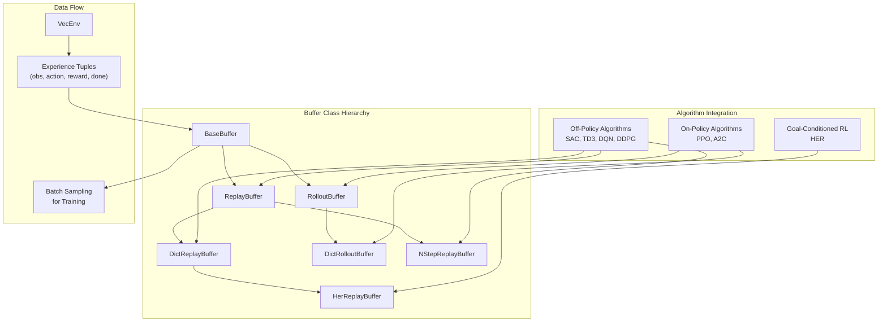
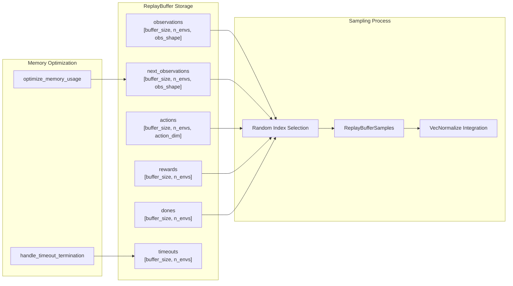
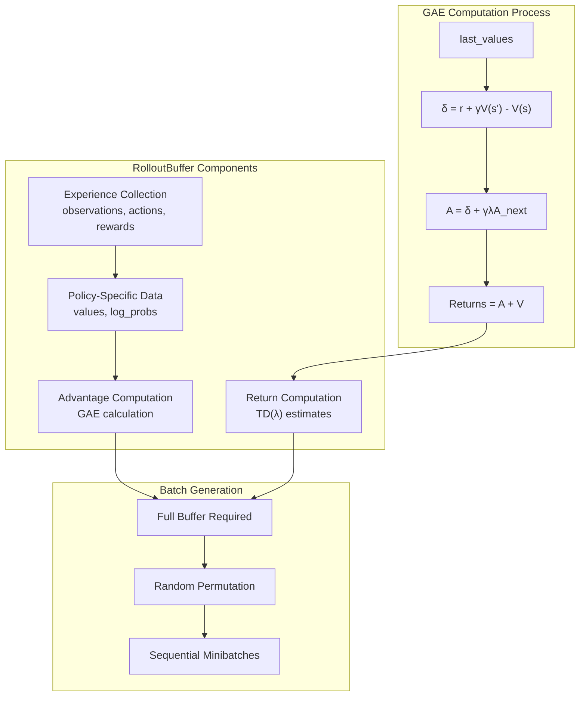
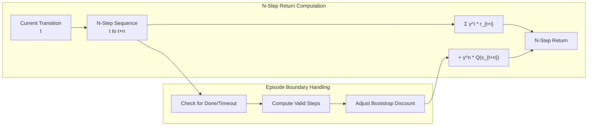
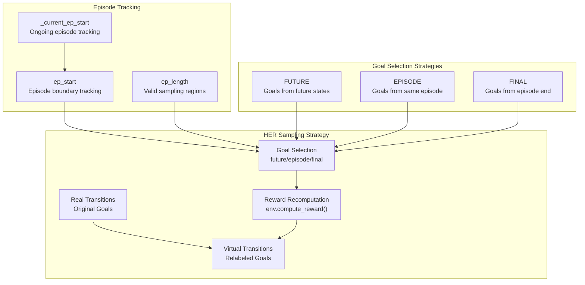
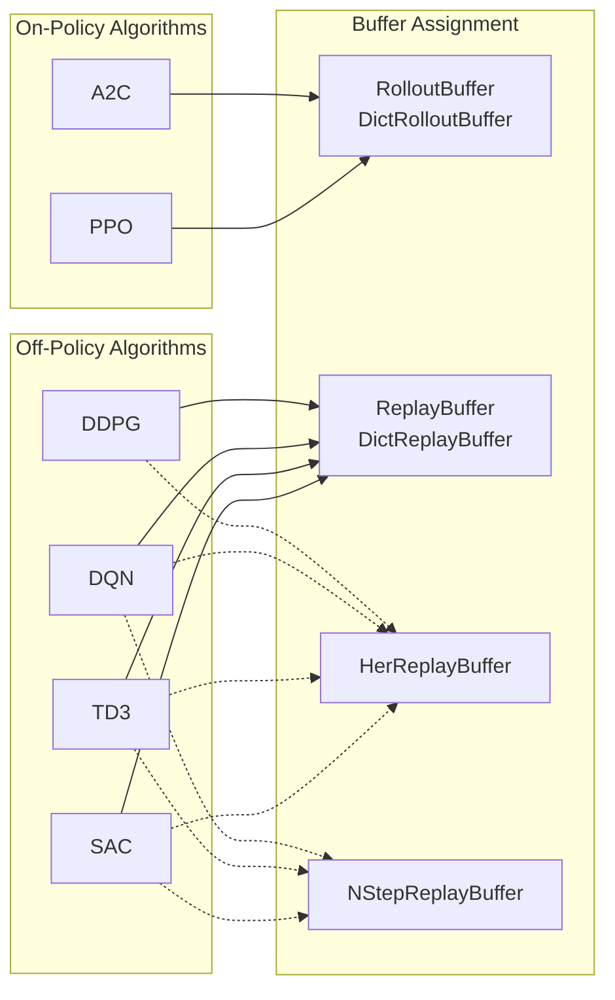

<!-- source: DeepWiki mcp.deepwiki.com · repo DLR-RM/stable-baselines3 · page 6 Experience Storage · fetched 2026-10-14 -->

# Experience Storage

Relevant source files

The following files were used as context for generating this wiki page:

- [stable_baselines3/common/buffers.py](stable_baselines3/common/buffers.py)
- [stable_baselines3/common/vec_env/stacked_observations.py](stable_baselines3/common/vec_env/stacked_observations.py)
- [tests/test_buffers.py](tests/test_buffers.py)

Experience storage in Stable-Baselines3 provides specialized buffer systems for storing and managing training experiences collected during reinforcement learning. These buffers handle the temporal storage of observations, actions, rewards, and other training data, with different implementations optimized for on-policy algorithms (like PPO, A2C) and off-policy algorithms (like SAC, TD3, DQN).

For information about training and monitoring systems that consume buffer data, see [Training & Monitoring](#7). For details about vectorized environments that generate the experiences stored in buffers, see [Vectorized Environments](#5.1).

## Buffer Architecture Overview

The experience storage system is built around a hierarchy of buffer classes that provide different storage strategies and sampling mechanisms:

**Sources:** [stable_baselines3/common/buffers.py:27-156](), [stable_baselines3/her/her_replay_buffer.py:15-47]()

## Core Buffer Types

### BaseBuffer Abstract Class

The `BaseBuffer` class provides the foundational interface for all experience storage implementations:

| Method | Purpose | Usage |
|--------|---------|-------|
| `add()` | Store new experience | Called during environment interaction |
| `sample()` | Retrieve training batch | Called during policy updates |
| `reset()` | Clear buffer contents | Called at episode boundaries or training restart |
| `size()` | Get current buffer occupancy | Used for training condition checks |

The base class handles device management, observation space compatibility, and utility functions for tensor conversion and normalization.

**Sources:** [stable_baselines3/common/buffers.py:27-156]()

### ReplayBuffer - Off-Policy Storage

The `ReplayBuffer` stores transitions for off-policy algorithms with uniform random sampling:

Key features:
- **Circular buffer**: Overwrites oldest experiences when full
- **Memory optimization**: Optional space-efficient storage that reduces memory usage by ~50%
- **Timeout handling**: Separates episode termination from timeout truncation
- **Multi-environment support**: Handles parallel environment data

For details, see [Replay & Rollout Buffers](#6.1).

**Sources:** [stable_baselines3/common/buffers.py:158-341]()

### RolloutBuffer - On-Policy Storage

The `RolloutBuffer` stores complete rollouts for on-policy algorithms with sequential sampling:

The buffer implements Generalized Advantage Estimation (GAE) for computing advantages and TD(λ) returns.

For details, see [Replay & Rollout Buffers](#6.1).

**Sources:** [stable_baselines3/common/buffers.py:343-523](), [stable_baselines3/common/buffers.py:403-438]()

## Dictionary Observation Support

### DictReplayBuffer and DictRolloutBuffer

For environments with dictionary observations (e.g., goal-conditioned environments), specialized buffer variants handle structured observation spaces:

| Buffer Type | Base Class | Observation Handling |
|-------------|------------|---------------------|
| `DictReplayBuffer` | `ReplayBuffer` | Dict observation spaces |
| `DictRolloutBuffer` | `RolloutBuffer` | Dict observation spaces |

These buffers maintain separate arrays for each observation key while preserving the core functionality of their base classes.

For details, see [Replay & Rollout Buffers](#6.1).

**Sources:** [stable_baselines3/common/buffers.py:525-695](), [stable_baselines3/common/buffers.py:697-844]()

## Specialized Buffer Implementations

### N-Step Replay Buffer

The `NStepReplayBuffer` extends `ReplayBuffer` to compute n-step returns for improved sample efficiency:

For details, see [Stacked Observations & N-step Replay](#6.2).

**Sources:** [stable_baselines3/common/buffers.py:847-954]()

### Hindsight Experience Replay Buffer

The `HerReplayBuffer` implements goal-relabeling for goal-conditioned reinforcement learning:

For details, see [HER (Hindsight Experience Replay)](#3.3).

**Sources:** [stable_baselines3/her/her_replay_buffer.py:15-408]()

## Memory Management and Performance

### Memory Optimization Features

| Feature | Implementation | Memory Savings |
|---------|----------------|----------------|
| `optimize_memory_usage` | Reuse observation arrays | ~50% reduction |
| Memory monitoring | `psutil` integration | Early warning system |
| Dtype optimization | `_maybe_cast_dtype()` | Automatic float64→float32 |

**Sources:** [stable_baselines3/common/buffers.py:168-174](), [stable_baselines3/common/buffers.py:200-203]()

### Device Management

All buffers support automatic device placement with the `device` parameter:
- `"auto"`: Automatic device detection
- `"cpu"`: Force CPU storage
- `"cuda"`: Force GPU storage

This ensures that sampled batches are moved to the correct device for model training.

**Sources:** [stable_baselines3/common/buffers.py:59](), [stable_baselines3/common/buffers.py:138-140](), [tests/test_buffers.py:113-164]()

## Integration with Training Pipeline

### Algorithm-Buffer Mapping

### Sample Batch Types

Each buffer type returns specific sample batch structures:

| Buffer Type | Sample Type | Contents |
|-------------|-------------|----------|
| `ReplayBuffer` | `ReplayBufferSamples` | observations, actions, next_observations, dones, rewards |
| `RolloutBuffer` | `RolloutBufferSamples` | observations, actions, old_values, old_log_prob, advantages, returns |
| `DictReplayBuffer` | `DictReplayBufferSamples` | Dict-structured observations and next_observations |
| `DictRolloutBuffer` | `DictRolloutBufferSamples` | Dict-structured observations |

**Sources:** [stable_baselines3/common/type_aliases.py](), [stable_baselines3/common/buffers.py:307-325](), [stable_baselines3/common/buffers.py:508-522]()

---

