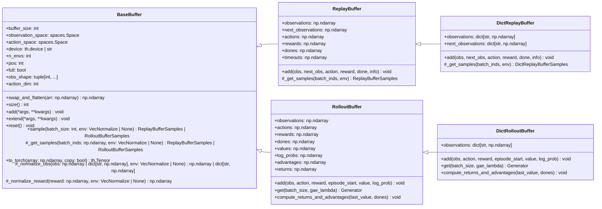

<!-- source: DeepWiki mcp.deepwiki.com · repo DLR-RM/stable-baselines3 · page 6.1 Replay & Rollout Buffers · fetched 2026-10-14 -->

# Replay & Rollout Buffers

<details>
<summary>Relevant source files</summary>

The following files were used as context for generating this wiki page:

- [stable_baselines3/common/buffers.py](stable_baselines3/common/buffers.py)
- [stable_baselines3/common/vec_env/stacked_observations.py](stable_baselines3/common/vec_env/stacked_observations.py)
- [stable_baselines3/common/vec_env/vec_video_recorder.py](stable_baselines3/common/vec_env/vec_video_recorder.py)
- [tests/test_buffers.py](tests/test_buffers.py)
- [tests/test_cnn.py](tests/test_cnn.py)
- [tests/test_dict_env.py](tests/test_dict_env.py)
- [tests/test_gae.py](tests/test_gae.py)

</details>


This page details the implementation and usage of replay and rollout buffers in Stable-Baselines3. These buffers are fundamental components for storing and managing experience tuples (observations, actions, rewards, etc.) collected from the environment, which are then used for training reinforcement learning agents. We will cover `ReplayBuffer` for off-policy algorithms, `RolloutBuffer` for on-policy algorithms, their dictionary-based variants, memory optimization techniques, Generalized Advantage Estimation (GAE) computation, and the sampling mechanisms.

## BaseBuffer

The `BaseBuffer` class [stable_baselines3/common/buffers.py:27-61]() serves as an abstract base class for both `ReplayBuffer` and `RolloutBuffer`. It defines common attributes and methods shared by all buffer types.

**Key Attributes:**

*   `buffer_size`: The maximum number of elements the buffer can store [stable_baselines3/common/buffers.py:51]().
*   `observation_space`: The observation space of the environment [stable_baselines3/common/buffers.py:52]().
*   `action_space`: The action space of the environment [stable_baselines3/common/buffers.py:53]().
*   `device`: The PyTorch device (CPU or GPU) where the data will be converted to tensors [stable_baselines3/common/buffers.py:59]().
*   `n_envs`: The number of parallel environments from which experiences are collected [stable_baselines3/common/buffers.py:60]().
*   `pos`: The current position in the buffer, indicating where the next experience will be added [stable_baselines3/common/buffers.py:57]().
*   `full`: A boolean flag indicating if the buffer is full [stable_baselines3/common/buffers.py:58]().

**Key Methods:**

*   `swap_and_flatten(arr: np.ndarray) -> np.ndarray`: A static method to reshape arrays from `[n_steps, n_envs, ...]` to `[n_steps * n_envs, ...]` [stable_baselines3/common/buffers.py:63-75](). This is useful for processing data collected from vectorized environments.
*   `size() -> int`: Returns the current number of elements in the buffer [stable_baselines3/common/buffers.py:77-84]().
*   `add(*args, **kwargs) -> None`: An abstract method for adding elements to the buffer, implemented by subclasses [stable_baselines3/common/buffers.py:85-89]().
*   `extend(*args, **kwargs) -> None`: Adds a batch of transitions to the buffer by iterating and calling `add()` for each transition [stable_baselines3/common/buffers.py:91-98]().
*   `reset() -> None`: Resets the buffer's position and `full` flag [stable_baselines3/common/buffers.py:99-105]().
*   `sample(batch_size: int, env: VecNormalize | None = None)`: Samples a batch of experiences from the buffer [stable_baselines3/common/buffers.py:106-115](). It uses `_get_samples` which is an abstract method.
*   `_get_samples(...)`: An abstract method for retrieving samples, implemented by subclasses [stable_baselines3/common/buffers.py:117-127]().
*   `to_torch(array: np.ndarray, copy: bool = True) -> th.Tensor`: Converts a NumPy array to a PyTorch tensor on the specified device [stable_baselines3/common/buffers.py:129-141]().
*   `_normalize_obs(obs: np.ndarray | dict[str, np.ndarray], env: VecNormalize | None = None)`: Normalizes observations using an optional `VecNormalize` environment [stable_baselines3/common/buffers.py:143-149]().
*   `_normalize_reward(reward: np.ndarray, env: VecNormalize | None = None) -> np.ndarray`: Normalizes rewards using an optional `VecNormalize` environment [stable_baselines3/common/buffers.py:151-155]().


**Diagram: BaseBuffer and its Subclasses**

Sources: [stable_baselines3/common/buffers.py:27-155]()

## ReplayBuffer

The `ReplayBuffer` [stable_baselines3/common/buffers.py:158-203]() is used by off-policy algorithms like SAC, TD3, and DQN. It stores individual transitions `(observation, action, reward, next_observation, done)` and allows for random sampling of batches, which helps break correlations in the data and improve learning stability.

**Key Features:**

*   **Circular Buffer:** Experiences are stored in a circular fashion, overwriting the oldest experiences once the buffer is full.
*   **Memory Optimization (`optimize_memory_usage`):** When enabled, `observations` and `next_observations` are stored in a single array to reduce memory footprint [stable_baselines3/common/buffers.py:167-172](). This is achieved by storing `next_observations` at `observations[pos + 1]` and `observations` at `observations[pos]`. This optimization is incompatible with `handle_timeout_termination`.
*   **Timeout Termination Handling (`handle_timeout_termination`):** This feature addresses the specific case of timeout terminations (e.g., due to `TimeLimit` wrappers in Gymnasium environments). If `True`, a timeout is treated as a non-terminal state for value function estimation, effectively making the task an infinite horizon task [stable_baselines3/common/buffers.py:173-176](). This is crucial for algorithms that rely on accurate value estimates.
    *   When `handle_timeout_termination` is `True`, a separate `timeouts` array is maintained [stable_baselines3/common/buffers.py:183]().
    *   During sampling, if a transition `(s, a, r, s', d)` has `d=True` but `timeout=False`, it means the episode truly terminated. If `d=True` and `timeout=True`, it means the episode was truncated, and `s'` is still a valid state for bootstrapping.
*   **Data Storage:** It maintains NumPy arrays for `observations`, `next_observations`, `actions`, `rewards`, `dones`, and `timeouts` [stable_baselines3/common/buffers.py:178-183]().
*   **Adding Transitions:** The `add()` method stores a single transition. It handles the circular buffer logic and updates the `pos` and `full` flags [stable_baselines3/common/buffers.py:205-246]().
*   **Sampling:** The `_get_samples()` method retrieves a batch of `ReplayBufferSamples` (a named tuple) containing observations, actions, next observations, dones, and rewards, converted to PyTorch tensors and moved to the specified device [stable_baselines3/common/buffers.py:248-290](). It also handles observation and reward normalization if a `VecNormalize` environment is provided.

```mermaid
graph TD
    subgraph ReplayBuffer Initialization
        A[__init__] --> B{buffer_size / n_envs};
        B --> C{Check memory usage (psutil)};
        C --> D[Allocate NumPy arrays: observations, next_observations, actions, rewards, dones, timeouts];
        D --> E[Set self.pos = 0, self.full = False];
    end

    subgraph Adding Transition (add)
        F[add(obs, next_obs, action, reward, done, info)] --> G{Store data at self.pos};
        G --> H[Increment self.pos];
        H --> I{If self.pos == self.buffer_size, set self.full = True, self.pos = 0};
    end

    subgraph Sampling (sample -> _get_samples)
        J[sample(batch_size, env)] --> K{Generate random batch_inds};
        K --> L[_get_samples(batch_inds, env)];
        L --> M[Extract data from NumPy arrays using batch_inds];
        M --> N{Normalize observations and rewards if env is VecNormalize};
        N --> O[Convert data to PyTorch tensors on self.device];
        O --> P[Return ReplayBufferSamples];
    end
```
**Diagram: ReplayBuffer Data Flow**

Sources: [stable_baselines3/common/buffers.py:158-290]()

## RolloutBuffer

The `RolloutBuffer` [stable_baselines3/common/buffers.py:300-340]() is designed for on-policy algorithms like A2C and PPO. These algorithms typically collect a fixed number of steps (a "rollout") from the environment, compute advantages and returns, and then use this entire batch for a few optimization steps before discarding it and collecting new experiences.

**Key Features:**

*   **Fixed-size Rollouts:** Stores experiences for a single rollout, typically `n_steps` from the algorithm's configuration.
*   **Data Storage:** Maintains NumPy arrays for `observations`, `actions`, `rewards`, `dones`, `values` (predicted by the critic), and `log_probs` (of the taken actions) [stable_baselines3/common/buffers.py:342-347](). It also stores `advantages` and `returns` after computation.
*   **Adding Transitions:** The `add()` method stores a single transition, including the predicted value and log probability [stable_baselines3/common/buffers.py:350-370]().
*   **Generalized Advantage Estimation (GAE):** The `compute_returns_and_advantages()` method calculates the advantages and returns using GAE [stable_baselines3/common/buffers.py:372-429]().
    *   It takes the `last_value` (value of the next state after the rollout) and `dones` flags as input.
    *   It iterates backward through the collected experiences to compute `advantages` and `returns` based on the Bellman equation and the GAE formula:
        *   `delta = reward + gamma * next_value * (1 - done) - current_value`
        *   `advantage = delta + gamma * gae_lambda * next_advantage * (1 - done)`
        *   `return = advantage + current_value`
    *   The `dones` array is crucial here, as it determines whether to bootstrap from the `last_value` or reset the advantage/return calculation at episode boundaries.
*   **Sampling:** The `get()` method yields minibatches of `RolloutBufferSamples` (a named tuple) from the computed advantages and returns [stable_baselines3/common/buffers.py:431-469](). It shuffles the indices to decorrelate samples within the rollout.

```mermaid
graph TD
    subgraph RolloutBuffer Initialization
        A[__init__] --> B[Allocate NumPy arrays: observations, actions, rewards, dones, values, log_probs, advantages, returns];
        B --> C[Set self.pos = 0, self.full = False];
    end

    subgraph Adding Transition (add)
        D[add(obs, action, reward, episode_start, value, log_prob)] --> E{Store data at self.pos};
        E --> F[Increment self.pos];
        F --> G{If self.pos == self.buffer_size, set self.full = True};
    end

    subgraph GAE Computation (compute_returns_and_advantages)
        H[compute_returns_and_advantages(last_value, dones)] --> I{Initialize advantages and returns};
        I --> J{Iterate backward from last step to first step};
        J --> K{Calculate delta: reward + gamma * next_value * (1 - done) - current_value};
        K --> L{Calculate advantage: delta + gamma * gae_lambda * next_advantage * (1 - done)};
        L --> M{Calculate return: advantage + current_value};
        M --> N[Store computed advantages and returns];
    end

    subgraph Sampling (get)
        O[get(batch_size, gae_lambda)] --> P{Shuffle indices of collected data};
        P --> Q{Yield minibatches of RolloutBufferSamples};
        Q --> R[Convert data to PyTorch tensors on self.device];
    end
```
**Diagram: RolloutBuffer Data Flow**

Sources: [stable_baselines3/common/buffers.py:300-469]()

## DictReplayBuffer and DictRolloutBuffer

These are specialized versions of `ReplayBuffer` and `RolloutBuffer` designed to handle dictionary observation spaces, which are common in environments with multiple observation modalities (e.g., image, vector, discrete) or goal-conditioned tasks.

*   `DictReplayBuffer` [stable_baselines3/common/buffers.py:472-500]() inherits from `ReplayBuffer`. Its primary difference is that its `observations` and `next_observations` attributes are dictionaries of NumPy arrays, where each key corresponds to a sub-observation space [stable_baselines3/common/buffers.py:502-503](). The `add()` and `_get_samples()` methods are adapted to handle these dictionary structures [stable_baselines3/common/buffers.py:505-546]().
*   `DictRolloutBuffer` [stable_baselines3/common/buffers.py:549-577]() inherits from `RolloutBuffer`. Similarly, its `observations` attribute is a dictionary of NumPy arrays [stable_baselines3/common/buffers.py:579](). The `add()`, `compute_returns_and_advantages()`, and `get()` methods are modified to correctly process dictionary observations [stable_baselines3/common/buffers.py:581-622]().

Both `DictReplayBuffer` and `DictRolloutBuffer` ensure that when observations are sampled or added, the dictionary structure is preserved, and each component of the observation is handled appropriately.

Sources: [stable_baselines3/common/buffers.py:472-622]()

## Memory Optimization

The `optimize_memory_usage` flag in `ReplayBuffer` [stable_baselines3/common/buffers.py:167]() is a key optimization. Instead of allocating separate arrays for `observations` and `next_observations`, it stores `next_observations` directly after `observations` in a single, larger `observations` array.

**How it works:**

*   When `optimize_memory_usage` is `True`, the `observations` array is allocated with a size of `(buffer_size + 1, n_envs, *obs_shape)` [stable_baselines3/common/buffers.py:219]().
*   When adding a transition `(obs, next_obs, ...)`, `obs` is stored at `self.observations[self.pos]` and `next_obs` is stored at `self.observations[(self.pos + 1) % self.buffer_size]` [stable_baselines3/common/buffers.py:230-231]().
*   During sampling, `observations` are retrieved from `self.observations[batch_inds]` and `next_observations` from `self.observations[(batch_inds + 1) % self.buffer_size]` [stable_baselines3/common/buffers.py:260-261]().

This approach effectively halves the memory required for storing observations, which can be significant for high-dimensional observation spaces like images. However, it cannot be used in conjunction with `handle_timeout_termination` because the `next_observations` might need to be the `terminal_observation` from the info dict, which would break the contiguous storage assumption.

Sources: [stable_baselines3/common/buffers.py:167-172](), [stable_baselines3/common/buffers.py:219](), [stable_baselines3/common/buffers.py:230-231](), [stable_baselines3/common/buffers.py:260-261]()

## GAE Computation

Generalized Advantage Estimation (GAE) is a technique used in on-policy algorithms to estimate the advantage function with reduced variance compared to Monte Carlo estimates, while also having lower bias than one-step TD estimates. The `RolloutBuffer.compute_returns_and_advantages()` method [stable_baselines3/common/buffers.py:372-429]() implements this.

The GAE formula for advantage $A_t$ is:
$A_t = \sum_{l=0}^{\infty} (\gamma \lambda)^l \delta_{t+l}$
where $\delta_t = R_t + \gamma V(S_{t+1}) - V(S_t)$ is the TD error.

The `compute_returns_and_advantages` method calculates these values iteratively backwards:

1.  **Initialize:** `last_gae_lam = 0` and `last_value` is the value of the state after the last step in the rollout.
2.  **Iterate backwards:** For each step `step` from `n_steps - 1` down to `0`:
    *   `next_non_terminal = 1.0 - dones[step]` (0 if episode terminated, 1 otherwise).
    *   `next_value = self.values[step + 1]` if `step < n_steps - 1`, otherwise `last_value`.
    *   `delta = self.rewards[step] + self.gamma * next_value * next_non_terminal - self.values[step]`.
    *   `last_gae_lam = delta + self.gamma * self.gae_lambda * next_non_terminal * last_gae_lam`.
    *   `self.advantages[step] = last_gae_lam`.
3.  **Compute Returns:** `self.returns = self.advantages + self.values`.

This computation is critical for on-policy algorithms like PPO and A2C, as it provides a more stable and efficient way to estimate the advantage function, which guides policy updates. The `CheckGAECallback` in the tests verifies the correctness of this implementation by comparing computed advantages and returns against known values for a simple environment [tests/test_gae.py:66-103]().

Sources: [stable_baselines3/common/buffers.py:372-429](), [tests/test_gae.py:66-103]()

## Sampling

Both `ReplayBuffer` and `RolloutBuffer` provide sampling mechanisms to retrieve batches of experiences for training.

### ReplayBuffer Sampling

The `ReplayBuffer.sample()` method [stable_baselines3/common/buffers.py:106-115]() randomly selects `batch_size` indices from the currently filled portion of the buffer. These indices are then used by `_get_samples()` to extract the corresponding observations, actions, rewards, next observations, and done flags.

*   **Random Selection:** `np.random.randint(0, upper_bound, size=batch_size)` is used to get random indices [stable_baselines3/common/buffers.py:114]().
*   **Normalization:** If a `VecNormalize` environment is passed, observations and rewards are normalized before being returned [stable_baselines3/common/buffers.py:270-271]().
*   **Tensor Conversion:** The sampled NumPy arrays are converted to PyTorch tensors and moved to the `self.device` [stable_baselines3/common/buffers.py:273-280]().
*   **Output:** Returns a `ReplayBufferSamples` named tuple [stable_baselines3/common/type_aliases.py:30-36]().

### RolloutBuffer Sampling

The `RolloutBuffer.get()` method [stable_baselines3/common/buffers.py:431-469]() is designed to yield minibatches from the entire collected rollout.

*   **Shuffling:** It shuffles the indices of the collected data to ensure that minibatches are not sequential, which helps decorrelate samples [stable_baselines3/common/buffers.py:440]().
*   **Minibatch Iteration:** It iterates through the shuffled indices, yielding minibatches of size `batch_size` [stable_baselines3/common/buffers.py:442-469]().
*   **Tensor Conversion:** Similar to `ReplayBuffer`, data is converted to PyTorch tensors and moved to the `self.device` [stable_baselines3/common/buffers.py:454-461]().
*   **Output:** Yields `RolloutBufferSamples` named tuples [stable_baselines3/common/type_aliases.py:38-46]().

The `test_device_buffer` test confirms that sampled data is correctly moved to the specified device (CPU or CUDA) for both replay and rollout buffers [tests/test_buffers.py:112-164]().

Sources: [stable_baselines3/common/buffers.py:106-115](), [stable_baselines3/common/buffers.py:270-271](), [stable_baselines3/common/buffers.py:273-280](), [stable_baselines3/common/type_aliases.py:30-36](), [stable_baselines3/common/buffers.py:431-469](), [stable_baselines3/common/buffers.py:440](), [stable_baselines3/common/buffers.py:442-469](), [stable_baselines3/common/buffers.py:454-461](), [stable_baselines3/common/type_aliases.py:38-46](), [tests/test_buffers.py:112-164]()

---

