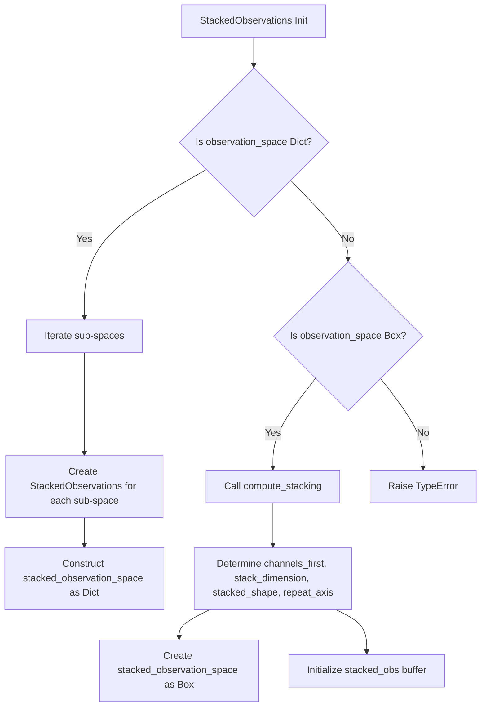

<!-- source: DeepWiki mcp.deepwiki.com · repo DLR-RM/stable-baselines3 · page 6.2 Stacked Observations & N-step Replay · fetched 2026-10-14 -->

# Stacked Observations & N-step Replay

<details>
<summary>Relevant source files</summary>

The following files were used as context for generating this wiki page:

- [stable_baselines3/common/buffers.py](stable_baselines3/common/buffers.py)
- [stable_baselines3/common/vec_env/stacked_observations.py](stable_baselines3/common/vec_env/stacked_observations.py)
- [tests/test_buffers.py](tests/test_buffers.py)
- [tests/test_n_step_replay.py](tests/test_n_step_replay.py)
- [tests/test_vec_stacked_obs.py](tests/test_vec_stacked_obs.py)

</details>


This page delves into the internal mechanisms of frame stacking for observations and the behavior of N-step replay sampling within Stable-Baselines3. It explains how observations are processed and stored when stacking is enabled, and how the `NStepReplayBuffer` computes returns over multiple steps.

## Stacked Observations

Frame stacking is a technique used to provide the agent with a sense of motion and history by concatenating multiple consecutive observations into a single observation. This is particularly useful for environments where a single frame does not provide enough information to determine the direction of movement or other temporal aspects.

The `StackedObservations` class [stable_baselines3/common/vec_env/stacked_observations.py:12-177]() handles the logic for stacking observations. It supports both `Box` and `Dict` observation spaces.

### Stacking Logic

When `StackedObservations` is initialized, it determines how to stack the observations based on the `observation_space` and an optional `channels_order` parameter [stable_baselines3/common/vec_env/stacked_observations.py:30-34]().

For `Box` spaces, the `compute_stacking` static method [stable_baselines3/common/vec_env/stacked_observations.py:67-100]() calculates:
*   `channels_first`: A boolean indicating if channels are the first dimension (e.g., `(C, H, W)`). This is automatically detected for image spaces [stable_baselines3/common/vec_env/stacked_observations.py:82-83]().
*   `stack_dimension`: The axis along which observations are concatenated.
*   `stacked_shape`: The resulting shape of the stacked observation.
*   `repeat_axis`: The axis used for repeating the observation space bounds (`low` and `high`) to create the new stacked observation space.

If `channels_order` is `None`, the system attempts to detect if the observation space is an image and whether it's channels-first or channels-last. If it's not an image space, it defaults to stacking on the last axis [stable_baselines3/common/vec_env/stacked_observations.py:81-86]().

For `Dict` spaces, `StackedObservations` recursively creates `StackedObservations` instances for each sub-space [stable_baselines3/common/vec_env/stacked_observations.py:40-43]().

#### Diagram: `StackedObservations` Initialization Flow


Sources:
* `stable_baselines3/common/vec_env/stacked_observations.py:30-65`
* `stable_baselines3/common/vec_env/stacked_observations.py:67-100`

### Updating Stacked Observations

The `reset` method [stable_baselines3/common/vec_env/stacked_observations.py:102-117]() initializes the `stacked_obs` buffer with zeros and places the initial observation at the end of the stack.

The `update` method [stable_baselines3/common/vec_env/stacked_observations.py:119-177]() is called at each step to add new observations to the stack. It shifts the existing observations and appends the latest one. If an environment is done, its corresponding stack is reset to all zeros, and the `terminal_observation` from the info dict is used to initialize the stack for the next episode.

#### Diagram: `StackedObservations` Update Flow

```mermaid
graph TD
    A[StackedObservations.update(observations, dones, infos)] --> B{Is observations Dict?};
    B -- Yes --> C[Process sub-observations recursively];
    C --> D[Reconstruct infos with terminal_observation];
    B -- No --> E[Shift existing stacked_obs];
    E --> F[Append new observations];
    F --> G{Check dones for each environment};
    G -- Done --> H[Reset corresponding stack to zeros];
    H --> I[Use terminal_observation from info to initialize stack];
    G -- Not Done --> J[Keep existing stack];
    I --> K[Return updated stacked_obs and infos];
    J --> K;
```
Sources:
* `stable_baselines3/common/vec_env/stacked_observations.py:102-117`
* `stable_baselines3/common/vec_env/stacked_observations.py:119-178`

## N-step Replay

N-step replay buffers are used in off-policy algorithms to compute N-step returns, which can help reduce bias and variance in value estimation. Instead of using the immediate reward and the value of the next state (1-step return), N-step returns sum rewards over N steps and then bootstrap from the N-th state's value.

The `NStepReplayBuffer` class [stable_baselines3/common/buffers.py:700-954]() extends the `ReplayBuffer` to handle N-step returns.

### N-step Return Calculation

When a transition is added to the `NStepReplayBuffer` via the `add` method [stable_baselines3/common/buffers.py:760-799](), it stores the individual rewards, observations, actions, and done flags. The actual N-step return calculation happens during sampling in the `_get_samples` method [stable_baselines3/common/buffers.py:801-954]().

For each sampled index `idx`, the buffer looks `n_steps` into the future to compute the N-step reward.
The N-step reward `R_n` for a transition `(s_t, a_t, r_t, s_{t+1})` is calculated as:
$R_n = r_t + \gamma r_{t+1} + \gamma^2 r_{t+2} + \dots + \gamma^{n-1} r_{t+n-1} + \gamma^n V(s_{t+n})$

Where:
*   $r_i$ is the reward at step $i$.
*   $\gamma$ is the discount factor.
*   $V(s_{t+n})$ is the value of the state $s_{t+n}$, which is used for bootstrapping.

Special handling is implemented for episode termination or truncation within the N-step horizon [stable_baselines3/common/buffers.py:860-878](). If an episode terminates or truncates before `n_steps` are completed, the N-step return is calculated up to that point, and the subsequent rewards are zeroed out, and the `next_observations` and `dones` are adjusted accordingly. The `dones` flag for the sampled transition is set to `True` if the episode terminates within the N-step horizon.

The `NStepReplayBuffer` also stores `n_steps_rewards` and `n_steps_dones` to provide the computed N-step values directly [stable_baselines3/common/buffers.py:890-891]().

#### Diagram: N-step Replay Buffer Sampling

```mermaid
graph TD
    A[NStepReplayBuffer._get_samples(batch_inds)] --> B{For each index `idx` in `batch_inds`};
    B --> C[Retrieve transition (s_t, a_t, r_t, s_{t+1}, done_t, info_t)];
    C --> D[Initialize n_step_reward = r_t];
    C --> E[Initialize n_step_done = done_t];
    C --> F[Initialize next_obs_n = s_{t+1}];
    F --> G[Initialize discount_factor = gamma];
    G --> H{For step `k` from 1 to `n_steps - 1`};
    H --> I[Retrieve transition (s_{t+k}, a_{t+k}, r_{t+k}, s_{t+k+1}, done_{t+k}, info_{t+k})];
    I --> J{Is episode terminated or truncated at `t+k`?};
    J -- Yes --> K[Set n_step_done = True];
    K --> L[Set next_obs_n = s_{t+k}];
    K --> M[Break loop];
    J -- No --> N[Add gamma^k * r_{t+k} to n_step_reward];
    N --> O[Multiply discount_factor by gamma];
    O --> P[Set next_obs_n = s_{t+k+1}];
    H --> Q[End For loop];
    Q --> R[Store n_step_reward, n_step_done, next_obs_n];
    R --> S[Collect all N-step samples];
    S --> T[Return NStepReplayBufferSamples];
```
Sources:
* `stable_baselines3/common/buffers.py:801-955`
* `stable_baselines3/common/buffers.py:760-799`
* `tests/test_n_step_replay.py:123-135`

### Limitations

*   `NStepReplayBuffer` does not support `Dict` observation spaces directly. An `AssertionError` is raised if `n_steps > 1` is used with `Dict` observation spaces and the default buffer [tests/test_n_step_replay.py:51-52]().
*   If a custom `replay_buffer_class` is provided to an algorithm, the `n_steps` parameter is ignored, and a `UserWarning` is issued [tests/test_n_step_replay.py:39-42](). This is because the custom buffer might not implement N-step logic.

Sources:
* `tests/test_n_step_replay.py:37-44`
* `tests/test_n_step_replay.py:46-54`

---

