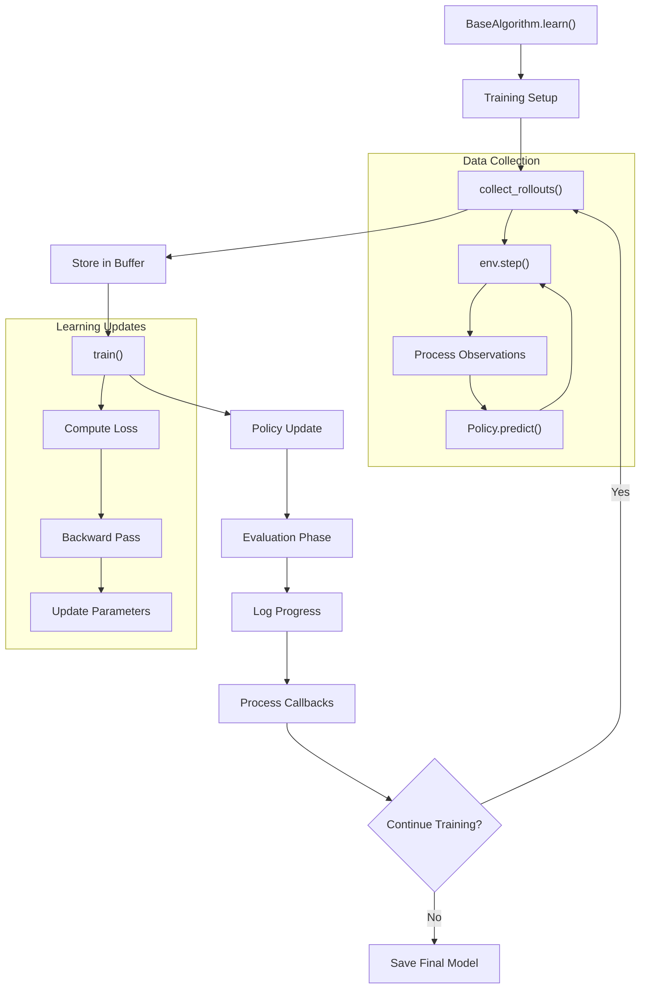
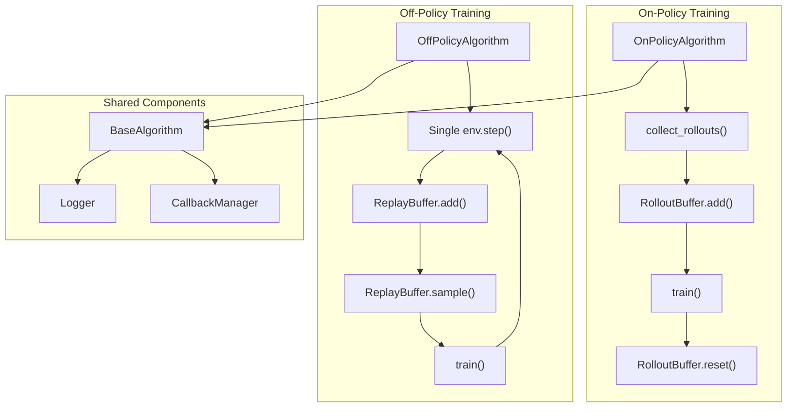
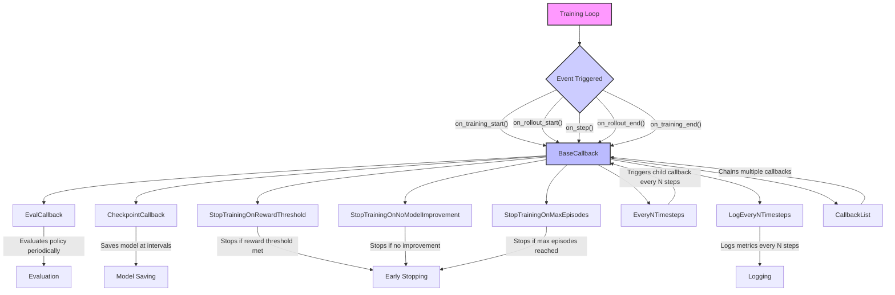
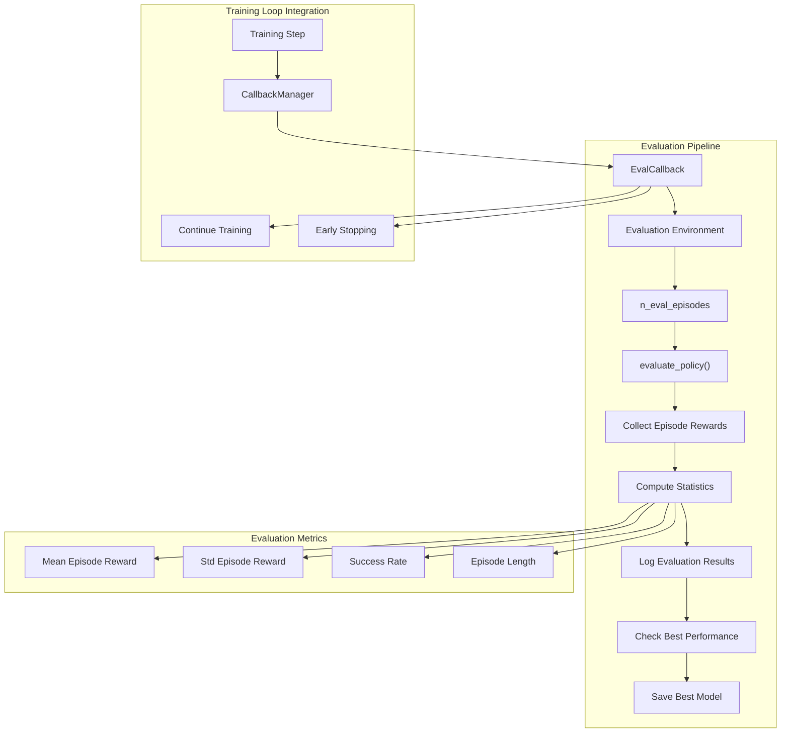
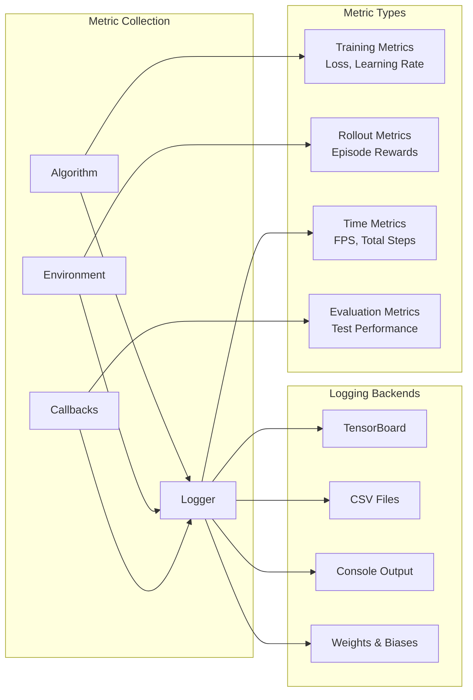
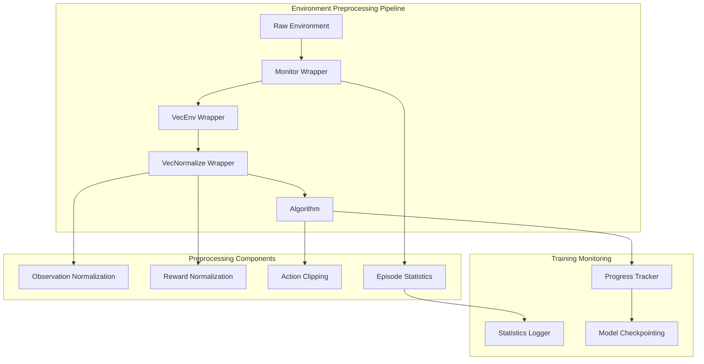

<!-- source: DeepWiki mcp.deepwiki.com · repo DLR-RM/stable-baselines3 · page 7 Training & Monitoring · fetched 2026-10-14 -->

# Training & Monitoring

Relevant source files

The following files were used as context for generating this wiki page:

- [docs/guide/plotting.md](docs/guide/plotting.md)
- [scripts/run_tests.sh](scripts/run_tests.sh)
- [stable_baselines3/common/callbacks.py](stable_baselines3/common/callbacks.py)
- [stable_baselines3/common/monitor.py](stable_baselines3/common/monitor.py)
- [stable_baselines3/common/results_plotter.py](stable_baselines3/common/results_plotter.py)
- [tests/test_callbacks.py](tests/test_callbacks.py)
- [tests/test_identity.py](tests/test_identity.py)
- [tests/test_monitor.py](tests/test_monitor.py)

This document covers the training process control, monitoring systems, and performance tracking capabilities in Stable-Baselines3. It explains how training loops operate, how to monitor training progress, and how to evaluate algorithm performance effectively.

For implementation details of specific monitoring components, see [Callback System](#7.1) and [Logging & Visualization](#7.2). For broader algorithm architecture, see [Core Architecture](#2).

## Training Loop Architecture

The training process in SB3 follows a standardized pattern across all algorithms, with distinct phases for data collection, experience storage, learning updates, and evaluation.

### Core Training Flow

Sources: [docs/guide/rl_tips.rst:1-291](), [docs/guide/quickstart.rst:1-52]()

### Algorithm-Specific Training Patterns

SB3 implements different training patterns for on-policy and off-policy algorithms:

| Algorithm Type | Training Pattern | Buffer Management | Update Frequency |
|---------------|------------------|-------------------|------------------|
| On-Policy (PPO, A2C) | Collect rollouts → Train on batch → Discard | `RolloutBuffer` | After each rollout collection |
| Off-Policy (SAC, TD3, DQN) | Continuous collection → Sample from buffer → Train | `ReplayBuffer` | Every N environment steps |
| Goal-Conditioned (HER) | Experience relabeling → Store transitions | `HerReplayBuffer` | With goal relabeling strategy |

Sources: [stable_baselines3/common/base_class.py](), [stable_baselines3/common/on_policy_algorithm.py](), [stable_baselines3/common/off_policy_algorithm.py]()

## Training Control and Monitoring

### Callback System

The callback system in Stable-Baselines3 provides a flexible way to inject custom logic into the training loop. Callbacks, inheriting from `BaseCallback` [stable_baselines3/common/callbacks.py:31-31](), allow users to execute code at various stages of training, such as at the start/end of training, before/after each step, or at specific intervals. This enables functionalities like model saving, logging, early stopping, and custom metric collection without modifying the core algorithm code.

For a detailed explanation of available callbacks and how to create custom ones, see [Callback System](#7.1).

Sources: [stable_baselines3/common/callbacks.py:31-31](), [tests/test_callbacks.py:10-20]()

### Performance Evaluation

Proper evaluation is critical for assessing training progress and algorithm performance. SB3 provides structured evaluation patterns that separate training and testing phases. The `evaluate_policy` function [stable_baselines3/common/evaluation.py]() is a key utility for this, allowing for consistent measurement of an agent's performance on a given environment.

For a comprehensive guide on policy evaluation, including deterministic evaluation and handling of environment modes, see [Policy Evaluation](#7.3).

The evaluation process requires careful consideration of environment wrappers and deterministic policy execution:

- **Separate Test Environment**: Use a distinct environment instance for evaluation to avoid training bias
- **Deterministic Policy**: Set `deterministic=True` when calling `model.predict()` for consistent evaluation
- **Wrapper Consistency**: Ensure evaluation environment uses the same wrappers as training environment
- **Statistical Significance**: Run multiple episodes (typically 5-20) and average results

Sources: [docs/guide/rl_tips.rst:78-105](), [stable_baselines3/common/evaluation.py]()

### Training Metrics and Logging

SB3 automatically tracks and logs comprehensive training metrics throughout the learning process. The `Logger` [stable_baselines3/common/logger.py]() class is central to this, providing a standardized interface for recording key-value pairs. These metrics can then be visualized using tools like TensorBoard or saved to CSV files. The `Monitor` wrapper [stable_baselines3/common/monitor.py:17-17]() is specifically designed to record episode-level statistics such as rewards, lengths, and timestamps.

For more details on logging formats, TensorBoard integration, and plotting utilities, see [Logging & Visualization](#7.2).

Sources: [stable_baselines3/common/logger.py](), [docs/guide/rl_tips.rst:40-41](), [stable_baselines3/common/monitor.py:17-17]()

## Training Best Practices

### Hyperparameter Considerations

Effective training requires careful attention to hyperparameter selection and tuning:

- **Learning Rate Scheduling**: Most algorithms support learning rate decay or adaptive schedules
- **Buffer Size**: Critical for off-policy algorithms; larger buffers improve sample diversity
- **Batch Size**: Affects gradient noise and computational efficiency
- **Network Architecture**: Policy and value network sizes impact learning capacity

### Environment Preprocessing

Proper environment setup significantly impacts training success:

- **Observation Normalization**: Use `VecNormalize` wrapper for continuous control tasks
- **Action Space Normalization**: Scale actions to [-1, 1] range for continuous action spaces
- **Reward Shaping**: Design informative reward functions that guide learning
- **Termination Handling**: Properly distinguish between episode termination and timeout

Sources: [docs/guide/rl_tips.rst:184-249](), [stable_baselines3/common/vec_env/]()

### Training Stability and Debugging

Monitor these indicators for stable training:

- **Loss Trends**: Gradual decrease in policy/value losses indicates healthy learning
- **Reward Progress**: Consistent improvement in episode rewards over time
- **Exploration Metrics**: Adequate action diversity and state visitation
- **Gradient Norms**: Stable gradient magnitudes prevent vanishing/exploding gradients

Common training issues and solutions:

| Issue | Symptoms | Solutions |
|-------|----------|-----------|
| Poor Sample Efficiency | Slow learning, high variance | Increase buffer size, tune learning rate |
| Training Instability | Oscillating performance | Use trust region methods (PPO), reduce learning rate |
| Overfitting | Good training, poor evaluation | Increase environment diversity, regularization |
| Exploration Failure | Stuck in local optima | Adjust exploration noise, reward shaping |

Sources: [docs/guide/rl_tips.rst:57-76](), [docs/guide/rl_tips.rst:252-291]()

---

