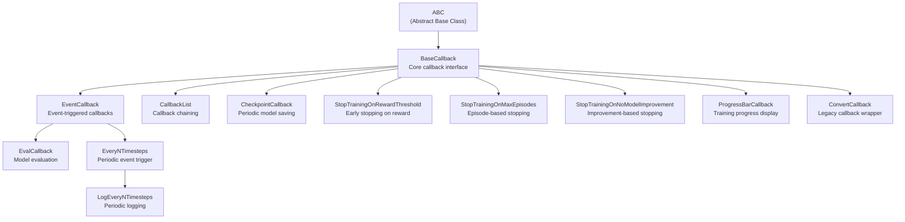
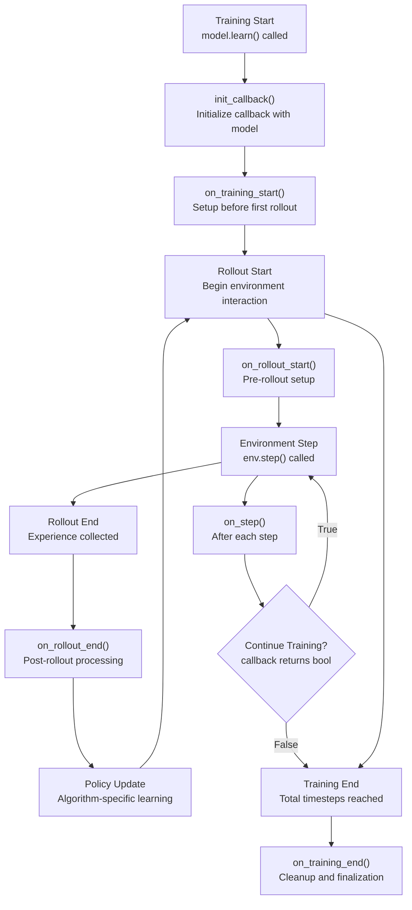
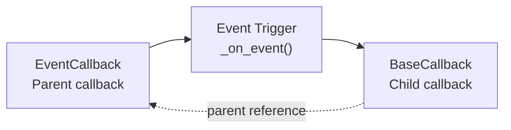
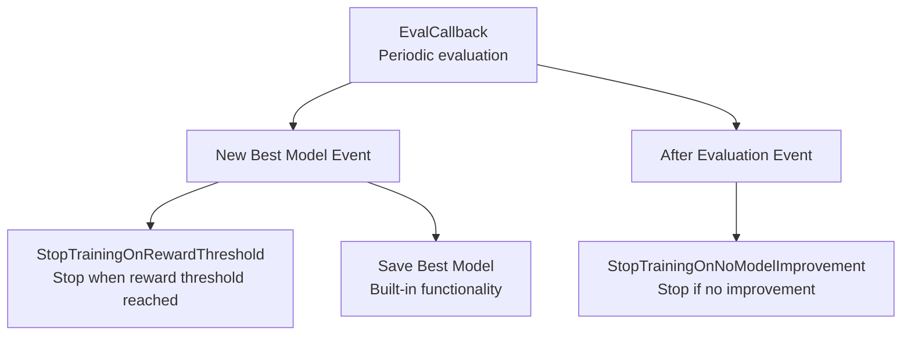

<!-- source: DeepWiki mcp.deepwiki.com · repo DLR-RM/stable-baselines3 · page 7.1 Callback System · fetched 2026-10-14 -->

# Callback System

<details>
<summary>Relevant source files</summary>

The following files were used as context for generating this wiki page:

- [docs/guide/callbacks.md](docs/guide/callbacks.md)
- [scripts/run_tests.sh](scripts/run_tests.sh)
- [stable_baselines3/common/callbacks.py](stable_baselines3/common/callbacks.py)
- [tests/test_callbacks.py](tests/test_callbacks.py)
- [tests/test_identity.py](tests/test_identity.py)

</details>


The callback system provides a flexible mechanism for monitoring, controlling, and customizing the training process in Stable-Baselines3. Callbacks allow you to inject custom logic at specific points during training, such as model evaluation, checkpoint saving, early stopping, and progress monitoring. The system is built around an abstract base class with a well-defined lifecycle that integrates seamlessly with all RL algorithms.

For information about logging and visualization during training, see [Logging & Visualization](#7.2). For model persistence and checkpoint handling, see [Model Saving & Loading](#8).

## Architecture Overview

The callback system is built on a hierarchical class structure with clear separation between base functionality and specific implementations. The core architecture consists of three main components: base classes that define the callback interface, event-driven callbacks that can trigger child callbacks, and concrete implementations for common training tasks.

### Class Hierarchy



**Sources:** [stable_baselines3/common/callbacks.py:30-729]()

### Training Integration

The callback system integrates directly with the training loop of all algorithms, providing hooks at critical points in the learning process:



**Sources:** [stable_baselines3/common/callbacks.py:67-144](), [stable_baselines3/common/callbacks.py:102-114]()

## Core Concepts

### BaseCallback Interface

The `BaseCallback` class defines the fundamental interface that all callbacks must implement. It provides access to the training model, environment, logger, and training state variables.

**Key Properties:**
- `model`: Reference to the `BaseAlgorithm` instance being trained [stable_baselines3/common/callbacks.py:39-40]()
- `training_env`: The vectorized training environment (`VecEnv`) [stable_baselines3/common/callbacks.py:56-61]()
- `logger`: Logger instance for recording metrics and messages [stable_baselines3/common/callbacks.py:64-65]()
- `num_timesteps`: Total number of environment steps taken [stable_baselines3/common/callbacks.py:47]()
- `n_calls`: Number of times the callback has been invoked [stable_baselines3/common/callbacks.py:45]()
- `locals` and `globals`: Access to training loop variables [stable_baselines3/common/callbacks.py:49-50]()

**Abstract Methods:**
- `_on_step()`: Must return `bool` indicating whether to continue training [stable_baselines3/common/callbacks.py:96-101]()

**Sources:** [stable_baselines3/common/callbacks.py:30-144]()

### Callback Lifecycle

Each callback follows a well-defined lifecycle that corresponds to different phases of the training process:

| Phase | Method | Purpose | When Called |
|-------|--------|---------|-------------|
| Initialization | `init_callback()` | Setup callback with model reference | Once when training starts |
| Training Start | `_on_training_start()` | Pre-training setup | Before first rollout |
| Rollout Start | `_on_rollout_start()` | Pre-rollout setup | Before each rollout begins |
| Step | `_on_step()` | Per-step processing | After each `env.step()` |
| Rollout End | `_on_rollout_end()` | Post-rollout processing | After rollout completion |
| Training End | `_on_training_end()` | Cleanup and finalization | When training completes |

**Sources:** [stable_baselines3/common/callbacks.py:67-126]()

### Event-Driven Callbacks

The `EventCallback` class enables callbacks that trigger child callbacks when specific events occur. This pattern allows for complex callback composition and conditional execution.



**Example:** `EvalCallback` triggers child callbacks when a new best model is found or after each evaluation completes.

**Sources:** [stable_baselines3/common/callbacks.py:146-188]()

## Built-in Callbacks

### CheckpointCallback

Saves model checkpoints at regular intervals during training. Supports saving the model, replay buffer, and environment normalization statistics.

**Key Parameters:**
- `save_freq`: Frequency of checkpoint saving (in timesteps) [stable_baselines3/common/callbacks.py:254]()
- `save_path`: Directory for checkpoint files [stable_baselines3/common/callbacks.py:255]()
- `save_replay_buffer`: Whether to save replay buffer (off-policy algorithms) [stable_baselines3/common/callbacks.py:256]()
- `save_vecnormalize`: Whether to save normalization statistics [stable_baselines3/common/callbacks.py:257]()

**Sources:** [stable_baselines3/common/callbacks.py:244-321]()

### EvalCallback

Evaluates model performance on a separate evaluation environment and can trigger child callbacks based on results. This is one of the most commonly used callbacks for monitoring training progress.

**Key Features:**
- Periodic evaluation using `evaluate_policy` [stable_baselines3/common/callbacks.py:440]()
- Best model saving based on mean reward [stable_baselines3/common/callbacks.py:460-467]()
- Logging of evaluation results to disk [stable_baselines3/common/callbacks.py:470-471]()
- Support for success rate tracking (e.g., for HER) [stable_baselines3/common/callbacks.py:473-476]()
- Child callback triggering on new best model or after evaluation [stable_baselines3/common/callbacks.py:480-487]()

**Sources:** [stable_baselines3/common/callbacks.py:341-541]()

### Early Stopping Callbacks

Several callbacks implement different early stopping strategies:

#### StopTrainingOnRewardThreshold
Stops training when mean evaluation reward exceeds a threshold. Must be used with `EvalCallback`. [stable_baselines3/common/callbacks.py:543-571]()

#### StopTrainingOnMaxEpisodes  
Stops training after a maximum number of episodes, accounting for multiple environments. [stable_baselines3/common/callbacks.py:660-696]()

#### StopTrainingOnNoModelImprovement
Stops training if no improvement is seen for a specified number of consecutive evaluations. [stable_baselines3/common/callbacks.py:597-658]()

**Sources:** [stable_baselines3/common/callbacks.py:543-696]()

### Utility Callbacks

#### EveryNTimesteps
An `EventCallback` that triggers its child callback every N timesteps, useful for periodic operations. [stable_baselines3/common/callbacks.py:573-595]()

#### LogEveryNTimesteps
Dumps logged data every N timesteps, complementing the automatic logging system. [stable_baselines3/common/callbacks.py:698-713]()

#### ProgressBarCallback
Displays a visual progress bar during training using `tqdm` and `rich`. [stable_baselines3/common/callbacks.py:715-729]()

**Sources:** [stable_baselines3/common/callbacks.py:573-729]()

## Usage Patterns

### Basic Callback Usage

```python
# Single callback
model.learn(total_timesteps=10000, callback=CheckpointCallback(save_freq=1000, save_path="./logs/"))

# Multiple callbacks (automatically converted to CallbackList)
model.learn(total_timesteps=10000, callback=[checkpoint_callback, eval_callback])
```
**Sources:** [tests/test_callbacks.py:91-93]()

### Callback Composition

The event-driven architecture enables sophisticated callback compositions:



**Sources:** [tests/test_callbacks.py:53-66]()

### Callback Chaining

The `CallbackList` class executes multiple callbacks sequentially, stopping training if any callback returns `False`:

```python
callback_list = CallbackList([
    CheckpointCallback(save_freq=1000, save_path="./logs/"),
    EvalCallback(eval_env, eval_freq=500),
    StopTrainingOnMaxEpisodes(max_episodes=100)
])
```
**Sources:** [tests/test_callbacks.py:77]()

## Custom Callback Development

### Basic Custom Callback

To create a custom callback, inherit from `BaseCallback` and implement the `_on_step()` method:

```python
from stable_baselines3.common.callbacks import BaseCallback

class CustomCallback(BaseCallback):
    def __init__(self, verbose: int = 0):
        super().__init__(verbose)
        
    def _on_step(self) -> bool:
        # Custom logic here
        # Access self.model, self.training_env, self.logger, etc.
        return True  # Continue training
```
**Sources:** [docs/guide/callbacks.md:16-70]()

### Advanced Custom Callback

For more complex callbacks, override additional lifecycle methods:

```python
class AdvancedCallback(BaseCallback):
    def _on_training_start(self) -> None:
        # Setup before training
        pass
        
    def _on_rollout_start(self) -> None:
        # Setup before each rollout
        pass
        
    def _on_step(self) -> bool:
        # Per-step logic
        return True
        
    def _on_rollout_end(self) -> None:
        # Post-rollout processing
        pass
        
    def _on_training_end(self) -> None:
        # Cleanup
        pass
```
**Sources:** [docs/guide/callbacks.md:47-82]()

### Accessing Training State

Callbacks have access to training loop variables through `self.locals` and `self.globals`:

- `self.locals["obs"]`: Current observations [stable_baselines3/common/callbacks.py:135]()
- `self.locals["actions"]`: Current actions  [stable_baselines3/common/callbacks.py:135]()
- `self.locals["rewards"]`: Current rewards [stable_baselines3/common/callbacks.py:135]()
- `self.locals["dones"]`: Episode termination flags [stable_baselines3/common/callbacks.py:135]()
- `self.locals["infos"]`: Environment info dictionaries [stable_baselines3/common/callbacks.py:135]()

**Sources:** [stable_baselines3/common/callbacks.py:128-143](), [docs/guide/callbacks.md:39-40]()

### Environment Step Considerations

When using multiple environments, each call to `env.step()` corresponds to `n_envs` steps. Callbacks should account for this when implementing frequency-based logic:

```python
# Adjust frequency for multiple environments
save_freq_adjusted = max(save_freq // n_envs, 1)
```

**Sources:** [docs/guide/callbacks.md:149-153]()

---

