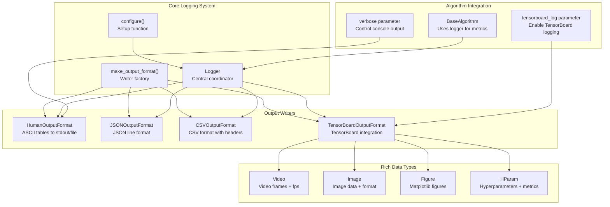
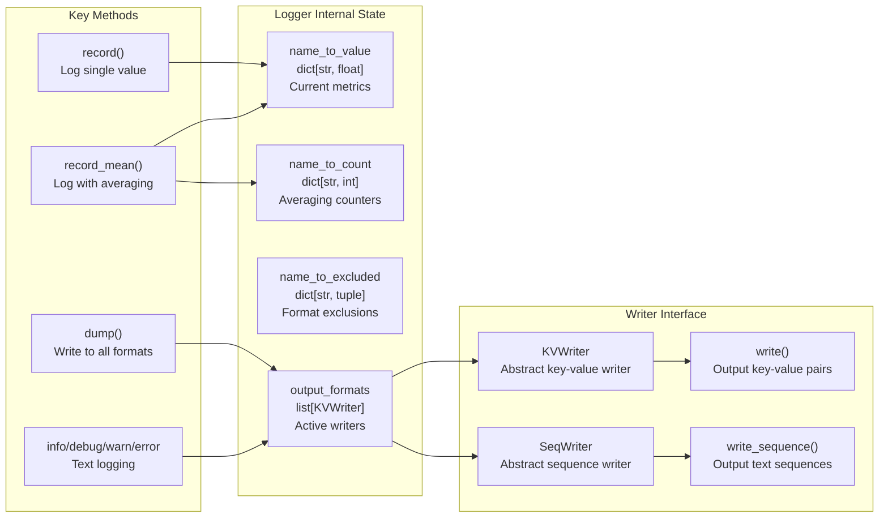
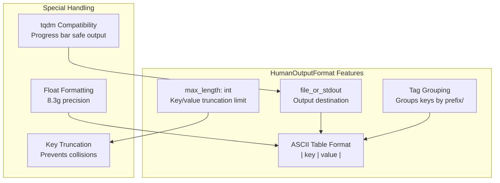
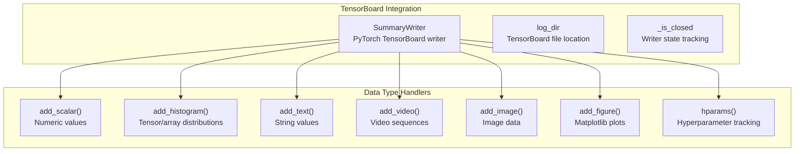
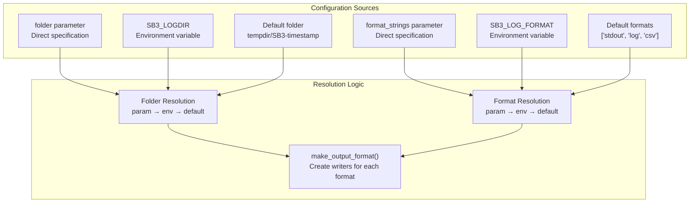
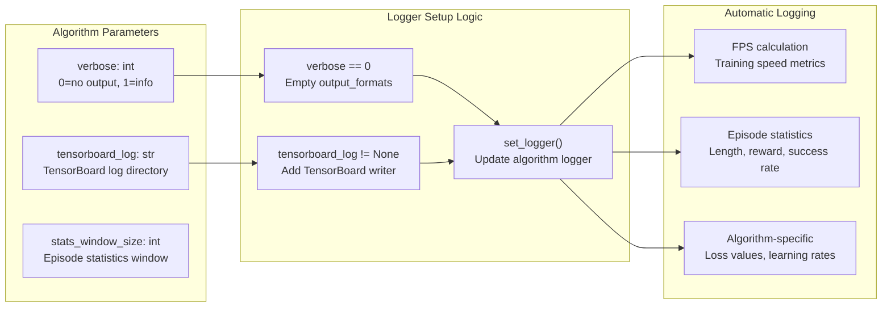
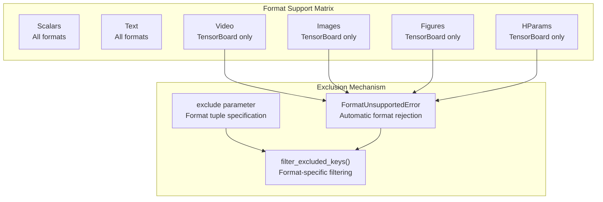
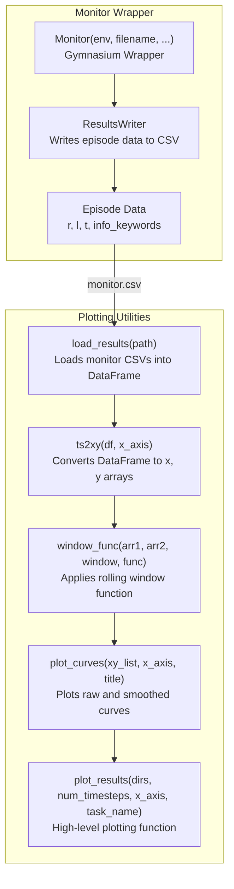

<!-- source: DeepWiki mcp.deepwiki.com · repo DLR-RM/stable-baselines3 · page 7.2 Logging & Visualization · fetched 2026-10-14 -->

# Logging & Visualization

<details>
<summary>Relevant source files</summary>

The following files were used as context for generating this wiki page:

- [docs/guide/export.md](docs/guide/export.md)
- [docs/guide/plotting.md](docs/guide/plotting.md)
- [docs/guide/tensorboard.md](docs/guide/tensorboard.md)
- [stable_baselines3/common/logger.py](stable_baselines3/common/logger.py)
- [stable_baselines3/common/monitor.py](stable_baselines3/common/monitor.py)
- [stable_baselines3/common/results_plotter.py](stable_baselines3/common/results_plotter.py)
- [tests/test_logger.py](tests/test_logger.py)
- [tests/test_monitor.py](tests/test_monitor.py)
- [tests/test_tensorboard.py](tests/test_tensorboard.py)

</details>


This document covers the logging and visualization system in Stable-Baselines3, which provides comprehensive monitoring and tracking capabilities during training and evaluation. The system supports multiple output formats including console output, file logging, and TensorBoard integration for real-time visualization of training metrics.

For information about training control and callbacks during the training process, see [Callback System](). For model persistence and checkpointing, see [Model Saving & Loading]().

## System Overview

The logging system is built around a central `Logger` class that coordinates multiple output writers, each responsible for a specific format. The system supports both simple scalar logging and rich media types like images, videos, and matplotlib figures.



**Sources:** [stable_baselines3/common/logger.py:477-637](), [stable_baselines3/common/logger.py:639-667](), [stable_baselines3/common/logger.py:448-469]()

## Core Logger Architecture

The `Logger` class serves as the central coordinator for all logging operations, managing multiple output writers and maintaining the current set of metrics to be logged.



**Sources:** [stable_baselines3/common/logger.py:477-544](), [stable_baselines3/common/logger.py:113-146]()

## Output Format Writers

The system supports four main output formats, each implemented as a separate writer class that handles format-specific serialization and output.

| Format | Class | Output | Use Case |
|--------|-------|---------|----------|
| `stdout` | `HumanOutputFormat` | ASCII tables to console | Real-time monitoring |
| `log` | `HumanOutputFormat` | ASCII tables to file | Persistent human-readable logs |
| `json` | `JSONOutputFormat` | JSON lines to file | Machine-readable structured logs |
| `csv` | `CSVOutputFormat` | CSV with dynamic headers | Spreadsheet analysis |
| `tensorboard` | `TensorBoardOutputFormat` | TensorBoard event files | Rich visualization |

### HumanOutputFormat

Produces ASCII tables for human consumption, supporting both console output and file output with configurable key length truncation.



**Sources:** [stable_baselines3/common/logger.py:149-261](), [stable_baselines3/common/logger.py:176-242]()

### TensorBoardOutputFormat

Integrates with PyTorch's `SummaryWriter` to provide rich visualization capabilities including scalars, histograms, images, videos, and hyperparameters.



**Sources:** [stable_baselines3/common/logger.py:391-445](), [stable_baselines3/common/logger.py:403-437]()

## Rich Data Types

The logging system supports specialized data types for rich media logging, primarily targeting TensorBoard visualization.

### Video Logging

The `Video` class encapsulates video frame sequences with frame rate information for TensorBoard video visualization.

```python
# Video data structure
Video(frames: th.Tensor, fps: float)
```

**Sources:** [stable_baselines3/common/logger.py:35-45](), [docs/guide/tensorboard.md:179-197]()

### Image Logging  

The `Image` class wraps image data with format specification for proper TensorBoard display.

```python
# Image data structure  
Image(image: Union[th.Tensor, np.ndarray, str], dataformats: str)
```

**Sources:** [stable_baselines3/common/logger.py:61-73](), [docs/guide/tensorboard.md:107-141]()

### Figure Logging

The `Figure` class handles matplotlib figure logging with automatic cleanup options.

```python
# Figure data structure
Figure(figure: matplotlib.figure.Figure, close: bool)
```

**Sources:** [stable_baselines3/common/logger.py:48-58](), [docs/guide/tensorboard.md:142-178]()

### Hyperparameter Logging

The `HParam` class enables hyperparameter tracking in TensorBoard's HPARAMS tab for experiment comparison.

```python
# Hyperparameter data structure
HParam(hparam_dict: Mapping[str, Union[bool, str, float, None]], 
       metric_dict: Mapping[str, float])
```

**Sources:** [stable_baselines3/common/logger.py:76-89](), [tests/test_tensorboard.py:20-42]()

## Configuration and Integration

### Logger Configuration

The `configure()` function serves as the main entry point for setting up the logging system with environment variable support.



**Sources:** [stable_baselines3/common/logger.py:639-667](), [stable_baselines3/common/logger.py:448-469]()

### Algorithm Integration

Stable-Baselines3 algorithms integrate the logging system through standardized parameters and automatic logger setup.



**Sources:** [tests/test_logger.py:109-152](), [tests/test_logger.py:436-459](), [tests/test_tensorboard.py:49-75]()

## Usage Patterns

### Basic TensorBoard Integration

The simplest usage involves passing the `tensorboard_log` parameter to any algorithm constructor.

```python
# Basic TensorBoard logging
model = A2C("MlpPolicy", "CartPole-v1", verbose=1, 
            tensorboard_log="./logs/")
model.learn(total_timesteps=10_000)
```

**Sources:** [docs/guide/tensorboard.md:9-17]()

### Custom Logging with Callbacks

Advanced logging scenarios use callbacks to log custom metrics and rich media data.

```python
# Custom callback logging pattern
class CustomCallback(BaseCallback):
    def _on_step(self) -> bool:
        # Log custom scalar
        self.logger.record("custom/metric", value)
        
        # Log rich media (TensorBoard only)
        self.logger.record("custom/image", 
                         Image(image_data, "HWC"), 
                         exclude=("stdout", "log", "json", "csv"))
        return True
```

**Sources:** [docs/guide/tensorboard.md:70-99](), [docs/guide/tensorboard.md:125-141]()

### Format Exclusion

The logging system supports selective format exclusion for specific metrics, particularly useful for rich media that only certain formats support.



**Sources:** [stable_baselines3/common/logger.py:92-110](), [stable_baselines3/common/logger.py:264-277](), [stable_baselines3/common/logger.py:504-515]()

## Monitor Files and Results Plotting

The `Monitor` wrapper is a Gymnasium environment wrapper that records episode-level statistics such as reward, length, and time. These statistics are saved to a CSV file, typically named `*.monitor.csv`.



**Sources:** [stable_baselines3/common/monitor.py:17-114](), [stable_baselines3/common/monitor.py:164-190](), [stable_baselines3/common/results_plotter.py:62-84](), [stable_baselines3/common/results_plotter.py:46-60](), [stable_baselines3/common/results_plotter.py:87-115](), [stable_baselines3/common/results_plotter.py:117-138]()

### Monitor File Format

The `Monitor` wrapper saves training data in CSV format. Each row represents a completed episode.

| Column | Description |
|--------|-------------|
| `r`    | Episode return (sum of rewards) |
| `l`    | Episode length (number of steps) |
| `t`    | Wall-clock time when episode ended (seconds since `t_start`) |
| `info_keywords` | Additional custom information from `env.step()`'s `info` dictionary |

The file also includes a header line starting with `#` containing metadata like `t_start` (start time of the monitor) and `env_id`.

**Sources:** [stable_baselines3/common/monitor.py:30-52](), [stable_baselines3/common/monitor.py:100-104](), [docs/guide/plotting.md:76-84]()

### Plotting Results

The `stable_baselines3.common.results_plotter` module provides functions to visualize the data collected by the `Monitor` wrapper.

#### `load_results`

The `load_results(path: str)` function reads all `*.monitor.csv` files within a given directory and its subdirectories, concatenating them into a single Pandas DataFrame. It handles cases where multiple monitor files exist (e.g., from vectorized environments) by sorting episodes chronologically.

**Sources:** [stable_baselines3/common/monitor.py:200-240](), [docs/guide/plotting.md:158-158]()

#### `ts2xy`

The `ts2xy(data_frame: pd.DataFrame, x_axis: str)` function extracts x and y coordinates from the loaded DataFrame.
- `x_axis` can be `X_TIMESTEPS` (cumulative timesteps), `X_EPISODES` (episode number), or `X_WALLTIME` (wall-clock time in hours).
- The y-axis always represents the episode rewards (`r`).

**Sources:** [stable_baselines3/common/results_plotter.py:62-84]()

#### `window_func`

The `window_func(var_1: np.ndarray, var_2: np.ndarray, window: int, func: Callable)` function applies a rolling window function (e.g., `np.mean`) to `var_2` (typically rewards) over a specified `window` size, returning the corresponding `var_1` (e.g., timesteps) and the smoothed `var_2`. This is used to smooth out noisy reward curves.

**Sources:** [stable_baselines3/common/results_plotter.py:46-60]()

#### `plot_results`

The `plot_results(dirs: list[str], num_timesteps: int | None, x_axis: str, task_name: str, figsize: tuple[int, int] = (8, 2))` function is a high-level utility to plot results from one or more directories. It loads data, converts it to x-y pairs, and then calls `plot_curves` to render the plot.

**Sources:** [stable_baselines3/common/results_plotter.py:117-138]()

#### Example Usage

```python
import os
import gymnasium as gym
import matplotlib.pyplot as plt

from stable_baselines3 import PPO
from stable_baselines3.common.monitor import Monitor
from stable_baselines3.common.results_plotter import plot_results, X_TIMESTEPS

# Create log directory
log_dir = "tmp_monitor_logs/"
os.makedirs(log_dir, exist_ok=True)

# Create and wrap the environment with Monitor
env = gym.make("CartPole-v1")
env = Monitor(env, log_dir)

# Train the agent
model = PPO("MlpPolicy", env, verbose=1)
model.learn(total_timesteps=20_000)

# Plot the results by timesteps
plot_results([log_dir], 20_000, X_TIMESTEPS, "PPO CartPole Performance")
plt.show()
```

**Sources:** [docs/guide/plotting.md:99-123]()

---

