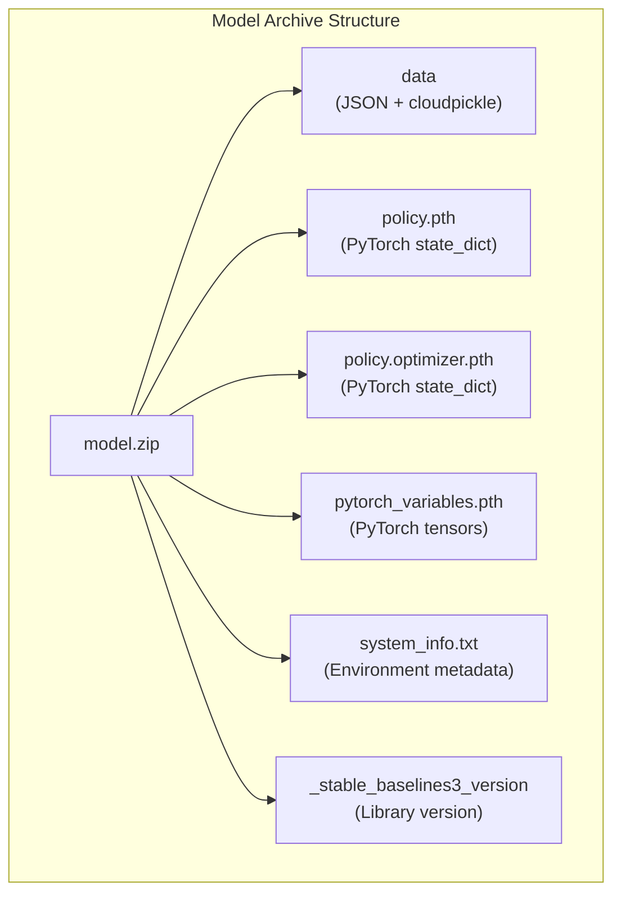
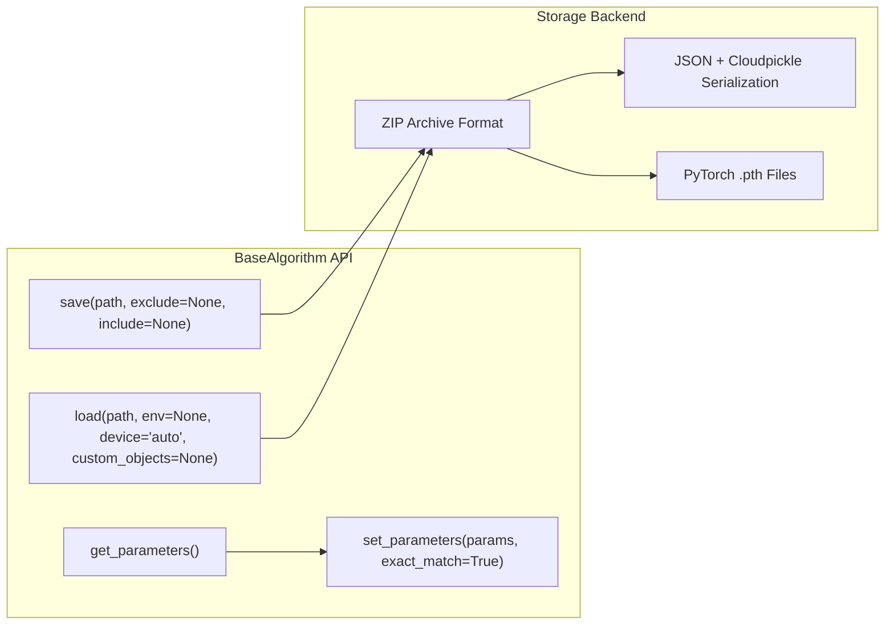
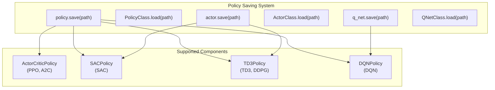
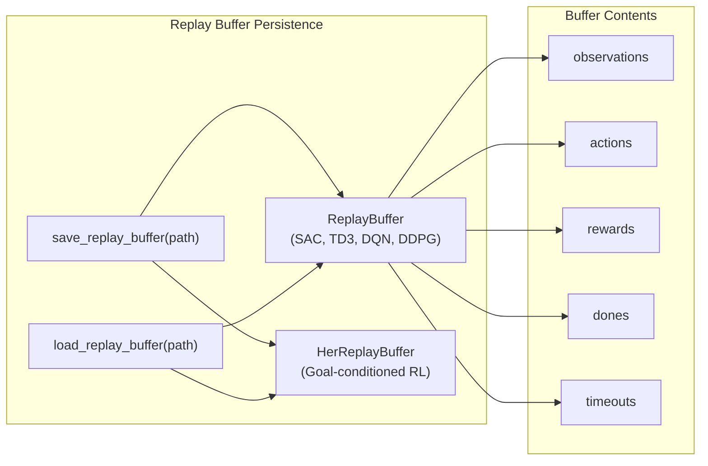
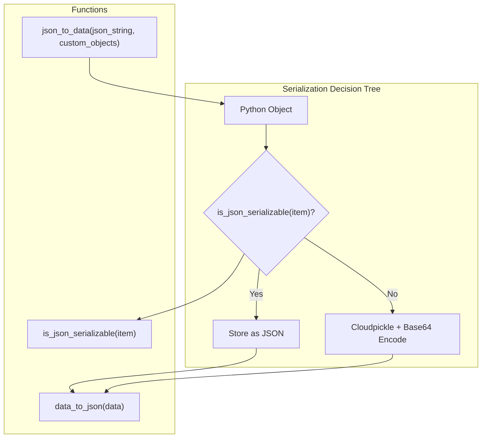
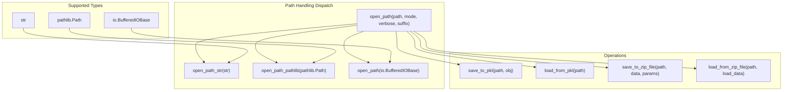
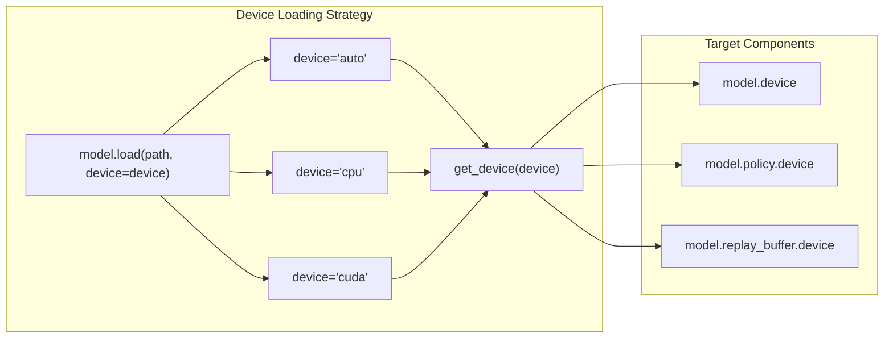
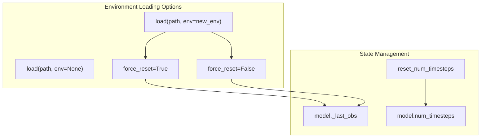
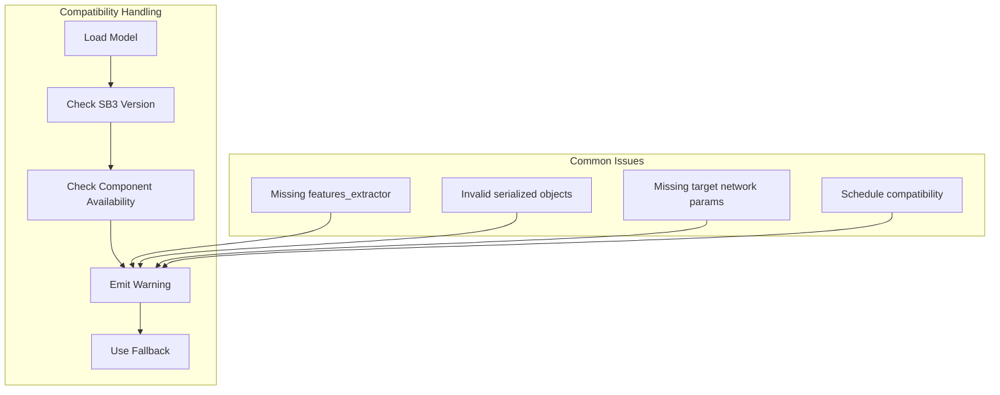

<!-- source: DeepWiki mcp.deepwiki.com · repo DLR-RM/stable-baselines3 · page 8 Model Saving & Loading · fetched 2026-10-14 -->

# Model Saving & Loading

Relevant source files

The following files were used as context for generating this wiki page:

- [stable_baselines3/common/save_util.py](stable_baselines3/common/save_util.py)
- [tests/test_save_load.py](tests/test_save_load.py)

This document covers the model persistence system in Stable-Baselines3, including saving and loading complete models, managing model parameters, and handling individual components like policies and replay buffers. The system provides both high-level APIs for complete model persistence and low-level utilities for fine-grained control over serialization.

For information about model deployment and export to other formats, see [Model Export & Deployment](#9.3).

## Overview

The model saving and loading system is built around a ZIP-based archive format that stores multiple components:

**Sources:** [stable_baselines3/common/save_util.py:294-334](), [stable_baselines3/common/save_util.py:376-457]()

## High-Level Save/Load API

### Complete Model Persistence

The primary interface for model persistence is through the `BaseAlgorithm` class methods:

**Sources:** [tests/test_save_load.py:39-168](), [stable_baselines3/common/save_util.py:294-337]()

### Parameter Management

The system provides granular access to model parameters through structured dictionaries:

| Method | Purpose | Parameters |
|--------|---------|------------|
| `get_parameters()` | Extract all model parameters | Returns nested dict of state_dicts |
| `set_parameters()` | Update model parameters | `params`: dict, `exact_match`: bool |
| `save()` | Persist complete model | `exclude`: list, `include`: list |
| `load()` | Restore complete model | `custom_objects`: dict, `device`: str |

**Sources:** [tests/test_save_load.py:58-125](), [tests/test_save_load.py:246-283]()

## Component-Specific Saving

### Policy Networks

Individual policy components can be saved and loaded independently:

**Sources:** [tests/test_save_load.py:433-530](), [tests/test_save_load.py:532-606]()

### Replay Buffers

Off-policy algorithms support independent replay buffer persistence:

**Sources:** [tests/test_save_load.py:352-386]()

## Serialization System

### JSON and Cloudpickle Hybrid

The system uses a two-tier serialization strategy to balance portability and functionality. Objects that are JSON serializable are stored directly, while non-JSON serializable objects are serialized using `cloudpickle` and then base64 encoded for storage within the JSON structure. This allows for complex Python objects to be persisted while maintaining a human-readable and somewhat interoperable format for basic data.

**Sources:** [stable_baselines3/common/save_util.py:60-74](), [stable_baselines3/common/save_util.py:76-128](), [stable_baselines3/common/save_util.py:131-177]()

### Path Management System

The system provides flexible path handling through single dispatch:

**Sources:** [stable_baselines3/common/save_util.py:181-292](), [stable_baselines3/common/save_util.py:339-374]()

## Advanced Features

### Custom Objects and Parameter Control

The loading system supports fine-grained control over deserialization:

| Feature | Purpose | Usage Example |
|---------|---------|---------------|
| `custom_objects` | Replace deserialized objects | `{"learning_rate": lambda _: 0.001}` |
| `exclude` | Skip saving parameters | `exclude=["verbose", "tensorboard_log"]` |
| `include` | Force save excluded parameters | `include=["verbose"]` |
| `exact_match` | Strict parameter validation | `set_parameters(params, exact_match=True)` |

**Sources:** [tests/test_save_load.py:246-283](), [tests/test_save_load.py:712-740]()

### Device Management

The system automatically handles device placement during model loading:

**Sources:** [tests/test_save_load.py:136-164](), [tests/test_save_load.py:363-369]()

### Environment Handling

Model loading supports flexible environment management:

**Sources:** [tests/test_save_load.py:171-243]()

## Error Handling and Compatibility

### Version Compatibility

The system handles backward compatibility through warnings and graceful degradation:

**Sources:** [tests/test_save_load.py:344-349](), [tests/test_save_load.py:814-824](), [tests/test_save_load.py:826-877]()

---

