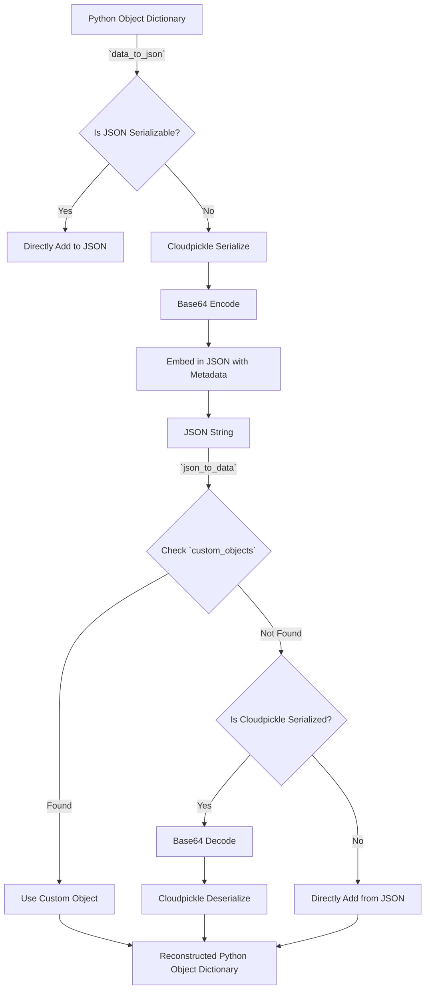

<!-- source: DeepWiki mcp.deepwiki.com · repo DLR-RM/stable-baselines3 · page 8.1 Save Format & Serialization Utilities · fetched 2026-10-14 -->

# Save Format & Serialization Utilities

<details>
<summary>Relevant source files</summary>

The following files were used as context for generating this wiki page:

- [docs/guide/integrations.md](docs/guide/integrations.md)
- [docs/guide/migration.md](docs/guide/migration.md)
- [docs/guide/save_format.md](docs/guide/save_format.md)
- [stable_baselines3/common/save_util.py](stable_baselines3/common/save_util.py)
- [tests/test_save_load.py](tests/test_save_load.py)

</details>


This page details the saving and loading mechanisms within Stable-Baselines3 (SB3), focusing on the `save_to_zip_file` and `load_from_zip_file` utilities, the underlying pickle serialization, the `open_path` function, and the on-disk zip archive layout. Understanding these components is crucial for persisting trained models and their associated data.

## Save Format Overview

SB3 models are saved as zip archives containing both neural network parameters and algorithm-specific parameters. This design facilitates continuous learning and the deployment of trained agents. The format is designed to be robust to unserializable objects and allows for inspection of saved files using standard zip archive tools.

The saving process distinguishes between two main types of data:
- **Parameters**: Refers to neural network weights, stored as PyTorch tensors.
- **Data**: Refers to RL algorithm parameters, such as learning rate, exploration schedules, and observation/action spaces. These are stored as a dictionary mapping variable names to their values.

Sources:
- [docs/guide/save_format.md:10-15]()

### On-Disk Zip Layout

A saved SB3 model is a `.zip` archive with a specific internal structure:

```
saved_model.zip/
├── data
├── *.optimizer.pth
├── policy.pth
├── pytorch_variables.pth
├── _stable_baselines3_version
└── system_info.txt
```

- `data`: A JSON file containing the algorithm's class parameters (the "data" mentioned above). Objects that are not JSON serializable are serialized using `cloudpickle` and stored as base64-encoded strings within this JSON file.
- `*.optimizer.pth`: PyTorch optimizers are serialized using `torch.save()`. There can be multiple such files, one for each optimizer (e.g., `policy.optimizer.pth`, `q_net.optimizer.pth`).
- `policy.pth`: The PyTorch state dictionary of the policy network.
- `pytorch_variables.pth`: Additional PyTorch variables that are part of the model's state.
- `_stable_baselines3_version`: A file containing the SB3 version used to save the model.
- `system_info.txt`: Contains system information (OS, Python version, etc.) at the time the model was saved.

This structure allows for more robust loading, as individual components can be skipped or replaced using `custom_objects` if they are problematic.

Sources:
- [docs/guide/save_format.md:41-49]()

### `data_to_json` and `json_to_data`

The `data_to_json` function [stable_baselines3/common/save_util.py:76-128]() is responsible for converting a dictionary of class parameters into a JSON string for storage. It iterates through the provided `data` dictionary. If an item is JSON serializable (checked by `is_json_serializable` [stable_baselines3/common/save_util.py:60-73]()), it's stored directly. Otherwise, it's serialized using `cloudpickle.dumps` [stable_baselines3/common/save_util.py:100]() and then base64-encoded before being embedded in the JSON string. This allows for storing complex Python objects that are not natively JSON serializable. Additionally, for non-serializable objects, it attempts to include first-level JSON-serializable attributes from their `__dict__` or `items()` method for better introspection.

The `json_to_data` function [stable_baselines3/common/save_util.py:131-177]() performs the reverse operation, converting a JSON string back into a dictionary of class parameters. It handles the deserialization of `cloudpickle`-encoded objects by detecting the `":serialized:"` key within the JSON data. It also supports a `custom_objects` argument, which allows users to provide replacement objects for specific keys, preventing deserialization errors for problematic items.

The following diagram illustrates the data flow for `data_to_json` and `json_to_data`:


**Diagram: `data_to_json` and `json_to_data` Data Flow**

Sources:
- [stable_baselines3/common/save_util.py:60-73]()
- [stable_baselines3/common/save_util.py:76-128]()
- [stable_baselines3/common/save_util.py:131-177]()

## Pickle Utilities: `save_to_pkl` and `load_from_pkl`

Stable-Baselines3 provides utility functions for saving and loading Python objects using `pickle` (or `cloudpickle` for broader compatibility). These are primarily used internally for specific components or when a full model save is not required.

- `save_to_pkl(path: str | pathlib.Path | io.BufferedIOBase, data: Any) -> None`: This function saves an arbitrary Python object `data` to the specified `path` using `cloudpickle.dump`. `cloudpickle` is used instead of standard `pickle` to handle more complex objects like lambda functions or objects defined in the main script.
- `load_from_pkl(path: str | pathlib.Path | io.BufferedIOBase) -> Any`: This function loads a Python object from the specified `path` using `cloudpickle.load`.

These functions are used for general-purpose object serialization, for example, when saving and loading the replay buffer.

Sources:
- [stable_baselines3/common/save_util.py:390-393]()
- [stable_baselines3/common/save_util.py:396-399]()

## `open_path`

The `open_path` function [stable_baselines3/common/save_util.py:402-420]() provides a flexible way to open files, supporting both local file paths (strings or `pathlib.Path` objects) and file-like objects (e.g., `io.BytesIO`). It returns a context manager that yields an opened file handle, ensuring proper resource management. This utility is crucial for handling various input sources when loading models or data.

```python
# Example usage of open_path
from stable_baselines3.common.save_util import open_path
import io

# Using a file path
with open_path("my_file.txt", "w") as f:
    f.write("Hello, world!")

# Using a BytesIO object
buffer = io.BytesIO()
with open_path(buffer, "wb") as f:
    f.write(b"Binary data")
```

Sources:
- [stable_baselines3/common/save_util.py:402-420]()

## `save_to_zip_file` and `load_from_zip_file`

These are the core functions for saving and loading SB3 models. They manage the creation and extraction of the zip archive, handling the serialization of different model components.

### `save_to_zip_file`

The `save_to_zip_file` function [stable_baselines3/common/save_util.py:200-260]() takes a file path and a dictionary of data to save. It creates a zip archive and writes various components into it:

1.  **System Info**: It gathers system information using `get_system_info()` [stable_baselines3/common/utils.py:20-21]() and saves it to `system_info.txt` within the zip.
2.  **SB3 Version**: The current SB3 version is saved to `_stable_baselines3_version`.
3.  **Data Dictionary**: The provided `data` dictionary is converted to a JSON string using `data_to_json` [stable_baselines3/common/save_util.py:76-128]() and saved as `data`.
4.  **PyTorch State Dictionaries**: Any PyTorch state dictionaries (e.g., policy parameters, optimizer states) are saved using `torch.save()` [stable_baselines3/common/save_util.py:246-250]() into `.pth` files within the zip.

```mermaid
graph TD
    A[Model Data (dict)] -->|`data_to_json`| B[JSON String];
    C[PyTorch State Dicts] -->|`torch.save`| D[PyTorch .pth files];
    E[System Info] --> F[system_info.txt];
    G[SB3 Version] --> H[_stable_baselines3_version];

    A & C & E & G --> I{`save_to_zip_file`};
    I --> J[Create Zip Archive];
    J --> K[Add B to J as "data"];
    J --> L[Add D to J as "*.optimizer.pth", "policy.pth", etc.];
    J --> M[Add F to J];
    J --> N[Add H to J];
    J --> O[saved_model.zip];
```
**Diagram: `save_to_zip_file` Process**

Sources:
- [stable_baselines3/common/save_util.py:200-260]()
- [stable_baselines3/common/utils.py:20-21]()
- [stable_baselines3/common/save_util.py:76-128]()
- [stable_baselines3/common/save_util.py:246-250]()

### `load_from_zip_file`

The `load_from_zip_file` function [stable_baselines3/common/save_util.py:263-387]() reads a zip archive and reconstructs the saved data. It takes the file path, a device to load tensors onto, and an optional `custom_objects` dictionary.

1.  **Open Zip**: It opens the zip archive using `zipfile.ZipFile`.
2.  **Load System Info**: It reads `system_info.txt` and `_stable_baselines3_version` for informational purposes, potentially printing warnings if there are version mismatches.
3.  **Load Data Dictionary**: It reads the `data` JSON file and deserializes it using `json_to_data` [stable_baselines3/common/save_util.py:131-177](), incorporating `custom_objects` if provided.
4.  **Load PyTorch State Dictionaries**: It iterates through the files in the zip archive, loading any `.pth` files using `torch.load()` [stable_baselines3/common/save_util.py:360-361]() and mapping them to the specified `device`. These are then stored in the `loaded_params` dictionary.

The `load_from_zip_file` function is robust to missing files within the archive, logging warnings instead of raising errors for non-critical components.

```mermaid
graph TD
    A[saved_model.zip] -->|`load_from_zip_file`| B[Open Zip Archive];
    B --> C[Read "system_info.txt"];
    B --> D[Read "_stable_baselines3_version"];
    B --> E[Read "data" (JSON)];
    E -->|`json_to_data` with `custom_objects`| F[Reconstructed Model Data (dict)];
    B --> G[Find "*.pth" files];
    G -->|`torch.load` to `device`| H[Loaded PyTorch State Dicts];

    F & H --> I[Return Loaded Data and Parameters];
```
**Diagram: `load_from_zip_file` Process**

Sources:
- [stable_baselines3/common/save_util.py:263-387]()
- [stable_baselines3/common/save_util.py:131-177]()
- [stable_baselines3/common/save_util.py:360-361]()
- [tests/test_save_load.py:139-146]()

### Example Usage

The `test_save_load` function [tests/test_save_load.py:38-171]() demonstrates the typical usage of saving and loading models. A model is trained, its parameters are retrieved, saved to a zip file, and then reloaded. The test verifies that the loaded model's parameters and behavior (predictions) remain consistent across different devices.

```python
# Example from tests/test_save_load.py
from stable_baselines3 import PPO
from stable_baselines3.common.env_util import make_vec_env
from stable_baselines3.common.envs import IdentityEnvBox
import numpy as np
import tempfile

# Create a temporary directory for saving
with tempfile.TemporaryDirectory() as tmp_path:
    env = make_vec_env(lambda: IdentityEnvBox(-10, 10), n_envs=1)
    model = PPO("MlpPolicy", env, policy_kwargs=dict(net_arch=[16]), verbose=1)
    model.learn(total_timesteps=128)

    observations = np.concatenate([env.step([env.action_space.sample()])[0] for _ in range(10)], axis=0)
    selected_actions, _ = model.predict(observations, deterministic=True)

    # Save the model
    model.save(f"{tmp_path}/test_save.zip")
    del model

    # Load the model
    model = PPO.load(f"{tmp_path}/test_save.zip", env=env, device="cpu")

    # Verify predictions
    new_selected_actions, _ = model.predict(observations, deterministic=True)
    assert np.allclose(selected_actions, new_selected_actions, 1e-4)

    # Continue learning
    model.learn(total_timesteps=128)
```

Sources:
- [tests/test_save_load.py:38-171]()

---

