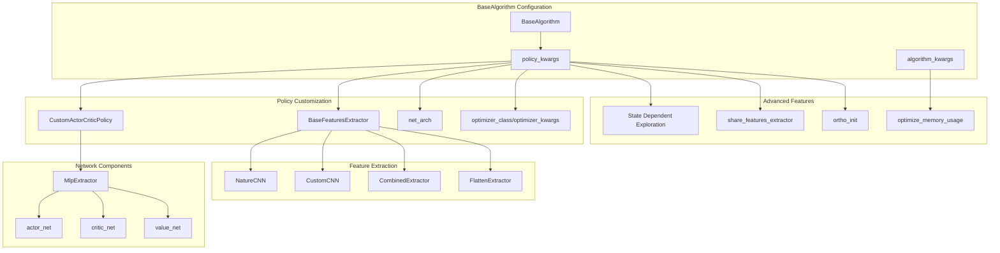
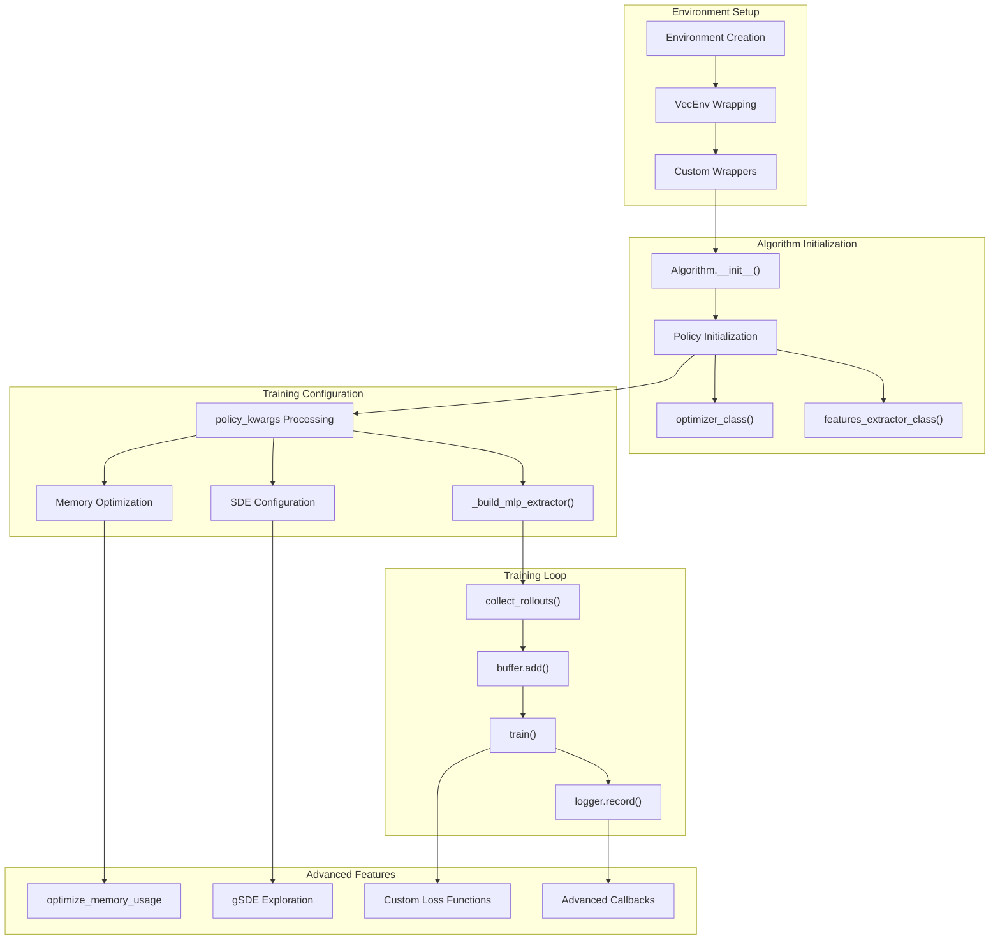

<!-- source: DeepWiki mcp.deepwiki.com · repo DLR-RM/stable-baselines3 · page 9 Advanced Usage · fetched 2026-10-14 -->

# Advanced Usage

<details>
<summary>Relevant source files</summary>

The following files were used as context for generating this wiki page:

- [docs/guide/custom_policy.md](docs/guide/custom_policy.md)
- [tests/test_sde.py](tests/test_sde.py)

</details>


This document covers advanced features and specialized use cases in Stable-Baselines3 that go beyond basic algorithm usage. It provides an overview of customization capabilities, performance optimizations, and deployment strategies for experienced users who need fine-grained control over their reinforcement learning implementations.

For basic algorithm usage and getting started, see [Getting Started & Examples](#1.2). For standard training and monitoring, see [Training & Monitoring](#7). For model persistence basics, see [Model Saving & Loading](#8).

## Scope and Advanced Features Overview

Stable-Baselines3 provides extensive customization capabilities through several advanced features:

- **Custom Policy Networks**: Creating specialized neural network architectures - detailed coverage in [Custom Policies](#9.1)
- **State-Dependent Exploration**: Advanced exploration techniques including gSDE - see [State-Dependent Exploration](#9.2)  
- **Model Export & Deployment**: Exporting trained models to various formats - see [Model Export & Deployment](#9.3)
- **Advanced Training Configurations**: Fine-tuning optimizers, schedulers, and training parameters
- **Multi-Input Handling**: Working with complex observation spaces including dictionary observations
- **Memory Optimization**: Techniques for reducing memory usage in large-scale training
- **Custom Environment Integration**: Advanced environment wrapper patterns

## Advanced Configuration Architecture

The following diagram shows how advanced configuration components integrate within the SB3 framework:



Sources: [docs/guide/custom_policy.md:1-171](), [stable_baselines3/common/policies.py](), [stable_baselines3/common/torch_layers.py]()

## Policy Customization Framework

SB3's policy system allows extensive customization through the `policy_kwargs` parameter. The framework separates concerns between feature extraction and network architecture:

### Key Configuration Parameters

| Parameter | Purpose | Example Values |
|-----------|---------|----------------|
| `features_extractor_class` | Custom feature extractor | `CustomCNN`, `CombinedExtractor` |
| `features_extractor_kwargs` | Feature extractor parameters | `{"features_dim": 128}` |
| `net_arch` | Network architecture specification | `[64, 64]`, `{"pi": [32, 32], "vf": [64]}` |
| `activation_fn` | Activation function | `th.nn.ReLU`, `th.nn.Tanh` |
| `optimizer_class` | Custom optimizer | `th.optim.Adam`, `RMSpropTFLike` |
| `optimizer_kwargs` | Optimizer parameters | `{"eps": 1e-5, "weight_decay": 1e-4}` |

### Network Architecture Specifications

The `net_arch` parameter provides flexible architecture control:

**On-Policy Algorithms (PPO, A2C)**:
- Shared architecture: `net_arch=[128, 128]`
- Separate networks: `net_arch={"pi": [32, 32], "vf": [64, 64]}`

**Off-Policy Algorithms (SAC, TD3, DDPG)**:
- Shared architecture: `net_arch=[256, 256]`  
- Separate networks: `net_arch={"pi": [64, 64], "qf": [400, 300]}`

For details on customizing policy networks, feature extractors, and `net_arch` configurations, see [Custom Policies](#9.1).

Sources: [docs/guide/custom_policy.md:1-171]()

## Advanced Training Pipeline Integration

This diagram shows how advanced features integrate into the training pipeline:



Sources: [stable_baselines3/common/base_class.py](), [stable_baselines3/common/on_policy_algorithm.py](), [stable_baselines3/common/off_policy_algorithm.py]()

## Memory Optimization Techniques

SB3 provides several memory optimization strategies for large-scale training:

### Replay Buffer Optimization

For off-policy algorithms, memory usage can be significantly reduced:

```python
# Enable memory-efficient replay buffer
model = SAC("MlpPolicy", env, 
           optimize_memory_usage=True,  # Reduces memory by ~2x
           buffer_size=1_000_000)
```

### Feature Extractor Sharing

Control feature extractor sharing between actor and critic networks:

```python
# Separate feature extractors (default for off-policy)
policy_kwargs = {"share_features_extractor": False}

# Shared feature extractor (saves computation)
policy_kwargs = {"share_features_extractor": True}
```

Sources: [docs/guide/custom_policy.md:118-122]()

## Multi-Input and Dictionary Observations

SB3 supports complex observation spaces through the `MultiInputPolicy` and `CombinedExtractor`:

### Default Processing Strategy

1. **Image inputs**: Processed with NatureCNN → 256-dimensional vector
2. **Non-image inputs**: Flattened directly  
3. **Combination**: All vectors concatenated and passed to policy networks

### Custom Multi-Input Processing

The `CombinedExtractor` can be subclassed for specialized multi-input handling:

```python
class CustomCombinedExtractor(BaseFeaturesExtractor):
    def __init__(self, observation_space: gym.spaces.Dict):
        # Custom processing for each observation key
        extractors = {}
        for key, subspace in observation_space.spaces.items():
            if key == "image":
                extractors[key] = nn.Sequential(nn.MaxPool2d(4), nn.Flatten())
            elif key == "vector":
                extractors[key] = nn.Linear(subspace.shape[0], 16)
        self.extractors = nn.ModuleDict(extractors)
```

Sources: [docs/guide/custom_policy.md:1-171]()

## State-Dependent Exploration (gSDE)

SB3 implements generalized State-Dependent Exploration, enabling robust exploration. This feature is available for A2C, PPO, and SAC algorithms and allows the exploration noise to depend on the current state. The `use_sde` parameter enables this functionality, and `policy_kwargs` can be used to configure `log_std_init` and `use_expln` for the policy's noise distribution.

For detailed implementation and usage, including how the gradients are computed for state-dependent noise, see [State-Dependent Exploration](#9.2).

Sources: [tests/test_sde.py:10-57](), [tests/test_sde.py:69-107]()

## Optimizer Customization

Advanced users can specify custom optimizers and their parameters:

### Custom Optimizer Classes

```python
from stable_baselines3.common.sb2_compat.rmsprop_tf_like import RMSpropTFLike

policy_kwargs = {
    "optimizer_class": RMSpropTFLike,
    "optimizer_kwargs": {"eps": 1e-5, "weight_decay": 1e-4}
}
```

### Learning Rate Scheduling

Learning rates can be functions for dynamic scheduling:

```python
def linear_schedule(initial_value):
    def func(progress_remaining):
        return progress_remaining * initial_value
    return func

model = PPO("MlpPolicy", env, learning_rate=linear_schedule(3e-4))
```

## Model Export and Deployment

SB3 supports exporting trained models to various formats for deployment in different environments. The export system focuses on the policy networks since they contain the learned behavior.

For comprehensive export procedures including ONNX, PyTorch JIT, and deployment to edge devices, see [Model Export & Deployment](#9.3).

## Advanced Callback Integration

The callback system enables sophisticated training control and monitoring. Advanced callbacks can implement:

- Custom evaluation protocols
- Dynamic hyperparameter adjustment  
- Early stopping with complex criteria
- Custom logging and visualization
- Model checkpointing strategies

For detailed callback implementation, see [Callback System](#7.1).

Sources: [stable_baselines3/common/callbacks.py]()

## Performance Considerations

### Threading and Parallelization

PyTorch threading can significantly impact performance:

```python
import torch as th
th.set_num_threads(1)  # May improve performance in some cases
```

### Vectorized Environments

Use vectorized environments for better throughput:

```python
from stable_baselines3.common.env_util import make_vec_env
env = make_vec_env("CartPole-v1", n_envs=8)  # 8 parallel environments
```

### GPU Utilization

For CNN policies and large networks, GPU acceleration can provide significant speedups:

```python
model = PPO("CnnPolicy", env, device="cuda")
```

---

