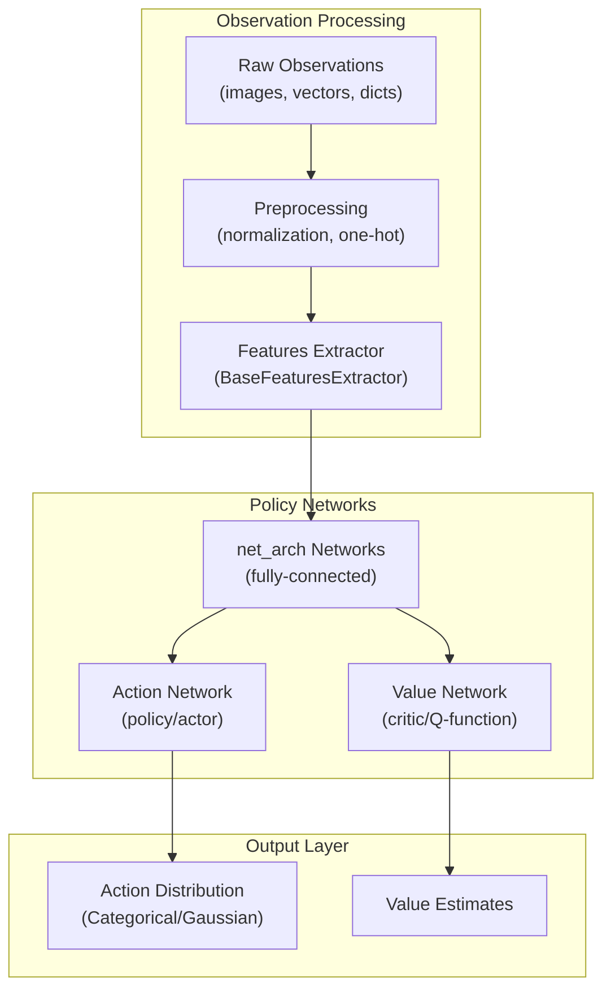
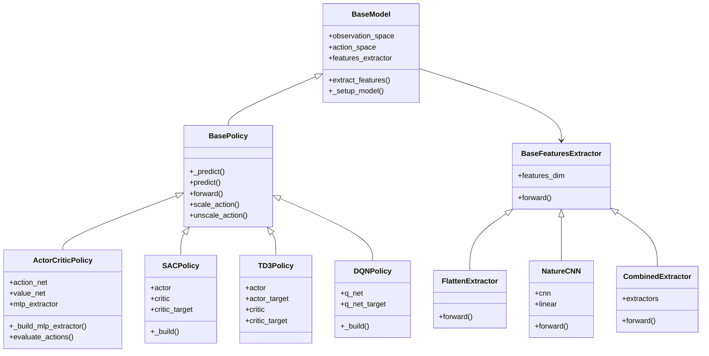
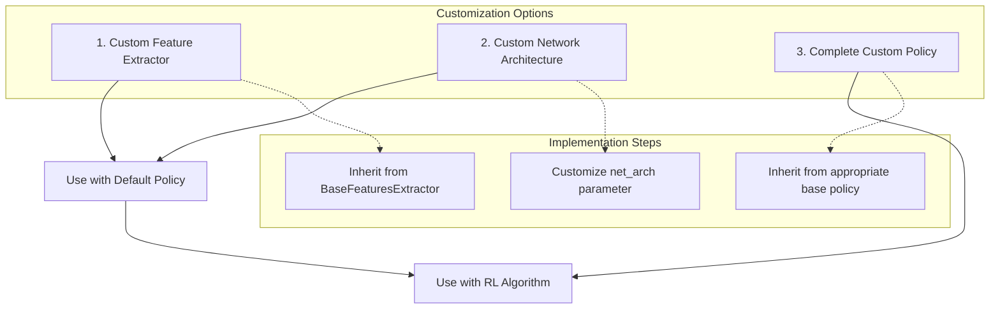
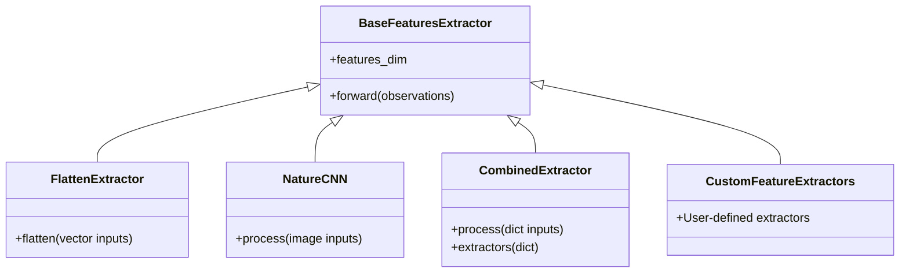

<!-- source: DeepWiki mcp.deepwiki.com · repo DLR-RM/stable-baselines3 · page 9.1 Custom Policies · fetched 2026-10-14 -->

# Custom Policies

<details>
<summary>Relevant source files</summary>

The following files were used as context for generating this wiki page:

- [docs/guide/custom_policy.md](docs/guide/custom_policy.md)
- [stable_baselines3/common/torch_layers.py](stable_baselines3/common/torch_layers.py)
- [tests/test_custom_policy.py](tests/test_custom_policy.py)

</details>


This page provides a comprehensive guide on creating custom policy networks and feature extractors for Stable Baselines3. You'll learn how to extend the default policies to adapt them to your specific needs and how to implement completely custom policy architectures.

For information about the built-in policies provided by SB3, see [Policy Networks](#4).

## Policy Architecture in Stable Baselines3

Stable Baselines3 policies are composed of two main components: a features extractor and fully-connected networks that map features to actions/values. The features extractor converts high-dimensional observations (like images) into feature vectors, while the network architecture is controlled by the `net_arch` parameter.

### SB3 Policy Structure

Title: "SB3 Policy Architecture"

Sources: [docs/guide/custom_policy.md:16-27]()

### Policy Class Hierarchy

Title: "SB3 Policy Class Hierarchy"


Sources: [stable_baselines3/common/torch_layers.py:11-29](), [stable_baselines3/common/torch_layers.py:31-45](), [stable_baselines3/common/torch_layers.py:48-105]()

### Base Classes

All policies in SB3 inherit from these fundamental classes:

1. **BaseModel**: The foundation class that handles:
   - Feature extraction from observations via `features_extractor`
   - Device management (CPU/GPU)
   - Model saving and loading
   - Parameter vectorization

2. **BasePolicy**: Extends BaseModel to add policy-specific methods:
   - Action prediction (`_predict` and `predict`)
   - Action scaling for continuous action spaces
   - Abstract methods that must be implemented by child classes

### Algorithm-Specific Policies

Each reinforcement learning algorithm implements its own policy class:

1. **ActorCriticPolicy**: For on-policy algorithms (PPO, A2C)
   - Implements both actor (policy) and critic (value function)
   - Uses `mlp_extractor` to process features before action/value networks
   - Supports shared or separate feature extractors via `share_features_extractor` parameter

2. **DQNPolicy**: For DQN algorithm
   - Implements `q_net` and `q_net_target` networks
   - Only supports discrete action spaces

3. **SACPolicy**: For SAC algorithm
   - Implements `actor`, `critic`, and `critic_target` networks
   - Supports continuous action spaces with Gaussian policies
   - Separate feature extractors for actor and critic by default

4. **TD3Policy**: For TD3 algorithm
   - Implements `actor`, `actor_target`, `critic`, and `critic_target` networks
   - Supports continuous action spaces with deterministic policies
   - Separate feature extractors for actor and critic

## Default Network Architectures

The default network architecture varies by algorithm and observation space:

| Algorithm | 1D Observations | Image Observations | Post-CNN Layers |
|-----------|----------------|-------------------|-----------------|
| PPO/A2C/DQN | 64 units × 2 layers | Nature CNN | Linear layer only |
| SAC | 256 units × 2 layers | Nature CNN | 256 units × 2 layers |
| TD3/DDPG | [400, 300] units | Nature CNN | [400, 300] units |

For image observations, the "Nature CNN" [stable_baselines3/common/torch_layers.py:48-105]() is used for feature extraction. For on-policy algorithms (A2C/PPO), the CNN is shared between actor and critic. For off-policy algorithms, separate feature extractors are used for optimal performance.

Sources: [docs/guide/custom_policy.md:47-61](), [stable_baselines3/common/torch_layers.py:48-105]()

## Creating Custom Policies

There are three primary approaches to creating custom policies in Stable Baselines3, depending on your needs:

Title: "Custom Policy Implementation Flow"


### 1. Using Custom Feature Extractors

Feature extractors process raw observations before they're passed to the policy and value networks. Creating a custom feature extractor is the most common customization.

#### Step 1: Create a Custom Feature Extractor

Inherit from `BaseFeaturesExtractor` [stable_baselines3/common/torch_layers.py:11-29]() and implement the `forward` method:

```python
import torch as th
import torch.nn as nn
from gymnasium import spaces
from stable_baselines3.common.torch_layers import BaseFeaturesExtractor

class CustomCNN(BaseFeaturesExtractor):
    """
    :param observation_space: (gym.Space)
    :param features_dim: (int) Number of features extracted.
        This corresponds to the number of unit for the last layer.
    """

    def __init__(self, observation_space: spaces.Box, features_dim: int = 256):
        super().__init__(observation_space, features_dim)
        # We assume CxHxW images (channels first)
        # Re-ordering will be done by pre-preprocessing or wrapper
        n_input_channels = observation_space.shape[0]
        self.cnn = nn.Sequential(
            nn.Conv2d(n_input_channels, 32, kernel_size=8, stride=4, padding=0),
            nn.ReLU(),
            nn.Conv2d(32, 64, kernel_size=4, stride=2, padding=0),
            nn.ReLU(),
            nn.Flatten(),
        )

        # Compute shape by doing one forward pass
        with th.no_grad():
            n_flatten = self.cnn(
                th.as_tensor(observation_space.sample()[None]).float()
            ).shape[1]

        self.linear = nn.Sequential(nn.Linear(n_flatten, features_dim), nn.ReLU())

    def forward(self, observations: th.Tensor) -> th.Tensor:
        return self.linear(self.cnn(observations))
```
Sources: [docs/guide/custom_policy.md:133-163](), [stable_baselines3/common/torch_layers.py:11-29]()

#### Step 2: Use the Custom Feature Extractor with an Algorithm

```python
from stable_baselines3 import PPO

policy_kwargs = dict(
    features_extractor_class=CustomCNN,
    features_extractor_kwargs=dict(features_dim=128),
)
model = PPO("CnnPolicy", "BreakoutNoFrameskip-v4", policy_kwargs=policy_kwargs, verbose=1)
model.learn(1000)
```
Sources: [docs/guide/custom_policy.md:164-170]()

### 2. Customizing Network Architecture

You can customize the neural network architecture without changing the feature extractor. The `net_arch` parameter is used to define the architecture of the fully-connected layers. The `create_mlp` function [stable_baselines3/common/torch_layers.py:108-166]() is responsible for building these MLP networks.

#### On-Policy Algorithms (PPO, A2C)

For on-policy algorithms, use `pi` for the actor (policy) network and `vf` for the critic (value function) network:

```python
import gymnasium as gym
import torch as th
from stable_baselines3 import PPO

# Custom actor (pi) and value function (vf) networks
# of two layers of size 32 each with ReLU activation function
policy_kwargs = dict(activation_fn=th.nn.ReLU,
                     net_arch=dict(pi=[32, 32], vf=[32, 32]))

model = PPO("MlpPolicy", "CartPole-v1", policy_kwargs=policy_kwargs, verbose=1)
```
Sources: [docs/guide/custom_policy.md:94-98]()

Same architecture for both actor and critic:
```python
# Equivalent to dict(pi=[128, 128], vf=[128, 128])
policy_kwargs = dict(net_arch=[128, 128])
model = PPO("MlpPolicy", "CartPole-v1", policy_kwargs=policy_kwargs, verbose=1)
```
Sources: [tests/test_custom_policy.py:27-34]()

#### Off-Policy Algorithms (SAC, TD3, DDPG)

For off-policy algorithms, use `pi` for the actor network and `qf` for the critic (Q-function) network:

```python
from stable_baselines3 import SAC

# Custom actor architecture with two layers of 64 units each
# Custom critic architecture with two layers of 400 and 300 units
policy_kwargs = dict(net_arch=dict(pi=[64, 64], qf=[400, 300]))
model = SAC("MlpPolicy", "Pendulum-v1", policy_kwargs=policy_kwargs, verbose=1)
model.learn(5000)
```
Sources: [tests/test_custom_policy.py:37-42]()

### 3. Creating a Completely Custom Policy

For maximum flexibility, you can create a policy from scratch by inheriting from one of the base policy classes.

#### Example: Custom Actor-Critic Policy

For complete control, inherit from `ActorCriticPolicy` and override the `_build_mlp_extractor` method:

```python
from typing import Callable, Dict, List, Optional, Tuple, Type, Union
from gymnasium import spaces
import torch as th
from torch import nn
from stable_baselines3 import PPO
from stable_baselines3.common.policies import ActorCriticPolicy

class CustomNetwork(nn.Module):
    """
    Custom network for policy and value function.
    It receives as input the features extracted by the features extractor.

    :param feature_dim: dimension of the features extracted with the features_extractor (e.g. features from a CNN)
    :param last_layer_dim_pi: (int) number of units for the last layer of the policy network
    :param last_layer_dim_vf: (int) number of units for the last layer of the value network
    """

    def __init__(
        self,
        feature_dim: int,
        last_layer_dim_pi: int = 64,
        last_layer_dim_vf: int = 64,
    ):
        super().__init__()

        # IMPORTANT:
        # Save output dimensions, used to create the distributions
        self.latent_dim_pi = last_layer_dim_pi
        self.latent_dim_vf = last_layer_dim_vf

        # Policy network
        self.policy_net = nn.Sequential(
            nn.Linear(feature_dim, last_layer_dim_pi), nn.ReLU()
        )
        # Value network
        self.value_net = nn.Sequential(
            nn.Linear(feature_dim, last_layer_dim_vf), nn.ReLU()
        )

    def forward(self, features: th.Tensor) -> Tuple[th.Tensor, th.Tensor]:
        """
        :return: (th.Tensor, th.Tensor) latent_policy, latent_value of the specified network.
            If all layers are shared, then ``latent_policy == latent_value``
        """
        return self.forward_actor(features), self.forward_critic(features)

    def forward_actor(self, features: th.Tensor) -> th.Tensor:
        return self.policy_net(features)

    def forward_critic(self, features: th.Tensor) -> th.Tensor:
        return self.value_net(features)

class CustomActorCriticPolicy(ActorCriticPolicy):
    def __init__(
        self,
        observation_space: spaces.Space,
        action_space: spaces.Space,
        lr_schedule: Callable[[float], float],
        *args,
        **kwargs,
    ):
        # Disable orthogonal initialization
        kwargs["ortho_init"] = False
        super().__init__(
            observation_space,
            action_space,
            lr_schedule,
            *args,
            **kwargs,
        )

    def _build_mlp_extractor(self) -> None:
        self.mlp_extractor = CustomNetwork(self.features_dim)

model = PPO(CustomActorCriticPolicy, "CartPole-v1", verbose=1)
model.learn(5000)
```

## Features Extractors in Detail

Feature extractors are responsible for processing the raw observations into a format suitable for the policy and value networks. SB3 provides several built-in feature extractors:

Title: "Feature Extractor Hierarchy"


1. **FlattenExtractor** [stable_baselines3/common/torch_layers.py:31-45](): Default for vector observations, simply flattens the input.
2. **NatureCNN** [stable_baselines3/common/torch_layers.py:48-105](): Default for image observations, implements the CNN from the DQN Nature paper.
3. **CombinedExtractor**: Default for dictionary observations, processes each key with appropriate extractor.

Sources: [stable_baselines3/common/torch_layers.py:31-45](), [stable_baselines3/common/torch_layers.py:48-105]()

### Creating a Custom Feature Extractor for Dict Observation Spaces

The `CombinedExtractor` processes dictionary observations by default. For custom processing of multiple input types:

```python
import gymnasium as gym
import torch as th
from torch import nn
from stable_baselines3.common.torch_layers import BaseFeaturesExtractor

class CustomCombinedExtractor(BaseFeaturesExtractor):
    def __init__(self, observation_space: gym.spaces.Dict):
        # We do not know features-dim here before going over all the items,
        # so put something dummy for now. PyTorch requires calling
        # nn.Module.__init__ before adding modules
        super().__init__(observation_space, features_dim=1)

        extractors = {}

        total_concat_size = 0
        # We need to know size of the output of this extractor,
        # so go over all the spaces and compute output feature sizes
        for key, subspace in observation_space.spaces.items():
            if key == "image":
                # We will just downsample one channel of the image by 4x4 and flatten.
                # Assume the image is single-channel (subspace.shape[0] == 0)
                extractors[key] = nn.Sequential(nn.MaxPool2d(4), nn.Flatten())
                total_concat_size += subspace.shape[1] // 4 * subspace.shape[2] // 4
            elif key == "vector":
                # Run through a simple MLP
                extractors[key] = nn.Linear(subspace.shape[0], 16)
                total_concat_size += 16

        self.extractors = nn.ModuleDict(extractors)

        # Update the features dim manually
        self._features_dim = total_concat_size

    def forward(self, observations) -> th.Tensor:
        encoded_tensor_list = []

        # self.extractors contain nn.Modules that do all the processing.
        for key, extractor in self.extractors.items():
            encoded_tensor_list.append(extractor(observations[key]))
        # Return a (B, self._features_dim) PyTorch tensor, where B is batch dimension.
        return th.cat(encoded_tensor_list, dim=1)
```

Use this custom extractor with `MultiInputPolicy`:

```python
policy_kwargs = dict(
    features_extractor_class=CustomCombinedExtractor,
)

model = PPO("MultiInputPolicy", env, policy_kwargs=policy_kwargs)
```

## Advanced Customization

### Custom Distributions for Stochastic Policies

For algorithms that use stochastic policies (A2C, PPO, SAC), you can customize the action distribution:

```python
from torch.distributions import Normal
from stable_baselines3.common.distributions import DiagGaussianDistribution

class CustomDiagGaussianDistribution(DiagGaussianDistribution):
    def get_actions(self, deterministic: bool = False) -> th.Tensor:
        if deterministic:
            return self.mean
        # Custom sampling logic
        return self.mean + self.std * Normal(0, 1).sample(self.mean.shape)
```

### Custom Initialization

You can customize how the networks are initialized:

```python
import torch.nn as nn
from stable_baselines3 import PPO

class CustomPolicy(ActorCriticPolicy):
    def __init__(self, *args, **kwargs):
        super().__init__(*args, **kwargs)
        # Apply custom initialization
        self.apply(self.custom_weight_init)

    @staticmethod
    def custom_weight_init(module):
        if isinstance(module, (nn.Linear, nn.Conv2d)):
            nn.init.xavier_uniform_(module.weight)
            if module.bias is not None:
                module.bias.data.fill_(0.01)
```

### Shared vs. Separate Feature Extractors

For on-policy algorithms, the features extractor is shared by default between actor and critic. This can be controlled via the `share_features_extractor` parameter:

```python
from stable_baselines3 import PPO

# Using separate feature extractors (higher computation, potentially better performance)
policy_kwargs = dict(share_features_extractor=False)
model = PPO("MlpPolicy", env, policy_kwargs=policy_kwargs)
```
For off-policy algorithms (SAC, TD3, DDPG), separate feature extractors are used by default for optimal performance, as the actor and critic are updated at different frequencies.

Sources: [docs/guide/custom_policy.md:118-122]()

## Best Practices

1. **Start Simple**: Begin with minimal customizations to the default policies before building complex architectures
2. **Validate Incrementally**: Test each customization step to ensure it works as expected
3. **Monitor Performance**: Track training metrics to ensure customizations improve, not degrade performance
4. **Consider Computational Cost**: More complex policies increase training time and resource requirements
5. **Debug with Small Batches**: Use small batches of data to debug policy behavior

## Policy Registration

If you want to make your custom policy available as a string argument (like the built-in "MlpPolicy"), you can register it:

```python
from stable_baselines3.common.policies import register_policy
from stable_baselines3 import PPO

# Register the policy with PPO
register_policy(PPO, "CustomPolicy", CustomActorCriticPolicy)

# Then use it like a built-in policy
model = PPO("CustomPolicy", env)
```

This approach is particularly useful when creating reusable policies across multiple projects.

## Complete Example: Custom CNN with Custom Network Architecture

Here's a complete example combining a custom feature extractor with a custom network architecture:

```python
import gymnasium as gym
import torch as th
from torch import nn
from stable_baselines3 import PPO
from stable_baselines3.common.torch_layers import BaseFeaturesExtractor

class CustomCNN(BaseFeaturesExtractor):
    def __init__(self, observation_space, features_dim=256):
        super().__init__(observation_space, features_dim)
        n_input_channels = observation_space.shape[0]
        self.cnn = nn.Sequential(
            nn.Conv2d(n_input_channels, 32, kernel_size=8, stride=4, padding=0),
            nn.ReLU(),
            nn.Conv2d(32, 64, kernel_size=4, stride=2, padding=0),
            nn.ReLU(),
            nn.Conv2d(64, 64, kernel_size=3, stride=1, padding=0),
            nn.ReLU(),
            nn.Flatten(),
        )

        # Compute shape by doing one forward pass
        with th.no_grad():
            n_flatten = self.cnn(
                th.as_tensor(observation_space.sample()[None]).float()
            ).shape[1]

        self.linear = nn.Sequential(
            nn.Linear(n_flatten, features_dim),
            nn.ReLU(),
        )

    def forward(self, observations):
        return self.linear(self.cnn(observations))

# Create environment
env = gym.make("ALE/Breakout-v5")

policy_kwargs = {
    "features_extractor_class": CustomCNN,
    "features_extractor_kwargs": {"features_dim": 256},
    "net_arch": {
        "pi": [128, 64],  # Actor network architecture
        "vf": [128, 64]   # Critic network architecture
    },
    "activation_fn": nn.ReLU
}

model = PPO("CnnPolicy", env, policy_kwargs=policy_kwargs, verbose=1)
model.learn(total_timesteps=10000)
```

This example demonstrates how to:
1. Create a custom CNN feature extractor
2. Specify different architectures for policy and value networks
3. Choose a custom activation function

---

