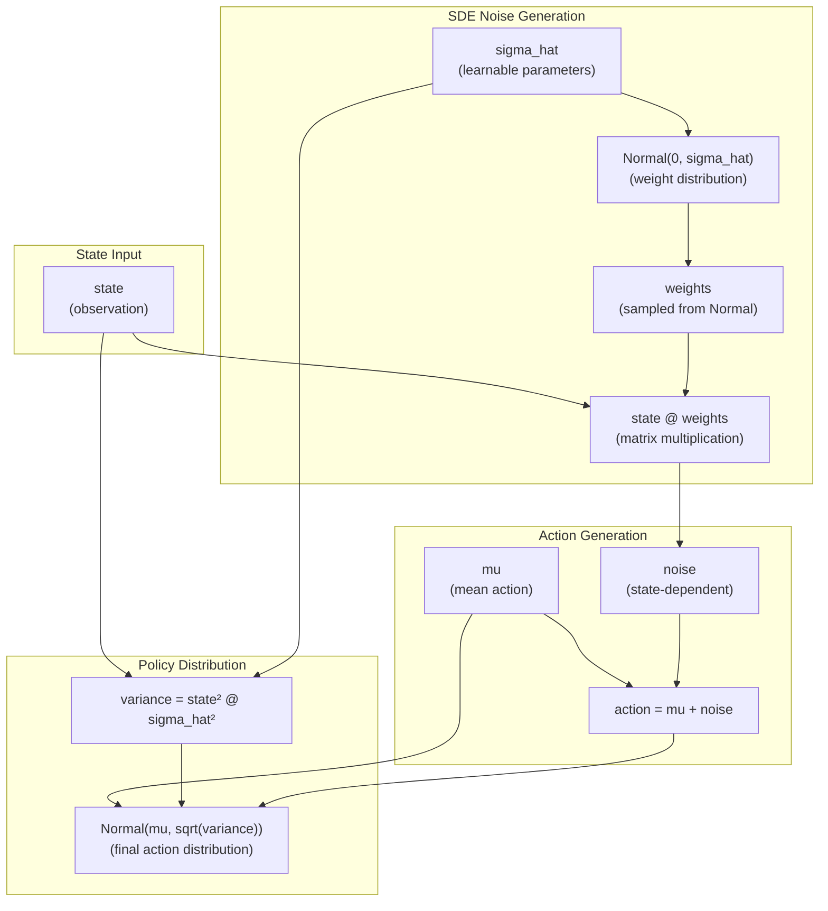
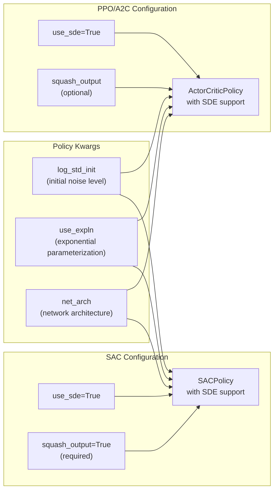
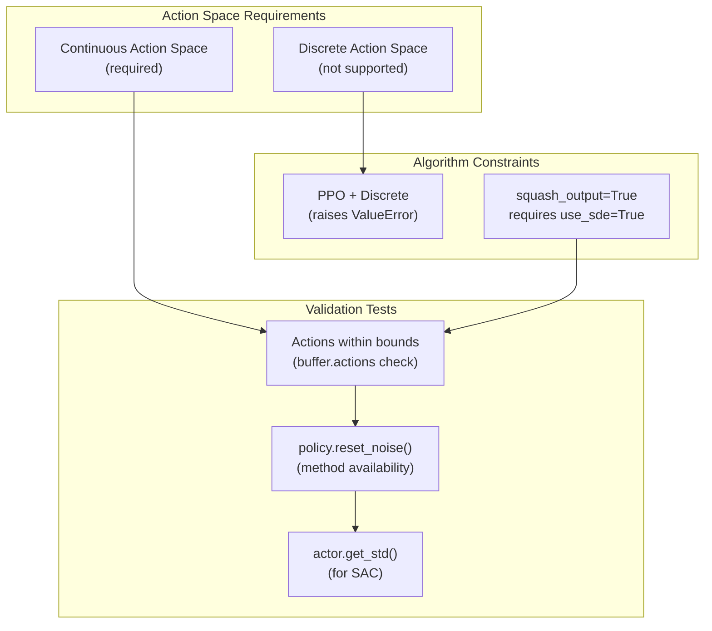
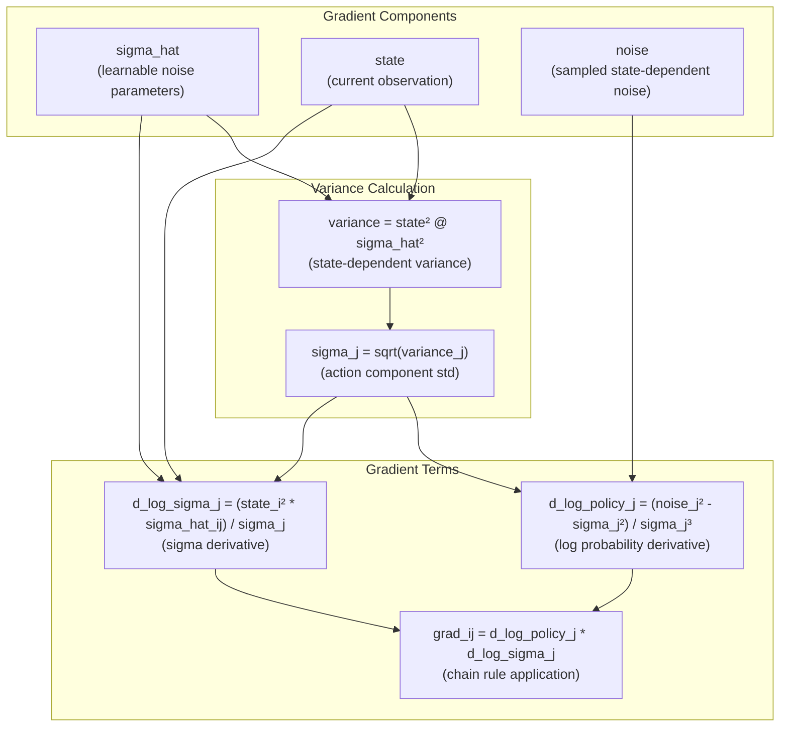
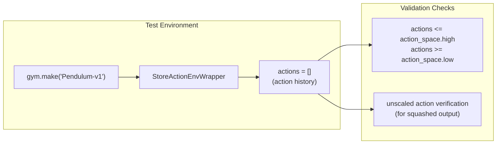

<!-- source: DeepWiki mcp.deepwiki.com · repo DLR-RM/stable-baselines3 · page 9.2 State-Dependent Exploration · fetched 2026-10-14 -->

# State-Dependent Exploration

<details>
<summary>Relevant source files</summary>

The following files were used as context for generating this wiki page:

- [stable_baselines3/common/distributions.py](stable_baselines3/common/distributions.py)
- [stable_baselines3/common/noise.py](stable_baselines3/common/noise.py)
- [stable_baselines3/common/preprocessing.py](stable_baselines3/common/preprocessing.py)
- [stable_baselines3/common/sb2_compat/rmsprop_tf_like.py](stable_baselines3/common/sb2_compat/rmsprop_tf_like.py)
- [tests/test_distributions.py](tests/test_distributions.py)
- [tests/test_sde.py](tests/test_sde.py)
- [tests/test_spaces.py](tests/test_spaces.py)

</details>


## Purpose and Scope

This document covers State-Dependent Exploration (SDE), an advanced exploration technique implemented in Stable-Baselines3 that allows the exploration noise to vary based on the current state of the environment. SDE enables more intelligent exploration strategies by adapting the amount of noise injected into actions depending on the observed state.

For information about basic exploration strategies and policy networks, see [Custom Policies](#9.1). For broader advanced usage patterns, see [Advanced Usage](#9).

## Overview

State-Dependent Exploration (SDE) is an exploration method where the noise added to actions during policy execution depends on the current state observation. Instead of using fixed exploration noise across all states, SDE learns a state-dependent noise distribution that can provide more or less exploration in different regions of the state space.

### Key Benefits

- **Adaptive Exploration**: More exploration in uncertain regions, less in well-understood areas
- **Improved Sample Efficiency**: Better exploration can lead to faster learning
- **State-Aware Noise**: Noise magnitude adapts to the local state characteristics

Sources: [tests/test_sde.py:1-122]()

## SDE Implementation Architecture



Sources: [tests/test_sde.py:14-35]()

## Supported Algorithms

SDE is supported by the following algorithms in Stable-Baselines3:

| Algorithm | SDE Support | Action Space | Notes |
|-----------|-------------|--------------|-------|
| `SAC` | ✅ | Continuous | Always uses `squash_output=True` |
| `PPO` | ✅ | Continuous | Supports both squashed and non-squashed output |
| `A2C` | ✅ | Continuous | Supports both squashed and non-squashed output |
| `TD3` | ❌ | - | Not supported |
| `DDPG` | ❌ | - | Not supported |
| `DQN` | ❌ | - | Discrete action spaces not supported |

### Algorithm-Specific Configuration



Sources: [tests/test_sde.py:69-107]()

## Configuration and Usage

### Basic Configuration

To enable SDE, set `use_sde=True` when creating the algorithm instance:

```python
# Example configuration patterns from test file
policy_kwargs = {
    "log_std_init": -2,      # Initial log standard deviation
    "use_expln": True,       # Use exponential parameterization
    "net_arch": [64],        # Network architecture
    "squash_output": True    # Squash actions to action space bounds
}

model = PPO(
    "MlpPolicy",
    env,
    use_sde=True,
    policy_kwargs=policy_kwargs
)
```

### Policy Configuration Parameters

| Parameter | Type | Description | Default |
|-----------|------|-------------|---------|
| `log_std_init` | float | Initial value for log standard deviation | varies |
| `use_expln` | bool | Use exponential parameterization for std | False |
| `squash_output` | bool | Squash actions to action space bounds | False |
| `net_arch` | list | Network architecture specification | varies |

Sources: [tests/test_sde.py:75-90]()

## SDE Validation and Constraints

### Environment Compatibility

SDE has specific requirements and constraints:



### Runtime Validation

The implementation includes several validation mechanisms:

1.  **Action Space Validation**: SDE only works with continuous action spaces. Attempting to use SDE with a discrete action space, for example, with `PPO("MlpPolicy", "CartPole-v1", use_sde=True)`, will raise a `ValueError` [tests/test_sde.py:59-62]().
2.  **Output Squashing**: When `squash_output=True` is specified in `policy_kwargs`, `use_sde=True` must also be enabled. If `use_sde=False` is used with `squash_output=True`, an `AssertionError` will be raised [tests/test_sde.py:64-67]().
3.  **Action Bounds Checking**: Actions are validated to be within the environment's action space bounds. The `StoreActionEnvWrapper` is used in tests to track actions and assert that they remain within the `model.action_space.high` and `model.action_space.low` limits [tests/test_sde.py:94-96](). For squashed outputs, it also verifies that actions are correctly unscaled [tests/test_sde.py:98-103]().

Sources: [tests/test_sde.py:59-67](), [tests/test_sde.py:94-103]()

## Mathematical Foundation

### Gradient Computation

The SDE implementation follows the mathematical framework described in the Rueckstiess paper. The gradient computation for the noise parameters involves:



The gradient validation ensures that the computed gradients match the analytical form derived from the mathematical theory. This is tested in `test_state_dependent_exploration_grad` by comparing the autograd computed gradient (`sigma_hat.grad`) with an analytically derived gradient (`grad`) [tests/test_sde.py:38-56]().

Sources: [tests/test_sde.py:10-56]()

## Testing Infrastructure

### Test Coverage

The SDE implementation includes comprehensive test coverage:

| Test Function | Purpose | Validation |
|---------------|---------|------------|
| `test_state_dependent_exploration_grad` | Gradient correctness | Mathematical accuracy |
| `test_sde_check` | Discrete action space rejection | Error handling |
| `test_only_sde_squashed` | Squashing configuration | Parameter validation |
| `test_state_dependent_noise` | End-to-end functionality | Integration testing |

Sources: [tests/test_sde.py:10-107]()

### Action Tracking

The test infrastructure includes a custom environment wrapper for validation:



The `StoreActionEnvWrapper` [tests/test_sde.py:109-122]() tracks all actions sent to the environment to verify that SDE maintains proper action bounds and scaling. This wrapper appends each action to an internal list `self.actions` during the `step` method [tests/test_sde.py:120](). This allows subsequent assertions to check properties of the actions taken by the agent, such as being within the expected range [tests/test_sde.py:94-103]().

Sources: [tests/test_sde.py:109-122](), [tests/test_sde.py:82-107]()

---

