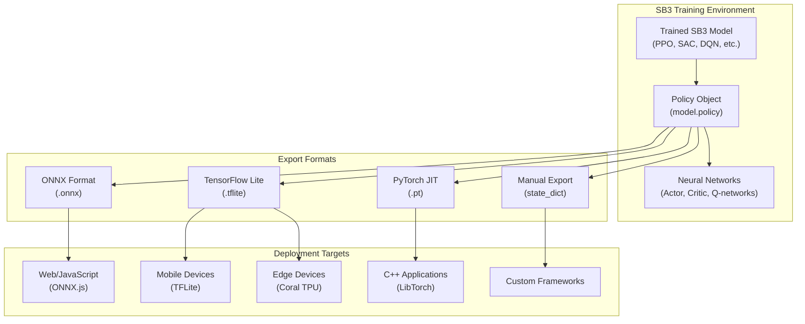
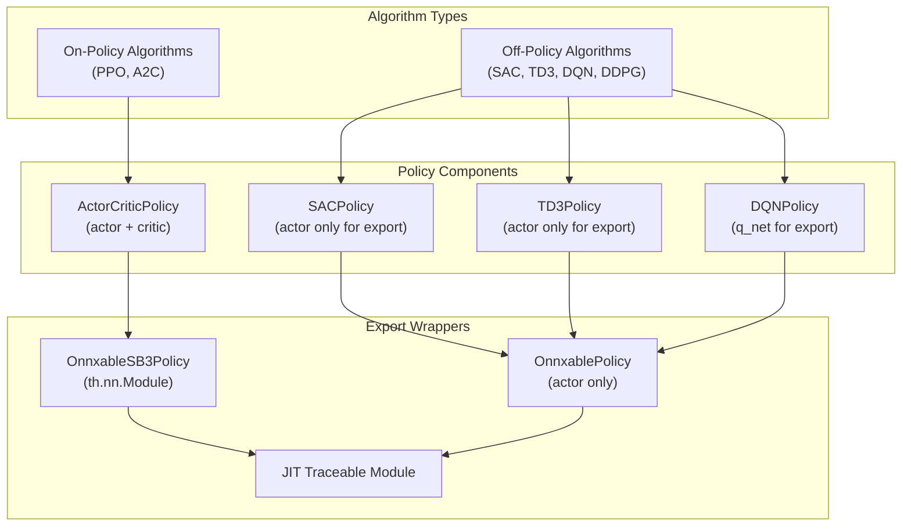
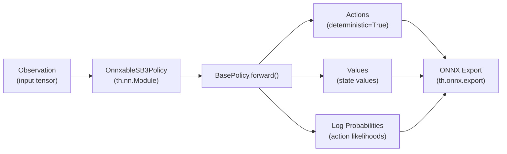
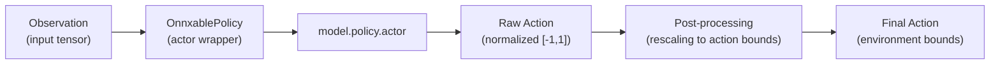
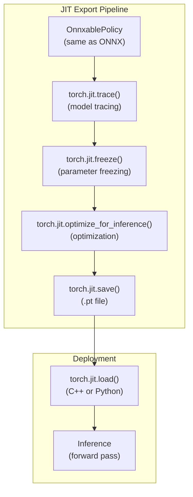
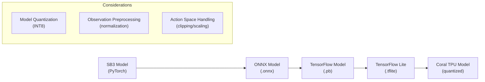
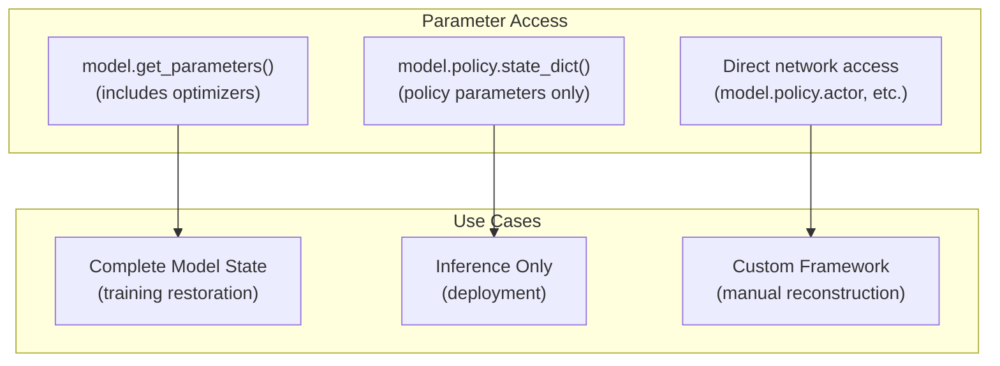
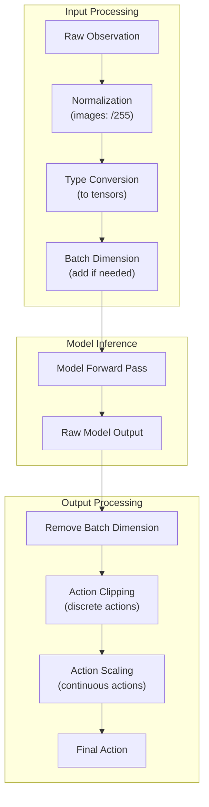
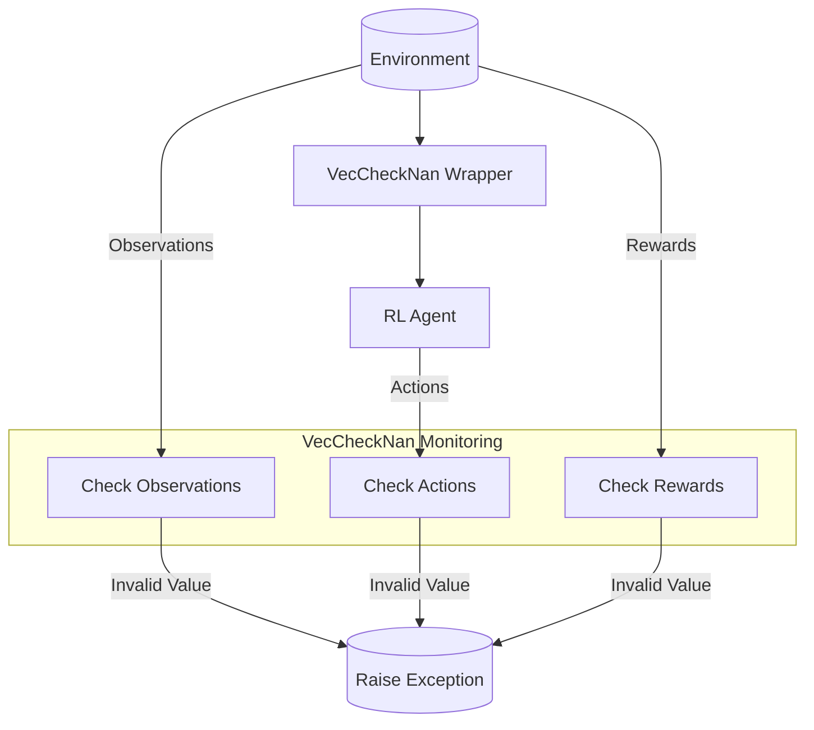

<!-- source: DeepWiki mcp.deepwiki.com · repo DLR-RM/stable-baselines3 · page 9.3 Model Export & Deployment · fetched 2026-10-14 -->

# Model Export & Deployment

<details>
<summary>Relevant source files</summary>

The following files were used as context for generating this wiki page:

- [docs/guide/checking_nan.md](docs/guide/checking_nan.md)
- [docs/guide/export.md](docs/guide/export.md)
- [docs/guide/imitation.md](docs/guide/imitation.md)
- [docs/guide/integrations.md](docs/guide/integrations.md)
- [docs/guide/migration.md](docs/guide/migration.md)
- [docs/guide/save_format.md](docs/guide/save_format.md)
- [docs/guide/sb3_contrib.md](docs/guide/sb3_contrib.md)
- [docs/guide/tensorboard.md](docs/guide/tensorboard.md)

</details>


This document covers exporting trained Stable-Baselines3 models for deployment in production environments and other frameworks. It explains the export pipeline, supported formats, and deployment considerations for trained RL agents.

For information about model persistence and checkpointing during training, see [Model Saving & Loading](#8). For custom policy architectures that affect export, see [Custom Policies](#9.1).

## Overview

Stable-Baselines3 models can be exported to various formats for deployment outside the SB3 ecosystem. The core component for export is the policy object (`model.policy`), which contains the neural networks and logic needed for inference. The policy holds sufficient information to predict actions from observations without requiring the full training infrastructure.



**Sources:** [docs/guide/export.md:11-20]()

## Export Architecture

The export process involves extracting the policy component from trained models and wrapping it in format-specific containers. Different algorithms require different export approaches based on their policy structures.



**Sources:** [docs/guide/export.md:17-24](), [stable_baselines3/common/policies.py:370-377]()

## ONNX Export

ONNX (Open Neural Network Exchange) export enables deployment across multiple frameworks and platforms. The process involves creating wrapper classes that expose the policy's forward pass in ONNX-compatible format.

### PPO/A2C Export

For on-policy algorithms, the `OnnxableSB3Policy` wrapper exports the complete policy including actor and critic networks:

| Component | Description | Output |
|-----------|-------------|---------|
| Actor Network | Action prediction | `actions` tensor |
| Critic Network | Value estimation | `values` tensor |
| Log Probabilities | Action likelihoods | `log_prob` tensor |



**Sources:** [docs/guide/export.md:44-82]()

### SAC/TD3 Export

For off-policy algorithms, typically only the actor network is exported since it's sufficient for action prediction:



**Sources:** [docs/guide/export.md:107-161]()

### ONNX Export Process

The export pipeline follows this sequence:

1.  **Model Loading**: Load trained SB3 model on CPU device
2.  **Wrapper Creation**: Instantiate format-specific wrapper class (`OnnxableSB3Policy` [docs/guide/export.md:42-54]() or `OnnxablePolicy` [docs/guide/export.md:104-113]())
3.  **Dummy Input**: Create tensor matching observation space shape
4.  **ONNX Export**: Use `torch.onnx.export()` with specified opset version
5.  **Validation**: Verify exported model using ONNX runtime

**Sources:** [docs/guide/export.md:68-102]()

## PyTorch JIT Export

PyTorch JIT (Just-In-Time) compilation enables deployment in C++ applications and provides optimized inference performance.



The JIT export process provides several optimizations:
-   **Model Tracing**: Records computational graph during forward pass using `th.jit.trace()` [docs/guide/export.md:167]()
-   **Parameter Freezing**: Eliminates training-specific code paths using `th.jit.freeze()` [docs/guide/export.md:168]()
-   **Inference Optimization**: Applies runtime optimizations for deployment using `th.jit.optimize_for_inference()` [docs/guide/export.md:169]()

**Sources:** [docs/guide/export.md:167-179]()

## TensorFlow Lite and Edge Deployment

For mobile and edge deployment, models can be exported through a multi-step conversion pipeline: SB3 → ONNX → TensorFlow → TensorFlow Lite → Coral TPU.



### Edge Deployment Challenges

| Challenge | Solution |
|-----------|----------|
| Model Size | Quantization to INT8 |
| Observation Processing | Embed normalization in model |
| Action Space | Handle bounds conversion |
| Hardware Constraints | Optimize for target device |

**Sources:** [docs/guide/export.md:181-192]()

## Manual Parameter Export

For custom deployment scenarios, direct access to model parameters enables manual reconstruction in target frameworks.

### Parameter Access Methods



### Policy Architecture Access

Each algorithm provides access to its policy components:

| Algorithm | Key Components | Access Pattern |
|-----------|---------------|----------------|
| PPO/A2C | `actor`, `critic` | `model.policy.mlp_extractor` |
| SAC | `actor`, `critic`, `critic_target` | `model.policy.actor` |
| TD3/DDPG | `actor`, `critic`, `actor_target`, `critic_target` | `model.policy.actor` |
| DQN | `q_net`, `q_net_target` | `model.policy.q_net` |

**Sources:** [docs/guide/migration.md:74-76](), [docs/guide/migration.md:84-85](), [docs/guide/migration.md:123-124](), [docs/guide/migration.md:127-128](), [docs/guide/migration.md:130-131]()

## Deployment Considerations

### Preprocessing and Postprocessing

Exported models require careful handling of observation preprocessing and action postprocessing:



**Sources:** [docs/guide/export.md:26-33](), [docs/guide/export.md:49-51](), [docs/guide/export.md:110-111](), [docs/guide/export.md:144-146]()

### Performance Considerations

| Consideration | Impact | Mitigation |
|---------------|--------|------------|
| Model Size | Memory usage, load time | Quantization, pruning |
| Inference Speed | Response time | JIT compilation, optimization |
| Batch Processing | Throughput | Vectorized environments |
| Memory Allocation | Runtime performance | Pre-allocated buffers |

**Sources:** [docs/guide/export.md:167-169]()

### Framework Compatibility

Different export formats have varying compatibility with deployment targets:

-   **ONNX**: Broad framework support, standardized format. See [docs/guide/export.md:27-92]() for an example.
-   **PyTorch JIT**: Native PyTorch ecosystem, C++ deployment. See [docs/guide/export.md:155-179]() for an example.
-   **TensorFlow Lite**: Mobile and embedded devices. See [docs/guide/export.md:181-192]() for related discussion.
-   **Manual Export**: Maximum flexibility, custom implementations.

**Sources:** [docs/guide/export.md:8-11](), [docs/guide/export.md:155-179](), [docs/guide/export.md:181-192]()

## NaN Checking and Integrations

During training or deployment, numerical instabilities can lead to `NaN` (Not a Number) or `inf` (infinity) values, corrupting the model. Stable-Baselines3 provides tools and recommendations to detect and handle these issues.

### Anomaly Detection with PyTorch

PyTorch offers an anomaly detection feature that can be enabled to catch `NaN`s and `inf`s during backpropagation.

```python
import torch as th
th.autograd.set_detect_anomaly(True)
```

This will raise an error when an invalid value is produced during the backward pass, helping to pinpoint the source of the numerical instability.

**Sources:** [docs/guide/checking_nan.md:36-38]()

### `VecCheckNan` Wrapper

The `VecCheckNan` environment wrapper is designed to monitor observations, actions, and rewards for `NaN` or `inf` values. It can be configured to raise an exception immediately upon detection, providing detailed information about where the invalid value originated.



**Example Usage:**

```python
import gymnasium as gym
from gymnasium import spaces
import numpy as np

from stable_baselines3 import PPO
from stable_baselines3.common.vec_env import DummyVecEnv, VecCheckNan

class NanAndInfEnv(gym.Env):
    # ... (environment definition from source) ...
    def __init__(self):
        super(NanAndInfEnv, self).__init__()
        self.action_space = spaces.Box(low=-np.inf, high=np.inf, shape=(1,), dtype=np.float64)
        self.observation_space = spaces.Box(low=-np.inf, high=np.inf, shape=(1,), dtype=np.float64)

    def step(self, _action):
        randf = np.random.rand()
        if randf > 0.99:
            obs = float("NaN")
        elif randf > 0.98:
            obs = float("inf")
        else:
            obs = randf
        return [obs], 0.0, False, {}

    def reset(self):
        return [0.0]

    def render(self, close=False):
        pass

env = DummyVecEnv([lambda: NanAndInfEnv()])
env = VecCheckNan(env, raise_exception=True)

model = PPO("MlpPolicy", env)
model.learn(total_timesteps=int(2e5))
```

**Sources:** [docs/guide/checking_nan.md:89-135]()

### Hyperparameter Tuning

Numerical instabilities can often be a symptom of poorly chosen hyperparameters. Certain combinations of learning rates, network architectures, or other parameters can lead to exploding or vanishing gradients, resulting in `NaN`s. It is recommended to:
-   Understand the effect of each hyperparameter.
-   Tune hyperparameters carefully, potentially using automatic hyperparameter tuning tools (e.g., those found in the [RL Zoo](https://github.com/DLR-RM/rl-baselines3-zoo)).

**Sources:** [docs/guide/checking_nan.md:138-147]()

### Data Integrity

If the environment's observations are derived from external datasets, ensure that these datasets do not contain `NaN`s or `inf`s. Missing values in datasets are sometimes represented as `NaN`s and must be handled (e.g., by imputation) before being fed into the RL environment.

**Sources:** [docs/guide/checking_nan.md:150-155]()

---

