# Page: Overview

# Overview

<details>
<summary>Relevant source files</summary>

The following files were used as context for generating this wiki page:

- [README.md](README.md)
- [docs/guide/rl.md](docs/guide/rl.md)
- [docs/index.rst](docs/index.rst)
- [stable_baselines3/__init__.py](stable_baselines3/__init__.py)
- [stable_baselines3/version.txt](stable_baselines3/version.txt)

</details>


Stable Baselines3 (SB3) is a reliable, PyTorch-based implementation of reinforcement learning algorithms. This document provides a high-level overview of the library's architecture, components, and capabilities to help users understand how the different parts fit together.

For detailed installation instructions, see [Installation Guide](#1.1). For getting started with examples, see [Getting Started & Examples](#1.2).

## Purpose and Scope

SB3 aims to provide:
1. Clean, modular implementations of reinforcement learning algorithms
2. A common interface for training, prediction, and evaluation
3. Type-hinted, well-documented code for research and production use
4. Reliable performance with extensive testing

The library focuses on providing strong baseline implementations rather than cutting-edge research features. More experimental algorithms are available in the SB3-Contrib repository, while performance-optimized versions are available in SBX (SB3 + Jax).
Sources: [README.md:10-18](), [README.md:45-52]()

## Core Architecture

Stable Baselines3's architecture is designed around modularity and extensibility, with clear separation between algorithms, policies, and environment interactions.

### Component Relationships

```mermaid
graph TD
    subgraph "Core Components"
        BaseAlgorithm["BaseAlgorithm"]
        BasePolicy["BasePolicy"]
        VecEnv["VecEnv"]
        Buffers["Experience Buffers"]
        Callbacks["Callbacks"]
    end

    subgraph "Algorithm Types"
        OnPolicy["OnPolicyAlgorithm"]
        OffPolicy["OffPolicyAlgorithm"]
    end

    subgraph "Concrete Algorithms"
        PPO["PPO (stable_baselines3/ppo.py)"]
        A2C["A2C (stable_baselines3/a2c.py)"]
        DQN["DQN (stable_baselines3/dqn.py)"]
        SAC["SAC (stable_baselines3/sac.py)"]
        TD3["TD3 (stable_baselines3/td3.py)"]
        DDPG["DDPG (stable_baselines3/ddpg.py)"]
    end

    subgraph "Policy Types"
        AC["ActorCriticPolicy"]
        Q["QPolicy"]
    end

    subgraph "Buffers"
        ReplayBuffer["ReplayBuffer (stable_baselines3/common/buffers.py)"]
        RolloutBuffer["RolloutBuffer (stable_baselines3/common/buffers.py)"]
    end

    BaseAlgorithm --> OnPolicy
    BaseAlgorithm --> OffPolicy
    OnPolicy --> PPO
    OnPolicy --> A2C
    OffPolicy --> DQN
    OffPolicy --> SAC
    OffPolicy --> TD3
    OffPolicy --> DDPG

    BaseAlgorithm --> BasePolicy
    BasePolicy --> AC
    BasePolicy --> Q

    OnPolicy --> RolloutBuffer
    OffPolicy --> ReplayBuffer

    BaseAlgorithm --> VecEnv
    BaseAlgorithm --> Callbacks
```
Sources: [stable_baselines3/__init__.py:3-10]()

SB3's architecture follows a clear inheritance pattern, with all algorithms inheriting from a common `BaseAlgorithm` class, then specialized into on-policy and off-policy variants, before being implemented as concrete algorithms like `PPO`, `A2C`, and `DQN`.

### Training Data Flow

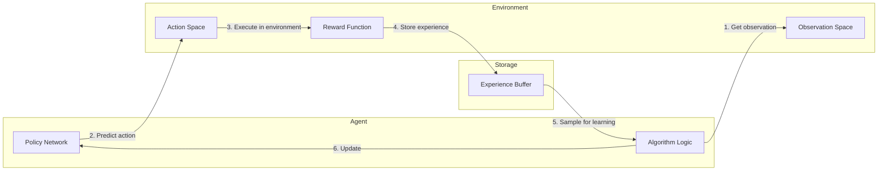

During training, the algorithm interacts with the environment to gather experiences, which are stored in buffers (replay buffer for off-policy algorithms or rollout buffer for on-policy algorithms). These experiences are then sampled to update the policy network through gradient descent.

## Implemented Algorithms

SB3 implements several widely-used reinforcement learning algorithms, with different characteristics and capabilities:

| Algorithm | Type | Action Space Support | Multi-Processing |
|-----------|------|----------------------|-----------------|
| A2C | On-Policy | Box, Discrete, MultiDiscrete, MultiBinary | ✅ |
| PPO | On-Policy | Box, Discrete, MultiDiscrete, MultiBinary | ✅ |
| DQN | Off-Policy | Discrete | ✅ |
| DDPG | Off-Policy | Box | ✅ |
| TD3 | Off-Policy | Box | ✅ |
| SAC | Off-Policy | Box | ✅ |
| HER | Off-Policy Wrapper | Box, Discrete (with goal) | ✅ |

SB3-Contrib provides additional algorithms including TRPO, TQC, QR-DQN, RecurrentPPO, and Maskable PPO.
Sources: [README.md:88-91]()

The algorithms are divided into two main categories:
- **On-policy algorithms** (`A2C`, `PPO`): Learn from current experiences, typically more sample-efficient but less data-efficient
- **Off-policy algorithms** (`DQN`, `SAC`, `TD3`, `DDPG`): Can learn from past experiences, typically more data-efficient but less sample-efficient

## Policy Architecture

Policies define how agents map observations to actions. SB3 provides several policy types to handle different types of observations and action spaces:

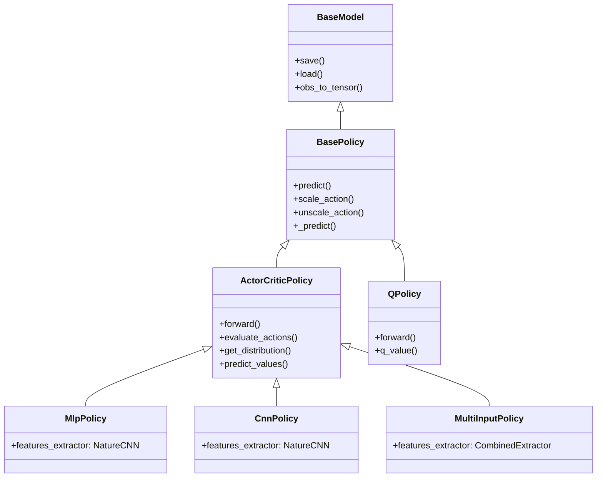

For each algorithm, SB3 provides pre-configured policies:
- `MlpPolicy`: For environments with vector observations
- `CnnPolicy`: For environments with image observations
- `MultiInputPolicy`: For environments with dictionary observations (mixing different types)

## Environment Interaction

SB3 uses vectorized environments (`VecEnv`) to handle multiple environments at once, enabling parallel execution and normalization:

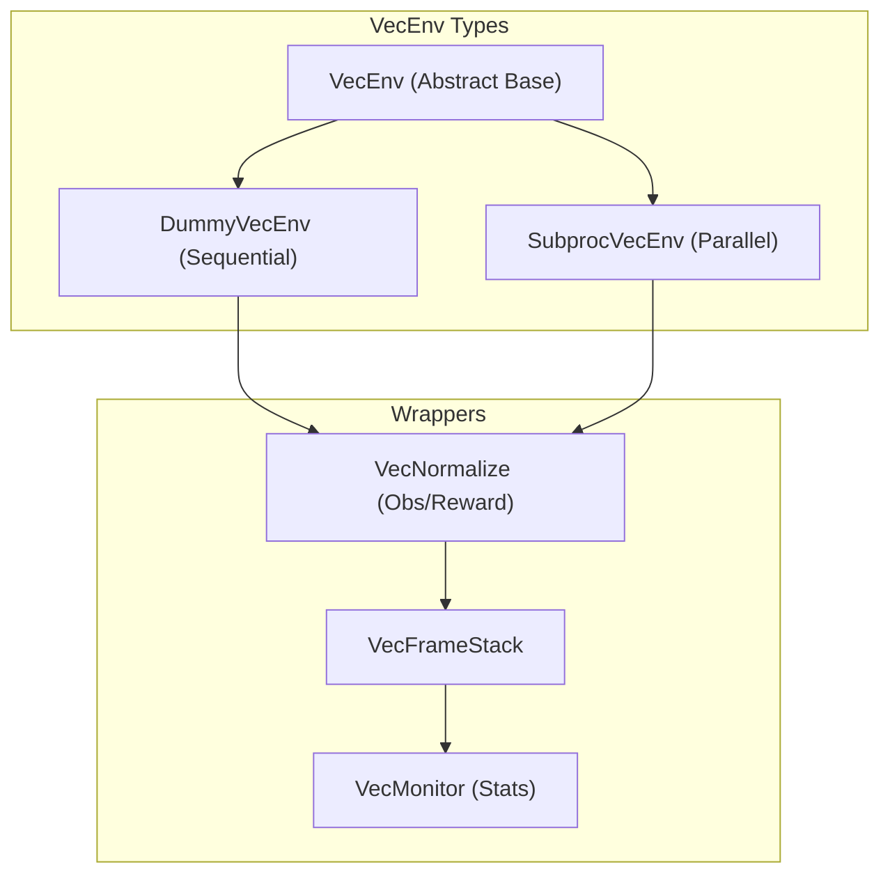

The vectorized environment system provides:
- Standardized interface for all algorithms
- Support for parallel environment execution
- Observation and reward normalization
- Episode monitoring and statistics

## Callback System

SB3 uses callbacks to monitor, control and customize the training process:

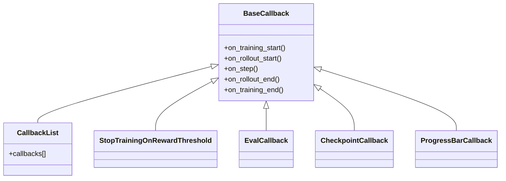

Common callbacks include:
- `EvalCallback`: Periodically evaluate agent performance
- `CheckpointCallback`: Save models at regular intervals
- `ProgressBarCallback`: Display training progress
- `StopTrainingOnRewardThreshold`: Early stopping based on rewards

## SB3 Ecosystem

SB3 is part of a larger ecosystem of reinforcement learning tools:

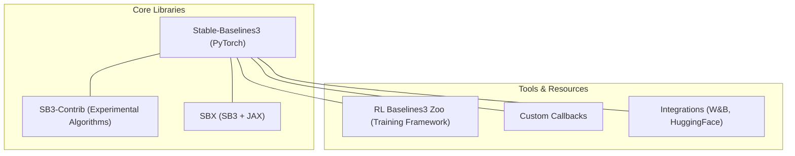
Sources: [README.md:49-52](), [README.md:66-98]()

The ecosystem includes:
- **SB3**: Core reinforcement learning algorithms
- **SB3-Contrib**: Experimental algorithms (TRPO, QR-DQN, TQC, etc.)
- **SBX**: High-performance JAX implementations (up to 20x faster)
- **RL Baselines3 Zoo**: Training framework with hyperparameter tuning, logging, and pre-trained models

## Installation and Requirements

SB3 requires Python 3.10+ and PyTorch >= 2.8. The basic installation can be done via pip:
Sources: [README.md:103-105]()

```sh
pip install stable-baselines3
```

For additional features (Tensorboard, OpenCV, Atari support):

```sh
pip install 'stable-baselines3[extra]'
```
Sources: [README.md:114-117]()

For details, see [Installation Guide](#1.1).

## Version History

SB3 follows semantic versioning with regular releases. The current version is `2.9.2a0`.
Sources: [stable_baselines3/version.txt:1]()

While SB3 development is now focused on bug fixes and maintenance, new features and algorithms are primarily added to associated repositories like SB3-Contrib and SBX.
Sources: [README.md:49-52]()

## Summary

Stable Baselines3 provides a reliable, well-tested implementation of reinforcement learning algorithms in PyTorch. Its modular design allows for easy experimentation and extension, while its consistent interface simplifies the process of training and deploying reinforcement learning agents. The library is actively maintained and continues to evolve with new features and improvements.

---

# Page: Installation Guide

# Installation Guide

<details>
<summary>Relevant source files</summary>

The following files were used as context for generating this wiki page:

- [.dockerignore](.dockerignore)
- [.readthedocs.yml](.readthedocs.yml)
- [Dockerfile](Dockerfile)
- [docs/conda_env.yml](docs/conda_env.yml)
- [docs/guide/install.md](docs/guide/install.md)
- [scripts/build_docker.sh](scripts/build_docker.sh)
- [scripts/run_docker_cpu.sh](scripts/run_docker_cpu.sh)
- [scripts/run_docker_gpu.sh](scripts/run_docker_gpu.sh)
- [setup.py](setup.py)
- [stable_baselines3/common/envs/__init__.py](stable_baselines3/common/envs/__init__.py)

</details>


This document provides comprehensive installation instructions for Stable-Baselines3, including system requirements, dependency management, and various installation methods. It covers standard pip installation, development setup, Docker configurations, and optional package installations.

For information about getting started with basic usage after installation, see [Getting Started & Examples](#1.2). For migration from previous versions, see the migration documentation in the SB3 ecosystem.

## Prerequisites and System Requirements

Stable-Baselines3 requires specific system prerequisites that must be met before installation:

### Core Requirements

| Component | Requirement | Notes |
|-----------|-------------|-------|
| Python | `>=3.10` | Minimum supported version [setup.py:140]() |
| PyTorch | `>=2.8,<3.0` | Deep learning backend [setup.py:84]() |
| Operating System | Windows, Linux, macOS | Full cross-platform support |

### Platform-Specific Considerations

**Windows Users**: We recommend using [miniforge](https://github.com/conda-forge/miniforge#windows) for Windows users for easier installation of Python packages and required libraries. You need an environment with Python version 3.10 or above. [docs/guide/install.md:9-11]() Some Atari environments may require additional DLL files and can produce vague error messages if dependencies are missing. [docs/guide/install.md:15-18]()

**Headless Systems**: For systems without X-server (e.g., Docker containers), `opencv-python-headless` is required instead of standard OpenCV packages. [docs/guide/install.md:39-41]()

Sources: [setup.py:138-155](), [docs/guide/install.md:9-18](), [docs/guide/install.md:39-41]()

## Installation Methods

### Stable Release Installation

The standard installation method uses pip to install the latest stable release from PyPI:

```bash
pip install 'stable-baselines3[extra]'
```
[docs/guide/install.md:24-26]()

**Note**: Some shells (like Zsh) require quotation marks around brackets, i.e. `pip install 'stable-baselines3[extra]'`. [docs/guide/install.md:28-30]()

For minimal installation without optional dependencies:
```bash
pip install stable-baselines3
```
[docs/guide/install.md:34-36]()

The `[extra]` suffix includes optional dependencies for enhanced functionality including TensorBoard logging, OpenCV, `ale-py` for Atari games, `psutil` for memory checking, `tqdm` and `rich` for progress bars, `pandas` and `matplotlib` for plotting. [setup.py:111-128]()

Sources: [docs/guide/install.md:24-36](), [setup.py:78-88](), [setup.py:111-128]()

### Development and Bleeding-Edge Versions

#### Bleeding-Edge Installation
Install directly from the main branch for latest features:

```bash
pip install git+https://github.com/DLR-RM/stable-baselines3
```
[docs/guide/install.md:46-48]()

With optional dependencies:
```bash
pip install "stable_baselines3[extra,tests,docs] @ git+https://github.com/DLR-RM/stable-baselines3"
```
[docs/guide/install.md:50-52]()

#### Development Installation
For contributors requiring editable installation with testing and documentation tools:

```bash
git clone https://github.com/DLR-RM/stable-baselines3 && cd stable-baselines3
pip install -e '.[docs,tests,extra]'
```
[docs/guide/install.md:59-62]()

Sources: [docs/guide/install.md:46-62]()

## Dependency Configuration

### Core Dependencies

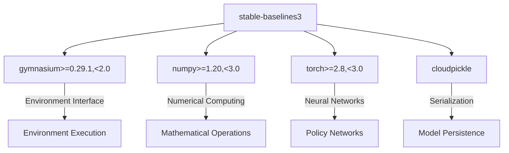
Sources: [setup.py:81-87]()

### Optional Dependency Groups

The installation system supports several optional dependency groups defined in the `extras_require` configuration:

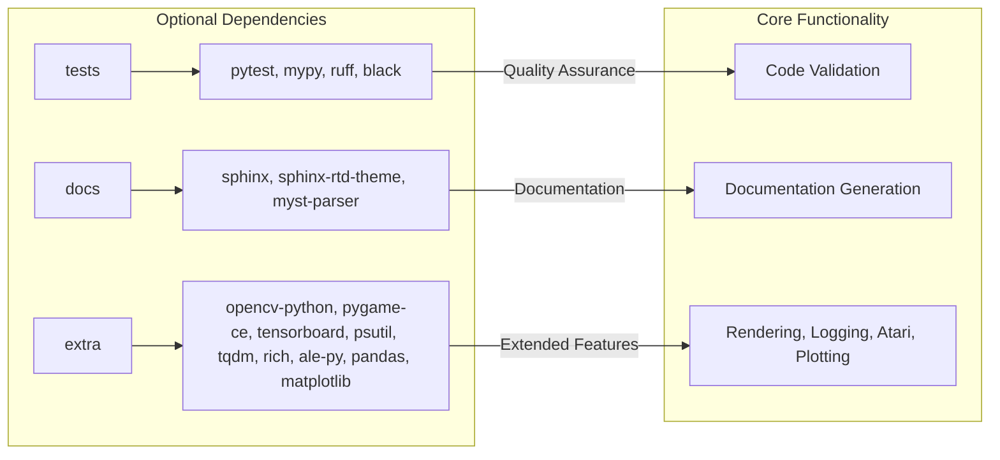
Sources: [setup.py:89-128]()

#### Tests Extra Package
```bash
pip install 'stable-baselines3[tests]'
```
Includes: `pytest`, `pytest-cov`, `mypy`, `ruff`, `black`. [setup.py:89-98]()

#### Documentation Extra Package  
```bash
pip install 'stable-baselines3[docs]'
```
Includes: `sphinx`, `sphinx-autobuild`, `sphinx-rtd-theme`, `sphinxcontrib.spelling`, `sphinx_copybutton`, `myst-parser`. [setup.py:100-110]()

#### Extra Features Package
```bash
pip install 'stable-baselines3[extra]'
```
Includes: `opencv-python`, `pygame-ce`, `tensorboard`, `psutil`, `tqdm`, `rich`, `ale-py`, `pillow`, `pandas`, `matplotlib`. [setup.py:112-128]()

Sources: [setup.py:89-128]()

## Docker Installation

### Pre-built Docker Images

Stable-Baselines3 provides official Docker images for development and testing:

**GPU Support** (requires [nvidia-docker](https://github.com/NVIDIA/nvidia-docker)):
```bash
docker pull stablebaselines/stable-baselines3
```
[docs/guide/install.md:77-79]()

**CPU Only**:
```bash
docker pull stablebaselines/stable-baselines3-cpu
```
[docs/guide/install.md:81-83]()

### Building Custom Images

The `Dockerfile` [Dockerfile:1-27]() defines the environment. The `scripts/build_docker.sh` [scripts/build_docker.sh:1-25]() script automates the build process.

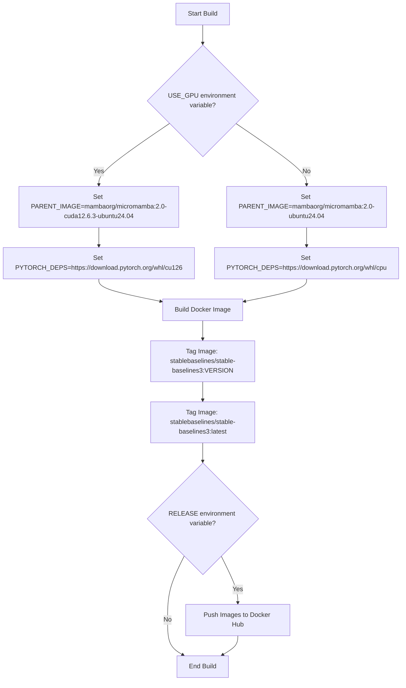
Sources: [Dockerfile:1-27](), [scripts/build_docker.sh:1-25]()

**GPU Image**:
```bash
make docker-gpu
```
This command internally uses `scripts/build_docker.sh` with `USE_GPU=True`. [scripts/build_docker.sh:9]()

**CPU Image**:
```bash
make docker-cpu
```
This command internally uses `scripts/build_docker.sh` with `USE_GPU` not set to `True`. [scripts/build_docker.sh:13]()

Sources: [docs/guide/install.md:90-93](), [scripts/build_docker.sh:1-25]()

### Running Docker Containers

**GPU Container**:
```bash
docker run -it --runtime=nvidia --rm --network host --ipc=host \
  --name test --mount src="$(pwd)",target=/home/mamba/stable-baselines3,type=bind \
  stablebaselines/stable-baselines3 bash -c 'cd /home/mamba/stable-baselines3/ && pytest tests/'
```
[docs/guide/install.md:110-113]()
Or, with the shell file:
```bash
./scripts/run_docker_gpu.sh pytest tests/
```
[docs/guide/install.md:117-119]()

**CPU Container**:
```bash
docker run -it --rm --network host --ipc=host \
  --name test --mount src="$(pwd)",target=/home/mamba/stable-baselines3,type=bind \
  stablebaselines/stable-baselines3-cpu bash -c 'cd /home/mamba/stable-baselines3/ && pytest tests/'
```
[docs/guide/install.md:123-126]()
Or, with the shell file:
```bash
./scripts/run_docker_cpu.sh pytest tests/
```
[docs/guide/install.md:129-131]()

#### Docker Command Parameters

| Parameter | Purpose |
|-----------|---------|
| `docker run -it` | Create an instance of an image (=container), and run it interactively. [docs/guide/install.md:135-136]() |
| `--rm` | Remove the container once it exits/stops. [docs/guide/install.md:137-138]() |
| `--network host` | Don't use network isolation, allows TensorBoard/Visdom on host machine. [docs/guide/install.md:139-141]() |
| `--ipc=host` | Use the host system’s IPC namespace for shared memory segments, semaphores, and message queues. [docs/guide/install.md:142-145]() |
| `--name test` | Assign the name `test` to the container. [docs/guide/install.md:146-147]() |
| `--mount src=...` | Bind the local directory (`pwd`) to `/home/mamba/stable-baselines3` in the container. [docs/guide/install.md:148-150]() |
| `bash -c '...'` | Run a command inside the Docker image. [docs/guide/install.md:151-152]()

Sources: [docs/guide/install.md:108-152](), [scripts/run_docker_gpu.sh:1-12](), [scripts/run_docker_cpu.sh:1-11]()

## Installation Verification

### Basic Functionality Test

Create a simple test script to verify installation:

```python
import gymnasium

from stable_baselines3 import PPO

# Create environment
env = gymnasium.make("CartPole-v1", render_mode="human") # render_mode added for clarity

# Create agent
model = PPO("MlpPolicy", env, verbose=1)

# Quick training test
model.learn(total_timesteps=1000)
print("Installation successful!")

# Optional: Test prediction and step
vec_env = model.get_env()
obs = vec_env.reset()
for i in range(100):
    action, _states = model.predict(obs, deterministic=True)
    obs, rewards, dones, info = vec_env.step(action)
    vec_env.render()
```
This example is adapted from the `setup.py` quick example. [setup.py:45-64]()

### Package Structure Verification

After installation, the package structure should include:

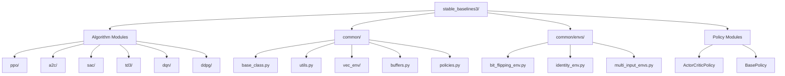
Sources: [setup.py:78-80](), [stable_baselines3/common/envs/__init__.py:1-19]()

## Troubleshooting Common Issues

### Performance Issues

**Slow PyTorch Performance**: If experiencing significant slowdown after switching to PyTorch, try adjusting thread usage:

```python
import torch
torch.set_num_threads(1)
```

Or set environment variable:
```bash
export OMP_NUM_THREADS=1
```

### Environment-Specific Problems

**Atari Environment Issues**: On Windows, missing DLL files may cause vague errors. Ensure all Visual C++ redistributables are installed. [docs/guide/install.md:15-18]()

**Headless OpenCV**: For Docker or headless systems, `opencv-python-headless` is required. [docs/guide/install.md:39-41]()
```bash
pip install opencv-python-headless
```

### Import Errors

**Missing Optional Dependencies**: Install specific extras based on features needed:
```bash
pip install 'stable-baselines3[extra]'  # For full features
pip install 'stable-baselines3[tests]'  # For testing
pip install 'stable-baselines3[docs]'   # For documentation
```

Sources: [docs/guide/install.md:15-18](), [docs/guide/install.md:39-41]()

---

# Page: Getting Started & Examples

# Getting Started & Examples

<details>
<summary>Relevant source files</summary>

The following files were used as context for generating this wiki page:

- [README.md](README.md)
- [docs/guide/algos.md](docs/guide/algos.md)
- [docs/guide/examples.md](docs/guide/examples.md)
- [docs/guide/quickstart.md](docs/guide/quickstart.md)
- [docs/guide/rl.md](docs/guide/rl.md)
- [docs/guide/rl_tips.md](docs/guide/rl_tips.md)
- [docs/index.rst](docs/index.rst)

</details>


This page provides a practical introduction to using Stable-Baselines3 (SB3) with step-by-step examples and common usage patterns. It covers basic training workflows, core API usage, and essential examples to get you started with reinforcement learning experiments.

For installation instructions, see [Installation Guide](#1.1). For information about creating custom environments, see [Custom Environments](#5.3). For advanced training control and monitoring, see [Training & Monitoring](#7) and [Callback System](#7.1).

## Basic Training Workflow

The fundamental SB3 workflow involves four main components working together: algorithms, policies, environments, and training utilities.

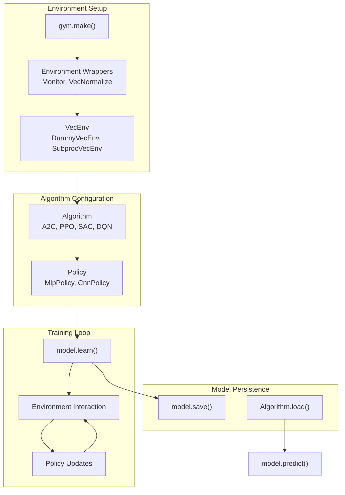

Sources: [docs/guide/examples.md:65-103](), [docs/guide/quickstart.md:15-37]()

## Quick Start Example

The simplest way to train an RL agent follows a sklearn-like API pattern:

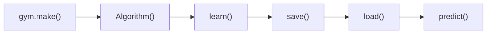

The basic pattern involves creating an environment, instantiating an algorithm with a policy, training with `learn()`, and using the trained model with `predict()`.

Sources: [docs/guide/quickstart.md:15-37](), [docs/guide/examples.md:65-103]()

## Core Usage Patterns

### Environment and Algorithm Setup

SB3 supports multiple environment types and automatically wraps single environments in vectorized containers:

| Environment Type | SB3 Class | Use Case |
|-----------------|-----------|----------|
| Single Process | `DummyVecEnv` | Simple environments, debugging |
| Multi Process | `SubprocVecEnv` | CPU parallelization |
| Normalized | `VecNormalize` | Continuous control tasks |
| Monitoring | `Monitor` | Training metrics collection |

The core algorithm classes follow a consistent interface:

| Algorithm Type | Classes | Action Space |
|---------------|---------|--------------|
| On-Policy | `A2C`, `PPO` | Discrete, Continuous |
| Off-Policy | `SAC`, `TD3`, `DDPG` | Continuous |
| Value-Based | `DQN` | Discrete |

Sources: [docs/guide/examples.md:116-160](), [docs/guide/algos.md:11-27]()

### Training and Evaluation Workflow

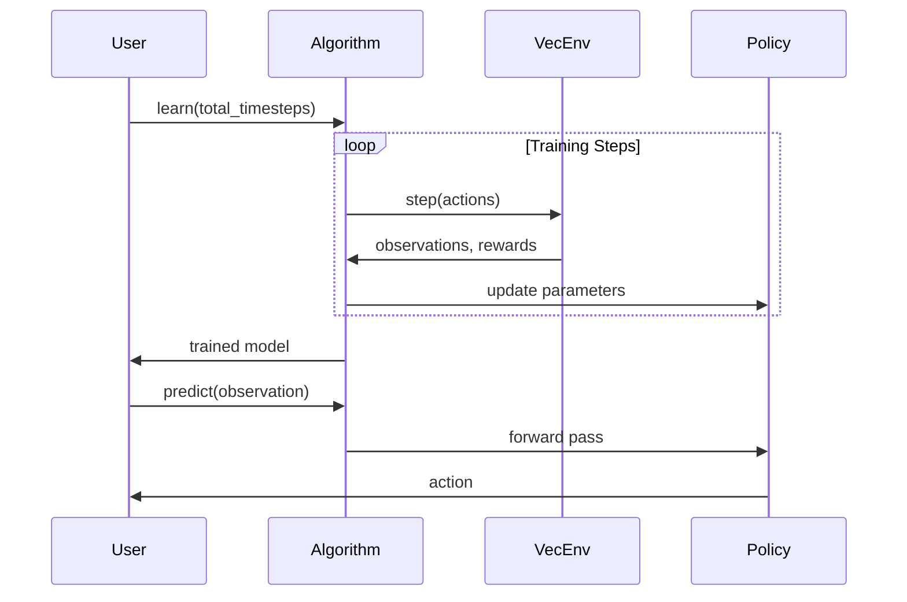

The training process involves the algorithm collecting experience from the environment and updating the policy. Evaluation uses the same `predict()` method but typically with `deterministic=True`.

Sources: [docs/guide/examples.md:94-102](), [docs/guide/examples.md:310-350]()

## Essential Examples

### Basic Training and Evaluation

The fundamental pattern for training any SB3 algorithm:

```python
# Create environment
env = gym.make("LunarLander-v3", render_mode="rgb_array")

# Instantiate the agent
# Note: you can enable multi-step replay buffer by passing `n_steps=3` for instance
model = DQN("MlpPolicy", env, verbose=1)
# Train the agent and display a progress bar
model.learn(total_timesteps=int(2e5), progress_bar=True)
# Save the agent
model.save("dqn_lunar")
del model  # delete trained model to demonstrate loading

# Load the trained agent
# NOTE: if you have loading issue, you can pass `print_system_info=True`
# to compare the system on which the model was trained vs the current one
# model = DQN.load("dqn_lunar", env=env, print_system_info=True)
model = DQN.load("dqn_lunar", env=env)

# Evaluate the agent
# NOTE: If you use wrappers with your environment that modify rewards,
#       this will be reflected here. To evaluate with original rewards,
#       wrap the environment in a "Monitor" wrapper before other wrappers.
mean_reward, std_reward = evaluate_policy(model, model.get_env(), n_eval_episodes=10)

# Enjoy trained agent
vec_env = model.get_env()
obs = vec_env.reset()
for i in range(1000):
    action, _states = model.predict(obs, deterministic=True)
    obs, rewards, dones, info = vec_env.step(action)
    vec_env.render("human")
```

This pattern works across all algorithms by changing the algorithm class (`DQN`, `PPO`, `SAC`, etc.) and appropriate policy type.

Sources: [docs/guide/examples.md:59-96]()

### Vectorized Environment Training

For improved performance, SB3 supports parallel environment execution:

```python
import gymnasium as gym

from stable_baselines3 import PPO
from stable_baselines3.common.vec_env import DummyVecEnv, SubprocVecEnv
from stable_baselines3.common.env_util import make_vec_env
from stable_baselines3.common.utils import set_random_seed

def make_env(env_id: str, rank: int, seed: int = 0):
    """
    Utility function for multiprocessed env.

    :param env_id: the environment ID
    :param num_env: the number of environments you wish to have in subprocesses
    :param seed: the initial seed for RNG
    :param rank: index of the subprocess
    """
    def _init():
        env = gym.make(env_id, render_mode="human")
        env.reset(seed=seed + rank)
        return env
    set_random_seed(seed)
    return _init

if __name__ == "__main__":
    env_id = "CartPole-v1"
    num_cpu = 4  # Number of processes to use
    # Create the vectorized environment
    vec_env = SubprocVecEnv([make_env(env_id, i) for i in range(num_cpu)])

    # Stable Baselines provides you with make_vec_env() helper
    # which does exactly the previous steps for you.
    # You can choose between `DummyVecEnv` (usually faster) and `SubprocVecEnv`
    # env = make_vec_env(env_id, n_envs=num_cpu, seed=0, vec_env_cls=SubprocVecEnv)

    model = PPO("MlpPolicy", vec_env, verbose=1)
    model.learn(total_timesteps=25_000)

    obs = vec_env.reset()
    for _ in range(1000):
        action, _states = model.predict(obs)
        obs, rewards, dones, info = vec_env.step(action)
        vec_env.render()
```

The `make_vec_env` utility automatically handles environment creation and vectorization. For off-policy algorithms, consider setting `gradient_steps=-1` for optimal sample efficiency.

Sources: [docs/guide/examples.md:116-151](), [docs/guide/examples.md:153-174]()

### Model Persistence

SB3 provides comprehensive save/load functionality:

```python
# Save the agent
model.save("dqn_lunar")
del model  # delete trained model to demonstrate loading

# Load the trained agent
# NOTE: if you have loading issue, you can pass `print_system_info=True`
# to compare the system on which the model was trained vs the current one
# model = DQN.load("dqn_lunar", env=env, print_system_info=True)
model = DQN.load("dqn_lunar", env=env)
```

The `load()` method recreates the model from scratch and should be called as a class method, not on an existing instance.

Sources: [docs/guide/examples.md:73-81]()

### Environment Normalization

For continuous control tasks, input normalization is often critical:

```python
# Create and normalize environment
vec_env = make_vec_env("HalfCheetahBulletEnv-v0", n_envs=1)
vec_env = VecNormalize(vec_env, norm_obs=True, norm_reward=True)

# Training
model = PPO("MlpPolicy", vec_env)
model.learn(total_timesteps=2000)

# Save normalization statistics
vec_env.save("vec_normalize.pkl")
```

The `VecNormalize` wrapper computes running statistics for observations and rewards, which must be saved and loaded separately from the model.

Sources: [docs/guide/examples.md:398-453]()

## Common Integration Patterns

### Dictionary Observations

For environments with complex observation spaces:

```python
# Multi-modal observations
env = SimpleMultiObsEnv(random_start=False)
model = PPO("MultiInputPolicy", env, verbose=1)
```

The `MultiInputPolicy` handles dictionary observation spaces automatically.

Sources: [docs/guide/examples.md:189-209]()

### Custom Callbacks

For training monitoring and control:

```python
# Evaluation during training
eval_callback = EvalCallback(
    eval_env, 
    best_model_save_path="./logs/",
    eval_freq=500,
    deterministic=True
)

model.learn(total_timesteps=5000, callback=eval_callback)
```

Callbacks provide hooks into the training loop for custom logic.

Sources: [docs/guide/examples.md:310-351]()

### Learning Rate Scheduling

For adaptive hyperparameters:

```python
def linear_schedule(initial_value: float) -> Callable[[float], float]:
    def func(progress_remaining: float) -> float:
        return progress_remaining * initial_value
    return func

model = PPO("MlpPolicy", "CartPole-v1", learning_rate=linear_schedule(0.001))
```

Schedules receive the remaining training progress as input.

Sources: [docs/guide/examples.md:530-572]()

This covers the essential patterns for getting started with SB3. For more advanced usage including custom policies, state-dependent exploration, and specialized algorithms, see the respective sections in [Advanced Usage](#9).

---

# Page: Core Architecture

# Core Architecture

<details>
<summary>Relevant source files</summary>

The following files were used as context for generating this wiki page:

- [stable_baselines3/common/base_class.py](stable_baselines3/common/base_class.py)
- [stable_baselines3/common/off_policy_algorithm.py](stable_baselines3/common/off_policy_algorithm.py)
- [stable_baselines3/common/on_policy_algorithm.py](stable_baselines3/common/on_policy_algorithm.py)

</details>


This page documents the foundational architecture and class hierarchy of Stable Baselines3 (SB3). It explains the core components that all algorithms in SB3 are built upon and how they interact with each other. For specific algorithm implementations, see [Algorithms](#3), and for details on policies, see [Policy Networks](#4).

## Class Hierarchy Overview

The Stable Baselines3 framework is built around a clean inheritance structure that allows for code reuse while maintaining algorithm-specific optimizations. At its core is the `BaseAlgorithm` abstract base class, which provides the foundation for all reinforcement learning algorithms.

### Core Class Hierarchy

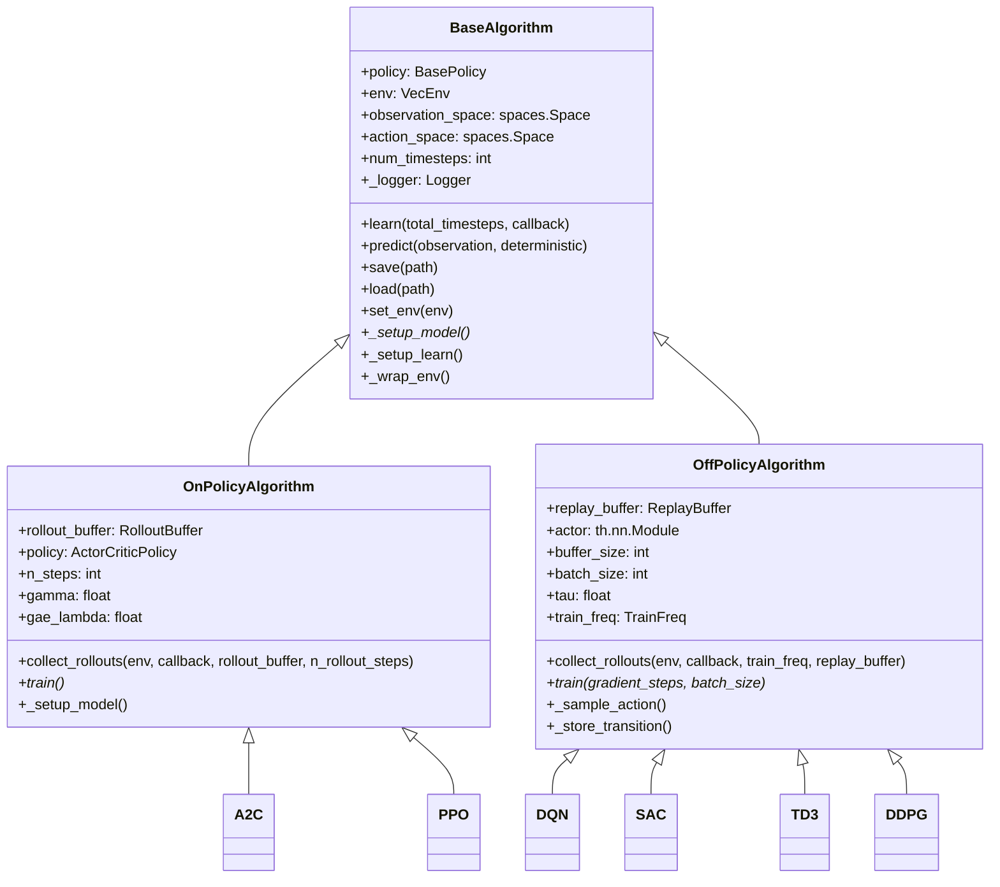

Sources: [stable_baselines3/common/base_class.py:67-98](), [stable_baselines3/common/on_policy_algorithm.py:21-60](), [stable_baselines3/common/off_policy_algorithm.py:27-110]()

## BaseAlgorithm - The Foundation

The `BaseAlgorithm` class provides the core functionality shared by all RL algorithms in SB3. It is an abstract base class that defines the standard interface and implements common methods. For a detailed look, see [BaseAlgorithm & Algorithm Base Classes](#2.1).

### Core BaseAlgorithm Components

The `BaseAlgorithm` class [stable_baselines3/common/base_class.py:67]() provides the foundation for all RL algorithms with these key responsibilities:

#### Environment Management
- `_wrap_env()` [stable_baselines3/common/base_class.py:204-249]() - Automatically wraps environments with `Monitor` and `DummyVecEnv`
- `set_env()` [stable_baselines3/common/base_class.py:476-509]() - Validates and sets new environments
- `env: VecEnv` attribute stores the vectorized environment

#### Policy and Network Management  
- `policy: BasePolicy` attribute stores the neural network policy
- `policy_class` and `policy_kwargs` manage policy creation
- `_get_policy_from_name()` [stable_baselines3/common/base_class.py:323-338]() resolves policy aliases

#### Model Persistence
- `save()` [stable_baselines3/common/base_class.py:819-862]() - Saves model parameters and metadata to zip file
- `load()` [stable_baselines3/common/base_class.py:642-802]() - Loads model from zip file with environment validation
- `get_parameters()` / `set_parameters()` for parameter management

#### Training Infrastructure
- `_setup_model()` abstract method for subclass initialization
- `_setup_learn()` [stable_baselines3/common/base_class.py:383-436]() prepares training state
- `_update_learning_rate()` [stable_baselines3/common/base_class.py:287-301]() handles learning rate schedules

### Key BaseAlgorithm Methods

| Method | Line Reference | Purpose |
|--------|---------------|---------|
| `learn()` | [stable_baselines3/common/base_class.py:512-535]() | Abstract training entry point |
| `predict()` | [stable_baselines3/common/base_class.py:537-557]() | Action prediction from observations |
| `save()` | [stable_baselines3/common/base_class.py:819-862]() | Model serialization to zip file |
| `load()` | [stable_baselines3/common/base_class.py:642-802]() | Model deserialization with validation |
| `_setup_model()` | [stable_baselines3/common/base_class.py:252-253]() | Abstract method for network initialization |
| `set_env()` | [stable_baselines3/common/base_class.py:476-509]() | Environment replacement with validation |
| `_wrap_env()` | [stable_baselines3/common/base_class.py:204-249]() | Automatic environment wrapping |

### BaseAlgorithm Training Lifecycle

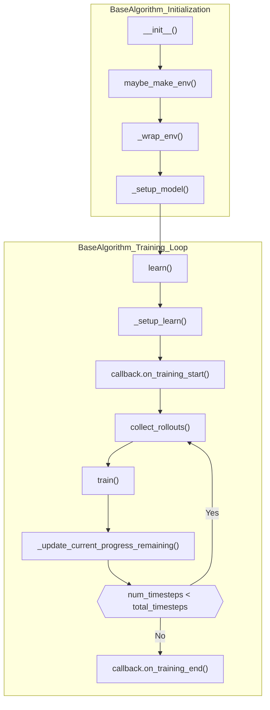

Sources: [stable_baselines3/common/base_class.py:106-122](), [stable_baselines3/common/base_class.py:383-436](), [stable_baselines3/common/base_class.py:512-535]()

## On-Policy vs Off-Policy Algorithms

SB3 organizes algorithms into two main categories based on how they use collected experience data:

### OnPolicyAlgorithm Architecture

The `OnPolicyAlgorithm` class [stable_baselines3/common/on_policy_algorithm.py:21]() serves as the base for algorithms that learn from recently collected experiences and discard them after updates. These algorithms typically use a `RolloutBuffer` for temporary storage. For more details, see [BaseAlgorithm & Algorithm Base Classes](#2.1).

#### Core Components
- `rollout_buffer: RolloutBuffer` [stable_baselines3/common/on_policy_algorithm.py:58]() - Temporary experience storage
- `policy: ActorCriticPolicy` [stable_baselines3/common/on_policy_algorithm.py:59]() - Actor-critic policy networks
- `n_steps: int` - Number of environment steps per rollout
- `gamma: float` - Discount factor for returns calculation
- `gae_lambda: float` - GAE lambda parameter for advantage estimation

#### Key Methods
- `collect_rollouts()` [stable_baselines3/common/on_policy_algorithm.py:162-268]() - Collects n_steps experiences
- `train()` [stable_baselines3/common/on_policy_algorithm.py:270-275]() - Abstract method for policy updates
- `_setup_model()` [stable_baselines3/common/on_policy_algorithm.py:115-140]() - Initializes rollout buffer and policy

#### Hyperparameters Table

| Parameter | Type | Purpose | Line Reference |
|-----------|------|---------|----------------|
| `n_steps` | int | Rollout length per update | [stable_baselines3/common/on_policy_algorithm.py:66]() |
| `gamma` | float | Discount factor | [stable_baselines3/common/on_policy_algorithm.py:67]() |
| `gae_lambda` | float | GAE lambda parameter | [stable_baselines3/common/on_policy_algorithm.py:68]() |
| `ent_coef` | float | Entropy coefficient | [stable_baselines3/common/on_policy_algorithm.py:69]() |
| `vf_coef` | float | Value function coefficient | [stable_baselines3/common/on_policy_algorithm.py:70]() |
| `max_grad_norm` | float | Gradient clipping threshold | [stable_baselines3/common/on_policy_algorithm.py:71]() |

Sources: [stable_baselines3/common/on_policy_algorithm.py:21-114](), [stable_baselines3/common/on_policy_algorithm.py:162-268]()

### OffPolicyAlgorithm Architecture

The `OffPolicyAlgorithm` class [stable_baselines3/common/off_policy_algorithm.py:27]() serves as the base for algorithms that can learn from previously collected experiences stored in a replay buffer. For more details, see [BaseAlgorithm & Algorithm Base Classes](#2.1).

#### Core Components
- `replay_buffer: ReplayBuffer` [stable_baselines3/common/off_policy_algorithm.py:136]() - Long-term experience storage
- `actor: th.nn.Module` [stable_baselines3/common/off_policy_algorithm.py:79]() - Actor network for action generation
- `train_freq: TrainFreq` - Controls training frequency (steps or episodes)
- `action_noise: ActionNoise` - Exploration noise for deterministic policies

#### Key Methods
- `collect_rollouts()` [stable_baselines3/common/off_policy_algorithm.py:513-607]() - Collects experiences based on train_freq
- `train()` [stable_baselines3/common/off_policy_algorithm.py:360-365]() - Abstract method for network updates
- `_sample_action()` [stable_baselines3/common/off_policy_algorithm.py:367-414]() - Action sampling with exploration
- `_store_transition()` [stable_baselines3/common/off_policy_algorithm.py:448-511]() - Stores experiences in replay buffer

#### Hyperparameters Table

| Parameter | Type | Purpose | Line Reference |
|-----------|------|---------|----------------|
| `buffer_size` | int | Replay buffer capacity | [stable_baselines3/common/off_policy_algorithm.py:86]() |
| `learning_starts` | int | Steps before training begins | [stable_baselines3/common/off_policy_algorithm.py:87]() |
| `batch_size` | int | Mini-batch size for training | [stable_baselines3/common/off_policy_algorithm.py:88]() |
| `tau` | float | Soft update coefficient | [stable_baselines3/common/off_policy_algorithm.py:89]() |
| `gamma` | float | Discount factor | [stable_baselines3/common/off_policy_algorithm.py:90]() |
| `train_freq` | TrainFreq | Training frequency | [stable_baselines3/common/off_policy_algorithm.py:91]() |
| `gradient_steps` | int | Updates per training step | [stable_baselines3/common/off_policy_algorithm.py:92]() |

Sources: [stable_baselines3/common/off_policy_algorithm.py:27-149](), [stable_baselines3/common/off_policy_algorithm.py:513-607]()

## Experience Collection and Learning Flow

The following diagram illustrates how experience data flows through the system during training:

### Experience Collection and Training Flows

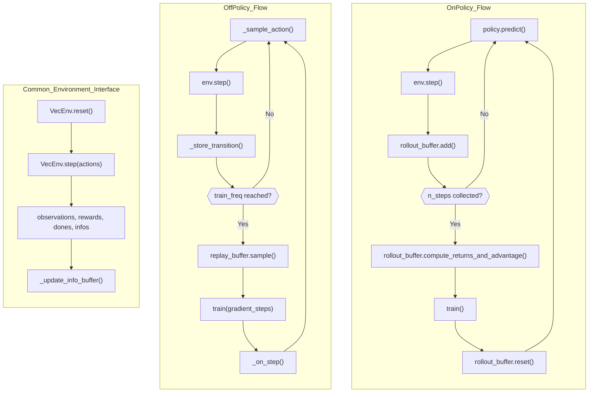

Sources: [stable_baselines3/common/on_policy_algorithm.py:194-217](), [stable_baselines3/common/off_policy_algorithm.py:558-604](), [stable_baselines3/common/base_class.py:438-457]()

## Core Training Process

Both algorithm types implement the `learn()` method from `BaseAlgorithm` but with different approaches:

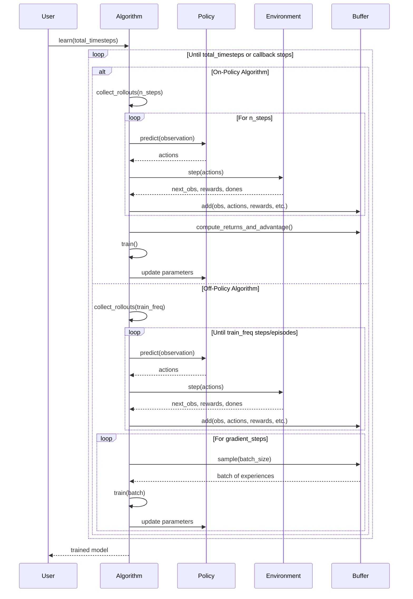

Sources: [stable_baselines3/common/on_policy_algorithm.py:300-341](), [stable_baselines3/common/off_policy_algorithm.py:305-351]()

## Key Abstractions and Composition

### Policy and Network Composition

The policy objects in SB3 encapsulate the neural networks that map observations to actions. The following diagram shows how these components fit together:

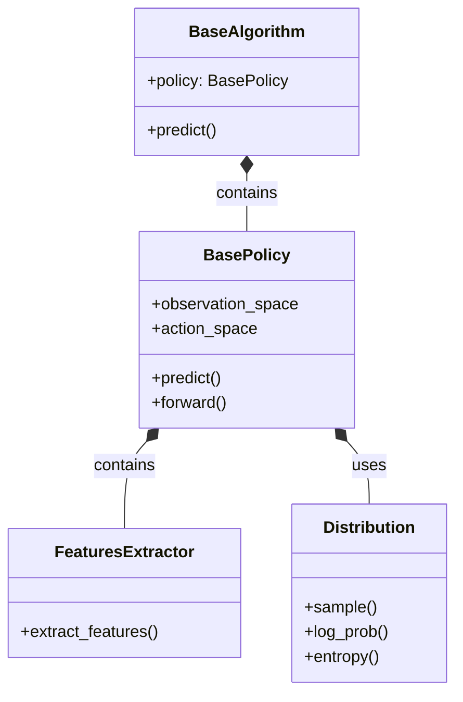

### Environment Wrapping and Vectorization

SB3 automatically wraps environments to ensure consistent interfaces and enable vectorized execution:

#### Environment Wrapping Process
1. `maybe_make_env()` [stable_baselines3/common/base_class.py:48-64]() - Creates environment from string ID
2. `_wrap_env()` [stable_baselines3/common/base_class.py:204-249]() - Applies necessary wrappers
3. Automatic `Monitor` wrapping for episode statistics
4. `DummyVecEnv` wrapping for single environments  
5. `VecTransposeImage` for image observations

#### Environment Architecture

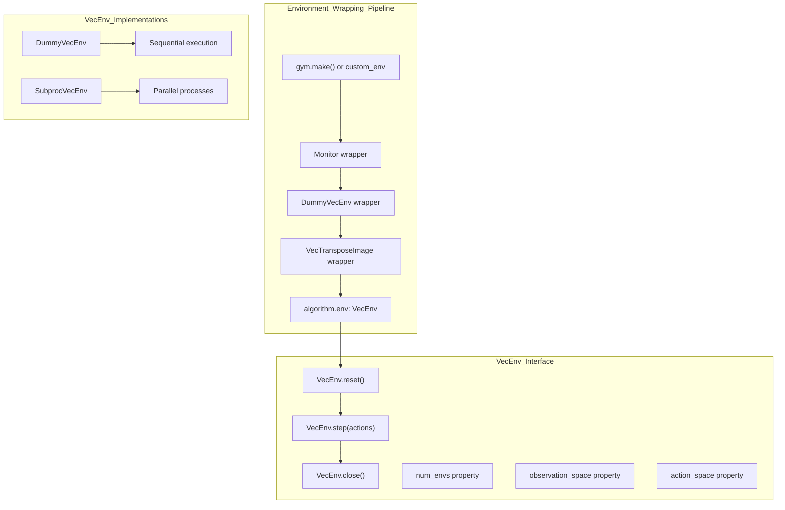

#### Key Environment Methods

| Method | Purpose | Line Reference |
|--------|---------|----------------|
| `_wrap_env()` | Applies Monitor, DummyVecEnv, VecTransposeImage wrappers | [stable_baselines3/common/base_class.py:204-249]() |
| `set_env()` | Validates and replaces environment | [stable_baselines3/common/base_class.py:476-509]() |
| `get_env()` | Returns current environment | [stable_baselines3/common/base_class.py:459-465]() |
| `check_for_correct_spaces()` | Validates observation/action spaces | [stable_baselines3/common/utils.py:304-319]() |

Sources: [stable_baselines3/common/base_class.py:48-64](), [stable_baselines3/common/base_class.py:204-249](), [stable_baselines3/common/utils.py:304-319]()

## Standard Algorithm Workflow

The standard workflow for creating and using an algorithm in SB3 follows these steps:

1. **Initialization**:
   - Create an environment
   - Initialize the algorithm with appropriate hyperparameters
   - The algorithm creates the policy and other components

2. **Training**:
   - Call the `learn()` method
   - The algorithm collects experiences and updates the policy
   - Callbacks can monitor and control the training process

3. **Inference**:
   - Use the trained policy for prediction with `predict()`
   - Or save the model with `save()` for later use

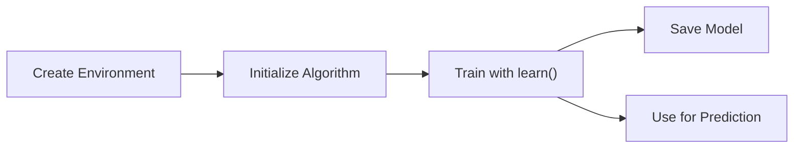

## Integration Patterns

The SB3 architecture follows several design patterns that make it flexible and extensible:

1. **Template Method Pattern**: Base classes define the skeleton of operations, while subclasses fill in specific implementations
2. **Strategy Pattern**: Policies can be swapped out (e.g., MLP vs CNN) without changing the algorithm
3. **Observer Pattern**: Callback system allows monitoring without modifying core code
4. **Factory Method Pattern**: Policy creation is delegated to subclasses

## Model Persistence and State Management

SB3 provides comprehensive model saving and loading capabilities with automatic environment validation:

### Save/Load Architecture

```mermaid
flowchart LR
    subgraph "save_process"
        A["algorithm.save()"] --> B["_excluded_save_params()"]
        B --> C["_get_torch_save_params()"]
        C --> D["save_to_zip_file()"]
        D --> E["ZIP file with params + metadata"]
    end
    
    subgraph "load_process"
        F["algorithm.load()"] --> G["load_from_zip_file()"]
        G --> H["validate environment spaces"]
        H --> I["create new algorithm instance"]
        I --> J["set_parameters()"]
        J --> K["loaded algorithm"]
    end
```

#### Key Persistence Methods

| Method | Purpose | Line Reference |
|--------|---------|----------------|
| `save()` | Serializes model to zip file | [stable_baselines3/common/base_class.py:819-862]() |
| `load()` | Deserializes model with validation | [stable_baselines3/common/base_class.py:642-802]() |
| `get_parameters()` | Extracts PyTorch state dicts | [stable_baselines3/common/base_class.py:804-817]() |
| `set_parameters()` | Loads PyTorch state dicts | [stable_baselines3/common/base_class.py:574-640]() |
| `_excluded_save_params()` | Lists params to exclude from pickle | [stable_baselines3/common/base_class.py:303-321]() |
| `_get_torch_save_params()` | Identifies PyTorch parameters | [stable_baselines3/common/base_class.py:340-356]() |

#### Initialization Flow

```mermaid
sequenceDiagram
    participant User
    participant Algorithm
    participant Environment
    participant Policy
    participant Buffer
    
    User->>Algorithm: __init__(policy, env, **kwargs)
    Algorithm->>Environment: maybe_make_env()
    Algorithm->>Environment: _wrap_env()
    Algorithm->>Algorithm: _setup_model()
    Algorithm->>Policy: policy_class(obs_space, action_space)
    Algorithm->>Buffer: buffer_class(buffer_size, obs_space)
    Algorithm->>Algorithm: _setup_lr_schedule()
    Algorithm-->>User: initialized algorithm
```

Sources: [stable_baselines3/common/base_class.py:106-191](), [stable_baselines3/common/base_class.py:642-862](), [stable_baselines3/common/on_policy_algorithm.py:115-140](), [stable_baselines3/common/off_policy_algorithm.py:174-215]()

## Common Interfaces

The core interfaces in SB3 are designed to be simple and consistent:

| Interface | Main Methods | Purpose |
|-----------|--------------|---------|
| Algorithm | `learn()`, `predict()`, `save()`, `load()` | Core RL algorithm functionality |
| Policy | `predict()`, `forward()`, `evaluate_actions()` | Mapping observations to actions |
| Buffer | `add()`, `sample()`, `reset()` | Storing and retrieving experiences |
| VecEnv | `reset()`, `step()`, `close()` | Environment interaction |
| Callback | `on_step()`, `on_rollout_start/end()`, etc. | Monitoring and controlling training |

Sources: [stable_baselines3/common/base_class.py:512-535](), [stable_baselines3/common/base_class.py:537-557]()

## Child Pages

For a deeper dive into specific aspects of the core architecture, refer to the following child pages:

- **[BaseAlgorithm & Algorithm Base Classes](#2.1)**: Provides a detailed examination of `BaseAlgorithm`, `OnPolicyAlgorithm`, and `OffPolicyAlgorithm`, covering their setup, learning loops, rollout collection, and device/seed handling.
- **[Common Utilities & Type Aliases](#2.2)**: Explores shared helper functions in `common/utils.py`, including schedules, device management, explained variance, type aliases, running mean/std, and preprocessing utilities.
- **[Probability Distributions & Preprocessing](#2.3)**: Focuses on the action distributions used in SB3 (e.g., Diagonal Gaussian, Categorical, Bernoulli, SquashedGaussian) and the preprocessing steps for observation and action spaces.

---

# Page: BaseAlgorithm & Algorithm Base Classes

# BaseAlgorithm & Algorithm Base Classes

<details>
<summary>Relevant source files</summary>

The following files were used as context for generating this wiki page:

- [stable_baselines3/common/base_class.py](stable_baselines3/common/base_class.py)
- [stable_baselines3/common/off_policy_algorithm.py](stable_baselines3/common/off_policy_algorithm.py)
- [stable_baselines3/common/on_policy_algorithm.py](stable_baselines3/common/on_policy_algorithm.py)

</details>


This page provides a detailed examination of the core abstract base classes in Stable-Baselines3: `BaseAlgorithm`, `OnPolicyAlgorithm`, and `OffPolicyAlgorithm`. We will explore their setup, the learning loop, rollout collection mechanisms, and how they handle device allocation and random seeding.

## BaseAlgorithm

The `BaseAlgorithm` class [stable_baselines3/common/base_class.py:67-94]() serves as the foundational abstract base class for all reinforcement learning algorithms in Stable-Baselines3. It encapsulates common functionalities and attributes shared across different algorithms, regardless of whether they are on-policy or off-policy.

### Initialization (`__init__`)

The constructor of `BaseAlgorithm` [stable_baselines3/common/base_class.py:106-122]() handles the initial setup of various parameters and components.

**Key Parameters:**

*   `policy`: Specifies the policy model to use (e.g., `MlpPolicy`, `CnnPolicy`). Can be a string alias or a direct class reference [stable_baselines3/common/base_class.py:123-126]().
*   `env`: The environment for learning. Can be a Gym environment object or its string ID [stable_baselines3/common/base_class.py:109](). The `maybe_make_env` helper function [stable_baselines3/common/base_class.py:48-64]() is used to instantiate the environment if a string ID is provided.
*   `learning_rate`: The learning rate for the optimizer, which can be a fixed float or a schedule [stable_baselines3/common/base_class.py:110]().
*   `policy_kwargs`: Additional arguments passed to the policy during its creation [stable_baselines3/common/base_class.py:111]().
*   `stats_window_size`: Determines the number of episodes over which to average reported metrics like success rate, episode length, and reward [stable_baselines3/common/base_class.py:112]().
*   `tensorboard_log`: Path for TensorBoard logging [stable_baselines3/common/base_class.py:113]().
*   `verbose`: Controls the verbosity level of output messages [stable_baselines3/common/base_class.py:114]().
*   `device`: Specifies the computational device (CPU or GPU) to use. Defaults to "auto", which attempts to use CUDA if available [stable_baselines3/common/base_class.py:115](). The `get_device` utility [stable_baselines3/common/utils.py:30]() resolves this.
*   `support_multi_env`: Indicates if the algorithm supports training with multiple environments [stable_baselines3/common/base_class.py:116]().
*   `monitor_wrapper`: Whether to wrap the environment with a `Monitor` wrapper [stable_baselines3/common/base_class.py:117]().
*   `seed`: Seed for pseudo-random number generators [stable_baselines3/common/base_class.py:118]().
*   `use_sde`: Flag to enable Generalized State Dependent Exploration (gSDE) [stable_baselines3/common/base_class.py:119]().
*   `sde_sample_freq`: Frequency for sampling new noise matrices when using gSDE [stable_baselines3/common/base_class.py:120]().
*   `supported_action_spaces`: A tuple of action space types supported by the algorithm [stable_baselines3/common/base_class.py:121]().

**Internal Attributes:**

*   `policy_class`: Stores the actual policy class [stable_baselines3/common/base_class.py:124-126]().
*   `device`: The resolved PyTorch device [stable_baselines3/common/base_class.py:128]().
*   `num_timesteps`: Total number of timesteps processed [stable_baselines3/common/base_class.py:135]().
*   `_total_timesteps`: Used for updating schedules [stable_baselines3/common/base_class.py:137]().
*   `seed`: The random seed used [stable_baselines3/common/base_class.py:141]().
*   `_current_progress_remaining`: Tracks training progress for learning rate schedules [stable_baselines3/common/base_class.py:155]().
*   `ep_info_buffer`, `ep_success_buffer`: Deques for logging episode statistics [stable_baselines3/common/base_class.py:158-159]().
*   `env`: The vectorized environment [stable_baselines3/common/base_class.py:164]().
*   `_vec_normalize_env`: Reference to `VecNormalize` if the environment is wrapped [stable_baselines3/common/base_class.py:165]().

### Device and Seed Handling

`BaseAlgorithm` centralizes the management of computational device and random seeds.

*   **Device Selection**: The `device` parameter [stable_baselines3/common/base_class.py:115]() allows specifying "cpu", "cuda", or "auto". `get_device` [stable_baselines3/common/utils.py:30]() automatically selects a CUDA device if available, otherwise defaults to CPU.
*   **Random Seeding**: The `seed` parameter [stable_baselines3/common/base_class.py:118]() is used by `set_random_seed` [stable_baselines3/common/utils.py:32]() to ensure reproducibility across runs. This function sets seeds for Python's `random` module, NumPy, and PyTorch.

### Core Methods (Abstract and Common)

`BaseAlgorithm` defines several abstract methods that must be implemented by concrete algorithms, along with common utility methods.

*   `_setup_model()`: An abstract method responsible for creating the policy network and optimizer [stable_baselines3/common/base_class.py:200]().
*   `learn()`: The main training loop [stable_baselines3/common/base_class.py:500-501](). It handles environment interaction, model updates, logging, and callback execution.
*   `predict()`: Predicts an action given an observation [stable_baselines3/common/base_class.py:700-701]().
*   `_get_action_noise()`: Retrieves the action noise for exploration [stable_baselines3/common/base_class.py:730]().
*   `set_env()`: Sets or updates the environment for the algorithm [stable_baselines3/common/base_class.py:202]().
*   `_setup_learn()`: Prepares the learning process, including environment setup, callbacks, and logging [stable_baselines3/common/base_class.py:400]().
*   `_update_current_progress_remaining()`: Updates the progress remaining for learning rate schedules [stable_baselines3/common/base_class.py:490]().
*   `_excluded_save_params()`: Returns parameters to exclude from saving [stable_baselines3/common/base_class.py:740]().
*   `_get_torch_save_params()`: Returns parameters to save using PyTorch's `state_dict` [stable_baselines3/common/base_class.py:750]().
*   `save()`: Saves the model to a zip file [stable_baselines3/common/base_class.py:760]().
*   `load()`: Loads a model from a zip file [stable_baselines3/common/base_class.py:810]().

### `learn()` Loop Overview

The `learn()` method [stable_baselines3/common/base_class.py:500-501]() orchestrates the entire training process.

1.  **Setup**: Calls `_setup_learn()` [stable_baselines3/common/base_class.py:519]() to initialize the environment, logger, and callbacks.
2.  **Reset**: Resets the environment and initializes `_last_obs` and `_last_episode_starts` [stable_baselines3/common/base_class.py:529-530]().
3.  **Main Loop**: Iterates for `total_timesteps` [stable_baselines3/common/base_class.py:532]().
    *   **Rollout Collection**: Calls `collect_rollouts()` [stable_baselines3/common/base_class.py:540]() (an abstract method) to gather experience.
    *   **Model Update**: Calls `train()` [stable_baselines3/common/base_class.py:546]() (an abstract method) to update the policy using the collected data.
    *   **Logging and Callbacks**: Updates progress, logs metrics, and triggers callbacks [stable_baselines3/common/base_class.py:550-560]().
4.  **Teardown**: Closes the environment and logger [stable_baselines3/common/base_class.py:562-563]().

```mermaid
graph TD
    A[BaseAlgorithm.learn()] --> B{_setup_learn()};
    B --> C[Initialize Environment, Logger, Callbacks];
    C --> D[Reset Environment];
    D --> E{Loop for total_timesteps};
    E --> F[Call collect_rollouts()];
    F --> G[Call train()];
    G --> H[Update Progress];
    H --> I[Log Metrics];
    I --> J[Execute Callbacks];
    J --> E;
    E -- Loop Ends --> K[Close Environment];
    K --> L[Close Logger];
```
**Diagram: BaseAlgorithm Learn Loop**
Sources: [stable_baselines3/common/base_class.py:500-563]()

Sources:
[stable_baselines3/common/base_class.py:1-166]()
[stable_baselines3/common/base_class.py:200]()
[stable_baselines3/common/base_class.py:202]()
[stable_baselines3/common/base_class.py:400]()
[stable_baselines3/common/base_class.py:48-64]()
[stable_baselines3/common/base_class.py:490]()
[stable_baselines3/common/base_class.py:500-501]()
[stable_baselines3/common/base_class.py:500-563]()
[stable_baselines3/common/base_class.py:519]()
[stable_baselines3/common/base_class.py:529-530]()
[stable_baselines3/common/base_class.py:532]()
[stable_baselines3/common/base_class.py:540]()
[stable_baselines3/common/base_class.py:546]()
[stable_baselines3/common/base_class.py:550-560]()
[stable_baselines3/common/base_class.py:562-563]()
[stable_baselines3/common/base_class.py:67-94]()
[stable_baselines3/common/base_class.py:700-701]()
[stable_baselines3/common/base_class.py:730]()
[stable_baselines3/common/base_class.py:740]()
[stable_baselines3/common/base_class.py:750]()
[stable_baselines3/common/base_class.py:760]()
[stable_baselines3/common/base_class.py:810]()
[stable_baselines3/common/utils.py:30]()
[stable_baselines3/common/utils.py:32]()

## OnPolicyAlgorithm

The `OnPolicyAlgorithm` class [stable_baselines3/common/on_policy_algorithm.py:21-56]() extends `BaseAlgorithm` and provides the base for on-policy algorithms like A2C and PPO. These algorithms update their policy directly using the data collected from the current policy, and then discard that data.

### Initialization (`__init__`)

In addition to `BaseAlgorithm` parameters, `OnPolicyAlgorithm` introduces parameters specific to on-policy learning:

*   `n_steps`: The number of steps to run for each environment per update. The batch size for training is `n_steps * n_env` [stable_baselines3/common/on_policy_algorithm.py:29-31]().
*   `gamma`: Discount factor [stable_baselines3/common/on_policy_algorithm.py:32]().
*   `gae_lambda`: Factor for Generalized Advantage Estimator (GAE) [stable_baselines3/common/on_policy_algorithm.py:33-34]().
*   `ent_coef`: Entropy coefficient for the loss calculation [stable_baselines3/common/on_policy_algorithm.py:35]().
*   `vf_coef`: Value function coefficient for the loss calculation [stable_baselines3/common/on_policy_algorithm.py:36]().
*   `max_grad_norm`: Maximum value for gradient clipping [stable_baselines3/common/on_policy_algorithm.py:37]().
*   `rollout_buffer_class`: The class to use for the rollout buffer (e.g., `RolloutBuffer`, `DictRolloutBuffer`) [stable_baselines3/common/on_policy_algorithm.py:41]().
*   `rollout_buffer_kwargs`: Keyword arguments for the rollout buffer [stable_baselines3/common/on_policy_algorithm.py:42]().

### Model Setup (`_setup_model`)

The `_setup_model` method [stable_baselines3/common/on_policy_algorithm.py:115]() is responsible for initializing the learning rate schedule, setting the random seed, and creating the rollout buffer and policy network.

1.  **Learning Rate Schedule**: `_setup_lr_schedule()` is called to prepare the learning rate schedule [stable_baselines3/common/on_policy_algorithm.py:116]().
2.  **Random Seed**: `set_random_seed(self.seed)` ensures reproducibility [stable_baselines3/common/on_policy_algorithm.py:117]().
3.  **Rollout Buffer**:
    *   If `rollout_buffer_class` is `None`, it automatically selects `DictRolloutBuffer` for dictionary observation spaces or `RolloutBuffer` otherwise [stable_baselines3/common/on_policy_algorithm.py:119-124]().
    *   The buffer is then instantiated with `n_steps`, observation/action spaces, device, gamma, gae_lambda, and `n_envs` [stable_baselines3/common/on_policy_algorithm.py:125-134]().
4.  **Policy Network**: The `policy_class` (which is typically an `ActorCriticPolicy` for on-policy algorithms) is instantiated and moved to the specified `device` [stable_baselines3/common/on_policy_algorithm.py:135-138]().
5.  **CPU Recommendation**: `_maybe_recommend_cpu()` [stable_baselines3/common/on_policy_algorithm.py:142]() issues a warning if an `MlpPolicy` is used on a GPU, as it's generally more efficient on CPU for such policies.

### Rollout Collection (`collect_rollouts`)

The `collect_rollouts` method [stable_baselines3/common/on_policy_algorithm.py:157]() is crucial for gathering experience from the environment.

1.  **Buffer Reset**: The `rollout_buffer` is reset [stable_baselines3/common/on_policy_algorithm.py:160]().
2.  **SDE Noise Reset**: If gSDE is enabled and `sde_sample_freq` is met, the SDE noise is reset [stable_baselines3/common/on_policy_algorithm.py:162-165]().
3.  **Environment Interaction Loop**:
    *   It iterates for `n_steps` [stable_baselines3/common/on_policy_algorithm.py:170]().
    *   **Action Prediction**: The policy predicts actions, value estimates, and log probabilities using `policy.predict()` [stable_baselines3/common/on_policy_algorithm.py:174-177]().
    *   **Environment Step**: The predicted actions are applied to the environment using `self.env.step()` [stable_baselines3/common/on_policy_algorithm.py:180]().
    *   **Buffer Addition**: The collected observation, action, reward, done flag, value, and log probability are added to the `rollout_buffer` [stable_baselines3/common/on_policy_algorithm.py:187-190]().
    *   **Episode Tracking**: Handles episode termination and resets the environment if an episode ends [stable_baselines3/common/on_policy_algorithm.py:192-204]().
4.  **GAE Computation**: After collecting `n_steps` of data, `compute_returns_and_advantage()` is called on the `rollout_buffer` to calculate returns and advantages using GAE [stable_baselines3/common/on_policy_algorithm.py:210-211]().

```mermaid
graph TD
    A[OnPolicyAlgorithm.collect_rollouts()] --> B[Reset RolloutBuffer];
    B --> C{If use_sde and sde_sample_freq met};
    C -- Yes --> D[Reset SDE Noise];
    C -- No --> E[Continue];
    D --> E;
    E --> F{Loop for n_steps};
    F --> G[Policy.predict(obs)];
    G --> H[env.step(action)];
    H --> I[Add (obs, action, reward, done, value, log_prob) to RolloutBuffer];
    I --> J{If episode ends};
    J -- Yes --> K[Increment episode_num];
    K --> L[Reset env];
    J -- No --> M[Continue];
    L --> F;
    M --> F;
    F -- Loop Ends --> N[RolloutBuffer.compute_returns_and_advantage()];
    N --> O[Return RolloutBuffer];
```
**Diagram: OnPolicyAlgorithm Rollout Collection**
Sources: [stable_baselines3/common/on_policy_algorithm.py:157-211]()

Sources:
[stable_baselines3/common/on_policy_algorithm.py:115]()
[stable_baselines3/common/on_policy_algorithm.py:116]()
[stable_baselines3/common/on_policy_algorithm.py:117]()
[stable_baselines3/common/on_policy_algorithm.py:119-124]()
[stable_baselines3/common/on_policy_algorithm.py:125-134]()
[stable_baselines3/common/on_policy_algorithm.py:135-138]()
[stable_baselines3/common/on_policy_algorithm.py:142]()
[stable_baselines3/common/on_policy_algorithm.py:157]()
[stable_baselines3/common/on_policy_algorithm.py:157-211]()
[stable_baselines3/common/on_policy_algorithm.py:160]()
[stable_baselines3/common/on_policy_algorithm.py:162-165]()
[stable_baselines3/common/on_policy_algorithm.py:170]()
[stable_baselines3/common/on_policy_algorithm.py:174-177]()
[stable_baselines3/common/on_policy_algorithm.py:180]()
[stable_baselines3/common/on_policy_algorithm.py:187-190]()
[stable_baselines3/common/on_policy_algorithm.py:192-204]()
[stable_baselines3/common/on_policy_algorithm.py:21-56]()
[stable_baselines3/common/on_policy_algorithm.py:210-211]()
[stable_baselines3/common/on_policy_algorithm.py:29-31]()
[stable_baselines3/common/on_policy_algorithm.py:32]()
[stable_baselines3/common/on_policy_algorithm.py:33-34]()
[stable_baselines3/common/on_policy_algorithm.py:35]()
[stable_baselines3/common/on_policy_algorithm.py:36]()
[stable_baselines3/common/on_policy_algorithm.py:37]()
[stable_baselines3/common/on_policy_algorithm.py:41]()
[stable_baselines3/common/on_policy_algorithm.py:42]()

## OffPolicyAlgorithm

The `OffPolicyAlgorithm` class [stable_baselines3/common/off_policy_algorithm.py:27-80]() extends `BaseAlgorithm` and serves as the base for off-policy algorithms such as SAC, TD3, and DQN. These algorithms can learn from data collected by older policies, typically storing experiences in a replay buffer.

### Initialization (`__init__`)

`OffPolicyAlgorithm` introduces several parameters specific to off-policy learning:

*   `buffer_size`: The maximum size of the replay buffer [stable_baselines3/common/off_policy_algorithm.py:36]().
*   `learning_starts`: The number of steps to collect transitions before learning begins [stable_baselines3/common/off_policy_algorithm.py:37]().
*   `batch_size`: The minibatch size for each gradient update [stable_baselines3/common/off_policy_algorithm.py:38]().
*   `tau`: The soft update coefficient for target networks (Polyak update) [stable_baselines3/common/off_policy_algorithm.py:39]().
*   `gamma`: The discount factor [stable_baselines3/common/off_policy_algorithm.py:40]().
*   `train_freq`: How often to update the model, specified as a number of steps or episodes [stable_baselines3/common/off_policy_algorithm.py:41-42]().
*   `gradient_steps`: The number of gradient steps to perform after each rollout [stable_baselines3/common/off_policy_algorithm.py:43-45]().
*   `action_noise`: The type of action noise for exploration (e.g., `NormalActionNoise`, `OrnsteinUhlenbeckActionNoise`) [stable_baselines3/common/off_policy_algorithm.py:46-47]().
*   `replay_buffer_class`: The class to use for the replay buffer (e.g., `ReplayBuffer`, `DictReplayBuffer`, `HerReplayBuffer`) [stable_baselines3/common/off_policy_algorithm.py:48-49]().
*   `replay_buffer_kwargs`: Keyword arguments for the replay buffer [stable_baselines3/common/off_policy_algorithm.py:50]().
*   `optimize_memory_usage`: Enables a memory-efficient replay buffer variant [stable_baselines3/common/off_policy_algorithm.py:51-53]().
*   `n_steps`: When greater than 1, uses N-step returns for Q-value updates (with `NStepReplayBuffer`) [stable_baselines3/common/off_policy_algorithm.py:54-57]().
*   `use_sde_at_warmup`: Whether to use gSDE during the warm-up phase [stable_baselines3/common/off_policy_algorithm.py:76]().
*   `sde_support`: Indicates if the model supports gSDE [stable_baselines3/common/off_policy_algorithm.py:77]().

### Model Setup (`_setup_model`)

The `_setup_model` method for off-policy algorithms [stable_baselines3/common/off_policy_algorithm.py:142]() initializes the replay buffer and policy.

1.  **Replay Buffer**:
    *   If `replay_buffer_class` is `None`, it automatically selects `DictReplayBuffer` for dictionary observation spaces or `ReplayBuffer` otherwise [stable_baselines3/common/off_policy_algorithm.py:145-150]().
    *   If `n_steps > 1`, it uses `NStepReplayBuffer` [stable_baselines3/common/off_policy_algorithm.py:151-153]().
    *   The buffer is then instantiated with `buffer_size`, observation/action spaces, device, `n_envs`, and other relevant parameters [stable_baselines3/common/off_policy_algorithm.py:154-165]().
2.  **Policy Network**: The policy is created and moved to the specified `device` [stable_baselines3/common/off_policy_algorithm.py:166-169]().
3.  **Target Networks**: Off-policy algorithms often use target networks. `_create_aliases()` [stable_baselines3/common/off_policy_algorithm.py:170]() is called to set up these aliases (e.g., `actor_target`, `critic_target`).

### Rollout Collection (`collect_rollouts`)

The `collect_rollouts` method [stable_baselines3/common/off_policy_algorithm.py:200]() for off-policy algorithms focuses on filling the replay buffer.

1.  **Environment Interaction Loop**:
    *   It iterates for `train_freq.n_steps` or until `train_freq.n_episodes` are collected [stable_baselines3/common/off_policy_algorithm.py:203-204]().
    *   **Action Selection**:
        *   During the warm-up phase (`self.num_timesteps < self.learning_starts`), actions are sampled randomly from the action space [stable_baselines3/common/off_policy_algorithm.py:210-213]().
        *   Otherwise, actions are predicted by the policy, potentially with action noise or gSDE [stable_baselines3/common/off_policy_algorithm.py:215-224]().
    *   **Environment Step**: The selected actions are applied to the environment [stable_baselines3/common/off_policy_algorithm.py:226]().
    *   **Buffer Addition**: The collected transition (observation, action, reward, next observation, done flag) is added to the `replay_buffer` [stable_baselines3/common/off_policy_algorithm.py:230-233]().
    *   **Episode Tracking**: Handles episode termination and resets the environment [stable_baselines3/common/off_policy_algorithm.py:235-247]().
2.  **Return**: Returns the number of steps collected and the number of episodes collected [stable_baselines3/common/off_policy_algorithm.py:250]().

```mermaid
graph TD
    A[OffPolicyAlgorithm.collect_rollouts()] --> B{Loop until train_freq criteria met};
    B --> C{If num_timesteps < learning_starts};
    C -- Yes --> D[Sample random action];
    C -- No --> E[Policy.predict(obs) + Action Noise/gSDE];
    D --> F[env.step(action)];
    E --> F;
    F --> G[Add (obs, action, reward, next_obs, done) to ReplayBuffer];
    G --> H{If episode ends};
    H -- Yes --> I[Increment episode_num];
    I --> J[Reset env];
    H -- No --> K[Continue];
    J --> B;
    K --> B;
    B -- Loop Ends --> L[Return collected_steps, collected_episodes];
```
**Diagram: OffPolicyAlgorithm Rollout Collection**
Sources: [stable_baselines3/common/off_policy_algorithm.py:200-250]()

Sources:
[stable_baselines3/common/off_policy_algorithm.py:142]()
[stable_baselines3/common/off_policy_algorithm.py:145-150]()
[stable_baselines3/common/off_policy_algorithm.py:151-153]()
[stable_baselines3/common/off_policy_algorithm.py:154-165]()
[stable_baselines3/common/off_policy_algorithm.py:166-169]()
[stable_baselines3/common/off_policy_algorithm.py:170]()
[stable_baselines3/common/off_policy_algorithm.py:200]()
[stable_baselines3/common/off_policy_algorithm.py:200-250]()
[stable_baselines3/common/off_policy_algorithm.py:203-204]()
[stable_baselines3/common/off_policy_algorithm.py:210-213]()
[stable_baselines3/common/off_policy_algorithm.py:215-224]()
[stable_baselines3/common/off_policy_algorithm.py:226]()
[stable_baselines3/common/off_policy_algorithm.py:230-233]()
[stable_baselines3/common/off_policy_algorithm.py:235-247]()
[stable_baselines3/common/off_policy_algorithm.py:250]()
[stable_baselines3/common/off_policy_algorithm.py:27-80]()
[stable_baselines3/common/off_policy_algorithm.py:36]()
[stable_baselines3/common/off_policy_algorithm.py:37]()
[stable_baselines3/common/off_policy_algorithm.py:38]()
[stable_baselines3/common/off_policy_algorithm.py:39]()
[stable_baselines3/common/off_policy_algorithm.py:40]()
[stable_baselines3/common/off_policy_algorithm.py:41-42]()
[stable_baselines3/common/off_policy_algorithm.py:43-45]()
[stable_baselines3/common/off_policy_algorithm.py:46-47]()
[stable_baselines3/common/off_policy_algorithm.py:48-49]()
[stable_baselines3/common/off_policy_algorithm.py:50]()
[stable_baselines3/common/off_policy_algorithm.py:51-53]()
[stable_baselines3/common/off_policy_algorithm.py:54-57]()
[stable_baselines3/common/off_policy_algorithm.py:76]()
[stable_baselines3/common/off_policy_algorithm.py:77]()

---

# Page: Common Utilities & Type Aliases

# Common Utilities & Type Aliases

<details>
<summary>Relevant source files</summary>

The following files were used as context for generating this wiki page:

- [docs/common/utils.md](docs/common/utils.md)
- [stable_baselines3/common/running_mean_std.py](stable_baselines3/common/running_mean_std.py)
- [stable_baselines3/common/type_aliases.py](stable_baselines3/common/type_aliases.py)
- [stable_baselines3/common/utils.py](stable_baselines3/common/utils.py)
- [tests/test_utils.py](tests/test_utils.py)

</details>


This page details the common utility functions and type aliases used throughout the Stable-Baselines3 codebase. These shared helpers, primarily found in `stable_baselines3/common/utils.py` and `stable_baselines3/common/type_aliases.py`, provide functionalities such as scheduling, device management, explained variance calculation, and running mean/standard deviation tracking. They are fundamental building blocks for various algorithms and components within the library.

## Type Aliases

Stable-Baselines3 uses a set of type aliases to improve code readability and maintainability, especially when dealing with complex nested types or common patterns. These aliases are defined in `stable_baselines3/common/type_aliases.py` [stable_baselines3/common/type_aliases.py:1-105]().

The `Schedule` type alias is particularly important, representing a callable that takes a `float` (progress remaining) and returns a `float` [stable_baselines3/common/type_aliases.py:28-29](). This is used for annealing learning rates, exploration rates, or other hyper-parameters over the course of training.

Other notable type aliases include:
*   `GymEnv`: Union of `gym.Env` and `VecEnv` [stable_baselines3/common/type_aliases.py:16]().
*   `GymObs`: Represents observations from a Gymnasium environment [stable_baselines3/common/type_aliases.py:17]().
*   `TensorDict`: A dictionary where keys are strings and values are PyTorch tensors [stable_baselines3/common/type_aliases.py:22]().
*   `RolloutBufferSamples`, `DictRolloutBufferSamples`, `ReplayBufferSamples`, `DictReplayBufferSamples`: Named tuples used to structure data sampled from rollout and replay buffers [stable_baselines3/common/type_aliases.py:32-67]().
*   `TrainFreq`: A named tuple specifying a training frequency (e.g., every N steps or N episodes) [stable_baselines3/common/type_aliases.py:80-82]().

### Type Alias Diagram

```mermaid
graph TD
    subgraph "Type Aliases (type_aliases.py)"
        GymEnv["GymEnv (Union[gym.Env, VecEnv])"]
        GymObs["GymObs (Union[tuple, dict, np.ndarray, int])"]
TensorDict["TensorDict (dict[str, th.Tensor])"]
        Schedule["Schedule (Callable[[float], float])"]
        RolloutBufferSamples["RolloutBufferSamples (NamedTuple)"]
        DictRolloutBufferSamples["DictRolloutBufferSamples (NamedTuple)"]
        ReplayBufferSamples["ReplayBufferSamples (NamedTuple)"]
        DictReplayBufferSamples["DictReplayBufferSamples (NamedTuple)"]
        TrainFreq["TrainFreq (NamedTuple)"]
        PolicyPredictor["PolicyPredictor (Protocol)"]
    end
    subgraph "Core Components"
        gym.Env
        VecEnv
        th.Tensor
        BaseCallback
    end

    GymEnv --> gym.Env
    GymEnv --> VecEnv
    Schedule --> BaseCallback
    RolloutBufferSamples --> th.Tensor
    DictRolloutBufferSamples --> TensorDict
    ReplayBufferSamples --> th.Tensor
    DictReplayBufferSamples --> TensorDict
    TrainFreq --> TrainFrequencyUnit
    PolicyPredictor --> np.ndarray
    PolicyPredictor --> th.Tensor
```
Sources: [stable_baselines3/common/type_aliases.py:1-105]()

## Schedules

The `stable_baselines3/common/utils.py` module provides several classes and functions for managing schedules, which are crucial for dynamically adjusting hyperparameters like learning rates or exploration rates during training.

### `FloatSchedule`

The `FloatSchedule` class acts as a wrapper to ensure that the output of any schedule is always a `float` [stable_baselines3/common/utils.py:80-104](). This is important for consistency and to prevent issues with unpickling models. It can wrap either a constant float value or another callable schedule.

*   **Initialization**: Takes `value_schedule` which can be a `float`, `int`, or an existing `Schedule` callable [stable_baselines3/common/utils.py:89-96]().
*   **Call Method**: `__call__(self, progress_remaining: float) -> float` [stable_baselines3/common/utils.py:98-101]() evaluates the wrapped schedule and casts the result to a `float`.

### `LinearSchedule`

`LinearSchedule` implements a linear interpolation between a `start` and `end` value over a specified `end_fraction` of the training progress [stable_baselines3/common/utils.py:107-132](). This is commonly used for annealing exploration rates (e.g., epsilon in DQN).

*   **Initialization**: Requires `start`, `end` values, and `end_fraction` [stable_baselines3/common/utils.py:120-123]().
*   **Call Method**: `__call__(self, progress_remaining: float) -> float` [stable_baselines3/common/utils.py:125-129]() calculates the current value based on the `progress_remaining`. If `(1 - progress_remaining)` exceeds `end_fraction`, it returns the `end` value.

### `ConstantSchedule`

`ConstantSchedule` is a simple schedule that always returns a fixed `val` [stable_baselines3/common/utils.py:135-150](). This is useful for hyperparameters that do not change during training, such as a fixed learning rate or clip range.

*   **Initialization**: Takes a single `val` argument [stable_baselines3/common/utils.py:144]().
*   **Call Method**: `__call__(self, _: float) -> float` [stable_baselines3/common/utils.py:146]() always returns `self.val`.

### Deprecated Schedule Functions

The module also includes `get_schedule_fn` and `get_linear_fn` [stable_baselines3/common/utils.py:158-189](). These are deprecated and primarily kept for backward compatibility when loading older models. New code should use `FloatSchedule`, `LinearSchedule`, and `ConstantSchedule` directly.

### Schedule Usage Diagram

```mermaid
graph TD
    subgraph "Schedule Classes (common/utils.py)"
        FloatSchedule["FloatSchedule"]
        LinearSchedule["LinearSchedule"]
        ConstantSchedule["ConstantSchedule"]
    end

    subgraph "Type Aliases (common/type_aliases.py)"
        ScheduleType["Schedule (Callable[[float], float])"]
    end

    FloatSchedule -- "Wraps" --> ScheduleType
    LinearSchedule -- "Implements" --> ScheduleType
    ConstantSchedule -- "Implements" --> ScheduleType

    FloatSchedule -- "Can wrap" --> LinearSchedule
    FloatSchedule -- "Can wrap" --> ConstantSchedule
    FloatSchedule -- "Can wrap" --> "float (constant value)"

    LinearSchedule -- "Used for" --> "Epsilon-greedy annealing"
    ConstantSchedule -- "Used for" --> "Fixed learning rate"

    style FloatSchedule fill:#fff,stroke:#333,stroke-width:2px
    style LinearSchedule fill:#fff,stroke:#333,stroke-width:2px
    style ConstantSchedule fill:#fff,stroke:#333,stroke-width:2px
    style ScheduleType fill:#fff,stroke:#333,stroke-width:2px
```
Sources: [stable_baselines3/common/utils.py:80-189](), [stable_baselines3/common/type_aliases.py:28-29]()

## Running Mean and Standard Deviation

The `stable_baselines3/common/running_mean_std.py` module provides the `RunningMeanStd` class for efficiently calculating the running mean and standard deviation of a data stream. This is particularly useful for observation normalization in reinforcement learning.

### `RunningMeanStd` Class

The `RunningMeanStd` class implements a parallel algorithm for calculating variance, as described on Wikipedia [stable_baselines3/common/running_mean_std.py:8-9]().

*   **Initialization**: `__init__(self, epsilon: float = 1e-4, shape: tuple[int, ...] = ())` [stable_baselines3/common/running_mean_std.py:5-16]() initializes `mean` to zeros, `var` to ones, and `count` to `epsilon` (to prevent division by zero).
*   **`copy()`**: Returns a deep copy of the `RunningMeanStd` object [stable_baselines3/common/running_mean_std.py:17-25]().
*   **`combine(other: RunningMeanStd)`**: Merges statistics from another `RunningMeanStd` object into the current one [stable_baselines3/common/running_mean_std.py:27-34](). This is useful in distributed settings where statistics from different workers need to be aggregated.
*   **`update(arr: np.ndarray)`**: Updates the running mean and variance with a new batch of data `arr` [stable_baselines3/common/running_mean_std.py:36-39](). It calculates the batch mean, variance, and count, then calls `update_from_moments`.
*   **`update_from_moments(batch_mean: np.ndarray, batch_var: np.ndarray, batch_count: float)`**: The core logic for updating the statistics. It uses the parallel algorithm to combine the current statistics with the provided batch statistics [stable_baselines3/common/running_mean_std.py:41-55]().

Sources: [stable_baselines3/common/running_mean_std.py:1-55]()

## Other Common Utilities

The `stable_baselines3/common/utils.py` module contains various other helper functions:

*   **`set_random_seed(seed: int, using_cuda: bool = False)`**: Seeds Python's `random`, NumPy's `np.random`, and PyTorch's `th.manual_seed` for reproducibility. If `using_cuda` is true, it also sets `torch.backends.cudnn.deterministic` and `torch.backends.cudnn.benchmark` [stable_baselines3/common/utils.py:28-46]().
*   **`explained_variance(y_pred: np.ndarray, y_true: np.ndarray) -> float`**: Computes the fraction of variance that `y_pred` explains about `y_true`. A value of 1 indicates perfect prediction, 0 means it's no better than predicting the mean, and negative values mean it's worse than predicting zero [stable_baselines3/common/utils.py:49-65]().
*   **`update_learning_rate(optimizer: th.optim.Optimizer, learning_rate: float)`**: Updates the learning rate for all parameter groups within a given PyTorch optimizer [stable_baselines3/common/utils.py:68-78](). This is often used in conjunction with learning rate schedules.
*   **`zip_strict(*iterables)`**: A utility function that behaves like `zip` but raises a `ValueError` if the iterables have different lengths [stable_baselines3/common/utils.py:32](). This helps catch common errors during iteration.
*   **`get_system_info()`**: Gathers and returns system information, including OS, Python version, PyTorch version, and Stable-Baselines3 version [stable_baselines3/common/utils.py:29](). This is useful for debugging and reporting issues.
*   **`polyak_update(params: Iterable[th.nn.Parameter], target_params: Iterable[th.nn.Parameter], tau: float)`**: Performs a Polyak (exponential moving average) update of target network parameters towards the main network parameters [stable_baselines3/common/utils.py:31](). This is a common technique in off-policy algorithms like SAC and TD3.
*   **`is_vectorized_observation(observation: np.ndarray, observation_space: gym.Space) -> bool`**: Checks if a given observation is vectorized based on the provided observation space [stable_baselines3/common/utils.py:30]().
*   **`check_shape_equal(shape1: tuple[int, ...], shape2: tuple[int, ...])`**: Asserts that two shapes are equal, raising an error if they are not [stable_baselines3/common/utils.py:24]().
*   **`get_parameters_by_name(model: th.nn.Module, excluded_params: list[str] | None = None) -> list[tuple[str, th.Tensor]]`**: Retrieves named parameters from a PyTorch module, optionally excluding some [stable_baselines3/common/utils.py:27]().

Sources: [stable_baselines3/common/utils.py:28-78](), [stable_baselines3/common/utils.py:31](), [stable_baselines3/common/utils.py:32](), [stable_baselines3/common/utils.py:29](), [stable_baselines3/common/utils.py:30](), [stable_baselines3/common/utils.py:24](), [stable_baselines3/common/utils.py:27](), [tests/test_utils.py:114]()

---

# Page: Probability Distributions & Preprocessing

# Probability Distributions & Preprocessing

<details>
<summary>Relevant source files</summary>

The following files were used as context for generating this wiki page:

- [stable_baselines3/common/distributions.py](stable_baselines3/common/distributions.py)
- [stable_baselines3/common/preprocessing.py](stable_baselines3/common/preprocessing.py)
- [tests/test_distributions.py](tests/test_distributions.py)
- [tests/test_preprocessing.py](tests/test_preprocessing.py)
- [tests/test_spaces.py](tests/test_spaces.py)

</details>


This page details the probability distributions used in Stable-Baselines3 for defining action spaces and the preprocessing steps applied to observations and actions. Understanding these components is crucial for comprehending how agents interact with environments and how their policies are structured.

## Action Distributions

Stable-Baselines3 implements several probability distributions to handle different types of action spaces, primarily continuous and discrete. These distributions are subclasses of the abstract base class `Distribution` [stable_baselines3/common/distributions.py:26-110](). Each distribution provides methods for creating its neural network components, setting its parameters, sampling actions, computing log probabilities, and calculating entropy.

### `Distribution` Abstract Base Class

The `Distribution` class [stable_baselines3/common/distributions.py:26-110]() defines the common interface for all action distributions.

```python
class Distribution(ABC):
    distribution: TorchDistribution | list[TorchDistribution]

    @abstractmethod
    def proba_distribution_net(self, *args, **kwargs) -> nn.Module | tuple[nn.Module, nn.Parameter]: ...

    @abstractmethod
    def proba_distribution(self: SelfDistribution, *args, **kwargs) -> SelfDistribution: ...

    @abstractmethod
    def log_prob(self, actions: th.Tensor) -> th.Tensor: ...

    @abstractmethod
    def entropy(self) -> th.Tensor | None: ...

    @abstractmethod
    def sample(self) -> th.Tensor: ...

    @abstractmethod
    def mode(self) -> th.Tensor: ...

    def get_actions(self, deterministic: bool = False) -> th.Tensor: ...

    @abstractmethod
    def actions_from_params(self, *args, **kwargs) -> th.Tensor: ...

    @abstractmethod
    def log_prob_from_params(self, *args, **kwargs) -> tuple[th.Tensor, th.Tensor]: ...
```

Key methods include:
*   `proba_distribution_net()`: Creates the PyTorch modules and parameters that define the distribution's output layer (e.g., mean and log standard deviation for Gaussian distributions).
*   `proba_distribution()`: Sets the internal `torch.distributions.Distribution` object based on the provided parameters.
*   `log_prob()`: Computes the log probability of given actions under the current distribution.
*   `entropy()`: Calculates the Shannon entropy of the distribution.
*   `sample()`: Draws a stochastic sample from the distribution.
*   `mode()`: Returns the most likely action (deterministic output).
*   `get_actions()`: A convenience method to get either a stochastic sample or the mode based on the `deterministic` flag [stable_baselines3/common/distributions.py:82-91]().

#### Diagram: `Distribution` Class Hierarchy

```mermaid
graph TD
    A[Distribution] --> B[DiagGaussianDistribution]
    A --> C[CategoricalDistribution]
    A --> D[BernoulliDistribution]
    A --> E[MultiCategoricalDistribution]
    A --> F[SquashedDiagGaussianDistribution]
    A --> G[StateDependentNoiseDistribution]
```
Sources: [stable_baselines3/common/distributions.py:26-110]()

### `DiagGaussianDistribution`

This distribution is used for continuous action spaces where actions are assumed to be independent, meaning the covariance matrix is diagonal.

*   **Action Space Type**: `gymnasium.spaces.Box`
*   **Implementation**: Uses `torch.distributions.Normal` [stable_baselines3/common/distributions.py:166]().
*   **Parameters**: The `proba_distribution_net` method [stable_baselines3/common/distributions.py:141-153]() creates a linear layer for the mean actions and a `nn.Parameter` for the log standard deviation. The standard deviation is shared across all actions by default, but can be made action-dependent.
*   **Sampling**: Uses the reparameterization trick (`.rsample()`) for sampling to allow gradients to flow through [stable_baselines3/common/distributions.py:185]().
*   **Log Probability/Entropy**: The `sum_independent_dims` helper function [stable_baselines3/common/distributions.py:112-124]() is used to sum the log probabilities or entropies across independent action dimensions.

Sources: [stable_baselines3/common/distributions.py:127-194]()

### `CategoricalDistribution`

This distribution is for discrete action spaces, where the agent chooses one action from a finite set.

*   **Action Space Type**: `gymnasium.spaces.Discrete`
*   **Implementation**: Uses `torch.distributions.Categorical`.
*   **Parameters**: `proba_distribution_net` creates a linear layer that outputs logits for each action [stable_baselines3/common/distributions.py:209-210]().
*   **Sampling**: Samples directly from the `Categorical` distribution [stable_baselines3/common/distributions.py:239]().
*   **Mode**: Returns the action with the highest logit [stable_baselines3/common/distributions.py:242]().

Sources: [stable_baselines3/common/distributions.py:197-256]()

### `BernoulliDistribution`

Used for binary action spaces, where each action dimension can be either 0 or 1.

*   **Action Space Type**: `gymnasium.spaces.MultiBinary`
*   **Implementation**: Uses `torch.distributions.Bernoulli`.
*   **Parameters**: `proba_distribution_net` creates a linear layer that outputs logits for each binary action [stable_baselines3/common/distributions.py:300-301]().
*   **Sampling**: Samples directly from the `Bernoulli` distribution [stable_baselines3/common/distributions.py:328]().
*   **Mode**: Returns 1 if the probability is >= 0.5, else 0 [stable_baselines3/common/distributions.py:331]().

Sources: [stable_baselines3/common/distributions.py:290-347]()

### `SquashedDiagGaussianDistribution`

This is a variant of the `DiagGaussianDistribution` where the output actions are squashed to be within a specific range (typically [-1, 1]) using a Tanh function. This is commonly used in algorithms like SAC.

*   **Action Space Type**: `gymnasium.spaces.Box` (continuous, typically [-1, 1])
*   **Implementation**: Extends `DiagGaussianDistribution` and applies a `TanhBijector` [stable_baselines3/common/distributions.py:400-401]() to the samples.
*   **Log Probability**: The log probability calculation accounts for the change of variables introduced by the Tanh squashing function [stable_baselines3/common/distributions.py:410-414]().
*   **Entropy**: The entropy for squashed Gaussian distributions does not have a simple analytical form and is often approximated or computed numerically [tests/test_distributions.py:113]().

Sources: [stable_baselines3/common/distributions.py:350-440](), [tests/test_distributions.py:26-38](), [tests/test_distributions.py:40-55]()

### `StateDependentNoiseDistribution`

This distribution is used for continuous action spaces with state-dependent exploration noise (gSDE). The standard deviation of the Gaussian distribution is a function of the state.

*   **Action Space Type**: `gymnasium.spaces.Box`
*   **Implementation**: Uses `torch.distributions.Normal`.
*   **Parameters**: `proba_distribution_net` creates a linear layer for the mean actions and a `nn.Parameter` for the log standard deviation, which is then modulated by the state [stable_baselines3/common/distributions.py:470-471]().
*   **Noise Sampling**: The noise weights are sampled and updated periodically [stable_baselines3/common/distributions.py:500-501]().

Sources: [stable_baselines3/common/distributions.py:443-550](), [tests/test_distributions.py:96-111]()

## Observation and Action Space Preprocessing

Stable-Baselines3 includes utilities to preprocess observations and determine the shapes of observation and action spaces, making them suitable for neural network inputs.

### `get_obs_shape`

This function determines the shape of an observation space, which is crucial for defining the input layers of neural networks.

*   For `spaces.Box`, it returns the `shape` attribute directly [stable_baselines3/common/preprocessing.py:151]().
*   For `spaces.Discrete`, it returns `(1,)` as it represents a single integer [stable_baselines3/common/preprocessing.py:154]().
*   For `spaces.MultiDiscrete`, it returns `(len(observation_space.nvec),)` [stable_baselines3/common/preprocessing.py:157]().
*   For `spaces.MultiBinary`, it returns the `shape` attribute [stable_baselines3/common/preprocessing.py:160]().
*   For `spaces.Dict`, it recursively calls `get_obs_shape` for each subspace [stable_baselines3/common/preprocessing.py:162]().

Sources: [stable_baselines3/common/preprocessing.py:142-167](), [tests/test_preprocessing.py:7-22]()

### `preprocess_obs`

This function transforms raw observations from the environment into a format suitable for neural network input.

*   **Image Normalization**: If an observation space is identified as an image (using `is_image_space` [stable_baselines3/common/preprocessing.py:26-68]()), its pixel values (assumed to be in [0, 255]) are normalized to [0, 1] by dividing by 255.0 [stable_baselines3/common/preprocessing.py:118-119]().
*   **Discrete Observations**: `spaces.Discrete` observations are converted into one-hot encoded vectors [stable_baselines3/common/preprocessing.py:122-124]().
*   **MultiDiscrete Observations**: `spaces.MultiDiscrete` observations are converted into a concatenated one-hot encoded vector for each sub-space [stable_baselines3/common/preprocessing.py:126-135]().
*   **MultiBinary Observations**: `spaces.MultiBinary` observations are converted to float tensors [stable_baselines3/common/preprocessing.py:137]().
*   **Dict Observations**: For `spaces.Dict`, it recursively preprocesses each sub-observation [stable_baselines3/common/preprocessing.py:107-113]().

Sources: [stable_baselines3/common/preprocessing.py:91-140](), [tests/test_preprocessing.py:31-65]()

#### Diagram: Observation Preprocessing Flow

```mermaid
graph TD
    A[Raw Observation] --> B{Observation Space Type?}
    B -- "spaces.Box (Image)" --> C{Normalize Images?}
    C -- "Yes" --> D[Divide by 255.0]
    C -- "No" --> E[Convert to Float]
    B -- "spaces.Box (Non-Image)" --> E
    B -- "spaces.Discrete" --> F[One-Hot Encode]
    B -- "spaces.MultiDiscrete" --> G[Concatenate One-Hot Encodings]
    B -- "spaces.MultiBinary" --> H[Convert to Float]
    B -- "spaces.Dict" --> I[Recursively Preprocess Sub-Observations]
    D --> J[Preprocessed Observation]
    E --> J
    F --> J
    G --> J
    H --> J
    I --> J
```
Sources: [stable_baselines3/common/preprocessing.py:91-140]()

### `is_image_space` and `is_image_space_channels_first`

These helper functions are used to identify if an observation space represents an image and its channel order (channels-first or channels-last).

*   `is_image_space` [stable_baselines3/common/preprocessing.py:26-68]() checks if a `spaces.Box` has 3 dimensions, `uint8` dtype, and values in [0, 255]. It can also check the number of channels (1, 3, or 4).
*   `is_image_space_channels_first` [stable_baselines3/common/preprocessing.py:9-23]() determines the channel order by finding the smallest dimension. If the first dimension is the smallest, it's considered channels-first (CxHxW).

Sources: [stable_baselines3/common/preprocessing.py:9-68]()

### `maybe_transpose`

This function handles transposing image observations to a channels-first format (CxHxW) if they are initially channels-last (HxWxC), which is the expected format for PyTorch convolutions. It uses `VecTransposeImage.transpose_image` for the actual transposition [stable_baselines3/common/preprocessing.py:85]().

Sources: [stable_baselines3/common/preprocessing.py:71-88]()

---

# Page: Algorithms

# Algorithms

<details>
<summary>Relevant source files</summary>

The following files were used as context for generating this wiki page:

- [stable_baselines3/a2c/a2c.py](stable_baselines3/a2c/a2c.py)
- [stable_baselines3/ppo/ppo.py](stable_baselines3/ppo/ppo.py)
- [stable_baselines3/sac/sac.py](stable_baselines3/sac/sac.py)
- [stable_baselines3/td3/td3.py](stable_baselines3/td3/td3.py)

</details>


This document provides an overview of the reinforcement learning algorithms implemented in Stable-Baselines3 and their categorization into on-policy and off-policy approaches. It covers the base classes that define common behavior and the fundamental differences between algorithm types.

For detailed implementation of specific on-policy algorithms like PPO and A2C, see [On-Policy Algorithms](#3.1). For off-policy algorithms like SAC, TD3, DQN, and DDPG, see [Off-Policy Algorithms](#3.2).

## Algorithm Hierarchy and Base Classes

Stable-Baselines3 organizes its reinforcement learning algorithms using a clear inheritance hierarchy with two main categories: on-policy and off-policy algorithms. Both inherit from a common `BaseAlgorithm` class that provides shared functionality.

### Algorithm Inheritance Structure

```mermaid
graph TD
    BaseAlgorithm["BaseAlgorithm<br/>stable_baselines3.common.base_class"]
    
    OnPolicyAlgorithm["OnPolicyAlgorithm<br/>stable_baselines3.common.on_policy_algorithm.OnPolicyAlgorithm"]
    OffPolicyAlgorithm["OffPolicyAlgorithm<br/>stable_baselines3.common.off_policy_algorithm.OffPolicyAlgorithm"]
    
    A2C["A2C<br/>stable_baselines3.a2c.A2C"]
    PPO["PPO<br/>stable_baselines3.ppo.PPO"]
    
    SAC["SAC<br/>stable_baselines3.sac.SAC"]
    TD3["TD3<br/>stable_baselines3.td3.TD3"]
    DQN["DQN<br/>stable_baselines3.dqn.DQN"]
    DDPG["DDPG<br/>stable_baselines3.ddpg.DDPG"]
    
    BaseAlgorithm --> OnPolicyAlgorithm
    BaseAlgorithm --> OffPolicyAlgorithm
    
    OnPolicyAlgorithm --> A2C
    OnPolicyAlgorithm --> PPO
    
    OffPolicyAlgorithm --> SAC
    OffPolicyAlgorithm --> TD3
    OffPolicyAlgorithm --> DQN
    OffPolicyAlgorithm --> DDPG
```

Sources: [stable_baselines3/common/on_policy_algorithm.py:21-27](), [stable_baselines3/common/off_policy_algorithm.py:27-29]()

## Algorithm Categorization

### On-Policy Algorithms

On-policy algorithms learn from experiences collected using the current policy. They typically collect a batch of experiences, use them immediately for training, and then discard them. The `OnPolicyAlgorithm` class implements this pattern. Examples include `PPO` [stable_baselines3/ppo/ppo.py:18]() and `A2C` [stable_baselines3/a2c/a2c.py:16]().

**Key characteristics:**
- Use `RolloutBuffer` for temporary experience storage
- Collect exactly `n_steps` experiences per environment before training
- Train immediately after collection, then reset the buffer
- Support Generalized Advantage Estimation (GAE) with `gae_lambda`

For a detailed discussion of PPO and A2C, including their loss functions, GAE, and clipping mechanisms, see [On-Policy Algorithms](#3.1).

### Off-Policy Algorithms

Off-policy algorithms can learn from experiences collected using any policy, including older versions of the current policy or even random actions. The `OffPolicyAlgorithm` class implements replay buffer functionality for this purpose. Examples include `SAC` [stable_baselines3/sac/sac.py:19]() and `TD3` [stable_baselines3/td3/td3.py:19]().

**Key characteristics:**
- Use `ReplayBuffer` for persistent experience storage  
- Support configurable `buffer_size` (typically 1M experiences)
- Include warmup phase with `learning_starts` random actions
- Train periodically based on `train_freq` parameter
- Support action noise for exploration

For a detailed discussion of SAC, TD3, DQN, and DDPG, including target networks, entropy tuning, and exploration schedules, see [Off-Policy Algorithms](#3.2).

## Core Algorithm Parameters

| Parameter | On-Policy | Off-Policy | Purpose |
|-----------|-----------|------------|---------|
| `n_steps` | ✓ | ✗ | Number of steps per rollout before training |
| `buffer_size` | ✗ | ✓ | Maximum size of replay buffer |
| `learning_starts` | ✗ | ✓ | Steps before learning begins (warmup) |
| `batch_size` | ✓ (PPO) | ✓ | Minibatch size for gradient updates |
| `train_freq` | ✗ | ✓ | Training frequency (steps or episodes) |
| `tau` | ✗ | ✓ | Soft update coefficient for target networks |
| `gae_lambda` | ✓ | ✗ | GAE lambda parameter for advantage estimation |
| `ent_coef` | ✓ | ✓ (SAC) | Entropy coefficient for policy loss |
| `vf_coef` | ✓ | ✗ | Value function coefficient for loss |
| `gamma` | ✓ | ✓ | Discount factor |

Sources: [stable_baselines3/common/on_policy_algorithm.py:61-85](), [stable_baselines3/common/off_policy_algorithm.py:81-111](), [stable_baselines3/ppo/ppo.py:86-87](), [stable_baselines3/sac/sac.py:100-101]()

## Training Flow Differences

### On-Policy Training Flow

```mermaid
flowchart TD
    Start["Start Training"]
    Reset["rollout_buffer.reset()"]
    Collect["collect_rollouts()<br/>n_steps experiences"]
    Compute["compute_returns_and_advantage()"]
    Train["train()<br/>Immediate policy update"]
    Check{"num_timesteps <<br/>total_timesteps?"}
    End["Training Complete"]
    
    Start --> Reset
    Reset --> Collect
    Collect --> Compute
    Compute --> Train
    Train --> Check
    Check -->|Yes| Reset
    Check -->|No| End
```

Sources: [stable_baselines3/common/on_policy_algorithm.py:300-341]()

### Off-Policy Training Flow

```mermaid
flowchart TD
    Start["Start Training"]
    Sample["_sample_action()<br/>Random or policy-based"]
    Store["_store_transition()<br/>Add to replay_buffer"]
    CheckStart{"num_timesteps ><br/>learning_starts?"}
    CheckFreq{"Time to train?<br/>Based on train_freq"}
    TrainLoop["train()<br/>Sample batch from buffer<br/>gradient_steps updates"]
    CheckEnd{"num_timesteps <<br/>total_timesteps?"}
    End["Training Complete"]
    
    Start --> Sample
    Sample --> Store
    Store --> CheckStart
    CheckStart -->|No| CheckEnd
    CheckStart -->|Yes| CheckFreq
    CheckFreq -->|No| CheckEnd
    CheckFreq -->|Yes| TrainLoop
    TrainLoop --> CheckEnd
    CheckEnd -->|Yes| Sample
    CheckEnd -->|No| End
```

Sources: [stable_baselines3/common/off_policy_algorithm.py:312-359]()

## Experience Management

### RolloutBuffer vs ReplayBuffer

The choice between `RolloutBuffer` and `ReplayBuffer` is fundamental to the algorithm design:

**RolloutBuffer (On-Policy):**
- Stores exactly `n_steps * n_envs` experiences
- Computes returns and advantages using GAE
- Data is consumed once and discarded
- Implemented in `stable_baselines3.common.buffers.RolloutBuffer`
- Used by `PPO` [stable_baselines3/ppo/ppo.py:98]() and `A2C` [stable_baselines3/a2c/a2c.py:81]()

**ReplayBuffer (Off-Policy):**
- Stores up to `buffer_size` experiences (circular buffer)
- Supports random sampling for breaking temporal correlations  
- Data can be reused multiple times
- Variants include `DictReplayBuffer`, `NStepReplayBuffer`, `HerReplayBuffer`
- Used by `SAC` [stable_baselines3/sac/sac.py:107]() and `TD3` [stable_baselines3/td3/td3.py:96]()

Sources: [stable_baselines3/common/on_policy_algorithm.py:115-134](), [stable_baselines3/common/off_policy_algorithm.py:174-204]()

## Action Selection and Exploration

### On-Policy Action Selection

On-policy algorithms sample actions directly from the current policy distribution:

```python
# From collect_rollouts method
with th.no_grad():
    obs_tensor = obs_as_tensor(self._last_obs, self.device)
    actions, values, log_probs = self.policy(obs_tensor)
```

Sources: [stable_baselines3/common/on_policy_algorithm.py:199-203]()

### Off-Policy Action Selection  

Off-policy algorithms support multiple exploration strategies through the `_sample_action` method:

- **Warmup phase**: Random actions when `num_timesteps < learning_starts`
- **Policy-based**: Actions from current policy (potentially stochastic)
- **Action noise**: Additional noise for deterministic policies (TD3, DDPG)
- **State-dependent exploration**: Optional SDE support, e.g., `use_sde` in `SAC` [stable_baselines3/sac/sac.py:114]() and `PPO` [stable_baselines3/ppo/ppo.py:96]().

Sources: [stable_baselines3/common/off_policy_algorithm.py:367-414]()

---

# Page: On-Policy Algorithms

# On-Policy Algorithms

<details>
<summary>Relevant source files</summary>

The following files were used as context for generating this wiki page:

- [docs/modules/a2c.md](docs/modules/a2c.md)
- [docs/modules/ppo.md](docs/modules/ppo.md)
- [stable_baselines3/a2c/a2c.py](stable_baselines3/a2c/a2c.py)
- [stable_baselines3/common/vec_env/vec_video_recorder.py](stable_baselines3/common/vec_env/vec_video_recorder.py)
- [stable_baselines3/ppo/ppo.py](stable_baselines3/ppo/ppo.py)
- [tests/test_cnn.py](tests/test_cnn.py)
- [tests/test_dict_env.py](tests/test_dict_env.py)
- [tests/test_gae.py](tests/test_gae.py)

</details>


This page covers on-policy reinforcement learning algorithms in Stable-Baselines3, including A2C (Advantage Actor-Critic) and PPO (Proximal Policy Optimization). On-policy algorithms learn directly from the experiences generated by the current policy, requiring fresh data collection for each policy update.

For off-policy algorithms that can reuse past experiences, see [Off-Policy Algorithms](#3.2). For general algorithm concepts and the overall algorithm architecture, see [Algorithms](#3).

## Overview

On-policy algorithms in Stable-Baselines3 share a common architectural foundation through the `OnPolicyAlgorithm` base class. These algorithms collect a fixed number of environment steps using the current policy, then update the policy using this freshly collected data.

### Key Characteristics

| Characteristic | Description |
|---------------|-------------|
| **Data Usage** | Uses only fresh experiences from current policy |
| **Sample Efficiency** | Generally less sample efficient than off-policy methods |
| **Stability** | More stable training, less prone to divergence |
| **Memory Usage** | Lower memory requirements (no replay buffer) |
| **Parallelization** | Naturally supports multiple parallel environments |

### Supported Algorithms

- **A2C (Advantage Actor-Critic)**: Synchronous version of A3C with advantage estimation
- **PPO (Proximal Policy Optimization)**: Clip-based policy optimization with improved stability

## Architecture Overview

The on-policy algorithm system is built around the `OnPolicyAlgorithm` base class and its associated components.

### Class Hierarchy

```mermaid
graph TD
    BaseAlgorithm["BaseAlgorithm<br/>(base_class.py)"]
    OnPolicyAlgorithm["OnPolicyAlgorithm<br/>(on_policy_algorithm.py)"]
    A2C["A2C<br/>(a2c/a2c.py)"]
    PPO["PPO<br/>(ppo/ppo.py)"]
    
    ActorCriticPolicy["ActorCriticPolicy<br/>(policies.py)"]
    RolloutBuffer["RolloutBuffer<br/>(buffers.py)"]
    DictRolloutBuffer["DictRolloutBuffer<br/>(buffers.py)"]
    
    BaseAlgorithm --> OnPolicyAlgorithm
    OnPolicyAlgorithm --> A2C
    OnPolicyAlgorithm --> PPO
    
    OnPolicyAlgorithm --> ActorCriticPolicy
    OnPolicyAlgorithm --> RolloutBuffer
    RolloutBuffer --> DictRolloutBuffer
```

Sources: [stable_baselines3/common/on_policy_algorithm.py:21-342]()

### Core Components

```mermaid
graph TB
    subgraph "OnPolicyAlgorithm Core"
        OnPolicy["OnPolicyAlgorithm"]
        Policy["ActorCriticPolicy"]
        Buffer["RolloutBuffer"]
    end
    
    subgraph "Training Loop"
        CollectRollouts["collect_rollouts()"]
        Train["train()"]
        Learn["learn()"]
    end
    
    subgraph "Environment Interface"
        VecEnv["VecEnv"]
        Observation["observations"]
        Actions["actions"]
        Rewards["rewards"]
    end
    
    OnPolicy --> Policy
    OnPolicy --> Buffer
    OnPolicy --> Learn
    
    Learn --> CollectRollouts
    CollectRollouts --> Train
    
    CollectRollouts --> VecEnv
    VecEnv --> Observation
    VecEnv --> Actions
    VecEnv --> Rewards
    
    Observation --> Policy
    Policy --> Actions
    Actions --> Buffer
    Rewards --> Buffer
```

Sources: [stable_baselines3/common/on_policy_algorithm.py:162-268](), [stable_baselines3/common/on_policy_algorithm.py:300-341]()

## Data Flow and Training Process

On-policy algorithms follow a structured collect-then-train cycle that ensures policy updates use only current policy data.

### Training Cycle

```mermaid
flowchart TD
    Start["Training Start"]
    CheckSteps{"num_timesteps < total_timesteps?"}
    CollectData["collect_rollouts()<br/>Collect n_steps experiences"]
    ComputeAdvantages["compute_returns_and_advantage()<br/>Calculate GAE"]
    UpdatePolicy["train()<br/>Policy gradient update"]
    LogMetrics["dump_logs()<br/>Record metrics"]
    End["Training Complete"]
    
    Start --> CheckSteps
    CheckSteps -->|Yes| CollectData
    CollectData --> ComputeAdvantages
    ComputeAdvantages --> UpdatePolicy
    UpdatePolicy --> LogMetrics
    LogMetrics --> CheckSteps
    CheckSteps -->|No| End
```

Sources: [stable_baselines3/common/on_policy_algorithm.py:300-341]()

### Rollout Collection Process

```mermaid
sequenceDiagram
    participant Env as "VecEnv"
    participant Policy as "ActorCriticPolicy" 
    participant Buffer as "RolloutBuffer"
    participant Alg as "OnPolicyAlgorithm"
    
    Alg->>Buffer: reset()
    Alg->>Policy: set_training_mode(False)
    
    loop n_steps times
        Alg->>Policy: policy(obs_tensor)
        Policy->>Alg: actions, values, log_probs
        Alg->>Env: step(clipped_actions)
        Env->>Alg: new_obs, rewards, dones, infos
        Alg->>Buffer: add(obs, actions, rewards, values, log_probs)
    end
    
    Alg->>Policy: predict_values(final_obs)
    Policy->>Alg: final_values
    Alg->>Buffer: compute_returns_and_advantage(final_values)
```

Sources: [stable_baselines3/common/on_policy_algorithm.py:162-268]()

## Key Parameters and Configuration

On-policy algorithms are configured through several critical parameters that control the learning process.

### Essential Parameters

| Parameter | Type | Description | Default |
|-----------|------|-------------|---------|
| `n_steps` | `int` | Steps per environment per update | Algorithm-specific |
| `gamma` | `float` | Discount factor for future rewards | 0.99 |
| `gae_lambda` | `float` | GAE lambda parameter | Algorithm-specific |
| `ent_coef` | `float` | Entropy coefficient for exploration | Algorithm-specific |
| `vf_coef` | `float` | Value function loss coefficient | Algorithm-specific |
| `max_grad_norm` | `float` | Maximum gradient norm for clipping | Algorithm-specific |

Sources: [stable_baselines3/common/on_policy_algorithm.py:61-110]()

### Buffer Configuration

```mermaid
graph LR
    ObsSpace["observation_space"]
    ActionSpace["action_space"]
    
    ObsSpace -->|Dict| DictRolloutBuffer["DictRolloutBuffer"]
    ObsSpace -->|Other| RolloutBuffer["RolloutBuffer"]
    
    Config["Configuration"]
    Config --> NSteps["n_steps"]
    Config --> Gamma["gamma"] 
    Config --> GAELambda["gae_lambda"]
    Config --> NEnvs["n_envs"]
    
    NSteps --> RolloutBuffer
    Gamma --> RolloutBuffer
    GAELambda --> RolloutBuffer
    NEnvs --> RolloutBuffer
    ActionSpace --> RolloutBuffer
```

Sources: [stable_baselines3/common/on_policy_algorithm.py:115-138]()

## Implementation Details

### Model Setup Process

The `_setup_model` method initializes the core components:

1. **Learning Rate Schedule**: Configures learning rate scheduling via `_setup_lr_schedule()`
2. **Random Seed**: Sets random seed for reproducibility via `set_random_seed()`
3. **Buffer Selection**: Chooses appropriate buffer class based on observation space type
4. **Buffer Initialization**: Creates buffer with algorithm-specific parameters
5. **Policy Creation**: Instantiates `ActorCriticPolicy` with environment spaces
6. **Device Transfer**: Moves policy to specified device (CPU/GPU)

Sources: [stable_baselines3/common/on_policy_algorithm.py:115-141]()

### Gradient Clipping and Optimization

On-policy algorithms implement gradient clipping through the `max_grad_norm` parameter to stabilize training:

```python
# Applied in concrete algorithm implementations
torch.nn.utils.clip_grad_norm_(self.policy.parameters(), self.max_grad_norm)
```

Sources: [stable_baselines3/ppo/ppo.py:95](), [stable_baselines3/a2c/a2c.py:76]()

### Action Space Handling

The algorithm handles different action spaces during rollout collection:

- **Continuous (Box)**: Actions are clipped to environment bounds or unscaled if using squashed output
- **Discrete**: Actions are reshaped to column vector format for buffer storage

Sources: [stable_baselines3/common/on_policy_algorithm.py:208-232]()

### Terminal State Bootstrapping

On-policy algorithms handle episode termination by bootstrapping value estimates for timeout scenarios:

```python
# When episode ends due to time limit, not terminal state
if done and infos[idx].get("TimeLimit.truncated", False):
    terminal_value = self.policy.predict_values(terminal_obs)[0]
    rewards[idx] += self.gamma * terminal_value
```

This ensures proper value estimation when episodes are truncated rather than naturally terminated.

Sources: [stable_baselines3/common/on_policy_algorithm.py:234-245]()

### Multi-Environment Support

On-policy algorithms natively support vectorized environments through the `VecEnv` interface, enabling efficient parallel data collection across multiple environment instances.

Sources: [stable_baselines3/common/on_policy_algorithm.py:162-268]()

## Proximal Policy Optimization (PPO)

PPO is an on-policy algorithm that aims to achieve the data efficiency and reliable performance of Trust Region Policy Optimization (TRPO) while being much simpler to implement. It uses a clipped surrogate objective function to limit the policy update size, preventing large, destabilizing changes.

### PPO Loss Function

The PPO objective function is a combination of three terms: a clipped surrogate objective for the actor, a value function loss for the critic, and an entropy bonus for exploration.

```mermaid
graph TD
    PPO_Loss["PPO Loss"]
    Clipped_Surrogate_Loss["Clipped Surrogate Loss (Actor)"]
    Value_Function_Loss["Value Function Loss (Critic)"]
    Entropy_Loss["Entropy Loss (Exploration)"]

    PPO_Loss --> Clipped_Surrogate_Loss
    PPO_Loss --> Value_Function_Loss
    PPO_Loss --> Entropy_Loss
```

The total loss optimized by PPO is:
$L^{PPO}(\theta) = E_t[\min(r_t(\theta)\hat{A}_t, \text{clip}(r_t(\theta), 1-\epsilon, 1+\epsilon)\hat{A}_t)] - c_1 L^{VF}_t(\theta) + c_2 S_t(\theta)$

Where:
- $r_t(\theta) = \frac{\pi_\theta(a_t|s_t)}{\pi_{\theta_{old}}(a_t|s_t)}$ is the ratio of the new policy probability to the old policy probability.
- $\hat{A}_t$ is the advantage estimate at time $t$.
- $\epsilon$ is the clipping parameter (`clip_range`).
- $L^{VF}_t(\theta)$ is the value function loss.
- $S_t(\theta)$ is the entropy bonus.
- $c_1$ (`vf_coef`) and $c_2$ (`ent_coef`) are coefficients for the value function and entropy terms, respectively.

#### Clipped Surrogate Objective

The core of PPO is the clipped surrogate objective, which prevents the new policy from deviating too much from the old policy.
The term $\min(r_t(\theta)\hat{A}_t, \text{clip}(r_t(\theta), 1-\epsilon, 1+\epsilon)\hat{A}_t)$ ensures that the policy update is bounded. If the advantage is positive, the policy is encouraged to increase the probability of that action, but only up to $1+\epsilon$ times the old probability. If the advantage is negative, the policy is encouraged to decrease the probability, but only down to $1-\epsilon$ times the old probability.

The implementation calculates the ratio `ratio = th.exp(log_prob - rollout_data.old_log_prob)` and then computes the two terms for the min operation: `pg_losses1 = advantages * ratio` and `pg_losses2 = advantages * th.clamp(ratio, 1 - clip_fraction, 1 + clip_fraction)`. The policy loss is then `(-th.min(pg_losses1, pg_losses2)).mean()`.
Sources: [stable_baselines3/ppo/ppo.py:249-257]()

#### Value Function Loss

The value function loss is typically a Mean Squared Error (MSE) between the predicted value and the target value (returns).
$L^{VF}_t(\theta) = (V_\theta(s_t) - V^{target}_t)^2$

The implementation uses `F.mse_loss(values, rollout_data.returns)`.
Sources: [stable_baselines3/ppo/ppo.py:260]()

PPO also supports clipping the value function, controlled by `clip_range_vf`. If enabled, the value function loss is also clipped to prevent large changes.
Sources: [stable_baselines3/ppo/ppo.py:262-270]()

#### Entropy Loss

An entropy bonus $S_t(\theta)$ is added to encourage exploration. This is the negative of the entropy of the policy distribution.
The implementation uses `entropy_loss = -entropy.mean()`.
Sources: [stable_baselines3/ppo/ppo.py:272]()

### Generalized Advantage Estimation (GAE)

PPO uses Generalized Advantage Estimation (GAE) to compute advantage estimates. GAE balances the bias-variance trade-off in advantage estimation using the `gae_lambda` parameter.
The advantages are computed in the `RolloutBuffer.compute_returns_and_advantage` method.
Sources: [stable_baselines3/common/buffers.py:300-340]()

The formula for GAE is:
$\hat{A}_t = \delta_t + (\gamma\lambda)\delta_{t+1} + (\gamma\lambda)^2\delta_{t+2} + \dots$
where $\delta_t = R_t + \gamma V(s_{t+1}) - V(s_t)$ is the TD error.

A `CheckGAECallback` is used in tests to verify the correctness of GAE computation.
Sources: [tests/test_gae.py:66-103]()

### PPO Hyperparameters

Key hyperparameters for PPO include:
- `n_steps`: Number of steps to collect per environment before updating.
- `batch_size`: Minibatch size for optimization.
- `n_epochs`: Number of passes over the collected data during optimization.
- `gamma`: Discount factor.
- `gae_lambda`: GAE parameter.
- `clip_range`: Clipping parameter for the policy objective.
- `clip_range_vf`: Clipping parameter for the value function (optional).
- `ent_coef`: Entropy coefficient.
- `vf_coef`: Value function coefficient.
- `max_grad_norm`: Maximum gradient norm for clipping.
- `normalize_advantage`: Whether to normalize advantages.
- `target_kl`: Optional KL divergence limit to prevent large policy updates.

Sources: [stable_baselines3/ppo/ppo.py:84-108]()

### PPO Class (`PPO`)

The `PPO` class inherits from `OnPolicyAlgorithm` and implements the PPO-specific training logic.
Sources: [stable_baselines3/ppo/ppo.py:18]()

```python
class PPO(OnPolicyAlgorithm):
    # ...
    def __init__(
        self,
        policy: str | type[ActorCriticPolicy],
        env: GymEnv | str,
        learning_rate: float | Schedule = 3e-4,
        n_steps: int = 2048,
        batch_size: int = 64,
        n_epochs: int = 10,
        gamma: float = 0.99,
        gae_lambda: float = 0.95,
        clip_range: float | Schedule = 0.2,
        clip_range_vf: float | Schedule | None = None,
        normalize_advantage: bool = True,
        ent_coef: float = 0.0,
        vf_coef: float = 0.5,
        max_grad_norm: float = 0.5,
        use_sde: bool = False,
        sde_sample_freq: int = -1,
        rollout_buffer_class: type[RolloutBuffer] | None = None,
        rollout_buffer_kwargs: dict[str, Any] | None = None,
        target_kl: float | None = None,
        stats_window_size: int = 100,
        tensorboard_log: str | None = None,
        policy_kwargs: dict[str, Any] | None = None,
        verbose: int = 0,
        seed: int | None = None,
        device: th.device | str = "auto",
        _init_setup_model: bool = True,
    ):
        super().__init__(
            policy,
            env,
            learning_rate=learning_rate,
            n_steps=n_steps,
            gamma=gamma,
            gae_lambda=gae_lambda,
            ent_coef=ent_coef,
            vf_coef=vf_coef,
            max_grad_norm=max_grad_norm,
            use_sde=use_sde,
            sde_sample_freq=sde_sample_freq,
            rollout_buffer_class=rollout_buffer_class,
            rollout_buffer_kwargs=rollout_buffer_kwargs,
            stats_window_size=stats_window_size,
            tensorboard_log=tensorboard_log,
            policy_kwargs=policy_kwargs,
            verbose=verbose,
            device=device,
            seed=seed,
            _init_setup_model=False,
            supported_action_spaces=(
                spaces.Box,
                spaces.Discrete,
                spaces.MultiDiscrete,
                spaces.MultiBinary,
            ),
        )
        # ...
```
Sources: [stable_baselines3/ppo/ppo.py:18-136]()

## Advantage Actor-Critic (A2C)

A2C is a synchronous, deterministic variant of A3C (Asynchronous Advantage Actor-Critic). It uses a single worker to collect experiences and update the policy, making it simpler than A3C while still leveraging advantage estimation.

### A2C Loss Function

The A2C loss function is similar to PPO, combining a policy gradient loss, a value function loss, and an entropy bonus. However, it does not use the clipping mechanism of PPO.

```mermaid
graph TD
    A2C_Loss["A2C Loss"]
    Policy_Gradient_Loss["Policy Gradient Loss (Actor)"]
    Value_Function_Loss["Value Function Loss (Critic)"]
    Entropy_Loss["Entropy Loss (Exploration)"]

    A2C_Loss --> Policy_Gradient_Loss
    A2C_Loss --> Value_Function_Loss
    A2C_Loss --> Entropy_Loss
```

The total loss optimized by A2C is:
$L^{A2C}(\theta) = -E_t[\log \pi_\theta(a_t|s_t)\hat{A}_t] + c_1 L^{VF}_t(\theta) - c_2 S_t(\theta)$

Where:
- $\log \pi_\theta(a_t|s_t)$ is the log probability of the action taken.
- $\hat{A}_t$ is the advantage estimate at time $t$.
- $L^{VF}_t(\theta)$ is the value function loss.
- $S_t(\theta)$ is the entropy bonus.
- $c_1$ (`vf_coef`) and $c_2$ (`ent_coef`) are coefficients for the value function and entropy terms, respectively.

#### Policy Gradient Loss

The policy gradient loss directly maximizes the expected advantage.
The implementation calculates `policy_loss = -(advantages * log_prob).mean()`.
Sources: [stable_baselines3/a2c/a2c.py:154]()

#### Value Function Loss

Similar to PPO, the value function loss is typically an MSE between the predicted value and the target value (returns).
The implementation uses `value_loss = F.mse_loss(values, rollout_data.returns)`.
Sources: [stable_baselines3/a2c/a2c.py:157]()

#### Entropy Loss

An entropy bonus $S_t(\theta)$ is added to encourage exploration.
The implementation uses `entropy_loss = -entropy.mean()`.
Sources: [stable_baselines3/a2c/a2c.py:158]()

### Generalized Advantage Estimation (GAE)

A2C also uses GAE for advantage estimation, similar to PPO, with the `gae_lambda` parameter.
Sources: [stable_baselines3/common/buffers.py:300-340]()

### A2C Hyperparameters

Key hyperparameters for A2C include:
- `n_steps`: Number of steps to collect per environment before updating.
- `gamma`: Discount factor.
- `gae_lambda`: GAE parameter.
- `ent_coef`: Entropy coefficient.
- `vf_coef`: Value function coefficient.
- `max_grad_norm`: Maximum gradient norm for clipping.
- `rms_prop_eps`: Epsilon for the RMSProp optimizer (if `use_rms_prop` is True).
- `use_rms_prop`: Whether to use RMSProp or Adam as the optimizer.
- `normalize_advantage`: Whether to normalize advantages.

Sources: [stable_baselines3/a2c/a2c.py:70-90]()

### A2C Class (`A2C`)

The `A2C` class inherits from `OnPolicyAlgorithm` and implements the A2C-specific training logic.
Sources: [stable_baselines3/a2c/a2c.py:16]()

```python
class A2C(OnPolicyAlgorithm):
    # ...
    def __init__(
        self,
        policy: str | type[ActorCriticPolicy],
        env: GymEnv | str,
        learning_rate: float | Schedule = 7e-4,
        n_steps: int = 5,
        gamma: float = 0.99,
        gae_lambda: float = 1.0,
        ent_coef: float = 0.0,
        vf_coef: float = 0.5,
        max_grad_norm: float = 0.5,
        rms_prop_eps: float = 1e-5,
        use_rms_prop: bool = True,
        use_sde: bool = False,
        sde_sample_freq: int = -1,
        rollout_buffer_class: type[RolloutBuffer] | None = None,
        rollout_buffer_kwargs: dict[str, Any] | None = None,
        normalize_advantage: bool = False,
        stats_window_size: int = 100,
        tensorboard_log: str | None = None,
        policy_kwargs: dict[str, Any] | None = None,
        verbose: int = 0,
        seed: int | None = None,
        device: th.device | str = "auto",
        _init_setup_model: bool = True,
    ):
        super().__init__(
            policy,
            env,
            learning_rate=learning_rate,
            n_steps=n_steps,
            gamma=gamma,
            gae_lambda=gae_lambda,
            ent_coef=ent_coef,
            vf_coef=vf_coef,
            max_grad_norm=max_grad_norm,
            use_sde=use_sde,
            sde_sample_freq=sde_sample_freq,
            rollout_buffer_class=rollout_buffer_class,
            rollout_buffer_kwargs=rollout_buffer_kwargs,
            stats_window_size=stats_window_size,
            tensorboard_log=tensorboard_log,
            policy_kwargs=policy_kwargs,
            verbose=verbose,
            device=device,
            seed=seed,
            _init_setup_model=False,
            supported_action_spaces=(
                spaces.Box,
                spaces.Discrete,
                spaces.MultiDiscrete,
                spaces.MultiBinary,
            ),
        )
        # ...
```
Sources: [stable_baselines3/a2c/a2c.py:16-119]()

---

# Page: Off-Policy Algorithms

# Off-Policy Algorithms

<details>
<summary>Relevant source files</summary>

The following files were used as context for generating this wiki page:

- [docs/modules/dqn.md](docs/modules/dqn.md)
- [docs/modules/sac.md](docs/modules/sac.md)
- [docs/modules/td3.md](docs/modules/td3.md)
- [stable_baselines3/ddpg/ddpg.py](stable_baselines3/ddpg/ddpg.py)
- [stable_baselines3/dqn/dqn.py](stable_baselines3/dqn/dqn.py)
- [stable_baselines3/sac/sac.py](stable_baselines3/sac/sac.py)
- [stable_baselines3/td3/td3.py](stable_baselines3/td3/td3.py)

</details>


## Purpose and Scope

This document provides a detailed technical overview of the off-policy reinforcement learning algorithms implemented in Stable Baselines3. Off-policy algorithms are characterized by their ability to learn from experiences that were not necessarily generated by the current policy, making them generally more sample-efficient than on-policy methods. For information about on-policy algorithms like PPO and A2C, see [On-Policy Algorithms](#3.1).

## Off-Policy Algorithm Hierarchy

In Stable Baselines3, all off-policy algorithms inherit from a common `OffPolicyAlgorithm` base class, which itself inherits from the `BaseAlgorithm` class. This hierarchy provides shared functionality while allowing for algorithm-specific implementations.

### Key Off-Policy Algorithms

```mermaid
classDiagram
    class BaseAlgorithm {
        +learn()
        +predict()
        +save()
        +load()
    }
    
    class OffPolicyAlgorithm {
        +replay_buffer
        +_setup_learn()
        +train()
        +collect_rollouts()
    }
    
    class DQN {
        +q_net
        +q_net_target
        +exploration_schedule
        +action_space: Discrete
    }
    
    class SAC {
        +actor
        +critic
        +critic_target
        +ent_coef
        +action_space: Box
    }
    
    class TD3 {
        +actor
        +actor_target
        +critic
        +critic_target
        +policy_delay
        +action_space: Box
    }
    
    class DDPG {
        +actor
        +actor_target
        +critic
        +critic_target
        +action_space: Box
    }
    
    BaseAlgorithm <|-- OffPolicyAlgorithm
    OffPolicyAlgorithm <|-- DQN
    OffPolicyAlgorithm <|-- SAC
    OffPolicyAlgorithm <|-- TD3
    OffPolicyAlgorithm <|-- DDPG
```

Sources: [stable_baselines3/dqn/dqn.py:19-65](), [stable_baselines3/sac/sac.py:19-79](), [stable_baselines3/td3/td3.py:19-67]()

## Core Components of Off-Policy Learning

Off-policy algorithms in Stable Baselines3 share several key components that enable their functionality:

```mermaid
flowchart TD
    subgraph "Off-Policy Algorithm"
        Policy["Policy Networks"]
        ReplayBuffer["Replay Buffer"]
        ExplStrat["Exploration Strategy"]
        Training["Training Process"]
    end
    
    Environment["Environment"] --> |"States, Rewards"| Off-Policy Algorithm
    Off-Policy Algorithm --> |"Actions"| Environment
    
    ReplayBuffer --> |"Sample Transitions"| Training
    Training --> |"Update"| Policy
    ExplStrat --> |"Introduce Randomness"| Policy
    Policy --> |"Generate Actions"| Environment
```

Sources: [stable_baselines3/dqn/dqn.py:184-226](), [stable_baselines3/sac/sac.py:199-297](), [stable_baselines3/td3/td3.py:154-211]()

### Replay Buffer

All off-policy algorithms use a replay buffer to store and sample experiences. This buffer allows these algorithms to:

1. Reuse past experiences for multiple updates
2. Break temporal correlations by sampling randomly
3. Improve sample efficiency

Unlike on-policy methods that discard experiences after each update, off-policy algorithms can learn from data collected by any policy, including past versions of the policy.

### Target Networks

Target networks are separate copies of the main networks that are updated more slowly to stabilize learning. All off-policy algorithms in SB3 implement some form of target network:

- DQN: Target Q-network
- SAC: Target critic networks
- TD3: Target actor and critic networks

## Algorithm Implementations

### DQN (Deep Q-Network)

DQN implements Q-learning with deep neural networks and several stabilizing techniques.

#### Key Components
- Q-Network: Predicts action values for each discrete action
- Target Q-Network: Slowly updated copy of the Q-Network for stable learning
- Epsilon-greedy exploration: Balances exploration and exploitation

#### Implementation Details
- Action space: Only supports `Discrete` action spaces [stable_baselines3/dqn/dqn.py:132]()
- Exploration: Uses epsilon-greedy with a decaying schedule, managed by `exploration_schedule` [stable_baselines3/dqn/dqn.py:75]()
- Update mechanism: Updates target network using polyak averaging with parameter `tau` [stable_baselines3/dqn/dqn.py:88]()

```python
# Key DQN hyperparameters and their defaults
learning_rate = 1e-4
buffer_size = 1_000_000  # 1e6
learning_starts = 100
batch_size = 32
tau = 1.0  # Hard update by default
gamma = 0.99
train_freq = 4
gradient_steps = 1
target_update_interval = 10000
exploration_fraction = 0.1
exploration_initial_eps = 1.0
exploration_final_eps = 0.05
```

Sources: [stable_baselines3/dqn/dqn.py:76-103](), [stable_baselines3/dqn/dqn.py:184-226]()

### SAC (Soft Actor-Critic)

SAC is an entropy-regularized actor-critic algorithm designed for continuous control.

#### Key Components
- Actor (Policy) Network: Outputs actions with a probabilistic policy
- Critic Networks (Twin Q-functions): Estimate action values
- Entropy regularization: Encourages exploration through policy entropy

#### Implementation Details
- Action space: Only supports `Box` (continuous) action spaces [stable_baselines3/sac/sac.py:134]()
- Entropy coefficient: Can be fixed or automatically adjusted via `ent_coef` [stable_baselines3/sac/sac.py:111]()
- Optimization: Uses separate optimizers for actor, critic, and optionally entropy coefficient
- Update mechanism: Soft updates with parameter `tau` [stable_baselines3/sac/sac.py:102]()

```python
# Key SAC hyperparameters and their defaults
learning_rate = 3e-4
buffer_size = 1_000_000  # 1e6
learning_starts = 100
batch_size = 256
tau = 0.005
gamma = 0.99
train_freq = 1
gradient_steps = 1
ent_coef = "auto"  # Automatically adjust entropy coefficient
target_update_interval = 1
```

Sources: [stable_baselines3/sac/sac.py:90-119](), [stable_baselines3/sac/sac.py:199-297]()

### TD3 (Twin Delayed DDPG)

TD3 is an improvement over DDPG, addressing function approximation errors through several techniques.

#### Key Components
- Actor Network: Deterministic policy that outputs actions
- Twin Critic Networks: Two Q-functions to reduce overestimation bias
- Target Actor and Critics: Slowly updated copies for stability
- Delayed policy updates: Updates actor less frequently than critics

#### Implementation Details
- Action space: Only supports `Box` (continuous) action spaces [stable_baselines3/td3/td3.py:134]()
- Target policy noise: Adds noise to target actions for smoothing, controlled by `target_policy_noise` and `target_noise_clip` [stable_baselines3/td3/td3.py:139-140]()
- Policy delay: Updates actor and target networks every `policy_delay` steps [stable_baselines3/td3/td3.py:138]()
- Twin critics: Uses minimum of both critics to reduce overestimation

```python
# Key TD3 hyperparameters and their defaults
learning_rate = 1e-3
buffer_size = 1_000_000  # 1e6
learning_starts = 100
batch_size = 256
tau = 0.005
gamma = 0.99
train_freq = 1
gradient_steps = 1
policy_delay = 2
target_policy_noise = 0.2
target_noise_clip = 0.5
```

Sources: [stable_baselines3/td3/td3.py:79-105](), [stable_baselines3/td3/td3.py:154-211]()

### DDPG (Deep Deterministic Policy Gradient)

DDPG is a deterministic policy gradient algorithm for continuous control tasks. It is implemented as a special case of TD3 in Stable Baselines3.

#### Key Components
- Similar structure to TD3 but with a single critic network. This is achieved by setting `n_critics=1` in `policy_kwargs` [stable_baselines3/ddpg/ddpg.py:115]().
- Action noise instead of parameter space noise for exploration.
- Removes TD3's specific tricks like policy delay, target noise clipping, and target policy noise by setting `policy_delay=1`, `target_noise_clip=0.0`, and `target_policy_noise=0.1` during initialization [stable_baselines3/ddpg/ddpg.py:107-109]().

## Training Process Comparison

The table below summarizes the key differences in the training processes of the off-policy algorithms:

| Feature | DQN | SAC | TD3 |
|---------|-----|-----|-----|
| Action Space | Discrete | Continuous | Continuous |
| Policy Type | Value-based (Q-network) | Stochastic | Deterministic |
| Target Update | Hard update by default (τ=1.0) | Soft update (τ=0.005) | Soft update (τ=0.005) |
| Exploration | Epsilon-greedy | Entropy maximization | Action noise |
| Critics | Single Q-network | Twin Q-networks | Twin Q-networks |
| Policy Updates | Every step | Every step | Delayed (every 2 steps by default) |
| Target Smoothing | No | No | Yes (adds noise to target actions) |
| Loss Function | Huber Loss | MSE | MSE |

Sources: [stable_baselines3/dqn/dqn.py:184-226](), [stable_baselines3/sac/sac.py:199-297](), [stable_baselines3/td3/td3.py:154-211]()

## Key Implementation Features

### Training Method

The core of each off-policy algorithm is its `train()` method, which:
1. Samples a batch of transitions from the replay buffer
2. Computes target values using the target networks
3. Updates the main networks using gradient descent
4. Occasionally updates the target networks

Here's a simplified flow of the training process:

```mermaid
flowchart TD
    Sample["Sample from Replay Buffer"] --> TargetCalc["Calculate Target Values"]
    TargetCalc --> CurrentQCalc["Calculate Current Q-Values"]
    CurrentQCalc --> LossCalc["Calculate Loss"]
    LossCalc --> Backprop["Backpropagate"]
    Backprop --> UpdateTargets["Update Target Networks"]
    
    subgraph DQN["DQN Training"]
        dqnStep1["Sample batch"] --> dqnStep2["Compute target Q-values"]
        dqnStep2 --> dqnStep3["Compute current Q-values"]
        dqnStep3 --> dqnStep4["Compute Huber loss"]
        dqnStep4 --> dqnStep5["Update Q-network"]
        dqnStep5 --> dqnStep6["Polyak update target"]
    end
    
    subgraph SAC["SAC Training"]
        sacStep1["Sample batch"] --> sacStep2["Update entropy coefficient"]
        sacStep2 --> sacStep3["Compute target Q-values"]
        sacStep3 --> sacStep4["Update critics"]
        sacStep4 --> sacStep5["Update actor"]
        sacStep5 --> sacStep6["Polyak update targets"]
    end
    
    subgraph TD3["TD3 Training"]
        td3Step1["Sample batch"] --> td3Step2["Add noise to target actions"]
        td3Step2 --> td3Step3["Compute target Q-values"]
        td3Step3 --> td3Step4["Update critics"]
        td3Step4 --> td3Step5["Update actor every N steps"]
        td3Step5 --> td3Step6["Polyak update targets"]
    end
```

Sources: [stable_baselines3/dqn/dqn.py:184-226](), [stable_baselines3/sac/sac.py:199-297](), [stable_baselines3/td3/td3.py:154-211]()

### Policy Setup

Each algorithm has a slightly different policy setup:

```mermaid
classDiagram
    class BasePolicy {
        +predict()
        +forward()
    }
    
    class DQNPolicy {
        +q_net: QNetwork
        +q_net_target: QNetwork
        +epsilon_greedy_action()
    }
    
    class SACPolicy {
        +actor: Actor
        +critic: ContinuousCritic
        +critic_target: ContinuousCritic
        +action_log_prob()
    }
    
    class TD3Policy {
        +actor: Actor
        +actor_target: Actor
        +critic: ContinuousCritic
        +critic_target: ContinuousCritic
    }
    
    BasePolicy <|-- DQNPolicy
    BasePolicy <|-- SACPolicy
    BasePolicy <|-- TD3Policy
```

Sources: [stable_baselines3/dqn/dqn.py:73-74](), [stable_baselines3/sac/sac.py:85-88](), [stable_baselines3/td3/td3.py:73-77]()

## Algorithm-Specific Techniques

### DQN-Specific
- Uses epsilon-greedy exploration with a linear decay schedule, implemented by `LinearSchedule` and `exploration_schedule` [stable_baselines3/dqn/dqn.py:75]().
- Default configuration implements hard updates (τ=1.0) rather than soft updates [stable_baselines3/dqn/dqn.py:88]().
- Applies Huber loss to handle potential outliers in the Q-value estimation.

### SAC-Specific
- Automatic entropy coefficient tuning (when `ent_coef="auto"`) [stable_baselines3/sac/sac.py:111](). This involves optimizing the logarithm of the entropy coefficient for stability.
- Uses reparameterization trick for sampling actions with backpropagation.
- Maintains a stochastic policy even during evaluation (can be made deterministic).

### TD3-Specific
- Delayed policy updates (updates actor less frequently than critic) via `policy_delay` [stable_baselines3/td3/td3.py:138]().
- Target policy smoothing (adds noise to actions when computing target values) using `target_policy_noise` and `target_noise_clip` [stable_baselines3/td3/td3.py:139-140]().
- Clipped double Q-learning (uses minimum of both critics to reduce overestimation).

## Usage Considerations

When choosing between off-policy algorithms in SB3, consider:

1. **Action Space Type**:
   - Discrete action spaces: DQN is the only option [stable_baselines3/dqn/dqn.py:132]().
   - Continuous action spaces: SAC [stable_baselines3/sac/sac.py:134](), TD3 [stable_baselines3/td3/td3.py:134](), or DDPG.

2. **Sample Efficiency vs. Stability**:
   - SAC: Generally most sample-efficient but can be harder to tune.
   - TD3: Good balance of stability and sample efficiency.
   - DQN: Well-studied for discrete action problems.

3. **Exploration Requirements**:
   - Hard exploration problems may benefit from SAC's entropy-based exploration.
   - Problems requiring precise control might prefer TD3 with carefully tuned action noise.

These guidelines combined with the technical details above should help you choose and implement the appropriate off-policy algorithm for your reinforcement learning problem using Stable Baselines3.

---

# Page: HER (Hindsight Experience Replay)

# HER (Hindsight Experience Replay)

<details>
<summary>Relevant source files</summary>

The following files were used as context for generating this wiki page:

- [docs/modules/her.md](docs/modules/her.md)
- [stable_baselines3/common/envs/bit_flipping_env.py](stable_baselines3/common/envs/bit_flipping_env.py)
- [stable_baselines3/her/her_replay_buffer.py](stable_baselines3/her/her_replay_buffer.py)
- [tests/test_her.py](tests/test_her.py)

</details>


Hindsight Experience Replay (HER) is a technique designed to improve the sample efficiency of off-policy reinforcement learning algorithms in environments with sparse and binary rewards, particularly those involving goal-conditioned tasks. It achieves this by re-labeling past experiences with new "hindsight" goals, effectively turning failed attempts into successful ones for different goals. This page details the implementation of HER in Stable-Baselines3, focusing on its `HerReplayBuffer`, its interaction with goal-conditioned environments, and its usage with off-policy algorithms.

## HER Replay Buffer

In Stable-Baselines3, HER is implemented as a specialized replay buffer, `HerReplayBuffer` [stable_baselines3/her/her_replay_buffer.py:15-15](), which extends the `DictReplayBuffer` [stable_baselines3/her/her_replay_buffer.py:9-9](). This design choice means that HER is not a standalone algorithm but rather a component that can be integrated with any off-policy algorithm (like DQN, SAC, TD3, DDPG) that supports `MultiInputPolicy` and dictionary observations.

The core idea of `HerReplayBuffer` is to store episodes and then, during sampling, create "virtual" transitions by replacing the original `desired_goal` with an `achieved_goal` from a later point in the same episode. This allows the agent to learn from experiences where the original goal was not met, by treating the state it *did* reach as a new, successfully achieved goal.

### Initialization and Parameters

The `HerReplayBuffer` is initialized with several key parameters [stable_baselines3/her/her_replay_buffer.py:50-63]():

*   `buffer_size`: Maximum number of elements in the buffer.
*   `observation_space`: The observation space of the environment, which *must* be a `spaces.Dict` containing `observation`, `achieved_goal`, and `desired_goal` keys.
*   `action_space`: The action space of the environment.
*   `env`: The training environment, required for `compute_reward()` to re-calculate rewards for virtual transitions.
*   `n_sampled_goal`: The number of virtual transitions to create per real transition by sampling new goals.
*   `goal_selection_strategy`: Determines how new goals are sampled. Options include "future", "final", and "episode".
*   `copy_info_dict`: Whether to copy the info dictionary when adding transitions, which can be necessary if `compute_reward()` relies on it.

The `goal_selection_strategy` is converted from a string to a `GoalSelectionStrategy` enum [stable_baselines3/her/her_replay_buffer.py:77-81](). The `her_ratio` is calculated based on `n_sampled_goal` to determine the proportion of HER replays versus regular replays [stable_baselines3/her/her_replay_buffer.py:90-90]().

### Data Flow and Episode Management

Unlike a standard replay buffer, `HerReplayBuffer` needs to store entire episodes to perform goal re-labeling. It maintains internal arrays to track the start and length of episodes [stable_baselines3/her/her_replay_buffer.py:97-98]().

When a transition is added via the `add()` method [stable_baselines3/her/her_replay_buffer.py:135-143](), it first checks if the buffer is full and if the current position is overwriting an existing episode. If so, the length of the old episode is set to 0 to prevent it from being sampled [stable_baselines3/her/her_replay_buffer.py:148-155](). The episode start index for the current transition is recorded [stable_baselines3/her/her_replay_buffer.py:157-157](). If `copy_info_dict` is true, the `infos` dictionary is also stored [stable_baselines3/her/her_replay_buffer.py:159-160](). After the base `DictReplayBuffer.add()` is called, if an episode ends, its length is computed and stored [stable_baselines3/her/her_replay_buffer.py:164-168]().

#### `add()` Method Data Flow

```mermaid
graph TD
    A[Call HerReplayBuffer.add()] --> B{Buffer full and overwriting episode?};
    B -- Yes --> C[Set old episode length to 0];
    B -- No --> D[Record current episode start index];
    C --> D;
    D --> E{copy_info_dict is True?};
    E -- Yes --> F[Store info dictionary];
    E -- No --> G[Call DictReplayBuffer.add()];
    F --> G;
    G --> H{Episode ends?};
    H -- Yes --> I[Compute and store episode length];
    H -- No --> J[Return];
    I --> J;
```
Sources: [stable_baselines3/her/her_replay_buffer.py:135-173]()

### Goal Selection Strategies

The `GoalSelectionStrategy` enum [stable_baselines3/her/goal_selection_strategy.py:12-12]() defines how hindsight goals are chosen:

*   **`FUTURE`**: Samples a goal from any future state in the same episode, including the current state. This is the default and often most effective strategy.
*   **`FINAL`**: Uses the final state of the episode as the hindsight goal.
*   **`EPISODE`**: Samples a goal from any state within the entire episode.

These strategies are crucial for generating diverse virtual experiences.

### Sampling Virtual Transitions

The `sample()` method [stable_baselines3/her/her_replay_buffer.py:200-200]() is overridden to implement the HER logic. It first samples a batch of real transitions using the parent `DictReplayBuffer.sample()` method. Then, for a fraction of these transitions determined by `her_ratio`, it performs goal re-labeling:

1.  It identifies the episode to which each sampled transition belongs.
2.  Based on the `goal_selection_strategy`, it selects a new `achieved_goal` from a state within that episode.
3.  The `desired_goal` of the original transition is replaced with this new `achieved_goal`.
4.  The reward for this virtual transition is re-computed using the environment's `compute_reward()` method, taking into account the new `desired_goal` [stable_baselines3/her/her_replay_buffer.py:340-340]().

This process effectively creates new, "successful" experiences for the agent, even if the original attempt failed to reach the initial desired goal.

#### `sample()` Method Data Flow

```mermaid
graph TD
    A[Call HerReplayBuffer.sample()] --> B[Sample batch of real transitions from DictReplayBuffer];
    B --> C{Iterate through sampled transitions};
    C --> D{Randomly decide to apply HER based on her_ratio?};
    D -- Yes --> E[Identify episode for current transition];
    E --> F{Select new achieved_goal based on goal_selection_strategy};
    F --> G[Replace original desired_goal with new achieved_goal];
    G --> H[Re-compute reward using env.compute_reward()];
    H --> I[Update transition with new desired_goal and reward];
    D -- No --> J[Keep original transition];
    I --> C;
    J --> C;
    C --> K[Return modified batch of transitions];
```
Sources: [stable_baselines3/her/her_replay_buffer.py:200-340]()

### Pickling and Environment Handling

The `HerReplayBuffer` implements `__getstate__` and `__setstate__` methods [stable_baselines3/her/her_replay_buffer.py:101-123]() to handle pickling. Crucially, the `env` attribute is excluded from the pickled state because `VecEnv` instances are generally not pickleable. This means that after unpickling, the user *must* call `set_env()` [stable_baselines3/her/her_replay_buffer.py:125-133]() to re-associate the buffer with an environment before use. This is important for the `compute_reward()` functionality.

Sources: [stable_baselines3/her/her_replay_buffer.py:1-408]()

## Goal-Conditioned Environments

HER requires environments that adhere to a specific interface, often referred to as the `gym_robotics.GoalEnv` interface. This interface mandates:

1.  **Dictionary Observation Space**: The environment's observation space must be a `gymnasium.spaces.Dict` containing three keys:
    *   `"observation"`: The current observation of the agent.
    *   `"achieved_goal"`: The goal that was achieved in the current state.
    *   `"desired_goal"`: The goal that the agent is currently trying to achieve.
2.  **`compute_reward()` Method**: The environment must implement a vectorized `compute_reward(achieved_goal, desired_goal, info)` method. This method calculates the reward given an `achieved_goal` and a `desired_goal`, which is essential for HER to re-label rewards for virtual transitions.

### Example: `BitFlippingEnv`

The `BitFlippingEnv` [stable_baselines3/common/envs/bit_flipping_env.py:11-11]() is a simple goal-conditioned environment used for testing HER. Its goal is to flip all bits in a binary vector to achieve a vector of ones.

The observation space of `BitFlippingEnv` is a `spaces.Dict` [stable_baselines3/common/envs/bit_flipping_env.py:161-167]() with `observation`, `achieved_goal`, and `desired_goal`. The `achieved_goal` is simply the current state of the bits, and the `desired_goal` is a vector of ones.

The `compute_reward()` method [stable_baselines3/common/envs/bit_flipping_env.py:209-216]() in `BitFlippingEnv` calculates a reward of 0 if the `achieved_goal` matches the `desired_goal`, and -1 otherwise. This binary reward structure is typical for environments where HER is most beneficial.

Sources: [stable_baselines3/common/envs/bit_flipping_env.py:1-236]()

## Usage with Off-Policy Algorithms

HER is designed to work seamlessly with off-policy algorithms in Stable-Baselines3, such as SAC, TD3, DDPG, and DQN. Instead of being a separate algorithm, it's integrated by passing `HerReplayBuffer` as the `replay_buffer_class` to the algorithm's constructor.

### Integration Steps

1.  **Choose an Off-Policy Algorithm**: Select an algorithm like `SAC`, `TD3`, `DDPG`, or `DQN`.
2.  **Prepare a Goal-Conditioned Environment**: Ensure your environment has a `Dict` observation space with `observation`, `achieved_goal`, `desired_goal` and implements `compute_reward()`.
3.  **Instantiate `HerReplayBuffer`**: Pass `HerReplayBuffer` to the `replay_buffer_class` argument of your chosen algorithm.
4.  **Configure `replay_buffer_kwargs`**: Provide a dictionary of arguments for `HerReplayBuffer` via `replay_buffer_kwargs`, including `n_sampled_goal` and `goal_selection_strategy`.

### Example Usage

```python
from stable_baselines3 import HerReplayBuffer, DDPG, DQN, SAC, TD3
from stable_baselines3.her.goal_selection_strategy import GoalSelectionStrategy
from stable_baselines3.common.envs import BitFlippingEnv

model_class = DQN  # Can be SAC, DDPG, TD3
N_BITS = 15

env = BitFlippingEnv(n_bits=N_BITS, continuous=model_class in [DDPG, SAC, TD3], max_steps=N_BITS)

goal_selection_strategy = "future" # equivalent to GoalSelectionStrategy.FUTURE

model = model_class(
    "MultiInputPolicy",
    env,
    replay_buffer_class=HerReplayBuffer,
    replay_buffer_kwargs=dict(
        n_sampled_goal=4,
        goal_selection_strategy=goal_selection_strategy,
    ),
    verbose=1,
)

model.learn(1000)

model.save("./her_bit_env")
# HER models must be loaded with the env because they need access to `env.compute_reward()`
model = model_class.load("./her_bit_env", env=env)

obs, info = env.reset()
for _ in range(100):
    action, _ = model.predict(obs, deterministic=True)
    obs, reward, terminated, truncated, _ = env.step(action)
    if terminated or truncated:
        obs, info = env.reset()
```
Sources: [docs/modules/her.md:55-94]()

### Testing HER Integration

The `tests/test_her.py` file contains various tests for the `HerReplayBuffer` and its integration with different off-policy algorithms.

*   `test_her()` [tests/test_her.py:28-64]() verifies the basic functionality of HER with SAC, TD3, DDPG, and DQN, using the `BitFlippingEnv`. It also tests with both standard and image-based observation spaces.
*   `test_multiprocessing()` [tests/test_her.py:66-75]() checks HER's compatibility with `SubprocVecEnv` for multiprocessing.
*   `test_goal_selection_strategy()` [tests/test_her.py:78-117]() ensures that all defined goal selection strategies work correctly.
*   `test_save_load()` [tests/test_her.py:121-212]() confirms that models trained with HER can be saved and loaded properly, including the handling of custom objects and ensuring parameter integrity.

Sources: [tests/test_her.py:1-471]()

---

# Page: Policy Networks

# Policy Networks

<details>
<summary>Relevant source files</summary>

The following files were used as context for generating this wiki page:

- [stable_baselines3/common/policies.py](stable_baselines3/common/policies.py)
- [stable_baselines3/dqn/policies.py](stable_baselines3/dqn/policies.py)
- [stable_baselines3/sac/policies.py](stable_baselines3/sac/policies.py)
- [stable_baselines3/td3/policies.py](stable_baselines3/td3/policies.py)

</details>


This document covers the policy network system in Stable-Baselines3, which serves as the core neural network architecture for decision-making in reinforcement learning algorithms. Policy networks handle observation processing, action prediction, and value estimation across different algorithm types and observation/action spaces.

For information about the broader algorithm implementations that use these policies, see [Algorithms](#3). For details about environment handling and observation preprocessing, see [Environments](#5).

## Policy Architecture Overview

The policy system in Stable-Baselines3 follows a hierarchical design with base classes providing common functionality and algorithm-specific implementations handling particular requirements.

```mermaid
graph TB
    subgraph "Base Architecture"
        BaseModel["BaseModel<br/>(policies.py:39)"]
        BasePolicy["BasePolicy<br/>(policies.py:280)"]
    end
    
    subgraph "On-Policy Implementations"
        ActorCriticPolicy["ActorCriticPolicy<br/>(policies.py:416)"]
        ActorCriticCnnPolicy["ActorCriticCnnPolicy<br/>(policies.py:766)"]
        MultiInputActorCriticPolicy["MultiInputActorCriticPolicy<br/>(policies.py:839)"]
    end
    
    subgraph "Off-Policy Implementations"
        SACPolicy["SACPolicy<br/>(sac/policies.py:181)"]
        SACCnnPolicy["CnnPolicy<br/>(sac/policies.py:371)"]
        TD3Policy["TD3Policy<br/>(td3/policies.py:86)"]
        TD3CnnPolicy["CnnPolicy<br/>(td3/policies.py:260)"]
        DQNPolicy["DQNPolicy<br/>(dqn/policies.py:88)"]
        DQNCnnPolicy["CnnPolicy<br/>(dqn/policies.py:217)"]
    end
    
    subgraph "Network Components"
        SACactor["Actor<br/>(sac/policies.py:25)"]
        TD3actor["Actor<br/>(td3/policies.py:20)"]
        QNetwork["QNetwork<br/>(dqn/policies.py:18)"]
        ContinuousCritic["ContinuousCritic<br/>(policies.py:912)"]
    end
    
    BaseModel --> BasePolicy
    BasePolicy --> ActorCriticPolicy
    BasePolicy --> SACPolicy
    BasePolicy --> TD3Policy
    BasePolicy --> DQNPolicy
    
    ActorCriticPolicy --> ActorCriticCnnPolicy
    ActorCriticPolicy --> MultiInputActorCriticPolicy
    
    SACPolicy --> SACCnnPolicy
    TD3Policy --> TD3CnnPolicy
    DQNPolicy --> DQNCnnPolicy
    
    SACPolicy --> SACactor
    SACPolicy --> ContinuousCritic
    TD3Policy --> TD3actor
    TD3Policy --> ContinuousCritic
    DQNPolicy --> QNetwork
```

Sources: [stable_baselines3/common/policies.py:1-987](), [stable_baselines3/sac/policies.py:1-500](), [stable_baselines3/td3/policies.py:1-365](), [stable_baselines3/dqn/policies.py:1-304]()

## Base Classes

### BaseModel

The `BaseModel` class provides fundamental functionality for all neural network models in the framework, including feature extraction, device management, and model persistence.

| Component | Purpose | Key Methods |
|-----------|---------|-------------|
| Feature Extraction | Process observations through feature extractors | `extract_features()`, `make_features_extractor()` |
| Device Management | Handle GPU/CPU placement | `device` property |
| Model Persistence | Save/load functionality | `save()`, `load()`, `load_from_vector()` |
| Observation Processing | Convert observations to tensors | `obs_to_tensor()`, `is_vectorized_observation()` |

Key attributes managed by `BaseModel`:
- `observation_space`: Environment observation space
- `action_space`: Environment action space  
- `features_extractor`: Network for processing observations
- `normalize_images`: Whether to normalize image inputs
- `optimizer_class` and `optimizer_kwargs`: Optimizer configuration

Sources: [stable_baselines3/common/policies.py:39-278]()

### BasePolicy

`BasePolicy` extends `BaseModel` with action prediction capabilities and serves as the abstract base for all policy implementations.

The core prediction pipeline:

```mermaid
flowchart LR
    observation["Raw Observation"] --> obs_to_tensor["obs_to_tensor()"]
    obs_to_tensor --> predict_method["_predict()"]
    predict_method --> action_processing["Action Processing"]
    action_processing --> final_action["Final Action"]
    
    subgraph action_processing ["Action Processing"]
        squash["Squash Output<br/>(if continuous)"]
        clip["Clip Actions<br/>(if needed)"]
        unscale["Unscale Actions<br/>(if squashed)"]
    end
```

Sources: [stable_baselines3/common/policies.py:280-414]()

## Algorithm-Specific Policy Implementations

This section provides a high-level overview of algorithm-specific policy implementations. For detailed information on the class hierarchy and components, refer to [Policy Class Hierarchy](#4.1).

### ActorCriticPolicy (On-Policy)

Used by PPO and A2C algorithms, `ActorCriticPolicy` combines both policy (actor) and value function (critic) in a single network with shared or separate feature extractors.

```mermaid
graph TB
    subgraph "ActorCriticPolicy Components"
        features_extractor["features_extractor<br/>(BaseFeaturesExtractor)"]
        mlp_extractor["mlp_extractor<br/>(MlpExtractor)"]
        action_net["action_net<br/>(Policy Head)"]
        value_net["value_net<br/>(Value Head)"]
        action_dist["action_dist<br/>(Distribution)"]
    end
    
    observation["Observation"] --> features_extractor
    features_extractor --> mlp_extractor
    mlp_extractor --> action_net
    mlp_extractor --> value_net
    action_net --> action_dist
    action_dist --> actions["Actions"]
    value_net --> values["Values"]
```

Key configuration parameters:
- `net_arch`: Network architecture specification (e.g., `dict(pi=[64, 64], vf=[64, 64])`)
- `share_features_extractor`: Whether actor and critic share feature extraction
- `use_sde`: Enable State Dependent Exploration
- `ortho_init`: Use orthogonal weight initialization

For details, see [Policy Class Hierarchy](#4.1).
Sources: [stable_baselines3/common/policies.py:416-764]()

### SACPolicy (Off-Policy)

SAC uses separate actor and critic networks with distinct optimizers and supports both regular and state-dependent exploration.

```mermaid
graph TB
    subgraph "SACPolicy Architecture"
        sac_actor["Actor<br/>(sac/policies.py:25)"]
        sac_critic["ContinuousCritic<br/>(policies.py:912)"]
        sac_critic_target["ContinuousCritic Target<br/>(policies.py:912)"]
    end
    
    subgraph "Actor Components"
        actor_features["features_extractor"]
        latent_pi["latent_pi<br/>(MLP layers)"]
        mu["mu<br/>(mean output)"]
        log_std["log_std<br/>(std output)"]
        action_dist_sac["SquashedDiagGaussianDistribution"]
    end
    
    subgraph "Critic Components"
        critic_features["features_extractor"]
        q_networks["q_networks<br/>(List of Q-nets)"]
    end
    
    observation --> sac_actor
    observation --> sac_critic
    actions --> sac_critic
    
    sac_actor --> actor_features
    actor_features --> latent_pi
    latent_pi --> mu
    latent_pi --> log_std
    mu --> action_dist_sac
    log_std --> action_dist_sac
    
    sac_critic --> critic_features
    critic_features --> q_networks
```

SAC-specific features:
- Separate optimizers for actor and critic: `actor.optimizer` [stable_baselines3/sac/policies.py:230](), `critic.optimizer` [stable_baselines3/sac/policies.py:236]()
- Support for gSDE via `use_sde` parameter [stable_baselines3/sac/policies.py:74]()
- Multiple Q-networks (default: 2) for reduced overestimation [stable_baselines3/sac/policies.py:209]()
- Optional feature extractor sharing: `share_features_extractor` [stable_baselines3/sac/policies.py:210]()

For details, see [Policy Class Hierarchy](#4.1).
Sources: [stable_baselines3/sac/policies.py:181-366]()

### TD3Policy (Off-Policy)

TD3 uses deterministic actors with target networks for both actor and critic components.

Key differences from SAC:
- Deterministic policy (no stochastic sampling) [stable_baselines3/td3/policies.py:60]()
- Actor and critic target networks: `actor_target` [stable_baselines3/td3/policies.py:110](), `critic_target` [stable_baselines3/td3/policies.py:112]()
- Default architecture: `[400, 300]` for MLP, `[256, 256]` for CNN [stable_baselines3/td3/policies.py:141-145]()

For details, see [Policy Class Hierarchy](#4.1).
Sources: [stable_baselines3/td3/policies.py:86-255]()

### DQNPolicy (Value-Based)

DQN uses Q-networks for discrete action spaces without separate actor components.

```mermaid
graph TB
    subgraph "DQNPolicy Components"
        q_net["q_net<br/>(QNetwork)"]
        q_net_target["q_net_target<br/>(QNetwork)"]
    end
    
    subgraph "QNetwork Structure"
        q_features["features_extractor"]
        q_mlp["q_net<br/>(MLP → action_dim)"]
    end
    
    observation --> q_net
    q_net --> q_features
    q_features --> q_mlp
    q_mlp --> q_values["Q-Values"]
    q_values --> greedy_action["argmax → Action"]
```

DQN-specific characteristics:
- Single Q-network with target network for stability [stable_baselines3/dqn/policies.py:108-109]()
- Greedy action selection: `q_values.argmax(dim=1)` [stable_baselines3/dqn/policies.py:71]()
- Discrete action spaces only (`spaces.Discrete`) [stable_baselines3/dqn/policies.py:30]()

For details, see [Policy Class Hierarchy](#4.1).
Sources: [stable_baselines3/dqn/policies.py:88-212]()

## Feature Extraction and Network Components

This section provides a high-level overview of feature extractors and network components. For detailed information on their implementation and usage, refer to [Feature Extractors & Torch Layers](#4.2).

### Feature Extractors

All policies use feature extractors to process raw observations into feature vectors:

| Extractor Type | Use Case | Implementation |
|---------------|----------|----------------|
| `FlattenExtractor` | Vector observations | Flattens input to 1D |
| `NatureCNN` | Image observations | CNN with specific architecture |
| `CombinedExtractor` | Dict observations | Combines multiple extractors |

The feature extraction pipeline:

```mermaid
flowchart LR
    raw_obs["Raw Observation"] --> preprocess["preprocess_obs()"]
    preprocess --> features_extractor["features_extractor()"]
    features_extractor --> features["Feature Vector"]
    
    subgraph preprocess ["Preprocessing"]
        normalize["Normalize Images<br/>(divide by 255)"]
        transpose["Transpose Images<br/>(channel-first)"]
        tensor_convert["Convert to Tensor"]
    end
```

For details, see [Feature Extractors & Torch Layers](#4.2).
Sources: [stable_baselines3/common/policies.py:122-131]()

### Network Architecture Configuration

Network architectures are specified through the `net_arch` parameter:

- **List format**: `[64, 64]` - shared layers for actor-critic
- **Dict format**: `dict(pi=[64, 64], vf=[64, 64])` - separate actor/critic layers
- **Algorithm defaults**:
  - ActorCritic: `dict(pi=[64, 64], vf=[64, 64])` [stable_baselines3/common/policies.py:496-500]()
  - SAC: `[256, 256]` [stable_baselines3/sac/policies.py:244-246]()
  - TD3: `[400, 300]` (MLP), `[256, 256]` (CNN) [stable_baselines3/td3/policies.py:141-145]()
  - DQN: `[64, 64]` (MLP), `[]` (CNN) [stable_baselines3/dqn/policies.py:134-138]()

For details, see [Feature Extractors & Torch Layers](#4.2).
Sources: [stable_baselines3/common/policies.py:496-500](), [stable_baselines3/sac/policies.py:244-246](), [stable_baselines3/td3/policies.py:141-145](), [stable_baselines3/dqn/policies.py:134-138]()

## Policy Variants

### CNN Policies

All algorithm implementations provide CNN variants for image-based observations:

- `ActorCriticCnnPolicy`: Uses `NatureCNN` as default feature extractor
- `sac.CnnPolicy`, `td3.CnnPolicy`, `dqn.CnnPolicy`: Algorithm-specific CNN policies

### MultiInput Policies  

For environments with dictionary observation spaces:

- `MultiInputActorCriticPolicy`: Uses `CombinedExtractor`
- `sac.MultiInputPolicy`, `td3.MultiInputPolicy`, `dqn.MultiInputPolicy`

### Policy Aliases

Common aliases for easier usage:
- `MlpPolicy` = Main policy class for each algorithm
- Algorithm-specific imports: `from stable_baselines3.sac import MlpPolicy`

Sources: [stable_baselines3/common/policies.py:766-910](), [stable_baselines3/sac/policies.py:368-500](), [stable_baselines3/td3/policies.py:257-365](), [stable_baselines3/dqn/policies.py:214-304]()

---

# Page: Policy Class Hierarchy

# Policy Class Hierarchy

<details>
<summary>Relevant source files</summary>

The following files were used as context for generating this wiki page:

- [stable_baselines3/a2c/policies.py](stable_baselines3/a2c/policies.py)
- [stable_baselines3/common/policies.py](stable_baselines3/common/policies.py)
- [stable_baselines3/ddpg/policies.py](stable_baselines3/ddpg/policies.py)
- [stable_baselines3/dqn/policies.py](stable_baselines3/dqn/policies.py)
- [stable_baselines3/ppo/policies.py](stable_baselines3/ppo/policies.py)
- [stable_baselines3/sac/policies.py](stable_baselines3/sac/policies.py)
- [stable_baselines3/td3/policies.py](stable_baselines3/td3/policies.py)

</details>


This page details the policy class hierarchy within Stable-Baselines3, focusing on the foundational `BaseModel` and `BasePolicy` classes, and their specialized implementations for various algorithms like `ActorCriticPolicy`, `SACPolicy`, `TD3Policy`, and `DQNPolicy`. It also covers the actor and critic components that constitute these policies.

## BaseModel and BasePolicy

At the core of the policy architecture are `BaseModel` and `BasePolicy`.

### BaseModel

The `BaseModel` class [stable_baselines3/common/policies.py:39-175]() serves as the abstract base for all models that make predictions based on observations. This includes both policies (which predict actions) and critics (which estimate values).

Key responsibilities of `BaseModel` include:
*   **Observation and Action Space Handling**: Stores the `observation_space` and `action_space` of the environment [stable_baselines3/common/policies.py:82-83]().
*   **Feature Extraction**: Manages the `features_extractor_class` and `features_extractor_kwargs` for processing raw observations into a feature representation [stable_baselines3/common/policies.py:48-52](). It provides `make_features_extractor()` [stable_baselines3/common/policies.py:118-120]() to create a feature extractor instance and `extract_features()` [stable_baselines3/common/policies.py:122-131]() to apply it.
*   **Image Normalization**: Handles optional normalization of image observations [stable_baselines3/common/policies.py:53-54]().
*   **Optimizer Configuration**: Stores the `optimizer_class` and `optimizer_kwargs` for creating optimizers [stable_baselines3/common/policies.py:55-58]().
*   **Device Management**: Provides a `device` property to infer the PyTorch device the model resides on [stable_baselines3/common/policies.py:149-156]().
*   **Serialization**: Implements `save()` [stable_baselines3/common/policies.py:158-165]() and `load()` [stable_baselines3/common/policies.py:167-175]() methods for model persistence, using `_get_constructor_parameters()` [stable_baselines3/common/policies.py:133-146]() to store necessary constructor arguments.

```mermaid
classDiagram
    direction LR
    class BaseModel {
        +observation_space: Space
        +action_space: Space
        +features_extractor_class: type[BaseFeaturesExtractor]
        +features_extractor_kwargs: dict
        +normalize_images: bool
        +optimizer_class: type[Optimizer]
        +optimizer_kwargs: dict
        +make_features_extractor(): BaseFeaturesExtractor
        +extract_features(obs): Tensor
        +save(path: str): None
        +load(path: str, device: str): SelfBaseModel
        +device: device
    }
    class nn.Module {
        <<abstract>>
    }
    nn.Module <|-- BaseModel
```
**Diagram: BaseModel Class Structure**
Sources: [stable_baselines3/common/policies.py:39-175]()

### BasePolicy

The `BasePolicy` class [stable_baselines3/common/policies.py:200-240]() extends `BaseModel` and adds functionalities specific to policies. It introduces the `_predict()` method, which is an abstract method that concrete policy implementations must define to produce actions.

Key additions in `BasePolicy`:
*   **Prediction Interface**: Defines the abstract `_predict()` method [stable_baselines3/common/policies.py:238-240]() for generating actions.
*   **Action Sampling**: The `_get_action_dist_from_latent()` method [stable_baselines3/common/policies.py:242-260]() creates an action distribution from a latent representation, which is then used by `_get_actions()` [stable_baselines3/common/policies.py:262-277]() to sample actions.
*   **Evaluation Mode**: `set_training_mode()` [stable_baselines3/common/policies.py:279-285]() allows switching between training and evaluation modes.
*   **Action Distribution**: `action_dist` property [stable_baselines3/common/policies.py:287-290]() holds the probability distribution over actions.

```mermaid
classDiagram
    direction LR
    class BaseModel {
        +observation_space: Space
        +action_space: Space
        +features_extractor_class: type[BaseFeaturesExtractor]
        +normalize_images: bool
        +optimizer_class: type[Optimizer]
        +make_features_extractor(): BaseFeaturesExtractor
        +extract_features(obs): Tensor
        +save(path: str): None
        +load(path: str, device: str): SelfBaseModel
        +device: device
    }
    class BasePolicy {
        +squash_output: bool
        +action_dist: Distribution
        +set_training_mode(mode: bool): None
        +forward(obs: PyTorchObs, deterministic: bool): Tensor
        +predict(obs: PyTorchObs, deterministic: bool): Tuple[Tensor, Optional[Tensor]]
        #_predict(obs: PyTorchObs, deterministic: bool): Tensor
    }
    BaseModel <|-- BasePolicy
```
**Diagram: BasePolicy Class Structure**
Sources: [stable_baselines3/common/policies.py:39-175](), [stable_baselines3/common/policies.py:200-240]()

## ActorCriticPolicy

The `ActorCriticPolicy` [stable_baselines3/common/policies.py:300-500]() is a fundamental policy structure used in on-policy algorithms like A2C and PPO. It consists of two main components: an actor network and a critic network, which may or may not share a feature extractor.

*   **Actor Network**: Responsible for outputting the action distribution.
*   **Critic Network**: Responsible for outputting the state-value function.

The `ActorCriticPolicy` class handles the creation and management of these networks. It uses `MlpExtractor` [stable_baselines3/common/torch_layers.py:29]() or `NatureCNN` [stable_baselines3/common/torch_layers.py:30]() as feature extractors, depending on the observation space.

Key methods:
*   `_build()`: Constructs the actor and critic networks based on the provided `net_arch` [stable_baselines3/common/policies.py:370-409]().
*   `forward()`: Computes actions, value estimates, and log probabilities given an observation [stable_baselines3/common/policies.py:411-429]().
*   `evaluate_actions()`: Evaluates actions and returns value estimates, log probabilities, and entropy [stable_baselines3/common/policies.py:431-450]().
*   `get_distribution()`: Returns the action distribution for a given observation [stable_baselines3/common/policies.py:452-460]().
*   `predict_values()`: Predicts the value of a given observation [stable_baselines3/common/policies.py:462-468]().

`MlpPolicy` and `CnnPolicy` for PPO and A2C are simply aliases for `ActorCriticPolicy` and `ActorCriticCnnPolicy` respectively [stable_baselines3/ppo/policies.py:5-6](), [stable_baselines3/a2c/policies.py:5-6]().

```mermaid
classDiagram
    direction LR
    class BasePolicy {
        <<abstract>>
    }
    class ActorCriticPolicy {
        +pi_features_extractor: BaseFeaturesExtractor
        +vf_features_extractor: BaseFeaturesExtractor
        +mlp_extractor: MlpExtractor
        +action_net: nn.Linear
        +value_net: nn.Linear
        +log_std: nn.Parameter
        +action_dist: Distribution
        +forward(obs, deterministic): Tuple[Tensor, Tensor, Tensor]
        +evaluate_actions(obs, actions): Tuple[Tensor, Tensor, Tensor]
        +get_distribution(obs): Distribution
        +predict_values(obs): Tensor
    }
    BasePolicy <|-- ActorCriticPolicy
```
**Diagram: ActorCriticPolicy Class Structure**
Sources: [stable_baselines3/common/policies.py:300-500](), [stable_baselines3/ppo/policies.py:5-6](), [stable_baselines3/a2c/policies.py:5-6]()

## SACPolicy

The `SACPolicy` [stable_baselines3/sac/policies.py:200-500]() is designed for the Soft Actor-Critic (SAC) algorithm. It comprises an `Actor` network and multiple `ContinuousCritic` networks.

### Actor (SAC)

The `Actor` class [stable_baselines3/sac/policies.py:25-169]() for SAC is a `BasePolicy` that outputs parameters for a `SquashedDiagGaussianDistribution` or `StateDependentNoiseDistribution` (if `use_sde` is true). It includes:
*   `latent_pi`: An MLP that processes features into a latent representation [stable_baselines3/sac/policies.py:85-86]().
*   `mu`: A linear layer for the mean of the action distribution [stable_baselines3/sac/policies.py:102]().
*   `log_std`: A linear layer for the log standard deviation of the action distribution [stable_baselines3/sac/policies.py:103]().
*   `get_action_dist_params()`: Computes the mean, log standard deviation, and any additional parameters for the action distribution [stable_baselines3/sac/policies.py:147-165]().

### SACPolicy Structure

`SACPolicy` orchestrates the actor and critic networks:
*   **Actor**: `self.actor` and `self.actor_target` are instances of `Actor` [stable_baselines3/sac/policies.py:290-291]().
*   **Critic**: `self.critic` and `self.critic_target` are instances of `ContinuousCritic` [stable_baselines3/sac/policies.py:292-293](). SAC typically uses two Q-networks for the critic to mitigate overestimation bias.
*   **Shared Feature Extractor**: The `share_features_extractor` flag determines if the actor and critic share the same feature extractor [stable_baselines3/sac/policies.py:300]().

```mermaid
classDiagram
    direction LR
    class BasePolicy {
        <<abstract>>
    }
    class Actor {
        +latent_pi: nn.Sequential
        +mu: nn.Module
        +log_std: nn.Module
        +action_dist: Distribution
        +get_action_dist_params(obs): Tuple[Tensor, Tensor, dict]
        +reset_noise(batch_size: int): None
    }
    class ContinuousCritic {
        +q_networks: List[nn.Sequential]
        +forward(obs, actions): Tuple[Tensor, ...]
    }
    class SACPolicy {
        +actor: Actor
        +actor_target: Actor
        +critic: ContinuousCritic
        +critic_target: ContinuousCritic
        +share_features_extractor: bool
        +make_actor(features_extractor): Actor
        +make_critic(features_extractor): ContinuousCritic
        +forward(obs, deterministic): Tensor
        +action_log_prob(obs): Tuple[Tensor, Tensor]
    }
    BasePolicy <|-- Actor
    BasePolicy <|-- ContinuousCritic
    BasePolicy <|-- SACPolicy
    SACPolicy --> Actor : "has a"
    SACPolicy --> ContinuousCritic : "has a"
```
**Diagram: SACPolicy and its Components**
Sources: [stable_baselines3/sac/policies.py:25-169](), [stable_baselines3/sac/policies.py:200-500](), [stable_baselines3/common/policies.py:502-560]()

## TD3Policy

The `TD3Policy` [stable_baselines3/td3/policies.py:86-365]() implements the policy for the Twin Delayed DDPG (TD3) algorithm. Similar to SAC, it uses an `Actor` and multiple `ContinuousCritic` networks, but the actor is deterministic.

### Actor (TD3)

The `Actor` class [stable_baselines3/td3/policies.py:20-83]() for TD3 is a `BasePolicy` that outputs deterministic actions.
*   `mu`: An MLP that directly outputs the action, squashed to the action space bounds [stable_baselines3/td3/policies.py:58-60]().
*   `forward()`: Computes the deterministic action given an observation [stable_baselines3/td3/policies.py:75-78]().

### TD3Policy Structure

`TD3Policy` manages the actor and critic networks:
*   **Actor**: `self.actor` and `self.actor_target` are instances of the TD3 `Actor` [stable_baselines3/td3/policies.py:109-110]().
*   **Critic**: `self.critic` and `self.critic_target` are instances of `ContinuousCritic` [stable_baselines3/td3/policies.py:111-112](). TD3 also uses two Q-networks for the critic.
*   **Shared Feature Extractor**: The `share_features_extractor` flag controls feature extractor sharing [stable_baselines3/td3/policies.py:168]().

```mermaid
classDiagram
    direction LR
    class BasePolicy {
        <<abstract>>
    }
    class Actor {
        +mu: nn.Sequential
        +forward(obs): Tensor
    }
    class ContinuousCritic {
        +q_networks: List[nn.Sequential]
        +forward(obs, actions): Tuple[Tensor, ...]
    }
    class TD3Policy {
        +actor: Actor
        +actor_target: Actor
        +critic: ContinuousCritic
        +critic_target: ContinuousCritic
        +share_features_extractor: bool
        +make_actor(features_extractor): Actor
        +make_critic(features_extractor): ContinuousCritic
        +forward(obs, deterministic): Tensor
        +action_log_prob(obs): Tuple[Tensor, Tensor]
    }
    BasePolicy <|-- Actor
    BasePolicy <|-- ContinuousCritic
    BasePolicy <|-- TD3Policy
    TD3Policy --> Actor : "has a"
    TD3Policy --> ContinuousCritic : "has a"
```
**Diagram: TD3Policy and its Components**
Sources: [stable_baselines3/td3/policies.py:20-83](), [stable_baselines3/td3/policies.py:86-365](), [stable_baselines3/common/policies.py:502-560]()
Note that DDPG policies are aliases for TD3 policies [stable_baselines3/ddpg/policies.py:2]().

## DQNPolicy

The `DQNPolicy` [stable_baselines3/dqn/policies.py:88-304]() implements the policy for the Deep Q-Network (DQN) algorithm. It consists of a `QNetwork` and a target `QNetwork`.

### QNetwork

The `QNetwork` class [stable_baselines3/dqn/policies.py:18-85]() is a `BasePolicy` that estimates Q-values for discrete actions.
*   `q_net`: An MLP that takes features as input and outputs a Q-value for each possible action [stable_baselines3/dqn/policies.py:57-58]().
*   `forward()`: Computes the Q-values for all actions given an observation [stable_baselines3/dqn/policies.py:59-66]().
*   `_predict()`: Selects the action with the highest Q-value (greedy action) [stable_baselines3/dqn/policies.py:68-73]().

### DQNPolicy Structure

`DQNPolicy` manages the Q-networks:
*   **Q-Network**: `self.q_net` is the primary Q-network [stable_baselines3/dqn/policies.py:108]().
*   **Target Q-Network**: `self.q_net_target` is a copy of `self.q_net` used for stability during training [stable_baselines3/dqn/policies.py:109](). It is put into evaluation mode (`set_training_mode(False)`) [stable_baselines3/dqn/policies.py:166]().
*   `make_q_net()`: Helper to create `QNetwork` instances [stable_baselines3/dqn/policies.py:175-178]().

```mermaid
classDiagram
    direction LR
    class BasePolicy {
        <<abstract>>
    }
    class QNetwork {
        +q_net: nn.Sequential
        +forward(obs): Tensor
        #_predict(obs, deterministic): Tensor
    }
    class DQNPolicy {
        +q_net: QNetwork
        +q_net_target: QNetwork
        +make_q_net(): QNetwork
        +forward(obs, deterministic): Tensor
        #_predict(obs, deterministic): Tensor
    }
    BasePolicy <|-- QNetwork
    BasePolicy <|-- DQNPolicy
    DQNPolicy --> QNetwork : "has a"
```
**Diagram: DQNPolicy and its Components**
Sources: [stable_baselines3/dqn/policies.py:18-85](), [stable_baselines3/dqn/policies.py:88-304]()

---

# Page: Feature Extractors & Torch Layers

# Feature Extractors & Torch Layers

<details>
<summary>Relevant source files</summary>

The following files were used as context for generating this wiki page:

- [stable_baselines3/common/torch_layers.py](stable_baselines3/common/torch_layers.py)
- [tests/test_custom_policy.py](tests/test_custom_policy.py)

</details>


This page details the feature extractors and PyTorch layers used within Stable-Baselines3 policies. It covers the `NatureCNN`, `FlattenExtractor`, and `CombinedExtractor` classes, which are responsible for processing observations into a suitable format for policy networks. Additionally, it explains the `create_mlp` helper function for constructing Multi-Layer Perceptrons (MLPs) and how the `net_arch` parameter is used to define network architectures.

## BaseFeaturesExtractor

The `BaseFeaturesExtractor` is an abstract base class for all feature extractors in Stable-Baselines3. It inherits from `torch.nn.Module` and provides a common interface for processing observations.

The primary role of a feature extractor is to transform raw observations from the environment into a fixed-size feature vector that can be fed into subsequent policy or value networks.

```python
class BaseFeaturesExtractor(nn.Module):
    def __init__(self, observation_space: gym.Space, features_dim: int = 0) -> None:
        super().__init__()
        assert features_dim > 0
        self._observation_space = observation_space
        self._features_dim = features_dim

    @property
    def features_dim(self) -> int:
        return self._features_dim
```

The `features_dim` property [stable_baselines3/common/torch_layers.py:26-28]() indicates the dimensionality of the output feature vector.

Sources:
* [stable_baselines3/common/torch_layers.py:11-28]()

## FlattenExtractor

The `FlattenExtractor` is a simple feature extractor that flattens the input observation. It is typically used when the observation space is already a 1D vector or when no complex feature extraction (like CNNs for images) is required.

```python
class FlattenExtractor(BaseFeaturesExtractor):
    def __init__(self, observation_space: gym.Space) -> None:
        super().__init__(observation_space, get_flattened_obs_dim(observation_space))
        self.flatten = nn.Flatten()

    def forward(self, observations: th.Tensor) -> th.Tensor:
        return self.flatten(observations)
```

It initializes an `nn.Flatten()` layer [stable_baselines3/common/torch_layers.py:41]() and its `forward` method simply applies this flattening operation to the input observations [stable_baselines3/common/torch_layers.py:44](). The `features_dim` is determined by `get_flattened_obs_dim`, which calculates the total number of elements in the flattened observation space [stable_baselines3/common/torch_layers.py:40]().

Sources:
* [stable_baselines3/common/torch_layers.py:31-44]()

## NatureCNN

The `NatureCNN` class implements the Convolutional Neural Network architecture described in the DQN Nature paper (Mnih et al., 2015). This extractor is designed for image-based observation spaces.

```python
class NatureCNN(BaseFeaturesExtractor):
    def __init__(
        self,
        observation_space: gym.Space,
        features_dim: int = 512,
        normalized_image: bool = False,
    ) -> None:
        assert isinstance(observation_space, spaces.Box), (
            "NatureCNN must be used with a gym.spaces.Box ",
            f"observation space, not {observation_space}",
        )
        super().__init__(observation_space, features_dim)
        # We assume CxHxW images (channels first)
        # Re-ordering will be done by pre-preprocessing or wrapper
        assert is_image_space(observation_space, check_channels=False, normalized_image=normalized_image), (
            "You should use NatureCNN "
            f"only with images not with {observation_space}\n"
            "(you are probably using `CnnPolicy` instead of `MlpPolicy` or `MultiInputPolicy`)\n"
            "If you are using a custom environment,\n"
            "please check it using our env checker:\n"
            "https://stable-baselines3.readthedocs.io/en/master/common/env_checker.html.\n"
            "If you are using `VecNormalize` or already normalized channel-first images "
            "you should pass `normalize_images=False`: \n"
            "https://stable-baselines3.readthedocs.io/en/master/guide/custom_env.html"
        )
        n_input_channels = observation_space.shape[0]
        self.cnn = nn.Sequential(
            nn.Conv2d(n_input_channels, 32, kernel_size=8, stride=4, padding=0),
            nn.ReLU(),
            nn.Conv2d(32, 64, kernel_size=4, stride=2, padding=0),
            nn.ReLU(),
            nn.Conv2d(64, 64, kernel_size=3, stride=1, padding=0),
            nn.ReLU(),
            nn.Flatten(),
        )

        # Compute shape by doing one forward pass
        with th.no_grad():
            n_flatten = self.cnn(th.as_tensor(observation_space.sample()[None]).float()).shape[1]

        self.linear = nn.Sequential(nn.Linear(n_flatten, features_dim), nn.ReLU())

    def forward(self, observations: th.Tensor) -> th.Tensor:
        return self.linear(self.cnn(observations))
```

The constructor performs checks to ensure the `observation_space` is a `Box` space and represents an image [stable_baselines3/common/torch_layers.py:69-86](). It then defines a convolutional network (`self.cnn`) consisting of three `Conv2d` layers followed by `ReLU` activations and a `Flatten` layer [stable_baselines3/common/torch_layers.py:88-96]().

After the CNN, a linear layer (`self.linear`) with a `ReLU` activation maps the flattened CNN output to the desired `features_dim` [stable_baselines3/common/torch_layers.py:102](). The `n_flatten` dimension is dynamically computed by performing a forward pass with a dummy observation [stable_baselines3/common/torch_layers.py:99-100]().

The `forward` method applies the CNN and then the linear layer sequentially [stable_baselines3/common/torch_layers.py:104]().

Sources:
* [stable_baselines3/common/torch_layers.py:47-105]()

## CombinedExtractor

The `CombinedExtractor` is designed to handle `gym.spaces.Dict` observation spaces, where observations are composed of multiple distinct components (e.g., an image and a vector of sensor readings). It applies a different feature extractor to each component of the dictionary observation.

```python
class CombinedExtractor(BaseFeaturesExtractor):
    """
    Combined features extractor for Dict observation spaces.
    Builds a features extractor for each key of the space.
    Enables different feature extractors per observation key.

    :param observation_space: A gymnasium.spaces.Dict observation space
    :param cnn_output_dim: Number of features to output from each CNN extractor for image
        observations.
    """

    def __init__(self, observation_space: spaces.Dict, cnn_output_dim: int = 256) -> None:
        super().__init__(observation_space, features_dim=0)

        extractors: dict[str, nn.Module] = {}
        total_concat_size = 0
        for key, subspace in observation_space.spaces.items():
            if is_image_space(subspace):
                extractors[key] = NatureCNN(subspace, features_dim=cnn_output_dim)
                total_concat_size += cnn_output_dim
            else:
                # The observation key is a vector, flatten it if needed
                extractors[key] = nn.Flatten()
                total_concat_size += get_flattened_obs_dim(subspace)

        self.extractors = nn.ModuleDict(extractors)
        self._features_dim = total_concat_size

    def forward(self, observations: TensorDict) -> th.Tensor:
        encoded_tensor_list = []

        for key, extractor in self.extractors.items():
            encoded_tensor_list.append(extractor(observations[key]))
        return th.cat(encoded_tensor_list, dim=1)
```

In its constructor, `CombinedExtractor` iterates through each `subspace` in the `observation_space.spaces` dictionary [stable_baselines3/common/torch_layers.py:190]().
- If a `subspace` is an image space (checked by `is_image_space`), a `NatureCNN` is created for it [stable_baselines3/common/torch_layers.py:191-192]().
- Otherwise, an `nn.Flatten()` extractor is used [stable_baselines3/common/torch_layers.py:195]().

The individual extractors are stored in an `nn.ModuleDict` called `self.extractors` [stable_baselines3/common/torch_layers.py:199](). The `_features_dim` is the sum of the output dimensions of all individual extractors [stable_baselines3/common/torch_layers.py:193, 197, 200]().

The `forward` method processes each observation component using its corresponding extractor and concatenates the resulting feature vectors along dimension 1 [stable_baselines3/common/torch_layers.py:204-207]().

### Diagram: CombinedExtractor Data Flow

```mermaid
graph TD
    subgraph "Observation Space (gym.spaces.Dict)"
        ObsDict["observations (TensorDict)"]
        ObsDict --> SubspaceA["observations['key_A']"]
        ObsDict --> SubspaceB["observations['key_B']"]
        ObsDict --> SubspaceC["observations['key_C']"]
    end

    subgraph "CombinedExtractor"
        SubspaceA --> ExtractorA["self.extractors['key_A']"]
        SubspaceB --> ExtractorB["self.extractors['key_B']"]
        SubspaceC --> ExtractorC["self.extractors['key_C']"]

        ExtractorA --> EncodedA["Encoded Features A"]
        ExtractorB --> EncodedB["Encoded Features B"]
        ExtractorC --> EncodedC["Encoded Features C"]

        EncodedA & EncodedB & EncodedC --> Concat["th.cat(..., dim=1)"]
    end

    Concat --> OutputFeatures["Output Features (th.Tensor)"]

    style ObsDict fill:#ace,stroke:#333,stroke-width:2px
    style SubspaceA fill:#f9f,stroke:#333,stroke-width:1px
    style SubspaceB fill:#f9f,stroke:#333,stroke-width:1px
    style SubspaceC fill:#f9f,stroke:#333,stroke-width:1px
    style ExtractorA fill:#afa,stroke:#333,stroke-width:1px
    style ExtractorB fill:#afa,stroke:#333,stroke-width:1px
    style ExtractorC fill:#afa,stroke:#333,stroke-width:1px
    style EncodedA fill:#fcc,stroke:#333,stroke-width:1px
    style EncodedB fill:#fcc,stroke:#333,stroke-width:1px
    style EncodedC fill:#fcc,stroke:#333,stroke-width:1px
    style Concat fill:#add,stroke:#333,stroke-width:2px
    style OutputFeatures fill:#ace,stroke:#333,stroke-width:2px
```
Sources:
* [stable_baselines3/common/torch_layers.py:179-207]()

## MLP Creation Helper: `create_mlp`

The `create_mlp` function is a utility for constructing Multi-Layer Perceptrons (MLPs) as a list of `torch.nn.Module` objects. It provides flexibility in defining the network architecture, activation functions, and optional pre/post-linear modules.

```python
def create_mlp(
    input_dim: int,
    output_dim: int,
    net_arch: list[int],
    activation_fn: type[nn.Module] = nn.ReLU,
    squash_output: bool = False,
    with_bias: bool = True,
    pre_linear_modules: list[type[nn.Module]] | None = None,
    post_linear_modules: list[type[nn.Module]] | None = None,
) -> list[nn.Module]:
    # ... (implementation details) ...
```

Key parameters:
- `input_dim`: Dimension of the input vector.
- `output_dim`: Dimension of the output layer. If `output_dim <= 0`, no final output layer is added.
- `net_arch`: A list of integers defining the number of units in each hidden layer. For example, `[64, 64]` creates two hidden layers with 64 units each.
- `activation_fn`: The activation function to use after each hidden layer (default: `nn.ReLU`).
- `squash_output`: If `True`, a `nn.Tanh` activation is applied to the final output layer.
- `pre_linear_modules`: A list of `nn.Module` types to add *before* each linear layer (e.g., `nn.BatchNorm1d`). These modules should maintain the input dimension.
- `post_linear_modules`: A list of `nn.Module` types to add *after* each linear layer and *before* the activation function (e.g., `nn.LayerNorm`, `nn.Dropout`). These modules should also maintain the input dimension.

The function constructs the MLP layer by layer. For each layer specified in `net_arch`:
1. It adds `pre_linear_modules` [stable_baselines3/common/torch_layers.py:150-152, 162-164]().
2. It adds an `nn.Linear` layer [stable_baselines3/common/torch_layers.py:153, 165]().
3. It adds `post_linear_modules` [stable_baselines3/common/torch_layers.py:156-158, 167-169]().
4. It adds the `activation_fn` [stable_baselines3/common/torch_layers.py:159, 170]().

Finally, if `output_dim > 0`, a final `nn.Linear` layer is added to produce the desired output dimension [stable_baselines3/common/torch_layers.py:174](). If `squash_output` is `True`, an `nn.Tanh` activation is appended [stable_baselines3/common/torch_layers.py:176]().

### Diagram: `create_mlp` Structure

```mermaid
graph TD
    Input["Input (input_dim)"] --> PreLinear1["pre_linear_modules (input_dim)"]
    PreLinear1 --> Linear1["nn.Linear(input_dim, net_arch[0])"]
    Linear1 --> PostLinear1["post_linear_modules (net_arch[0])"]
    PostLinear1 --> Activation1["activation_fn()"]

    Activation1 --> PreLinear2["pre_linear_modules (net_arch[0])"]
    PreLinear2 --> Linear2["nn.Linear(net_arch[0], net_arch[1])"]
    Linear2 --> PostLinear2["post_linear_modules (net_arch[1])"]
    PostLinear2 --> Activation2["activation_fn()"]

    Activation2 --> ...
    ... --> PreLinearN["pre_linear_modules (net_arch[N-1])"]
    PreLinearN --> LinearN["nn.Linear(net_arch[N-1], net_arch[N])"]
    LinearN --> PostLinearN["post_linear_modules (net_arch[N])"]
    PostLinearN --> ActivationN["activation_fn()"]

    ActivationN --> FinalLinear["nn.Linear(net_arch[N], output_dim)"]
    FinalLinear --> SquashOutput{"squash_output ?"}
    SquashOutput -- Yes --> Tanh["nn.Tanh()"]
    SquashOutput -- No --> Output["Output (output_dim)"]
    Tanh --> Output

    style Input fill:#ace,stroke:#333,stroke-width:2px
    style Output fill:#ace,stroke:#333,stroke-width:2px
    style PreLinear1 fill:#afa,stroke:#333,stroke-width:1px
    style Linear1 fill:#fcc,stroke:#333,stroke-width:1px
    style PostLinear1 fill:#afa,stroke:#333,stroke-width:1px
    style Activation1 fill:#add,stroke:#333,stroke-width:1px
    style PreLinear2 fill:#afa,stroke:#333,stroke-width:1px
    style Linear2 fill:#fcc,stroke:#333,stroke-width:1px
    style PostLinear2 fill:#afa,stroke:#333,stroke-width:1px
    style Activation2 fill:#add,stroke:#333,stroke-width:1px
    style PreLinearN fill:#afa,stroke:#333,stroke-width:1px
    style LinearN fill:#fcc,stroke:#333,stroke-width:1px
    style PostLinearN fill:#afa,stroke:#333,stroke-width:1px
    style ActivationN fill:#add,stroke:#333,stroke-width:1px
    style FinalLinear fill:#fcc,stroke:#333,stroke-width:1px
    style SquashOutput fill:#add,stroke:#333,stroke-width:1px
    style Tanh fill:#add,stroke:#333,stroke-width:1px
```

Sources:
* [stable_baselines3/common/torch_layers.py:108-177]()
* [tests/test_custom_policy.py:76-127]()

## `net_arch` Handling

The `net_arch` parameter is crucial for defining the architecture of the policy and value networks within Stable-Baselines3 algorithms. It can be specified in `policy_kwargs` when creating a model.

### For `MlpPolicy` (A2C, PPO)

For `MlpPolicy` used with on-policy algorithms like A2C and PPO, `net_arch` can be:
- A list of integers: `[64, 64]` creates two hidden layers of 64 units for both the actor (policy) and critic (value) networks.
- A dictionary: `dict(vf=[16], pi=[8])` allows separate architectures for the value function (`vf`) and policy (`pi`) networks. `vf` defines the critic's MLP, and `pi` defines the actor's MLP. If a key is omitted, the default architecture for that component is used.

Example usage:
```python
# Shared MLP for actor and critic
model = PPO("MlpPolicy", "CartPole-v1", policy_kwargs=dict(net_arch=[64, 64]))

# Separate MLPs for actor and critic
model = A2C("MlpPolicy", "CartPole-v1", policy_kwargs=dict(net_arch=dict(vf=[16], pi=[8])))
```
The `test_flexible_mlp` function in the test suite verifies various `net_arch` configurations for A2C and PPO [tests/test_custom_policy.py:10-35]().

### For `MlpPolicy` (SAC, TD3, DQN)

For `MlpPolicy` used with off-policy algorithms like SAC, TD3, and DQN, `net_arch` can also be:
- A list of integers: `[64, 64]` creates two hidden layers of 64 units for the policy network (actor) and the Q-networks (critics).
- A dictionary: `dict(qf=[8], pi=[8, 4])` allows separate architectures for the Q-function (`qf`) and policy (`pi`) networks.

Example usage:
```python
# Shared MLP for actor and critics
model = SAC("MlpPolicy", "Pendulum-v1", policy_kwargs=dict(net_arch=[64, 64]))

# Separate MLPs for actor and critics
model = TD3("MlpPolicy", "Pendulum-v1", policy_kwargs=dict(net_arch=dict(qf=[8], pi=[8, 4])))
```
The `test_custom_offpolicy` function tests these configurations for SAC and TD3 [tests/test_custom_policy.py:37-42]().

### Diagram: `net_arch` Configuration Mapping

```mermaid
graph TD
    subgraph "Policy Kwargs"
        PolicyKwargs["policy_kwargs"]
        PolicyKwargs --> NetArch["net_arch"]
    end

    subgraph "net_arch Types"
        NetArch -- "List of int: [L1, L2]" --> SharedMLP["Shared MLP Architecture"]
        NetArch -- "Dict: {'pi': [P1, P2], 'vf': [V1, V2]}" --> SeparateMLP_AC["Separate Actor/Critic MLPs (A2C, PPO)"]
        NetArch -- "Dict: {'pi': [P1, P2], 'qf': [Q1, Q2]}" --> SeparateMLP_OffPolicy["Separate Actor/Critic MLPs (SAC, TD3, DQN)"]
    end

    subgraph "MLP Construction"
        SharedMLP --> CreateMLP_Actor["create_mlp(..., net_arch=[L1, L2])"]
        SharedMLP --> CreateMLP_Critic["create_mlp(..., net_arch=[L1, L2])"]

        SeparateMLP_AC --> CreateMLP_Actor_AC["create_mlp(..., net_arch=[P1, P2])"]
        SeparateMLP_AC --> CreateMLP_Critic_AC["create_mlp(..., net_arch=[V1, V2])"]

        SeparateMLP_OffPolicy --> CreateMLP_Actor_OffPolicy["create_mlp(..., net_arch=[P1, P2])"]
        SeparateMLP_OffPolicy --> CreateMLP_Critic_OffPolicy["create_mlp(..., net_arch=[Q1, Q2])"]
    end

    CreateMLP_Actor --> ActorNetwork["Actor Network"]
    CreateMLP_Critic --> CriticNetwork["Critic Network"]
    CreateMLP_Actor_AC --> ActorNetwork
    CreateMLP_Critic_AC --> CriticNetwork
    CreateMLP_Actor_OffPolicy --> ActorNetwork
    CreateMLP_Critic_OffPolicy --> CriticNetwork

    style PolicyKwargs fill:#ace,stroke:#333,stroke-width:2px
    style NetArch fill:#add,stroke:#333,stroke-width:2px
    style SharedMLP fill:#f9f,stroke:#333,stroke-width:1px
    style SeparateMLP_AC fill:#f9f,stroke:#333,stroke-width:1px
    style SeparateMLP_OffPolicy fill:#f9f,stroke:#333,stroke-width:1px
    style CreateMLP_Actor fill:#afa,stroke:#333,stroke-width:1px
    style CreateMLP_Critic fill:#afa,stroke:#333,stroke-width:1px
    style CreateMLP_Actor_AC fill:#afa,stroke:#333,stroke-width:1px
    style CreateMLP_Critic_AC fill:#afa,stroke:#333,stroke-width:1px
    style CreateMLP_Actor_OffPolicy fill:#afa,stroke:#333,stroke-width:1px
    style CreateMLP_Critic_OffPolicy fill:#afa,stroke:#333,stroke-width:1px
    style ActorNetwork fill:#ace,stroke:#333,stroke-width:2px
    style CriticNetwork fill:#ace,stroke:#333,stroke-width:2px
```

Sources:
* [tests/test_custom_policy.py:10-24]()
* [tests/test_custom_policy.py:26-35]()
* [tests/test_custom_policy.py:37-42]()

---

# Page: Environments

# Environments

<details>
<summary>Relevant source files</summary>

The following files were used as context for generating this wiki page:

- [stable_baselines3/common/env_checker.py](stable_baselines3/common/env_checker.py)
- [stable_baselines3/common/envs/identity_env.py](stable_baselines3/common/envs/identity_env.py)
- [stable_baselines3/common/envs/multi_input_envs.py](stable_baselines3/common/envs/multi_input_envs.py)
- [tests/test_env_checker.py](tests/test_env_checker.py)
- [tests/test_envs.py](tests/test_envs.py)

</details>


This document covers environment handling, integration patterns, and environment utilities in Stable-Baselines3. It focuses on how SB3 integrates with Gymnasium environments, core environment patterns, and the fundamental utilities for environment management.

For vectorized environment systems, see [Vectorized Environments](#5.1). For environment wrappers and normalization, see [Environment Wrappers & Normalization](#5.2). For creating custom environments, see [Custom Environments](#5.3).

## Environment Integration Architecture

SB3 builds upon the Gymnasium environment interface to provide a flexible and powerful environment management system. The framework supports both single and vectorized environments with various preprocessing and monitoring capabilities.

```mermaid
graph TB
    subgraph "Environment Creation"
        gym_make["gym.make()"]
        custom_env["CustomEnv"]
        atari_helper["make_atari_env()"]
        vec_helper["make_vec_env()"]
    end
    
    subgraph "Core Environment Types"
        base_env["gymnasium.Env"]
        vec_env["VecEnv"]
        dummy_vec["DummyVecEnv"]
        subproc_vec["SubprocVecEnv"]
    end
    
    subgraph "Environment Wrappers"
        monitor["Monitor"]
        vec_normalize["VecNormalize"]
        frame_stack["VecFrameStack"]
        transpose["VecTransposeImage"]
    end
    
    subgraph "Algorithm Integration"
        base_algorithm["BaseAlgorithm"]
        on_policy["OnPolicyAlgorithm"]
        off_policy["OffPolicyAlgorithm"]
    end
    
    subgraph "Utilities"
        env_checker["check_env()"]
        env_util["env_util module"]
        evaluation["evaluate_policy()"]
    end
    
    gym_make --> base_env
    custom_env --> base_env
    atari_helper --> vec_env
    vec_helper --> vec_env
    
    base_env --> dummy_vec
    vec_env --> dummy_vec
    vec_env --> subproc_vec
    
    dummy_vec --> monitor
    subproc_vec --> monitor
    monitor --> vec_normalize
    vec_normalize --> frame_stack
    frame_stack --> transpose
    
    transpose --> base_algorithm
    base_algorithm --> on_policy
    base_algorithm --> off_policy
    
    base_env --> env_checker
    env_util --> vec_helper
    base_algorithm --> evaluation
```

Sources: [docs/guide/examples.rst:67-159](), [docs/guide/custom_env.rst:46-101]()

## Core Environment Patterns

SB3 supports multiple environment usage patterns depending on training requirements and performance needs.

### Single Environment Pattern

The simplest pattern uses a single environment instance, typically wrapped in `DummyVecEnv` for API consistency:

| Component | Purpose | Example Usage |
|-----------|---------|---------------|
| `gym.make()` | Environment creation | `env = gym.make("LunarLander-v3")` |
| `DummyVecEnv` | Single-env vectorization | Automatic wrapping by algorithms |
| `Monitor` | Episode tracking | Automatic or manual wrapping |

### Multi-Environment Pattern

For improved sample efficiency and parallelization:

| Component | Purpose | Key Features |
|-----------|---------|--------------|
| `SubprocVecEnv` | Multi-process environments | Parallel execution, isolated processes |
| `make_vec_env()` | Helper for vectorization | Simplified creation with seeding |
| `make_env()` | Environment factory | Custom environment configuration |

Sources: [docs/guide/examples.rst:116-159]()

## Environment Lifecycle and Data Flow

This diagram shows how environments interact with SB3 algorithms during training:

```mermaid
flowchart TD
    subgraph "Environment Setup Phase"
        create["Environment Creation"]
        wrap["Wrapper Application"]
        vectorize["Vectorization"]
        validate["Environment Validation"]
    end
    
    subgraph "Training Loop Phase"
        reset["env.reset()"]
        predict["model.predict()"]
        step["env.step()"]
        collect["Experience Collection"]
        update["Algorithm Update"]
    end
    
    subgraph "Evaluation Phase"
        eval_env["Evaluation Environment"]
        eval_policy["evaluate_policy()"]
        performance["Performance Metrics"]
    end
    
    create --> wrap
    wrap --> vectorize
    vectorize --> validate
    validate --> reset
    
    reset --> predict
    predict --> step
    step --> collect
    collect --> update
    update --> predict
    
    step --> eval_env
    eval_env --> eval_policy
    eval_policy --> performance
    
    performance --> reset
```

Sources: [docs/guide/examples.rst:78-94](), [docs/guide/examples.rst:312-350]()

## Environment Utilities and Helpers

SB3 provides several utilities to simplify environment management and ensure compatibility.

### Environment Creation Helpers

```mermaid
graph LR
    subgraph "Helper Functions"
        make_vec_env["make_vec_env()"]
        make_atari_env["make_atari_env()"]
        make_env["make_env()"]
    end
    
    subgraph "Configuration"
        env_id["env_id"]
        n_envs["n_envs"]
        seed["seed"]
        vec_env_cls["vec_env_cls"]
    end
    
    subgraph "Output"
        vectorized["Vectorized Environment"]
        configured["Configured Environment"]
    end
    
    env_id --> make_vec_env
    n_envs --> make_vec_env
    seed --> make_vec_env
    vec_env_cls --> make_vec_env
    
    make_vec_env --> vectorized
    make_atari_env --> configured
    make_env --> configured
```

Sources: [docs/guide/examples.rst:147-150](), [docs/guide/examples.rst:374-389]()

### Environment Validation

The `check_env()` function validates environment compatibility with SB3. It performs a series of checks to ensure the environment adheres to the Gymnasium API and SB3's specific requirements. This includes verifying the observation and action spaces, data types, and the format of return values from `reset()` and `step()`.

```mermaid
graph TD
    A[check_env(env)] --> B{Is env a Gymnasium Env?};
    B -- Yes --> C{Check observation_space};
    B -- No --> Error1[AssertionError: Not a Gymnasium Env];
    C --> D{Check action_space};
    D --> E{Call env.reset()};
    E --> F{Validate reset() return values};
    F --> G{Call env.step()};
    G --> H{Validate step() return values};
    H --> I{Check for unsupported spaces};
    I --> J[Validation Complete];

    subgraph "Observation Space Checks"
        C --> C1{Check for nested Dict spaces};
        C --> C2{Check for Tuple spaces};
        C --> C3{Check for Sequence spaces};
        C --> C4{Check for Graph spaces};
        C --> C5{Check for OneOf spaces};
        C --> C6{Check for MultiDiscrete with multi-dim nvec};
        C --> C7{Check for non-zero start in Discrete/MultiDiscrete};
        C --> C8{Check image observation properties (dtype, range, shape)};
    end

    subgraph "Action Space Checks"
        D --> D1{Check for Dict action spaces};
        D --> D2{Check for non-zero start in Discrete/MultiDiscrete};
        D --> D3{Check Box action space properties (symmetry, dtype, bounds)};
    end

    subgraph "Return Value Checks"
        F --> F1{Validate observation in space};
        F --> F2{Validate info dict};
        G --> G1{Validate observation in space};
        G --> G2{Validate reward type};
        G --> G3{Validate terminated/truncated types};
        G --> G4{Validate info dict};
    end
```
Sources: [stable_baselines3/common/env_checker.py:9-10](), [stable_baselines3/common/env_checker.py:95-159](), [stable_baselines3/common/env_checker.py:470-547](), [tests/test_envs.py:39-41](), [tests/test_env_checker.py:36-37]()

## Environment Space Requirements

SB3 has specific requirements for environment spaces that algorithms can handle. The `check_env` utility emits warnings or errors for unsupported configurations.

### Observation Spaces

| Space Type | Support | Requirements | Warnings/Errors |
|------------|---------|--------------|-----------------|
| `Box` | Full | Any shape, `np.uint8` for images (0-255 range recommended) | Warnings for non-`uint8` image dtype, non-[0,255] range, small image resolution [stable_baselines3/common/env_checker.py:66-93]() |
| `Discrete` | Full | Must start from 0 | Warning if `start != 0` [stable_baselines3/common/env_checker.py:47-54]() |
| `MultiDiscrete` | Full | Must start from 0, 1D `nvec` | Warning if `start != 0` [stable_baselines3/common/env_checker.py:47-54](), warning for multi-dimensional `nvec` [stable_baselines3/common/env_checker.py:123-129]() |
| `Dict` | Full | For multi-input policies, no nested `Dict` spaces | Warning for nested `Dict` spaces [stable_baselines3/common/env_checker.py:115-121]() |
| `Tuple` | Limited | Not directly supported, convert to `Dict` | Warning for `Tuple` spaces [stable_baselines3/common/env_checker.py:132-138]() |
| `Sequence` | Limited | Not supported, pad to fixed size | Warning for `Sequence` spaces [stable_baselines3/common/env_checker.py:156-159]() |
| `Graph` | Limited | Not supported | Warning for `Graph` spaces [stable_baselines3/common/env_checker.py:109](), [stable_baselines3/common/env_checker.py:144]() |
| `OneOf` | Limited | Not supported | Warning for `OneOf` spaces [stable_baselines3/common/env_checker.py:147-151]() |

### Action Spaces

| Space Type | Algorithm Support | Notes | Warnings/Errors |
|------------|------------------|-------|-----------------|
| `Discrete` | All algorithms | Must start from 0 | Warning if `start != 0` [stable_baselines3/common/env_checker.py:47-54]() |
| `Box` | Continuous control algorithms (SAC, TD3, DDPG, PPO, A2C) | Recommended range `[-1, 1]` for continuous actions | Warnings for non-symmetric range, non-`float32` dtype, very large/small ranges, unbounded spaces [stable_baselines3/common/env_checker.py:400-420]() |
| `MultiDiscrete` | Limited | Some algorithms only, must start from 0 | Warning if `start != 0` [stable_baselines3/common/env_checker.py:47-54](), warning for multi-dimensional `nvec` [stable_baselines3/common/env_checker.py:123-129]() |
| `Dict` | Not supported | | Warning for `Dict` action spaces [stable_baselines3/common/env_checker.py:390-394]() |

Sources: [stable_baselines3/common/env_checker.py:47-54](), [stable_baselines3/common/env_checker.py:66-93](), [stable_baselines3/common/env_checker.py:115-159](), [stable_baselines3/common/env_checker.py:390-420](), [tests/test_envs.py:107-132](), [tests/test_envs.py:153-175](), [tests/test_env_checker.py:33-37]()

## Integration with Algorithm Classes

Environments integrate with SB3's algorithm hierarchy through standardized interfaces:

```mermaid
graph TB
    subgraph "Algorithm Base Classes"
        BaseAlgorithm["BaseAlgorithm"]
        OnPolicy["OnPolicyAlgorithm"]
        OffPolicy["OffPolicyAlgorithm"]
    end
    
    subgraph "Environment Interface"
        env_property["self.env"]
        get_env["get_env()"]
        set_env["set_env()"]
        vec_env_wrapper["VecEnv wrapper"]
    end
    
    subgraph "Environment Methods"
        reset_method["reset()"]
        step_method["step()"]
        render_method["render()"]
        close_method["close()"]
    end
    
    BaseAlgorithm --> env_property
    env_property --> get_env
    env_property --> set_env
    env_property --> vec_env_wrapper
    
    vec_env_wrapper --> reset_method
    vec_env_wrapper --> step_method
    vec_env_wrapper --> render_method
    vec_env_wrapper --> close_method
    
    OnPolicy --> BaseAlgorithm
    OffPolicy --> BaseAlgorithm
```

Sources: [docs/guide/examples.rst:97-102](), [docs/guide/examples.rst:630-633]()

---

# Page: Vectorized Environments

# Vectorized Environments

<details>
<summary>Relevant source files</summary>

The following files were used as context for generating this wiki page:

- [docs/guide/vec_envs.md](docs/guide/vec_envs.md)
- [stable_baselines3/common/evaluation.py](stable_baselines3/common/evaluation.py)
- [stable_baselines3/common/vec_env/__init__.py](stable_baselines3/common/vec_env/__init__.py)
- [stable_baselines3/common/vec_env/base_vec_env.py](stable_baselines3/common/vec_env/base_vec_env.py)
- [stable_baselines3/common/vec_env/dummy_vec_env.py](stable_baselines3/common/vec_env/dummy_vec_env.py)
- [stable_baselines3/common/vec_env/patch_gym.py](stable_baselines3/common/vec_env/patch_gym.py)
- [stable_baselines3/common/vec_env/subproc_vec_env.py](stable_baselines3/common/vec_env/subproc_vec_env.py)
- [stable_baselines3/common/vec_env/util.py](stable_baselines3/common/vec_env/util.py)
- [stable_baselines3/common/vec_env/vec_frame_stack.py](stable_baselines3/common/vec_env/vec_frame_stack.py)
- [tests/test_vec_envs.py](tests/test_vec_envs.py)

</details>


Vectorized Environments are a method for stacking multiple independent environments into a single environment. Instead of training an RL agent on 1 environment per step, it allows us to train it on `n` environments per step. Because of this, `actions` passed to the environment are now a vector (of dimension `n`). It is the same for `observations`, `rewards` and end of episode signals (`dones`). In the case of non-array observation spaces such as `Dict` or `Tuple`, where different sub-spaces may have different shapes, the sub-observations are vectors (of dimension `n`).

This document covers the vectorized environment system in Stable-Baselines3, which enables parallel execution of multiple environment instances for improved training performance. Vectorized environments stack multiple independent environments into a single environment interface, allowing algorithms to collect experiences from `n` environments simultaneously rather than one at a time.

For information about environment wrappers that can be applied to vectorized environments, see [Environment Wrappers & Normalization](#5.2). For guidance on creating custom environments that can be vectorized, see [Custom Environments](#5.3).

## Core Architecture

The vectorized environment system is built around the abstract `VecEnv` base class, which defines a common interface for running multiple environments in parallel. The system provides two main implementations: `DummyVecEnv` for single-process execution and `SubprocVecEnv` for multi-process execution.

```mermaid
graph TB
    VecEnv["VecEnv<br/>(Abstract Base)"]
    VecEnvWrapper["VecEnvWrapper<br/>(Abstract Base)"]
    DummyVecEnv["DummyVecEnv<br/>(Single Process)"]
    SubprocVecEnv["SubprocVecEnv<br/>(Multi Process)"]
    
    VecEnv --> DummyVecEnv
    VecEnv --> SubprocVecEnv
    VecEnv --> VecEnvWrapper
    
    VecEnvWrapper --> VecNormalize["VecNormalize"]
    VecEnvWrapper --> VecFrameStack["VecFrameStack"]
    VecEnvWrapper --> VecVideoRecorder["VecVideoRecorder"]
    VecEnvWrapper --> OtherWrappers["Other Wrappers..."]
    
    subgraph "Core Implementations"
        DummyVecEnv
        SubprocVecEnv
    end
    
    subgraph "Wrapper Ecosystem"
        VecNormalize
        VecFrameStack
        VecVideoRecorder
        OtherWrappers
    end
```

Sources: [stable_baselines3/common/vec_env/base_vec_env.py:50-358](), [stable_baselines3/common/vec_env/dummy_vec_env.py:15-142](), [stable_baselines3/common/vec_env/subproc_vec_env.py:79-222]()

### VecEnv Base Class

The `VecEnv` class defines the core interface that all vectorized environments must implement:

| Method | Purpose | Return Type |
|--------|---------|-------------|
| `reset()` | Reset all environments | `VecEnvObs` |
| `step(actions)` | Step all environments with given actions | `VecEnvStepReturn` |
| `step_async(actions)` | Start async step | `None` |
| `step_wait()` | Wait for async step completion | `VecEnvStepReturn` |
| `close()` | Clean up resources | `None` |
| `get_attr(attr_name, indices)` | Get attribute from environments | `list[Any]` |
| `set_attr(attr_name, value, indices)` | Set attribute in environments | `None` |
| `env_method(method_name, *args, indices, **kwargs)` | Call method on environments | `list[Any]` |

The base class also handles seeding (`seed()`), options (`set_options()`), rendering (`render()`), and wrapper introspection (`env_is_wrapped()`).

Sources: [stable_baselines3/common/vec_env/base_vec_env.py:108-326]()

## Implementation Types

### DummyVecEnv - Single Process Execution

`DummyVecEnv` runs all environments sequentially in the same Python process. It's suitable for computationally simple environments where the overhead of multiprocessing would outweigh the benefits.

**Key characteristics:**
- Sequential execution in single process
- Lower memory overhead
- No multiprocessing complexity
- Direct access to environment instances via `self.envs`

**Usage example:**
```python
from stable_baselines3.common.vec_env import DummyVecEnv
import gymnasium as gym

vec_env = DummyVecEnv([lambda: gym.make("CartPole-v1") for _ in range(4)])
```

Sources: [stable_baselines3/common/vec_env/dummy_vec_env.py:15-142]()

### SubprocVecEnv - Multi-Process Execution

`SubprocVecEnv` runs each environment in a separate process, enabling true parallelism for computationally expensive environments. Communication between the main process and worker processes occurs via pipes.

**Key characteristics:**
- Parallel execution across multiple processes
- Better performance for complex environments
- Higher memory overhead
- Process communication via pipes
- Supports different start methods (`fork`, `spawn`, `forkserver`)

**Usage example:**
```python
from stable_baselines3.common.vec_env import SubprocVecEnv
import gymnasium as gym

vec_env = SubprocVecEnv([lambda: gym.make("CartPole-v1") for _ in range(4)])
```

Sources: [stable_baselines3/common/vec_env/subproc_vec_env.py:79-222]()

## Worker Process Architecture

`SubprocVecEnv` uses a worker-based architecture where each environment runs in its own process. The main process communicates with workers through pipes using a command-response protocol.

```mermaid
graph TB
    MainProcess["Main Process<br/>SubprocVecEnv"]
    
    subgraph "Worker Processes"
        Worker1["Worker 1<br/>_worker()"]
        Worker2["Worker 2<br/>_worker()"]
        Worker3["Worker N<br/>_worker()"]
    end
    
    subgraph "Environments"
        Env1["Environment 1"]
        Env2["Environment 2"] 
        Env3["Environment N"]
    end
    
    MainProcess -.->|"Pipe Commands<br/>step, reset, render,<br/>get_attr, set_attr,<br/>env_method"| Worker1
    MainProcess -.->|"Pipe Commands"| Worker2
    MainProcess -.->|"Pipe Commands"| Worker3
    
    Worker1 --> Env1
    Worker2 --> Env2
    Worker3 --> Env3
    
    Worker1 -.->|"Responses"| MainProcess
    Worker2 -.->|"Responses"| MainProcess
    Worker3 -.->|"Responses"| MainProcess
```

### Communication Protocol

The worker processes handle the following commands:

| Command | Purpose | Data |
|---------|---------|------|
| `"step"` | Execute environment step | Action |
| `"reset"` | Reset environment | Seed and options |
| `"render"` | Render environment | None |
| `"get_attr"` | Get environment attribute | Attribute name |
| `"set_attr"` | Set environment attribute | Attribute name and value |
| `"env_method"` | Call environment method | Method name, args, kwargs |
| `"is_wrapped"` | Check wrapper type | Wrapper class |
| `"close"` | Shutdown worker | None |

Sources: [stable_baselines3/common/vec_env/subproc_vec_env.py:20-77](), [stable_baselines3/common/vec_env/subproc_vec_env.py:131-221]()

## API Differences from Gymnasium

The VecEnv API differs from the standard Gymnasium API in several important ways:

### Reset Behavior
- **VecEnv**: `obs = vec_env.reset()` returns only observations [stable_baselines3/common/vec_env/base_vec_env.py:109-110]()
- **Gymnasium**: `obs, info = env.reset()` returns observations and info
- Reset info is stored in `vec_env.reset_infos` rather than returned [stable_baselines3/common/vec_env/base_vec_env.py:69]()

### Step Return Format  
- **VecEnv**: Returns 4-tuple `(obs, rewards, dones, infos)` [stable_baselines3/common/vec_env/base_vec_env.py:21]()
- **Gymnasium**: Returns 5-tuple `(obs, reward, terminated, truncated, info)`
- `dones = terminated or truncated` for each environment [stable_baselines3/common/vec_env/dummy_vec_env.py:63]()
- Truncation info available in `infos[i]["TimeLimit.truncated"]` [stable_baselines3/common/vec_env/dummy_vec_env.py:66]()

### Automatic Reset
- Environments automatically reset when episodes end [stable_baselines3/common/vec_env/dummy_vec_env.py:68-71]()
- Terminal observations stored in `infos[i]["terminal_observation"]` [stable_baselines3/common/vec_env/dummy_vec_env.py:70]()
- No manual reset required between episodes

### Batched Operations
- All operations work on batches of environments
- Actions, observations, rewards, and dones are arrays with batch dimension
- `obs.shape = (n_envs, *single_env_obs_shape)`

Sources: [docs/guide/vec_envs.md:47-98](), [stable_baselines3/common/vec_env/base_vec_env.py:13-21]()

## Observation Space Handling

Vectorized environments handle different observation space types by stacking observations along the batch dimension:

```mermaid
graph LR
    subgraph "Single Environment Observations"
        BoxObs["Box: (4,)"]
        DictObs["Dict: {'obs': (3,), 'goal': (2,)}"]
        TupleObs["Tuple: ((4,), (2,))"]
    end
    
    subgraph "Vectorized Observations (n_envs=3)"
        VecBoxObs["Box: (3, 4)"]
        VecDictObs["Dict: {'obs': (3, 3), 'goal': (3, 2)}"]
        VecTupleObs["Tuple: ((3, 4), (3, 2))"]
    end
    
    BoxObs --> VecBoxObs
    DictObs --> VecDictObs  
    TupleObs --> VecTupleObs
```

The `_stack_obs()` function in `SubprocVecEnv` handles observation stacking based on the observation space type:

- **Box spaces**: Direct numpy stacking [stable_baselines3/common/vec_env/subproc_vec_env.py:224-249]()
- **Dict spaces**: Stack each sub-observation independently [stable_baselines3/common/vec_env/util.py:25-26]()
- **Tuple spaces**: Stack each tuple element independently [stable_baselines3/common/vec_env/util.py:27-29]()

Sources: [stable_baselines3/common/vec_env/subproc_vec_env.py:224-249](), [stable_baselines3/common/vec_env/dummy_vec_env.py:44-47](), [stable_baselines3/common/vec_env/util.py:14-33]()

## Environment Access and Control

Vectorized environments provide methods to interact with individual environments or subsets:

### Attribute Access
```python
# Get attribute from all environments
values = vec_env.get_attr("attribute_name")

# Set attribute on specific environments  
vec_env.set_attr("attribute_name", new_value, indices=[0, 2])

# Check if attribute exists
has_attr = vec_env.has_attr("attribute_name")
```

Sources: [stable_baselines3/common/vec_env/base_vec_env.py:166-186](), [tests/test_vec_envs.py:127-187]()

### Method Calls
```python
# Call method on all environments
results = vec_env.env_method("method_name", arg1, arg2, kwarg1=value1)

# Call method on subset of environments
subset_results = vec_env.env_method("method_name", indices=[1, 3])
```

Sources: [stable_baselines3/common/vec_env/base_vec_env.py:188-212](), [tests/test_vec_envs.py:145-168]()

### Wrapper Introspection  
```python
# Check if environments are wrapped with specific wrapper
is_wrapped = vec_env.env_is_wrapped(Monitor)  # Returns [True, False, True, ...]
```

Sources: [stable_baselines3/common/vec_env/__init__.py:45-54](), [stable_baselines3/common/evaluation.py:68]()

---

# Page: Environment Wrappers & Normalization

# Environment Wrappers & Normalization

<details>
<summary>Relevant source files</summary>

The following files were used as context for generating this wiki page:

- [stable_baselines3/common/atari_wrappers.py](stable_baselines3/common/atari_wrappers.py)
- [stable_baselines3/common/env_util.py](stable_baselines3/common/env_util.py)
- [stable_baselines3/common/vec_env/vec_check_nan.py](stable_baselines3/common/vec_env/vec_check_nan.py)
- [stable_baselines3/common/vec_env/vec_extract_dict_obs.py](stable_baselines3/common/vec_env/vec_extract_dict_obs.py)
- [stable_baselines3/common/vec_env/vec_monitor.py](stable_baselines3/common/vec_env/vec_monitor.py)
- [stable_baselines3/common/vec_env/vec_normalize.py](stable_baselines3/common/vec_env/vec_normalize.py)
- [stable_baselines3/common/vec_env/vec_transpose.py](stable_baselines3/common/vec_env/vec_transpose.py)
- [tests/test_predict.py](tests/test_predict.py)
- [tests/test_run.py](tests/test_run.py)
- [tests/test_vec_extract_dict_obs.py](tests/test_vec_extract_dict_obs.py)
- [tests/test_vec_monitor.py](tests/test_vec_monitor.py)
- [tests/test_vec_normalize.py](tests/test_vec_normalize.py)

</details>


This document covers the environment wrapper system in Stable-Baselines3, focusing on preprocessing utilities that transform observations and rewards before they reach the learning algorithm. The primary components include observation/reward normalization (`VecNormalize`), episode monitoring (`Monitor`), and specialized Atari preprocessing wrappers.

For information about vectorized environments and parallel execution, see [Vectorized Environments](#5.1). For custom environment creation, see [Custom Environments](#5.3).

## Wrapper Architecture Overview

The wrapper system in SB3 follows the standard Gymnasium wrapper pattern, where environments are composed through layered transformations. The most commonly used wrappers form a preprocessing pipeline that normalized data and tracks training metrics.

```mermaid
graph TB
    subgraph "Wrapper Stack"
        BaseEnv["Base Environment<br/>(gym.Env)"]
        Monitor["Monitor<br/>Episode tracking"]
        VecEnv["DummyVecEnv/SubprocVecEnv<br/>Vectorization"]
        VecNormalize["VecNormalize<br/>Obs/reward normalization"]
        Algorithm["RL Algorithm<br/>(PPO, SAC, etc.)"]
    end
    
    subgraph "Data Flow"
        RawObs["Raw Observations"]
        RawReward["Raw Rewards"]
        NormObs["Normalized Observations"]
        NormReward["Normalized Rewards"]
        Stats["Episode Statistics"]
    end
    
    BaseEnv --> Monitor
    Monitor --> VecEnv
    VecEnv --> VecNormalize
    VecNormalize --> Algorithm
    
    RawObs --> VecNormalize
    RawReward --> VecNormalize
    VecNormalize --> NormObs
    VecNormalize --> NormReward
    Monitor --> Stats
```

Sources: [stable_baselines3/common/vec_env/vec_normalize.py:15-332](), [stable_baselines3/common/monitor.py:15-255](), [tests/test_vec_normalize.py:268-304]()

## VecNormalize: Observation and Reward Normalization

`VecNormalize` is the core normalization wrapper that maintains running statistics to standardize observations and rewards during training. It wraps vectorized environments and applies z-score normalization using exponentially decaying statistics.

### Core Functionality

```mermaid
graph TB
    subgraph "VecNormalize Components"
        ObsRMS["obs_rms: RunningMeanStd<br/>Observation statistics"]
        RetRMS["ret_rms: RunningMeanStd<br/>Return statistics"]
        Returns["returns: np.ndarray<br/>Discounted episode returns"]
    end
    
    subgraph "Normalization Process"
        RawObs["Raw Observations"]
        RawReward["Raw Rewards"]
        UpdateStats["Update Statistics<br/>(training mode only)"]
        NormalizeObs["Normalize Observations<br/>clip to [-clip_obs, clip_obs]"]
        NormalizeRew["Normalize Rewards<br/>clip to [-clip_reward, clip_reward]"]
        NormObs["Normalized Observations"]
        NormRew["Normalized Rewards"]
    end
    
    RawObs --> UpdateStats
    RawReward --> UpdateStats
    UpdateStats --> ObsRMS
    UpdateStats --> RetRMS
    UpdateStats --> Returns
    
    RawObs --> NormalizeObs
    RawReward --> NormalizeRew
    ObsRMS --> NormalizeObs
    RetRMS --> NormalizeRew
    NormalizeObs --> NormObs
    NormalizeRew --> NormRew
```

Sources: [stable_baselines3/common/vec_env/vec_normalize.py:15-98](), [stable_baselines3/common/vec_env/vec_normalize.py:174-207]()

### Key Parameters and Configuration

| Parameter | Type | Default | Description |
|-----------|------|---------|-------------|
| `training` | bool | True | Whether to update running statistics |
| `norm_obs` | bool | True | Enable observation normalization |
| `norm_reward` | bool | True | Enable reward normalization |
| `clip_obs` | float | 10.0 | Clipping range for observations |
| `clip_reward` | float | 10.0 | Clipping range for rewards |
| `gamma` | float | 0.99 | Discount factor for return calculation |
| `epsilon` | float | 1e-8 | Small constant to avoid division by zero |
| `norm_obs_keys` | list[str] | None | Keys to normalize in dict observation spaces |

Sources: [stable_baselines3/common/vec_env/vec_normalize.py:35-46]()

### Dictionary Observation Support

`VecNormalize` supports `spaces.Dict` observation spaces with selective key normalization. This is particularly useful for environments with mixed observation types, such as goal-conditioned RL.

```mermaid
graph LR
    subgraph "Dict Observation Space"
        ObsDict["observation_space.spaces"]
        ObsKey["'observation': Box(4,)"]
        GoalKey["'achieved_goal': Box(4,)"]
        DesiredKey["'desired_goal': Box(4,)"]
    end
    
    subgraph "Normalization Selection"
        NormKeys["norm_obs_keys = ['observation']"]
        ObsRMS["obs_rms['observation']"]
        Skip["Skip other keys"]
    end
    
    ObsDict --> ObsKey
    ObsDict --> GoalKey
    ObsDict --> DesiredKey
    
    ObsKey --> ObsRMS
    GoalKey --> Skip
    DesiredKey --> Skip
    NormKeys --> ObsRMS
```

Sources: [stable_baselines3/common/vec_env/vec_normalize.py:56-68](), [stable_baselines3/common/vec_env/vec_normalize.py:104-116](), [tests/test_vec_normalize.py:355-368]()

### Persistence and State Management

`VecNormalize` provides save/load functionality to preserve normalization statistics across training sessions. The wrapper can be serialized without the underlying environment and later reattached.

```mermaid
graph TB
    subgraph "Save Process"
        VecNorm1["VecNormalize Instance"]
        RemoveEnv["Remove venv reference"]
        Pickle["Pickle state"]
        SaveFile["Save to disk"]
    end
    
    subgraph "Load Process"
        LoadFile["Load from disk"]
        Unpickle["Unpickle state"]
        NewEnv["New VecEnv"]
        SetVenv["set_venv(new_env)"]
        VecNorm2["Restored VecNormalize"]
    end
    
    VecNorm1 --> RemoveEnv
    RemoveEnv --> Pickle
    Pickle --> SaveFile
    
    LoadFile --> Unpickle
    Unpickle --> NewEnv
    NewEnv --> SetVenv
    SetVenv --> VecNorm2
```

Sources: [stable_baselines3/common/vec_env/vec_normalize.py:310-332](), [stable_baselines3/common/vec_env/vec_normalize.py:128-172]()

## VecFrameStack: Stacking Frames

`VecFrameStack` is a wrapper that stacks the last `n_stack` observations along a new axis. This is commonly used in environments where a single observation does not provide enough information about the state, such as Atari games where velocity and direction are inferred from multiple frames.

```mermaid
graph TD
    subgraph "VecFrameStack"
        InputObs["Observation (t)"]
        Buffer["Frame Buffer<br/>(stores last n_stack observations)"]
        StackedObs["Stacked Observation<br/>(n_stack, H, W, C) or (H, W, C * n_stack)"]
    end

    InputObs --> Buffer
    Buffer -- "on step()" --> StackedObs
```

The `VecFrameStack` wrapper takes a `VecEnv` and an integer `n_stack` as input. It modifies the observation space to reflect the stacked frames. For example, if the original observation space is `(H, W, C)`, the new observation space will be `(n_stack, H, W, C)` or `(H, W, C * n_stack)` depending on the stacking method.

Sources: [stable_baselines3/common/vec_env/vec_frame_stack.py:15-49]()

## VecTransposeImage: Transposing Image Observations

`VecTransposeImage` re-orders the channels of image observations, typically from HxWxC (height, width, channels) to CxHxW (channels, height, width). This is a common requirement for PyTorch convolution layers.

```mermaid
graph TD
    subgraph "VecTransposeImage"
        InputImage["Image Observation<br/>(H, W, C)"]
        TransposeOp["Transpose Operation<br/>(np.transpose)"]
        OutputImage["Transposed Image<br/>(C, H, W)"]
    end

    InputImage --> TransposeOp
    TransposeOp --> OutputImage
```

This wrapper automatically detects if the observation space is an image or a dictionary containing image spaces and applies the transposition accordingly. It also updates the observation space of the wrapped environment.

Sources: [stable_baselines3/common/vec_env/vec_transpose.py:10-74]()

## VecMonitor: Episode Statistics Tracking for VecEnvs

`VecMonitor` is a vectorized version of the `Monitor` wrapper, designed to track episode-level statistics (rewards, lengths, time) for `VecEnv` instances. It is particularly useful when the underlying `VecEnv` is created directly without individual `Monitor` wrappers.

### Data Collection and Logging

```mermaid
graph TD
    subgraph "VecMonitor"
        VecEnvInput["VecEnv"]
        EpisodeReturns["episode_returns: np.ndarray<br/>(per environment)"]
        EpisodeLengths["episode_lengths: np.ndarray<br/>(per environment)"]
        ResultsWriter["ResultsWriter<br/>(writes to CSV)"]
    end

    VecEnvInput -- "step_wait()" --> EpisodeReturns
    VecEnvInput -- "step_wait()" --> EpisodeLengths
    EpisodeReturns -- "on episode done" --> ResultsWriter
    EpisodeLengths -- "on episode done" --> ResultsWriter
```

The `VecMonitor` collects episode data for each environment in the `VecEnv` and writes it to a CSV file using `ResultsWriter`. It also supports logging additional information from the `info` dictionary returned by `env.step()`.

Sources: [stable_baselines3/common/vec_env/vec_monitor.py:9-94]()

### CSV Output Format

The `VecMonitor` generates structured CSV logs similar to `Monitor`, with episode statistics and metadata:

| Column | Description |
|--------|-------------|
| `r` | Episode return (sum of rewards) |
| `l` | Episode length (number of steps) |
| `t` | Episode time (wall-clock seconds since start) |
| Additional | User-defined keys from `info_keywords` |

Sources: [stable_baselines3/common/vec_env/vec_monitor.py:60-66]()

## VecCheckNan: NaN and Inf Checking

`VecCheckNan` is a debugging wrapper that checks for `NaN` (Not a Number) and `inf` (infinity) values in observations, actions, and rewards. It can either raise a `ValueError` or issue a `UserWarning` to alert the user about numerical instabilities.

```mermaid
graph TD
    subgraph "VecCheckNan"
        InputData["Observations, Actions, Rewards"]
        CheckArrayValue["check_array_value()<br/>(detects NaN/inf)"]
        WarningOrError["UserWarning / ValueError"]
    end

    InputData -- "on step_async(), step_wait(), reset()" --> CheckArrayValue
    CheckArrayValue -- "if NaN/inf found" --> WarningOrError
```

This wrapper is useful for identifying issues early in the training process that might lead to unstable learning. It can be configured to check for `inf` values and to warn only once.

Sources: [stable_baselines3/common/vec_env/vec_check_nan.py:9-107]()

## VecVideoRecorder: Recording Videos of Episodes

`VecVideoRecorder` allows recording videos of episodes from a `VecEnv`. It can be configured to record a certain number of episodes or for a specific duration.

```mermaid
graph TD
    subgraph "VecVideoRecorder"
        VecEnvInput["VecEnv"]
        VideoWriter["Imageio Video Writer"]
        RenderFrames["env.render()"]
        VideoFile["Output Video File"]
    end

    VecEnvInput -- "on step()" --> RenderFrames
    RenderFrames --> VideoWriter
    VideoWriter --> VideoFile
```

This wrapper is useful for visualizing agent behavior and debugging. It requires the `imageio` library to be installed.

Sources: [stable_baselines3/common/vec_env/vec_video_recorder.py:10-100]()

## VecExtractDictObs: Extracting Observations from Dict Spaces

`VecExtractDictObs` is a specialized wrapper for `VecEnv` instances that have `spaces.Dict` observation spaces. It extracts a specific key from the dictionary observation and makes it the primary observation for the agent.

```mermaid
graph TD
    subgraph "VecExtractDictObs"
        DictObsInput["Dict Observation<br/>{'rgb': ..., 'vector': ...}"]
        KeySelection["Extract 'rgb' key"]
        ExtractedObs["Extracted Observation<br/>(e.g., 'rgb' array)"]
    end

    DictObsInput -- "on reset(), step_wait()" --> KeySelection
    KeySelection --> ExtractedObs
```

This wrapper simplifies the observation space for algorithms that are not designed to handle dictionary observations directly. It also handles `terminal_observation` in the `info` dictionary.

Sources: [stable_baselines3/common/vec_env/vec_extract_dict_obs.py:7-33]()

## Atari Preprocessing Wrappers

SB3 provides specialized wrappers for Atari environments that implement standard preprocessing techniques from the DQN literature.

### Individual Atari Wrappers

```mermaid
graph TB
    subgraph "Atari Wrapper Components"
        StickyAction["StickyActionEnv<br/>Repeat actions with probability"]
        NoopReset["NoopResetEnv<br/>Random no-op start states"]
        MaxSkip["MaxAndSkipEnv<br/>Frame skipping + max pooling"]
        EpisodicLife["EpisodicLifeEnv<br/>Life loss = episode end"]
        FireReset["FireResetEnv<br/>Auto-fire on reset"]
        WarpFrame["WarpFrame<br/>84x84 grayscale conversion"]
        ClipReward["ClipRewardEnv<br/>Reward clipping to {-1,0,1}"]
    end
    
    subgraph "Preprocessing Pipeline"
        RawAtari["Raw Atari Environment"]
        Sticky["Apply StickyActionEnv"]
        Noop["Apply NoopResetEnv"]
        Skip["Apply MaxAndSkipEnv"]
        Life["Apply EpisodicLifeEnv"]
        Fire["Apply FireResetEnv"]
        Warp["Apply WarpFrame"]
        Clip["Apply ClipRewardEnv"]
        ProcessedAtari["Processed Atari Environment"]
    end
    
    RawAtari --> Sticky
    Sticky --> Noop
    Noop --> Skip
    Skip --> Life
    Life --> Fire
    Fire --> Warp
    Warp --> Clip
    Clip --> ProcessedAtari
```

Sources: [stable_baselines3/common/atari_wrappers.py:250-307](), [stable_baselines3/common/atari_wrappers.py:17-212]()

### AtariWrapper: Unified Preprocessing

The `AtariWrapper` class combines all individual wrappers into a single convenient interface:

| Wrapper | Default | Purpose |
|---------|---------|---------|
| `StickyActionEnv` | disabled | Action repeat for stochasticity |
| `NoopResetEnv` | 30 max no-ops | Randomize initial states |
| `MaxAndSkipEnv` | 4 frame skip | Frame skipping with max pooling |
| `EpisodicLifeEnv` | enabled | Treat life loss as episode termination |
| `FireResetEnv` | conditional | Auto-fire for certain games |
| `WarpFrame` | 84x84 | Resize and convert to grayscale |
| `ClipRewardEnv` | enabled | Clip rewards to {-1, 0, 1} |

Sources: [stable_baselines3/common/atari_wrappers.py:281-306]()

## env_util Helpers

The `env_util.py` module provides helper functions for creating and managing environments, especially vectorized ones.

### `make_vec_env`

The `make_vec_env` function is a versatile utility for creating a wrapped, monitored `VecEnv`. It can take an environment ID, an environment class, or a callable returning an environment. By default, it uses `DummyVecEnv` but can be configured to use `SubprocVecEnv` or a custom `VecEnv` class.

```mermaid
graph TD
    subgraph "make_vec_env"
        EnvInput["env_id (str or Callable)"]
        NumEnvs["n_envs"]
        Seed["seed"]
        MonitorDir["monitor_dir"]
        WrapperClass["wrapper_class"]
        VecEnvCls["vec_env_cls (DummyVecEnv/SubprocVecEnv)"]
        
        MakeEnvFn["make_env(rank) -> Callable[[], gym.Env]"]
        MonitorWrap["Monitor(env, filename=monitor_path)"]
        CustomWrap["wrapper_class(env)"]
        VecEnvCreation["vec_env_cls([make_env_fns])"]
        
        EnvInput --> MakeEnvFn
        MakeEnvFn --> MonitorWrap
        MonitorWrap --> CustomWrap
        CustomWrap --> VecEnvCreation
        NumEnvs --> VecEnvCreation
        Seed --> VecEnvCreation
        MonitorDir --> MonitorWrap
        WrapperClass --> CustomWrap
        VecEnvCls --> VecEnvCreation
        
        VecEnvCreation --> OutputVecEnv["VecEnv"]
    end
```

Sources: [stable_baselines3/common/env_util.py:40-129]()

### `make_atari_env`

The `make_atari_env` function is a specialized helper built on top of `make_vec_env` that automatically applies common Atari preprocessing wrappers.

```mermaid
graph TD
    subgraph "make_atari_env"
        EnvInput["env_id"]
        NumEnvs["n_envs"]
        AtariWrapperConfig["wrapper_kwargs (e.g., terminal_on_life_loss)"]
        
        MakeVecEnvCall["make_vec_env(..., wrapper_class=AtariWrapper, ...)"]
        
        EnvInput --> MakeVecEnvCall
        NumEnvs --> MakeVecEnvCall
        AtariWrapperConfig --> MakeVecEnvCall
        
        MakeVecEnvCall --> OutputVecEnv["VecEnv (with Atari preprocessing)"]
    end
```

Sources: [stable_baselines3/common/env_util.py:132-180]()

### `unwrap_wrapper` and `is_wrapped`

These utility functions help inspect the wrapper stack of an environment.
- `unwrap_wrapper(env, wrapper_class)`: Recursively searches for and returns an instance of `wrapper_class` if it exists in the environment's wrapper stack.
- `is_wrapped(env, wrapper_class)`: Checks if an environment has been wrapped with a specific `wrapper_class`.

Sources: [stable_baselines3/common/env_util.py:13-37]()

## Utility Functions

### Environment Synchronization

The module provides utilities for managing wrapper hierarchies and synchronizing statistics between environments.

```mermaid
graph LR
    subgraph "Utility Functions"
        UnwrapVec["unwrap_vec_normalize()<br/>Find VecNormalize in stack"]
        SyncEnvs["sync_envs_normalization()<br/>Copy statistics between envs"]
    end
    
    subgraph "Use Cases"
        FindWrapper["Locate VecNormalize wrapper"]
        CopyStats["Training → Evaluation env sync"]
        ModelSaving["Extract wrapper for model saving"]
    end
    
    UnwrapVec --> FindWrapper
    UnwrapVec --> ModelSaving
    SyncEnvs --> CopyStats
```

Sources: [stable_baselines3/common/vec_env/__init__.py](), [tests/test_vec_normalize.py:421-477]()

### Integration with RL Algorithms

SB3 algorithms automatically detect and manage `VecNormalize` wrappers through the `get_vec_normalize_env()` method, enabling seamless integration of normalization with model training and evaluation.

```mermaid
graph TB
    subgraph "Algorithm Integration"
        Algorithm["BaseAlgorithm"]
        GetVecNorm["get_vec_normalize_env()"]
        SetEnv["set_env()"]
        AutoSync["Automatic wrapper detection"]
    end
    
    subgraph "Environment Management"
        TrainEnv["Training Environment<br/>with VecNormalize"]
        EvalEnv["Evaluation Environment<br/>with VecNormalize"]
        SyncStats["sync_envs_normalization()"]
    end
    
    Algorithm --> GetVecNorm
    Algorithm --> SetEnv
    GetVecNorm --> AutoSync
    
    TrainEnv --> SyncStats
    EvalEnv --> SyncStats
    SetEnv --> TrainEnv
    SetEnv --> EvalEnv
```

Sources: [tests/test_vec_normalize.py:377-417](), [tests/test_vec_normalize.py:400-417]()

---

# Page: Custom Environments

# Custom Environments

<details>
<summary>Relevant source files</summary>

The following files were used as context for generating this wiki page:

- [docs/guide/custom_env.md](docs/guide/custom_env.md)
- [stable_baselines3/common/env_checker.py](stable_baselines3/common/env_checker.py)
- [tests/test_env_checker.py](tests/test_env_checker.py)
- [tests/test_envs.py](tests/test_envs.py)

</details>


This page covers creating and integrating custom Gymnasium environments with Stable-Baselines3. Custom environments allow you to define domain-specific reinforcement learning problems while leveraging SB3's algorithms and training infrastructure.

For information about environment vectorization, see [Vectorized Environments](#5.1). For environment preprocessing and normalization utilities, see [Environment Wrappers & Normalization](#5.2).

## Environment Interface Requirements

Custom environments must implement the Gymnasium interface to be compatible with Stable-Baselines3. The core requirements include inheriting from `gym.Env` and implementing specific methods with correct signatures.

```mermaid
graph TB
    subgraph "Gymnasium Interface"
        GymEnv["gym.Env<br/>Base Class"]
        ActionSpace["action_space<br/>gym.spaces object"]
        ObsSpace["observation_space<br/>gym.spaces object"]
        StepMethod["step(action)<br/>Returns: obs, reward, terminated, truncated, info"]
        ResetMethod["reset(seed, options)<br/>Returns: observation, info"]
        RenderMethod["render()<br/>Optional visualization"]
        CloseMethod["close()<br/>Resource cleanup"]
    end
    
    subgraph "Custom Environment"
        CustomEnv["CustomEnv<br/>User implementation"]
        InitMethod["__init__()<br/>Setup spaces and state"]
        StepImpl["step() implementation<br/>Environment dynamics"]
        ResetImpl["reset() implementation<br/>Initial state"]
    end
    
    subgraph "SB3 Integration"
        Algorithm["BaseAlgorithm<br/>PPO, SAC, DQN, etc."]
        EnvChecker["check_env()<br/>Validation utility"]
        VecEnv["VecEnv<br/>Vectorization layer"]
    end
    
    GymEnv --> CustomEnv
    ActionSpace --> CustomEnv
    ObsSpace --> CustomEnv
    StepMethod --> StepImpl
    ResetMethod --> ResetImpl
    RenderMethod --> CustomEnv
    CloseMethod --> CustomEnv
    InitMethod --> CustomEnv
    
    CustomEnv --> EnvChecker
    EnvChecker --> VecEnv
    VecEnv --> Algorithm
```

Sources: [docs/guide/custom_env.md:5-7](), [docs/guide/custom_env.md:61-95]()

## Core Implementation Pattern

The basic structure for a custom environment follows a standardized pattern with required methods and proper space definitions.

```mermaid
flowchart TD
    subgraph "Environment Lifecycle"
        Creation["Environment Creation<br/>__init__()"]
        SpaceSetup["Space Definition<br/>action_space, observation_space"]
        InitialReset["Initial Reset<br/>reset()"]
        StepLoop["Step Loop<br/>step(action)"]
        Termination["Episode End<br/>terminated or truncated"]
        FinalReset["Reset for Next Episode<br/>reset()"]
        Cleanup["Resource Cleanup<br/>close()"]
    end
    
    subgraph "Required Components"
        ActionSpaceDef["ActionSpace Definition<br/>spaces.Discrete, spaces.Box"]
        ObsSpaceDef["ObservationSpace Definition<br/>spaces.Box, spaces.Dict"]
        StepLogic["Step Logic<br/>Environment dynamics"]
        ResetLogic["Reset Logic<br/>Initial state generation"]
        RewardCalc["Reward Calculation<br/>Scalar reward value"]
        TerminationCheck["Termination Check<br/>terminated, truncated flags"]
    end
    
    Creation --> SpaceSetup
    SpaceSetup --> ActionSpaceDef
    SpaceSetup --> ObsSpaceDef
    SpaceSetup --> InitialReset
    InitialReset --> ResetLogic
    InitialReset --> StepLoop
    StepLoop --> StepLogic
    StepLoop --> RewardCalc
    StepLoop --> TerminationCheck
    TerminationCheck --> Termination
    Termination --> FinalReset
    FinalReset --> StepLoop
    Cleanup --> Creation
```

Sources: [docs/guide/custom_env.md:72-85]()

## Space Configuration and Constraints

Different observation and action space types require specific configurations for compatibility with SB3 policies and algorithms.

| Space Type | Configuration Requirements | SB3 Policy Compatibility |
|------------|---------------------------|---------------------------|
| `spaces.Discrete` | Must have `start=0` | All discrete-action algorithms |
| `spaces.Box` (continuous) | Proper bounds and dtype | Continuous-action algorithms |
| `spaces.Box` (images) | `dtype=np.uint8`, bounds [0,255] | CNN policies |
| `spaces.Dict` | Nested spaces properly defined | MultiInputPolicy |
| `spaces.MultiDiscrete` | Must have `start=0` for all sub-spaces | Limited algorithm support |

```mermaid
graph TB
    subgraph "Observation Space Types"
        VectorObs["Vector Observations<br/>spaces.Box(shape=(n,))"]
        ImageObs["Image Observations<br/>spaces.Box(low=0, high=255, dtype=np.uint8)"]
        DictObs["Dictionary Observations<br/>spaces.Dict with mixed types"]
        TupleObs["Tuple Observations<br/>spaces.Tuple"]
        SequenceObs["Sequence Observations<br/>spaces.Sequence"]
        GraphObs["Graph Observations<br/>spaces.Graph"]
        OneOfObs["OneOf Observations<br/>spaces.OneOf"]
    end
    
    subgraph "Action Space Types"
        DiscreteAct["Discrete Actions<br/>spaces.Discrete(n, start=0)"]
        ContinuousAct["Continuous Actions<br/>spaces.Box(low, high, shape)"]
        MultiDiscreteAct["Multi-Discrete Actions<br/>spaces.MultiDiscrete with start=0"]
        DictAct["Dict Actions<br/>spaces.Dict"]
    end
    
    subgraph "Policy Compatibility"
        MlpPolicy["MlpPolicy<br/>Vector observations"]
        CnnPolicy["CnnPolicy<br/>Image observations"]
        MultiInputPolicy["MultiInputPolicy<br/>Dict observations"]
    end
    
    VectorObs --> MlpPolicy
    ImageObs --> CnnPolicy
    DictObs --> MultiInputPolicy
    
    DiscreteAct --> MlpPolicy
    DiscreteAct --> CnnPolicy
    DiscreteAct --> MultiInputPolicy
    
    ContinuousAct --> MlpPolicy
    ContinuousAct --> CnnPolicy
    ContinuousAct --> MultiInputPolicy

    TupleObs -- "Not supported by SB3" --> MlpPolicy
    TupleObs -- "Not supported by SB3" --> CnnPolicy
    TupleObs -- "Not supported by SB3" --> MultiInputPolicy

    SequenceObs -- "Not supported by SB3" --> MlpPolicy
    SequenceObs -- "Not supported by SB3" --> CnnPolicy
    SequenceObs -- "Not supported by SB3" --> MultiInputPolicy

    GraphObs -- "Not supported by SB3" --> MlpPolicy
    GraphObs -- "Not supported by SB3" --> CnnPolicy
    GraphObs -- "Not supported by SB3" --> MultiInputPolicy

    OneOfObs -- "Not supported by SB3" --> MlpPolicy
    OneOfObs -- "Not supported by SB3" --> CnnPolicy
    OneOfObs -- "Not supported by SB3" --> MultiInputPolicy

    DictAct -- "Not supported by SB3" --> MlpPolicy
    DictAct -- "Not supported by SB3" --> CnnPolicy
    DictAct -- "Not supported by SB3" --> MultiInputPolicy
```

Stable-Baselines3 has specific requirements and limitations regarding Gymnasium spaces:
*   `spaces.Discrete` and `spaces.MultiDiscrete` must have a `start` value of 0. If your environment uses a non-zero start, a wrapper can be used to shift the action space [docs/guide/custom_env.md:26-38](). The `_check_non_zero_start` function in `stable_baselines3.common.env_checker` verifies this [stable_baselines3/common/env_checker.py:39-55]().
*   `spaces.MultiDiscrete` with multi-dimensional arrays (`len(nvec.shape) > 1`) are not supported. A `ReshapeWrapper` can flatten the `nvec` to a 1D array [docs/guide/custom_env.md:40-58]().
*   `spaces.Tuple` observation spaces are not directly supported. It is recommended to convert them to `spaces.Dict` [stable_baselines3/common/env_checker.py:131-138]().
*   `spaces.Dict` observation spaces do not support nesting (Dict spaces inside Dict spaces) [stable_baselines3/common/env_checker.py:114-121]().
*   `spaces.Sequence`, `spaces.Graph`, and `spaces.OneOf` observation spaces are not supported [stable_baselines3/common/env_checker.py:147-159]().
*   `spaces.Dict` action spaces are not supported [stable_baselines3/common/env_checker.py:210-216]().

Sources: [docs/guide/custom_env.md:9-16](), [docs/guide/custom_env.md:26-58](), [docs/guide/custom_env.md:78-80](), [stable_baselines3/common/env_checker.py:39-55](), [stable_baselines3/common/env_checker.py:103-159](), [stable_baselines3/common/env_checker.py:210-216]()

## Environment Validation

The `check_env` function validates custom environments against SB3 requirements and provides warnings for potential issues.

```mermaid
flowchart LR
    subgraph "Validation Process"
        CustomEnv["Custom Environment<br/>User implementation"]
        CheckEnv["check_env()<br/>stable_baselines3.common.env_checker"]
        ValidationResult["Validation Results<br/>Warnings and errors"]
        CompatibleEnv["SB3-Compatible Environment<br/>Ready for training"]
    end
    
    subgraph "Validation Checks"
        SpaceCheck["Space Validation<br/>Proper gym.spaces objects"]
        MethodCheck["Method Signatures<br/>step(), reset() returns"]
        DataTypeCheck["Data Type Validation<br/>Observation/action types"]
        BoundsCheck["Bounds Checking<br/>Values within spaces"]
        UnsupportedSpaceCheck["Unsupported Space Check<br/>Tuple, Sequence, Graph, OneOf, Nested Dict"]
        ImageInputCheck["Image Input Check<br/>dtype, range, resolution"]
        NonZeroStartCheck["Non-Zero Start Check<br/>Discrete/MultiDiscrete spaces"]
    end
    
    CustomEnv --> CheckEnv
    CheckEnv --> SpaceCheck
    CheckEnv --> MethodCheck
    CheckEnv --> DataTypeCheck
    CheckEnv --> BoundsCheck
    CheckEnv --> UnsupportedSpaceCheck
    CheckEnv --> ImageInputCheck
    CheckEnv --> NonZeroStartCheck
    SpaceCheck --> ValidationResult
    MethodCheck --> ValidationResult
    DataTypeCheck --> ValidationResult
    BoundsCheck --> ValidationResult
    UnsupportedSpaceCheck --> ValidationResult
    ImageInputCheck --> ValidationResult
    NonZeroStartCheck --> ValidationResult
    ValidationResult --> CompatibleEnv
```

The `stable_baselines3.common.env_checker.check_env` function performs a series of checks to ensure compatibility:
*   It verifies that the environment inherits from `gym.Env` [stable_baselines3/common/env_checker.py:230]().
*   It checks for the presence and correct type of `observation_space` and `action_space` [stable_baselines3/common/env_checker.py:231-232]().
*   It calls `_check_unsupported_spaces` to warn about unsupported space types like `spaces.Tuple`, `spaces.Sequence`, `spaces.Graph`, `spaces.OneOf`, and nested `spaces.Dict` [stable_baselines3/common/env_checker.py:234]().
*   For `spaces.Box` observations that appear to be images, it calls `_check_image_input` to verify `dtype` (`np.uint8`), value range (`[0, 255]`), and minimum resolution [stable_baselines3/common/env_checker.py:239-240]().
*   It checks for `Discrete` and `MultiDiscrete` spaces with non-zero `start` values using `_check_non_zero_start` [stable_baselines3/common/env_checker.py:235-236]().
*   It performs a series of `reset()` and `step()` calls to validate return types, shapes, and bounds of observations, rewards, and done flags [stable_baselines3/common/env_checker.py:244-499]().
*   For continuous action spaces, it checks if the action space is symmetric around zero and has finite bounds [stable_baselines3/common/env_checker.py:195-208]().

You can use `check_env(env)` to validate your custom environment [docs/guide/custom_env.md:109-114](). Note that Gymnasium also has its own `gymnasium.utils.env_checker.check_env`, but the SB3 version checks for a subset of features specifically supported by Stable-Baselines3 [docs/guide/custom_env.md:116-117]().

Sources: [docs/guide/custom_env.md:109-117](), [stable_baselines3/common/env_checker.py:39-55](), [stable_baselines3/common/env_checker.py:58-92](), [stable_baselines3/common/env_checker.py:95-216](), [stable_baselines3/common/env_checker.py:228-547]()

## Environment Registration

Environments can be registered with Gymnasium for easy instantiation and integration with training workflows.

| Registration Component | Purpose | Example |
|------------------------|---------|---------|
| `id` | Unique environment identifier | `"CustomEnv-v1"` |
| `entry_point` | Path to environment class | `"module.path:ClassName"` |
| `max_episode_steps` | Episode length limit | `500` (applies `TimeLimitWrapper`) |
| `kwargs` | Default initialization arguments | Environment-specific parameters |

```mermaid
graph LR
    subgraph "Registration Flow"
        EnvClass["Environment Class<br/>CustomEnv implementation"]
        RegisterCall["register()<br/>gymnasium.envs.registration"]
        Registry["Environment Registry<br/>Global registration system"]
        GymMake["gym.make()<br/>Environment instantiation"]
        EnvInstance["Environment Instance<br/>Ready for use"]
    end
    
    subgraph "Registration Parameters"
        EnvId["Environment ID<br/>Unique identifier"]
        EntryPoint["Entry Point<br/>Class path or object"]
        MaxSteps["max_episode_steps<br/>TimeLimitWrapper"]
        DefaultKwargs["Default kwargs<br/>Initialization parameters"]
    end
    
    EnvClass --> RegisterCall
    EnvId --> RegisterCall
    EntryPoint --> RegisterCall
    MaxSteps --> RegisterCall
    DefaultKwargs --> RegisterCall
    RegisterCall --> Registry
    Registry --> GymMake
    GymMake --> EnvInstance
```

Sources: [docs/guide/custom_env.md:124-135]()

## Integration with SB3 Algorithms

Custom environments integrate seamlessly with SB3 algorithms once they implement the required interface. The training process follows standard patterns.

```mermaid
flowchart TD
    subgraph "Training Pipeline"
        CustomEnv["CustomEnv<br/>Gymnasium interface"]
        AlgorithmInit["Algorithm Initialization<br/>PPO, SAC, DQN, etc."]
        PolicySelect["Policy Selection<br/>MlpPolicy, CnnPolicy, etc."]
        TrainingLoop["Training Loop<br/>learn() method"]
        ModelSave["Model Persistence<br/>save() method"]
    end
    
    subgraph "Environment Processing"
        EnvWrapper["Environment Wrappers<br/>Monitor, VecNormalize, etc."]
        VecEnvCreation["Vectorization<br/>DummyVecEnv, SubprocVecEnv"]
        DataCollection["Data Collection<br/>Environment interaction"]
    end
    
    subgraph "Algorithm Components"
        PolicyNetwork["Policy Network<br/>Action prediction"]
        ValueNetwork["Value Network<br/>Value estimation"]
        BufferMgmt["Buffer Management<br/>Experience storage"]
        LearningUpdate["Learning Updates<br/>Gradient steps"]
    end
    
    CustomEnv --> EnvWrapper
    EnvWrapper --> VecEnvCreation
    VecEnvCreation --> AlgorithmInit
    PolicySelect --> AlgorithmInit
    AlgorithmInit --> TrainingLoop
    TrainingLoop --> DataCollection
    DataCollection --> PolicyNetwork
    DataCollection --> ValueNetwork
    DataCollection --> BufferMgmt
    BufferMgmt --> LearningUpdate
    LearningUpdate --> TrainingLoop
    TrainingLoop --> ModelSave
```

Sources: [docs/guide/custom_env.md:99-104]()

## Image Observation Handling

Custom environments using image observations require specific configuration for proper integration with CNN policies.

| Image Configuration | Requirement | Notes |
|---------------------|-------------|-------|
| Data Type | `np.uint8` | Required for SB3 preprocessing |
| Value Range | `[0, 255]` | Normalized to `[0, 1]` by default |
| Channel Order | Channel-first preferred | Channel-last supported with wrapper |
| Space Definition | `Box(low=0, high=255, shape=(C,H,W))` | Proper bounds specification |
| Policy Selection | `CnnPolicy` | Required for image inputs |

```mermaid
graph TB
    subgraph "Image Processing Pipeline"
        RawImage["Raw Image Data<br/>Environment output"]
        ImageSpace["Image Space<br/>Box(low=0, high=255, dtype=np.uint8)"]
        ChannelCheck["Channel Order Check<br/>Channel-first vs channel-last"]
        Normalization["Image Normalization<br/>Division by 255"]
        PolicyInput["Policy Input<br/>Processed image tensor"]
    end
    
    subgraph "Channel Handling"
        ChannelFirst["Channel-First<br/>(C, H, W) format"]
        ChannelLast["Channel-Last<br/>(H, W, C) format"]
        TransposeWrapper["VecTransposeImage<br/>Automatic reordering"]
    end
    
    subgraph "Policy Configuration"
        CnnPolicy["CnnPolicy<br/>Image-compatible policy"]
        NormalizeFlag["normalize_images<br/>Policy parameter"]
        PolicyKwargs["policy_kwargs<br/>Configuration options"]
    end
    
    RawImage --> ImageSpace
    ImageSpace --> ChannelCheck
    ChannelCheck --> ChannelFirst
    ChannelCheck --> ChannelLast
    ChannelLast --> TransposeWrapper
    TransposeWrapper --> ChannelFirst
    ChannelFirst --> Normalization
    Normalization --> PolicyInput
    PolicyInput --> CnnPolicy
    NormalizeFlag --> PolicyKwargs
    PolicyKwargs --> CnnPolicy
```

Sources: [docs/guide/custom_env.md:9-25](), [docs/guide/custom_env.md:78-80]()

## Testing and Validation Framework

SB3 provides comprehensive testing utilities for validating custom environments before training.

```mermaid
flowchart LR
    subgraph "Validation Tools"
        CheckEnv["check_env()<br/>SB3 compatibility checker"]
        GymChecker["gymnasium.utils.env_checker<br/>Full Gym validation"]
        IdentityEnv["IdentityEnv<br/>Reference test environment"]
    end
    
    subgraph "Test Scenarios"
        BasicFunc["Basic Functionality<br/>step(), reset() calls"]
        SpaceCompliance["Space Compliance<br/>Action/observation bounds"]
        DataTypes["Data Type Validation<br/>Return value types"]
        EpisodeFlow["Episode Flow<br/>Termination handling"]
        UnsupportedSpaces["Unsupported Spaces<br/>Tuple, Sequence, Graph, OneOf, Nested Dict"]
        ImageInputChecks["Image Input Checks<br/>dtype, range, resolution"]
        NonZeroStartChecks["Non-Zero Start Checks<br/>Discrete/MultiDiscrete spaces"]
    end
    
    subgraph "Example Environments"
        BitFlippingEnv["BitFlippingEnv<br/>Goal-conditioned env"]
        FakeImageEnv["FakeImageEnv<br/>Image observation env"]
        IdentityEnv["IdentityEnv<br/>Minimal test env"]
        SimpleMultiObsEnv["SimpleMultiObsEnv<br/>Dict observation env"]
        ActionDictTestEnv["ActionDictTestEnv<br/>Dict action space (unsupported)"]
        CustomEnv["CustomEnv<br/>Sequence observation (unsupported)"]
        LimitedStepsTestEnv["LimitedStepsTestEnv<br/>Termination check"]
        SimpleGraphEnv["SimpleGraphEnv<br/>Graph observation (unsupported)"]
        SimpleDictGraphEnv["SimpleDictGraphEnv<br/>Dict with Graph (unsupported)"]
    end
    
    CheckEnv --> BasicFunc
    CheckEnv --> SpaceCompliance
    CheckEnv --> DataTypes
    CheckEnv --> EpisodeFlow
    CheckEnv --> UnsupportedSpaces
    CheckEnv --> ImageInputChecks
    CheckEnv --> NonZeroStartChecks
    
    IdentityEnv --> BasicFunc
    BitFlippingEnv --> BasicFunc
    FakeImageEnv --> ImageInputChecks
    SimpleMultiObsEnv --> SpaceCompliance
    ActionDictTestEnv --> UnsupportedSpaces
    CustomEnv --> UnsupportedSpaces
    LimitedStepsTestEnv --> EpisodeFlow
    SimpleGraphEnv --> UnsupportedSpaces
    SimpleDictGraphEnv --> UnsupportedSpaces
    
    GymChecker --> CheckEnv
```

The `stable_baselines3.common.env_checker.check_env` function is used extensively in the SB3 test suite (`tests/test_envs.py`, `tests/test_env_checker.py`) to validate various environment configurations. This includes:
*   Testing standard Gymnasium environments like "CartPole-v1" and "Pendulum-v1" [tests/test_envs.py:31-49]().
*   Validating SB3's internal custom environments such as `BitFlippingEnv`, `IdentityEnv`, `FakeImageEnv`, and `SimpleMultiObsEnv` [tests/test_envs.py:51-56]().
*   Specific tests for `BitFlippingEnv` with different observation types (continuous, discrete, image) [tests/test_envs.py:69-74]().
*   Tests for unsupported observation spaces, including small images, incorrect image ranges/dtypes, `spaces.Tuple`, nested `spaces.Dict`, `Discrete` and `MultiDiscrete` with non-zero starts, and 2D `MultiDiscrete` [tests/test_envs.py:107-132](). These tests expect `UserWarning` messages from `check_env` [tests/test_envs.py:148-149]().
*   Tests for unsupported action spaces, such as non-symmetric `spaces.Box`, incorrect dtypes, too large/small ranges, unbounded spaces, and `Discrete`/`MultiDiscrete` with non-zero starts [tests/test_envs.py:152-175](). These also expect warnings or errors [tests/test_envs.py:190-207]().
*   Detailed error messages are checked when observations are outside their defined space, covering wrong bounds, dtypes, and shapes for various space types [tests/test_env_checker.py:57-114]().
*   Validation of environments that terminate quickly, ensuring `check_env` can handle short episodes [tests/test_env_checker.py:183-188]().
*   Specific tests for `spaces.Dict` action spaces (which are not supported) [tests/test_env_checker.py:33-37](), and `spaces.Sequence` and `spaces.Graph` observation spaces [tests/test_env_checker.py:45-46](), [tests/test_env_checker.py:190-202]().

Sources: [docs/guide/custom_env.md:109-117](), [docs/guide/custom_env.md:137-140](), [tests/test_envs.py:31-208](), [tests/test_env_checker.py:33-37](), [tests/test_env_checker.py:45-46](), [tests/test_env_checker.py:57-114](), [tests/test_env_checker.py:183-188](), [tests/test_env_checker.py:190-202]()

---

# Page: Experience Storage

# Experience Storage

<details>
<summary>Relevant source files</summary>

The following files were used as context for generating this wiki page:

- [stable_baselines3/common/buffers.py](stable_baselines3/common/buffers.py)
- [stable_baselines3/common/vec_env/stacked_observations.py](stable_baselines3/common/vec_env/stacked_observations.py)
- [tests/test_buffers.py](tests/test_buffers.py)

</details>


Experience storage in Stable-Baselines3 provides specialized buffer systems for storing and managing training experiences collected during reinforcement learning. These buffers handle the temporal storage of observations, actions, rewards, and other training data, with different implementations optimized for on-policy algorithms (like PPO, A2C) and off-policy algorithms (like SAC, TD3, DQN).

For information about training and monitoring systems that consume buffer data, see [Training & Monitoring](#7). For details about vectorized environments that generate the experiences stored in buffers, see [Vectorized Environments](#5.1).

## Buffer Architecture Overview

The experience storage system is built around a hierarchy of buffer classes that provide different storage strategies and sampling mechanisms:

```mermaid
graph TB
    subgraph "Buffer Class Hierarchy"
        BaseBuffer["BaseBuffer"]
        ReplayBuffer["ReplayBuffer"]
        RolloutBuffer["RolloutBuffer"]
        DictReplayBuffer["DictReplayBuffer"]
        DictRolloutBuffer["DictRolloutBuffer"]
        NStepReplayBuffer["NStepReplayBuffer"]
        HerReplayBuffer["HerReplayBuffer"]
    end
    
    subgraph "Algorithm Integration"
        OnPolicy["On-Policy Algorithms<br/>PPO, A2C"]
        OffPolicy["Off-Policy Algorithms<br/>SAC, TD3, DQN, DDPG"]
        GoalConditioned["Goal-Conditioned RL<br/>HER"]
    end
    
    subgraph "Data Flow"
        Environment["VecEnv"]
        Experiences["Experience Tuples<br/>(obs, action, reward, done)"]
        Sampling["Batch Sampling<br/>for Training"]
    end
    
    BaseBuffer --> ReplayBuffer
    BaseBuffer --> RolloutBuffer
    ReplayBuffer --> DictReplayBuffer
    RolloutBuffer --> DictRolloutBuffer
    ReplayBuffer --> NStepReplayBuffer
    DictReplayBuffer --> HerReplayBuffer
    
    OnPolicy --> RolloutBuffer
    OnPolicy --> DictRolloutBuffer
    OffPolicy --> ReplayBuffer
    OffPolicy --> DictReplayBuffer
    OffPolicy --> NStepReplayBuffer
    GoalConditioned --> HerReplayBuffer
    
    Environment --> Experiences
    Experiences --> BaseBuffer
    BaseBuffer --> Sampling
```

**Sources:** [stable_baselines3/common/buffers.py:27-156](), [stable_baselines3/her/her_replay_buffer.py:15-47]()

## Core Buffer Types

### BaseBuffer Abstract Class

The `BaseBuffer` class provides the foundational interface for all experience storage implementations:

| Method | Purpose | Usage |
|--------|---------|-------|
| `add()` | Store new experience | Called during environment interaction |
| `sample()` | Retrieve training batch | Called during policy updates |
| `reset()` | Clear buffer contents | Called at episode boundaries or training restart |
| `size()` | Get current buffer occupancy | Used for training condition checks |

The base class handles device management, observation space compatibility, and utility functions for tensor conversion and normalization.

**Sources:** [stable_baselines3/common/buffers.py:27-156]()

### ReplayBuffer - Off-Policy Storage

The `ReplayBuffer` stores transitions for off-policy algorithms with uniform random sampling:

```mermaid
graph LR
    subgraph "ReplayBuffer Storage"
        Obs["observations<br/>[buffer_size, n_envs, obs_shape]"]
        NextObs["next_observations<br/>[buffer_size, n_envs, obs_shape]"]
        Actions["actions<br/>[buffer_size, n_envs, action_dim]"]
        Rewards["rewards<br/>[buffer_size, n_envs]"]
        Dones["dones<br/>[buffer_size, n_envs]"]
        Timeouts["timeouts<br/>[buffer_size, n_envs]"]
    end
    
    subgraph "Memory Optimization"
        OptimizeMemory["optimize_memory_usage"]
        HandleTimeout["handle_timeout_termination"]
    end
    
    subgraph "Sampling Process"
        RandomIndices["Random Index Selection"]
        BatchConstruction["ReplayBufferSamples"]
        Normalization["VecNormalize Integration"]
    end
    
    Obs --> RandomIndices
    NextObs --> RandomIndices
    Actions --> RandomIndices
    Rewards --> RandomIndices
    Dones --> RandomIndices
    
    OptimizeMemory --> NextObs
    HandleTimeout --> Timeouts
    
    RandomIndices --> BatchConstruction
    BatchConstruction --> Normalization
```

Key features:
- **Circular buffer**: Overwrites oldest experiences when full
- **Memory optimization**: Optional space-efficient storage that reduces memory usage by ~50%
- **Timeout handling**: Separates episode termination from timeout truncation
- **Multi-environment support**: Handles parallel environment data

For details, see [Replay & Rollout Buffers](#6.1).

**Sources:** [stable_baselines3/common/buffers.py:158-341]()

### RolloutBuffer - On-Policy Storage

The `RolloutBuffer` stores complete rollouts for on-policy algorithms with sequential sampling:

```mermaid
graph TB
    subgraph "RolloutBuffer Components"
        Experiences["Experience Collection<br/>observations, actions, rewards"]
        PolicyData["Policy-Specific Data<br/>values, log_probs"]
        Advantages["Advantage Computation<br/>GAE calculation"]
        Returns["Return Computation<br/>TD(λ) estimates"]
    end
    
    subgraph "GAE Computation Process"
        LastValues["last_values"]
        Delta["δ = r + γV(s') - V(s)"]
        GAEStep["A = δ + γλA_next"]
        TDLambda["Returns = A + V"]
    end
    
    subgraph "Batch Generation"
        FullBuffer["Full Buffer Required"]
        Permutation["Random Permutation"]
        Minibatches["Sequential Minibatches"]
    end
    
    Experiences --> PolicyData
    PolicyData --> Advantages
    LastValues --> Delta
    Delta --> GAEStep
    GAEStep --> TDLambda
    TDLambda --> Returns
    
    Advantages --> FullBuffer
    Returns --> FullBuffer
    FullBuffer --> Permutation
    Permutation --> Minibatches
```

The buffer implements Generalized Advantage Estimation (GAE) for computing advantages and TD(λ) returns.

For details, see [Replay & Rollout Buffers](#6.1).

**Sources:** [stable_baselines3/common/buffers.py:343-523](), [stable_baselines3/common/buffers.py:403-438]()

## Dictionary Observation Support

### DictReplayBuffer and DictRolloutBuffer

For environments with dictionary observations (e.g., goal-conditioned environments), specialized buffer variants handle structured observation spaces:

| Buffer Type | Base Class | Observation Handling |
|-------------|------------|---------------------|
| `DictReplayBuffer` | `ReplayBuffer` | Dict observation spaces |
| `DictRolloutBuffer` | `RolloutBuffer` | Dict observation spaces |

These buffers maintain separate arrays for each observation key while preserving the core functionality of their base classes.

For details, see [Replay & Rollout Buffers](#6.1).

**Sources:** [stable_baselines3/common/buffers.py:525-695](), [stable_baselines3/common/buffers.py:697-844]()

## Specialized Buffer Implementations

### N-Step Replay Buffer

The `NStepReplayBuffer` extends `ReplayBuffer` to compute n-step returns for improved sample efficiency:

```mermaid
graph LR
    subgraph "N-Step Return Computation"
        Transition["Current Transition<br/>t"]
        NStepSeq["N-Step Sequence<br/>t to t+n"]
        DiscountedSum["Σ γ^i * r_{t+i}"]
        BootstrapValue["+ γ^n * Q(s_{t+n})"]
        NStepReturn["N-Step Return"]
    end
    
    subgraph "Episode Boundary Handling"
        DoneCheck["Check for Done/Timeout"]
        MaskComputation["Compute Valid Steps"]
        DiscountAdjustment["Adjust Bootstrap Discount"]
    end
    
    Transition --> NStepSeq
    NStepSeq --> DiscountedSum
    NStepSeq --> DoneCheck
    DoneCheck --> MaskComputation
    MaskComputation --> DiscountAdjustment
    DiscountedSum --> NStepReturn
    BootstrapValue --> NStepReturn
    DiscountAdjustment --> BootstrapValue
```

For details, see [Stacked Observations & N-step Replay](#6.2).

**Sources:** [stable_baselines3/common/buffers.py:847-954]()

### Hindsight Experience Replay Buffer

The `HerReplayBuffer` implements goal-relabeling for goal-conditioned reinforcement learning:

```mermaid
graph TB
    subgraph "HER Sampling Strategy"
        RealTransitions["Real Transitions<br/>Original Goals"]
        VirtualTransitions["Virtual Transitions<br/>Relabeled Goals"]
        GoalSampling["Goal Selection<br/>future/episode/final"]
        RewardComputation["Reward Recomputation<br/>env.compute_reward()"]
    end
    
    subgraph "Episode Tracking"
        EpisodeStarts["ep_start<br/>Episode boundary tracking"]
        EpisodeLengths["ep_length<br/>Valid sampling regions"]
        CurrentEpisode["_current_ep_start<br/>Ongoing episode tracking"]
    end
    
    subgraph "Goal Selection Strategies"
        Future["FUTURE<br/>Goals from future states"]
        Episode["EPISODE<br/>Goals from same episode"]
        Final["FINAL<br/>Goals from episode end"]
    end
    
    RealTransitions --> VirtualTransitions
    GoalSampling --> RewardComputation
    RewardComputation --> VirtualTransitions
    
    EpisodeStarts --> GoalSampling
    EpisodeLengths --> GoalSampling
    CurrentEpisode --> EpisodeStarts
    
    Future --> GoalSampling
    Episode --> GoalSampling
    Final --> GoalSampling
```

For details, see [HER (Hindsight Experience Replay)](#3.3).

**Sources:** [stable_baselines3/her/her_replay_buffer.py:15-408]()

## Memory Management and Performance

### Memory Optimization Features

| Feature | Implementation | Memory Savings |
|---------|----------------|----------------|
| `optimize_memory_usage` | Reuse observation arrays | ~50% reduction |
| Memory monitoring | `psutil` integration | Early warning system |
| Dtype optimization | `_maybe_cast_dtype()` | Automatic float64→float32 |

**Sources:** [stable_baselines3/common/buffers.py:168-174](), [stable_baselines3/common/buffers.py:200-203]()

### Device Management

All buffers support automatic device placement with the `device` parameter:
- `"auto"`: Automatic device detection
- `"cpu"`: Force CPU storage
- `"cuda"`: Force GPU storage

This ensures that sampled batches are moved to the correct device for model training.

**Sources:** [stable_baselines3/common/buffers.py:59](), [stable_baselines3/common/buffers.py:138-140](), [tests/test_buffers.py:113-164]()

## Integration with Training Pipeline

### Algorithm-Buffer Mapping

```mermaid
graph LR
    subgraph "On-Policy Algorithms"
        PPO["PPO"]
        A2C["A2C"]
    end
    
    subgraph "Off-Policy Algorithms"
        SAC["SAC"]
        TD3["TD3"]
        DQN["DQN"]
        DDPG["DDPG"]
    end
    
    subgraph "Buffer Assignment"
        RolloutBuf["RolloutBuffer<br/>DictRolloutBuffer"]
        ReplayBuf["ReplayBuffer<br/>DictReplayBuffer"]
        HERBuf["HerReplayBuffer"]
        NStepBuf["NStepReplayBuffer"]
    end
    
    PPO --> RolloutBuf
    A2C --> RolloutBuf
    
    SAC --> ReplayBuf
    TD3 --> ReplayBuf
    DQN --> ReplayBuf
    DDPG --> ReplayBuf
    
    SAC -.-> HERBuf
    TD3 -.-> HERBuf
    DQN -.-> HERBuf
    DDPG -.-> HERBuf
    
    SAC -.-> NStepBuf
    TD3 -.-> NStepBuf
    DQN -.-> NStepBuf
```

### Sample Batch Types

Each buffer type returns specific sample batch structures:

| Buffer Type | Sample Type | Contents |
|-------------|-------------|----------|
| `ReplayBuffer` | `ReplayBufferSamples` | observations, actions, next_observations, dones, rewards |
| `RolloutBuffer` | `RolloutBufferSamples` | observations, actions, old_values, old_log_prob, advantages, returns |
| `DictReplayBuffer` | `DictReplayBufferSamples` | Dict-structured observations and next_observations |
| `DictRolloutBuffer` | `DictRolloutBufferSamples` | Dict-structured observations |

**Sources:** [stable_baselines3/common/type_aliases.py](), [stable_baselines3/common/buffers.py:307-325](), [stable_baselines3/common/buffers.py:508-522]()

---

# Page: Replay & Rollout Buffers

# Replay & Rollout Buffers

<details>
<summary>Relevant source files</summary>

The following files were used as context for generating this wiki page:

- [stable_baselines3/common/buffers.py](stable_baselines3/common/buffers.py)
- [stable_baselines3/common/vec_env/stacked_observations.py](stable_baselines3/common/vec_env/stacked_observations.py)
- [stable_baselines3/common/vec_env/vec_video_recorder.py](stable_baselines3/common/vec_env/vec_video_recorder.py)
- [tests/test_buffers.py](tests/test_buffers.py)
- [tests/test_cnn.py](tests/test_cnn.py)
- [tests/test_dict_env.py](tests/test_dict_env.py)
- [tests/test_gae.py](tests/test_gae.py)

</details>


This page details the implementation and usage of replay and rollout buffers in Stable-Baselines3. These buffers are fundamental components for storing and managing experience tuples (observations, actions, rewards, etc.) collected from the environment, which are then used for training reinforcement learning agents. We will cover `ReplayBuffer` for off-policy algorithms, `RolloutBuffer` for on-policy algorithms, their dictionary-based variants, memory optimization techniques, Generalized Advantage Estimation (GAE) computation, and the sampling mechanisms.

## BaseBuffer

The `BaseBuffer` class [stable_baselines3/common/buffers.py:27-61]() serves as an abstract base class for both `ReplayBuffer` and `RolloutBuffer`. It defines common attributes and methods shared by all buffer types.

**Key Attributes:**

*   `buffer_size`: The maximum number of elements the buffer can store [stable_baselines3/common/buffers.py:51]().
*   `observation_space`: The observation space of the environment [stable_baselines3/common/buffers.py:52]().
*   `action_space`: The action space of the environment [stable_baselines3/common/buffers.py:53]().
*   `device`: The PyTorch device (CPU or GPU) where the data will be converted to tensors [stable_baselines3/common/buffers.py:59]().
*   `n_envs`: The number of parallel environments from which experiences are collected [stable_baselines3/common/buffers.py:60]().
*   `pos`: The current position in the buffer, indicating where the next experience will be added [stable_baselines3/common/buffers.py:57]().
*   `full`: A boolean flag indicating if the buffer is full [stable_baselines3/common/buffers.py:58]().

**Key Methods:**

*   `swap_and_flatten(arr: np.ndarray) -> np.ndarray`: A static method to reshape arrays from `[n_steps, n_envs, ...]` to `[n_steps * n_envs, ...]` [stable_baselines3/common/buffers.py:63-75](). This is useful for processing data collected from vectorized environments.
*   `size() -> int`: Returns the current number of elements in the buffer [stable_baselines3/common/buffers.py:77-84]().
*   `add(*args, **kwargs) -> None`: An abstract method for adding elements to the buffer, implemented by subclasses [stable_baselines3/common/buffers.py:85-89]().
*   `extend(*args, **kwargs) -> None`: Adds a batch of transitions to the buffer by iterating and calling `add()` for each transition [stable_baselines3/common/buffers.py:91-98]().
*   `reset() -> None`: Resets the buffer's position and `full` flag [stable_baselines3/common/buffers.py:99-105]().
*   `sample(batch_size: int, env: VecNormalize | None = None)`: Samples a batch of experiences from the buffer [stable_baselines3/common/buffers.py:106-115](). It uses `_get_samples` which is an abstract method.
*   `_get_samples(...)`: An abstract method for retrieving samples, implemented by subclasses [stable_baselines3/common/buffers.py:117-127]().
*   `to_torch(array: np.ndarray, copy: bool = True) -> th.Tensor`: Converts a NumPy array to a PyTorch tensor on the specified device [stable_baselines3/common/buffers.py:129-141]().
*   `_normalize_obs(obs: np.ndarray | dict[str, np.ndarray], env: VecNormalize | None = None)`: Normalizes observations using an optional `VecNormalize` environment [stable_baselines3/common/buffers.py:143-149]().
*   `_normalize_reward(reward: np.ndarray, env: VecNormalize | None = None) -> np.ndarray`: Normalizes rewards using an optional `VecNormalize` environment [stable_baselines3/common/buffers.py:151-155]().

```mermaid
classDiagram
    direction LR
    class BaseBuffer {
        +buffer_size: int
        +observation_space: spaces.Space
        +action_space: spaces.Space
        +device: th.device | str
        +n_envs: int
        +pos: int
        +full: bool
        +obs_shape: tuple[int, ...]
        +action_dim: int
        +swap_and_flatten(arr: np.ndarray) np.ndarray
        +size() int
        +add(*args, **kwargs) void
        +extend(*args, **kwargs) void
        +reset() void
        +sample(batch_size: int, env: VecNormalize | None) ReplayBufferSamples | RolloutBufferSamples
        #_get_samples(batch_inds: np.ndarray, env: VecNormalize | None) ReplayBufferSamples | RolloutBufferSamples
        +to_torch(array: np.ndarray, copy: bool) th.Tensor
        #_normalize_obs(obs: np.ndarray | dict[str, np.ndarray], env: VecNormalize | None) np.ndarray | dict[str, np.ndarray]
        #_normalize_reward(reward: np.ndarray, env: VecNormalize | None) np.ndarray
    }
    class ReplayBuffer {
        +observations: np.ndarray
        +next_observations: np.ndarray
        +actions: np.ndarray
        +rewards: np.ndarray
        +dones: np.ndarray
        +timeouts: np.ndarray
        +add(obs, next_obs, action, reward, done, info) void
        #_get_samples(batch_inds, env) ReplayBufferSamples
    }
    class RolloutBuffer {
        +observations: np.ndarray
        +actions: np.ndarray
        +rewards: np.ndarray
        +dones: np.ndarray
        +values: np.ndarray
        +log_probs: np.ndarray
        +advantages: np.ndarray
        +returns: np.ndarray
        +add(obs, action, reward, episode_start, value, log_prob) void
        +get(batch_size, gae_lambda) Generator
        +compute_returns_and_advantages(last_value, dones) void
    }
    class DictReplayBuffer {
        +observations: dict[str, np.ndarray]
        +next_observations: dict[str, np.ndarray]
        +add(obs, next_obs, action, reward, done, info) void
        #_get_samples(batch_inds, env) DictReplayBufferSamples
    }
    class DictRolloutBuffer {
        +observations: dict[str, np.ndarray]
        +add(obs, action, reward, episode_start, value, log_prob) void
        +get(batch_size, gae_lambda) Generator
        +compute_returns_and_advantages(last_value, dones) void
    }

    BaseBuffer <|-- ReplayBuffer
    BaseBuffer <|-- RolloutBuffer
    ReplayBuffer <|-- DictReplayBuffer
    RolloutBuffer <|-- DictRolloutBuffer
```
**Diagram: BaseBuffer and its Subclasses**

Sources: [stable_baselines3/common/buffers.py:27-155]()

## ReplayBuffer

The `ReplayBuffer` [stable_baselines3/common/buffers.py:158-203]() is used by off-policy algorithms like SAC, TD3, and DQN. It stores individual transitions `(observation, action, reward, next_observation, done)` and allows for random sampling of batches, which helps break correlations in the data and improve learning stability.

**Key Features:**

*   **Circular Buffer:** Experiences are stored in a circular fashion, overwriting the oldest experiences once the buffer is full.
*   **Memory Optimization (`optimize_memory_usage`):** When enabled, `observations` and `next_observations` are stored in a single array to reduce memory footprint [stable_baselines3/common/buffers.py:167-172](). This is achieved by storing `next_observations` at `observations[pos + 1]` and `observations` at `observations[pos]`. This optimization is incompatible with `handle_timeout_termination`.
*   **Timeout Termination Handling (`handle_timeout_termination`):** This feature addresses the specific case of timeout terminations (e.g., due to `TimeLimit` wrappers in Gymnasium environments). If `True`, a timeout is treated as a non-terminal state for value function estimation, effectively making the task an infinite horizon task [stable_baselines3/common/buffers.py:173-176](). This is crucial for algorithms that rely on accurate value estimates.
    *   When `handle_timeout_termination` is `True`, a separate `timeouts` array is maintained [stable_baselines3/common/buffers.py:183]().
    *   During sampling, if a transition `(s, a, r, s', d)` has `d=True` but `timeout=False`, it means the episode truly terminated. If `d=True` and `timeout=True`, it means the episode was truncated, and `s'` is still a valid state for bootstrapping.
*   **Data Storage:** It maintains NumPy arrays for `observations`, `next_observations`, `actions`, `rewards`, `dones`, and `timeouts` [stable_baselines3/common/buffers.py:178-183]().
*   **Adding Transitions:** The `add()` method stores a single transition. It handles the circular buffer logic and updates the `pos` and `full` flags [stable_baselines3/common/buffers.py:205-246]().
*   **Sampling:** The `_get_samples()` method retrieves a batch of `ReplayBufferSamples` (a named tuple) containing observations, actions, next observations, dones, and rewards, converted to PyTorch tensors and moved to the specified device [stable_baselines3/common/buffers.py:248-290](). It also handles observation and reward normalization if a `VecNormalize` environment is provided.

```mermaid
graph TD
    subgraph ReplayBuffer Initialization
        A[__init__] --> B{buffer_size / n_envs};
        B --> C{Check memory usage (psutil)};
        C --> D[Allocate NumPy arrays: observations, next_observations, actions, rewards, dones, timeouts];
        D --> E[Set self.pos = 0, self.full = False];
    end

    subgraph Adding Transition (add)
        F[add(obs, next_obs, action, reward, done, info)] --> G{Store data at self.pos};
        G --> H[Increment self.pos];
        H --> I{If self.pos == self.buffer_size, set self.full = True, self.pos = 0};
    end

    subgraph Sampling (sample -> _get_samples)
        J[sample(batch_size, env)] --> K{Generate random batch_inds};
        K --> L[_get_samples(batch_inds, env)];
        L --> M[Extract data from NumPy arrays using batch_inds];
        M --> N{Normalize observations and rewards if env is VecNormalize};
        N --> O[Convert data to PyTorch tensors on self.device];
        O --> P[Return ReplayBufferSamples];
    end
```
**Diagram: ReplayBuffer Data Flow**

Sources: [stable_baselines3/common/buffers.py:158-290]()

## RolloutBuffer

The `RolloutBuffer` [stable_baselines3/common/buffers.py:300-340]() is designed for on-policy algorithms like A2C and PPO. These algorithms typically collect a fixed number of steps (a "rollout") from the environment, compute advantages and returns, and then use this entire batch for a few optimization steps before discarding it and collecting new experiences.

**Key Features:**

*   **Fixed-size Rollouts:** Stores experiences for a single rollout, typically `n_steps` from the algorithm's configuration.
*   **Data Storage:** Maintains NumPy arrays for `observations`, `actions`, `rewards`, `dones`, `values` (predicted by the critic), and `log_probs` (of the taken actions) [stable_baselines3/common/buffers.py:342-347](). It also stores `advantages` and `returns` after computation.
*   **Adding Transitions:** The `add()` method stores a single transition, including the predicted value and log probability [stable_baselines3/common/buffers.py:350-370]().
*   **Generalized Advantage Estimation (GAE):** The `compute_returns_and_advantages()` method calculates the advantages and returns using GAE [stable_baselines3/common/buffers.py:372-429]().
    *   It takes the `last_value` (value of the next state after the rollout) and `dones` flags as input.
    *   It iterates backward through the collected experiences to compute `advantages` and `returns` based on the Bellman equation and the GAE formula:
        *   `delta = reward + gamma * next_value * (1 - done) - current_value`
        *   `advantage = delta + gamma * gae_lambda * next_advantage * (1 - done)`
        *   `return = advantage + current_value`
    *   The `dones` array is crucial here, as it determines whether to bootstrap from the `last_value` or reset the advantage/return calculation at episode boundaries.
*   **Sampling:** The `get()` method yields minibatches of `RolloutBufferSamples` (a named tuple) from the computed advantages and returns [stable_baselines3/common/buffers.py:431-469](). It shuffles the indices to decorrelate samples within the rollout.

```mermaid
graph TD
    subgraph RolloutBuffer Initialization
        A[__init__] --> B[Allocate NumPy arrays: observations, actions, rewards, dones, values, log_probs, advantages, returns];
        B --> C[Set self.pos = 0, self.full = False];
    end

    subgraph Adding Transition (add)
        D[add(obs, action, reward, episode_start, value, log_prob)] --> E{Store data at self.pos};
        E --> F[Increment self.pos];
        F --> G{If self.pos == self.buffer_size, set self.full = True};
    end

    subgraph GAE Computation (compute_returns_and_advantages)
        H[compute_returns_and_advantages(last_value, dones)] --> I{Initialize advantages and returns};
        I --> J{Iterate backward from last step to first step};
        J --> K{Calculate delta: reward + gamma * next_value * (1 - done) - current_value};
        K --> L{Calculate advantage: delta + gamma * gae_lambda * next_advantage * (1 - done)};
        L --> M{Calculate return: advantage + current_value};
        M --> N[Store computed advantages and returns];
    end

    subgraph Sampling (get)
        O[get(batch_size, gae_lambda)] --> P{Shuffle indices of collected data};
        P --> Q{Yield minibatches of RolloutBufferSamples};
        Q --> R[Convert data to PyTorch tensors on self.device];
    end
```
**Diagram: RolloutBuffer Data Flow**

Sources: [stable_baselines3/common/buffers.py:300-469]()

## DictReplayBuffer and DictRolloutBuffer

These are specialized versions of `ReplayBuffer` and `RolloutBuffer` designed to handle dictionary observation spaces, which are common in environments with multiple observation modalities (e.g., image, vector, discrete) or goal-conditioned tasks.

*   `DictReplayBuffer` [stable_baselines3/common/buffers.py:472-500]() inherits from `ReplayBuffer`. Its primary difference is that its `observations` and `next_observations` attributes are dictionaries of NumPy arrays, where each key corresponds to a sub-observation space [stable_baselines3/common/buffers.py:502-503](). The `add()` and `_get_samples()` methods are adapted to handle these dictionary structures [stable_baselines3/common/buffers.py:505-546]().
*   `DictRolloutBuffer` [stable_baselines3/common/buffers.py:549-577]() inherits from `RolloutBuffer`. Similarly, its `observations` attribute is a dictionary of NumPy arrays [stable_baselines3/common/buffers.py:579](). The `add()`, `compute_returns_and_advantages()`, and `get()` methods are modified to correctly process dictionary observations [stable_baselines3/common/buffers.py:581-622]().

Both `DictReplayBuffer` and `DictRolloutBuffer` ensure that when observations are sampled or added, the dictionary structure is preserved, and each component of the observation is handled appropriately.

Sources: [stable_baselines3/common/buffers.py:472-622]()

## Memory Optimization

The `optimize_memory_usage` flag in `ReplayBuffer` [stable_baselines3/common/buffers.py:167]() is a key optimization. Instead of allocating separate arrays for `observations` and `next_observations`, it stores `next_observations` directly after `observations` in a single, larger `observations` array.

**How it works:**

*   When `optimize_memory_usage` is `True`, the `observations` array is allocated with a size of `(buffer_size + 1, n_envs, *obs_shape)` [stable_baselines3/common/buffers.py:219]().
*   When adding a transition `(obs, next_obs, ...)`, `obs` is stored at `self.observations[self.pos]` and `next_obs` is stored at `self.observations[(self.pos + 1) % self.buffer_size]` [stable_baselines3/common/buffers.py:230-231]().
*   During sampling, `observations` are retrieved from `self.observations[batch_inds]` and `next_observations` from `self.observations[(batch_inds + 1) % self.buffer_size]` [stable_baselines3/common/buffers.py:260-261]().

This approach effectively halves the memory required for storing observations, which can be significant for high-dimensional observation spaces like images. However, it cannot be used in conjunction with `handle_timeout_termination` because the `next_observations` might need to be the `terminal_observation` from the info dict, which would break the contiguous storage assumption.

Sources: [stable_baselines3/common/buffers.py:167-172](), [stable_baselines3/common/buffers.py:219](), [stable_baselines3/common/buffers.py:230-231](), [stable_baselines3/common/buffers.py:260-261]()

## GAE Computation

Generalized Advantage Estimation (GAE) is a technique used in on-policy algorithms to estimate the advantage function with reduced variance compared to Monte Carlo estimates, while also having lower bias than one-step TD estimates. The `RolloutBuffer.compute_returns_and_advantages()` method [stable_baselines3/common/buffers.py:372-429]() implements this.

The GAE formula for advantage $A_t$ is:
$A_t = \sum_{l=0}^{\infty} (\gamma \lambda)^l \delta_{t+l}$
where $\delta_t = R_t + \gamma V(S_{t+1}) - V(S_t)$ is the TD error.

The `compute_returns_and_advantages` method calculates these values iteratively backwards:

1.  **Initialize:** `last_gae_lam = 0` and `last_value` is the value of the state after the last step in the rollout.
2.  **Iterate backwards:** For each step `step` from `n_steps - 1` down to `0`:
    *   `next_non_terminal = 1.0 - dones[step]` (0 if episode terminated, 1 otherwise).
    *   `next_value = self.values[step + 1]` if `step < n_steps - 1`, otherwise `last_value`.
    *   `delta = self.rewards[step] + self.gamma * next_value * next_non_terminal - self.values[step]`.
    *   `last_gae_lam = delta + self.gamma * self.gae_lambda * next_non_terminal * last_gae_lam`.
    *   `self.advantages[step] = last_gae_lam`.
3.  **Compute Returns:** `self.returns = self.advantages + self.values`.

This computation is critical for on-policy algorithms like PPO and A2C, as it provides a more stable and efficient way to estimate the advantage function, which guides policy updates. The `CheckGAECallback` in the tests verifies the correctness of this implementation by comparing computed advantages and returns against known values for a simple environment [tests/test_gae.py:66-103]().

Sources: [stable_baselines3/common/buffers.py:372-429](), [tests/test_gae.py:66-103]()

## Sampling

Both `ReplayBuffer` and `RolloutBuffer` provide sampling mechanisms to retrieve batches of experiences for training.

### ReplayBuffer Sampling

The `ReplayBuffer.sample()` method [stable_baselines3/common/buffers.py:106-115]() randomly selects `batch_size` indices from the currently filled portion of the buffer. These indices are then used by `_get_samples()` to extract the corresponding observations, actions, rewards, next observations, and done flags.

*   **Random Selection:** `np.random.randint(0, upper_bound, size=batch_size)` is used to get random indices [stable_baselines3/common/buffers.py:114]().
*   **Normalization:** If a `VecNormalize` environment is passed, observations and rewards are normalized before being returned [stable_baselines3/common/buffers.py:270-271]().
*   **Tensor Conversion:** The sampled NumPy arrays are converted to PyTorch tensors and moved to the `self.device` [stable_baselines3/common/buffers.py:273-280]().
*   **Output:** Returns a `ReplayBufferSamples` named tuple [stable_baselines3/common/type_aliases.py:30-36]().

### RolloutBuffer Sampling

The `RolloutBuffer.get()` method [stable_baselines3/common/buffers.py:431-469]() is designed to yield minibatches from the entire collected rollout.

*   **Shuffling:** It shuffles the indices of the collected data to ensure that minibatches are not sequential, which helps decorrelate samples [stable_baselines3/common/buffers.py:440]().
*   **Minibatch Iteration:** It iterates through the shuffled indices, yielding minibatches of size `batch_size` [stable_baselines3/common/buffers.py:442-469]().
*   **Tensor Conversion:** Similar to `ReplayBuffer`, data is converted to PyTorch tensors and moved to the `self.device` [stable_baselines3/common/buffers.py:454-461]().
*   **Output:** Yields `RolloutBufferSamples` named tuples [stable_baselines3/common/type_aliases.py:38-46]().

The `test_device_buffer` test confirms that sampled data is correctly moved to the specified device (CPU or CUDA) for both replay and rollout buffers [tests/test_buffers.py:112-164]().

Sources: [stable_baselines3/common/buffers.py:106-115](), [stable_baselines3/common/buffers.py:270-271](), [stable_baselines3/common/buffers.py:273-280](), [stable_baselines3/common/type_aliases.py:30-36](), [stable_baselines3/common/buffers.py:431-469](), [stable_baselines3/common/buffers.py:440](), [stable_baselines3/common/buffers.py:442-469](), [stable_baselines3/common/buffers.py:454-461](), [stable_baselines3/common/type_aliases.py:38-46](), [tests/test_buffers.py:112-164]()

---

# Page: Stacked Observations & N-step Replay

# Stacked Observations & N-step Replay

<details>
<summary>Relevant source files</summary>

The following files were used as context for generating this wiki page:

- [stable_baselines3/common/buffers.py](stable_baselines3/common/buffers.py)
- [stable_baselines3/common/vec_env/stacked_observations.py](stable_baselines3/common/vec_env/stacked_observations.py)
- [tests/test_buffers.py](tests/test_buffers.py)
- [tests/test_n_step_replay.py](tests/test_n_step_replay.py)
- [tests/test_vec_stacked_obs.py](tests/test_vec_stacked_obs.py)

</details>


This page delves into the internal mechanisms of frame stacking for observations and the behavior of N-step replay sampling within Stable-Baselines3. It explains how observations are processed and stored when stacking is enabled, and how the `NStepReplayBuffer` computes returns over multiple steps.

## Stacked Observations

Frame stacking is a technique used to provide the agent with a sense of motion and history by concatenating multiple consecutive observations into a single observation. This is particularly useful for environments where a single frame does not provide enough information to determine the direction of movement or other temporal aspects.

The `StackedObservations` class [stable_baselines3/common/vec_env/stacked_observations.py:12-177]() handles the logic for stacking observations. It supports both `Box` and `Dict` observation spaces.

### Stacking Logic

When `StackedObservations` is initialized, it determines how to stack the observations based on the `observation_space` and an optional `channels_order` parameter [stable_baselines3/common/vec_env/stacked_observations.py:30-34]().

For `Box` spaces, the `compute_stacking` static method [stable_baselines3/common/vec_env/stacked_observations.py:67-100]() calculates:
*   `channels_first`: A boolean indicating if channels are the first dimension (e.g., `(C, H, W)`). This is automatically detected for image spaces [stable_baselines3/common/vec_env/stacked_observations.py:82-83]().
*   `stack_dimension`: The axis along which observations are concatenated.
*   `stacked_shape`: The resulting shape of the stacked observation.
*   `repeat_axis`: The axis used for repeating the observation space bounds (`low` and `high`) to create the new stacked observation space.

If `channels_order` is `None`, the system attempts to detect if the observation space is an image and whether it's channels-first or channels-last. If it's not an image space, it defaults to stacking on the last axis [stable_baselines3/common/vec_env/stacked_observations.py:81-86]().

For `Dict` spaces, `StackedObservations` recursively creates `StackedObservations` instances for each sub-space [stable_baselines3/common/vec_env/stacked_observations.py:40-43]().

#### Diagram: `StackedObservations` Initialization Flow

```mermaid
graph TD
    A[StackedObservations Init] --> B{Is observation_space Dict?};
    B -- Yes --> C[Iterate sub-spaces];
    C --> D[Create StackedObservations for each sub-space];
    D --> E[Construct stacked_observation_space as Dict];
    B -- No --> F{Is observation_space Box?};
    F -- Yes --> G[Call compute_stacking];
    G --> H[Determine channels_first, stack_dimension, stacked_shape, repeat_axis];
    H --> I[Create stacked_observation_space as Box];
    H --> J[Initialize stacked_obs buffer];
    F -- No --> K[Raise TypeError];
```
Sources:
* `stable_baselines3/common/vec_env/stacked_observations.py:30-65`
* `stable_baselines3/common/vec_env/stacked_observations.py:67-100`

### Updating Stacked Observations

The `reset` method [stable_baselines3/common/vec_env/stacked_observations.py:102-117]() initializes the `stacked_obs` buffer with zeros and places the initial observation at the end of the stack.

The `update` method [stable_baselines3/common/vec_env/stacked_observations.py:119-177]() is called at each step to add new observations to the stack. It shifts the existing observations and appends the latest one. If an environment is done, its corresponding stack is reset to all zeros, and the `terminal_observation` from the info dict is used to initialize the stack for the next episode.

#### Diagram: `StackedObservations` Update Flow

```mermaid
graph TD
    A[StackedObservations.update(observations, dones, infos)] --> B{Is observations Dict?};
    B -- Yes --> C[Process sub-observations recursively];
    C --> D[Reconstruct infos with terminal_observation];
    B -- No --> E[Shift existing stacked_obs];
    E --> F[Append new observations];
    F --> G{Check dones for each environment};
    G -- Done --> H[Reset corresponding stack to zeros];
    H --> I[Use terminal_observation from info to initialize stack];
    G -- Not Done --> J[Keep existing stack];
    I --> K[Return updated stacked_obs and infos];
    J --> K;
```
Sources:
* `stable_baselines3/common/vec_env/stacked_observations.py:102-117`
* `stable_baselines3/common/vec_env/stacked_observations.py:119-178`

## N-step Replay

N-step replay buffers are used in off-policy algorithms to compute N-step returns, which can help reduce bias and variance in value estimation. Instead of using the immediate reward and the value of the next state (1-step return), N-step returns sum rewards over N steps and then bootstrap from the N-th state's value.

The `NStepReplayBuffer` class [stable_baselines3/common/buffers.py:700-954]() extends the `ReplayBuffer` to handle N-step returns.

### N-step Return Calculation

When a transition is added to the `NStepReplayBuffer` via the `add` method [stable_baselines3/common/buffers.py:760-799](), it stores the individual rewards, observations, actions, and done flags. The actual N-step return calculation happens during sampling in the `_get_samples` method [stable_baselines3/common/buffers.py:801-954]().

For each sampled index `idx`, the buffer looks `n_steps` into the future to compute the N-step reward.
The N-step reward `R_n` for a transition `(s_t, a_t, r_t, s_{t+1})` is calculated as:
$R_n = r_t + \gamma r_{t+1} + \gamma^2 r_{t+2} + \dots + \gamma^{n-1} r_{t+n-1} + \gamma^n V(s_{t+n})$

Where:
*   $r_i$ is the reward at step $i$.
*   $\gamma$ is the discount factor.
*   $V(s_{t+n})$ is the value of the state $s_{t+n}$, which is used for bootstrapping.

Special handling is implemented for episode termination or truncation within the N-step horizon [stable_baselines3/common/buffers.py:860-878](). If an episode terminates or truncates before `n_steps` are completed, the N-step return is calculated up to that point, and the subsequent rewards are zeroed out, and the `next_observations` and `dones` are adjusted accordingly. The `dones` flag for the sampled transition is set to `True` if the episode terminates within the N-step horizon.

The `NStepReplayBuffer` also stores `n_steps_rewards` and `n_steps_dones` to provide the computed N-step values directly [stable_baselines3/common/buffers.py:890-891]().

#### Diagram: N-step Replay Buffer Sampling

```mermaid
graph TD
    A[NStepReplayBuffer._get_samples(batch_inds)] --> B{For each index `idx` in `batch_inds`};
    B --> C[Retrieve transition (s_t, a_t, r_t, s_{t+1}, done_t, info_t)];
    C --> D[Initialize n_step_reward = r_t];
    C --> E[Initialize n_step_done = done_t];
    C --> F[Initialize next_obs_n = s_{t+1}];
    F --> G[Initialize discount_factor = gamma];
    G --> H{For step `k` from 1 to `n_steps - 1`};
    H --> I[Retrieve transition (s_{t+k}, a_{t+k}, r_{t+k}, s_{t+k+1}, done_{t+k}, info_{t+k})];
    I --> J{Is episode terminated or truncated at `t+k`?};
    J -- Yes --> K[Set n_step_done = True];
    K --> L[Set next_obs_n = s_{t+k}];
    K --> M[Break loop];
    J -- No --> N[Add gamma^k * r_{t+k} to n_step_reward];
    N --> O[Multiply discount_factor by gamma];
    O --> P[Set next_obs_n = s_{t+k+1}];
    H --> Q[End For loop];
    Q --> R[Store n_step_reward, n_step_done, next_obs_n];
    R --> S[Collect all N-step samples];
    S --> T[Return NStepReplayBufferSamples];
```
Sources:
* `stable_baselines3/common/buffers.py:801-955`
* `stable_baselines3/common/buffers.py:760-799`
* `tests/test_n_step_replay.py:123-135`

### Limitations

*   `NStepReplayBuffer` does not support `Dict` observation spaces directly. An `AssertionError` is raised if `n_steps > 1` is used with `Dict` observation spaces and the default buffer [tests/test_n_step_replay.py:51-52]().
*   If a custom `replay_buffer_class` is provided to an algorithm, the `n_steps` parameter is ignored, and a `UserWarning` is issued [tests/test_n_step_replay.py:39-42](). This is because the custom buffer might not implement N-step logic.

Sources:
* `tests/test_n_step_replay.py:37-44`
* `tests/test_n_step_replay.py:46-54`

---

# Page: Training & Monitoring

# Training & Monitoring

<details>
<summary>Relevant source files</summary>

The following files were used as context for generating this wiki page:

- [docs/guide/plotting.md](docs/guide/plotting.md)
- [scripts/run_tests.sh](scripts/run_tests.sh)
- [stable_baselines3/common/callbacks.py](stable_baselines3/common/callbacks.py)
- [stable_baselines3/common/monitor.py](stable_baselines3/common/monitor.py)
- [stable_baselines3/common/results_plotter.py](stable_baselines3/common/results_plotter.py)
- [tests/test_callbacks.py](tests/test_callbacks.py)
- [tests/test_identity.py](tests/test_identity.py)
- [tests/test_monitor.py](tests/test_monitor.py)

</details>


This document covers the training process control, monitoring systems, and performance tracking capabilities in Stable-Baselines3. It explains how training loops operate, how to monitor training progress, and how to evaluate algorithm performance effectively.

For implementation details of specific monitoring components, see [Callback System](#7.1) and [Logging & Visualization](#7.2). For broader algorithm architecture, see [Core Architecture](#2).

## Training Loop Architecture

The training process in SB3 follows a standardized pattern across all algorithms, with distinct phases for data collection, experience storage, learning updates, and evaluation.

### Core Training Flow

```mermaid
flowchart TD
    BaseAlgorithm["BaseAlgorithm.learn()"] --> Setup["Training Setup"]
    Setup --> CollectRollouts["collect_rollouts()"]
    CollectRollouts --> StoreExperience["Store in Buffer"]
    StoreExperience --> Train["train()"]
    Train --> UpdatePolicy["Policy Update"]
    UpdatePolicy --> Evaluate["Evaluation Phase"]
    Evaluate --> LogProgress["Log Progress"]
    LogProgress --> CheckCallbacks["Process Callbacks"]
    CheckCallbacks --> CheckContinue{"Continue Training?"}
    CheckContinue -->|Yes| CollectRollouts
    CheckContinue -->|No| SaveModel["Save Final Model"]
    
    subgraph "Data Collection"
        CollectRollouts --> EnvStep["env.step()"]
        EnvStep --> ProcessObs["Process Observations"]
        ProcessObs --> ComputeActions["Policy.predict()"]
        ComputeActions --> EnvStep
    end
    
    subgraph "Learning Updates"
        Train --> ComputeLoss["Compute Loss"]
        ComputeLoss --> BackwardPass["Backward Pass"]
        BackwardPass --> UpdateParams["Update Parameters"]
    end
```

Sources: [docs/guide/rl_tips.rst:1-291](), [docs/guide/quickstart.rst:1-52]()

### Algorithm-Specific Training Patterns

SB3 implements different training patterns for on-policy and off-policy algorithms:

| Algorithm Type | Training Pattern | Buffer Management | Update Frequency |
|---------------|------------------|-------------------|------------------|
| On-Policy (PPO, A2C) | Collect rollouts → Train on batch → Discard | `RolloutBuffer` | After each rollout collection |
| Off-Policy (SAC, TD3, DQN) | Continuous collection → Sample from buffer → Train | `ReplayBuffer` | Every N environment steps |
| Goal-Conditioned (HER) | Experience relabeling → Store transitions | `HerReplayBuffer` | With goal relabeling strategy |

```mermaid
graph TD
    subgraph "On-Policy Training"
        OnPolicyAlg["OnPolicyAlgorithm"] --> CollectRollout["collect_rollouts()"]
        CollectRollout --> RolloutBuffer["RolloutBuffer.add()"]
        RolloutBuffer --> TrainOnBatch["train()"]
        TrainOnBatch --> ClearBuffer["RolloutBuffer.reset()"]
    end
    
    subgraph "Off-Policy Training"
        OffPolicyAlg["OffPolicyAlgorithm"] --> CollectStep["Single env.step()"]
        CollectStep --> ReplayBuffer["ReplayBuffer.add()"]
        ReplayBuffer --> SampleBatch["ReplayBuffer.sample()"]
        SampleBatch --> TrainStep["train()"]
        TrainStep --> CollectStep
    end
    
    subgraph "Shared Components"
        BaseAlgorithm["BaseAlgorithm"]
        Logger["Logger"]
        CallbackManager["CallbackManager"]
    end
    
    OnPolicyAlg --> BaseAlgorithm
    OffPolicyAlg --> BaseAlgorithm
    BaseAlgorithm --> Logger
    BaseAlgorithm --> CallbackManager
```

Sources: [stable_baselines3/common/base_class.py](), [stable_baselines3/common/on_policy_algorithm.py](), [stable_baselines3/common/off_policy_algorithm.py]()

## Training Control and Monitoring

### Callback System

The callback system in Stable-Baselines3 provides a flexible way to inject custom logic into the training loop. Callbacks, inheriting from `BaseCallback` [stable_baselines3/common/callbacks.py:31-31](), allow users to execute code at various stages of training, such as at the start/end of training, before/after each step, or at specific intervals. This enables functionalities like model saving, logging, early stopping, and custom metric collection without modifying the core algorithm code.

For a detailed explanation of available callbacks and how to create custom ones, see [Callback System](#7.1).

```mermaid
graph TD
    A[Training Loop] --> B{Event Triggered}
    B -- "on_training_start()" --> C[BaseCallback]
    B -- "on_rollout_start()" --> C
    B -- "on_step()" --> C
    B -- "on_rollout_end()" --> C
    B -- "on_training_end()" --> C

    C --> D[EvalCallback]
    C --> E[CheckpointCallback]
    C --> F[StopTrainingOnRewardThreshold]
    C --> G[StopTrainingOnNoModelImprovement]
    C --> H[StopTrainingOnMaxEpisodes]
    C --> I[EveryNTimesteps]
    C --> J[LogEveryNTimesteps]
    C --> K[CallbackList]

    D -- "Evaluates policy periodically" --> L[Evaluation]
    E -- "Saves model at intervals" --> M[Model Saving]
    F -- "Stops if reward threshold met" --> N[Early Stopping]
    G -- "Stops if no improvement" --> N
    H -- "Stops if max episodes reached" --> N
    I -- "Triggers child callback every N steps" --> C
    J -- "Logs metrics every N steps" --> O[Logging]
    K -- "Chains multiple callbacks" --> C

    style A fill:#f9f,stroke:#333,stroke-width:2px
    style B fill:#ccf,stroke:#333,stroke-width:2px
    style C fill:#bbf,stroke:#333,stroke-width:2px
```
Sources: [stable_baselines3/common/callbacks.py:31-31](), [tests/test_callbacks.py:10-20]()

### Performance Evaluation

Proper evaluation is critical for assessing training progress and algorithm performance. SB3 provides structured evaluation patterns that separate training and testing phases. The `evaluate_policy` function [stable_baselines3/common/evaluation.py]() is a key utility for this, allowing for consistent measurement of an agent's performance on a given environment.

For a comprehensive guide on policy evaluation, including deterministic evaluation and handling of environment modes, see [Policy Evaluation](#7.3).

```mermaid
graph TB
    subgraph "Evaluation Pipeline"
        EvalCallback["EvalCallback"] --> EvalEnv["Evaluation Environment"]
        EvalEnv --> EvalEpisodes["n_eval_episodes"]
        EvalEpisodes --> EvalPolicy["evaluate_policy()"]
        EvalPolicy --> CollectRewards["Collect Episode Rewards"]
        CollectRewards --> ComputeStats["Compute Statistics"]
        ComputeStats --> LogResults["Log Evaluation Results"]
        LogResults --> CheckBest["Check Best Performance"]
        CheckBest --> SaveBest["Save Best Model"]
    end
    
    subgraph "Training Loop Integration"
        TrainingStep["Training Step"] --> CallbackManager["CallbackManager"]
        CallbackManager --> EvalCallback
        EvalCallback --> ContinueTraining["Continue Training"]
        EvalCallback --> EarlyStop["Early Stopping"]
    end
    
    subgraph "Evaluation Metrics"
        MeanReward["Mean Episode Reward"]
        StdReward["Std Episode Reward"]
        SuccessRate["Success Rate"]
        EpisodeLength["Episode Length"]
    end
    
    ComputeStats --> MeanReward
    ComputeStats --> StdReward
    ComputeStats --> SuccessRate
    ComputeStats --> EpisodeLength
```

The evaluation process requires careful consideration of environment wrappers and deterministic policy execution:

- **Separate Test Environment**: Use a distinct environment instance for evaluation to avoid training bias
- **Deterministic Policy**: Set `deterministic=True` when calling `model.predict()` for consistent evaluation
- **Wrapper Consistency**: Ensure evaluation environment uses the same wrappers as training environment
- **Statistical Significance**: Run multiple episodes (typically 5-20) and average results

Sources: [docs/guide/rl_tips.rst:78-105](), [stable_baselines3/common/evaluation.py]()

### Training Metrics and Logging

SB3 automatically tracks and logs comprehensive training metrics throughout the learning process. The `Logger` [stable_baselines3/common/logger.py]() class is central to this, providing a standardized interface for recording key-value pairs. These metrics can then be visualized using tools like TensorBoard or saved to CSV files. The `Monitor` wrapper [stable_baselines3/common/monitor.py:17-17]() is specifically designed to record episode-level statistics such as rewards, lengths, and timestamps.

For more details on logging formats, TensorBoard integration, and plotting utilities, see [Logging & Visualization](#7.2).

```mermaid
graph LR
    subgraph "Metric Collection"
        Algorithm["Algorithm"] --> Logger["Logger"]
        Environment["Environment"] --> Logger
        Callbacks["Callbacks"] --> Logger
    end
    
    subgraph "Logging Backends"
        Logger --> TensorBoard["TensorBoard"]
        Logger --> CSV["CSV Files"]
        Logger --> Console["Console Output"]
        Logger --> Wandb["Weights & Biases"]
    end
    
    subgraph "Metric Types"
        TrainMetrics["Training Metrics<br/>Loss, Learning Rate"]
        RolloutMetrics["Rollout Metrics<br/>Episode Rewards"]
        TimeMetrics["Time Metrics<br/>FPS, Total Steps"]
        EvalMetrics["Evaluation Metrics<br/>Test Performance"]
    end
    
    Algorithm --> TrainMetrics
    Environment --> RolloutMetrics
    Logger --> TimeMetrics
    Callbacks --> EvalMetrics
```

Sources: [stable_baselines3/common/logger.py](), [docs/guide/rl_tips.rst:40-41](), [stable_baselines3/common/monitor.py:17-17]()

## Training Best Practices

### Hyperparameter Considerations

Effective training requires careful attention to hyperparameter selection and tuning:

- **Learning Rate Scheduling**: Most algorithms support learning rate decay or adaptive schedules
- **Buffer Size**: Critical for off-policy algorithms; larger buffers improve sample diversity
- **Batch Size**: Affects gradient noise and computational efficiency
- **Network Architecture**: Policy and value network sizes impact learning capacity

### Environment Preprocessing

Proper environment setup significantly impacts training success:

- **Observation Normalization**: Use `VecNormalize` wrapper for continuous control tasks
- **Action Space Normalization**: Scale actions to [-1, 1] range for continuous action spaces
- **Reward Shaping**: Design informative reward functions that guide learning
- **Termination Handling**: Properly distinguish between episode termination and timeout

```mermaid
graph TD
    subgraph "Environment Preprocessing Pipeline"
        RawEnv["Raw Environment"] --> Monitor["Monitor Wrapper"]
        Monitor --> VecEnv["VecEnv Wrapper"]
        VecEnv --> VecNormalize["VecNormalize Wrapper"]
        VecNormalize --> Algorithm["Algorithm"]
    end
    
    subgraph "Preprocessing Components"
        ObsNorm["Observation Normalization"]
        RewardNorm["Reward Normalization"] 
        ActionClip["Action Clipping"]
        EpisodeStats["Episode Statistics"]
    end
    
    VecNormalize --> ObsNorm
    VecNormalize --> RewardNorm
    Monitor --> EpisodeStats
    Algorithm --> ActionClip
    
    subgraph "Training Monitoring"
        StatsLogger["Statistics Logger"]
        ProgressTracker["Progress Tracker"]
        ModelCheckpoint["Model Checkpointing"]
    end
    
    EpisodeStats --> StatsLogger
    Algorithm --> ProgressTracker
    ProgressTracker --> ModelCheckpoint
```

Sources: [docs/guide/rl_tips.rst:184-249](), [stable_baselines3/common/vec_env/]()

### Training Stability and Debugging

Monitor these indicators for stable training:

- **Loss Trends**: Gradual decrease in policy/value losses indicates healthy learning
- **Reward Progress**: Consistent improvement in episode rewards over time
- **Exploration Metrics**: Adequate action diversity and state visitation
- **Gradient Norms**: Stable gradient magnitudes prevent vanishing/exploding gradients

Common training issues and solutions:

| Issue | Symptoms | Solutions |
|-------|----------|-----------|
| Poor Sample Efficiency | Slow learning, high variance | Increase buffer size, tune learning rate |
| Training Instability | Oscillating performance | Use trust region methods (PPO), reduce learning rate |
| Overfitting | Good training, poor evaluation | Increase environment diversity, regularization |
| Exploration Failure | Stuck in local optima | Adjust exploration noise, reward shaping |

Sources: [docs/guide/rl_tips.rst:57-76](), [docs/guide/rl_tips.rst:252-291]()

---

# Page: Callback System

# Callback System

<details>
<summary>Relevant source files</summary>

The following files were used as context for generating this wiki page:

- [docs/guide/callbacks.md](docs/guide/callbacks.md)
- [scripts/run_tests.sh](scripts/run_tests.sh)
- [stable_baselines3/common/callbacks.py](stable_baselines3/common/callbacks.py)
- [tests/test_callbacks.py](tests/test_callbacks.py)
- [tests/test_identity.py](tests/test_identity.py)

</details>


The callback system provides a flexible mechanism for monitoring, controlling, and customizing the training process in Stable-Baselines3. Callbacks allow you to inject custom logic at specific points during training, such as model evaluation, checkpoint saving, early stopping, and progress monitoring. The system is built around an abstract base class with a well-defined lifecycle that integrates seamlessly with all RL algorithms.

For information about logging and visualization during training, see [Logging & Visualization](#7.2). For model persistence and checkpoint handling, see [Model Saving & Loading](#8).

## Architecture Overview

The callback system is built on a hierarchical class structure with clear separation between base functionality and specific implementations. The core architecture consists of three main components: base classes that define the callback interface, event-driven callbacks that can trigger child callbacks, and concrete implementations for common training tasks.

### Class Hierarchy

```mermaid
graph TB
    ABC["ABC<br/>(Abstract Base Class)"]
    BaseCallback["BaseCallback<br/>Core callback interface"]
    EventCallback["EventCallback<br/>Event-triggered callbacks"]
    CallbackList["CallbackList<br/>Callback chaining"]
    
    CheckpointCallback["CheckpointCallback<br/>Periodic model saving"]
    EvalCallback["EvalCallback<br/>Model evaluation"]
    StopRewardThreshold["StopTrainingOnRewardThreshold<br/>Early stopping on reward"]
    StopMaxEpisodes["StopTrainingOnMaxEpisodes<br/>Episode-based stopping"]
    StopNoImprovement["StopTrainingOnNoModelImprovement<br/>Improvement-based stopping"]
    EveryNTimesteps["EveryNTimesteps<br/>Periodic event trigger"]
    LogEveryN["LogEveryNTimesteps<br/>Periodic logging"]
    ProgressBar["ProgressBarCallback<br/>Training progress display"]
    ConvertCallback["ConvertCallback<br/>Legacy callback wrapper"]
    
    ABC --> BaseCallback
    BaseCallback --> EventCallback
    BaseCallback --> CallbackList
    BaseCallback --> CheckpointCallback
    BaseCallback --> StopRewardThreshold
    BaseCallback --> StopMaxEpisodes
    BaseCallback --> StopNoImprovement
    BaseCallback --> ProgressBar
    BaseCallback --> ConvertCallback
    
    EventCallback --> EvalCallback
    EventCallback --> EveryNTimesteps
    EveryNTimesteps --> LogEveryN
```

**Sources:** [stable_baselines3/common/callbacks.py:30-729]()

### Training Integration

The callback system integrates directly with the training loop of all algorithms, providing hooks at critical points in the learning process:

```mermaid
graph TD
    TrainingStart["Training Start<br/>model.learn() called"]
    InitCallback["init_callback()<br/>Initialize callback with model"]
    OnTrainingStart["on_training_start()<br/>Setup before first rollout"]
    
    RolloutStart["Rollout Start<br/>Begin environment interaction"]
    OnRolloutStart["on_rollout_start()<br/>Pre-rollout setup"]
    
    EnvironmentStep["Environment Step<br/>env.step() called"]
    OnStep["on_step()<br/>After each step"]
    ContinueCheck{"Continue Training?<br/>callback returns bool"}
    
    RolloutEnd["Rollout End<br/>Experience collected"]
    OnRolloutEnd["on_rollout_end()<br/>Post-rollout processing"]
    
    PolicyUpdate["Policy Update<br/>Algorithm-specific learning"]
    
    TrainingEnd["Training End<br/>Total timesteps reached"]
    OnTrainingEnd["on_training_end()<br/>Cleanup and finalization"]
    
    TrainingStart --> InitCallback
    InitCallback --> OnTrainingStart
    OnTrainingStart --> RolloutStart
    RolloutStart --> OnRolloutStart
    OnRolloutStart --> EnvironmentStep
    EnvironmentStep --> OnStep
    OnStep --> ContinueCheck
    ContinueCheck -->|True| EnvironmentStep
    ContinueCheck -->|False| TrainingEnd
    EnvironmentStep --> RolloutEnd
    RolloutEnd --> OnRolloutEnd
    OnRolloutEnd --> PolicyUpdate
    PolicyUpdate --> RolloutStart
    RolloutStart --> TrainingEnd
    TrainingEnd --> OnTrainingEnd
```

**Sources:** [stable_baselines3/common/callbacks.py:67-144](), [stable_baselines3/common/callbacks.py:102-114]()

## Core Concepts

### BaseCallback Interface

The `BaseCallback` class defines the fundamental interface that all callbacks must implement. It provides access to the training model, environment, logger, and training state variables.

**Key Properties:**
- `model`: Reference to the `BaseAlgorithm` instance being trained [stable_baselines3/common/callbacks.py:39-40]()
- `training_env`: The vectorized training environment (`VecEnv`) [stable_baselines3/common/callbacks.py:56-61]()
- `logger`: Logger instance for recording metrics and messages [stable_baselines3/common/callbacks.py:64-65]()
- `num_timesteps`: Total number of environment steps taken [stable_baselines3/common/callbacks.py:47]()
- `n_calls`: Number of times the callback has been invoked [stable_baselines3/common/callbacks.py:45]()
- `locals` and `globals`: Access to training loop variables [stable_baselines3/common/callbacks.py:49-50]()

**Abstract Methods:**
- `_on_step()`: Must return `bool` indicating whether to continue training [stable_baselines3/common/callbacks.py:96-101]()

**Sources:** [stable_baselines3/common/callbacks.py:30-144]()

### Callback Lifecycle

Each callback follows a well-defined lifecycle that corresponds to different phases of the training process:

| Phase | Method | Purpose | When Called |
|-------|--------|---------|-------------|
| Initialization | `init_callback()` | Setup callback with model reference | Once when training starts |
| Training Start | `_on_training_start()` | Pre-training setup | Before first rollout |
| Rollout Start | `_on_rollout_start()` | Pre-rollout setup | Before each rollout begins |
| Step | `_on_step()` | Per-step processing | After each `env.step()` |
| Rollout End | `_on_rollout_end()` | Post-rollout processing | After rollout completion |
| Training End | `_on_training_end()` | Cleanup and finalization | When training completes |

**Sources:** [stable_baselines3/common/callbacks.py:67-126]()

### Event-Driven Callbacks

The `EventCallback` class enables callbacks that trigger child callbacks when specific events occur. This pattern allows for complex callback composition and conditional execution.

```mermaid
graph LR
    ParentCallback["EventCallback<br/>Parent callback"]
    ChildCallback["BaseCallback<br/>Child callback"]
    Event["Event Trigger<br/>_on_event()"]
    
    ParentCallback --> Event
    Event --> ChildCallback
    ChildCallback -.->|"parent reference"| ParentCallback
```

**Example:** `EvalCallback` triggers child callbacks when a new best model is found or after each evaluation completes.

**Sources:** [stable_baselines3/common/callbacks.py:146-188]()

## Built-in Callbacks

### CheckpointCallback

Saves model checkpoints at regular intervals during training. Supports saving the model, replay buffer, and environment normalization statistics.

**Key Parameters:**
- `save_freq`: Frequency of checkpoint saving (in timesteps) [stable_baselines3/common/callbacks.py:254]()
- `save_path`: Directory for checkpoint files [stable_baselines3/common/callbacks.py:255]()
- `save_replay_buffer`: Whether to save replay buffer (off-policy algorithms) [stable_baselines3/common/callbacks.py:256]()
- `save_vecnormalize`: Whether to save normalization statistics [stable_baselines3/common/callbacks.py:257]()

**Sources:** [stable_baselines3/common/callbacks.py:244-321]()

### EvalCallback

Evaluates model performance on a separate evaluation environment and can trigger child callbacks based on results. This is one of the most commonly used callbacks for monitoring training progress.

**Key Features:**
- Periodic evaluation using `evaluate_policy` [stable_baselines3/common/callbacks.py:440]()
- Best model saving based on mean reward [stable_baselines3/common/callbacks.py:460-467]()
- Logging of evaluation results to disk [stable_baselines3/common/callbacks.py:470-471]()
- Support for success rate tracking (e.g., for HER) [stable_baselines3/common/callbacks.py:473-476]()
- Child callback triggering on new best model or after evaluation [stable_baselines3/common/callbacks.py:480-487]()

**Sources:** [stable_baselines3/common/callbacks.py:341-541]()

### Early Stopping Callbacks

Several callbacks implement different early stopping strategies:

#### StopTrainingOnRewardThreshold
Stops training when mean evaluation reward exceeds a threshold. Must be used with `EvalCallback`. [stable_baselines3/common/callbacks.py:543-571]()

#### StopTrainingOnMaxEpisodes  
Stops training after a maximum number of episodes, accounting for multiple environments. [stable_baselines3/common/callbacks.py:660-696]()

#### StopTrainingOnNoModelImprovement
Stops training if no improvement is seen for a specified number of consecutive evaluations. [stable_baselines3/common/callbacks.py:597-658]()

**Sources:** [stable_baselines3/common/callbacks.py:543-696]()

### Utility Callbacks

#### EveryNTimesteps
An `EventCallback` that triggers its child callback every N timesteps, useful for periodic operations. [stable_baselines3/common/callbacks.py:573-595]()

#### LogEveryNTimesteps
Dumps logged data every N timesteps, complementing the automatic logging system. [stable_baselines3/common/callbacks.py:698-713]()

#### ProgressBarCallback
Displays a visual progress bar during training using `tqdm` and `rich`. [stable_baselines3/common/callbacks.py:715-729]()

**Sources:** [stable_baselines3/common/callbacks.py:573-729]()

## Usage Patterns

### Basic Callback Usage

```python
# Single callback
model.learn(total_timesteps=10000, callback=CheckpointCallback(save_freq=1000, save_path="./logs/"))

# Multiple callbacks (automatically converted to CallbackList)
model.learn(total_timesteps=10000, callback=[checkpoint_callback, eval_callback])
```
**Sources:** [tests/test_callbacks.py:91-93]()

### Callback Composition

The event-driven architecture enables sophisticated callback compositions:

```mermaid
graph TD
    EvalCallback["EvalCallback<br/>Periodic evaluation"]
    NewBestModel["New Best Model Event"]
    AfterEval["After Evaluation Event"]
    
    StopOnReward["StopTrainingOnRewardThreshold<br/>Stop when reward threshold reached"]
    SaveBestModel["Save Best Model<br/>Built-in functionality"]
    
    StopNoImprovement["StopTrainingOnNoModelImprovement<br/>Stop if no improvement"]
    
    EvalCallback --> NewBestModel
    EvalCallback --> AfterEval
    NewBestModel --> StopOnReward
    NewBestModel --> SaveBestModel
    AfterEval --> StopNoImprovement
```

**Sources:** [tests/test_callbacks.py:53-66]()

### Callback Chaining

The `CallbackList` class executes multiple callbacks sequentially, stopping training if any callback returns `False`:

```python
callback_list = CallbackList([
    CheckpointCallback(save_freq=1000, save_path="./logs/"),
    EvalCallback(eval_env, eval_freq=500),
    StopTrainingOnMaxEpisodes(max_episodes=100)
])
```
**Sources:** [tests/test_callbacks.py:77]()

## Custom Callback Development

### Basic Custom Callback

To create a custom callback, inherit from `BaseCallback` and implement the `_on_step()` method:

```python
from stable_baselines3.common.callbacks import BaseCallback

class CustomCallback(BaseCallback):
    def __init__(self, verbose: int = 0):
        super().__init__(verbose)
        
    def _on_step(self) -> bool:
        # Custom logic here
        # Access self.model, self.training_env, self.logger, etc.
        return True  # Continue training
```
**Sources:** [docs/guide/callbacks.md:16-70]()

### Advanced Custom Callback

For more complex callbacks, override additional lifecycle methods:

```python
class AdvancedCallback(BaseCallback):
    def _on_training_start(self) -> None:
        # Setup before training
        pass
        
    def _on_rollout_start(self) -> None:
        # Setup before each rollout
        pass
        
    def _on_step(self) -> bool:
        # Per-step logic
        return True
        
    def _on_rollout_end(self) -> None:
        # Post-rollout processing
        pass
        
    def _on_training_end(self) -> None:
        # Cleanup
        pass
```
**Sources:** [docs/guide/callbacks.md:47-82]()

### Accessing Training State

Callbacks have access to training loop variables through `self.locals` and `self.globals`:

- `self.locals["obs"]`: Current observations [stable_baselines3/common/callbacks.py:135]()
- `self.locals["actions"]`: Current actions  [stable_baselines3/common/callbacks.py:135]()
- `self.locals["rewards"]`: Current rewards [stable_baselines3/common/callbacks.py:135]()
- `self.locals["dones"]`: Episode termination flags [stable_baselines3/common/callbacks.py:135]()
- `self.locals["infos"]`: Environment info dictionaries [stable_baselines3/common/callbacks.py:135]()

**Sources:** [stable_baselines3/common/callbacks.py:128-143](), [docs/guide/callbacks.md:39-40]()

### Environment Step Considerations

When using multiple environments, each call to `env.step()` corresponds to `n_envs` steps. Callbacks should account for this when implementing frequency-based logic:

```python
# Adjust frequency for multiple environments
save_freq_adjusted = max(save_freq // n_envs, 1)
```

**Sources:** [docs/guide/callbacks.md:149-153]()

---

# Page: Logging & Visualization

# Logging & Visualization

<details>
<summary>Relevant source files</summary>

The following files were used as context for generating this wiki page:

- [docs/guide/export.md](docs/guide/export.md)
- [docs/guide/plotting.md](docs/guide/plotting.md)
- [docs/guide/tensorboard.md](docs/guide/tensorboard.md)
- [stable_baselines3/common/logger.py](stable_baselines3/common/logger.py)
- [stable_baselines3/common/monitor.py](stable_baselines3/common/monitor.py)
- [stable_baselines3/common/results_plotter.py](stable_baselines3/common/results_plotter.py)
- [tests/test_logger.py](tests/test_logger.py)
- [tests/test_monitor.py](tests/test_monitor.py)
- [tests/test_tensorboard.py](tests/test_tensorboard.py)

</details>


This document covers the logging and visualization system in Stable-Baselines3, which provides comprehensive monitoring and tracking capabilities during training and evaluation. The system supports multiple output formats including console output, file logging, and TensorBoard integration for real-time visualization of training metrics.

For information about training control and callbacks during the training process, see [Callback System](). For model persistence and checkpointing, see [Model Saving & Loading]().

## System Overview

The logging system is built around a central `Logger` class that coordinates multiple output writers, each responsible for a specific format. The system supports both simple scalar logging and rich media types like images, videos, and matplotlib figures.

```mermaid
graph TB
    subgraph "Core Logging System"
        Logger["Logger<br/>Central coordinator"]
        configure["configure()<br/>Setup function"]
        make_output_format["make_output_format()<br/>Writer factory"]
    end
    
    subgraph "Output Writers"
        HumanOutputFormat["HumanOutputFormat<br/>ASCII tables to stdout/file"]
        JSONOutputFormat["JSONOutputFormat<br/>JSON line format"]
        CSVOutputFormat["CSVOutputFormat<br/>CSV format with headers"]
        TensorBoardOutputFormat["TensorBoardOutputFormat<br/>TensorBoard integration"]
    end
    
    subgraph "Rich Data Types"
        Video["Video<br/>Video frames + fps"]
        Image["Image<br/>Image data + format"]
        Figure["Figure<br/>Matplotlib figures"]
        HParam["HParam<br/>Hyperparameters + metrics"]
    end
    
    subgraph "Algorithm Integration"
        BaseAlgorithm["BaseAlgorithm<br/>Uses logger for metrics"]
        tensorboard_log["tensorboard_log parameter<br/>Enable TensorBoard logging"]
        verbose["verbose parameter<br/>Control console output"]
    end
    
    configure --> Logger
    make_output_format --> HumanOutputFormat
    make_output_format --> JSONOutputFormat  
    make_output_format --> CSVOutputFormat
    make_output_format --> TensorBoardOutputFormat
    
    Logger --> HumanOutputFormat
    Logger --> JSONOutputFormat
    Logger --> CSVOutputFormat
    Logger --> TensorBoardOutputFormat
    
    TensorBoardOutputFormat --> Video
    TensorBoardOutputFormat --> Image
    TensorBoardOutputFormat --> Figure
    TensorBoardOutputFormat --> HParam
    
    BaseAlgorithm --> Logger
    tensorboard_log --> TensorBoardOutputFormat
    verbose --> HumanOutputFormat
```

**Sources:** [stable_baselines3/common/logger.py:477-637](), [stable_baselines3/common/logger.py:639-667](), [stable_baselines3/common/logger.py:448-469]()

## Core Logger Architecture

The `Logger` class serves as the central coordinator for all logging operations, managing multiple output writers and maintaining the current set of metrics to be logged.

```mermaid
graph LR
    subgraph "Logger Internal State"
        name_to_value["name_to_value<br/>dict[str, float]<br/>Current metrics"]
        name_to_count["name_to_count<br/>dict[str, int]<br/>Averaging counters"]
        name_to_excluded["name_to_excluded<br/>dict[str, tuple]<br/>Format exclusions"]
        output_formats["output_formats<br/>list[KVWriter]<br/>Active writers"]
    end
    
    subgraph "Key Methods"
        record["record()<br/>Log single value"]
        record_mean["record_mean()<br/>Log with averaging"]
        dump["dump()<br/>Write to all formats"]
        log_info["info/debug/warn/error<br/>Text logging"]
    end
    
    subgraph "Writer Interface"
        KVWriter["KVWriter<br/>Abstract key-value writer"]
        SeqWriter["SeqWriter<br/>Abstract sequence writer"]
        write_method["write()<br/>Output key-value pairs"]
        write_sequence["write_sequence()<br/>Output text sequences"]
    end
    
    record --> name_to_value
    record_mean --> name_to_value
    record_mean --> name_to_count
    dump --> output_formats
    log_info --> output_formats
    
    output_formats --> KVWriter
    output_formats --> SeqWriter
    KVWriter --> write_method
    SeqWriter --> write_sequence
```

**Sources:** [stable_baselines3/common/logger.py:477-544](), [stable_baselines3/common/logger.py:113-146]()

## Output Format Writers

The system supports four main output formats, each implemented as a separate writer class that handles format-specific serialization and output.

| Format | Class | Output | Use Case |
|--------|-------|---------|----------|
| `stdout` | `HumanOutputFormat` | ASCII tables to console | Real-time monitoring |
| `log` | `HumanOutputFormat` | ASCII tables to file | Persistent human-readable logs |
| `json` | `JSONOutputFormat` | JSON lines to file | Machine-readable structured logs |
| `csv` | `CSVOutputFormat` | CSV with dynamic headers | Spreadsheet analysis |
| `tensorboard` | `TensorBoardOutputFormat` | TensorBoard event files | Rich visualization |

### HumanOutputFormat

Produces ASCII tables for human consumption, supporting both console output and file output with configurable key length truncation.

```mermaid
graph TB
    subgraph "HumanOutputFormat Features"
        max_length["max_length: int<br/>Key/value truncation limit"]
        file_or_stdout["file_or_stdout<br/>Output destination"]
        table_format["ASCII Table Format<br/>| key | value |"]
        tag_grouping["Tag Grouping<br/>Groups keys by prefix/"]
    end
    
    subgraph "Special Handling"
        float_formatting["Float Formatting<br/>8.3g precision"]
        key_truncation["Key Truncation<br/>Prevents collisions"]
        tqdm_compatibility["tqdm Compatibility<br/>Progress bar safe output"]
    end
    
    max_length --> key_truncation
    file_or_stdout --> table_format
    tag_grouping --> table_format
    float_formatting --> table_format
    tqdm_compatibility --> file_or_stdout
```

**Sources:** [stable_baselines3/common/logger.py:149-261](), [stable_baselines3/common/logger.py:176-242]()

### TensorBoardOutputFormat

Integrates with PyTorch's `SummaryWriter` to provide rich visualization capabilities including scalars, histograms, images, videos, and hyperparameters.

```mermaid
graph TB
    subgraph "TensorBoard Integration"
        SummaryWriter["SummaryWriter<br/>PyTorch TensorBoard writer"]
        log_dir["log_dir<br/>TensorBoard file location"]
        _is_closed["_is_closed<br/>Writer state tracking"]
    end
    
    subgraph "Data Type Handlers"
        add_scalar["add_scalar()<br/>Numeric values"]
        add_histogram["add_histogram()<br/>Tensor/array distributions"]
        add_text["add_text()<br/>String values"]
        add_video["add_video()<br/>Video sequences"]
        add_image["add_image()<br/>Image data"]
        add_figure["add_figure()<br/>Matplotlib plots"]
        add_hparams["hparams()<br/>Hyperparameter tracking"]
    end
    
    SummaryWriter --> add_scalar
    SummaryWriter --> add_histogram
    SummaryWriter --> add_text
    SummaryWriter --> add_video
    SummaryWriter --> add_image
    SummaryWriter --> add_figure
    SummaryWriter --> add_hparams
```

**Sources:** [stable_baselines3/common/logger.py:391-445](), [stable_baselines3/common/logger.py:403-437]()

## Rich Data Types

The logging system supports specialized data types for rich media logging, primarily targeting TensorBoard visualization.

### Video Logging

The `Video` class encapsulates video frame sequences with frame rate information for TensorBoard video visualization.

```python
# Video data structure
Video(frames: th.Tensor, fps: float)
```

**Sources:** [stable_baselines3/common/logger.py:35-45](), [docs/guide/tensorboard.md:179-197]()

### Image Logging  

The `Image` class wraps image data with format specification for proper TensorBoard display.

```python
# Image data structure  
Image(image: Union[th.Tensor, np.ndarray, str], dataformats: str)
```

**Sources:** [stable_baselines3/common/logger.py:61-73](), [docs/guide/tensorboard.md:107-141]()

### Figure Logging

The `Figure` class handles matplotlib figure logging with automatic cleanup options.

```python
# Figure data structure
Figure(figure: matplotlib.figure.Figure, close: bool)
```

**Sources:** [stable_baselines3/common/logger.py:48-58](), [docs/guide/tensorboard.md:142-178]()

### Hyperparameter Logging

The `HParam` class enables hyperparameter tracking in TensorBoard's HPARAMS tab for experiment comparison.

```python
# Hyperparameter data structure
HParam(hparam_dict: Mapping[str, Union[bool, str, float, None]], 
       metric_dict: Mapping[str, float])
```

**Sources:** [stable_baselines3/common/logger.py:76-89](), [tests/test_tensorboard.py:20-42]()

## Configuration and Integration

### Logger Configuration

The `configure()` function serves as the main entry point for setting up the logging system with environment variable support.

```mermaid
graph TB
    subgraph "Configuration Sources"
        folder_param["folder parameter<br/>Direct specification"]
        SB3_LOGDIR["SB3_LOGDIR<br/>Environment variable"]
        default_folder["Default folder<br/>tempdir/SB3-timestamp"]
        format_param["format_strings parameter<br/>Direct specification"]
        SB3_LOG_FORMAT["SB3_LOG_FORMAT<br/>Environment variable"]
        default_formats["Default formats<br/>['stdout', 'log', 'csv']"]
    end
    
    subgraph "Resolution Logic"
        folder_resolution["Folder Resolution<br/>param → env → default"]
        format_resolution["Format Resolution<br/>param → env → default"]
        make_output_calls["make_output_format()<br/>Create writers for each format"]
    end
    
    folder_param --> folder_resolution
    SB3_LOGDIR --> folder_resolution
    default_folder --> folder_resolution
    
    format_param --> format_resolution
    SB3_LOG_FORMAT --> format_resolution
    default_formats --> format_resolution
    
    folder_resolution --> make_output_calls
    format_resolution --> make_output_calls
```

**Sources:** [stable_baselines3/common/logger.py:639-667](), [stable_baselines3/common/logger.py:448-469]()

### Algorithm Integration

Stable-Baselines3 algorithms integrate the logging system through standardized parameters and automatic logger setup.

```mermaid
graph LR
    subgraph "Algorithm Parameters"
        verbose["verbose: int<br/>0=no output, 1=info"]
        tensorboard_log["tensorboard_log: str<br/>TensorBoard log directory"]
        stats_window_size["stats_window_size: int<br/>Episode statistics window"]
    end
    
    subgraph "Logger Setup Logic"
        check_verbose["verbose == 0<br/>Empty output_formats"]
        check_tensorboard["tensorboard_log != None<br/>Add TensorBoard writer"]
        set_logger["set_logger()<br/>Update algorithm logger"]
    end
    
    subgraph "Automatic Logging"
        fps_logging["FPS calculation<br/>Training speed metrics"]
        episode_logging["Episode statistics<br/>Length, reward, success rate"]
        algorithm_metrics["Algorithm-specific<br/>Loss values, learning rates"]
    end
    
    verbose --> check_verbose
    tensorboard_log --> check_tensorboard
    check_verbose --> set_logger
    check_tensorboard --> set_logger
    
    set_logger --> fps_logging
    set_logger --> episode_logging
    set_logger --> algorithm_metrics
```

**Sources:** [tests/test_logger.py:109-152](), [tests/test_logger.py:436-459](), [tests/test_tensorboard.py:49-75]()

## Usage Patterns

### Basic TensorBoard Integration

The simplest usage involves passing the `tensorboard_log` parameter to any algorithm constructor.

```python
# Basic TensorBoard logging
model = A2C("MlpPolicy", "CartPole-v1", verbose=1, 
            tensorboard_log="./logs/")
model.learn(total_timesteps=10_000)
```

**Sources:** [docs/guide/tensorboard.md:9-17]()

### Custom Logging with Callbacks

Advanced logging scenarios use callbacks to log custom metrics and rich media data.

```python
# Custom callback logging pattern
class CustomCallback(BaseCallback):
    def _on_step(self) -> bool:
        # Log custom scalar
        self.logger.record("custom/metric", value)
        
        # Log rich media (TensorBoard only)
        self.logger.record("custom/image", 
                         Image(image_data, "HWC"), 
                         exclude=("stdout", "log", "json", "csv"))
        return True
```

**Sources:** [docs/guide/tensorboard.md:70-99](), [docs/guide/tensorboard.md:125-141]()

### Format Exclusion

The logging system supports selective format exclusion for specific metrics, particularly useful for rich media that only certain formats support.

```mermaid
graph TB
    subgraph "Format Support Matrix"
        scalar_support["Scalars<br/>All formats"]
        text_support["Text<br/>All formats"]  
        video_support["Video<br/>TensorBoard only"]
        image_support["Images<br/>TensorBoard only"]
        figure_support["Figures<br/>TensorBoard only"]
        hparam_support["HParams<br/>TensorBoard only"]
    end
    
    subgraph "Exclusion Mechanism"
        exclude_param["exclude parameter<br/>Format tuple specification"]
        FormatUnsupportedError["FormatUnsupportedError<br/>Automatic format rejection"]
        filter_excluded_keys["filter_excluded_keys()<br/>Format-specific filtering"]
    end
    
    video_support --> FormatUnsupportedError
    image_support --> FormatUnsupportedError
figure_support --> FormatUnsupportedError
hparam_support --> FormatUnsupportedError
    
    exclude_param --> filter_excluded_keys
    FormatUnsupportedError --> filter_excluded_keys
```

**Sources:** [stable_baselines3/common/logger.py:92-110](), [stable_baselines3/common/logger.py:264-277](), [stable_baselines3/common/logger.py:504-515]()

## Monitor Files and Results Plotting

The `Monitor` wrapper is a Gymnasium environment wrapper that records episode-level statistics such as reward, length, and time. These statistics are saved to a CSV file, typically named `*.monitor.csv`.

```mermaid
graph TD
    subgraph "Monitor Wrapper"
        MonitorEnv["Monitor(env, filename, ...)<br/>Gymnasium Wrapper"]
        ResultsWriter["ResultsWriter<br/>Writes episode data to CSV"]
        episode_data["Episode Data<br/>r, l, t, info_keywords"]
    end

    subgraph "Plotting Utilities"
        load_results["load_results(path)<br/>Loads monitor CSVs into DataFrame"]
        ts2xy["ts2xy(df, x_axis)<br/>Converts DataFrame to x, y arrays"]
        window_func["window_func(arr1, arr2, window, func)<br/>Applies rolling window function"]
        plot_curves["plot_curves(xy_list, x_axis, title)<br/>Plots raw and smoothed curves"]
        plot_results["plot_results(dirs, num_timesteps, x_axis, task_name)<br/>High-level plotting function"]
    end

    MonitorEnv --> ResultsWriter
    ResultsWriter --> episode_data
    episode_data -- "monitor.csv" --> load_results
    load_results --> ts2xy
    ts2xy --> window_func
    window_func --> plot_curves
    plot_curves --> plot_results
```

**Sources:** [stable_baselines3/common/monitor.py:17-114](), [stable_baselines3/common/monitor.py:164-190](), [stable_baselines3/common/results_plotter.py:62-84](), [stable_baselines3/common/results_plotter.py:46-60](), [stable_baselines3/common/results_plotter.py:87-115](), [stable_baselines3/common/results_plotter.py:117-138]()

### Monitor File Format

The `Monitor` wrapper saves training data in CSV format. Each row represents a completed episode.

| Column | Description |
|--------|-------------|
| `r`    | Episode return (sum of rewards) |
| `l`    | Episode length (number of steps) |
| `t`    | Wall-clock time when episode ended (seconds since `t_start`) |
| `info_keywords` | Additional custom information from `env.step()`'s `info` dictionary |

The file also includes a header line starting with `#` containing metadata like `t_start` (start time of the monitor) and `env_id`.

**Sources:** [stable_baselines3/common/monitor.py:30-52](), [stable_baselines3/common/monitor.py:100-104](), [docs/guide/plotting.md:76-84]()

### Plotting Results

The `stable_baselines3.common.results_plotter` module provides functions to visualize the data collected by the `Monitor` wrapper.

#### `load_results`

The `load_results(path: str)` function reads all `*.monitor.csv` files within a given directory and its subdirectories, concatenating them into a single Pandas DataFrame. It handles cases where multiple monitor files exist (e.g., from vectorized environments) by sorting episodes chronologically.

**Sources:** [stable_baselines3/common/monitor.py:200-240](), [docs/guide/plotting.md:158-158]()

#### `ts2xy`

The `ts2xy(data_frame: pd.DataFrame, x_axis: str)` function extracts x and y coordinates from the loaded DataFrame.
- `x_axis` can be `X_TIMESTEPS` (cumulative timesteps), `X_EPISODES` (episode number), or `X_WALLTIME` (wall-clock time in hours).
- The y-axis always represents the episode rewards (`r`).

**Sources:** [stable_baselines3/common/results_plotter.py:62-84]()

#### `window_func`

The `window_func(var_1: np.ndarray, var_2: np.ndarray, window: int, func: Callable)` function applies a rolling window function (e.g., `np.mean`) to `var_2` (typically rewards) over a specified `window` size, returning the corresponding `var_1` (e.g., timesteps) and the smoothed `var_2`. This is used to smooth out noisy reward curves.

**Sources:** [stable_baselines3/common/results_plotter.py:46-60]()

#### `plot_results`

The `plot_results(dirs: list[str], num_timesteps: int | None, x_axis: str, task_name: str, figsize: tuple[int, int] = (8, 2))` function is a high-level utility to plot results from one or more directories. It loads data, converts it to x-y pairs, and then calls `plot_curves` to render the plot.

**Sources:** [stable_baselines3/common/results_plotter.py:117-138]()

#### Example Usage

```python
import os
import gymnasium as gym
import matplotlib.pyplot as plt

from stable_baselines3 import PPO
from stable_baselines3.common.monitor import Monitor
from stable_baselines3.common.results_plotter import plot_results, X_TIMESTEPS

# Create log directory
log_dir = "tmp_monitor_logs/"
os.makedirs(log_dir, exist_ok=True)

# Create and wrap the environment with Monitor
env = gym.make("CartPole-v1")
env = Monitor(env, log_dir)

# Train the agent
model = PPO("MlpPolicy", env, verbose=1)
model.learn(total_timesteps=20_000)

# Plot the results by timesteps
plot_results([log_dir], 20_000, X_TIMESTEPS, "PPO CartPole Performance")
plt.show()
```

**Sources:** [docs/guide/plotting.md:99-123]()

---

# Page: Policy Evaluation

# Policy Evaluation

<details>
<summary>Relevant source files</summary>

The following files were used as context for generating this wiki page:

- [stable_baselines3/common/evaluation.py](stable_baselines3/common/evaluation.py)
- [stable_baselines3/common/vec_env/__init__.py](stable_baselines3/common/vec_env/__init__.py)
- [stable_baselines3/common/vec_env/util.py](stable_baselines3/common/vec_env/util.py)
- [stable_baselines3/common/vec_env/vec_frame_stack.py](stable_baselines3/common/vec_env/vec_frame_stack.py)
- [tests/test_deterministic.py](tests/test_deterministic.py)
- [tests/test_train_eval_mode.py](tests/test_train_eval_mode.py)

</details>


This page details the `evaluate_policy` helper function in Stable-Baselines3, which is used to assess the performance of a trained reinforcement learning agent. It covers how to use the function, its parameters, and important considerations like deterministic evaluation, handling different environment types, and the impact of environment wrappers. Additionally, it touches upon the concept of train/evaluation mode switching and determinism tests within the codebase.

Sources:
* [stable_baselines3/common/evaluation.py:12-143]()
* [stable_baselines3/common/vec_env/__init__.py:19-84]()
* [tests/test_train_eval_mode.py:1-380]()
* [tests/test_deterministic.py:1-40]()

## The `evaluate_policy` Helper

The `evaluate_policy` function [stable_baselines3/common/evaluation.py:12-143]() is a utility designed to run a given policy for a specified number of episodes and report the average return and its standard deviation. It is a crucial tool for monitoring the progress of an agent during training or for comparing the performance of different agents.

### Function Signature and Parameters

The core function is `evaluate_policy` [stable_baselines3/common/evaluation.py:12-22]():

```python
def evaluate_policy(
    model: "type_aliases.PolicyPredictor",
    env: gym.Env | VecEnv,
    n_eval_episodes: int = 10,
    deterministic: bool = True,
    render: bool = False,
    callback: Callable[[dict[str, Any], dict[str, Any]], None] | None = None,
    reward_threshold: float | None = None,
    return_episode_rewards: bool = False,
    warn: bool = True,
) -> tuple[float, float] | tuple[list[float], list[int]]:
```

*   `model`: The RL agent or policy to evaluate. This object must implement a `predict` method [stable_baselines3/common/evaluation.py:39-42]().
*   `env`: The Gymnasium environment or `VecEnv` environment to run the evaluation in [stable_baselines3/common/evaluation.py:43]().
*   `n_eval_episodes`: The total number of episodes to run for evaluation [stable_baselines3/common/evaluation.py:44]().
*   `deterministic`: A boolean indicating whether to use deterministic actions (i.e., the mean of the action distribution) or stochastic actions during evaluation [stable_baselines3/common/evaluation.py:45]().
*   `render`: If `True`, the environment will be rendered during evaluation [stable_baselines3/common/evaluation.py:46]().
*   `callback`: An optional callback function that is called after each step during evaluation [stable_baselines3/common/evaluation.py:47-49]().
*   `reward_threshold`: An optional minimum expected reward per episode. If the average reward falls below this threshold, an assertion error is raised [stable_baselines3/common/evaluation.py:50-51]().
*   `return_episode_rewards`: If `True`, the function returns lists of individual episode rewards and lengths instead of the mean and standard deviation [stable_baselines3/common/evaluation.py:52-54]().
*   `warn`: If `True`, a warning is issued if the evaluation environment is not wrapped with a `Monitor` wrapper [stable_baselines3/common/evaluation.py:55-56]().

### Evaluation Process

The `evaluate_policy` function operates as follows:

1.  **Environment Wrapping**: If a standard `gym.Env` is provided, it is automatically wrapped into a `DummyVecEnv` to ensure compatibility with the vectorized environment interface [stable_baselines3/common/evaluation.py:65-66]().
2.  **Monitor Wrapper Check**: It checks if the environment is wrapped with `VecMonitor` or `Monitor`. If not, and `warn` is `True`, a warning is issued because other wrappers might modify rewards or episode lengths, leading to potentially misleading evaluation results [stable_baselines3/common/evaluation.py:68-77]().
3.  **Episode Distribution**: For `VecEnv` environments, the `n_eval_episodes` are distributed as evenly as possible among the different sub-environments [stable_baselines3/common/evaluation.py:83-84]().
4.  **Rollout Collection**: The function then enters a loop, stepping through the environment until the target number of episodes for each sub-environment is reached [stable_baselines3/common/evaluation.py:91]().
    *   At each step, the `model.predict` method is called to get actions, optionally using `deterministic` mode [stable_baselines3/common/evaluation.py:92-96]().
    *   The environment is stepped with these actions, and rewards, dones, and infos are collected [stable_baselines3/common/evaluation.py:98]().
    *   Episode rewards and lengths are accumulated. If a `Monitor` wrapper is present, it provides accurate episode statistics via the `info` dictionary [stable_baselines3/common/evaluation.py:113-124](). Otherwise, rewards and lengths are tracked manually [stable_baselines3/common/evaluation.py:125-128]().
    *   If a `callback` is provided, it is executed after each step [stable_baselines3/common/evaluation.py:109-110]().
    *   If `render` is `True`, the environment is rendered [stable_baselines3/common/evaluation.py:135-136]().
5.  **Result Calculation**: After all episodes are completed, the mean and standard deviation of the collected episode rewards are calculated and returned [stable_baselines3/common/evaluation.py:138-143](). If `reward_threshold` is set, an assertion checks if the mean reward meets the threshold [stable_baselines3/common/evaluation.py:139-140]().

### Diagram: `evaluate_policy` Data Flow

```mermaid
graph TD
    A[Start evaluate_policy] --> B{Is env a VecEnv?};
    B -- No --> C[Wrap env in DummyVecEnv];
    B -- Yes --> D[Check for Monitor/VecMonitor wrapper];
    C --> D;
    D -- Not wrapped & warn=True --> E[Issue UserWarning];
    D -- Wrapped or warn=False --> F[Initialize episode counters and reward accumulators];
    F --> G[Reset environment];
    G --> H{All target episodes completed?};
    H -- No --> I[Model predicts action (deterministic or stochastic)];
    I --> J[Env.step(action)];
    J --> K[Accumulate rewards/lengths];
    K --> L{Episode done?};
    L -- Yes --> M{Is Monitor wrapped?};
    M -- Yes --> N[Extract episode stats from info];
    M -- No --> O[Use accumulated rewards/lengths];
    N --> P[Increment episode count];
    O --> P;
    P --> Q[Reset current rewards/lengths];
    Q --> R{Callback provided?};
    R -- Yes --> S[Execute callback];
    S --> T{Render enabled?};
    R -- No --> T;
    T -- Yes --> U[Env.render()];
    T -- No --> I;
    U --> I;
    H -- Yes --> V[Calculate mean and std of episode rewards];
    V --> W{Reward threshold met?};
    W -- No --> X[Raise AssertionError];
    W -- Yes --> Y[Return mean/std or lists of rewards/lengths];
    X --> Z[End];
    Y --> Z;
```
Sources:
* [stable_baselines3/common/evaluation.py:12-143]()
* [stable_baselines3/common/vec_env/__init__.py:19-84]()

## Deterministic Evaluation

The `deterministic` parameter in `evaluate_policy` [stable_baselines3/common/evaluation.py:45]() controls how actions are sampled from the policy's output distribution.

*   When `deterministic=True`, the agent will always choose the action with the highest probability (for discrete actions) or the mean of the action distribution (for continuous actions). This is typically used for evaluation to get a consistent measure of the policy's performance without the influence of exploration noise.
*   When `deterministic=False`, actions are sampled stochastically from the policy's output distribution. This mimics the behavior during training where exploration is often crucial.

### Determinism Tests

The Stable-Baselines3 codebase includes tests to ensure that training and evaluation are deterministic when seeds are fixed. The `test_deterministic.py` file [tests/test_deterministic.py:1-40]() contains tests that verify this behavior for various algorithms.

For example, `test_deterministic_training_common` [tests/test_deterministic.py:11-40]() trains an agent twice with the same seed and then compares the actions taken and rewards received during a short rollout. If the training and evaluation are truly deterministic, the actions and rewards should be identical across both runs.

```python
# Example from test_deterministic.py
@pytest.mark.parametrize("algo", [A2C, DQN, PPO, SAC, TD3])
def test_deterministic_training_common(algo):
    results = [[], []]
    rewards = [[], []]
    # ... setup ...
    for i in range(2):
        model = algo("MlpPolicy", env_id, seed=SEED, **kwargs)
        model.learn(N_STEPS_TRAINING)
        env = model.get_env()
        obs = env.reset()
        for _ in range(100):
            action, _ = model.predict(obs, deterministic=False) # Note: deterministic=False here for testing stochasticity
            obs, reward, _, _ = env.step(action)
            results[i].append(action)
            rewards[i].append(reward)
    assert sum(results[0]) == sum(results[1]), results
    assert sum(rewards[0]) == sum(rewards[1]), rewards
```
This test ensures that given the same initial conditions (seed), the entire training and subsequent evaluation process yields identical results, confirming the determinism of the algorithms.

Sources:
* [stable_baselines3/common/evaluation.py:45]()
* [tests/test_deterministic.py:1-40]()

## Train/Evaluation Mode Switching

Neural networks, especially those with layers like BatchNorm or Dropout, behave differently during training and evaluation.

*   **Training Mode**: In training mode (`model.train()`), layers like `nn.BatchNorm1d` [tests/test_train_eval_mode.py:34]() update their running statistics (mean and variance) based on the current batch, and `nn.Dropout` [tests/test_train_eval_mode.py:35]() randomly drops out neurons.
*   **Evaluation Mode**: In evaluation mode (`model.eval()`), `nn.BatchNorm1d` uses the accumulated running statistics (mean and variance) from training, and `nn.Dropout` layers are disabled. This ensures consistent predictions without the noise introduced by dropout or batch-specific statistics.

Stable-Baselines3 models automatically handle this mode switching. When `model.predict()` is called, the model is temporarily set to evaluation mode to ensure consistent predictions, and then switched back to its original mode.

The `test_train_eval_mode.py` file [tests/test_train_eval_mode.py:1-380]() contains tests that verify this behavior. It uses a custom `FlattenBatchNormDropoutExtractor` [tests/test_train_eval_mode.py:20-41]() which includes `BatchNorm1d` and `Dropout` layers.

The tests, such as `test_dqn_train_with_batch_norm` [tests/test_train_eval_mode.py:137-176](), verify that:
1.  During training, the running statistics of `BatchNorm1d` layers are updated.
2.  When target networks are updated (e.g., in DQN, TD3, SAC), the running statistics are correctly copied or synchronized.

### Diagram: Batch Normalization Stats in DQN

```mermaid
graph TD
    A[DQN Model] --> B{Q-Network};
    A --> C{Target Q-Network};

    B --> B1[Features Extractor];
    C --> C1[Features Extractor];

    B1 --> B2[BatchNorm1d Layer];
    C1 --> C2[BatchNorm1d Layer];

    subgraph Training Phase
        B2 -- Updates --> B3[Running Mean/Variance];
        B2 -- Updates --> B4[Bias];
    end

    subgraph Target Network Update (e.g., every `target_update_interval` steps)
        B3 -- Copies to --> C3[Target Running Mean/Variance];
        B4 -- Copies to --> C4[Target Bias];
    end

    subgraph Evaluation Phase
        B2 -- Uses fixed --> B3;
        C2 -- Uses fixed --> C3;
    end

    style B2 fill:#fff,stroke:#333,stroke-width:2px
    style C2 fill:#fff,stroke:#333,stroke-width:2px
    style B3 fill:#fff,stroke:#333,stroke-width:2px
    style B4 fill:#fff,stroke:#333,stroke-width:2px
    style C3 fill:#fff,stroke:#333,stroke-width:2px
    style C4 fill:#fff,stroke:#333,stroke-width:2px
```
This diagram illustrates how `BatchNorm1d` statistics are handled in a DQN model. During training, the Q-Network's `BatchNorm1d` layer updates its running mean and variance. When the target network is updated, these running statistics are copied to the target Q-Network's `BatchNorm1d` layer. During evaluation, both networks use their fixed, accumulated running statistics.

Sources:
* [tests/test_train_eval_mode.py:1-380]()
* [tests/test_train_eval_mode.py:34]()
* [tests/test_train_eval_mode.py:35]()
* [tests/test_train_eval_mode.py:137-176]()

## Environment Wrappers and Normalization Synchronization

The `evaluate_policy` function is designed to work seamlessly with various environment wrappers. However, special attention is given to `VecMonitor` and `VecNormalize`.

### `VecMonitor` Wrapper

As noted in the `evaluate_policy` docstring [stable_baselines3/common/evaluation.py:31-37](), if the environment is not wrapped with a `Monitor` (or `VecMonitor`), the reported rewards and episode lengths might be affected by other wrappers that modify these values (e.g., reward scaling, early episode resets). The `Monitor` wrapper ensures that the true, unmodified episode rewards and lengths are recorded in the `info` dictionary under the "episode" key [stable_baselines3/common/evaluation.py:117-121]().

The `is_vecenv_wrapped` helper function [stable_baselines3/common/vec_env/__init__.py:45-53]() is used to check if a `VecEnv` is wrapped with a specific `VecEnvWrapper` like `VecMonitor` [stable_baselines3/common/evaluation.py:68]().

### `VecNormalize` Synchronization

When using `VecNormalize` for observation and reward normalization, it's crucial that the evaluation environment uses the same normalization statistics as the training environment. The `sync_envs_normalization` function [stable_baselines3/common/vec_env/__init__.py:56-84]() is provided for this purpose. It recursively searches for `VecNormalize` wrappers in both the training and evaluation environments and copies the `obs_rms` (observation running mean/std) and `ret_rms` (return running mean/std) from the training environment to the evaluation environment. This ensures that the agent experiences normalized observations and rewards consistently across training and evaluation.

```python
# Example of sync_envs_normalization usage (conceptual)
train_env = VecNormalize(DummyVecEnv([lambda: gym.make("CartPole-v1")]))
eval_env = VecNormalize(DummyVecEnv([lambda: gym.make("CartPole-v1")]))

# ... train model with train_env ...

# Before evaluating, synchronize normalization stats
sync_envs_normalization(train_env, eval_env)

# Now evaluate with eval_env
mean_reward, _ = evaluate_policy(model, eval_env)
```

Sources:
* [stable_baselines3/common/evaluation.py:31-37]()
* [stable_baselines3/common/evaluation.py:68]()
* [stable_baselines3/common/evaluation.py:117-121]()
* [stable_baselines3/common/vec_env/__init__.py:45-53]()
* [stable_baselines3/common/vec_env/__init__.py:56-84]()

---

# Page: Model Saving & Loading

# Model Saving & Loading

<details>
<summary>Relevant source files</summary>

The following files were used as context for generating this wiki page:

- [stable_baselines3/common/save_util.py](stable_baselines3/common/save_util.py)
- [tests/test_save_load.py](tests/test_save_load.py)

</details>


This document covers the model persistence system in Stable-Baselines3, including saving and loading complete models, managing model parameters, and handling individual components like policies and replay buffers. The system provides both high-level APIs for complete model persistence and low-level utilities for fine-grained control over serialization.

For information about model deployment and export to other formats, see [Model Export & Deployment](#9.3).

## Overview

The model saving and loading system is built around a ZIP-based archive format that stores multiple components:

```mermaid
graph TB
    subgraph "Model Archive Structure"
        ZipFile["model.zip"]
        Data["data<br/>(JSON + cloudpickle)"]
        PolicyPth["policy.pth<br/>(PyTorch state_dict)"]
        OptimizerPth["policy.optimizer.pth<br/>(PyTorch state_dict)"]
        PyTorchVars["pytorch_variables.pth<br/>(PyTorch tensors)"]
        SystemInfo["system_info.txt<br/>(Environment metadata)"]
        Version["_stable_baselines3_version<br/>(Library version)"]
    end
    
    ZipFile --> Data
    ZipFile --> PolicyPth
    ZipFile --> OptimizerPth
    ZipFile --> PyTorchVars
    ZipFile --> SystemInfo
    ZipFile --> Version
```

**Sources:** [stable_baselines3/common/save_util.py:294-334](), [stable_baselines3/common/save_util.py:376-457]()

## High-Level Save/Load API

### Complete Model Persistence

The primary interface for model persistence is through the `BaseAlgorithm` class methods:

```mermaid
graph LR
    subgraph "BaseAlgorithm API"
        Save["save(path, exclude=None, include=None)"]
        Load["load(path, env=None, device='auto', custom_objects=None)"]
        GetParams["get_parameters()"]
        SetParams["set_parameters(params, exact_match=True)"]
    end
    
    subgraph "Storage Backend"
        ZipArchive["ZIP Archive Format"]
        JSONData["JSON + Cloudpickle Serialization"]
        PyTorchFiles["PyTorch .pth Files"]
    end
    
    Save --> ZipArchive
    Load --> ZipArchive
    ZipArchive --> JSONData
    ZipArchive --> PyTorchFiles
    
    GetParams --> SetParams
```

**Sources:** [tests/test_save_load.py:39-168](), [stable_baselines3/common/save_util.py:294-337]()

### Parameter Management

The system provides granular access to model parameters through structured dictionaries:

| Method | Purpose | Parameters |
|--------|---------|------------|
| `get_parameters()` | Extract all model parameters | Returns nested dict of state_dicts |
| `set_parameters()` | Update model parameters | `params`: dict, `exact_match`: bool |
| `save()` | Persist complete model | `exclude`: list, `include`: list |
| `load()` | Restore complete model | `custom_objects`: dict, `device`: str |

**Sources:** [tests/test_save_load.py:58-125](), [tests/test_save_load.py:246-283]()

## Component-Specific Saving

### Policy Networks

Individual policy components can be saved and loaded independently:

```mermaid
graph TB
    subgraph "Policy Saving System"
        PolicySave["policy.save(path)"]
        PolicyLoad["PolicyClass.load(path)"]
        ActorSave["actor.save(path)"]
        ActorLoad["ActorClass.load(path)"]
        QNetSave["q_net.save(path)"]
        QNetLoad["QNetClass.load(path)"]
    end
    
    subgraph "Supported Components"
        ActorCriticPolicy["ActorCriticPolicy<br/>(PPO, A2C)"]
        SACPolicy["SACPolicy<br/>(SAC)"]
        TD3Policy["TD3Policy<br/>(TD3, DDPG)"]
        DQNPolicy["DQNPolicy<br/>(DQN)"]
    end
    
    PolicySave --> ActorCriticPolicy
    PolicySave --> SACPolicy
    PolicySave --> TD3Policy
    PolicySave --> DQNPolicy
    
    ActorSave --> SACPolicy
    ActorSave --> TD3Policy
    
    QNetSave --> DQNPolicy
```

**Sources:** [tests/test_save_load.py:433-530](), [tests/test_save_load.py:532-606]()

### Replay Buffers

Off-policy algorithms support independent replay buffer persistence:

```mermaid
graph LR
    subgraph "Replay Buffer Persistence"
        SaveBuffer["save_replay_buffer(path)"]
        LoadBuffer["load_replay_buffer(path)"]
        ReplayBuffer["ReplayBuffer<br/>(SAC, TD3, DQN, DDPG)"]
        HerBuffer["HerReplayBuffer<br/>(Goal-conditioned RL)"]
    end
    
    SaveBuffer --> ReplayBuffer
    SaveBuffer --> HerBuffer
    LoadBuffer --> ReplayBuffer
    LoadBuffer --> HerBuffer
    
    subgraph "Buffer Contents"
        Observations["observations"]
        Actions["actions"]
        Rewards["rewards"]
        Dones["dones"]
        Timeouts["timeouts"]
    end
    
    ReplayBuffer --> Observations
    ReplayBuffer --> Actions
    ReplayBuffer --> Rewards
    ReplayBuffer --> Dones
    ReplayBuffer --> Timeouts
```

**Sources:** [tests/test_save_load.py:352-386]()

## Serialization System

### JSON and Cloudpickle Hybrid

The system uses a two-tier serialization strategy to balance portability and functionality. Objects that are JSON serializable are stored directly, while non-JSON serializable objects are serialized using `cloudpickle` and then base64 encoded for storage within the JSON structure. This allows for complex Python objects to be persisted while maintaining a human-readable and somewhat interoperable format for basic data.

```mermaid
graph TB
    subgraph "Serialization Decision Tree"
        Data["Python Object"]
        IsJSONSerializable{"is_json_serializable(item)?"}
        JSONStore["Store as JSON"]
        CloudPickle["Cloudpickle + Base64 Encode"]
        
        Data --> IsJSONSerializable
        IsJSONSerializable -->|Yes| JSONStore
        IsJSONSerializable -->|No| CloudPickle
    end
    
    subgraph "Functions"
        IsJSONSerializableFunc["is_json_serializable(item)"]
        DataToJSONFunc["data_to_json(data)"]
        JSONToDataFunc["json_to_data(json_string, custom_objects)"]
    end
    
    IsJSONSerializable --> IsJSONSerializableFunc
    JSONStore --> DataToJSONFunc
    CloudPickle --> DataToJSONFunc
    JSONToDataFunc --> Data
```

**Sources:** [stable_baselines3/common/save_util.py:60-74](), [stable_baselines3/common/save_util.py:76-128](), [stable_baselines3/common/save_util.py:131-177]()

### Path Management System

The system provides flexible path handling through single dispatch:

```mermaid
graph TB
    subgraph "Path Handling Dispatch"
        OpenPath["open_path(path, mode, verbose, suffix)"]
        StrPath["open_path_str(str)"]
        PathlibPath["open_path_pathlib(pathlib.Path)"]
        BufferedIO["open_path(io.BufferedIOBase)"]
    end
    
    subgraph "Supported Types"
        StringType["str"]
        PathlibType["pathlib.Path"]
        IOType["io.BufferedIOBase"]
    end
    
    OpenPath --> StrPath
    OpenPath --> PathlibPath
    OpenPath --> BufferedIO
    
    StringType --> StrPath
    PathlibType --> PathlibPath
    IOType --> BufferedIO
    
    subgraph "Operations"
        SaveToPkl["save_to_pkl(path, obj)"]
        LoadFromPkl["load_from_pkl(path)"]
        SaveToZip["save_to_zip_file(path, data, params)"]
        LoadFromZip["load_from_zip_file(path, load_data)"]
    end
    
    OpenPath --> SaveToPkl
    OpenPath --> LoadFromPkl
    OpenPath --> SaveToZip
    OpenPath --> LoadFromZip
```

**Sources:** [stable_baselines3/common/save_util.py:181-292](), [stable_baselines3/common/save_util.py:339-374]()

## Advanced Features

### Custom Objects and Parameter Control

The loading system supports fine-grained control over deserialization:

| Feature | Purpose | Usage Example |
|---------|---------|---------------|
| `custom_objects` | Replace deserialized objects | `{"learning_rate": lambda _: 0.001}` |
| `exclude` | Skip saving parameters | `exclude=["verbose", "tensorboard_log"]` |
| `include` | Force save excluded parameters | `include=["verbose"]` |
| `exact_match` | Strict parameter validation | `set_parameters(params, exact_match=True)` |

**Sources:** [tests/test_save_load.py:246-283](), [tests/test_save_load.py:712-740]()

### Device Management

The system automatically handles device placement during model loading:

```mermaid
graph LR
    subgraph "Device Loading Strategy"
        LoadCall["model.load(path, device=device)"]
        DeviceAuto["device='auto'"]
        DeviceCPU["device='cpu'"]
        DeviceCUDA["device='cuda'"]
        GetDevice["get_device(device)"]
    end
    
    LoadCall --> DeviceAuto
    LoadCall --> DeviceCPU
    LoadCall --> DeviceCUDA
    
    DeviceAuto --> GetDevice
    DeviceCPU --> GetDevice
    DeviceCUDA --> GetDevice
    
    subgraph "Target Components"
        ModelDevice["model.device"]
        PolicyDevice["model.policy.device"]
        BufferDevice["model.replay_buffer.device"]
    end
    
    GetDevice --> ModelDevice
    GetDevice --> PolicyDevice
    GetDevice --> BufferDevice
```

**Sources:** [tests/test_save_load.py:136-164](), [tests/test_save_load.py:363-369]()

### Environment Handling

Model loading supports flexible environment management:

```mermaid
graph TB
    subgraph "Environment Loading Options"
        LoadWithEnv["load(path, env=new_env)"]
        LoadWithoutEnv["load(path, env=None)"]
        ForceReset["force_reset=True"]
        KeepState["force_reset=False"]
    end
    
    subgraph "State Management"
        LastObs["model._last_obs"]
        NumTimesteps["model.num_timesteps"]
        ResetSteps["reset_num_timesteps"]
    end
    
    LoadWithEnv --> ForceReset
    LoadWithEnv --> KeepState
    
    ForceReset --> LastObs
    KeepState --> LastObs
    
    ResetSteps --> NumTimesteps
```

**Sources:** [tests/test_save_load.py:171-243]()

## Error Handling and Compatibility

### Version Compatibility

The system handles backward compatibility through warnings and graceful degradation:

```mermaid
graph TB
    subgraph "Compatibility Handling"
        LoadModel["Load Model"]
        VersionCheck["Check SB3 Version"]
        ComponentCheck["Check Component Availability"]
        Warning["Emit Warning"]
        Fallback["Use Fallback"]
    end
    
    subgraph "Common Issues"
        MissingFeatures["Missing features_extractor"]
        InvalidObjects["Invalid serialized objects"]
        TargetParams["Missing target network params"]
        ScheduleCompat["Schedule compatibility"]
    end
    
    LoadModel --> VersionCheck
    VersionCheck --> ComponentCheck
    ComponentCheck --> Warning
    Warning --> Fallback
    
    MissingFeatures --> Warning
    InvalidObjects --> Warning
    TargetParams --> Warning
    ScheduleCompat --> Warning
```

**Sources:** [tests/test_save_load.py:344-349](), [tests/test_save_load.py:814-824](), [tests/test_save_load.py:826-877]()

---

# Page: Save Format & Serialization Utilities

# Save Format & Serialization Utilities

<details>
<summary>Relevant source files</summary>

The following files were used as context for generating this wiki page:

- [docs/guide/integrations.md](docs/guide/integrations.md)
- [docs/guide/migration.md](docs/guide/migration.md)
- [docs/guide/save_format.md](docs/guide/save_format.md)
- [stable_baselines3/common/save_util.py](stable_baselines3/common/save_util.py)
- [tests/test_save_load.py](tests/test_save_load.py)

</details>


This page details the saving and loading mechanisms within Stable-Baselines3 (SB3), focusing on the `save_to_zip_file` and `load_from_zip_file` utilities, the underlying pickle serialization, the `open_path` function, and the on-disk zip archive layout. Understanding these components is crucial for persisting trained models and their associated data.

## Save Format Overview

SB3 models are saved as zip archives containing both neural network parameters and algorithm-specific parameters. This design facilitates continuous learning and the deployment of trained agents. The format is designed to be robust to unserializable objects and allows for inspection of saved files using standard zip archive tools.

The saving process distinguishes between two main types of data:
- **Parameters**: Refers to neural network weights, stored as PyTorch tensors.
- **Data**: Refers to RL algorithm parameters, such as learning rate, exploration schedules, and observation/action spaces. These are stored as a dictionary mapping variable names to their values.

Sources:
- [docs/guide/save_format.md:10-15]()

### On-Disk Zip Layout

A saved SB3 model is a `.zip` archive with a specific internal structure:

```
saved_model.zip/
├── data
├── *.optimizer.pth
├── policy.pth
├── pytorch_variables.pth
├── _stable_baselines3_version
└── system_info.txt
```

- `data`: A JSON file containing the algorithm's class parameters (the "data" mentioned above). Objects that are not JSON serializable are serialized using `cloudpickle` and stored as base64-encoded strings within this JSON file.
- `*.optimizer.pth`: PyTorch optimizers are serialized using `torch.save()`. There can be multiple such files, one for each optimizer (e.g., `policy.optimizer.pth`, `q_net.optimizer.pth`).
- `policy.pth`: The PyTorch state dictionary of the policy network.
- `pytorch_variables.pth`: Additional PyTorch variables that are part of the model's state.
- `_stable_baselines3_version`: A file containing the SB3 version used to save the model.
- `system_info.txt`: Contains system information (OS, Python version, etc.) at the time the model was saved.

This structure allows for more robust loading, as individual components can be skipped or replaced using `custom_objects` if they are problematic.

Sources:
- [docs/guide/save_format.md:41-49]()

### `data_to_json` and `json_to_data`

The `data_to_json` function [stable_baselines3/common/save_util.py:76-128]() is responsible for converting a dictionary of class parameters into a JSON string for storage. It iterates through the provided `data` dictionary. If an item is JSON serializable (checked by `is_json_serializable` [stable_baselines3/common/save_util.py:60-73]()), it's stored directly. Otherwise, it's serialized using `cloudpickle.dumps` [stable_baselines3/common/save_util.py:100]() and then base64-encoded before being embedded in the JSON string. This allows for storing complex Python objects that are not natively JSON serializable. Additionally, for non-serializable objects, it attempts to include first-level JSON-serializable attributes from their `__dict__` or `items()` method for better introspection.

The `json_to_data` function [stable_baselines3/common/save_util.py:131-177]() performs the reverse operation, converting a JSON string back into a dictionary of class parameters. It handles the deserialization of `cloudpickle`-encoded objects by detecting the `":serialized:"` key within the JSON data. It also supports a `custom_objects` argument, which allows users to provide replacement objects for specific keys, preventing deserialization errors for problematic items.

The following diagram illustrates the data flow for `data_to_json` and `json_to_data`:

```mermaid
graph TD
    A[Python Object Dictionary] -->|`data_to_json`| B{Is JSON Serializable?};
    B -- Yes --> C[Directly Add to JSON];
    B -- No --> D[Cloudpickle Serialize];
    D --> E[Base64 Encode];
    E --> F[Embed in JSON with Metadata];
    F --> G[JSON String];

    G -->|`json_to_data`| H{Check `custom_objects`};
    H -- Found --> I[Use Custom Object];
    H -- Not Found --> J{Is Cloudpickle Serialized?};
    J -- Yes --> K[Base64 Decode];
    K --> L[Cloudpickle Deserialize];
    J -- No --> M[Directly Add from JSON];
    I & L & M --> N[Reconstructed Python Object Dictionary];
```
**Diagram: `data_to_json` and `json_to_data` Data Flow**

Sources:
- [stable_baselines3/common/save_util.py:60-73]()
- [stable_baselines3/common/save_util.py:76-128]()
- [stable_baselines3/common/save_util.py:131-177]()

## Pickle Utilities: `save_to_pkl` and `load_from_pkl`

Stable-Baselines3 provides utility functions for saving and loading Python objects using `pickle` (or `cloudpickle` for broader compatibility). These are primarily used internally for specific components or when a full model save is not required.

- `save_to_pkl(path: str | pathlib.Path | io.BufferedIOBase, data: Any) -> None`: This function saves an arbitrary Python object `data` to the specified `path` using `cloudpickle.dump`. `cloudpickle` is used instead of standard `pickle` to handle more complex objects like lambda functions or objects defined in the main script.
- `load_from_pkl(path: str | pathlib.Path | io.BufferedIOBase) -> Any`: This function loads a Python object from the specified `path` using `cloudpickle.load`.

These functions are used for general-purpose object serialization, for example, when saving and loading the replay buffer.

Sources:
- [stable_baselines3/common/save_util.py:390-393]()
- [stable_baselines3/common/save_util.py:396-399]()

## `open_path`

The `open_path` function [stable_baselines3/common/save_util.py:402-420]() provides a flexible way to open files, supporting both local file paths (strings or `pathlib.Path` objects) and file-like objects (e.g., `io.BytesIO`). It returns a context manager that yields an opened file handle, ensuring proper resource management. This utility is crucial for handling various input sources when loading models or data.

```python
# Example usage of open_path
from stable_baselines3.common.save_util import open_path
import io

# Using a file path
with open_path("my_file.txt", "w") as f:
    f.write("Hello, world!")

# Using a BytesIO object
buffer = io.BytesIO()
with open_path(buffer, "wb") as f:
    f.write(b"Binary data")
```

Sources:
- [stable_baselines3/common/save_util.py:402-420]()

## `save_to_zip_file` and `load_from_zip_file`

These are the core functions for saving and loading SB3 models. They manage the creation and extraction of the zip archive, handling the serialization of different model components.

### `save_to_zip_file`

The `save_to_zip_file` function [stable_baselines3/common/save_util.py:200-260]() takes a file path and a dictionary of data to save. It creates a zip archive and writes various components into it:

1.  **System Info**: It gathers system information using `get_system_info()` [stable_baselines3/common/utils.py:20-21]() and saves it to `system_info.txt` within the zip.
2.  **SB3 Version**: The current SB3 version is saved to `_stable_baselines3_version`.
3.  **Data Dictionary**: The provided `data` dictionary is converted to a JSON string using `data_to_json` [stable_baselines3/common/save_util.py:76-128]() and saved as `data`.
4.  **PyTorch State Dictionaries**: Any PyTorch state dictionaries (e.g., policy parameters, optimizer states) are saved using `torch.save()` [stable_baselines3/common/save_util.py:246-250]() into `.pth` files within the zip.

```mermaid
graph TD
    A[Model Data (dict)] -->|`data_to_json`| B[JSON String];
    C[PyTorch State Dicts] -->|`torch.save`| D[PyTorch .pth files];
    E[System Info] --> F[system_info.txt];
    G[SB3 Version] --> H[_stable_baselines3_version];

    A & C & E & G --> I{`save_to_zip_file`};
    I --> J[Create Zip Archive];
    J --> K[Add B to J as "data"];
    J --> L[Add D to J as "*.optimizer.pth", "policy.pth", etc.];
    J --> M[Add F to J];
    J --> N[Add H to J];
    J --> O[saved_model.zip];
```
**Diagram: `save_to_zip_file` Process**

Sources:
- [stable_baselines3/common/save_util.py:200-260]()
- [stable_baselines3/common/utils.py:20-21]()
- [stable_baselines3/common/save_util.py:76-128]()
- [stable_baselines3/common/save_util.py:246-250]()

### `load_from_zip_file`

The `load_from_zip_file` function [stable_baselines3/common/save_util.py:263-387]() reads a zip archive and reconstructs the saved data. It takes the file path, a device to load tensors onto, and an optional `custom_objects` dictionary.

1.  **Open Zip**: It opens the zip archive using `zipfile.ZipFile`.
2.  **Load System Info**: It reads `system_info.txt` and `_stable_baselines3_version` for informational purposes, potentially printing warnings if there are version mismatches.
3.  **Load Data Dictionary**: It reads the `data` JSON file and deserializes it using `json_to_data` [stable_baselines3/common/save_util.py:131-177](), incorporating `custom_objects` if provided.
4.  **Load PyTorch State Dictionaries**: It iterates through the files in the zip archive, loading any `.pth` files using `torch.load()` [stable_baselines3/common/save_util.py:360-361]() and mapping them to the specified `device`. These are then stored in the `loaded_params` dictionary.

The `load_from_zip_file` function is robust to missing files within the archive, logging warnings instead of raising errors for non-critical components.

```mermaid
graph TD
    A[saved_model.zip] -->|`load_from_zip_file`| B[Open Zip Archive];
    B --> C[Read "system_info.txt"];
    B --> D[Read "_stable_baselines3_version"];
    B --> E[Read "data" (JSON)];
    E -->|`json_to_data` with `custom_objects`| F[Reconstructed Model Data (dict)];
    B --> G[Find "*.pth" files];
    G -->|`torch.load` to `device`| H[Loaded PyTorch State Dicts];

    F & H --> I[Return Loaded Data and Parameters];
```
**Diagram: `load_from_zip_file` Process**

Sources:
- [stable_baselines3/common/save_util.py:263-387]()
- [stable_baselines3/common/save_util.py:131-177]()
- [stable_baselines3/common/save_util.py:360-361]()
- [tests/test_save_load.py:139-146]()

### Example Usage

The `test_save_load` function [tests/test_save_load.py:38-171]() demonstrates the typical usage of saving and loading models. A model is trained, its parameters are retrieved, saved to a zip file, and then reloaded. The test verifies that the loaded model's parameters and behavior (predictions) remain consistent across different devices.

```python
# Example from tests/test_save_load.py
from stable_baselines3 import PPO
from stable_baselines3.common.env_util import make_vec_env
from stable_baselines3.common.envs import IdentityEnvBox
import numpy as np
import tempfile

# Create a temporary directory for saving
with tempfile.TemporaryDirectory() as tmp_path:
    env = make_vec_env(lambda: IdentityEnvBox(-10, 10), n_envs=1)
    model = PPO("MlpPolicy", env, policy_kwargs=dict(net_arch=[16]), verbose=1)
    model.learn(total_timesteps=128)

    observations = np.concatenate([env.step([env.action_space.sample()])[0] for _ in range(10)], axis=0)
    selected_actions, _ = model.predict(observations, deterministic=True)

    # Save the model
    model.save(f"{tmp_path}/test_save.zip")
    del model

    # Load the model
    model = PPO.load(f"{tmp_path}/test_save.zip", env=env, device="cpu")

    # Verify predictions
    new_selected_actions, _ = model.predict(observations, deterministic=True)
    assert np.allclose(selected_actions, new_selected_actions, 1e-4)

    # Continue learning
    model.learn(total_timesteps=128)
```

Sources:
- [tests/test_save_load.py:38-171]()

---

# Page: Parameters, Buffers & Backward Compatibility

# Parameters, Buffers & Backward Compatibility

<details>
<summary>Relevant source files</summary>

The following files were used as context for generating this wiki page:

- [stable_baselines3/common/noise.py](stable_baselines3/common/noise.py)
- [stable_baselines3/common/save_util.py](stable_baselines3/common/save_util.py)
- [stable_baselines3/common/sb2_compat/rmsprop_tf_like.py](stable_baselines3/common/sb2_compat/rmsprop_tf_like.py)
- [tests/test_save_load.py](tests/test_save_load.py)

</details>


This page details how Stable-Baselines3 handles model parameters, replay buffer persistence, and backward compatibility. It covers the `get_parameters` and `set_parameters` methods for managing model weights, the serialization of replay buffers, the use of `custom_objects` for loading models with non-standard components, device mapping, and considerations for migrating from Stable-Baselines2.

## Model Parameters: `get_parameters` and `set_parameters`

Stable-Baselines3 provides methods to retrieve and set the parameters of a trained model. These methods are crucial for tasks such as fine-tuning, transfer learning, or inspecting model weights.

### `get_parameters()`

The `get_parameters()` method, available on all `BaseAlgorithm` instances, returns a dictionary containing the model's parameters. The keys of this dictionary correspond to the names of the model's components (e.g., "policy", "policy.optimizer", "value_net"), and the values are `OrderedDict` instances containing the state dictionary of each component.

The structure of the returned dictionary is:
`Dict[str, OrderedDict[str, th.Tensor]]`

Where:
*   The outer `str` key is the name of the model component (e.g., "policy", "policy.optimizer").
*   The inner `OrderedDict[str, th.Tensor]` is the state dictionary of that specific component, mapping parameter names to their `torch.Tensor` values.

This method allows for a granular inspection and manipulation of the model's internal state.

### `set_parameters()`

The `set_parameters()` method allows updating the model's parameters using a dictionary structured identically to the output of `get_parameters()`. This method is useful for loading specific weights or for transfer learning scenarios.

```python
model.set_parameters(new_params_dict, exact_match=True)
```

The `exact_match` argument controls the strictness of the parameter loading:
*   If `exact_match=True` (default), the method expects the provided `new_params_dict` to contain all the parameters that the model expects, and no extra parameters. If there's a mismatch (missing or extra parameters), a `ValueError` or `RuntimeError` will be raised [tests/test_save_load.py:75-93](). This ensures that the model's state is fully and precisely updated.
*   If `exact_match=False`, the method will only update the parameters that are present in `new_params_dict`, ignoring any missing or extra parameters. This is useful when loading partial models or when the source and target models have slightly different architectures.

The `test_save_load` function demonstrates the usage and error handling of `set_parameters()` [tests/test_save_load.py:62-129](). It shows how `ValueError` is raised for invalid object names or missing objects when `exact_match=True`, and how `RuntimeError` is raised if a state dictionary is incomplete. It also illustrates how parameters can be selectively updated when `exact_match=False` [tests/test_save_load.py:107]().

#### Diagram: `get_parameters` and `set_parameters` Data Flow

```mermaid
graph TD
    A[Model Instance] -->|calls get_parameters()| B{Parameter Dictionary}
    B --> C{Component Name: "policy"}
    B --> D{Component Name: "policy.optimizer"}
    C --> C1[OrderedDict: Policy State Dict]
    D --> D1[OrderedDict: Optimizer State Dict]

    E[New Parameter Dictionary] -->|calls set_parameters(E, exact_match)| A

    subgraph "Policy State Dict"
        C1_1["'mlp_extractor.policy_net.0.weight': Tensor"]
        C1_2["'mlp_extractor.policy_net.0.bias': Tensor"]
        C1_3["..."]
    end

    subgraph "Optimizer State Dict"
        D1_1["'state': Dict"]
        D1_2["'param_groups': List"]
        D1_3["..."]
    end
```
Sources: [tests/test_save_load.py:62-129]()

## Replay Buffer Persistence

For off-policy algorithms like SAC, TD3, DQN, and DDPG, the replay buffer is a critical component that stores past experiences for training. Stable-Baselines3 supports saving and loading the replay buffer along with the model.

When a model is saved using `model.save()`, the replay buffer is automatically serialized and included in the saved zip file. This allows for seamless continuation of training or evaluation from a previously saved state, including the accumulated experience.

When loading a model using `model_class.load()`, the replay buffer is deserialized and restored. This ensures that the model can immediately resume training with its historical data.

The `test_save_load_replay_buffer` function in the test suite verifies this functionality, ensuring that the loaded replay buffer contains the same transitions as the original one.

## `custom_objects` for Loading Models

The `load()` method for models and the `json_to_data()` utility function accept a `custom_objects` argument [stable_baselines3/common/save_util.py:131](). This argument is a dictionary that allows users to replace specific objects during the loading process.

The `custom_objects` dictionary maps string keys (corresponding to the names of objects stored in the model's metadata) to the actual Python objects that should be used instead. This is particularly useful in scenarios where:
*   An object stored in the saved model cannot be deserialized (e.g., due to changes in its class definition or dependencies).
*   You want to replace a default component with a custom implementation (e.g., a custom action noise or a specific learning rate schedule).

For example, if a model was saved with a custom `ActionNoise` class that is no longer available or has changed, you can provide an updated version via `custom_objects`.

```python
from stable_baselines3 import PPO
from stable_baselines3.common.noise import NormalActionNoise
import numpy as np

# Assume 'model.zip' was saved with a NormalActionNoise
# If NormalActionNoise definition changed or is unavailable,
# you can provide a new instance:
custom_noise = NormalActionNoise(mean=np.zeros(1), sigma=np.ones(1))
custom_objects = {
    "action_noise": custom_noise
}

# Load the model, replacing the action_noise with the custom_noise
model = PPO.load("model.zip", custom_objects=custom_objects)
```

The `json_to_data` function handles the logic for `custom_objects` [stable_baselines3/common/save_util.py:151-155](). If a key in the `json_dict` (the deserialized model metadata) is also present in `custom_objects`, the value from `custom_objects` is used instead of attempting to deserialize the stored item. If deserialization fails for an item not in `custom_objects`, a warning is issued [stable_baselines3/common/save_util.py:167-172]().

#### Diagram: `custom_objects` in `json_to_data`

```mermaid
graph TD
    A[JSON String] -->|json.loads()| B{JSON Dictionary}
    B --> C{Loop through data_key, data_item in JSON Dictionary}

    C --> D{Is data_key in custom_objects?}
    D -- Yes --> E[return_data[data_key] = custom_objects[data_key]]
    D -- No --> F{Is data_item a serialized object?}
    F -- Yes --> G[Attempt cloudpickle.loads(base64_decode(data_item))]
    G -- Success --> H[return_data[data_key] = deserialized_object]
    G -- Failure --> I[Warn about deserialization error]
    F -- No --> J[return_data[data_key] = data_item (read as is)]

    E --> K[Continue Loop]
    H --> K
    I --> K
    J --> K
    K --> L[Return return_data Dictionary]
```
Sources: [stable_baselines3/common/save_util.py:131-175]()

## Device Mapping

When loading a model, it's often necessary to specify the device (CPU or GPU) on which the model should operate. Stable-Baselines3's `load()` method provides a `device` argument for this purpose.

```python
model = ModelClass.load("path/to/model.zip", device="cuda")
```

The `device` argument can take values like `"auto"`, `"cpu"`, or `"cuda"`.
*   `"auto"`: Automatically selects the device. If a GPU is available, it will be used; otherwise, the CPU will be used.
*   `"cpu"`: Forces the model to be loaded and run on the CPU.
*   `"cuda"`: Forces the model to be loaded and run on the GPU. If multiple GPUs are available, it will use the default CUDA device. You can specify a particular GPU using `"cuda:0"`, `"cuda:1"`, etc.

The `test_save_load` function includes tests to ensure that models are correctly loaded onto the specified device [tests/test_save_load.py:140-146](). It verifies that both the model's internal `device` attribute and the policy's `device` attribute match the requested device. It also checks that the parameters themselves are moved to the correct device [tests/test_save_load.py:155]().

## Migration from Stable-Baselines2

Stable-Baselines3 aims to provide a modern and efficient reinforcement learning library built on PyTorch. While direct model loading from Stable-Baselines2 (which was built on TensorFlow) is not supported due to fundamental differences in their underlying frameworks and model architectures, there are considerations for migrating concepts and algorithms.

Key differences to note:
*   **Framework**: SB2 uses TensorFlow 1.x, while SB3 uses PyTorch. This means model weights and graph definitions are incompatible.
*   **Optimizers**: Some optimizers might have slightly different implementations. For instance, SB3 includes `RMSpropTFLike` [stable_baselines3/common/sb2_compat/rmsprop_tf_like.py:8]() to provide a version of RMSprop that more closely matches the TensorFlow implementation used in SB2, which can be important for reproducibility with certain algorithms like A2C.
*   **Environment Wrappers**: While the core Gymnasium API is consistent, some utility wrappers or environment handling might differ.
*   **Hyperparameters**: Although algorithms share similar names, optimal hyperparameters might vary slightly between SB2 and SB3 due to implementation differences.

For migration, the general approach is to retrain models from scratch using Stable-Baselines3. However, the algorithmic concepts and high-level API design are similar, making it relatively straightforward to adapt existing SB2 training scripts to SB3.

Sources:
*   [tests/test_save_load.py:1-171]()
*   [stable_baselines3/common/save_util.py:1-177]()
*   [stable_baselines3/common/noise.py:1-173]()
*   [stable_baselines3/common/sb2_compat/rmsprop_tf_like.py:1-137]()

---

# Page: Advanced Usage

# Advanced Usage

<details>
<summary>Relevant source files</summary>

The following files were used as context for generating this wiki page:

- [docs/guide/custom_policy.md](docs/guide/custom_policy.md)
- [tests/test_sde.py](tests/test_sde.py)

</details>


This document covers advanced features and specialized use cases in Stable-Baselines3 that go beyond basic algorithm usage. It provides an overview of customization capabilities, performance optimizations, and deployment strategies for experienced users who need fine-grained control over their reinforcement learning implementations.

For basic algorithm usage and getting started, see [Getting Started & Examples](#1.2). For standard training and monitoring, see [Training & Monitoring](#7). For model persistence basics, see [Model Saving & Loading](#8).

## Scope and Advanced Features Overview

Stable-Baselines3 provides extensive customization capabilities through several advanced features:

- **Custom Policy Networks**: Creating specialized neural network architectures - detailed coverage in [Custom Policies](#9.1)
- **State-Dependent Exploration**: Advanced exploration techniques including gSDE - see [State-Dependent Exploration](#9.2)  
- **Model Export & Deployment**: Exporting trained models to various formats - see [Model Export & Deployment](#9.3)
- **Advanced Training Configurations**: Fine-tuning optimizers, schedulers, and training parameters
- **Multi-Input Handling**: Working with complex observation spaces including dictionary observations
- **Memory Optimization**: Techniques for reducing memory usage in large-scale training
- **Custom Environment Integration**: Advanced environment wrapper patterns

## Advanced Configuration Architecture

The following diagram shows how advanced configuration components integrate within the SB3 framework:

```mermaid
graph TB
    subgraph "BaseAlgorithm Configuration"
        BaseAlg["BaseAlgorithm"]
        PolicyKwargs["policy_kwargs"]
        AlgKwargs["algorithm_kwargs"]
    end
    
    subgraph "Policy Customization"
        CustomPolicy["CustomActorCriticPolicy"]
        FeatExtractor["BaseFeaturesExtractor"]
        NetworkArch["net_arch"]
        OptimConfig["optimizer_class/optimizer_kwargs"]
    end
    
    subgraph "Feature Extraction"
        NatureCNN["NatureCNN"]
        CustomCNN["CustomCNN"]
        CombinedExtractor["CombinedExtractor"] 
        FlattenExtractor["FlattenExtractor"]
    end
    
    subgraph "Network Components"
        MLPExtractor["MlpExtractor"]
        ActorNet["actor_net"]
        CriticNet["critic_net"]
        ValueNet["value_net"]
    end
    
    subgraph "Advanced Features"
        SDE["State Dependent Exploration"]
        MemoryOpt["optimize_memory_usage"]
        ShareFeatures["share_features_extractor"]
        OrthInit["ortho_init"]
    end
    
    BaseAlg --> PolicyKwargs
    PolicyKwargs --> CustomPolicy
    PolicyKwargs --> FeatExtractor
    PolicyKwargs --> NetworkArch
    PolicyKwargs --> OptimConfig
    
    FeatExtractor --> NatureCNN
    FeatExtractor --> CustomCNN
    FeatExtractor --> CombinedExtractor
    FeatExtractor --> FlattenExtractor
    
    CustomPolicy --> MLPExtractor
    MLPExtractor --> ActorNet
    MLPExtractor --> CriticNet
    MLPExtractor --> ValueNet
    
    PolicyKwargs --> SDE
    AlgKwargs --> MemoryOpt
    PolicyKwargs --> ShareFeatures
    PolicyKwargs --> OrthInit
```

Sources: [docs/guide/custom_policy.md:1-171](), [stable_baselines3/common/policies.py](), [stable_baselines3/common/torch_layers.py]()

## Policy Customization Framework

SB3's policy system allows extensive customization through the `policy_kwargs` parameter. The framework separates concerns between feature extraction and network architecture:

### Key Configuration Parameters

| Parameter | Purpose | Example Values |
|-----------|---------|----------------|
| `features_extractor_class` | Custom feature extractor | `CustomCNN`, `CombinedExtractor` |
| `features_extractor_kwargs` | Feature extractor parameters | `{"features_dim": 128}` |
| `net_arch` | Network architecture specification | `[64, 64]`, `{"pi": [32, 32], "vf": [64]}` |
| `activation_fn` | Activation function | `th.nn.ReLU`, `th.nn.Tanh` |
| `optimizer_class` | Custom optimizer | `th.optim.Adam`, `RMSpropTFLike` |
| `optimizer_kwargs` | Optimizer parameters | `{"eps": 1e-5, "weight_decay": 1e-4}` |

### Network Architecture Specifications

The `net_arch` parameter provides flexible architecture control:

**On-Policy Algorithms (PPO, A2C)**:
- Shared architecture: `net_arch=[128, 128]`
- Separate networks: `net_arch={"pi": [32, 32], "vf": [64, 64]}`

**Off-Policy Algorithms (SAC, TD3, DDPG)**:
- Shared architecture: `net_arch=[256, 256]`  
- Separate networks: `net_arch={"pi": [64, 64], "qf": [400, 300]}`

For details on customizing policy networks, feature extractors, and `net_arch` configurations, see [Custom Policies](#9.1).

Sources: [docs/guide/custom_policy.md:1-171]()

## Advanced Training Pipeline Integration

This diagram shows how advanced features integrate into the training pipeline:

```mermaid
flowchart TD
    subgraph "Environment Setup"
        EnvCreate["Environment Creation"]
        VecEnvWrap["VecEnv Wrapping"]
        CustomWrap["Custom Wrappers"]
    end
    
    subgraph "Algorithm Initialization"
        AlgInit["Algorithm.__init__()"]
        PolicyInit["Policy Initialization"]
        FeatExtInit["features_extractor_class()"]
        OptimInit["optimizer_class()"]
    end
    
    subgraph "Training Configuration"
        PolicyKwargsProc["policy_kwargs Processing"]
        NetArchBuild["_build_mlp_extractor()"]
        SDESetup["SDE Configuration"]
        MemOptSetup["Memory Optimization"]
    end
    
    subgraph "Training Loop"
        DataCollect["collect_rollouts()"]
        BufferStore["buffer.add()"]
        PolicyUpdate["train()"]
        LogRecord["logger.record()"]
    end
    
    subgraph "Advanced Features"
        CustomLoss["Custom Loss Functions"]
        AdvExplore["gSDE Exploration"]
        MemoryOpt["optimize_memory_usage"]
        CallbacksAdv["Advanced Callbacks"]
    end
    
    EnvCreate --> VecEnvWrap
    VecEnvWrap --> CustomWrap
    CustomWrap --> AlgInit
    
    AlgInit --> PolicyInit
    PolicyInit --> FeatExtInit
    PolicyInit --> OptimInit
    
    PolicyInit --> PolicyKwargsProc
    PolicyKwargsProc --> NetArchBuild
    PolicyKwargsProc --> SDESetup
    PolicyKwargsProc --> MemOptSetup
    
    NetArchBuild --> DataCollect
    DataCollect --> BufferStore
    BufferStore --> PolicyUpdate
    PolicyUpdate --> LogRecord
    
    SDESetup --> AdvExplore
    MemOptSetup --> MemoryOpt
    PolicyUpdate --> CustomLoss
    LogRecord --> CallbacksAdv
```

Sources: [stable_baselines3/common/base_class.py](), [stable_baselines3/common/on_policy_algorithm.py](), [stable_baselines3/common/off_policy_algorithm.py]()

## Memory Optimization Techniques

SB3 provides several memory optimization strategies for large-scale training:

### Replay Buffer Optimization

For off-policy algorithms, memory usage can be significantly reduced:

```python
# Enable memory-efficient replay buffer
model = SAC("MlpPolicy", env, 
           optimize_memory_usage=True,  # Reduces memory by ~2x
           buffer_size=1_000_000)
```

### Feature Extractor Sharing

Control feature extractor sharing between actor and critic networks:

```python
# Separate feature extractors (default for off-policy)
policy_kwargs = {"share_features_extractor": False}

# Shared feature extractor (saves computation)
policy_kwargs = {"share_features_extractor": True}
```

Sources: [docs/guide/custom_policy.md:118-122]()

## Multi-Input and Dictionary Observations

SB3 supports complex observation spaces through the `MultiInputPolicy` and `CombinedExtractor`:

### Default Processing Strategy

1. **Image inputs**: Processed with NatureCNN → 256-dimensional vector
2. **Non-image inputs**: Flattened directly  
3. **Combination**: All vectors concatenated and passed to policy networks

### Custom Multi-Input Processing

The `CombinedExtractor` can be subclassed for specialized multi-input handling:

```python
class CustomCombinedExtractor(BaseFeaturesExtractor):
    def __init__(self, observation_space: gym.spaces.Dict):
        # Custom processing for each observation key
        extractors = {}
        for key, subspace in observation_space.spaces.items():
            if key == "image":
                extractors[key] = nn.Sequential(nn.MaxPool2d(4), nn.Flatten())
            elif key == "vector":
                extractors[key] = nn.Linear(subspace.shape[0], 16)
        self.extractors = nn.ModuleDict(extractors)
```

Sources: [docs/guide/custom_policy.md:1-171]()

## State-Dependent Exploration (gSDE)

SB3 implements generalized State-Dependent Exploration, enabling robust exploration. This feature is available for A2C, PPO, and SAC algorithms and allows the exploration noise to depend on the current state. The `use_sde` parameter enables this functionality, and `policy_kwargs` can be used to configure `log_std_init` and `use_expln` for the policy's noise distribution.

For detailed implementation and usage, including how the gradients are computed for state-dependent noise, see [State-Dependent Exploration](#9.2).

Sources: [tests/test_sde.py:10-57](), [tests/test_sde.py:69-107]()

## Optimizer Customization

Advanced users can specify custom optimizers and their parameters:

### Custom Optimizer Classes

```python
from stable_baselines3.common.sb2_compat.rmsprop_tf_like import RMSpropTFLike

policy_kwargs = {
    "optimizer_class": RMSpropTFLike,
    "optimizer_kwargs": {"eps": 1e-5, "weight_decay": 1e-4}
}
```

### Learning Rate Scheduling

Learning rates can be functions for dynamic scheduling:

```python
def linear_schedule(initial_value):
    def func(progress_remaining):
        return progress_remaining * initial_value
    return func

model = PPO("MlpPolicy", env, learning_rate=linear_schedule(3e-4))
```

## Model Export and Deployment

SB3 supports exporting trained models to various formats for deployment in different environments. The export system focuses on the policy networks since they contain the learned behavior.

For comprehensive export procedures including ONNX, PyTorch JIT, and deployment to edge devices, see [Model Export & Deployment](#9.3).

## Advanced Callback Integration

The callback system enables sophisticated training control and monitoring. Advanced callbacks can implement:

- Custom evaluation protocols
- Dynamic hyperparameter adjustment  
- Early stopping with complex criteria
- Custom logging and visualization
- Model checkpointing strategies

For detailed callback implementation, see [Callback System](#7.1).

Sources: [stable_baselines3/common/callbacks.py]()

## Performance Considerations

### Threading and Parallelization

PyTorch threading can significantly impact performance:

```python
import torch as th
th.set_num_threads(1)  # May improve performance in some cases
```

### Vectorized Environments

Use vectorized environments for better throughput:

```python
from stable_baselines3.common.env_util import make_vec_env
env = make_vec_env("CartPole-v1", n_envs=8)  # 8 parallel environments
```

### GPU Utilization

For CNN policies and large networks, GPU acceleration can provide significant speedups:

```python
model = PPO("CnnPolicy", env, device="cuda")
```

---

# Page: Custom Policies

# Custom Policies

<details>
<summary>Relevant source files</summary>

The following files were used as context for generating this wiki page:

- [docs/guide/custom_policy.md](docs/guide/custom_policy.md)
- [stable_baselines3/common/torch_layers.py](stable_baselines3/common/torch_layers.py)
- [tests/test_custom_policy.py](tests/test_custom_policy.py)

</details>


This page provides a comprehensive guide on creating custom policy networks and feature extractors for Stable Baselines3. You'll learn how to extend the default policies to adapt them to your specific needs and how to implement completely custom policy architectures.

For information about the built-in policies provided by SB3, see [Policy Networks](#4).

## Policy Architecture in Stable Baselines3

Stable Baselines3 policies are composed of two main components: a features extractor and fully-connected networks that map features to actions/values. The features extractor converts high-dimensional observations (like images) into feature vectors, while the network architecture is controlled by the `net_arch` parameter.

### SB3 Policy Structure

Title: "SB3 Policy Architecture"
```mermaid
graph TB
    subgraph "ObservationProcessing"["Observation Processing"]
        Obs["Raw Observations<br/>(images, vectors, dicts)"]
        Preprocess["Preprocessing<br/>(normalization, one-hot)"]
        FeatExtract["Features Extractor<br/>(BaseFeaturesExtractor)"]
    end

    subgraph "PolicyNetworks"["Policy Networks"]
        NetArch["net_arch Networks<br/>(fully-connected)"]
        ActionNet["Action Network<br/>(policy/actor)"]
        ValueNet["Value Network<br/>(critic/Q-function)"]
    end

    subgraph "OutputLayer"["Output Layer"]
        ActionDist["Action Distribution<br/>(Categorical/Gaussian)"]
        Values["Value Estimates"]
    end

    Obs --> Preprocess
    Preprocess --> FeatExtract
    FeatExtract --> NetArch
    NetArch --> ActionNet
    NetArch --> ValueNet
    ActionNet --> ActionDist
    ValueNet --> Values
```
Sources: [docs/guide/custom_policy.md:16-27]()

### Policy Class Hierarchy

Title: "SB3 Policy Class Hierarchy"
```mermaid
classDiagram
    class BaseModel {
        +observation_space
        +action_space
        +features_extractor
        +extract_features()
        +_setup_model()
    }

    class BasePolicy {
        +_predict()
        +predict()
        +forward()
        +scale_action()
        +unscale_action()
    }

    class ActorCriticPolicy {
        +action_net
        +value_net
        +mlp_extractor
        +_build_mlp_extractor()
        +evaluate_actions()
    }

    class SACPolicy {
        +actor
        +critic
        +critic_target
        +_build()
    }

    class TD3Policy {
        +actor
        +actor_target
        +critic
        +critic_target
    }

    class DQNPolicy {
        +q_net
        +q_net_target
        +_build()
    }

    class BaseFeaturesExtractor {
        +features_dim
        +forward()
    }

    class FlattenExtractor {
        +forward()
    }

    class NatureCNN {
        +cnn
        +linear
        +forward()
    }

    class CombinedExtractor {
        +extractors
        +forward()
    }

    BaseModel <|-- BasePolicy
    BasePolicy <|-- ActorCriticPolicy
    BasePolicy <|-- SACPolicy
    BasePolicy <|-- TD3Policy
    BasePolicy <|-- DQNPolicy

    BaseFeaturesExtractor <|-- FlattenExtractor
    BaseFeaturesExtractor <|-- NatureCNN
    BaseFeaturesExtractor <|-- CombinedExtractor

    BaseModel --> BaseFeaturesExtractor
```

Sources: [stable_baselines3/common/torch_layers.py:11-29](), [stable_baselines3/common/torch_layers.py:31-45](), [stable_baselines3/common/torch_layers.py:48-105]()

### Base Classes

All policies in SB3 inherit from these fundamental classes:

1. **BaseModel**: The foundation class that handles:
   - Feature extraction from observations via `features_extractor`
   - Device management (CPU/GPU)
   - Model saving and loading
   - Parameter vectorization

2. **BasePolicy**: Extends BaseModel to add policy-specific methods:
   - Action prediction (`_predict` and `predict`)
   - Action scaling for continuous action spaces
   - Abstract methods that must be implemented by child classes

### Algorithm-Specific Policies

Each reinforcement learning algorithm implements its own policy class:

1. **ActorCriticPolicy**: For on-policy algorithms (PPO, A2C)
   - Implements both actor (policy) and critic (value function)
   - Uses `mlp_extractor` to process features before action/value networks
   - Supports shared or separate feature extractors via `share_features_extractor` parameter

2. **DQNPolicy**: For DQN algorithm
   - Implements `q_net` and `q_net_target` networks
   - Only supports discrete action spaces

3. **SACPolicy**: For SAC algorithm
   - Implements `actor`, `critic`, and `critic_target` networks
   - Supports continuous action spaces with Gaussian policies
   - Separate feature extractors for actor and critic by default

4. **TD3Policy**: For TD3 algorithm
   - Implements `actor`, `actor_target`, `critic`, and `critic_target` networks
   - Supports continuous action spaces with deterministic policies
   - Separate feature extractors for actor and critic

## Default Network Architectures

The default network architecture varies by algorithm and observation space:

| Algorithm | 1D Observations | Image Observations | Post-CNN Layers |
|-----------|----------------|-------------------|-----------------|
| PPO/A2C/DQN | 64 units × 2 layers | Nature CNN | Linear layer only |
| SAC | 256 units × 2 layers | Nature CNN | 256 units × 2 layers |
| TD3/DDPG | [400, 300] units | Nature CNN | [400, 300] units |

For image observations, the "Nature CNN" [stable_baselines3/common/torch_layers.py:48-105]() is used for feature extraction. For on-policy algorithms (A2C/PPO), the CNN is shared between actor and critic. For off-policy algorithms, separate feature extractors are used for optimal performance.

Sources: [docs/guide/custom_policy.md:47-61](), [stable_baselines3/common/torch_layers.py:48-105]()

## Creating Custom Policies

There are three primary approaches to creating custom policies in Stable Baselines3, depending on your needs:

Title: "Custom Policy Implementation Flow"
```mermaid
flowchart TD
    subgraph "Customization Options"
        A["1. Custom Feature Extractor"]
        B["2. Custom Network Architecture"]
        C["3. Complete Custom Policy"]
    end

    A --> D["Use with Default Policy"]
    B --> D
    C --> E["Use with RL Algorithm"]

    D --> E

    subgraph "Implementation Steps"
        F["Inherit from BaseFeaturesExtractor"]
        G["Customize net_arch parameter"]
        H["Inherit from appropriate base policy"]
    end

    A -.-> F
    B -.-> G
    C -.-> H
```

### 1. Using Custom Feature Extractors

Feature extractors process raw observations before they're passed to the policy and value networks. Creating a custom feature extractor is the most common customization.

#### Step 1: Create a Custom Feature Extractor

Inherit from `BaseFeaturesExtractor` [stable_baselines3/common/torch_layers.py:11-29]() and implement the `forward` method:

```python
import torch as th
import torch.nn as nn
from gymnasium import spaces
from stable_baselines3.common.torch_layers import BaseFeaturesExtractor

class CustomCNN(BaseFeaturesExtractor):
    """
    :param observation_space: (gym.Space)
    :param features_dim: (int) Number of features extracted.
        This corresponds to the number of unit for the last layer.
    """

    def __init__(self, observation_space: spaces.Box, features_dim: int = 256):
        super().__init__(observation_space, features_dim)
        # We assume CxHxW images (channels first)
        # Re-ordering will be done by pre-preprocessing or wrapper
        n_input_channels = observation_space.shape[0]
        self.cnn = nn.Sequential(
            nn.Conv2d(n_input_channels, 32, kernel_size=8, stride=4, padding=0),
            nn.ReLU(),
            nn.Conv2d(32, 64, kernel_size=4, stride=2, padding=0),
            nn.ReLU(),
            nn.Flatten(),
        )

        # Compute shape by doing one forward pass
        with th.no_grad():
            n_flatten = self.cnn(
                th.as_tensor(observation_space.sample()[None]).float()
            ).shape[1]

        self.linear = nn.Sequential(nn.Linear(n_flatten, features_dim), nn.ReLU())

    def forward(self, observations: th.Tensor) -> th.Tensor:
        return self.linear(self.cnn(observations))
```
Sources: [docs/guide/custom_policy.md:133-163](), [stable_baselines3/common/torch_layers.py:11-29]()

#### Step 2: Use the Custom Feature Extractor with an Algorithm

```python
from stable_baselines3 import PPO

policy_kwargs = dict(
    features_extractor_class=CustomCNN,
    features_extractor_kwargs=dict(features_dim=128),
)
model = PPO("CnnPolicy", "BreakoutNoFrameskip-v4", policy_kwargs=policy_kwargs, verbose=1)
model.learn(1000)
```
Sources: [docs/guide/custom_policy.md:164-170]()

### 2. Customizing Network Architecture

You can customize the neural network architecture without changing the feature extractor. The `net_arch` parameter is used to define the architecture of the fully-connected layers. The `create_mlp` function [stable_baselines3/common/torch_layers.py:108-166]() is responsible for building these MLP networks.

#### On-Policy Algorithms (PPO, A2C)

For on-policy algorithms, use `pi` for the actor (policy) network and `vf` for the critic (value function) network:

```python
import gymnasium as gym
import torch as th
from stable_baselines3 import PPO

# Custom actor (pi) and value function (vf) networks
# of two layers of size 32 each with ReLU activation function
policy_kwargs = dict(activation_fn=th.nn.ReLU,
                     net_arch=dict(pi=[32, 32], vf=[32, 32]))

model = PPO("MlpPolicy", "CartPole-v1", policy_kwargs=policy_kwargs, verbose=1)
```
Sources: [docs/guide/custom_policy.md:94-98]()

Same architecture for both actor and critic:
```python
# Equivalent to dict(pi=[128, 128], vf=[128, 128])
policy_kwargs = dict(net_arch=[128, 128])
model = PPO("MlpPolicy", "CartPole-v1", policy_kwargs=policy_kwargs, verbose=1)
```
Sources: [tests/test_custom_policy.py:27-34]()

#### Off-Policy Algorithms (SAC, TD3, DDPG)

For off-policy algorithms, use `pi` for the actor network and `qf` for the critic (Q-function) network:

```python
from stable_baselines3 import SAC

# Custom actor architecture with two layers of 64 units each
# Custom critic architecture with two layers of 400 and 300 units
policy_kwargs = dict(net_arch=dict(pi=[64, 64], qf=[400, 300]))
model = SAC("MlpPolicy", "Pendulum-v1", policy_kwargs=policy_kwargs, verbose=1)
model.learn(5000)
```
Sources: [tests/test_custom_policy.py:37-42]()

### 3. Creating a Completely Custom Policy

For maximum flexibility, you can create a policy from scratch by inheriting from one of the base policy classes.

#### Example: Custom Actor-Critic Policy

For complete control, inherit from `ActorCriticPolicy` and override the `_build_mlp_extractor` method:

```python
from typing import Callable, Dict, List, Optional, Tuple, Type, Union
from gymnasium import spaces
import torch as th
from torch import nn
from stable_baselines3 import PPO
from stable_baselines3.common.policies import ActorCriticPolicy

class CustomNetwork(nn.Module):
    """
    Custom network for policy and value function.
    It receives as input the features extracted by the features extractor.

    :param feature_dim: dimension of the features extracted with the features_extractor (e.g. features from a CNN)
    :param last_layer_dim_pi: (int) number of units for the last layer of the policy network
    :param last_layer_dim_vf: (int) number of units for the last layer of the value network
    """

    def __init__(
        self,
        feature_dim: int,
        last_layer_dim_pi: int = 64,
        last_layer_dim_vf: int = 64,
    ):
        super().__init__()

        # IMPORTANT:
        # Save output dimensions, used to create the distributions
        self.latent_dim_pi = last_layer_dim_pi
        self.latent_dim_vf = last_layer_dim_vf

        # Policy network
        self.policy_net = nn.Sequential(
            nn.Linear(feature_dim, last_layer_dim_pi), nn.ReLU()
        )
        # Value network
        self.value_net = nn.Sequential(
            nn.Linear(feature_dim, last_layer_dim_vf), nn.ReLU()
        )

    def forward(self, features: th.Tensor) -> Tuple[th.Tensor, th.Tensor]:
        """
        :return: (th.Tensor, th.Tensor) latent_policy, latent_value of the specified network.
            If all layers are shared, then ``latent_policy == latent_value``
        """
        return self.forward_actor(features), self.forward_critic(features)

    def forward_actor(self, features: th.Tensor) -> th.Tensor:
        return self.policy_net(features)

    def forward_critic(self, features: th.Tensor) -> th.Tensor:
        return self.value_net(features)

class CustomActorCriticPolicy(ActorCriticPolicy):
    def __init__(
        self,
        observation_space: spaces.Space,
        action_space: spaces.Space,
        lr_schedule: Callable[[float], float],
        *args,
        **kwargs,
    ):
        # Disable orthogonal initialization
        kwargs["ortho_init"] = False
        super().__init__(
            observation_space,
            action_space,
            lr_schedule,
            *args,
            **kwargs,
        )

    def _build_mlp_extractor(self) -> None:
        self.mlp_extractor = CustomNetwork(self.features_dim)

model = PPO(CustomActorCriticPolicy, "CartPole-v1", verbose=1)
model.learn(5000)
```

## Features Extractors in Detail

Feature extractors are responsible for processing the raw observations into a format suitable for the policy and value networks. SB3 provides several built-in feature extractors:

Title: "Feature Extractor Hierarchy"
```mermaid
classDiagram
    class BaseFeaturesExtractor {
        +features_dim
        +forward(observations)
    }

    class FlattenExtractor {
        +flatten(vector inputs)
    }

    class NatureCNN {
        +process(image inputs)
    }

    class CombinedExtractor {
        +process(dict inputs)
        +extractors(dict)
    }

    BaseFeaturesExtractor <|-- FlattenExtractor
    BaseFeaturesExtractor <|-- NatureCNN
    BaseFeaturesExtractor <|-- CombinedExtractor

    class CustomFeatureExtractors {
        +User-defined extractors
    }

    BaseFeaturesExtractor <|-- CustomFeatureExtractors
```

1. **FlattenExtractor** [stable_baselines3/common/torch_layers.py:31-45](): Default for vector observations, simply flattens the input.
2. **NatureCNN** [stable_baselines3/common/torch_layers.py:48-105](): Default for image observations, implements the CNN from the DQN Nature paper.
3. **CombinedExtractor**: Default for dictionary observations, processes each key with appropriate extractor.

Sources: [stable_baselines3/common/torch_layers.py:31-45](), [stable_baselines3/common/torch_layers.py:48-105]()

### Creating a Custom Feature Extractor for Dict Observation Spaces

The `CombinedExtractor` processes dictionary observations by default. For custom processing of multiple input types:

```python
import gymnasium as gym
import torch as th
from torch import nn
from stable_baselines3.common.torch_layers import BaseFeaturesExtractor

class CustomCombinedExtractor(BaseFeaturesExtractor):
    def __init__(self, observation_space: gym.spaces.Dict):
        # We do not know features-dim here before going over all the items,
        # so put something dummy for now. PyTorch requires calling
        # nn.Module.__init__ before adding modules
        super().__init__(observation_space, features_dim=1)

        extractors = {}

        total_concat_size = 0
        # We need to know size of the output of this extractor,
        # so go over all the spaces and compute output feature sizes
        for key, subspace in observation_space.spaces.items():
            if key == "image":
                # We will just downsample one channel of the image by 4x4 and flatten.
                # Assume the image is single-channel (subspace.shape[0] == 0)
                extractors[key] = nn.Sequential(nn.MaxPool2d(4), nn.Flatten())
                total_concat_size += subspace.shape[1] // 4 * subspace.shape[2] // 4
            elif key == "vector":
                # Run through a simple MLP
                extractors[key] = nn.Linear(subspace.shape[0], 16)
                total_concat_size += 16

        self.extractors = nn.ModuleDict(extractors)

        # Update the features dim manually
        self._features_dim = total_concat_size

    def forward(self, observations) -> th.Tensor:
        encoded_tensor_list = []

        # self.extractors contain nn.Modules that do all the processing.
        for key, extractor in self.extractors.items():
            encoded_tensor_list.append(extractor(observations[key]))
        # Return a (B, self._features_dim) PyTorch tensor, where B is batch dimension.
        return th.cat(encoded_tensor_list, dim=1)
```

Use this custom extractor with `MultiInputPolicy`:

```python
policy_kwargs = dict(
    features_extractor_class=CustomCombinedExtractor,
)

model = PPO("MultiInputPolicy", env, policy_kwargs=policy_kwargs)
```

## Advanced Customization

### Custom Distributions for Stochastic Policies

For algorithms that use stochastic policies (A2C, PPO, SAC), you can customize the action distribution:

```python
from torch.distributions import Normal
from stable_baselines3.common.distributions import DiagGaussianDistribution

class CustomDiagGaussianDistribution(DiagGaussianDistribution):
    def get_actions(self, deterministic: bool = False) -> th.Tensor:
        if deterministic:
            return self.mean
        # Custom sampling logic
        return self.mean + self.std * Normal(0, 1).sample(self.mean.shape)
```

### Custom Initialization

You can customize how the networks are initialized:

```python
import torch.nn as nn
from stable_baselines3 import PPO

class CustomPolicy(ActorCriticPolicy):
    def __init__(self, *args, **kwargs):
        super().__init__(*args, **kwargs)
        # Apply custom initialization
        self.apply(self.custom_weight_init)

    @staticmethod
    def custom_weight_init(module):
        if isinstance(module, (nn.Linear, nn.Conv2d)):
            nn.init.xavier_uniform_(module.weight)
            if module.bias is not None:
                module.bias.data.fill_(0.01)
```

### Shared vs. Separate Feature Extractors

For on-policy algorithms, the features extractor is shared by default between actor and critic. This can be controlled via the `share_features_extractor` parameter:

```python
from stable_baselines3 import PPO

# Using separate feature extractors (higher computation, potentially better performance)
policy_kwargs = dict(share_features_extractor=False)
model = PPO("MlpPolicy", env, policy_kwargs=policy_kwargs)
```
For off-policy algorithms (SAC, TD3, DDPG), separate feature extractors are used by default for optimal performance, as the actor and critic are updated at different frequencies.

Sources: [docs/guide/custom_policy.md:118-122]()

## Best Practices

1. **Start Simple**: Begin with minimal customizations to the default policies before building complex architectures
2. **Validate Incrementally**: Test each customization step to ensure it works as expected
3. **Monitor Performance**: Track training metrics to ensure customizations improve, not degrade performance
4. **Consider Computational Cost**: More complex policies increase training time and resource requirements
5. **Debug with Small Batches**: Use small batches of data to debug policy behavior

## Policy Registration

If you want to make your custom policy available as a string argument (like the built-in "MlpPolicy"), you can register it:

```python
from stable_baselines3.common.policies import register_policy
from stable_baselines3 import PPO

# Register the policy with PPO
register_policy(PPO, "CustomPolicy", CustomActorCriticPolicy)

# Then use it like a built-in policy
model = PPO("CustomPolicy", env)
```

This approach is particularly useful when creating reusable policies across multiple projects.

## Complete Example: Custom CNN with Custom Network Architecture

Here's a complete example combining a custom feature extractor with a custom network architecture:

```python
import gymnasium as gym
import torch as th
from torch import nn
from stable_baselines3 import PPO
from stable_baselines3.common.torch_layers import BaseFeaturesExtractor

class CustomCNN(BaseFeaturesExtractor):
    def __init__(self, observation_space, features_dim=256):
        super().__init__(observation_space, features_dim)
        n_input_channels = observation_space.shape[0]
        self.cnn = nn.Sequential(
            nn.Conv2d(n_input_channels, 32, kernel_size=8, stride=4, padding=0),
            nn.ReLU(),
            nn.Conv2d(32, 64, kernel_size=4, stride=2, padding=0),
            nn.ReLU(),
            nn.Conv2d(64, 64, kernel_size=3, stride=1, padding=0),
            nn.ReLU(),
            nn.Flatten(),
        )

        # Compute shape by doing one forward pass
        with th.no_grad():
            n_flatten = self.cnn(
                th.as_tensor(observation_space.sample()[None]).float()
            ).shape[1]

        self.linear = nn.Sequential(
            nn.Linear(n_flatten, features_dim),
            nn.ReLU(),
        )

    def forward(self, observations):
        return self.linear(self.cnn(observations))

# Create environment
env = gym.make("ALE/Breakout-v5")

policy_kwargs = {
    "features_extractor_class": CustomCNN,
    "features_extractor_kwargs": {"features_dim": 256},
    "net_arch": {
        "pi": [128, 64],  # Actor network architecture
        "vf": [128, 64]   # Critic network architecture
    },
    "activation_fn": nn.ReLU
}

model = PPO("CnnPolicy", env, policy_kwargs=policy_kwargs, verbose=1)
model.learn(total_timesteps=10000)
```

This example demonstrates how to:
1. Create a custom CNN feature extractor
2. Specify different architectures for policy and value networks
3. Choose a custom activation function

---

# Page: State-Dependent Exploration

# State-Dependent Exploration

<details>
<summary>Relevant source files</summary>

The following files were used as context for generating this wiki page:

- [stable_baselines3/common/distributions.py](stable_baselines3/common/distributions.py)
- [stable_baselines3/common/noise.py](stable_baselines3/common/noise.py)
- [stable_baselines3/common/preprocessing.py](stable_baselines3/common/preprocessing.py)
- [stable_baselines3/common/sb2_compat/rmsprop_tf_like.py](stable_baselines3/common/sb2_compat/rmsprop_tf_like.py)
- [tests/test_distributions.py](tests/test_distributions.py)
- [tests/test_sde.py](tests/test_sde.py)
- [tests/test_spaces.py](tests/test_spaces.py)

</details>


## Purpose and Scope

This document covers State-Dependent Exploration (SDE), an advanced exploration technique implemented in Stable-Baselines3 that allows the exploration noise to vary based on the current state of the environment. SDE enables more intelligent exploration strategies by adapting the amount of noise injected into actions depending on the observed state.

For information about basic exploration strategies and policy networks, see [Custom Policies](#9.1). For broader advanced usage patterns, see [Advanced Usage](#9).

## Overview

State-Dependent Exploration (SDE) is an exploration method where the noise added to actions during policy execution depends on the current state observation. Instead of using fixed exploration noise across all states, SDE learns a state-dependent noise distribution that can provide more or less exploration in different regions of the state space.

### Key Benefits

- **Adaptive Exploration**: More exploration in uncertain regions, less in well-understood areas
- **Improved Sample Efficiency**: Better exploration can lead to faster learning
- **State-Aware Noise**: Noise magnitude adapts to the local state characteristics

Sources: [tests/test_sde.py:1-122]()

## SDE Implementation Architecture

```mermaid
graph TB
    subgraph "State Input"
        State["state<br/>(observation)"]
    end
    
    subgraph "SDE Noise Generation"
        NoiseMatrix["weights<br/>(sampled from Normal)"]
        StateWeightMult["state @ weights<br/>(matrix multiplication)"]
        SigmaHat["sigma_hat<br/>(learnable parameters)"]
        WeightsDist["Normal(0, sigma_hat)<br/>(weight distribution)"]
    end
    
    subgraph "Action Generation"
        MeanAction["mu<br/>(mean action)"]
        NoiseComponent["noise<br/>(state-dependent)"]
        FinalAction["action = mu + noise"]
    end
    
    subgraph "Policy Distribution"
        Variance["variance = state² @ sigma_hat²"]
        ActionDist["Normal(mu, sqrt(variance))<br/>(final action distribution)"]
    end
    
    State --> StateWeightMult
    SigmaHat --> WeightsDist
    WeightsDist --> NoiseMatrix
    NoiseMatrix --> StateWeightMult
    StateWeightMult --> NoiseComponent
    
    MeanAction --> FinalAction
    NoiseComponent --> FinalAction
    
    State --> Variance
    SigmaHat --> Variance
    MeanAction --> ActionDist
    Variance --> ActionDist
    
    FinalAction --> ActionDist
```

Sources: [tests/test_sde.py:14-35]()

## Supported Algorithms

SDE is supported by the following algorithms in Stable-Baselines3:

| Algorithm | SDE Support | Action Space | Notes |
|-----------|-------------|--------------|-------|
| `SAC` | ✅ | Continuous | Always uses `squash_output=True` |
| `PPO` | ✅ | Continuous | Supports both squashed and non-squashed output |
| `A2C` | ✅ | Continuous | Supports both squashed and non-squashed output |
| `TD3` | ❌ | - | Not supported |
| `DDPG` | ❌ | - | Not supported |
| `DQN` | ❌ | - | Discrete action spaces not supported |

### Algorithm-Specific Configuration

```mermaid
graph LR
    subgraph "SAC Configuration"
        SAC_SDE["use_sde=True"]
        SAC_Squash["squash_output=True<br/>(required)"]
        SAC_Policy["SACPolicy<br/>with SDE support"]
    end
    
    subgraph "PPO/A2C Configuration"
        OnPolicy_SDE["use_sde=True"]
        OnPolicy_Squash["squash_output<br/>(optional)"]
        OnPolicy_Policy["ActorCriticPolicy<br/>with SDE support"]
    end
    
    subgraph "Policy Kwargs"
        LogStdInit["log_std_init<br/>(initial noise level)"]
        UseExpln["use_expln<br/>(exponential parameterization)"]
        NetArch["net_arch<br/>(network architecture)"]
    end
    
    SAC_SDE --> SAC_Policy
    SAC_Squash --> SAC_Policy
    OnPolicy_SDE --> OnPolicy_Policy
    OnPolicy_Squash --> OnPolicy_Policy
    
    LogStdInit --> SAC_Policy
    LogStdInit --> OnPolicy_Policy
    UseExpln --> SAC_Policy
    UseExpln --> OnPolicy_Policy
    NetArch --> SAC_Policy
    NetArch --> OnPolicy_Policy
```

Sources: [tests/test_sde.py:69-107]()

## Configuration and Usage

### Basic Configuration

To enable SDE, set `use_sde=True` when creating the algorithm instance:

```python
# Example configuration patterns from test file
policy_kwargs = {
    "log_std_init": -2,      # Initial log standard deviation
    "use_expln": True,       # Use exponential parameterization
    "net_arch": [64],        # Network architecture
    "squash_output": True    # Squash actions to action space bounds
}

model = PPO(
    "MlpPolicy",
    env,
    use_sde=True,
    policy_kwargs=policy_kwargs
)
```

### Policy Configuration Parameters

| Parameter | Type | Description | Default |
|-----------|------|-------------|---------|
| `log_std_init` | float | Initial value for log standard deviation | varies |
| `use_expln` | bool | Use exponential parameterization for std | False |
| `squash_output` | bool | Squash actions to action space bounds | False |
| `net_arch` | list | Network architecture specification | varies |

Sources: [tests/test_sde.py:75-90]()

## SDE Validation and Constraints

### Environment Compatibility

SDE has specific requirements and constraints:

```mermaid
graph TD
    subgraph "Action Space Requirements"
        ContSpace["Continuous Action Space<br/>(required)"]
        DiscSpace["Discrete Action Space<br/>(not supported)"]
    end
    
    subgraph "Algorithm Constraints"
        PPO_Discrete["PPO + Discrete<br/>(raises ValueError)"]
        Squash_SDE["squash_output=True<br/>requires use_sde=True"]
    end
    
    subgraph "Validation Tests"
        ActionBounds["Actions within bounds<br/>(buffer.actions check)"]
        NoiseReset["policy.reset_noise()<br/>(method availability)"]
        StdAccess["actor.get_std()<br/>(for SAC)"]
    end
    
    ContSpace --> ActionBounds
    DiscSpace --> PPO_Discrete
    Squash_SDE --> ActionBounds
    
    ActionBounds --> NoiseReset
    NoiseReset --> StdAccess
```

### Runtime Validation

The implementation includes several validation mechanisms:

1.  **Action Space Validation**: SDE only works with continuous action spaces. Attempting to use SDE with a discrete action space, for example, with `PPO("MlpPolicy", "CartPole-v1", use_sde=True)`, will raise a `ValueError` [tests/test_sde.py:59-62]().
2.  **Output Squashing**: When `squash_output=True` is specified in `policy_kwargs`, `use_sde=True` must also be enabled. If `use_sde=False` is used with `squash_output=True`, an `AssertionError` will be raised [tests/test_sde.py:64-67]().
3.  **Action Bounds Checking**: Actions are validated to be within the environment's action space bounds. The `StoreActionEnvWrapper` is used in tests to track actions and assert that they remain within the `model.action_space.high` and `model.action_space.low` limits [tests/test_sde.py:94-96](). For squashed outputs, it also verifies that actions are correctly unscaled [tests/test_sde.py:98-103]().

Sources: [tests/test_sde.py:59-67](), [tests/test_sde.py:94-103]()

## Mathematical Foundation

### Gradient Computation

The SDE implementation follows the mathematical framework described in the Rueckstiess paper. The gradient computation for the noise parameters involves:

```mermaid
graph TB
    subgraph "Gradient Components"
        SigmaHat["sigma_hat<br/>(learnable noise parameters)"]
        State["state<br/>(current observation)"]
        Noise["noise<br/>(sampled state-dependent noise)"]
    end
    
    subgraph "Variance Calculation"
        Variance["variance = state² @ sigma_hat²<br/>(state-dependent variance)"]
        SigmaJ["sigma_j = sqrt(variance_j)<br/>(action component std)"]
    end
    
    subgraph "Gradient Terms"
        LogPolicyDerivative["d_log_policy_j = (noise_j² - sigma_j²) / sigma_j³<br/>(log probability derivative)"]
        SigmaDerivative["d_log_sigma_j = (state_i² * sigma_hat_ij) / sigma_j<br/>(sigma derivative)"]
        ChainRule["grad_ij = d_log_policy_j * d_log_sigma_j<br/>(chain rule application)"]
    end
    
    SigmaHat --> Variance
    State --> Variance
    Variance --> SigmaJ
    
    Noise --> LogPolicyDerivative
    SigmaJ --> LogPolicyDerivative
    State --> SigmaDerivative
    SigmaHat --> SigmaDerivative
    SigmaJ --> SigmaDerivative
    
    LogPolicyDerivative --> ChainRule
    SigmaDerivative --> ChainRule
```

The gradient validation ensures that the computed gradients match the analytical form derived from the mathematical theory. This is tested in `test_state_dependent_exploration_grad` by comparing the autograd computed gradient (`sigma_hat.grad`) with an analytically derived gradient (`grad`) [tests/test_sde.py:38-56]().

Sources: [tests/test_sde.py:10-56]()

## Testing Infrastructure

### Test Coverage

The SDE implementation includes comprehensive test coverage:

| Test Function | Purpose | Validation |
|---------------|---------|------------|
| `test_state_dependent_exploration_grad` | Gradient correctness | Mathematical accuracy |
| `test_sde_check` | Discrete action space rejection | Error handling |
| `test_only_sde_squashed` | Squashing configuration | Parameter validation |
| `test_state_dependent_noise` | End-to-end functionality | Integration testing |

Sources: [tests/test_sde.py:10-107]()

### Action Tracking

The test infrastructure includes a custom environment wrapper for validation:

```mermaid
graph LR
    subgraph "Test Environment"
        BaseEnv["gym.make('Pendulum-v1')"]
        Wrapper["StoreActionEnvWrapper"]
        ActionTracking["actions = []<br/>(action history)"]
    end
    
    subgraph "Validation Checks"
        BoundsCheck["actions <= action_space.high<br/>actions >= action_space.low"]
        ScalingCheck["unscaled action verification<br/>(for squashed output)"]
    end
    
    BaseEnv --> Wrapper
    Wrapper --> ActionTracking
    ActionTracking --> BoundsCheck
    ActionTracking --> ScalingCheck
```

The `StoreActionEnvWrapper` [tests/test_sde.py:109-122]() tracks all actions sent to the environment to verify that SDE maintains proper action bounds and scaling. This wrapper appends each action to an internal list `self.actions` during the `step` method [tests/test_sde.py:120](). This allows subsequent assertions to check properties of the actions taken by the agent, such as being within the expected range [tests/test_sde.py:94-103]().

Sources: [tests/test_sde.py:109-122](), [tests/test_sde.py:82-107]()

---

# Page: Model Export & Deployment

# Model Export & Deployment

<details>
<summary>Relevant source files</summary>

The following files were used as context for generating this wiki page:

- [docs/guide/checking_nan.md](docs/guide/checking_nan.md)
- [docs/guide/export.md](docs/guide/export.md)
- [docs/guide/imitation.md](docs/guide/imitation.md)
- [docs/guide/integrations.md](docs/guide/integrations.md)
- [docs/guide/migration.md](docs/guide/migration.md)
- [docs/guide/save_format.md](docs/guide/save_format.md)
- [docs/guide/sb3_contrib.md](docs/guide/sb3_contrib.md)
- [docs/guide/tensorboard.md](docs/guide/tensorboard.md)

</details>


This document covers exporting trained Stable-Baselines3 models for deployment in production environments and other frameworks. It explains the export pipeline, supported formats, and deployment considerations for trained RL agents.

For information about model persistence and checkpointing during training, see [Model Saving & Loading](#8). For custom policy architectures that affect export, see [Custom Policies](#9.1).

## Overview

Stable-Baselines3 models can be exported to various formats for deployment outside the SB3 ecosystem. The core component for export is the policy object (`model.policy`), which contains the neural networks and logic needed for inference. The policy holds sufficient information to predict actions from observations without requiring the full training infrastructure.

```mermaid
graph TB
    subgraph "SB3 Training Environment"
        TrainedModel["Trained SB3 Model<br/>(PPO, SAC, DQN, etc.)"]
        Policy["Policy Object<br/>(model.policy)"]
        Networks["Neural Networks<br/>(Actor, Critic, Q-networks)"]
    end
    
    subgraph "Export Formats"
        ONNX["ONNX Format<br/>(.onnx)"]
        JIT["PyTorch JIT<br/>(.pt)"]
        TFLite["TensorFlow Lite<br/>(.tflite)"]
        Manual["Manual Export<br/>(state_dict)"]
    end
    
    subgraph "Deployment Targets"
        WebJS["Web/JavaScript<br/>(ONNX.js)"]
        Mobile["Mobile Devices<br/>(TFLite)"]
        Edge["Edge Devices<br/>(Coral TPU)"]
        CPP["C++ Applications<br/>(LibTorch)"]
        Custom["Custom Frameworks"]
    end
    
    TrainedModel --> Policy
    Policy --> Networks
    
    Policy --> ONNX
    Policy --> JIT
    Policy --> TFLite
    Policy --> Manual
    
    ONNX --> WebJS
    JIT --> CPP
    TFLite --> Mobile
    TFLite --> Edge
    Manual --> Custom
```

**Sources:** [docs/guide/export.md:11-20]()

## Export Architecture

The export process involves extracting the policy component from trained models and wrapping it in format-specific containers. Different algorithms require different export approaches based on their policy structures.

```mermaid
graph TB
    subgraph "Algorithm Types"
        OnPolicy["On-Policy Algorithms<br/>(PPO, A2C)"]
        OffPolicy["Off-Policy Algorithms<br/>(SAC, TD3, DQN, DDPG)"]
    end
    
    subgraph "Policy Components"
        ActorCritic["ActorCriticPolicy<br/>(actor + critic)"]
        SACPolicy["SACPolicy<br/>(actor only for export)"]
        TD3Policy["TD3Policy<br/>(actor only for export)"]
        DQNPolicy["DQNPolicy<br/>(q_net for export)"]
    end
    
    subgraph "Export Wrappers"
        OnnxableSB3["OnnxableSB3Policy<br/>(th.nn.Module)"]
        OnnxableActor["OnnxablePolicy<br/>(actor only)"]
        JITWrapper["JIT Traceable Module"]
    end
    
    OnPolicy --> ActorCritic
    OffPolicy --> SACPolicy
    OffPolicy --> TD3Policy
    OffPolicy --> DQNPolicy
    
    ActorCritic --> OnnxableSB3
    SACPolicy --> OnnxableActor
    TD3Policy --> OnnxableActor
    DQNPolicy --> OnnxableActor
    
    OnnxableSB3 --> JITWrapper
    OnnxableActor --> JITWrapper
```

**Sources:** [docs/guide/export.md:17-24](), [stable_baselines3/common/policies.py:370-377]()

## ONNX Export

ONNX (Open Neural Network Exchange) export enables deployment across multiple frameworks and platforms. The process involves creating wrapper classes that expose the policy's forward pass in ONNX-compatible format.

### PPO/A2C Export

For on-policy algorithms, the `OnnxableSB3Policy` wrapper exports the complete policy including actor and critic networks:

| Component | Description | Output |
|-----------|-------------|---------|
| Actor Network | Action prediction | `actions` tensor |
| Critic Network | Value estimation | `values` tensor |
| Log Probabilities | Action likelihoods | `log_prob` tensor |

```mermaid
graph LR
    Observation["Observation<br/>(input tensor)"] --> OnnxWrapper["OnnxableSB3Policy<br/>(th.nn.Module)"]
    OnnxWrapper --> Policy["BasePolicy.forward()"]
    Policy --> Actions["Actions<br/>(deterministic=True)"]
    Policy --> Values["Values<br/>(state values)"]
    Policy --> LogProb["Log Probabilities<br/>(action likelihoods)"]
    
    Actions --> ONNX["ONNX Export<br/>(th.onnx.export)"]
    Values --> ONNX
    LogProb --> ONNX
```

**Sources:** [docs/guide/export.md:44-82]()

### SAC/TD3 Export

For off-policy algorithms, typically only the actor network is exported since it's sufficient for action prediction:

```mermaid
graph LR
    Observation["Observation<br/>(input tensor)"] --> OnnxableActor["OnnxablePolicy<br/>(actor wrapper)"]
    OnnxableActor --> Actor["model.policy.actor"]
    Actor --> RawAction["Raw Action<br/>(normalized [-1,1])"]
    RawAction --> PostProcess["Post-processing<br/>(rescaling to action bounds)"]
    PostProcess --> FinalAction["Final Action<br/>(environment bounds)"]
```

**Sources:** [docs/guide/export.md:107-161]()

### ONNX Export Process

The export pipeline follows this sequence:

1.  **Model Loading**: Load trained SB3 model on CPU device
2.  **Wrapper Creation**: Instantiate format-specific wrapper class (`OnnxableSB3Policy` [docs/guide/export.md:42-54]() or `OnnxablePolicy` [docs/guide/export.md:104-113]())
3.  **Dummy Input**: Create tensor matching observation space shape
4.  **ONNX Export**: Use `torch.onnx.export()` with specified opset version
5.  **Validation**: Verify exported model using ONNX runtime

**Sources:** [docs/guide/export.md:68-102]()

## PyTorch JIT Export

PyTorch JIT (Just-In-Time) compilation enables deployment in C++ applications and provides optimized inference performance.

```mermaid
graph TB
    subgraph "JIT Export Pipeline"
        Wrapper["OnnxablePolicy<br/>(same as ONNX)"]
        Trace["torch.jit.trace()<br/>(model tracing)"]
        Freeze["torch.jit.freeze()<br/>(parameter freezing)"]
        Optimize["torch.jit.optimize_for_inference()<br/>(optimization)"]
        Save["torch.jit.save()<br/>(.pt file)"]
    end
    
    subgraph "Deployment"
        Load["torch.jit.load()<br/>(C++ or Python)"]
        Inference["Inference<br/>(forward pass)"]
    end
    
    Wrapper --> Trace
    Trace --> Freeze
    Freeze --> Optimize
    Optimize --> Save
    Save --> Load
    Load --> Inference
```

The JIT export process provides several optimizations:
-   **Model Tracing**: Records computational graph during forward pass using `th.jit.trace()` [docs/guide/export.md:167]()
-   **Parameter Freezing**: Eliminates training-specific code paths using `th.jit.freeze()` [docs/guide/export.md:168]()
-   **Inference Optimization**: Applies runtime optimizations for deployment using `th.jit.optimize_for_inference()` [docs/guide/export.md:169]()

**Sources:** [docs/guide/export.md:167-179]()

## TensorFlow Lite and Edge Deployment

For mobile and edge deployment, models can be exported through a multi-step conversion pipeline: SB3 → ONNX → TensorFlow → TensorFlow Lite → Coral TPU.

```mermaid
graph LR
    SB3["SB3 Model<br/>(PyTorch)"] --> ONNX["ONNX Model<br/>(.onnx)"]
    ONNX --> TF["TensorFlow Model<br/>(.pb)"]
    TF --> TFLite["TensorFlow Lite<br/>(.tflite)"]
    TFLite --> Coral["Coral TPU Model<br/>(quantized)"]
    
    subgraph "Considerations"
        Quantization["Model Quantization<br/>(INT8)"]
        ObsProcessing["Observation Preprocessing<br/>(normalization)"]
        ActionBounds["Action Space Handling<br/>(clipping/scaling)"]
    end
```

### Edge Deployment Challenges

| Challenge | Solution |
|-----------|----------|
| Model Size | Quantization to INT8 |
| Observation Processing | Embed normalization in model |
| Action Space | Handle bounds conversion |
| Hardware Constraints | Optimize for target device |

**Sources:** [docs/guide/export.md:181-192]()

## Manual Parameter Export

For custom deployment scenarios, direct access to model parameters enables manual reconstruction in target frameworks.

### Parameter Access Methods

```mermaid
graph TB
    subgraph "Parameter Access"
        GetParams["model.get_parameters()<br/>(includes optimizers)"]
        StateDict["model.policy.state_dict()<br/>(policy parameters only)"]
        DirectAccess["Direct network access<br/>(model.policy.actor, etc.)"]
    end
    
    subgraph "Use Cases"
        FullState["Complete Model State<br/>(training restoration)"]
        InferenceOnly["Inference Only<br/>(deployment)"]
        CustomFramework["Custom Framework<br/>(manual reconstruction)"]
    end
    
    GetParams --> FullState
    StateDict --> InferenceOnly
    DirectAccess --> CustomFramework
```

### Policy Architecture Access

Each algorithm provides access to its policy components:

| Algorithm | Key Components | Access Pattern |
|-----------|---------------|----------------|
| PPO/A2C | `actor`, `critic` | `model.policy.mlp_extractor` |
| SAC | `actor`, `critic`, `critic_target` | `model.policy.actor` |
| TD3/DDPG | `actor`, `critic`, `actor_target`, `critic_target` | `model.policy.actor` |
| DQN | `q_net`, `q_net_target` | `model.policy.q_net` |

**Sources:** [docs/guide/migration.md:74-76](), [docs/guide/migration.md:84-85](), [docs/guide/migration.md:123-124](), [docs/guide/migration.md:127-128](), [docs/guide/migration.md:130-131]()

## Deployment Considerations

### Preprocessing and Postprocessing

Exported models require careful handling of observation preprocessing and action postprocessing:

```mermaid
graph TB
    subgraph "Input Processing"
        RawObs["Raw Observation"]
        Normalize["Normalization<br/>(images: /255)"]
        Convert["Type Conversion<br/>(to tensors)"]
        Batch["Batch Dimension<br/>(add if needed)"]
    end
    
    subgraph "Model Inference"
        Forward["Model Forward Pass"]
        RawOutput["Raw Model Output"]
    end
    
    subgraph "Output Processing"
        Unbatch["Remove Batch Dimension"]
        Clip["Action Clipping<br/>(discrete actions)"]
        Scale["Action Scaling<br/>(continuous actions)"]
        FinalAction["Final Action"]
    end
    
    RawObs --> Normalize
    Normalize --> Convert
    Convert --> Batch
    Batch --> Forward
    Forward --> RawOutput
    RawOutput --> Unbatch
    Unbatch --> Clip
    Clip --> Scale
    Scale --> FinalAction
```

**Sources:** [docs/guide/export.md:26-33](), [docs/guide/export.md:49-51](), [docs/guide/export.md:110-111](), [docs/guide/export.md:144-146]()

### Performance Considerations

| Consideration | Impact | Mitigation |
|---------------|--------|------------|
| Model Size | Memory usage, load time | Quantization, pruning |
| Inference Speed | Response time | JIT compilation, optimization |
| Batch Processing | Throughput | Vectorized environments |
| Memory Allocation | Runtime performance | Pre-allocated buffers |

**Sources:** [docs/guide/export.md:167-169]()

### Framework Compatibility

Different export formats have varying compatibility with deployment targets:

-   **ONNX**: Broad framework support, standardized format. See [docs/guide/export.md:27-92]() for an example.
-   **PyTorch JIT**: Native PyTorch ecosystem, C++ deployment. See [docs/guide/export.md:155-179]() for an example.
-   **TensorFlow Lite**: Mobile and embedded devices. See [docs/guide/export.md:181-192]() for related discussion.
-   **Manual Export**: Maximum flexibility, custom implementations.

**Sources:** [docs/guide/export.md:8-11](), [docs/guide/export.md:155-179](), [docs/guide/export.md:181-192]()

## NaN Checking and Integrations

During training or deployment, numerical instabilities can lead to `NaN` (Not a Number) or `inf` (infinity) values, corrupting the model. Stable-Baselines3 provides tools and recommendations to detect and handle these issues.

### Anomaly Detection with PyTorch

PyTorch offers an anomaly detection feature that can be enabled to catch `NaN`s and `inf`s during backpropagation.

```python
import torch as th
th.autograd.set_detect_anomaly(True)
```

This will raise an error when an invalid value is produced during the backward pass, helping to pinpoint the source of the numerical instability.

**Sources:** [docs/guide/checking_nan.md:36-38]()

### `VecCheckNan` Wrapper

The `VecCheckNan` environment wrapper is designed to monitor observations, actions, and rewards for `NaN` or `inf` values. It can be configured to raise an exception immediately upon detection, providing detailed information about where the invalid value originated.

```mermaid
graph TD
    Env[("Environment")] --> VecCheckNan["VecCheckNan Wrapper"]
    VecCheckNan --> Agent["RL Agent"]
    
    subgraph "VecCheckNan Monitoring"
        ObsCheck["Check Observations"]
        ActionCheck["Check Actions"]
        RewardCheck["Check Rewards"]
    end
    
    Env -- Observations --> ObsCheck
    Agent -- Actions --> ActionCheck
    Env -- Rewards --> RewardCheck
    
    ObsCheck -- Invalid Value --> Exception[("Raise Exception")]
    ActionCheck -- Invalid Value --> Exception
    RewardCheck -- Invalid Value --> Exception
```

**Example Usage:**

```python
import gymnasium as gym
from gymnasium import spaces
import numpy as np

from stable_baselines3 import PPO
from stable_baselines3.common.vec_env import DummyVecEnv, VecCheckNan

class NanAndInfEnv(gym.Env):
    # ... (environment definition from source) ...
    def __init__(self):
        super(NanAndInfEnv, self).__init__()
        self.action_space = spaces.Box(low=-np.inf, high=np.inf, shape=(1,), dtype=np.float64)
        self.observation_space = spaces.Box(low=-np.inf, high=np.inf, shape=(1,), dtype=np.float64)

    def step(self, _action):
        randf = np.random.rand()
        if randf > 0.99:
            obs = float("NaN")
        elif randf > 0.98:
            obs = float("inf")
        else:
            obs = randf
        return [obs], 0.0, False, {}

    def reset(self):
        return [0.0]

    def render(self, close=False):
        pass

env = DummyVecEnv([lambda: NanAndInfEnv()])
env = VecCheckNan(env, raise_exception=True)

model = PPO("MlpPolicy", env)
model.learn(total_timesteps=int(2e5))
```

**Sources:** [docs/guide/checking_nan.md:89-135]()

### Hyperparameter Tuning

Numerical instabilities can often be a symptom of poorly chosen hyperparameters. Certain combinations of learning rates, network architectures, or other parameters can lead to exploding or vanishing gradients, resulting in `NaN`s. It is recommended to:
-   Understand the effect of each hyperparameter.
-   Tune hyperparameters carefully, potentially using automatic hyperparameter tuning tools (e.g., those found in the [RL Zoo](https://github.com/DLR-RM/rl-baselines3-zoo)).

**Sources:** [docs/guide/checking_nan.md:138-147]()

### Data Integrity

If the environment's observations are derived from external datasets, ensure that these datasets do not contain `NaN`s or `inf`s. Missing values in datasets are sometimes represented as `NaN`s and must be handled (e.g., by imputation) before being fed into the RL environment.

**Sources:** [docs/guide/checking_nan.md:150-155]()

---

# Page: Testing & Quality Assurance

# Testing & Quality Assurance

<details>
<summary>Relevant source files</summary>

The following files were used as context for generating this wiki page:

- [.github/workflows/ci.yml](.github/workflows/ci.yml)
- [pyproject.toml](pyproject.toml)
- [scripts/run_tests.sh](scripts/run_tests.sh)
- [stable_baselines3/common/callbacks.py](stable_baselines3/common/callbacks.py)
- [tests/test_callbacks.py](tests/test_callbacks.py)
- [tests/test_identity.py](tests/test_identity.py)

</details>


## Purpose and Scope

This document covers the testing infrastructure and quality assurance practices within Stable-Baselines3. The testing system validates algorithm implementations, policy networks, environment integration, and edge case handling to ensure reliable reinforcement learning implementations. The scope includes unit tests, integration tests, parameterized testing frameworks, and validation procedures.

For development setup and contribution guidelines, see [Development & Contributing](#12). For algorithm-specific implementation details, see [Algorithms](#3).

## Test Infrastructure Overview

The Stable-Baselines3 testing infrastructure is built around pytest and provides comprehensive validation of all core components. The testing system validates algorithm correctness, parameter handling, environment integration, and error conditions.

```mermaid
graph TB
    subgraph "Test Categories"
        AlgorithmTests["Algorithm Tests<br/>test_run.py"]
        PolicyTests["Policy Tests<br/>Policy validation"]
        EnvironmentTests["Environment Tests<br/>VecEnv, wrappers"]
        IntegrationTests["Integration Tests<br/>End-to-end workflows"]
    end

    subgraph "Test Framework"
        pytest["pytest<br/>Test runner"]
        Parametrize["@pytest.mark.parametrize<br/>Parameter variations"]
        Fixtures["Test Fixtures<br/>Environment setup"]
        Assertions["Assertions<br/>Error validation"]
    end

    subgraph "Core Algorithms"
        A2C["A2C<br/>On-policy actor-critic"]
        PPO["PPO<br/>Proximal policy optimization"]
        SAC["SAC<br/>Soft actor-critic"]
        TD3["TD3<br/>Twin delayed DDPG"]
        DQN["DQN<br/>Deep Q-network"]
        DDPG["DDPG<br/>Deep deterministic policy gradient"]
    end

    subgraph "Validation Areas"
        ParameterValidation["Parameter Validation<br/>Hyperparameter ranges"]
        ErrorHandling["Error Handling<br/>Exception testing"]
        SaveLoad["Save/Load Testing<br/>Model persistence"]
        MultiEnv["Multi-Environment<br/>Vectorized environments"]
    end

    AlgorithmTests --> A2C
    AlgorithmTests --> PPO
    AlgorithmTests --> SAC
    AlgorithmTests --> TD3
    AlgorithmTests --> DQN
    AlgorithmTests --> DDPG

    pytest --> Parametrize
    pytest --> Fixtures
    pytest --> Assertions

    Parametrize --> ParameterValidation
    Assertions --> ErrorHandling
    Fixtures --> SaveLoad
    Fixtures --> MultiEnv

    AlgorithmTests --> pytest
    PolicyTests --> pytest
    EnvironmentTests --> pytest
    IntegrationTests --> pytest
```

Sources: [tests/test_run.py:1-246]()

## Test Suite Organization

The test suite is organized to cover various aspects of the Stable-Baselines3 library, including algorithm correctness, environment compatibility, and specific feature validation. Tests are located in the `tests/` directory and leverage `pytest` for execution.

For a detailed breakdown of the test suite structure, including smoke tests, identity tests, and environment coverage, see [Test Suite Organization](#10.1).

Sources: [tests/test_callbacks.py:1-301](), [tests/test_identity.py:1-54]()

## Algorithm Testing Framework

The core algorithm testing framework validates all major reinforcement learning algorithms through parameterized tests that cover different configurations and scenarios.

### Algorithm Test Structure

```mermaid
graph LR
    subgraph "Test Functions"
        test_deterministic_pg["test_deterministic_pg<br/>TD3, DDPG validation"]
        test_a2c["test_a2c<br/>A2C algorithm testing"]
        test_ppo["test_ppo<br/>PPO algorithm testing"]
        test_sac["test_sac<br/>SAC algorithm testing"]
        test_dqn["test_dqn<br/>DQN algorithm testing"]
    end

    subgraph "Parameter Variations"
        model_class["model_class<br/>Algorithm selection"]
        env_id["env_id<br/>Environment types"]
        action_noise["action_noise<br/>Noise configurations"]
        ent_coef["ent_coef<br/>Entropy coefficients"]
        train_freq["train_freq<br/>Training frequencies"]
    end

    subgraph "Test Execution"
        ModelCreation["Model Creation<br/>Algorithm instantiation"]
        Learning["Learning<br/>model.learn() calls"]
        Validation["Validation<br/>Assert successful training"]
    end

    test_deterministic_pg --> model_class
    test_deterministic_pg --> action_noise
    test_a2c --> env_id
    test_ppo --> env_id
    test_sac --> ent_coef

    model_class --> ModelCreation
    env_id --> ModelCreation
    action_noise --> ModelCreation
    ent_coef --> ModelCreation
    train_freq --> ModelCreation

    ModelCreation --> Learning
    Learning --> Validation
```

Sources: [tests/test_run.py:13-31](), [tests/test_run.py:34-37](), [tests/test_run.py:47-72](), [tests/test_run.py:75-87](), [tests/test_run.py:104-114]()

### Parameterized Testing Implementation

The testing framework uses `pytest.mark.parametrize` to systematically test different algorithm configurations:

| Test Function | Parameters | Purpose |
|---------------|------------|---------|
| `test_discrete` | `model_class`: [A2C, PPO, DQN], `env`: [IdentityEnv, IdentityEnvMultiDiscrete, IdentityEnvMultiBinary] | Validates discrete action space algorithms on identity environments [tests/test_identity.py:13-15]() |
| `test_continuous` | `model_class`: [A2C, PPO, SAC, DDPG, TD3] | Validates continuous action space algorithms on identity environments [tests/test_identity.py:35]() |
| `test_callbacks` | `model_class`: [A2C, PPO, SAC, TD3, DQN, DDPG] | Tests various callbacks with different algorithms [tests/test_callbacks.py:33]() |
| `test_callbacks_can_cancel_runs` | `model_class`: [A2C, SAC], `callback_false_value`: [False, np.bool_(0), th.tensor(0, dtype=th.bool)] | Verifies that callbacks can stop training early [tests/test_callbacks.py:147-160]() |
| `test_deterministic_pg` | `model_class`: [TD3, DDPG], `action_noise`: [NormalActionNoise, OrnsteinUhlenbeckActionNoise] | Validates deterministic policy gradient algorithms [tests/test_run.py:13-17]() |
| `test_a2c` | `env_id`: ["CartPole-v1", "Pendulum-v1"] | Tests A2C on discrete and continuous environments [tests/test_run.py:34]() |
| `test_ppo` | `env_id`: ["CartPole-v1", "Pendulum-v1"], `clip_range_vf`: [None, 0.2, -0.2] | Tests PPO with different value function clipping [tests/test_run.py:47-48]() |
| `test_sac` | `ent_coef`: ["auto", 0.01, "auto_0.01"] | Tests SAC with different entropy coefficient settings [tests/test_run.py:75]() |
| `test_train_freq` | `train_freq`: [4, (4, "step"), (1, "episode")] | Validates training frequency configurations [tests/test_run.py:117]() |

Sources: [tests/test_run.py:13-17](), [tests/test_run.py:34](), [tests/test_run.py:47-48](), [tests/test_run.py:75](), [tests/test_run.py:117](), [tests/test_identity.py:13-15](), [tests/test_identity.py:35](), [tests/test_callbacks.py:33](), [tests/test_callbacks.py:147-160]()

## Error Handling and Validation Testing

The testing framework includes comprehensive error handling validation to ensure algorithms properly validate inputs and handle edge cases.

### Error Condition Testing

```mermaid
graph TD
    subgraph "Error Test Categories"
        ParameterErrors["Parameter Validation Errors<br/>Invalid hyperparameters"]
        ConfigurationErrors["Configuration Errors<br/>Invalid algorithm setup"]
        WarningTests["Warning Tests<br/>Expected warnings"]
        EdgeCases["Edge Cases<br/>Boundary conditions"]
    end

    subgraph "Test Implementations"
        test_ppo_warnings["test_ppo_warnings<br/>PPO-specific validations"]
        test_train_freq_fail["test_train_freq_fail<br/>Invalid training frequencies"]
        test_warn_dqn_multi_env["test_warn_dqn_multi_env<br/>DQN multi-environment warnings"]
        pytest_raises["pytest.raises<br/>Exception validation"]
        pytest_warns["pytest.warns<br/>Warning validation"]
    end

    subgraph "Validation Scenarios"
        clip_range_negative["clip_range_vf < 0<br/>PPO assertion error"]
        n_steps_invalid["n_steps=1<br/>Advantage normalization"]
        train_freq_invalid["Invalid train_freq<br/>Parameter format errors"]
        batch_size_issues["Truncated mini-batch<br/>Size warnings"]
    end

    ParameterErrors --> test_ppo_warnings
    ParameterErrors --> test_train_freq_fail
    ConfigurationErrors --> test_warn_dqn_multi_env
    WarningTests --> pytest_warns
    EdgeCases --> pytest_raises

    test_ppo_warnings --> clip_range_negative
    test_ppo_warnings --> n_steps_invalid
    test_ppo_warnings --> batch_size_issues
    test_train_freq_fail --> train_freq_invalid
```

Sources: [tests/test_run.py:137-149](), [tests/test_run.py:204-211](), [tests/test_run.py:214-246]()

### Specific Error Validation Examples

The testing framework validates specific error conditions:

- **PPO Assertions**: Tests that `clip_range_vf < 0` raises `AssertionError` [tests/test_run.py:50-60]()
- **Training Frequency Validation**: Tests that invalid `train_freq` formats raise `ValueError` [tests/test_run.py:137-149]()
- **Multi-Environment Warnings**: Validates that DQN warns when using multiple environments [tests/test_run.py:204-211]()
- **Advantage Normalization**: Tests edge cases where `n_steps=1` causes assertion errors [tests/test_run.py:222-223]()
- **Callback Cancellation**: Verifies that a callback returning `False` (or equivalent `np.bool_(0)`, `th.tensor(0, dtype=th.bool)`) correctly stops the training loop [tests/test_callbacks.py:160-166]()

Sources: [tests/test_run.py:50-60](), [tests/test_run.py:137-149](), [tests/test_run.py:204-211](), [tests/test_run.py:222-223](), [tests/test_callbacks.py:160-166]()

## Integration Testing

Integration tests validate end-to-end workflows including model persistence, multi-environment scenarios, and complex training configurations.

### Multi-Environment Testing

```mermaid
graph LR
    subgraph "Multi-Environment Test Setup"
        make_env["make_env<br/>Environment factory"]
        make_vec_env["make_vec_env<br/>Vectorized environment creation"]
        TimeLimit["gym.wrappers.TimeLimit<br/>Episode timeout wrapper"]
    end

    subgraph "Algorithm Testing"
        test_offpolicy_multi_env["test_offpolicy_multi_env<br/>Off-policy algorithm validation"]
        model_classes["model_class<br/>[SAC, TD3, DDPG, DQN]"]
        VectorizedActionNoise["VectorizedActionNoise<br/>Auto-conversion testing"]
    end

    subgraph "Training Validation"
        gradient_steps_test["gradient_steps=-1<br/>Automatic gradient steps"]
        n_updates_check["train/n_updates<br/>Logger validation"]
        train_freq_validation["train_freq * num_envs<br/>Update count verification"]
    end

    make_env --> make_vec_env
    make_env --> TimeLimit
    make_vec_env --> test_offpolicy_multi_env

    test_offpolicy_multi_env --> model_classes
    test_offpolicy_multi_env --> VectorizedActionNoise

    model_classes --> gradient_steps_test
    gradient_steps_test --> n_updates_check
    n_updates_check --> train_freq_validation
```

Sources: [tests/test_run.py:152-202]()

### Save/Load Testing Integration

The framework includes save/load testing to validate model persistence:

```python
# Save/load cycle validation in test_train_freq
model.save(tmp_path / "test_save.zip")
env = model.get_env()
model = SAC.load(tmp_path / "test_save.zip", env=env)
model.learn(total_timesteps=150)
```

Sources: [tests/test_run.py:129-134]()

## Quality Assurance Practices

### Test Coverage Areas

| Component | Test Coverage | Validation Method |
|-----------|---------------|-------------------|
| Algorithm Implementations | All core algorithms (A2C, PPO, SAC, TD3, DQN, DDPG) | Parameterized testing with multiple configurations |
| Policy Networks | Policy-specific parameters (`net_arch`, `n_critics`) | Configuration validation |
| Environment Integration | Single and multi-environment scenarios | Vectorized environment testing |
| Error Handling | Parameter validation and edge cases | Exception and warning testing |
| Persistence | Save/load functionality | Temporary file testing |
| Training Dynamics | Learning convergence and logging | Assertion-based validation |
| Callbacks | `BaseCallback` and its derivatives | Testing `on_step`, `on_training_start`, `on_training_end` lifecycle methods, and early stopping [stable_baselines3/common/callbacks.py:79-127]() |

Sources: [tests/test_run.py:1-246](), [stable_baselines3/common/callbacks.py:79-127]()

### Testing Best Practices

The testing framework follows several quality assurance practices:

1.  **Parameterized Testing**: Uses `@pytest.mark.parametrize` to test multiple configurations systematically.
2.  **Error Validation**: Explicitly tests error conditions with `pytest.raises` and `pytest.warns`.
3.  **Integration Testing**: Tests complete workflows including environment setup and model persistence.
4.  **Logging Validation**: Verifies training metrics and update counts through logger assertions.
5.  **Resource Management**: Uses temporary directories for file operations.
6.  **Test Markers**: Utilizes `pytest` markers, such as `expensive`, to categorize and selectively run tests [pyproject.toml:57-58](). This allows for faster feedback loops during development by excluding long-running tests.
7.  **Coverage Reporting**: Generates coverage reports to identify untested code paths [pyproject.toml:61-79]().

Sources: [tests/test_run.py:1-246](), [pyproject.toml:57-58](), [pyproject.toml:61-79]()

## CI, Linting & Type Checking

Stable-Baselines3 employs a robust Continuous Integration (CI) pipeline, linting, and type checking to maintain code quality and consistency.

For a detailed overview of the GitHub Actions workflows, `ruff`/`black`/`mypy` configurations, and release publishing process, see [CI, Linting & Type Checking](#10.2).

Sources: [.github/workflows/ci.yml:1-70](), [pyproject.toml:1-35]()

---

# Page: Test Suite Organization

# Test Suite Organization

<details>
<summary>Relevant source files</summary>

The following files were used as context for generating this wiki page:

- [LICENSE](LICENSE)
- [scripts/run_tests.sh](scripts/run_tests.sh)
- [stable_baselines3/common/callbacks.py](stable_baselines3/common/callbacks.py)
- [tests/__init__.py](tests/__init__.py)
- [tests/test_callbacks.py](tests/test_callbacks.py)
- [tests/test_deterministic.py](tests/test_deterministic.py)
- [tests/test_identity.py](tests/test_identity.py)
- [tests/test_vec_check_nan.py](tests/test_vec_check_nan.py)

</details>


The `stable-baselines3` test suite, located in the `tests/` directory, is designed to ensure the correctness, stability, and reproducibility of the codebase. It covers various aspects of the library, including algorithm functionality, environment interactions, and utility functions. This page details the structure of the test suite, the types of tests performed, and how they are executed.

## Test Suite Structure

The `tests/` directory contains several Python files, each focusing on specific components or aspects of the library. The primary testing framework used is `pytest`.

```mermaid
graph TD
    A[tests/] --> B[test_callbacks.py]
    A --> C[test_identity.py]
    A --> D[test_vec_check_nan.py]
    A --> E[test_deterministic.py]
    A --> F[__init__.py]
```
Sources: [tests/__init__.py:1-1](), [tests/test_callbacks.py:1-301](), [tests/test_identity.py:1-54](), [tests/test_vec_check_nan.py:1-59](), [tests/test_deterministic.py:1-40]()

### `test_callbacks.py`

This file contains tests for the callback system, which allows users to inject custom logic during the training process. It verifies the functionality of various callback types, including `CheckpointCallback`, `EvalCallback`, `StopTrainingOnMaxEpisodes`, `StopTrainingOnNoModelImprovement`, `StopTrainingOnRewardThreshold`, `EveryNTimesteps`, `LogEveryNTimesteps`, and `CallbackList`.

A key test in this file, `test_callbacks`, parametrizes across different reinforcement learning algorithms (`A2C`, `PPO`, `SAC`, `TD3`, `DQN`, `DDPG`) to ensure callbacks work consistently across them [tests/test_callbacks.py:33-79](). It also checks for proper access to local variables within callbacks and verifies that internal callback counters match the model's counters [tests/test_callbacks.py:81-89]().

Another important test, `test_callbacks_can_cancel_runs`, verifies that callbacks can abort training early by returning `False` from their `_on_step` method [tests/test_callbacks.py:146-169](). This is crucial for implementing early stopping mechanisms.

Sources: [tests/test_callbacks.py:10-20](), [tests/test_callbacks.py:33-79](), [tests/test_callbacks.py:81-89](), [tests/test_callbacks.py:146-169]()

### `test_identity.py`

This file focuses on "identity tests," which involve training agents on simple environments where the optimal policy is to directly output the observation or a transformation of it. These tests are crucial for verifying that the algorithms can learn basic mappings and that the core training loops are functioning correctly.

The `test_discrete` function parametrizes across `A2C`, `PPO`, and `DQN` algorithms and various discrete `IdentityEnv` variants (`IdentityEnv`, `IdentityEnvMultiDiscrete`, `IdentityEnvMultiBinary`) [tests/test_identity.py:13-15](). It trains the model for a set number of steps and then uses `evaluate_policy` to assert that the agent achieves a high reward threshold, indicating successful learning [tests/test_identity.py:28-29]().

Similarly, `test_continuous` tests `A2C`, `PPO`, `SAC`, `DDPG`, and `TD3` on `IdentityEnvBox`, a continuous action space environment [tests/test_identity.py:35-37](). It also evaluates the policy against a reward threshold [tests/test_identity.py:53-54]().

Sources: [tests/test_identity.py:13-15](), [tests/test_identity.py:28-29](), [tests/test_identity.py:35-37](), [tests/test_identity.py:53-54]()

### `test_vec_check_nan.py`

This file tests the `VecCheckNan` wrapper, which is designed to detect and raise errors when NaN (Not a Number) or Inf (Infinity) values appear in observations, rewards, or other environment outputs. This is important for debugging and preventing unstable training.

The `NanAndInfEnv` custom environment is defined to intentionally produce NaN or Inf values based on the action taken [tests/test_vec_check_nan.py:9-27](). The `test_check_nan` function then wraps this environment with `VecCheckNan` and asserts that `ValueError` exceptions are raised when NaN or Inf values are encountered, as expected [tests/test_vec_check_nan.py:40-56]().

Sources: [tests/test_vec_check_nan.py:9-27](), [tests/test_vec_check_nan.py:40-56]()

### `test_deterministic.py`

This file ensures that the training process is deterministic when a fixed seed is provided. Reproducibility is a critical aspect of scientific research and debugging in reinforcement learning.

The `test_deterministic_training_common` function parametrizes across all major algorithms (`A2C`, `DQN`, `PPO`, `SAC`, `TD3`) [tests/test_deterministic.py:11-12](). It trains each algorithm twice with the same seed and then compares the actions taken and rewards received during a subsequent evaluation phase [tests/test_deterministic.py:29-38](). The assertion `assert sum(results[0]) == sum(results[1])` and `assert sum(rewards[0]) == sum(rewards[1])` verify that the training and subsequent policy behavior are identical across runs [tests/test_deterministic.py:39-40]().

Sources: [tests/test_deterministic.py:11-12](), [tests/test_deterministic.py:29-38](), [tests/test_deterministic.py:39-40]()

## Test Categories and Coverage

The `stable-baselines3` test suite employs several categories of tests to ensure comprehensive coverage:

*   **Smoke Tests**: These are basic tests that verify the system can run without crashing. Many of the tests in `test_callbacks.py` and `test_identity.py` serve as smoke tests by simply running an algorithm for a short period.
*   **Identity Tests**: As described above, these tests use `IdentityEnv` variants to check if algorithms can learn simple, known optimal policies. This confirms the fundamental learning capabilities of the algorithms.
*   **Space/Environment Coverage**: The tests cover various observation and action spaces (discrete, continuous, multi-discrete, multi-binary) and different environment types (e.g., `CartPole-v1`, `Pendulum-v1`, `BitFlippingEnv`). This ensures broad compatibility.
*   **Deterministic Tests**: `test_deterministic.py` specifically addresses the reproducibility of training when a seed is set.

## Pytest Markers

The test suite utilizes `pytest` markers to categorize and selectively run tests. The `scripts/run_tests.sh` script demonstrates the use of the `expensive` marker.

```bash
python3 -m pytest --cov-report html --cov-report term --cov=. -v --color=yes -m "not expensive" --durations=15
```
Sources: [scripts/run_tests.sh:2]()

The `-m "not expensive"` flag [scripts/run_tests.sh:2]() instructs `pytest` to skip any tests marked as `expensive`. This is useful for continuous integration (CI) or local development where a quick feedback loop is desired, avoiding long-running tests. Tests that require significant computational resources or time would typically be marked with `@pytest.mark.expensive`.

## `run_tests.sh` Script

The `scripts/run_tests.sh` script is the primary entry point for executing the test suite.

```mermaid
graph TD
    A["scripts/run_tests.sh"] --> B["python3 -m pytest"]
    B --> C["--cov-report html"]
    B --> D["--cov-report term"]
    B --> E["--cov=."]
    B --> F["-v"]
    B --> G["--color=yes"]
    B --> H["-m 'not expensive'"]
    B --> I["--durations=15"]
```
Sources: [scripts/run_tests.sh:2]()

Here's a breakdown of the arguments used:

*   `python3 -m pytest`: Invokes `pytest` as a module.
*   `--cov-report html --cov-report term --cov=.`: These flags are related to code coverage.
    *   `--cov-report html`: Generates an HTML report of code coverage.
    *   `--cov-report term`: Prints a summary of code coverage to the terminal.
    *   `--cov=.`: Measures code coverage for the current directory (the entire `stable-baselines3` package).
*   `-v`: Enables verbose output, showing more details about each test run.
*   `--color=yes`: Ensures colored output in the terminal for better readability.
*   `-m "not expensive"`: As discussed above, this skips tests marked as `expensive`.
*   `--durations=15`: Reports the 15 slowest test durations, which helps in identifying performance bottlenecks in the test suite.

Sources: [scripts/run_tests.sh:2]()

---

# Page: CI, Linting & Type Checking

# CI, Linting & Type Checking

<details>
<summary>Relevant source files</summary>

The following files were used as context for generating this wiki page:

- [.github/workflows/ci.yml](.github/workflows/ci.yml)
- [.github/workflows/pypi-publish.yml](.github/workflows/pypi-publish.yml)
- [.gitignore](.gitignore)
- [pyproject.toml](pyproject.toml)

</details>


This page details the Continuous Integration (CI) setup, linting, and type checking configurations used in the Stable-Baselines3 codebase. It covers the GitHub Actions workflows for automated testing and release publishing, as well as the configuration for tools like Ruff, Black, and MyPy defined in `pyproject.toml`.

## Continuous Integration with GitHub Actions

The Stable-Baselines3 project uses GitHub Actions for its Continuous Integration (CI) pipeline. This ensures that all code changes are automatically tested for correctness, style, and type consistency before being merged into the `master` branch.

### CI Workflow (`ci.yml`)

The main CI workflow is defined in [.github/workflows/ci.yml](). This workflow is triggered on every `push` to the `master` branch and on every `pull_request` targeting the `master` branch [.github/workflows/ci.yml:7-10](). It also includes a mechanism to skip CI runs if `[ci skip]` is present in the commit message [.github/workflows/ci.yml:19]().

The `ci.yml` workflow consists of a single job named `build` [.github/workflows/ci.yml:13](). This job runs on `ubuntu-latest` and uses a strategy matrix to test against various Python versions and Gymnasium versions [.github/workflows/ci.yml:20-29]().

#### Build Job Steps

The `build` job executes a series of steps:

1.  **Checkout Code**: Uses `actions/checkout@v6` to check out the repository code [.github/workflows/ci.yml:31]().
2.  **Set up Python**: Configures the Python environment for the specified version using `actions/setup-python@v6` [.github/workflows/ci.yml:32-36]().
3.  **Install Dependencies**: Installs project dependencies, including `uv` for faster package management, `torch` (CPU version), and all extra, test, and documentation dependencies [.github/workflows/ci.yml:37-48](). It also installs `opencv-python-headless` [.github/workflows/ci.yml:49]().
4.  **Install Specific Gymnasium Version**: Conditionally installs a specific version of Gymnasium, `numpy<2`, and `ale-py==0.10.1` for compatibility testing, specifically for Python 3.10 with Gymnasium 0.29.1 [.github/workflows/ci.yml:50-55]().
5.  **Lint with Ruff**: Runs the `make lint` command, which executes the Ruff linter [.github/workflows/ci.yml:56-59]().
6.  **Build Documentation**: Executes `make doc` to build the project documentation [.github/workflows/ci.yml:60-63]().
7.  **Check Codestyle**: Runs `make check-codestyle` to verify code formatting using Black [.github/workflows/ci.yml:64-67]().
8.  **Type Check**: Executes `make type` to perform static type checking with MyPy [.github/workflows/ci.yml:68-70]().
9.  **Test with Pytest**: Runs the test suite using `make pytest` [.github/workflows/ci.yml:70]().

```mermaid
graph TD
    A[Push to master or Pull Request to master] --> B{CI Skip?};
    B -- No --> C[Build Job Triggered];
    C --> D[Checkout Code];
    C --> E[Set up Python (Matrix: 3.10, 3.11, 3.12, 3.13)];
    E --> F[Install Dependencies (uv, torch+cpu, .[extra,tests,docs], opencv-python-headless)];
    F --> G{Gymnasium Version Check};
    G -- gymnasium-version != '1.0.0' --> H[Install Specific Gymnasium (e.g., 0.29.1), numpy<2, ale-py];
    G -- gymnasium-version == '1.0.0' --> I[Continue];
    H --> I;
    I --> J[Lint with Ruff (make lint)];
    J --> K[Build Documentation (make doc)];
    K --> L[Check Codestyle (make check-codestyle)];
    L --> M[Type Check (make type)];
    M --> N[Test with Pytest (make pytest)];
    N --> O[Build Job Complete];
    B -- Yes --> P[CI Skipped];

```
**Figure 1: CI Workflow Overview**
Sources: [.github/workflows/ci.yml]()

### Release Publishing Workflow (`pypi-publish.yml`)

The `pypi-publish.yml` workflow handles the automated publishing of Stable-Baselines3 releases to PyPI [.github/workflows/pypi-publish.yml:1]().

#### Trigger Conditions

This workflow is triggered under two conditions:
1.  **Tag Push**: When a Git tag matching the pattern `v*` (e.g., `v2.0.0`) is pushed to the repository [.github/workflows/pypi-publish.yml:5-6]().
2.  **Manual Dispatch**: It can also be manually triggered via `workflow_dispatch` with an optional `publish` input [.github/workflows/pypi-publish.yml:7-13]().

#### PyPI Publish Job Steps

The `pypi-publish` job runs on `ubuntu-latest` [.github/workflows/pypi-publish.yml:17-18]() and includes the following steps:

1.  **Checkout Code**: Checks out the repository code [.github/workflows/pypi-publish.yml:25]().
2.  **Set up Python**: Sets up Python 3.14 [.github/workflows/pypi-publish.yml:27-30]().
3.  **Install Build Tool**: Installs the `build` package required for creating distribution archives [.github/workflows/pypi-publish.yml:32-33]().
4.  **Build**: Executes `python -m build` to create source distributions and wheel files [.github/workflows/pypi-publish.yml:35-36]().
5.  **Publish Package to PyPI**: Uses `pypa/gh-action-pypi-publish@release/v1` to upload the built packages to PyPI. This step is conditional, running only on tag pushes or when the `publish` input is true for manual dispatches [.github/workflows/pypi-publish.yml:38-40](). It uses OIDC for trusted publishing, requiring `id-token: write` permissions [.github/workflows/pypi-publish.yml:21-22]().

```mermaid
graph TD
    A[Push Tag v*] --> B{Publish to PyPI};
    C[Manual Workflow Dispatch] --> D{Publish Input True?};
    D -- Yes --> B;
    B --> E[Checkout Code];
    E --> F[Set up Python 3.14];
    F --> G[Install build tool];
    G --> H[Build (python -m build)];
    H --> I[Publish Package to PyPI (pypa/gh-action-pypi-publish@release/v1)];
    D -- No --> J[Publish Skipped];
```
**Figure 2: PyPI Publish Workflow**
Sources: [.github/workflows/pypi-publish.yml]()

Sources: [.github/workflows/ci.yml:1-70](), [.github/workflows/pypi-publish.yml:1-40]()

## Linting and Type Checking Configuration

The project uses several tools for code quality: Ruff for linting, Black for code formatting, and MyPy for static type checking. Their configurations are centralized in `pyproject.toml`.

### Ruff (Linting)

Ruff is configured to enforce code style and identify potential issues.

*   **Line Length**: Set to 127 characters, consistent with Black [pyproject.toml:3]().
*   **Target Python Version**: Assumes Python 3.10 [pyproject.toml:5]().
*   **Selected Rules**: A broad set of rules are selected, including error (`E`), flake8-to-ruff (`F`), bug-bear (`B`), pyupgrade (`UP`), McCabe complexity (`C90`), and Ruff-specific rules (`RUF`) [pyproject.toml:9]().
*   **Ignored Rules**: Specific rules are ignored to avoid false positives or accommodate design choices:
    *   `B028`: Ignored for explicit `stacklevel` [pyproject.toml:10-12]().
    *   `RUF013`: Ignored due to too many false positives related to implicit optionals [pyproject.toml:11-12]().
*   **Per-File Ignores**:
    *   `B027` (Abstract methods without `self`): Ignored for default implementations in abstract methods within `stable_baselines3/common/callbacks.py` and `stable_baselines3/common/noise.py` [pyproject.toml:14-16]().
    *   `RUF012`, `RUF013`: Ignored in `tests/*.py` for `ClassVar` and implicit optional checks [pyproject.toml:18-19]().
*   **McCabe Complexity**: The maximum complexity is set to 15 [pyproject.toml:21-23]().

Sources: [pyproject.toml:1-24]()

### Black (Code Formatting)

Black is used for uncompromising code formatting.

*   **Line Length**: Set to 127 characters, matching Ruff's configuration [pyproject.toml:26]().

Sources: [pyproject.toml:25-27]()

### MyPy (Type Checking)

MyPy performs static type checking to catch type-related errors.

*   **Ignore Missing Imports**: Set to `true` to ignore missing imports, which can be common for third-party libraries without type stubs [pyproject.toml:29]().
*   **Follow Imports**: Set to `silent` to suppress errors for imports that MyPy cannot resolve [pyproject.toml:30]().
*   **Show Error Codes**: Enabled to display MyPy error codes for easier debugging [pyproject.toml:31]().
*   **Exclude**: Specific test files are excluded from type checking to avoid issues with their specific patterns: `tests/test_logger.py` and `tests/test_train_eval_mode.py` [pyproject.toml:32-35]().
*   **Cache**: MyPy's cache files are ignored by Git [.gitignore:7]().

Sources: [pyproject.toml:28-35](), [.gitignore:7]()

### Pytest Configuration

The `pyproject.toml` also includes configuration for `pytest`:

*   **Filter Warnings**: A comprehensive list of warnings are filtered to reduce noise during test runs. These include `DeprecationWarning` from `multiprocessing.popen_fork`, warnings about running A2C/PPO on GPU, TensorBoard warnings, Gymnasium warnings, and `tqdm` warnings [pyproject.toml:41-56]().
*   **Markers**: Defines an `expensive` marker for tests that take a long time to run, allowing them to be deselected with `-m "not expensive"` [pyproject.toml:57-59]().

Sources: [pyproject.toml:37-59]()

### Coverage Configuration

Code coverage is measured using `coverage.py`, configured in `pyproject.toml`:

*   **Disable Warnings**: Disables warnings about not being able to parse files [pyproject.toml:62]().
*   **Branch Coverage**: Disabled [pyproject.toml:63]().
*   **Omit Files**: Excludes `tests/`, `setup.py`, `stable_baselines3/common/results_plotter.py` (requires graphical interface), and `stable_baselines3/common/vec_env/vec_video_recorder.py` (requires ffmpeg) from coverage reports [pyproject.toml:64-71]().
*   **Exclude Lines**: Lines containing `pragma: no cover`, `raise NotImplementedError()`, `if typing.TYPE_CHECKING:`, and `if TYPE_CHECKING:` are excluded from coverage calculations [pyproject.toml:73-78]().
*   **Cache**: Coverage cache files are ignored by Git [.gitignore:11-12]().

Sources: [pyproject.toml:61-79](), [.gitignore:11-12]()

```mermaid
graph TD
    A[pyproject.toml] --> B[tool.ruff];
    B --> B1["line-length = 127"];
    B --> B2["target-version = py310"];
    B --> B3[tool.ruff.lint];
    B3 --> B3a["select = [E, F, B, UP, C90, RUF]"];
    B3 --> B3b["ignore = [B028, RUF013]"];
    B3 --> B3c[tool.ruff.lint.per-file-ignores];
    B3c --> B3c1["./stable_baselines3/common/callbacks.py = [B027]"];
    B3c --> B3c2["./stable_baselines3/common/noise.py = [B027]"];
    B3c --> B3c3["./tests/*.py = [RUF012, RUF013]"];
    B --> B4[tool.ruff.lint.mccabe];
    B4 --> B4a["max-complexity = 15"];

    A --> C[tool.black];
    C --> C1["line-length = 127"];

    A --> D[tool.mypy];
    D --> D1["ignore_missing_imports = true"];
    D --> D2["follow_imports = silent"];
    D --> D3["show_error_codes = true"];
    D --> D4["exclude = tests/test_logger.py$, tests/test_train_eval_mode.py$"];

    A --> E[tool.pytest.ini_options];
    E --> E1[filterwarnings];
    E1 --> E1a["ignore::DeprecationWarning:multiprocessing.popen_fork"];
    E1 --> E1b["ignore:You are trying to run (PPO|A2C) on the GPU"];
    E1 --> E1c["ignore::DeprecationWarning:tensorboard"];
    E1 --> E1d["ignore:`newshape` keyword argument is deprecated"];
    E1 --> E1e["ignore::UserWarning:gymnasium"];
    E1 --> E1f["ignore::DeprecationWarning:gymnasium.envs.registration"];
    E1 --> E1g["ignore:rich is experimental"];
    E --> E2[markers];
    E2 --> E2a["expensive"];

    A --> F[tool.coverage.run];
    F --> F1["disable_warnings = [couldnt-parse]"];
    F --> F2["branch = false"];
    F --> F3[omit];
    F3 --> F3a["tests/*"];
    F3 --> F3b["setup.py"];
    F3 --> F3c["stable_baselines3/common/results_plotter.py"];
    F3 --> F3d["stable_baselines3/common/vec_env/vec_video_recorder.py"];

    A --> G[tool.coverage.report];
    G --> G1[exclude_lines];
    G1 --> G1a["pragma: no cover"];
    G1 --> G1b["raise NotImplementedError()"];
    G1 --> G1c["if typing.TYPE_CHECKING:"];
    G1 --> G1d["if TYPE_CHECKING:"];
```
**Figure 3: `pyproject.toml` Configuration for Quality Tools**
Sources: [pyproject.toml:1-79]()

---

# Page: SB3 Ecosystem

# SB3 Ecosystem

<details>
<summary>Relevant source files</summary>

The following files were used as context for generating this wiki page:

- [docs/guide/rl_zoo.md](docs/guide/rl_zoo.md)
- [docs/guide/sbx.md](docs/guide/sbx.md)
- [docs/misc/projects.md](docs/misc/projects.md)

</details>


This document covers the broader ecosystem of projects, extensions, and applications built around Stable-Baselines3. It includes official extensions, community-contributed libraries, and real-world applications that demonstrate SB3's usage across various domains.

For information about the core SB3 architecture and algorithms, see [Core Architecture](#2) and [Algorithms](#3). For development and contribution guidelines, see [Development & Contributing](#12).

## Ecosystem Overview

The SB3 ecosystem consists of three main layers: the core library, official extensions, and a diverse community of applications and tools.

### Core Ecosystem Architecture

```mermaid
graph TB
    subgraph "Core SB3"
        SB3["Stable-Baselines3<br/>Core Library"]
        BaseAlgorithm["BaseAlgorithm"]
        Policies["Policy Networks"]
        Utils["Common Utilities"]
    end
    
    subgraph "Official Extensions"
        SB3Contrib["SB3-Contrib<br/>Experimental Algorithms"]
        RLZoo["RL Baselines3 Zoo<br/>Pre-trained Models"]
        SBX["SBX<br/>JAX Implementation"]
    end
    
    subgraph "Community Ecosystem"
        Research["Research Projects"]
        Industrial["Industrial Applications"]
        Education["Educational Tools"]
        Environments["Custom Environments"]
        Utilities["Helper Libraries"]
    end
    
    SB3 --> SB3Contrib
    SB3 --> RLZoo
    SB3 --> SBX
    
    SB3 --> Research
    SB3 --> Industrial
    SB3 --> Education
    SB3 --> Environments
    SB3 --> Utilities
    
    SB3Contrib --> Research
    RLZoo --> Education
    SBX --> Research
```

Sources: [docs/misc/projects.md:1-193]()

## Official Extensions

### SB3-Contrib
SB3-Contrib is a separate repository that provides experimental algorithms and features that extend the core SB3 functionality. These algorithms are often newer or less stable than those in the main library, or they might be specialized for certain use cases.

**Key Algorithms (Examples):**
- `TRPO` (Trust Region Policy Optimization)
- `QR-DQN` (Quantile Regression DQN)
- `TQC` (Truncated Quantile Critics)

### RL Baselines3 Zoo
[RL Baselines3 Zoo](https://github.com/DLR-RM/rl-baselines3-zoo) is a training framework for Reinforcement Learning (RL) that complements Stable-Baselines3. It provides scripts for training, evaluating agents, tuning hyperparameters, plotting results, and recording videos [docs/guide/rl_zoo.md:5-8]().

**Features:**
- **Pre-trained models**: A collection of agents trained with tuned hyperparameters for common environments [docs/guide/rl_zoo.md:9]().
- **Hyperparameter Optimization**: Utilizes [Optuna](https://optuna.org/) for optimizing hyperparameters [docs/guide/rl_zoo.md:92-93]().
- **Training and Evaluation Scripts**: Provides command-line interfaces for training (`python -m rl_zoo3.train`) and enjoying (`python -m rl_zoo3.enjoy`) agents [docs/guide/rl_zoo.md:59-61](), [docs/guide/rl_zoo.md:77-79]().
- **Colab Notebooks**: Offers online training capabilities via Google Colab [docs/guide/rl_zoo.md:103-104]().

**Installation:**
The `rl_zoo3` package can be installed via pip: `pip install rl_zoo3` [docs/guide/rl_zoo.md:22](). Alternatively, the repository can be cloned and dependencies installed [docs/guide/rl_zoo.md:28-49]().

**Usage Example (Training):**
```bash
python -m rl_zoo3.train --algo ppo --env CartPole-v1 --eval-freq 10000 --save-freq 50000
```
This command trains a PPO agent on the `CartPole-v1` environment, evaluating every 10,000 timesteps and saving checkpoints every 50,000 timesteps [docs/guide/rl_zoo.md:64-67]().

**Usage Example (Hyperparameter Optimization):**
```bash
python -m rl_zoo3.train --algo ppo --env MountainCar-v0 -n 50000 -optimize --n-trials 1000 --n-jobs 2 \
  --sampler random --pruner median
```
This command optimizes hyperparameters for PPO on `MountainCar-v0` using a random sampler and median pruner, with 1000 trials and 2 parallel jobs, for a maximum of 50,000 steps [docs/guide/rl_zoo.md:97-100]().

### SBX (Stable Baselines Jax)
[Stable Baselines Jax (SBX)](https://github.com/araffin/sbx) is a proof-of-concept version of Stable-Baselines3 implemented in JAX. It aims for significantly faster execution (up to 20 times faster) compared to SB3 due to JAX's JIT compilation capabilities [docs/guide/sbx.md:5-7]().

**Implemented Algorithms:**
SBX provides JAX implementations for several popular RL algorithms, including:
- `SAC` (Soft Actor-Critic) and `SAC-N` [docs/guide/sbx.md:11]().
- `TQC` (Truncated Quantile Critics) [docs/guide/sbx.md:12]().
- `DroQ` (Dropout Q-Functions for Doubly Efficient Reinforcement Learning) [docs/guide/sbx.md:13]().
- `PPO` (Proximal Policy Optimization) [docs/guide/sbx.md:14]().
- `DQN` (Deep Q Network) [docs/guide/sbx.md:15]().
- `TD3` (Twin Delayed DDPG) [docs/guide/sbx.md:16]().
- `DDPG` (Deep Deterministic Policy Gradient) [docs/guide/sbx.md:17]().
- `CrossQ` (Batch Normalization in Deep Reinforcement Learning) [docs/guide/sbx.md:18]().
- `SimBa` (Simplicity Bias for Scaling Up Parameters in Deep Reinforcement Learning) [docs/guide/sbx.md:19]().

**Compatibility with RL Zoo:**
SBX follows the SB3 API, making it compatible with the RL Baselines3 Zoo. This requires creating wrapper scripts (`train_sbx.py` and `enjoy_sbx.py`) to map SBX algorithms to the `rl_zoo3.ALGOS` dictionary [docs/guide/sbx.md:21-23]().

**`train_sbx.py` Example:**
```python
import rl_zoo3
import rl_zoo3.train
from rl_zoo3.train import train
from sbx import DDPG, DQN, PPO, SAC, TD3, TQC, CrossQ

rl_zoo3.ALGOS["ddpg"] = DDPG
rl_zoo3.ALGOS["dqn"] = DQN
rl_zoo3.ALGOS["sac"] = SAC
rl_zoo3.ALGOS["ppo"] = PPO
rl_zoo3.ALGOS["td3"] = TD3
rl_zoo3.ALGOS["tqc"] = TQC
rl_zoo3.ALGOS["crossq"] = CrossQ
rl_zoo3.train.ALGOS = rl_zoo3.ALGOS
rl_zoo3.exp_manager.ALGOS = rl_zoo3.ALGOS

if __name__ == "__main__":
    train()
```
This script allows using the RL Zoo CLI with SBX algorithms, e.g., `python train_sbx.py --algo sac --env Pendulum-v1` [docs/guide/sbx.md:26-47](), [docs/guide/sbx.md:49]().

**`enjoy_sbx.py` Example:**
Similar to `train_sbx.py`, this script enables using SBX algorithms for enjoying trained agents via the RL Zoo's `enjoy` command [docs/guide/sbx.md:52-73]().

Sources: [docs/guide/sbx.md:1-74](), [docs/guide/rl_zoo.md:1-108]()

## Community Projects by Domain

### Robotics and Control

```mermaid
graph TD
    subgraph "Robotics Applications"
        DriverGym["DriverGym<br/>Autonomous Driving"]
        RLReach["RL Reach<br/>Robotic Reaching"]
        Furuta["Furuta Pendulum<br/>Inverted Pendulum Control"]
        GymDrones["gym-pybullet-drones<br/>Quadcopter Control"]
        ElectricMotor["gym-electric-motor<br/>Electric Drive Control"]
    end
    
    subgraph "Core Technologies"
        SB3Core["stable_baselines3"]
        PyBullet["PyBullet Physics"]
        SUMO["SUMO Traffic"]
    end
    
    DriverGym --> SB3Core
    RLReach --> SB3Core
    Furuta --> SB3Core
    GymDrones --> SB3Core
    GymDrones --> PyBullet
    ElectricMotor --> SB3Core
```

**Notable Projects:**

- **DriverGym**: An open-source Gym-compatible environment for developing RL algorithms for autonomous driving. It provides access to over 1000 hours of expert logged data and supports reactive and data-driven agent behavior [docs/misc/projects.md:8-11]().
    - GitHub: <https://github.com/woven-by-toyota/l5kit> [docs/misc/projects.md:16]()
    - Paper: <https://arxiv.org/abs/2111.06889> [docs/misc/projects.md:20]()
- **RL Reach**: A platform for reproducible reinforcement learning experiments in customizable robotic reaching tasks. It helps users investigate and identify optimal training configurations [docs/misc/projects.md:22-25]().
    - GitHub: <https://github.com/PierreExeter/rl_reach> [docs/misc/projects.md:30]()
    - Paper: <https://arxiv.org/abs/2102.04916> [docs/misc/projects.md:34]()
- **Generalized State Dependent Exploration for Deep Reinforcement Learning in Robotics**: This project introduced an exploration method to train RL agents directly on real robots and was the starting point for Stable-Baselines3 [docs/misc/projects.md:37-39]().
    - GitHub: <https://github.com/DLR-RM/stable-baselines3/tree/sde> [docs/misc/projects.md:45]()
    - Paper: <https://arxiv.org/abs/2005.05719> [docs/misc/projects.md:49]()
- **Furuta Pendulum Robot**: Provides everything needed to build and train a rotary inverted pendulum, including code, CAD files, and a bill of materials. It utilizes the gSDE method [docs/misc/projects.md:52-54]().
    - GitHub: <https://github.com/Armandpl/furuta> [docs/misc/projects.md:60]()
- **gym-pybullet-drones**: PyBullet Gym environments for single and multi-agent reinforcement learning of quadcopter control. It offers physics-based simulation and compatibility with `gym.Env` and RLlib's `MultiAgentEnv` [docs/misc/projects.md:92-96]().
    - GitHub: <https://github.com/learnsyslab/gym-pybullet-drones> [docs/misc/projects.md:103]()
    - Paper: <https://arxiv.org/abs/2103.02142> [docs/misc/projects.md:107]()
- **gym-electric-motor**: An OpenAI gym environment for the simulation and control of electric drive trains. It offers a rich interface for customization, including different control algorithms, reward shaping, and various motor types [docs/misc/projects.md:142-151]().
    - GitHub: <https://github.com/upb-lea/gym-electric-motor> [docs/misc/projects.md:161]()
    - SB3 Tutorial: [Colab Link](https://colab.research.google.com/github/upb-lea/gym-electric-motor/blob/master/examples/reinforcement_learning_controllers/stable_baselines3_dqn_disc_pmsm_example.ipynb) [docs/misc/projects.md:165]()

Sources: [docs/misc/projects.md:8-178]()

### Games and Entertainment

```mermaid
graph LR
    subgraph "Game Environments"
        RocketLeague["Rocket League Gym<br/>Custom API + DLL"]
        Unity["Reacher<br/>Unity ML-Agents"]
    end
    
    subgraph "Game Features"
        MultiAgent["Multi-agent Training"]
        SelfPlay["Self-play Support"]
        StateControl["Full State Configuration"]
    end
    
    RocketLeague --> MultiAgent
    RocketLeague --> SelfPlay
    RocketLeague --> StateControl
    Unity --> MultiAgent
```

**Key Capabilities:**
- **Reacher**: A solution to the Udacity deep reinforcement learning course's second project. It demonstrates wrapping single and multi-agent Unity environments for use with Stable-Baselines3 [docs/misc/projects.md:64-68]().
    - GitHub: <https://github.com/koulakis/reacher-deep-reinforcement-learning> [docs/misc/projects.md:75]()
- **Rocket League Gym**: A custom Python API and C++ DLL to treat the game Rocket League as an OpenAI Gym environment. It dramatically increases game run rate, supports full configuration of initial states, observations, rewards, and terminal states, and allows for multi-agent training and self-play [docs/misc/projects.md:125-132]().
    - GitHub: <https://github.com/lucas-emery/rocket-league-gym> [docs/misc/projects.md:138]()

Sources: [docs/misc/projects.md:64-75](), [docs/misc/projects.md:125-138]()

### Research and Advanced Methods

- **policy-distillation-baselines**: A PyTorch implementation of Policy Distillation for control, using well-trained teachers from Stable-Baselines3. It provides examples for policy distillation in various environments [docs/misc/projects.md:180-183]().
    - GitHub: <https://github.com/dion-jy/policy-distillation-baselines> [docs/misc/projects.md:190]()

Sources: [docs/misc/projects.md:180-190]()

## Environment Extensions and Wrappers

### Multi-Environment Support

```mermaid
graph TB
    subgraph "Environment Wrappers"
        SuperSuit["SuperSuit<br/>Preprocessing Wrappers"]
        VecWrapper["Vector Environment Support"]
        MultiAgent["Multi-agent Conversion"]
    end
    
    subgraph "Specialized Domains"
        Traffic["SUMO-RL<br/>Traffic Signal Control"]
    end
    
    subgraph "Core Integration"
        GymEnv["gymnasium.Env"]
        SB3["stable_baselines3"]
    end
    
    SuperSuit --> GymEnv
    Traffic --> GymEnv
    
    GymEnv --> SB3
    VecWrapper --> SB3
    MultiAgent --> SB3
```

**SuperSuit Features:**
[SuperSuit](https://github.com/Farama-Foundation/SuperSuit) contains easy-to-use wrappers for Gym (and multi-agent PettingZoo) environments to perform common preprocessing tasks like frame stacking, converting graphical observations to greyscale, and max-and-skip for Atari [docs/misc/projects.md:110-113]().
- Wrappers that apply lambda functions to observations, actions, or rewards with a single line of code [docs/misc/projects.md:114]().
- All wrappers can be used natively on vector environments, and wrappers exist to convert Gym environments to vectorized environments and concatenate multiple vector environments [docs/misc/projects.md:115-116]().
- Includes a wrapper for using regular single-agent RL libraries (like Stable-Baselines3) with simple multi-agent PettingZoo environments [docs/misc/projects.md:117-118]().
    - GitHub: <https://github.com/Farama-Foundation/SuperSuit> [docs/misc/projects.md:121]()

**SUMO-RL**: A simple interface to instantiate RL environments with SUMO for Traffic Signal Control. It supports multi-agent RL, compatibility with `gym.Env` and popular RL libraries, and easy customization of state and reward definitions [docs/misc/projects.md:78-83]().
    - GitHub: <https://github.com/LucasAlegre/sumo-rl> [docs/misc/projects.md:89]()

Sources: [docs/misc/projects.md:78-89](), [docs/misc/projects.md:110-121]()

## Integration Patterns

### Common Usage Patterns

Most community projects follow similar integration patterns with SB3:

1.  **Environment Creation**: Custom `gymnasium.Env` implementations.
2.  **Algorithm Selection**: Choose appropriate SB3 algorithm based on action space.
3.  **Training Scripts**: Standardized training loops with callbacks.
4.  **Evaluation**: Using `evaluate_policy` helper functions.

### Compatibility Requirements

Projects typically ensure compatibility with:
- `gymnasium.Env` interface standards.
- SB3 vectorized environment expectations.
- Standard observation and action space formats.
- Policy network interfaces.

Sources: [docs/misc/projects.md:66-68](), [docs/misc/projects.md:80-82](), [docs/misc/projects.md:94-96]()

## Educational and Learning Resources

Many projects serve educational purposes:
- **Colab Notebooks**: Interactive tutorials for specific domains, such as the `gym-electric-motor` SB3 tutorial [docs/misc/projects.md:165]().
- **Tutorial Videos**: Step-by-step guidance for implementation, like the video overview for the Furuta Pendulum project [docs/misc/projects.md:54]().
- **Example Scripts**: Ready-to-use training and evaluation code, often found in project repositories.
- **Documentation**: Comprehensive guides for custom implementations.

These resources help bridge the gap between SB3's core functionality and domain-specific applications.

Sources: [docs/misc/projects.md:54](), [docs/misc/projects.md:165]()

---

# Page: Development & Contributing

# Development & Contributing

<details>
<summary>Relevant source files</summary>

The following files were used as context for generating this wiki page:

- [CONTRIBUTING.md](CONTRIBUTING.md)
- [Makefile](Makefile)
- [docs/conf.py](docs/conf.py)
- [docs/guide/developer.md](docs/guide/developer.md)

</details>


This guide provides comprehensive information for developers who want to contribute to Stable Baselines3 (SB3). It covers the development environment setup, coding standards, testing procedures, and the contribution workflow.

## Getting Started

### Setting Up Development Environment

To develop Stable Baselines3 on your machine, follow these steps:

1.  **Clone the repository:**
    ```bash
    git clone https://github.com/DLR-RM/stable-baselines3
    cd stable-baselines3/
    ```

2.  **Install SB3 in development mode with dependencies:**
    ```bash
    pip install -e '.[docs,tests,extra]'
    ```
    This installation mode allows you to modify the source code and have the changes immediately reflected when importing the package.

### Development Environment Options

| Environment | Command | Use Case |
|-------------|---------|-----------|
| Standard Development | `pip install -e '.[docs,tests,extra]'` | Local development with all features |
| Docker CPU | `make docker-cpu` | Containerized development environment |
| Docker GPU | `make docker-gpu` | GPU-enabled containerized environment |
| Minimal Install | `pip install -e .` | Basic development without docs/tests |

### Docker Development Environment

For containerized development, SB3 provides Docker images:

```bash
# Build CPU Docker image
make docker-cpu

# Build GPU Docker image  
make docker-gpu

# Build and push (if RELEASE=True is set)
export RELEASE=True
make docker
```
Sources: [CONTRIBUTING.md:24-37](), [Makefile:48-56]()

## Development Workflow

The following diagram illustrates the typical development workflow when contributing to Stable Baselines3:

```mermaid
flowchart TD
    subgraph "1. Setup"
        A["Clone Repository"] --> B["Install in Development Mode"]
    end
    
    subgraph "2. Development"
        C["Implement Feature/Fix"] --> D["Run Local Tests"]
        D --> E["Format Code"]
        E --> F["Check Types"]
        F --> G["Run Linters"]
    end
    
    subgraph "3. Contribution"
        H["Open Issue"] --> I["Create Branch"]
        I --> J["Push Changes"]
        J --> K["Open Pull Request"]
        K --> L["Address Review Feedback"]
        L --> M["Merge to Master"]
    end
    
    B --> C
    G --> H
```
Sources: [CONTRIBUTING.md:22-37](), [CONTRIBUTING.md:63-68]()

### Development Tools and Infrastructure

#### Development Tools Ecosystem

```mermaid
graph TD
    subgraph "Code Quality Tools"
        Black["black\n(Code Formatter)"]
        Ruff["ruff\n(Linter & Import Sorter)"]
        MyPy["mypy\n(Type Checker)"]
        PyTest["pytest\n(Testing Framework)"]
    end
    
    subgraph "Documentation Tools"
        Sphinx["sphinx\n(Documentation Generator)"]
        SpellCheck["sphinxcontrib.spelling\n(Spell Checker)"]
        CopyButton["sphinx_copybutton\n(Copy Code Button)"]
        RTDTheme["sphinx_rtd_theme\n(Read the Docs Theme)"]
    end
    
    subgraph "Build Tools"
        Docker["Docker\n(Containerization)"]
        BuildTool["python -m build\n(Package Building)"]
        Twine["twine\n(PyPI Upload)"]
    end
    
    subgraph "Make Targets"
        Format["make format"]
        Lint["make lint"] 
        Type["make type"]
        Test["make pytest"]
        Doc["make doc"]
        CommitChecks["make commit-checks"]
        Release["make release"]
        DockerTargets["make docker-cpu/gpu"]
    end
    
    Format --> Black
    Format --> Ruff
    Lint --> Ruff
    Type --> MyPy
    Test --> PyTest
    Doc --> Sphinx
    Doc --> SpellCheck
    CommitChecks --> Format
    CommitChecks --> Type
    CommitChecks --> Lint
    Release --> BuildTool
    Release --> Twine
    DockerTargets --> Docker
```

#### Lint Paths and Target Files

The development tools operate on these specific paths defined in [Makefile:2]():

| Path | Purpose |
|------|---------|
| `stable_baselines3/` | Main source code |
| `tests/` | Test suite |
| `docs/conf.py` | Documentation configuration |
| `setup.py` | Package setup |

Sources: [Makefile:1-68](), [docs/conf.py:64-81]()

## Code Standards

### Code Style Requirements

Stable Baselines3 enforces strict code style standards:

| Tool | Purpose | Configuration |
|------|---------|---------------|
| **black** | Code formatting | Max line length: 127 characters |
| **ruff** | Linting & import sorting | Follows isort rules |
| **mypy** | Type checking | Strict type annotations required |

#### Code Style Commands

```bash
# Format code (sorts imports + reformats)
make format

# Check formatting without changes
make check-codestyle  

# Run linter with detailed output
make lint

# Type checking
make type

# Missing annotations check
make missing-annotations

# Run all checks (format + type + lint)
make commit-checks
```

#### Linting Configuration

The linting process uses `ruff` with specific rule sets defined in [Makefile:19-23]():

```bash
# Critical syntax errors (E9, F63, F7, F82)
ruff check ${LINT_PATHS} --select=E9,F63,F7,F82 --output-format=full

# All rules with warnings (exit-zero mode)
ruff check ${LINT_PATHS} --exit-zero --output-format=concise
```

### Type Checking Standards

SB3 requires comprehensive type annotations. The type checker runs in two modes:

| Command | Strictness | Purpose |
|---------|------------|---------|
| `make type` | Standard | Regular type checking |
| `make missing-annotations` | Strict | Identifies missing type annotations |

Sources: [CONTRIBUTING.md:40-44](), [Makefile:7-37]()

### Documentation Standards

Functions and methods should be documented using the following template:

```python
def my_function(arg1: type1, arg2: type2) -> returntype:
    """
    Short description of the function.

    :param arg1: describe what is arg1
    :param arg2: describe what is arg2
    :return: describe what is returned
    """
    ...
    return my_variable
```
Sources: [CONTRIBUTING.md:46-60]()

## Testing Infrastructure

### Testing Requirements

All contributions must include comprehensive tests:

-   **New features**: Add tests in `tests/` folder ensuring functionality works as expected
-   **Bug fixes**: Add regression tests to prevent future occurrences
-   **Algorithm changes**: Update or add algorithm-specific tests

### Test Execution

#### Test Framework and Commands

```mermaid
graph TD
    subgraph "Test Execution Pipeline"
        ScriptRunner["./scripts/run_tests.sh"]
        PyTestFramework["pytest"]
        TestDiscovery["Test Discovery"]
        TestExecution["Test Execution"] 
        TestReporting["Test Reporting"]
    end
    
    subgraph "Test Categories"
        UnitTests["Unit Tests\n(Algorithm components)"]
        IntegrationTests["Integration Tests\n(Full training loops)"]
        EnvTests["Environment Tests\n(VecEnv, Wrappers)"]
        PolicyTests["Policy Tests\n(Network architectures)"]
    end
    
    MakePytest["make pytest"] --> ScriptRunner
    ScriptRunner --> PyTestFramework
    PyTestFramework --> TestDiscovery
    TestDiscovery --> UnitTests
    TestDiscovery --> IntegrationTests  
    TestDiscovery --> EnvTests
    TestDiscovery --> PolicyTests
    TestExecution --> TestReporting
```

#### Test Commands

```bash
# Run all tests via script
make pytest

# Direct pytest execution  
./scripts/run_tests.sh

# Type checking tests
make type

# Check for missing type annotations
make missing-annotations
```

### Test Structure and Organization

The test suite is organized in the `tests/` directory with tests covering:

| Test Category | Location | Coverage |
|---------------|----------|----------|
| Algorithm Tests | `tests/` | Core RL algorithms (PPO, SAC, etc.) |
| Environment Tests | `tests/` | VecEnv, wrappers, environment handling |
| Policy Tests | `tests/` | Policy networks, feature extractors |
| Integration Tests | `tests/` | End-to-end training workflows |
| Utility Tests | `tests/` | Common utilities, buffers, callbacks |

Sources: [CONTRIBUTING.md:71-87](), [Makefile:4-5]()

## Continuous Integration

The following diagram shows the CI process for Stable Baselines3:

```mermaid
flowchart TD
    PR["Pull Request Created/Updated"] --> CI["GitHub Actions CI"]
    
    subgraph "CI Process"
        Setup["Setup Python\n(3.9, 3.10, 3.11, 3.12)"]
        Deps["Install Dependencies"]
        Lint["Lint with Ruff"]
        Doc["Build Documentation"]
        Style["Check Code Style"]
        Type["Type Check"]
        Test["Run Tests"]
    end
    
    CI --> Setup
    Setup --> Deps
    Deps --> Lint
    Lint --> Doc
    Doc --> Style
    Style --> Type
    Type --> Test
    
    Test --> Result["CI Result"]
    Result --> |"Success"| Approved["Ready for Review"]
    Result --> |"Failure"| Fix["Fix Issues"]
    Fix --> PR
```
Sources: [.github/workflows/ci.yml:1-69]()

## Contributing Process

### Issue and Pull Request Workflow

#### Before Contributing

```mermaid
flowchart TD
    subgraph "Feature Contribution"
        NewFeature["New Feature Idea"] --> CreateIssue["Create Issue"]
        CreateIssue --> DiscussDesign["Discuss Design & Implementation"]
        DiscussDesign --> Agreement["Reach Agreement"]
        Agreement --> StartImplementation["Start Implementation"]
    end
    
    subgraph "Bug Fix Contribution" 
        BugReport["Bug Report"] --> FindIssue["Find 'help wanted' Issues"]
        FindIssue --> CommentOnIssue["Comment on Issue"]
        CommentOnIssue --> AskClarification["Ask for Clarification"]
        AskClarification --> StartBugFix["Start Bug Fix"]
    end
    
    subgraph "Implementation Phase"
        StartImplementation --> MakeChanges["Make Code Changes"]
        StartBugFix --> MakeChanges
        MakeChanges --> LocalTesting["Run Local Tests"]
        LocalTesting --> CommitChecks["make commit-checks"]
        CommitChecks --> CreatePR["Create Pull Request"]
    end
```

### Pull Request Requirements

#### Mandatory PR Checklist

| Requirement | Details |
|-------------|---------|
| **Maintainer Review** | At least one maintainer approval required |
| **CI Tests Pass** | All continuous integration tests must pass |
| **Changelog Updated** | Update `docs/misc/changelog.md` with your changes |
| **Documentation** | Add/update documentation for new features |
| **Username Attribution** | Add your username to changelog entries |

#### Maintainer List

Pull requests are reviewed by these maintainers (from [CONTRIBUTING.md:66]()):
-   @hill-a
-   @araffin  
-   @ernestum
-   @AdamGleave
-   @Miffyli
-   @qgallouedec

### Contribution Categories

```mermaid
graph TD
    subgraph "Core Repository Contributions"
        CoreAlgorithms["Core Algorithms\n(PPO, SAC, DQN, etc.)"]
        BaseClasses["Base Classes\n(BaseAlgorithm, BasePolicy)"]
        CommonUtils["Common Utilities\n(VecEnv, Buffers, Callbacks)"]
        BugFixes["Bug Fixes"]
        Documentation["Documentation"]
    end
    
    subgraph "SB3-Contrib Repository"
        ExperimentalAlgs["Experimental Algorithms\n(TRPO, QR-DQN, TQC)"]
        NicheFeatures["Niche Features"]
        ResearchFeatures["Research Features"]
    end
    
    Contributors["Contributors"] --> |"Stable Features"| CoreAlgorithms
    Contributors --> |"Core Infrastructure"| BaseClasses
    Contributors --> |"Essential Utilities"| CommonUtils
    Contributors --> |"Issue Fixes"| BugFixes
    Contributors --> |"Guides & API Docs"| Documentation
    Contributors --> |"Experimental"| ExperimentalAlgs
    Contributors --> |"Specialized"| NicheFeatures
    Contributors --> |"Research"| ResearchFeatures
```
Sources: [CONTRIBUTING.md:1-20](), [CONTRIBUTING.md:63-68]()

## Documentation System

### Documentation Infrastructure

#### Sphinx Configuration and Extensions

The documentation system uses Sphinx with multiple extensions configured in [docs/conf.py:64-81]():

```mermaid
graph TD
    subgraph "Core Sphinx Extensions"
        AutoDoc["sphinx.ext.autodoc\n(API documentation)"]
        AutoSummary["sphinx.ext.autosummary\n(Summary generation)"]
        MathJax["sphinx.ext.mathjax\n(Math rendering)"]
        ViewCode["sphinx.ext.viewcode\n(Source code links)"]
    end
    
    subgraph "Optional Extensions"
        Spelling["sphinxcontrib.spelling\n(Spell checking)"]
        CopyButton["sphinx_copybutton\n(Copy code buttons)"]
    end
    
    subgraph "Theme and Styling"
        RTDTheme["sphinx_rtd_theme\n(Read the Docs theme)"]
        CustomCSS["baselines_theme.css\n(Custom styling)"]
        Logo["_static/img/logo.png"]
    end
    
    subgraph "Documentation Commands"
        BuildDoc["make doc"] 
        CheckSpelling["make spelling"]
        CleanDoc["make clean"]
    end
    
    BuildDoc --> AutoDoc
    BuildDoc --> AutoSummary
    BuildDoc --> MathJax
    BuildDoc --> RTDTheme
    CheckSpelling --> Spelling
```

### Documentation Commands

```bash
# Build documentation locally
make doc

# Check spelling (requires sphinxcontrib.spelling)
make spelling

# Clean documentation build files
make clean
```

### Documentation Standards

| Aspect | Requirement |
|--------|-------------|
| **Line Length** | 88 characters (different from code's 127) |
| **Format** | reStructuredText (.rst) and MyST Markdown (.md) |
| **API Documentation** | Auto-generated from docstrings |
| **Type Hints** | Included in documentation via `autodoc_typehints = "description"` |

### Documentation Structure

The documentation system automatically processes:

-   **Source Files**: Located in `docs/` directory, supporting both reStructuredText (`.rst`) and MyST Markdown (`.md`) [docs/conf.py:89]()
-   **API Reference**: Auto-generated from source code docstrings  
-   **Static Assets**: Stored in `docs/_static/` including logo and CSS [docs/conf.py:117-122]()
-   **Templates**: Custom templates in `docs/_templates/` [docs/conf.py:84]()
-   **Master Document**: Defined as `index` in [docs/conf.py:93]()

### Hosting and Deployment

Documentation is automatically built and hosted on Read the Docs, with builds triggered by repository changes.
Sources: [CONTRIBUTING.md:100-110](), [docs/conf.py:1-214]()

## Project Structure

The following diagram shows how the contributing guidelines relate to the overall project architecture:

```mermaid
graph TD
    subgraph "Stable Baselines3 Components"
        Algorithms["RL Algorithms"]
        BaseClasses["Base Classes"]
        Policies["Policy Networks"]
        Envs["Environment Wrappers"]
        Utils["Utilities"]
    end
    
    subgraph "Development Infrastructure"
        CI["CI Pipeline"]
        DocSys["Documentation System"]
        TestSuite["Test Suite"]
        CodeQuality["Code Quality Tools"]
    end
    
    Contributors["Contributors"] --> |"Make Changes To"| Algorithms
    Contributors --> |"Make Changes To"| BaseClasses
    Contributors --> |"Make Changes To"| Policies
    Contributors --> |"Make Changes To"| Envs
    Contributors --> |"Make Changes To"| Utils
    
    Contributors --> |"Must Pass"| CI
    Contributors --> |"Must Update"| DocSys
    Contributors --> |"Must Add/Update"| TestSuite
    Contributors --> |"Must Follow"| CodeQuality
```
Sources: [docs/guide/developer.md:15-77](), [CONTRIBUTING.md:1-121]()

## SB3 Ecosystem Contributions

Stable Baselines3 has a separate repository for experimental features called [SB3-Contrib](https://github.com/Stable-Baselines-Team/stable-baselines3-contrib). If your contribution is experimental or too niche for the main repository, it may be better suited for SB3-Contrib.

```mermaid
flowchart LR
    subgraph "Main Repository"
        SB3["Stable-Baselines3\n(Core Algorithms)"]
        A2C["A2C"]
        PPO["PPO"]
        DQN["DQN"]
        SAC["SAC"]
        TD3["TD3"]
        DDPG["DDPG"]
    end
    
    subgraph "Contrib Repository"
        SB3Contrib["SB3-Contrib\n(Experimental Features)"]
        ARS["ARS"]
        QRDQN["QR-DQN"]
        TQC["TQC"]
        TRPO["TRPO"]
        MaskablePPO["Maskable PPO"]
        RecurrentPPO["Recurrent PPO"]
        CrossQ["Cross Q"]
    end
    
    Contributors["Contributors"] --> |"Core Features"| SB3
    Contributors --> |"Experimental Features"| SB3Contrib
```
Sources: [docs/guide/developer.md:69-72]()

## Development Tasks Reference

### Complete Make Targets

The following table summarizes all available development tasks from [Makefile:1-68]():

| Category | Task | Command | Description |
|----------|------|---------|-------------|
| **Testing** | Run tests | `make pytest` | Execute all tests via `./scripts/run_tests.sh` |
| **Type Checking** | Type check | `make type` | Run mypy type checking |
| | Missing annotations | `make missing-annotations` | Find missing type annotations (strict mode) |
| **Code Quality** | Format code | `make format` | Sort imports (ruff) + reformat (black) |
| | Check style | `make check-codestyle` | Verify formatting without changes |
| | Lint code | `make lint` | Run ruff linter with syntax error detection |
| | All checks | `make commit-checks` | Run format + type + lint together |
| **Documentation** | Build docs | `make doc` | Build documentation with Sphinx |
| | Check spelling | `make spelling` | Verify documentation spelling |
| | Clean docs | `make clean` | Remove documentation build artifacts |
| **Docker** | CPU image | `make docker-cpu` | Build CPU Docker development image |
| | GPU image | `make docker-gpu` | Build GPU-enabled Docker image |  
| | All images | `make docker` | Build both CPU and GPU images |
| **Release** | Test release | `make test-release` | Upload to test PyPI repository |
| | Production release | `make release` | Build and upload to PyPI |

### Development Workflow Commands

#### Pre-commit Workflow
```bash
# Complete pre-commit check sequence
make commit-checks

# Individual checks
make format        # Fix formatting issues
make type         # Check type annotations  
make lint         # Check code quality
```

#### Testing Workflow  
```bash
# Run comprehensive test suite
make pytest

# Quick type verification
make type

# Find missing type annotations
make missing-annotations
```

#### Documentation Workflow
```bash
# Build and verify documentation
make doc

# Check for spelling errors
make spelling

# Clean build artifacts
make clean
```

### Release and Distribution

#### Release Process Commands

```mermaid
flowchart TD
    DevComplete["Development Complete"] --> TestRelease["make test-release"]
    TestRelease --> VerifyTestPyPI["Verify on test.pypi.org"]
    VerifyTestPyPI --> ProductionRelease["make release"] 
    ProductionRelease --> VerifyPyPI["Verify on pypi.org"]
    
    TestRelease --> BuildPackage["python -m build"]
    BuildPackage --> UploadTest["twine upload --repository-url https://test.pypi.org/legacy/ dist/*"]
    
    ProductionRelease --> BuildProd["python -m build"] 
    BuildProd --> UploadProd["twine upload dist/*"]
```

#### Docker Development

```bash
# Standard Docker development setup
make docker-cpu

# GPU-enabled development (requires NVIDIA Docker)
make docker-gpu

# Release mode (builds and pushes if RELEASE=True)
export RELEASE=True
make docker
```
Sources: [Makefile:1-68](), [CONTRIBUTING.md:86-110]()

## Debugging and Troubleshooting

When developing Stable Baselines3, you may encounter issues with tests, linting, or type checking. Here are some tips for troubleshooting:

1.  For test failures, examine the test output to identify which test is failing and why
2.  For linting issues, use the detailed output from `make lint` to find and fix problems
3.  For type errors, `make type` will show which files and lines have type annotation issues
4.  For documentation build errors, check the error output from `make doc`

## Additional Resources

-   [GitHub Repository](https://github.com/DLR-RM/stable-baselines3)
-   [Documentation](https://stable-baselines3.readthedocs.io/)
-   List of maintainers who can review PRs: @hill-a, @araffin, @ernestum, @AdamGleave, @Miffyli, and @qgallouedec

Sources: [CONTRIBUTING.md:66-67]()

---

# Page: Contributing Workflow & Release Process

# Contributing Workflow & Release Process

<details>
<summary>Relevant source files</summary>

The following files were used as context for generating this wiki page:

- [.github/ISSUE_TEMPLATE/bug_report.yml](.github/ISSUE_TEMPLATE/bug_report.yml)
- [.github/ISSUE_TEMPLATE/custom_env.yml](.github/ISSUE_TEMPLATE/custom_env.yml)
- [.github/ISSUE_TEMPLATE/documentation.yml](.github/ISSUE_TEMPLATE/documentation.yml)
- [.github/ISSUE_TEMPLATE/feature_request.yml](.github/ISSUE_TEMPLATE/feature_request.yml)
- [.github/ISSUE_TEMPLATE/question.yml](.github/ISSUE_TEMPLATE/question.yml)
- [.github/PULL_REQUEST_TEMPLATE.md](.github/PULL_REQUEST_TEMPLATE.md)
- [CODE_OF_CONDUCT.md](CODE_OF_CONDUCT.md)
- [CONTRIBUTING.md](CONTRIBUTING.md)
- [Makefile](Makefile)
- [docs/conf.py](docs/conf.py)
- [docs/misc/changelog.md](docs/misc/changelog.md)
- [stable_baselines3/version.txt](stable_baselines3/version.txt)

</details>


This page outlines the contribution guidelines, development workflow, and release process for the Stable-Baselines3 codebase. It covers how to contribute new features or bug fixes, the tools used for code quality, the structure of the changelog, and the versioning scheme.

## Contributing to Stable-Baselines3

Contributions to Stable-Baselines3 are welcome and fall into two main categories: proposing and implementing new features, or implementing features/bug fixes for existing issues [CONTRIBUTING.md:6-12]().

### Contribution Workflow

1.  **Proposing a New Feature**: Create an issue to discuss the design and implementation of your intended feature. Once an agreement is reached, proceed with the implementation [CONTRIBUTING.md:7-9]().
2.  **Implementing an Existing Feature or Bug Fix**: Look at the outstanding issues labeled "help wanted" on GitHub. Comment on the task you wish to work on. Ask for more context if needed [CONTRIBUTING.md:10-13]().
3.  **Submitting a Pull Request (PR)**: After implementing a feature or bug fix, submit a Pull Request to the main repository [CONTRIBUTING.md:15-16](). Ensure the PR adheres to the provided template, otherwise it may be ignored [CONTRIBUTING.md:18]().

#### Important Notes on AI-Assisted Contributions
The use of LLMs or code assistants (e.g., Claude or Copilot) must be publicly disclosed when submitting issues or pull requests [CONTRIBUTING.md:3-4](). PRs fully generated by an LLM/code assistant are not accepted unless triggered by a maintainer [CONTRIBUTING.md:66-67]().

### Development Setup

To set up Stable-Baselines3 for development:
1.  Clone the repository:
    ```bash
    git clone https://github.com/DLR-RM/stable-baselines3
    cd stable-baselines3/
    ```
    [CONTRIBUTING.md:31-33]()
2.  Install in editable mode with development dependencies:
    ```bash
    pip install -e '.[docs,tests,extra]'
    ```
    [CONTRIBUTING.md:37]()

Sources:
* [CONTRIBUTING.md:1-125]()

## Code Quality and Testing

Stable-Baselines3 enforces strict code quality standards using various tools and `Makefile` targets.

### Codestyle

The project uses `black` for code formatting (max line length of 127 characters) and `ruff` (with `isort` rules) for import sorting [CONTRIBUTING.md:43-44](). Documentation uses a default line length of 88 characters [CONTRIBUTING.md:45]().

To automatically reformat your code, run:
```bash
make format
```
[CONTRIBUTING.md:47, Makefile:25-29]()

To check the codestyle without modifying files, use:
```bash
make check-codestyle
make lint
```
[CONTRIBUTING.md:47, Makefile:31-35, Makefile:18-22]()

### Type Hinting and Documentation

All functions and methods should be documented and type-hinted using the following template:
```python
def my_function(arg1: type1, arg2: type2) -> returntype:
    """
    Short description of the function.

    :param arg1: describe what is arg1
    :param arg2: describe what is arg2
    :return: describe what is returned
    """
    ...
    return my_variable
```
[CONTRIBUTING.md:49-63]()

### Testing

New features and bug fixes require corresponding tests in the `tests/` folder using `pytest` [CONTRIBUTING.md:77-78]().

To run tests:
```bash
make pytest
```
[CONTRIBUTING.md:83, Makefile:4-5]()

To perform type checking with `mypy`:
```bash
make type
```
[CONTRIBUTING.md:88, Makefile:16]()

To run all commit checks (format, type, lint):
```bash
make commit-checks
```
[CONTRIBUTING.md:101, Makefile:37]()

### Documentation Building

To build the documentation locally:
```bash
make doc
```
[CONTRIBUTING.md:108, Makefile:39-40]()

To check documentation spelling (requires `sphinxcontrib.spelling`):
```bash
make spelling
```
[CONTRIBUTING.md:113, Makefile:42-43]()

Sources:
* [CONTRIBUTING.md:43-115]()
* [Makefile:4-43]()

## Pull Request Guidelines

Before submitting a PR, it is mandatory to open an issue to discuss the feature or bug fix. This helps prevent duplicate work and streamlines the review process [CONTRIBUTING.md:69-70]().

Each PR must be reviewed and accepted by at least one maintainer and must pass all Continuous Integration (CI) tests [CONTRIBUTING.md:72-73]().

The pull request template `.github/PULL_REQUEST_TEMPLATE.md` guides contributors through the necessary steps, including:
*   Providing a description and motivation for the changes [.github/PULL_REQUEST_TEMPLATE.md:2-7]()
*   Linking to an issue (if applicable) [.github/PULL_REQUEST_TEMPLATE.md:8-10]()
*   Categorizing the type of change (bug fix, new feature, breaking change, documentation) [.github/PULL_REQUEST_TEMPLATE.md:12-17]()
*   A checklist of required actions, such as reading the contribution guide, updating the changelog, updating tests, reformatting code, and ensuring all `make` checks pass [.github/PULL_REQUEST_TEMPLATE.md:22-33]()

### Issue Templates

The repository provides several issue templates to guide users in reporting problems or suggesting improvements:
*   **Bug Report**: For unexpected behavior, crashes, or bugs. Requires a clear description, steps to reproduce, relevant log output, and system information [.github/ISSUE_TEMPLATE/bug_report.yml:1-73]().
*   **Custom Gym Environment Issue**: Specifically for problems involving custom Gymnasium environments. Encourages checking the environment with `stable_baselines3.common.env_checker.check_env` [.github/ISSUE_TEMPLATE/custom_env.yml:1-109]().
*   **Feature Request**: For new features or improvements. Asks for a description, motivation, pitch, and potential alternatives [.github/ISSUE_TEMPLATE/feature_request.yml:1-46]().
*   **Question**: For general questions about Stable-Baselines3 [.github/ISSUE_TEMPLATE/question.yml:1-32]().
*   **Documentation**: For reporting errors, inconsistencies, or missing information in the documentation [.github/ISSUE_TEMPLATE/documentation.yml:1-25]().

Sources:
* [CONTRIBUTING.md:69-73]()
* [.github/PULL_REQUEST_TEMPLATE.md:1-38]()
* [.github/ISSUE_TEMPLATE/bug_report.yml:1-73]()
* [.github/ISSUE_TEMPLATE/custom_env.yml:1-109]()
* [.github/ISSUE_TEMPLATE/feature_request.yml:1-46]()
* [.github/ISSUE_TEMPLATE/question.yml:1-32]()
* [.github/ISSUE_TEMPLATE/documentation.yml:1-25]()

## Changelog and Versioning

The changelog (`docs/misc/changelog.md`) must be updated for every contribution. Contributors should add their username next to each entry they add [CONTRIBUTING.md:119-120]().

### Changelog Structure

The changelog is organized by release version, with sections for:
*   Breaking Changes
*   New Features
*   Bug Fixes
*   Sections for related projects like `SB3-Contrib`, `RL Zoo`, and `SBX`
*   Deprecations
*   Others (miscellaneous changes)
*   Documentation updates

Example entries from `docs/misc/changelog.md`:
```markdown
## Release 2.9.2a0 (WIP)

### Breaking Changes:

### New Features:

### Bug Fixes:

- Fixed file descriptor leak in `SubprocVecEnv.close()` by closing parent-side pipes to prevent "too many open files" errors in long-running loops

### [SB3-Contrib]

### [RL Zoo]

### [SBX] (SB3 + Jax)

### Deprecations:

### Others:

- Fixed moviepy test compatibility with moviepy >= 2.0 (PyTorch doesn't support it yet)
- Added filter for numpy `newshape` deprecation warning from torch tensorboard

### Documentation:

- Clarified in the `n_steps` docstring that it only applies when `replay_buffer_class` is `None`, and that a custom replay buffer must be configured with `replay_buffer_kwargs={"n_steps": ..., "gamma": ...}` (@Koustav-github)
```
[docs/misc/changelog.md:5-39]()

### Versioning

The current version of Stable-Baselines3 is stored in `stable_baselines3/version.txt` [stable_baselines3/version.txt:1](). This version is used by the Sphinx documentation builder to set the `release` and `version` variables [docs/conf.py:39-52]().

The version string `2.9.2a0` indicates:
*   `2`: Major version
*   `9`: Minor version
*   `2`: Patch version
*   `a0`: Alpha release (e.g., `a` for alpha, `b` for beta, `rc` for release candidate, followed by a number)

### Release Process

The release process involves building and uploading the package to PyPI.

#### PyPI Package Release
To build and upload the package to PyPI:
```bash
make release
```
This command executes `python -m build` to create distribution packages and then `twine upload dist/*` to upload them to the official PyPI repository [Makefile:59-61]().

#### Test PyPI Package Release
To test the package release on Test PyPI:
```bash
make test-release
```
This command builds the package and uploads it to the Test PyPI repository [Makefile:64-66]().

### Release Workflow
The project uses GitHub Actions to automatically publish to PyPI when a new tag is created [docs/misc/changelog.md:72]().

The overall release process can be visualized as follows:

```mermaid
graph TD
    A[Start Release Process] --> B{Update Changelog};
    B --> C{Update Version in stable_baselines3/version.txt};
    C --> D[Commit Changes];
    D --> E[Create Git Tag];
    E --> F{GitHub Actions Triggered};
    F -- "On new tag" --> G[Build Python Package];
    G --> H[Upload to PyPI];
    H --> I[End Release Process];
```
**Title: Release Process Flow**

Sources:
* [docs/misc/changelog.md:1-174]()
* [stable_baselines3/version.txt:1]()
* [docs/conf.py:39-52]()
* [Makefile:59-66]()

## Code of Conduct

The Stable-Baselines3 project adheres to the Contributor Covenant Code of Conduct. This document outlines pledges for a harassment-free experience, standards for acceptable and unacceptable behavior, and enforcement responsibilities and guidelines [CODE_OF_CONDUCT.md:1-126]().

Sources:
* [CODE_OF_CONDUCT.md:1-126]()

---

# Page: Documentation Build System

# Documentation Build System

<details>
<summary>Relevant source files</summary>

The following files were used as context for generating this wiki page:

- [.readthedocs.yml](.readthedocs.yml)
- [docs/Makefile](docs/Makefile)
- [docs/README.md](docs/README.md)
- [docs/_static/css/baselines_theme.css](docs/_static/css/baselines_theme.css)
- [docs/conda_env.yml](docs/conda_env.yml)
- [docs/guide/install.md](docs/guide/install.md)
- [docs/make.bat](docs/make.bat)
- [docs/spelling_wordlist.txt](docs/spelling_wordlist.txt)

</details>


This page details the documentation build system for Stable-Baselines3, covering its structure, configuration, theme, static assets, spelling checks, and integration with Read the Docs. The documentation is built using Sphinx, a powerful documentation generator that converts reStructuredText or Markdown files into various output formats, primarily HTML.

## Sphinx Documentation Layout

The documentation source files are located in the `docs/` directory. This directory contains the configuration file `conf.py`, static assets, and the various `.rst` and `.md` files that make up the documentation content.

### Building the Documentation Locally

To build the documentation locally, you first need to install the necessary dependencies. This can be done by installing the `[docs]` extra package:
```bash
pip install -e ".[docs]"
```
[docs/README.md:10-12]()

Alternatively, for development purposes, you can install the full development version with all extras:
```bash
git clone https://github.com/DLR-RM/stable-baselines3 && cd stable-baselines3
pip install -e '.[docs,tests,extra]'
```
[docs/guide/install.md:60-63]()

Once the dependencies are installed, navigate to the `docs/` directory and use `make` to build the HTML documentation:
```bash
make html
```
[docs/README.md:17-19]()

For automatic rebuilding upon file changes, `sphinx-autobuild` can be used:
```bash
sphinx-autobuild . _build/html
```
[docs/README.md:23-25]()

The `Makefile` [docs/Makefile:1-21]() and `make.bat` [docs/make.bat:1-36]() scripts define the build commands. The `Makefile` sets `SPHINXOPTS = -W` [docs/Makefile:6]() to make warnings fatal, ensuring high quality documentation.

### Documentation Build Process
```mermaid
graph TD
    A[User/ReadTheDocs] --> B{Trigger Build};
    B -- "make html" or "sphinx-autobuild" --> C[Sphinx Build System];
    C -- "Reads conf.py" --> D[Configuration];
    C -- "Processes .rst/.md files" --> E[Content Files];
    C -- "Applies theme" --> F[Theme & Static Assets];
    C -- "Checks spelling" --> G[Spelling Wordlist];
    C -- "Generates output" --> H[HTML Documentation];
    D -- "Defines extensions, theme, etc." --> C;
    E -- "Includes text, code, diagrams" --> C;
    F -- "Custom CSS, logo" --> C;
    G -- "Excludes known words from spell check" --> C;
```
Sources: [docs/README.md:10-25](), [docs/Makefile:1-21](), [docs/make.bat:1-36](), [docs/conf.py](), [docs/spelling_wordlist.txt:1-126]()

## `conf.py` Configuration

The `conf.py` file is the main configuration file for Sphinx. It defines various project-specific settings, extensions, and paths.

Key configurations include:
*   **Project Information**: `project`, `copyright`, `author`.
*   **Extensions**: A list of Sphinx extensions used to enhance functionality. Common extensions include `sphinx.ext.autodoc` for automatic documentation from docstrings, `sphinx.ext.napoleon` for Google/NumPy style docstrings, `sphinx.ext.viewcode` for linking to source code, `sphinx.ext.githubpages` for GitHub Pages compatibility, `sphinx.ext.doctest` for testing code examples, `sphinx.ext.intersphinx` for linking to external documentation, `sphinx.ext.todo` for todo lists, `sphinx.ext.coverage` for coverage reports, `sphinx.ext.mathjax` for mathematical equations, `sphinx.ext.ifconfig` for conditional content, `sphinx.ext.imgmath` for math as images, `sphinx.ext.inheritance_diagram` for class inheritance diagrams, `sphinx_copybutton` for adding a copy button to code blocks, `myst_parser` for parsing Markdown files, and `sphinxcontrib.spelling` for spell checking.
*   **Theme**: `html_theme` is set to `sphinx_rtd_theme`.
*   **Static Paths**: `html_static_path` specifies directories for static files like CSS and images.
*   **Spelling Configuration**: `spelling_show_suggestions`, `spelling_lang`, and `spelling_word_list_filename` are configured for the spell checker.

```mermaid
graph TD
    A[conf.py] --> B[Project Metadata];
    A --> C[Sphinx Extensions];
    A --> D[Theme Configuration];
    A --> E[Static Paths];
    A --> F[Spelling Configuration];

    B -- "project, copyright, author" --> G[Documentation Output];
    C -- "autodoc, napoleon, myst_parser, spelling, etc." --> G;
    D -- "html_theme = 'sphinx_rtd_theme'" --> G;
    E -- "html_static_path = ['_static']" --> G;
    F -- "spelling_word_list_filename = 'spelling_wordlist.txt'" --> G;
```
Sources: [docs/conf.py](), [docs/spelling_wordlist.txt:1-126]()

## Theme and Static Assets

The documentation uses the `sphinx_rtd_theme` [docs/conf.py:100]() for its visual presentation. This theme is widely used and provides a clean, responsive layout.

Custom CSS is applied via `docs/_static/css/baselines_theme.css` [docs/_static/css/baselines_theme.css:1-61](). This file overrides default styles to match the project's branding, such as:
*   **Main Colors**: Defines `--main-bg-color` (e.g., `#343A40`) and `--link-color` (e.g., `#FD7E14`) [docs/_static/css/baselines_theme.css:2-5]().
*   **Header Fonts**: Sets `font-family` for `h1`, `h2`, etc., to "Lato", "proxima-nova", etc. [docs/_static/css/baselines_theme.css:8-10]().
*   **Navigation Background**: Sets the background color for `.wy-side-nav-search` and `.wy-nav-top` to `--main-bg-color` [docs/_static/css/baselines_theme.css:14-21]().
*   **Link Colors**: Customizes `a` and `a:hover` colors to `--link-color` and `#4F778F` respectively [docs/_static/css/baselines_theme.css:24-30]().
*   **Code Block Background**: Sets the background for code blocks to `#f8f8f8` [docs/_static/css/baselines_theme.css:49-51]().

These customizations ensure a consistent look and feel across the documentation.

## Spelling Checks

The documentation build system includes a spell checker using the `sphinxcontrib.spelling` extension. This helps maintain high quality and professionalism in the written content.

The spell checker is configured in `conf.py` [docs/conf.py:120-122]() with:
*   `spelling_show_suggestions = True`: Displays suggestions for misspelled words.
*   `spelling_lang = 'en_US'`: Sets the language to American English.
*   `spelling_word_list_filename = 'spelling_wordlist.txt'`: Specifies a custom wordlist.

The `docs/spelling_wordlist.txt` file [docs/spelling_wordlist.txt:1-126]() contains a list of words that are intentionally excluded from spell checking. These typically include technical terms, acronyms, or proper nouns that are not found in standard dictionaries but are correct within the context of the project. Examples include `VecEnv`, `gSDE`, `minibatch`, `hyperparameters`, `TensorFlow`, `pytorch`, and various library or project-specific terms.

## Read the Docs Configuration

The documentation is hosted on Read the Docs, which automates the build and deployment process. The `.readthedocs.yml` file [.readthedocs.yml:1-21]() configures how Read the Docs builds the documentation.

Key settings in `.readthedocs.yml` include:
*   `version: 2`: Specifies the configuration file version.
*   `sphinx.configuration: docs/conf.py`: Points to the Sphinx configuration file.
*   `formats: all`: Builds documentation in all available formats (e.g., HTML, PDF, ePub).
*   `conda.environment: docs/conda_env.yml`: Specifies a Conda environment file for dependencies. This ensures a consistent build environment.
*   `build.os: ubuntu-24.04`: Sets the operating system for the build environment.
*   `build.tools.python: "miniforge3-25.11"`: Specifies the Python toolchain to use.

The `docs/conda_env.yml` file [docs/conda_env.yml:1-18]() defines the Conda environment used by Read the Docs. It lists essential dependencies such as `pip`, `python`, `pytorch-cpu`, and various Sphinx-related packages like `sphinx`, `sphinx_rtd_theme`, `sphinx_copybutton`, and `myst-parser`. This ensures that all required tools and libraries are available during the Read the Docs build process.

### Read the Docs Build Flow
```mermaid
graph TD
    A[Push to GitHub] --> B[Read the Docs Webhook];
    B --> C[Read the Docs Build Server];
    C -- "Reads .readthedocs.yml" --> D[Configuration];
    C -- "Creates Conda Environment" --> E[docs/conda_env.yml];
    C -- "Executes Sphinx Build" --> F[docs/conf.py];
    F -- "Processes Content" --> G[docs/*.rst, docs/*.md];
    F -- "Applies Theme/Assets" --> H[docs/_static/css/baselines_theme.css];
    F -- "Performs Spell Check" --> I[docs/spelling_wordlist.txt];
    C --> J[Generated Documentation];
    J -- "Hosted on" --> K[Read the Docs Website];

    D -- "Specifies build settings" --> C;
    E -- "Installs dependencies" --> C;
    G -- "Source content" --> F;
    H -- "Custom styling" --> F;
    I -- "Custom word list" --> F;
```
Sources: [.readthedocs.yml:1-21](), [docs/conda_env.yml:1-18](), [docs/conf.py](), [docs/_static/css/baselines_theme.css:1-61](), [docs/spelling_wordlist.txt:1-126]()

---

# Page: Glossary

# Glossary

<details>
<summary>Relevant source files</summary>

The following files were used as context for generating this wiki page:

- [README.md](README.md)
- [docs/guide/rl.md](docs/guide/rl.md)
- [docs/index.rst](docs/index.rst)
- [docs/spelling_wordlist.txt](docs/spelling_wordlist.txt)
- [stable_baselines3/common/base_class.py](stable_baselines3/common/base_class.py)
- [stable_baselines3/common/policies.py](stable_baselines3/common/policies.py)
- [stable_baselines3/common/type_aliases.py](stable_baselines3/common/type_aliases.py)
- [stable_baselines3/dqn/policies.py](stable_baselines3/dqn/policies.py)
- [stable_baselines3/sac/policies.py](stable_baselines3/sac/policies.py)
- [stable_baselines3/td3/policies.py](stable_baselines3/td3/policies.py)

</details>


This page provides definitions for terms, jargon, and abbreviations specific to the Stable-Baselines3 (SB3) codebase. It aims to clarify concepts for developers and users, often including pointers to relevant code sections for deeper understanding.

## Core Concepts

### BaseAlgorithm
The abstract base class for all reinforcement learning algorithms in SB3. It provides common functionalities such as environment setup, logging, device management, and random seed handling. All specific algorithms (like PPO, A2C, SAC) inherit from `BaseAlgorithm` [stable_baselines3/common/base_class.py:67-67]().

**Diagram: BaseAlgorithm Inheritance**
```mermaid
graph TD
    A[BaseAlgorithm] --> B[OnPolicyAlgorithm]
    A --> C[OffPolicyAlgorithm]
    B --> D[A2C]
    B --> E[PPO]
    C --> F[DQN]
    C --> G[SAC]
    C --> H[TD3]
```
Sources:
* [stable_baselines3/common/base_class.py:67-67]()

### Policy
In SB3, a `Policy` refers to the neural network architecture that dictates an agent's behavior. It maps observations from the environment to actions. The base class for all policies is `BasePolicy` [stable_baselines3/common/policies.py:39-39](). Policies can be further specialized into actor-critic policies, Q-networks, etc., depending on the algorithm.

**Diagram: Policy Class Hierarchy (Simplified)**
```mermaid
graph TD
    A[BaseModel] --> B[BasePolicy]
    B --> C[ActorCriticPolicy]
    B --> D[SACPolicy]
    B --> E[TD3Policy]
    B --> F[DQNPolicy]
    D --> G[Actor]
    E --> H[Actor]
    F --> I[QNetwork]
```
Sources:
* [stable_baselines3/common/policies.py:39-39]()
* [stable_baselines3/sac/policies.py:25-25]()
* [stable_baselines3/td3/policies.py:20-20]()
* [stable_baselines3/dqn/policies.py:18-18]()

### net_arch
Short for "network architecture," `net_arch` is a parameter used to define the structure of the neural networks within a policy. It's typically a list of integers, where each integer represents the number of neurons in a hidden layer. For actor-critic methods, it can also be a dictionary specifying separate architectures for the actor and critic networks [stable_baselines3/td3/policies.py:119-120]().

For example, `net_arch=[64, 64]` would create a network with two hidden layers, each having 64 neurons.

Sources:
* [stable_baselines3/td3/policies.py:119-120]()
* [stable_baselines3/sac/policies.py:54-55]()
* [stable_baselines3/dqn/policies.py:38-38]()

## Environment Interaction

### VecEnv
Short for "Vectorized Environment," `VecEnv` is an abstract base class [stable_baselines3/common/base_class.py:37-37]() that allows running multiple independent environments in parallel. This significantly speeds up data collection during training. SB3 provides several implementations, such as `DummyVecEnv` (for sequential execution) and `SubprocVecEnv` (for parallel execution using multiprocessing).

Sources:
* [stable_baselines3/common/base_class.py:37-37]()
* [docs/spelling_wordlist.txt:9-9]()

### Rollout
A "rollout" refers to a sequence of observations, actions, rewards, and other relevant information collected from the environment during a certain period. In on-policy algorithms like PPO and A2C, rollouts are collected and then used to update the policy, after which the data is discarded. The `RolloutBuffer` [stable_baselines3/common/type_aliases.py:32-39]() stores these samples.

Sources:
* [stable_baselines3/common/type_aliases.py:32-39]()
* [docs/spelling_wordlist.txt:101-101]()

### Replay Buffer
A data structure used in off-policy algorithms (like DQN, SAC, TD3) to store past experiences (transitions: observation, action, reward, next observation, done). These experiences are then sampled randomly to train the agent, breaking the correlation between consecutive samples and improving sample efficiency. The `ReplayBuffer` [stable_baselines3/common/type_aliases.py:50-57]() stores these samples.

Sources:
* [stable_baselines3/common/type_aliases.py:50-57]()

## Algorithm-Specific Terms

### gSDE
Short for "Generalized State-Dependent Exploration," `gSDE` is an exploration strategy that introduces noise into the policy's output in a way that depends on the current state. This can lead to more efficient exploration compared to simple action noise. It is used in algorithms like SAC [stable_baselines3/sac/policies.py:36-37]().

Sources:
* [stable_baselines3/sac/policies.py:36-37]()
* [stable_baselines3/common/base_class.py:90-90]()
* [docs/spelling_wordlist.txt:120-120]()

### GAE
Short for "Generalized Advantage Estimation," `GAE` is a method used in actor-critic algorithms (like A2C and PPO) to estimate the advantage function. It provides a balance between bias and variance in the advantage estimate by combining n-step returns with value function bootstrapping.

Sources:
* No direct code citation for GAE definition, but it's a core concept in on-policy algorithms.

## Other Terms

### Schedule
A `Schedule` [stable_baselines3/common/type_aliases.py:29-29]() is a callable that takes the current progress (a float from 1.0 down to 0.0, representing the remaining training progress) as input and returns a scalar value. This is commonly used to dynamically adjust hyperparameters like the learning rate or exploration rate during training.

Sources:
* [stable_baselines3/common/type_aliases.py:29-29]()

### TensorBoard
An open-source machine learning toolkit for visualization. SB3 integrates with TensorBoard to log training metrics, episode rewards, and other relevant data, which can then be visualized in a web interface.

Sources:
* [README.md:37-37]()
* [stable_baselines3/common/base_class.py:79-79]()

### RL Zoo
Refers to the "RL Baselines3 Zoo" project, a companion repository to Stable-Baselines3. It provides a training framework, pre-trained agents, and tuned hyperparameters for various environments and algorithms.

Sources:
* [README.md:69-85]()
* [docs/index.rst:17-20]()

### SB3-Contrib
Refers to the "Stable-Baselines3 Contrib" repository. This repository hosts experimental features and newer algorithms that are not yet part of the stable core SB3 library, allowing for more rapid development and testing of new ideas.

Sources:
* [README.md:87-92]()
* [docs/index.rst:21-21]()

### SBX
Refers to "Stable Baselines Jax," a proof-of-concept version of Stable-Baselines3 implemented in JAX. It aims for faster execution, sometimes achieving significant speedups.

Sources:
* [README.md:94-99]()
* [docs/index.rst:23-23]()