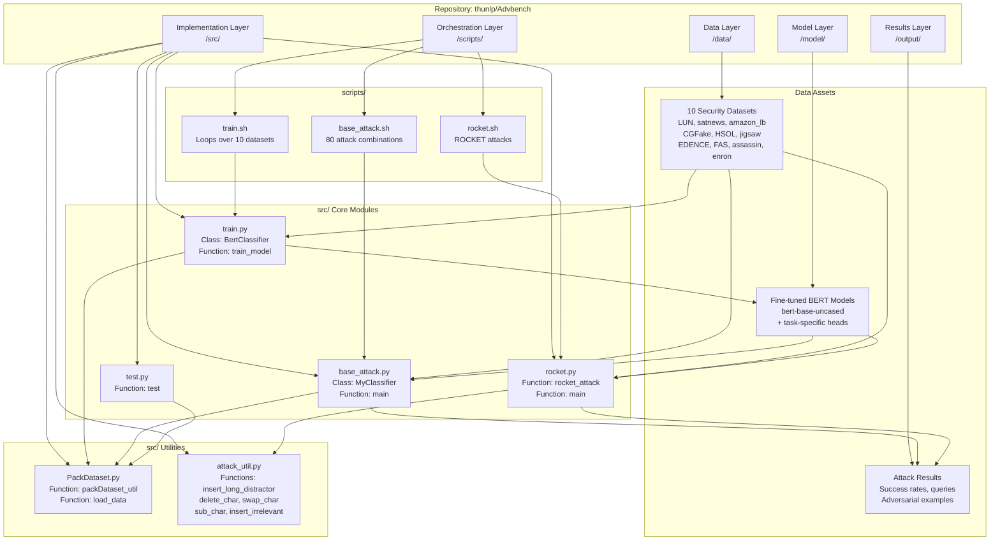
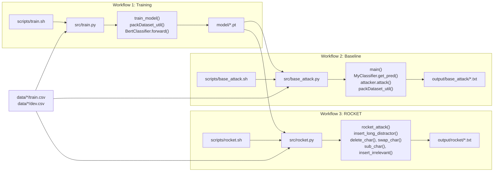
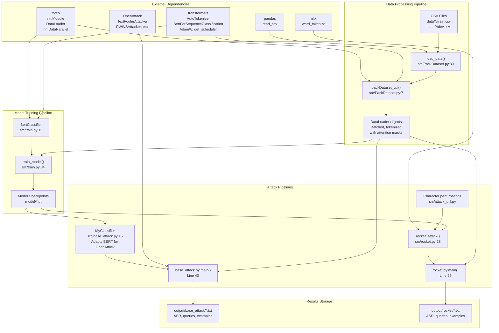

<!-- source: DeepWiki mcp.deepwiki.com · repo thunlp/Advbench · page 1 Overview · fetched 2026-11-02 -->

# Overview

Relevant source files

The following files were used as context for generating this wiki page:

- [README.md](README.md)

This document provides a high-level introduction to the Advbench benchmark system for Security-oriented Adversarial NLP (SoadNLP). It explains the system's purpose, architecture, and main components.

For detailed setup instructions, see [Getting Started](#1.1). For the research motivation behind the system, see [Research Paradigm: SoadNLP](#1.2). For information on the 10 security datasets, see [Datasets](#1.3). For detailed workflow documentation, see [Experimental Workflows](#2).

---

## Purpose and Scope

Advbench is a comprehensive benchmark system designed to evaluate adversarial NLP methods on security-specific tasks with real-world attacker goals. The system addresses three key deficiencies in traditional adversarial NLP research:

1. **Task Relevance**: Evaluates methods on actual security tasks (spam detection, fake news detection, toxic content detection) rather than generic NLP tasks
2. **Practical Goals**: Focuses on real-world attacker objectives rather than imperceptible perturbations
3. **Method Practicality**: Compares complex optimization-based attacks against simpler heuristic-based approaches

The system provides a unified platform for training models, executing baseline attacks via the OpenAttack framework, and running the proposed ROCKET method across 10 security datasets.

**Sources:** [README.md:7-12]()

---

## System Components

Advbench consists of four major component layers organized in the repository structure:

| Component Layer | Purpose | Key Artifacts |
|----------------|---------|---------------|
| **Orchestration Scripts** | Automate execution across multiple datasets | `scripts/train.sh`, `scripts/base_attack.sh`, `scripts/rocket.sh` |
| **Core Python Modules** | Implement training and attack logic | `src/train.py`, `src/base_attack.py`, `src/rocket.py`, `src/test.py` |
| **Utility Modules** | Provide data processing and text perturbation functions | `src/PackDataset.py`, `src/attack_util.py` |
| **Data Storage** | Store datasets, models, and results | `data/`, `model/`, `output/` directories |

### Component-to-Code Mapping

The following diagram maps the high-level system components to their concrete implementations in the codebase:

**Sources:** [README.md:27-67](), [scripts/train.sh:1-8](), [scripts/base_attack.sh:1-8](), [scripts/rocket.sh:1-8]()

---

## Three Experimental Workflows

Advbench implements three distinct experimental workflows, each orchestrated by a bash script that calls corresponding Python modules:

### Workflow 1: Model Training

**Purpose:** Fine-tune pre-trained BERT models on security datasets

- **Script:** `scripts/train.sh`
- **Module:** `src/train.py`
- **Input:** Raw CSV files from `data/` directory
- **Output:** Fine-tuned models saved to `model/` directory
- **Scope:** Trains models on all 10 datasets with unified hyperparameters

### Workflow 2: Baseline Attacks

**Purpose:** Evaluate robustness using established adversarial attack methods

- **Script:** `scripts/base_attack.sh`
- **Module:** `src/base_attack.py`
- **Framework:** OpenAttack library integration
- **Methods:** 8 attack methods (PSO, TextFooler, PWWS, BERT-Attack, DeepWordBug variants)
- **Scope:** 80 experiments (10 datasets × 8 attackers)

### Workflow 3: ROCKET Attacks

**Purpose:** Evaluate robustness using heuristic-based practical attacks

- **Script:** `scripts/rocket.sh`
- **Module:** `src/rocket.py`
- **Utilities:** `src/attack_util.py`
- **Methods:** Character-level perturbations with task-specific configurations
- **Scope:** 10 experiments (1 per dataset with customized parameters)

### Workflow Execution Pipeline

The following diagram shows the execution flow from shell scripts to Python modules, including the key functions called in each workflow:

**Sources:** [README.md:45-67](), [scripts/train.sh:4-7](), [scripts/base_attack.sh:4-8](), [scripts/rocket.sh:4-7]()

---

## Key Features

### Multi-Dataset Benchmark

The system includes 10 diverse security datasets covering different tasks:

| Dataset | Task Domain | Batch Size | Attack Configuration |
|---------|-------------|------------|---------------------|
| `LUN` | Security classification | 16-32 | Standard |
| `satnews` | News classification | 32 | Standard |
| `amazon_lb` | Review spam | 64 | begsl=3, ch='up' |
| `CGFake` | Fake news detection | 16 | begsl=3, ch='up' |
| `HSOL` | Hate speech detection | 16 | begsl=0, endsl=180, ch='peace' |
| `jigsaw` | Toxic comment detection | 16 | begsl=0, endsl=180, ch='peace' |
| `EDENCE` | Security classification | 16 | Standard |
| `FAS` | Security classification | 16 | Standard |
| `assassin` | Email classification | 16 | begsl=10, ch='>' |
| `enron` | Email spam detection | 16 | begsl=10, ch='>' |

For complete dataset specifications, see [Dataset Specifications](#5.3).

**Sources:** [scripts/train.sh:2](), [src/train.py:113-114](), [src/rocket.py:59-99]()

### Unified Model Training

All datasets use consistent training hyperparameters:
- **Base Model:** `bert-base-uncased` from Hugging Face transformers
- **Epochs:** 8
- **Learning Rate:** 1e-5
- **Optimizer:** AdamW with weight decay 1e-3
- **Warmup:** 10% of total steps
- **Multi-GPU:** Supported via `torch.nn.DataParallel`

**Sources:** [src/train.py:84-100](), [src/train.py:117-130]()

### Dual Attack Framework

The system provides two complementary attack methodologies:

**Baseline Attacks (via OpenAttack):**
- Complex optimization-based methods
- Focus on synonym replacement and gradient-based perturbations
- Methods: `PSO`, `TextFooler`, `PWWS`, `BERT`, `DeepWordBug-Insert`, `DeepWordBug-Delete`, `DeepWordBug-Swap`, `DeepWordBug-Substitute`

**ROCKET Attacks (heuristic-based):**
- Simple character-level perturbations
- Two-tiered strategy: long distractor insertion followed by iterative perturbations
- Operations: `insert_long_distractor()`, `delete_char()`, `swap_char()`, `sub_char()`, `insert_irrelevant()`

For detailed attack method documentation, see [Attack Method Catalog](#5.2).

**Sources:** [src/base_attack.py:29-35](), [src/rocket.py:56-57](), [src/attack_util.py:4-108]()

---

## System Architecture Overview

The following diagram illustrates the complete system architecture, showing how data flows from raw datasets through training and attack pipelines to produce evaluation results:

**Sources:** [src/PackDataset.py:1-43](), [src/train.py:1-130](), [src/base_attack.py:1-136](), [src/rocket.py:1-166](), [src/attack_util.py:1-108](), [requirements.txt:1-7]()

---

## Design Philosophy

Advbench embodies a paradigm shift in adversarial NLP research through its architecture:

1. **Security-First:** All datasets and tasks focus on real-world security applications rather than generic NLP benchmarks
2. **Practical Attack Simulation:** ROCKET method uses simple, interpretable heuristics that real attackers might employ
3. **Comparative Evaluation:** Direct comparison between complex optimization methods (baselines) and simple heuristics (ROCKET) on identical datasets and models
4. **Reproducibility:** Shell scripts automate entire experimental pipelines, ensuring consistent execution across all datasets

For the theoretical motivation behind this design, see [Research Paradigm: SoadNLP](#1.2).

**Sources:** [README.md:7-12]()

---

## Quick Start

To begin using Advbench:

1. **Setup Environment:** Install dependencies and create directories (see [Getting Started](#1.1))
2. **Prepare Data:** Download and extract the 10 security datasets (see [Datasets](#1.3))
3. **Train Models:** Run `bash scripts/train.sh` to fine-tune BERT on all datasets (see [Model Training Pipeline](#2.1))
4. **Run Attacks:** Execute `bash scripts/base_attack.sh` and `bash scripts/rocket.sh` to evaluate robustness (see [Baseline Attack Pipeline](#2.2) and [ROCKET Attack Pipeline](#2.3))
5. **Analyze Results:** Examine output files for attack success rates and adversarial examples (see [Interpreting Results](#4.3))

For detailed instructions on running experiments, see [User Guide](#4).

**Sources:** [README.md:16-67]()

---

