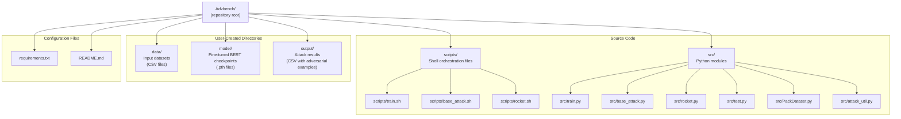
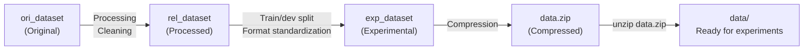
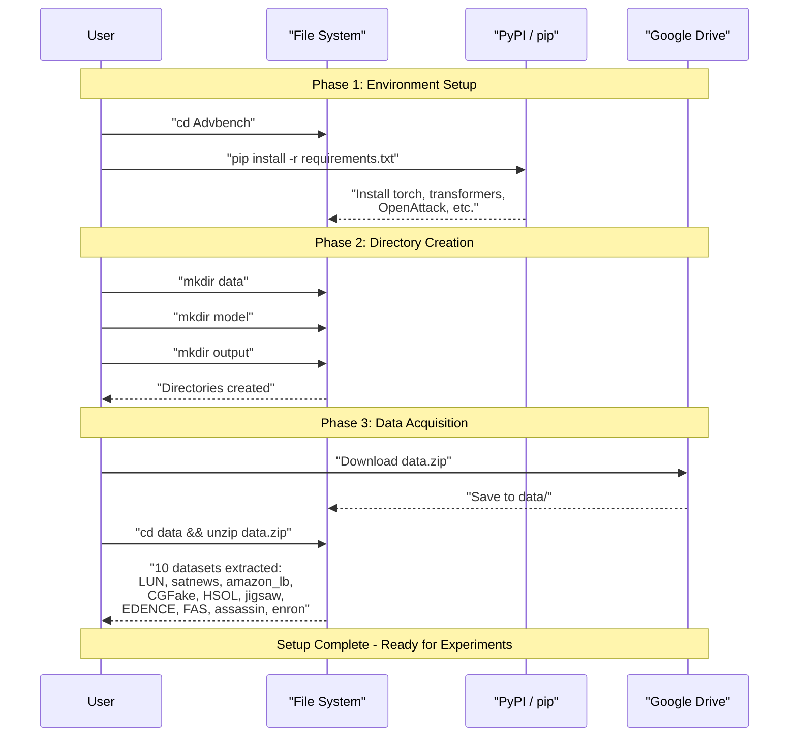
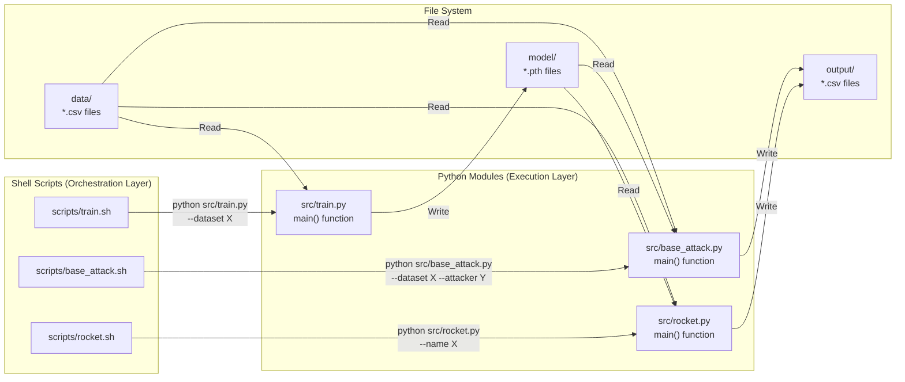
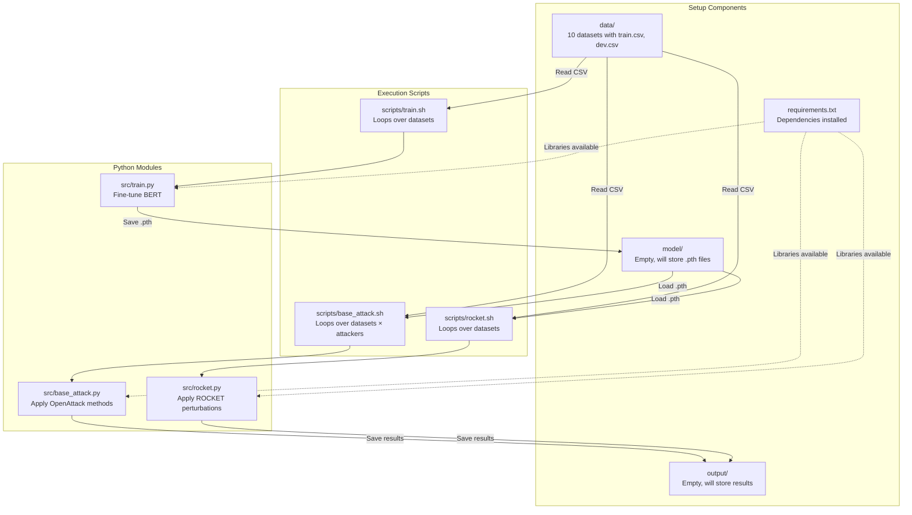

<!-- source: DeepWiki mcp.deepwiki.com · repo thunlp/Advbench · page 1.1 Getting Started · fetched 2026-11-02 -->

# Getting Started

<details>
<summary>Relevant source files</summary>

The following files were used as context for generating this wiki page:

- [README.md](README.md)
- [requirements.txt](requirements.txt)

</details>


This document guides you through the initial setup of the Advbench benchmark system, including environment installation, directory structure creation, and data preparation. By the end of this guide, you will have a working Advbench installation ready to train models and conduct adversarial attack experiments.

For information about the research paradigm and motivation behind Advbench, see [Research Paradigm: SoadNLP](#1.2). For detailed information about the datasets, see [Datasets](#1.3). For running experiments, see [Experimental Workflows](#2).

---

## Prerequisites

Before installing Advbench, ensure you have the following:

- **Python 3.6+** with pip package manager
- **CUDA-capable GPU** (recommended for training and running experiments)
- **15+ GB of disk space** for datasets and model checkpoints
- **Internet connection** for downloading dependencies and dataset files

---

## Installation

### Step 1: Install Dependencies

Advbench requires several Python libraries specified in [requirements.txt:1-10](). Install all dependencies using pip:

```bash
pip install -r requirements.txt
```

**Core Dependencies:**

| Library | Version | Purpose |
|---------|---------|---------|
| `torch` | ≥1.5.1 | PyTorch deep learning framework |
| `transformers` | ≥4.0.0 | Hugging Face library for BERT models |
| `OpenAttack` | latest | Baseline adversarial attack methods |
| `nltk` | ≥3.5 | Natural language processing utilities |
| `pandas` | latest | CSV data manipulation |
| `numpy` | latest | Numerical operations |
| `datasets` | latest | Dataset handling utilities |
| `tqdm` | latest | Progress bar visualization |

**Note:** Depending on your server configuration, you may need to adjust library versions for compatibility. The versions listed are minimum requirements specified in [requirements.txt:1-10]().

**Sources:** [requirements.txt:1-10](), [README.md:16-22]()

---

## Directory Structure Setup

### Step 2: Create Required Directories

Advbench requires three directories that are not included in the repository (excluded via `.gitignore`):

```bash
cd Advbench
mkdir data
mkdir model
mkdir output
```

**Directory Structure Diagram:**



**Directory Purposes:**

- **`data/`**: Stores all dataset files organized by dataset name. Each dataset has subdirectories containing `train.csv` and `dev.csv` files.
- **`model/`**: Stores fine-tuned BERT model checkpoints created by [src/train.py](). Models are saved with naming pattern `{dataset_name}.pth`.
- **`output/`**: Stores adversarial attack results generated by [src/base_attack.py]() and [src/rocket.py](). Results include perturbed text examples and attack metrics.

**Sources:** [README.md:27-32](), [README.md:45-48]()

---

## Data Preparation

### Step 3: Download Datasets

Advbench provides datasets in three forms, each serving different research purposes:

| Dataset Form | Description | Use Case |
|--------------|-------------|----------|
| **ori_dataset** | Raw, unprocessed datasets | Custom data processing and exploration |
| **rel_dataset** | Processed datasets ready for use | Further research and customization |
| **exp_dataset** | Experimental dataset (uncompressed) | Direct reproduction of paper experiments |
| **data.zip** | Compressed version of exp_dataset | Quick setup for reproduction |

**Download Location:** [Google Drive](https://drive.google.com/drive/folders/1_2q2282ZEoE_iPg8Q4ILGeB_aAkcP43v?usp=sharing)

**For Quick Reproduction:**

If you want to reproduce the experiments from the paper, download `data.zip`:

```bash
# After downloading data.zip to Advbench/data/
cd data
unzip data.zip
```

This creates the following structure:

```
data/
├── LUN/
│   ├── train.csv
│   └── dev.csv
├── satnews/
│   ├── train.csv
│   └── dev.csv
├── amazon_lb/
├── CGFake/
├── HSOL/
├── jigsaw/
├── EDENCE/
├── FAS/
├── assassin/
└── enron/
```

**Sources:** [README.md:25-41]()

---

## Dataset Structure and Format

### Understanding Dataset Forms

The three dataset forms represent different stages of data processing:



**CSV File Format:**

Each dataset contains `train.csv` and `dev.csv` with the following structure:

| Column | Description | Example |
|--------|-------------|---------|
| `text` | Input text sample | "This is a spam message..." |
| `label` | Binary classification label | 0 or 1 |

These CSV files are loaded by the `load_data` function referenced in [src/train.py]() and processed by `PackDataset.packDataset_util` from [src/PackDataset.py]().

**Sources:** [README.md:30-41]()

---

## Setup Workflow

### Complete Setup Process

The following diagram shows the complete setup workflow from installation to readiness:



**Sources:** [README.md:16-41]()

---

## Verification

### Step 4: Verify Installation

After completing the setup, verify that all components are correctly installed:

**1. Check Directory Structure:**

```bash
ls -la
# Should show: data/, model/, output/, scripts/, src/, requirements.txt, README.md
```

**2. Verify Dataset Files:**

```bash
ls data/
# Should list 10 directories: LUN, satnews, amazon_lb, CGFake, HSOL, jigsaw, EDENCE, FAS, assassin, enron

ls data/LUN/
# Should show: train.csv, dev.csv
```

**3. Test Python Dependencies:**

```python
# Test import of critical dependencies
import torch
import transformers
import OpenAttack
import nltk
import pandas

print(f"PyTorch version: {torch.__version__}")
print(f"Transformers version: {transformers.__version__}")
print(f"CUDA available: {torch.cuda.is_available()}")
```

**Expected Output:**
```
PyTorch version: 1.x.x
Transformers version: 4.x.x
CUDA available: True
```

**Sources:** [requirements.txt:1-10]()

---

## File Path Mapping to Code Entities

Understanding how shell scripts invoke Python modules:



**Sources:** [README.md:45-67]()

---

## Quick Start Example

### Running Your First Experiment

After completing setup, you can verify the installation by training a model on a single dataset:

```bash
# Train BERT on the LUN dataset
python src/train.py --dataset LUN --batch_size 32 --epochs 8

# Check that model was saved
ls model/
# Should show: LUN.pth
```

**Expected Behavior:**
1. Downloads `bert-base-uncased` pre-trained model from Hugging Face
2. Loads training data from `data/LUN/train.csv`
3. Fine-tunes BERT for 8 epochs
4. Saves model checkpoint to `model/LUN.pth`

For running complete experiments across all datasets, see [Running Training Experiments](#4.1).

**Sources:** [README.md:51-55]()

---

## Next Steps

After completing the setup, you can proceed to:

1. **Train Models**: Use [scripts/train.sh]() to fine-tune BERT on all 10 datasets. See [Model Training Pipeline](#2.1) for details.

2. **Run Baseline Attacks**: Use [scripts/base_attack.sh]() to evaluate 8 baseline attack methods via OpenAttack. See [Baseline Attack Pipeline](#2.2).

3. **Run ROCKET Attacks**: Use [scripts/rocket.sh]() to evaluate the heuristic-rule-based attack method. See [ROCKET Attack Pipeline](#2.3).

4. **Customize Experiments**: Modify attack parameters and configurations. See [Customizing Experiments](#4.4).

---

## Troubleshooting

### Common Issues

**Issue: CUDA out of memory during training**

Reduce batch size in training command or in [scripts/train.sh]():
```bash
python src/train.py --dataset LUN --batch_size 16  # Instead of 32
```

**Issue: Missing dataset files**

Ensure `data.zip` was fully extracted:
```bash
cd data
unzip -l data.zip  # List contents without extracting
unzip data.zip     # Extract if needed
```

**Issue: Import errors for transformers or OpenAttack**

Reinstall with specific versions:
```bash
pip install transformers==4.20.0
pip install OpenAttack
```

**Issue: Permission denied when creating directories**

Run with appropriate permissions:
```bash
sudo mkdir data model output
sudo chown $USER:$USER data model output
```

---

## System Overview Diagram

The following diagram shows how the components you've set up interact during a typical experiment workflow:



**Sources:** [README.md:16-67]()

---

## Summary

You have now completed the setup of Advbench. The system is ready to:

- Train BERT models on 10 security datasets
- Evaluate adversarial robustness using 8 baseline attack methods via OpenAttack
- Evaluate adversarial robustness using the ROCKET heuristic-rule-based method
- Store models in `model/` and attack results in `output/`

For detailed information about running experiments, proceed to [Experimental Workflows](#2).

**Sources:** [README.md:1-81]()

---

