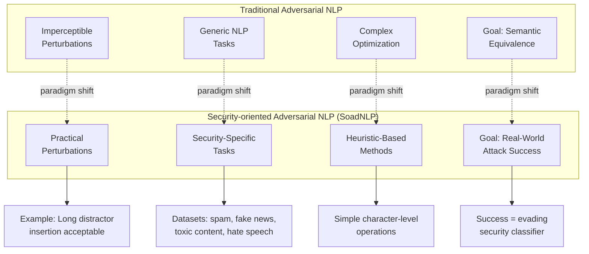
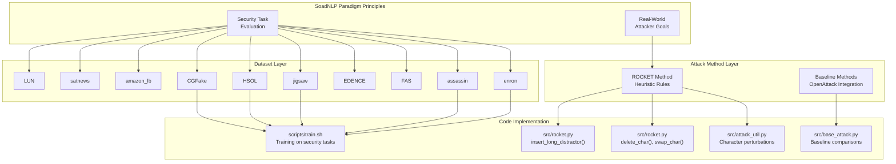
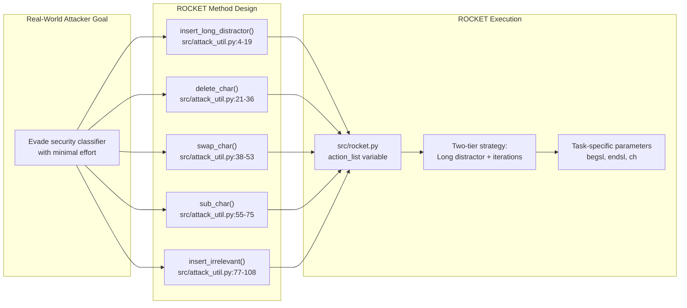
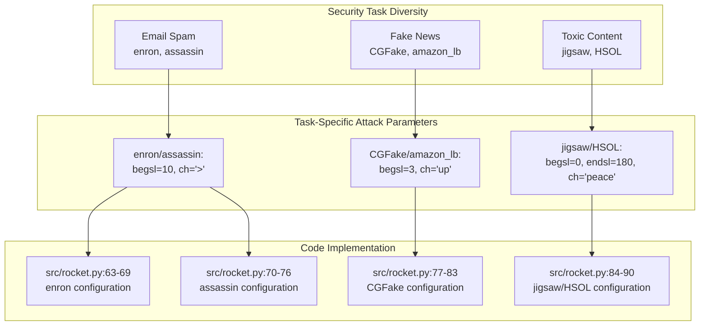
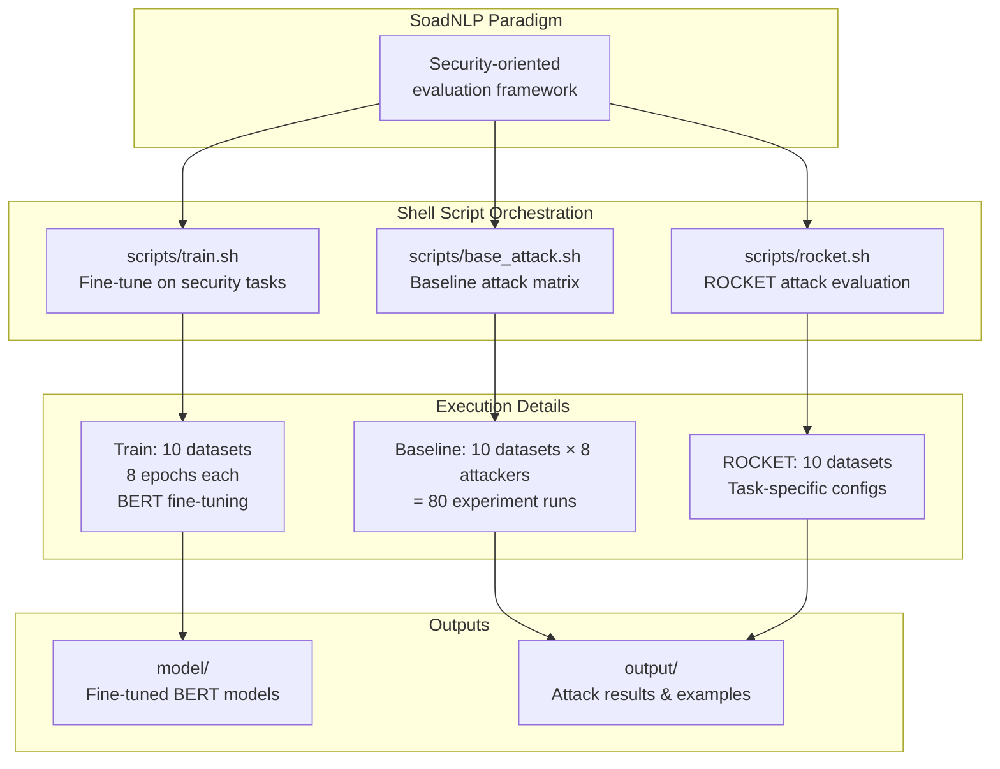

<!-- source: DeepWiki mcp.deepwiki.com · repo thunlp/Advbench · page 1.2 Research Paradigm: SoadNLP · fetched 2026-11-02 -->

# Research Paradigm: SoadNLP

Relevant source files

The following files were used as context for generating this wiki page:

- [README.md](README.md)

## Purpose and Scope

This document explains the Security-oriented adversarial NLP (SoadNLP) research paradigm that motivates the design and implementation of Advbench. It describes the paradigm shift from traditional adversarial NLP focused on imperceptible perturbations to practical, security-oriented attack simulation. For information about the specific datasets used in this paradigm, see [Datasets](#1.3). For details on how this paradigm is implemented through attack methods, see [Baseline Attack Pipeline](#2.2) and [ROCKET Attack Pipeline](#2.3).

**Sources:** [README.md:7-12]()

## Traditional Adversarial NLP Paradigm

Traditional adversarial NLP research operates under a paradigm inherited from computer vision adversarial examples. This paradigm emphasizes three primary characteristics:

1. **Imperceptibility Constraint**: Perturbations must be undetectable or minimally noticeable to human readers
2. **Generic Task Focus**: Evaluation primarily on sentiment analysis, natural language inference, and other general NLP tasks
3. **Complex Optimization**: Gradient-based methods or sophisticated search algorithms to find minimal perturbations

This paradigm assumes that the primary goal is to fool a model while maintaining semantic equivalence and minimal visual/semantic difference from the original text.

**Sources:** [README.md:7-12]()

## Deficiencies in Traditional Approaches for Security Scenarios

The Advbench system addresses three critical deficiencies when applying traditional adversarial NLP methods to security scenarios:

### Deficiency 1: Task Domain Mismatch

Traditional methods are evaluated on generic NLP tasks rather than security-specific tasks. Security applications such as spam detection, fake news identification, and toxic content filtering have different characteristics and requirements than sentiment analysis or textual entailment.

### Deficiency 2: Unrealistic Attacker Goals

The emphasis on imperceptibility does not align with real-world attacker goals in security scenarios. A spammer attempting to evade a filter does not need perturbations to be imperceptible—they need the message to accomplish its malicious purpose (e.g., delivering spam content, spreading misinformation).

### Deficiency 3: Impractical Attack Complexity

Complex optimization methods that require numerous queries or gradient access are impractical for real attackers. Security adversaries typically prefer simple, effective methods that can be applied at scale without sophisticated infrastructure.

**Sources:** [README.md:7-12]()

## The SoadNLP Paradigm

**Diagram: Paradigm Shift from Traditional Adversarial NLP to SoadNLP**

The SoadNLP paradigm reformulates adversarial NLP research with two core principles:

### Principle 1: Security Task Evaluation

Methods must be evaluated on security tasks to demonstrate real-world concerns. This principle is implemented in Advbench through a curated collection of 10 security datasets covering diverse security domains.

### Principle 2: Real-World Attacker Goals

Research should consider actual adversarial goals rather than theoretical constraints. In security scenarios, attackers prioritize effectiveness over subtlety. A spam message with character substitutions or long distractors is acceptable as long as it bypasses the filter and delivers the payload.

**Sources:** [README.md:7-12]()

## Implementation in Advbench System

The SoadNLP paradigm directly influences the architecture and design decisions throughout the Advbench system:

**Diagram: SoadNLP Paradigm Implementation in Advbench Codebase**

### Security Task Dataset Collection

The system implements Principle 1 through 10 security-specific datasets spanning multiple domains:

| Dataset | Security Task | Domain |
|---------|---------------|---------|
| enron | Spam detection | Email security |
| assassin | Spam detection | Email security |
| CGFake | Fake news detection | Misinformation |
| jigsaw | Toxic content detection | Content moderation |
| HSOL | Hate speech detection | Content moderation |
| amazon_lb | Review spam detection | E-commerce |
| LUN | Security classification | General security |
| satnews | Security classification | General security |
| EDENCE | Security classification | General security |
| FAS | Security classification | General security |

These datasets are processed through [src/PackDataset.py:7-43]() and trained using [src/train.py:117-130]() with consistent hyperparameters across all security tasks.

**Sources:** [README.md:11](), [README.md:34-41]()

### Practical Attack Method: ROCKET

The system implements Principle 2 through the ROCKET (heuristic-Rule-based) method, which simulates real-world attacker behavior:

**Diagram: ROCKET Method as Implementation of Real-World Attacker Goals**

The ROCKET method consists of five simple perturbation operations defined in [src/attack_util.py:4-108]():

1. **`insert_long_distractor()`**: Inserts long character sequences at sentence boundaries
2. **`delete_char()`**: Removes individual characters from words
3. **`swap_char()`**: Swaps adjacent characters within words
4. **`sub_char()`**: Substitutes characters with visually similar alternatives
5. **`insert_irrelevant()`**: Adds irrelevant words or phrases

These operations are coordinated through [src/rocket.py:56]() where the `action_list` variable defines the perturbation sequence.

**Sources:** [README.md:11](), [src/attack_util.py:4-108](), [src/rocket.py:56]()

## Design Implications and Code Organization

### Task-Specific Configuration

The SoadNLP paradigm requires different attack strategies for different security tasks. This is implemented through task-specific parameter configurations in [src/rocket.py:59-99]():

**Diagram: Task-Specific Parameter Configuration in ROCKET Implementation**

| Parameter | Purpose | Example Values |
|-----------|---------|----------------|
| `begsl` | Minimum sentence length for perturbation | 0, 3, 10 |
| `endsl` | Maximum sentence length for perturbation | 180 (jigsaw/HSOL) |
| `ch` | Distractor character sequence | '>', 'up', 'peace' |
| `attack_totalnum` | Number of positions to perturb | 3-20 depending on task |
| `attack_batchsize` | Parallel perturbation attempts | 5-20 depending on task |

**Sources:** [src/rocket.py:59-99]()

### Baseline Comparison Framework

To validate the SoadNLP paradigm empirically, Advbench includes baseline comparisons with traditional methods through [src/base_attack.py:29-35]():

| Attack Method | Type | Characteristic |
|---------------|------|----------------|
| PSO | Particle Swarm Optimization | Complex optimization |
| TextFooler | Synonym replacement | Semantic similarity constraint |
| PWWS | Word saliency | Gradient-based selection |
| BERT | BERT MLM predictions | Pre-trained model dependent |
| DeepWordBug* | Character-level | Simple but imperceptibility-focused |

These baseline methods represent the traditional paradigm, allowing empirical comparison with the SoadNLP approach implemented in ROCKET. The integration is handled through the `MyClassifier` wrapper in [src/base_attack.py:12-26]() and the attacker registry in [src/base_attack.py:29-35]().

**Sources:** [src/base_attack.py:12-35]()

### Evaluation Metrics Alignment

The SoadNLP paradigm shifts evaluation metrics to emphasize practical success:

| Metric | Traditional Focus | SoadNLP Focus |
|--------|-------------------|---------------|
| Attack Success Rate (ASR) | Model fooling rate | Security evasion rate |
| Query Count | Efficiency measure | Practicality indicator |
| Perturbation Similarity | Imperceptibility | Not primary concern |
| Runtime | Secondary metric | Practical feasibility |

The metrics are collected in [src/base_attack.py:127-135]() for baseline methods and [src/rocket.py:163-166]() for ROCKET, with emphasis on attack success rate and query efficiency rather than semantic similarity measures.

**Sources:** [src/base_attack.py:127-135](), [src/rocket.py:163-166]()

## Orchestration Through Shell Scripts

The paradigm is operationalized through three main orchestration scripts that automate experiments across the security dataset collection:

**Diagram: Paradigm Implementation Through Orchestration Scripts**

The [scripts/train.sh:2-6]() script trains models on all security tasks, [scripts/base_attack.sh:2-7]() creates a comprehensive attack matrix comparing traditional methods, and [scripts/rocket.sh:2-6]() evaluates the practical attack approach across all datasets.

**Sources:** [scripts/train.sh:2-6](), [scripts/base_attack.sh:2-7](), [scripts/rocket.sh:2-6]()

## Summary

The SoadNLP paradigm represents a fundamental shift in adversarial NLP research methodology:

- **From**: Imperceptible perturbations on generic tasks using complex optimization
- **To**: Practical perturbations on security tasks using heuristic methods

This paradigm is implemented throughout Advbench's architecture: in dataset selection (10 security tasks), attack method design (ROCKET's heuristic rules), baseline comparisons (traditional methods via OpenAttack), and evaluation metrics (emphasis on practical success). The system demonstrates that simpler, more practical attack methods may have higher real-world value in security scenarios than sophisticated but impractical optimization-based approaches.

**Sources:** [README.md:7-12]()

---

