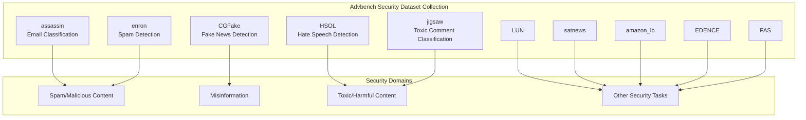
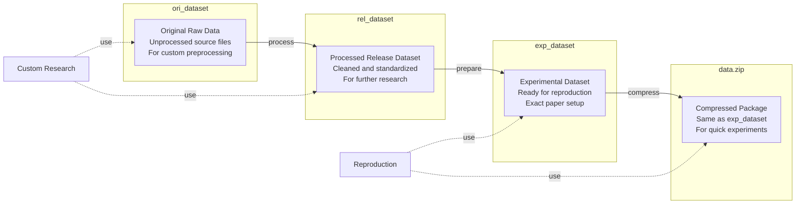
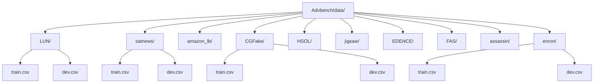
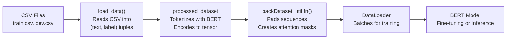

<!-- source: DeepWiki mcp.deepwiki.com · repo thunlp/Advbench · page 1.3 Datasets · fetched 2026-11-02 -->

# Datasets

<details>
<summary>Relevant source files</summary>

The following files were used as context for generating this wiki page:

- [README.md](README.md)
- [src/PackDataset.py](src/PackDataset.py)

</details>


This page documents the security datasets collection in Advbench, including the 10 security tasks, the three dataset forms provided (`ori_dataset`, `rel_dataset`, `exp_dataset`), file organization, data formats, and acquisition process. For information about how this data is processed and batched for model training, see [Data Processing System](#3.1). For task-specific training configurations, see [Model Training Pipeline](#2.1). For dataset-specific attack parameters, see [Dataset Specifications](#5.3).

## Dataset Collection Overview

Advbench provides a curated collection of 10 security-related NLP datasets spanning multiple domains including spam detection, fake news identification, hate speech detection, and toxic comment classification. This collection represents a paradigm shift from generic NLP tasks (sentiment analysis, question answering) to real-world security applications where adversarial attacks have practical consequences.

### Security Task Domains



**Sources:** [README.md:11](), [README.md:51]()

### Dataset Characteristics

The following table summarizes key characteristics of each dataset in the collection:

| Dataset | Domain | Training Batch Size | Notes |
|---------|--------|-------------------|-------|
| `LUN` | Security | 16-32 | Variable batch size |
| `satnews` | Security | 32 | - |
| `amazon_lb` | Security | 64 | Larger batch for efficiency |
| `CGFake` | Fake News | 16 | Memory-intensive |
| `HSOL` | Hate Speech | 16 | Offensive language detection |
| `jigsaw` | Toxic Comments | 16 | Multi-class toxicity |
| `EDENCE` | Security | 16 | - |
| `FAS` | Security | 16 | - |
| `assassin` | Email Security | 16 | Email classification |
| `enron` | Spam Detection | 16 | Email spam filtering |

**Sources:** Diagram 6 annotations, [src/train.py:113-114]()

## Dataset Forms

Advbench provides datasets in three different forms to accommodate various research needs and experimental workflows. Understanding these forms is crucial for selecting the appropriate data for your use case.

### Form Comparison Diagram



**Sources:** [README.md:36-41]()

### Form Specifications

#### ori_dataset (Original Dataset)

The `ori_dataset` contains unprocessed source files as obtained from their original sources. This form is suitable when:
- You need to apply custom preprocessing pipelines
- You want to extract different features or data splits
- You are conducting research that requires access to raw, unfiltered data

#### rel_dataset (Release Dataset)

The `rel_dataset` contains cleaned and standardized data suitable for general research purposes. This form is recommended when:
- You want to build on the benchmark for further research
- You need consistent, pre-processed data but want flexibility in experimental setup
- You plan to apply your own attack methods or evaluation metrics

[README.md:41]() states: "If you want to use our benchmark for further research, please download **rel_dataset**."

#### exp_dataset (Experimental Dataset)

The `exp_dataset` contains data configured exactly as used in the paper's experiments. This form is appropriate when:
- You want to reproduce the exact results from the paper
- You need the precise train/dev/test splits used in published experiments
- You are conducting comparative studies against the baseline results

[README.md:36]() indicates: "If you just want to reproduce the experiment, you should download the **data.zip**", which is equivalent to `exp_dataset` in compressed form.

**Sources:** [README.md:34-41]()

## Data Structure and Format

### Directory Organization



Each dataset directory follows a consistent structure with at least two files:
- `train.csv` - Training data split
- `dev.csv` - Development/validation data split

**Sources:** Diagram 3 annotations, [src/PackDataset.py:1-3]()

### CSV File Format

The CSV files use a standardized three-column format for text classification tasks:

```
text,label,id
```

- **text**: The input text sample (sentence, document, or comment)
- **label**: The ground truth classification label (typically 0 or 1 for binary tasks)
- **id**: A unique identifier for the sample (optional but typically included)

**Example structure:**
```csv
text,label,id
"This is a sample text for classification",0,1
"Another example with different label",1,2
```

This format is consistent across all datasets in the collection, enabling uniform data loading pipelines.

**Sources:** Diagram 3 annotations

## Data Acquisition

### Download Instructions

The datasets are hosted on Google Drive and must be downloaded manually before running experiments.

1. **Create data directory**:
```bash
cd Advbench
mkdir data
```

2. **Access Google Drive**: Navigate to the shared folder at [Google Drive link](https://drive.google.com/drive/folders/1_2q2282ZEoE_iPg8Q4ILGeB_aAkcP43v?usp=sharing)

3. **Select appropriate form**:
   - For reproduction: Download `data.zip`
   - For custom research: Download `rel_dataset` or `ori_dataset`
   - For inspection: Download `exp_dataset` (uncompressed)

4. **Extract data** (if using `data.zip`):
```bash
cd data
unzip data.zip
```

After extraction, the directory structure should match the organization shown in the previous section, with each dataset having its own subdirectory containing CSV files.

**Sources:** [README.md:27-41]()

## Data Loading Pipeline

### From CSV to Model Input



**Sources:** [src/PackDataset.py:1-51](), Diagram 3

### Data Processing Classes

The system uses two main classes for data processing:

#### processed_dataset

The `processed_dataset` class (defined in [src/PackDataset.py:13-27]()) converts raw text-label pairs into BERT-compatible token tensors:

- Initializes with `(text, label)` tuple list and BERT model type
- Uses `AutoTokenizer.from_pretrained()` to load tokenizer
- Encodes text with max length 512 and truncation enabled
- Stores tokenized texts and labels as parallel lists
- Implements PyTorch `Dataset` interface with `__len__()` and `__getitem__()`

#### packDataset_util

The `packDataset_util` class (defined in [src/PackDataset.py:30-50]()) handles batching and padding:

- **Initialization**: Loads tokenizer for specified BERT type
- **fn() method**: Collate function that:
  - Pads sequences to match batch's longest sequence using `pad_sequence()`
  - Creates attention masks (1 for real tokens, 0 for padding)
  - Returns tuple: `(padded_texts, attention_masks, labels)`
- **get_loader() method**: Creates PyTorch `DataLoader` with:
  - Configurable batch size and shuffling
  - Custom collate function for proper padding

**Sources:** [src/PackDataset.py:5-50]()

### Usage in Training and Attack Pipelines

The data loading pipeline is utilized across all experimental workflows:

1. **Training Pipeline** ([Model Training Pipeline](#2.1)): Loads train/dev splits for model fine-tuning
2. **Baseline Attacks** ([Baseline Attack Pipeline](#2.2)): Loads test data for adversarial evaluation
3. **ROCKET Attacks** ([ROCKET Attack Pipeline](#2.3)): Loads samples for heuristic perturbation
4. **Model Evaluation** ([Model Evaluation](#2.4)): Loads validation sets for accuracy testing

All workflows use the same `packDataset_util` interface, ensuring consistent data handling across the entire system.

**Sources:** [src/PackDataset.py:1-51](), Diagram 3, Diagram 4

## Dataset-Specific Considerations

While all datasets follow the same file format and loading pipeline, different datasets require different configurations for optimal experimental results:

### Batch Size Variations

Different datasets use different batch sizes during training based on memory constraints and dataset characteristics:

- **Large batch (64)**: `amazon_lb` - enables faster training on larger datasets
- **Standard batch (32)**: `satnews`, `LUN` (sometimes) - balanced efficiency
- **Small batch (16)**: `CGFake`, `HSOL`, `jigsaw`, `EDENCE`, `FAS`, `assassin`, `enron` - required for memory-intensive tasks or longer text sequences

These batch sizes are configured in the training scripts and affect both training speed and memory consumption.

### Attack Parameter Configurations

For ROCKET attacks, different datasets require task-specific perturbation strategies. Key parameters include:

- **begsl/endsl**: Sentence length ranges for inserting distractors
- **attack_totalnum**: Number of positions to perturb
- **ch**: Distractor characters or strings
- **attack_batchsize**: Number of parallel perturbations to test

For example:
- Email datasets (`enron`, `assassin`): Use `begsl=10` and `ch='>'` to simulate email-style distractors
- Fake news datasets (`CGFake`, `amazon_lb`): Use `begsl=3` and `ch='up'` 
- Toxic comment datasets (`jigsaw`, `HSOL`): Use `begsl=0`, `endsl=180`, and `ch='peace'`

These configurations reflect domain-specific attack strategies that simulate realistic adversarial perturbations for each security task.

**Sources:** Diagram 6 annotations, [src/train.py:113-114]()

## Summary Table

| Aspect | Description |
|--------|-------------|
| **Total Datasets** | 10 security-related NLP tasks |
| **Dataset Forms** | 3 forms (ori, rel, exp) plus compressed zip |
| **File Format** | CSV with columns: text, label, id |
| **Splits** | train.csv, dev.csv per dataset |
| **Processing** | `processed_dataset` + `packDataset_util` classes |
| **Tokenization** | BERT tokenizer with max_length=512 |
| **Batch Sizes** | 16-64 depending on dataset |
| **Location** | `Advbench/data/{dataset_name}/` |
| **Acquisition** | Manual download from Google Drive |

**Sources:** [README.md:1-81](), [src/PackDataset.py:1-51]()

---

