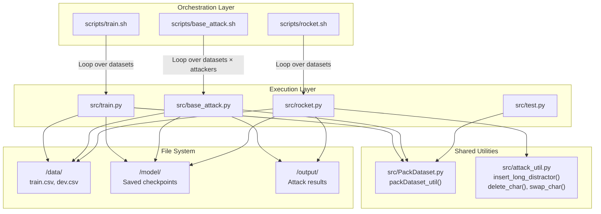
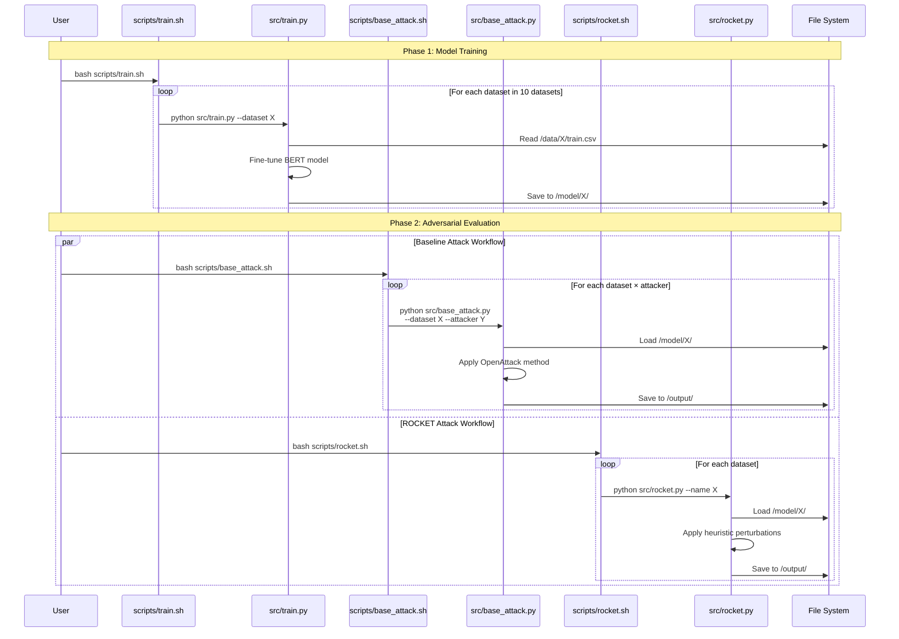
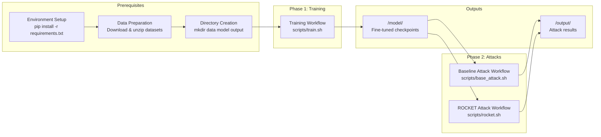

<!-- source: DeepWiki mcp.deepwiki.com · repo thunlp/Advbench · page 2 Experimental Workflows · fetched 2026-11-02 -->

# Experimental Workflows

<details>
<summary>Relevant source files</summary>

The following files were used as context for generating this wiki page:

- [README.md](README.md)

</details>


## Purpose and Scope

This page provides an overview of the three main experimental pipelines in Advbench: model training, baseline adversarial attacks, and ROCKET attacks. Each workflow is orchestrated by shell scripts that automate execution across multiple datasets. For detailed information about each pipeline, see:
- Model training specifics: [Model Training Pipeline](#2.1)
- Baseline attack methods: [Baseline Attack Pipeline](#2.2)
- ROCKET implementation: [ROCKET Attack Pipeline](#2.3)
- Model evaluation procedures: [Model Evaluation](#2.4)

For dataset preparation and structure, see [Datasets](#1.3). For technical implementation details, see [Technical Architecture](#3).

**Sources:** [README.md:43-67]()

## Overview

Advbench implements three distinct experimental workflows that enable comprehensive evaluation of adversarial robustness on security tasks:

| Workflow | Script | Core Module | Purpose |
|----------|--------|-------------|---------|
| **Model Training** | `scripts/train.sh` | `src/train.py` | Fine-tune BERT models on security datasets |
| **Baseline Attacks** | `scripts/base_attack.sh` | `src/base_attack.py` | Apply 8 OpenAttack methods across datasets |
| **ROCKET Attacks** | `scripts/rocket.sh` | `src/rocket.py` | Apply heuristic-rule-based perturbations |

The workflows follow a two-phase execution model:
1. **Phase 1 (Model Preparation):** Fine-tune pre-trained BERT models on all 10 security datasets
2. **Phase 2 (Adversarial Evaluation):** Apply both baseline and ROCKET attacks to evaluate model robustness

**Sources:** [README.md:45-67]()

## Workflow Orchestration Architecture

The system uses a layered architecture where bash scripts orchestrate Python modules that operate on datasets and models stored in the filesystem:



**Workflow Orchestration Architecture**

Each shell script implements a loop pattern that executes the corresponding Python module with different command-line arguments for each dataset. The Python modules share common utilities for data processing (`PackDataset.py`) and text perturbations (`attack_util.py`), while reading from and writing to standardized filesystem locations.

**Sources:** [README.md:45-67]()

## Execution Sequence

The complete experimental workflow follows a sequential execution pattern with clearly defined phases:



**Execution Sequence Diagram**

The training phase must complete before attack phases can begin, as attacks require trained models. However, baseline and ROCKET attack workflows can execute in parallel or sequentially, as they operate independently and produce separate output files.

**Sources:** [README.md:45-67]()

## Command-Line Interface

Each Python module in the execution layer exposes a command-line interface with dataset-specific arguments:

### Training Interface

```bash
python src/train.py --dataset <dataset_name>
```

The training script is invoked by `scripts/train.sh` which iterates over all datasets:

```bash
for dataset in LUN satnews amazon_lb CGFake HSOL jigsaw EDENCE FAS assassin enron
do
    python src/train.py --dataset $dataset
done
```

### Baseline Attack Interface

```bash
python src/base_attack.py --dataset <dataset_name> --attacker <attacker_name>
```

The baseline attack script performs a cross-product evaluation of datasets and attackers, executing 80 total runs (10 datasets × 8 attackers).

### ROCKET Attack Interface

```bash
python src/rocket.py --name <dataset_name>
```

The ROCKET script applies task-specific heuristic perturbations to each dataset.

**Sources:** [README.md:51-67]()

## Directory Structure and Artifacts

The workflows interact with three primary directories that must be created before execution:

| Directory | Purpose | Created By | Used By |
|-----------|---------|------------|---------|
| `/data/` | Input datasets (CSV files) | User (setup) | All workflows |
| `/model/` | Fine-tuned BERT checkpoints | Training workflow | Attack workflows |
| `/output/` | Adversarial attack results | Attack workflows | Analysis |

### Data Directory Structure

```
/data/
├── LUN/
│   ├── train.csv
│   └── dev.csv
├── satnews/
│   ├── train.csv
│   └── dev.csv
└── ... (8 more datasets)
```

Each dataset directory contains `train.csv` and `dev.csv` files with standardized columns for text content and labels.

### Model Directory Structure

```
/model/
├── LUN/
│   └── checkpoint.pth
├── satnews/
│   └── checkpoint.pth
└── ... (8 more datasets)
```

Each model directory stores the fine-tuned BERT model checkpoint for that dataset.

### Output Directory Structure

```
/output/
├── base_attack/
│   ├── LUN_PSO.csv
│   ├── LUN_TextFooler.csv
│   └── ... (80 result files)
└── rocket/
    ├── LUN_results.csv
    └── ... (10 result files)
```

Attack workflows generate result files containing adversarial examples, success rates, and query statistics.

**Sources:** [README.md:27-49]()

## Workflow Dependencies

The three workflows have clear dependency relationships that dictate execution order:



**Workflow Dependency Graph**

**Critical Dependencies:**
- Training workflow requires dataset files in `/data/`
- Attack workflows require trained models in `/model/`
- All workflows require their output directories to exist

**Independent Execution:**
- Baseline and ROCKET attack workflows are independent and can run in parallel
- Individual datasets within each workflow can be processed sequentially or in parallel (with sufficient GPU memory)

**Sources:** [README.md:16-67]()

## Execution Time Considerations

The workflows have different computational requirements:

| Workflow | Approximate Time | Bottleneck | Parallelization |
|----------|-----------------|------------|-----------------|
| Training | 2-4 hours per dataset | GPU compute | Sequential by dataset |
| Baseline Attacks | Variable (1-24 hours per dataset-attacker pair) | Search algorithms | Parallel across dataset-attacker pairs |
| ROCKET Attacks | 30 minutes - 2 hours per dataset | Model queries | Sequential by dataset |

Training must complete for all datasets before attacks can begin. The total experimental pipeline requires multiple days of compute time for full reproduction across all 10 datasets and 8 baseline attackers.

**Sources:** [README.md:45-67]()

## Dataset Coverage

All three workflows operate on the same 10 security datasets:

| Dataset | Domain | Task | Used By |
|---------|--------|------|---------|
| `LUN` | Social media | Classification | All workflows |
| `satnews` | News articles | Classification | All workflows |
| `amazon_lb` | Product reviews | Classification | All workflows |
| `CGFake` | News articles | Fake news detection | All workflows |
| `HSOL` | Social media | Hate speech detection | All workflows |
| `jigsaw` | Comments | Toxic comment detection | All workflows |
| `EDENCE` | Documents | Classification | All workflows |
| `FAS` | Text | Classification | All workflows |
| `assassin` | Email | Classification | All workflows |
| `enron` | Email | Spam detection | All workflows |

Each workflow processes all datasets to enable comprehensive cross-dataset evaluation and comparison of attack effectiveness across different security domains.

**Sources:** [README.md:51-67]()

---

