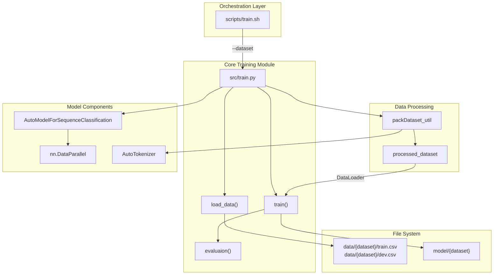
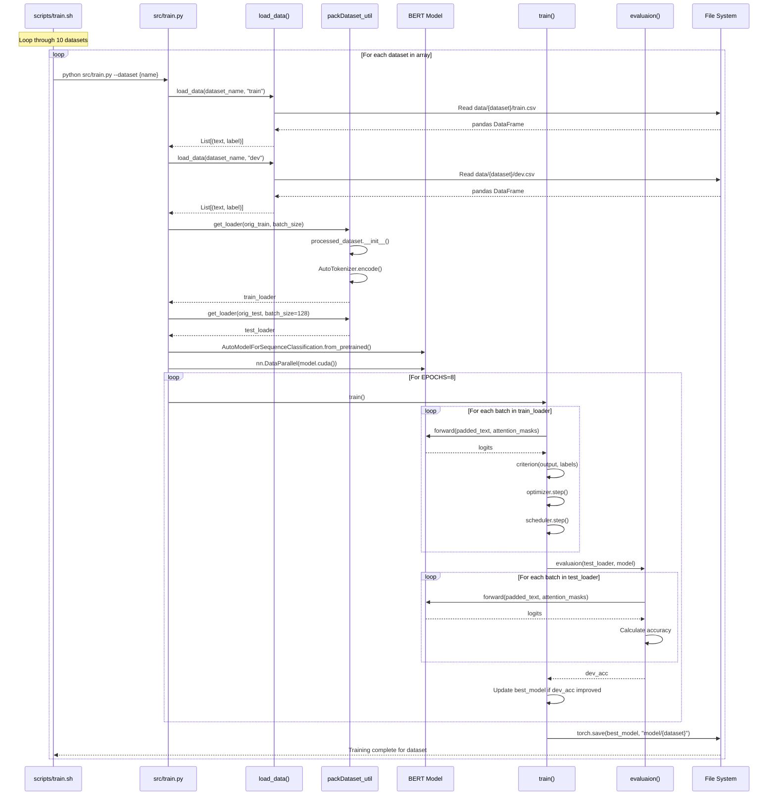
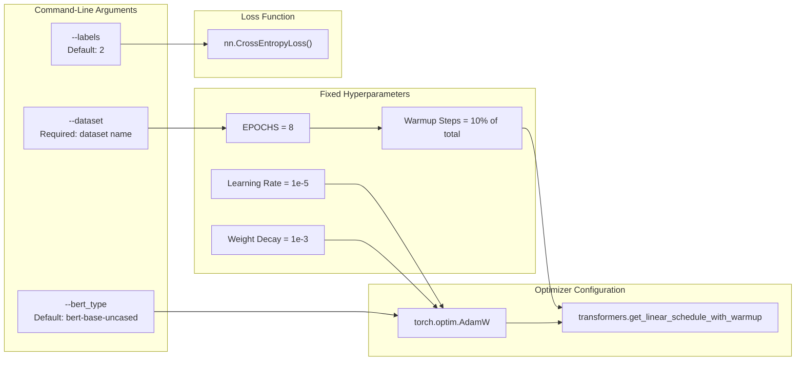
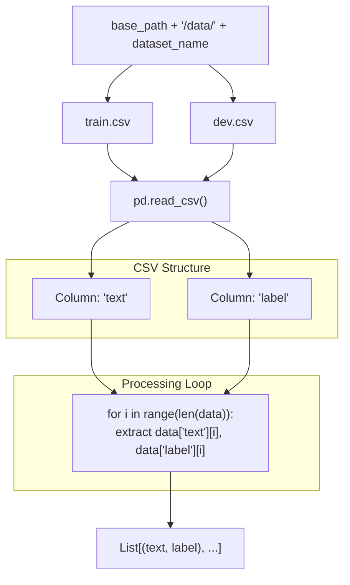
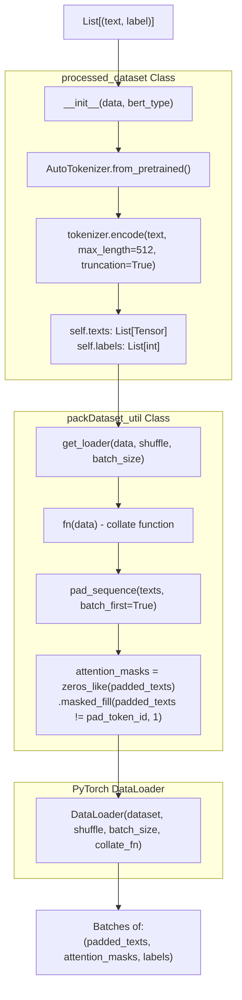
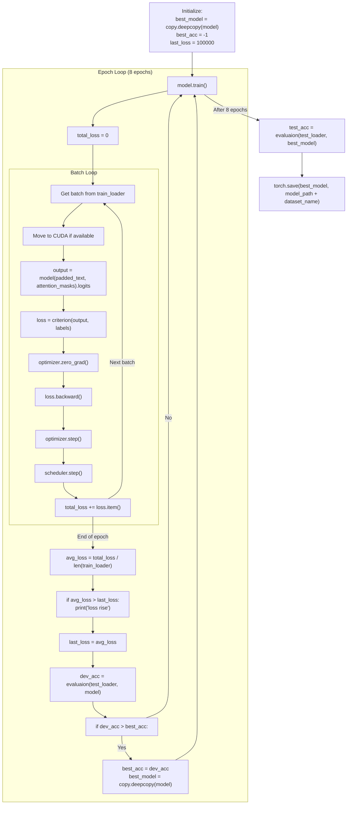
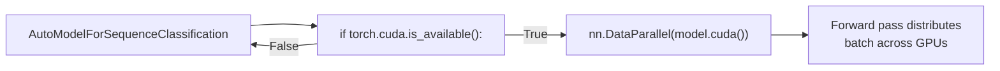

<!-- source: DeepWiki mcp.deepwiki.com · repo thunlp/Advbench · page 2.1 Model Training Pipeline · fetched 2026-11-02 -->

# Model Training Pipeline

<details>
<summary>Relevant source files</summary>

The following files were used as context for generating this wiki page:

- [scripts/train.sh](scripts/train.sh)
- [src/PackDataset.py](src/PackDataset.py)
- [src/train.py](src/train.py)

</details>


## Purpose and Scope

This document describes the model training pipeline in Advbench, which fine-tunes pre-trained BERT models on the 10 security datasets included in the benchmark. The pipeline prepares victim models that are subsequently evaluated using adversarial attacks.

For information about running training experiments from a user perspective, see [Running Training Experiments](#4.1). For technical implementation details of the training loop and optimization, see [Model Training Details](#3.3). For data tokenization and batching specifics, see [Data Processing System](#3.1).

**Sources:** [README.md:45-55](), [src/train.py:1-128]()

---

## Pipeline Architecture

The training pipeline consists of two components: a bash orchestration script that executes training across all datasets, and a Python module that implements the actual fine-tuning logic.



**Sources:** [scripts/train.sh:1-8](), [src/train.py:1-128](), [src/PackDataset.py:13-50]()

---

## Training Workflow

The training pipeline executes sequentially across all 10 datasets through the `scripts/train.sh` orchestrator:



**Sources:** [scripts/train.sh:4-7](), [src/train.py:47-86](), [src/train.py:19-25](), [src/PackDataset.py:47-50]()

---

## Dataset-Specific Batch Sizes

Training uses different batch sizes for different datasets to optimize GPU memory usage and training efficiency. The configuration is defined in the `batch_size_dict` dictionary:

| Dataset | Batch Size | Reason |
|---------|------------|--------|
| `amazon_lb` | 64 | Larger batch for efficiency on shorter texts |
| `LUN` | 32 | Default batch size |
| `satnews` | 32 | Default batch size |
| `EDENCE` | 32 | Default batch size |
| `FAS` | 32 | Default batch size |
| `assassin` | 32 | Default batch size |
| `enron` | 32 | Default batch size |
| `jigsaw` | 16 | Reduced for longer toxic comment texts |
| `CGFake` | 16 | Reduced for longer fake news articles |
| `HSOL` | 16 | Reduced for hate speech content |

The evaluation (dev) batch size is fixed at 128 for all datasets to maximize evaluation speed.

**Sources:** [src/train.py:107](), [src/train.py:120-121]()

---

## Hyperparameters and Configuration

The training pipeline uses consistent hyperparameters across all datasets to ensure fair comparison in attack experiments:



### Configuration Details

**Model Configuration:**
- Pre-trained model: `bert-base-uncased` (configurable via `--bert_type`)
- Number of labels: 2 (binary classification, configurable via `--labels`)
- Multi-GPU support: `nn.DataParallel` wraps the model when CUDA is available

**Training Configuration:**
- Epochs: 8 (hardcoded in [src/train.py:106]())
- Optimizer: `AdamW` with learning rate `1e-5` and weight decay `1e-3`
- Learning rate scheduler: Linear warmup for first 10% of steps, then linear decay
- Loss function: `CrossEntropyLoss` for classification

**Data Configuration:**
- Training batch size: Dataset-specific (see table above)
- Evaluation batch size: 128 (fixed)
- Shuffle: True for training, False for evaluation
- Max sequence length: 512 tokens (enforced during tokenization)

**Sources:** [src/train.py:90-125]()

---

## Data Loading Process

The `load_data()` function reads CSV files and converts them into the format required by the training pipeline:



**Implementation:** The function [src/train.py:19-25]() performs the following steps:

1. Constructs file path: `data_path + data_name + "/" + type + ".csv"`
2. Reads CSV using pandas: `pd.read_csv(file_path + type + ".csv")`
3. Extracts text and label columns into tuple list
4. Returns list of `(text, label)` tuples

**Sources:** [src/train.py:15-25]()

---

## Data Preprocessing Pipeline

The `packDataset_util` class from [src/PackDataset.py]() handles tokenization, padding, and DataLoader creation:



**Key Components:**

1. **`processed_dataset`** [src/PackDataset.py:13-27](): Dataset class that tokenizes text on initialization
   - Tokenizes each text to tensor using BERT tokenizer
   - Truncates to max length 512
   - Stores parallel lists of tokenized texts and labels

2. **`packDataset_util.fn()`** [src/PackDataset.py:35-44](): Collate function for batching
   - Pads sequences to maximum length in batch
   - Creates attention masks (1 for tokens, 0 for padding)
   - Returns tuple of `(padded_texts, attention_masks, labels)`

3. **`packDataset_util.get_loader()`** [src/PackDataset.py:47-50](): DataLoader factory
   - Creates `processed_dataset` instance
   - Wraps in PyTorch `DataLoader` with custom collate function

**Sources:** [src/PackDataset.py:13-50](), [src/train.py:119-121]()

---

## Training Loop Implementation

The `train()` function implements the main training loop with early stopping based on validation accuracy:

### Core Training Logic



### Evaluation Function

The `evaluaion()` function [src/train.py:29-43]() computes accuracy on the validation/test set:

1. Sets model to eval mode: `eval_model.eval()`
2. Disables gradient computation: `with torch.no_grad():`
3. Iterates through loader batches
4. Computes predictions: `torch.max(output, dim=1)`
5. Counts correct predictions: `(flag == labels).sum().item()`
6. Returns accuracy: `total_correct / total_number`

**Key Features:**
- **Model checkpointing:** Best model is saved based on dev accuracy, not final epoch
- **Loss monitoring:** Warns if training loss increases between epochs
- **Early stopping support:** Try-except block allows `KeyboardInterrupt` to exit training early
- **Deep copy:** Uses `copy.deepcopy()` to preserve best model state

**Sources:** [src/train.py:47-86](), [src/train.py:29-43]()

---

## Model Storage

Trained models are saved to the file system for subsequent use in attack experiments:

### Storage Path Structure

```
model/
├── LUN                  (saved PyTorch model)
├── satnews              (saved PyTorch model)
├── amazon_lb            (saved PyTorch model)
├── CGFake               (saved PyTorch model)
├── HSOL                 (saved PyTorch model)
├── jigsaw               (saved PyTorch model)
├── EDENCE               (saved PyTorch model)
├── FAS                  (saved PyTorch model)
├── assassin             (saved PyTorch model)
└── enron                (saved PyTorch model)
```

### Save and Load Process

**Saving:** [src/train.py:85-86]()
```python
model_path = base_path + "/model/"
torch.save(best_model, model_path + dataset_name)
```

The saved object is the entire `nn.DataParallel` wrapped model (or unwrapped model if CUDA unavailable), which includes:
- Model architecture (BERT with classification head)
- All trained weights and biases
- Configuration for number of labels

**Loading (in attack scripts):**
Models are loaded using `torch.load()` in attack pipelines for evaluation.

**Sources:** [src/train.py:85-86](), [src/train.py:114]()

---

## Output and Logging

The training pipeline provides console output to monitor progress:

### Training Progress Output

1. **Per-batch updates:** Progress bar via `tqdm(train_loader)` shows batch processing
2. **Per-epoch metrics:**
   - Average loss: `finish training, avg_loss: {avg_loss}, begin to evaluate`
   - Loss trend warning: `loss rise` if loss increases
   - Dev accuracy: `finish evaluation, acc: {dev_acc}/{best_acc}`
   - Separator: `*` * 89 between epochs
3. **Final results:**
   - Best test accuracy: `finish all, test acc: {test_acc}`

### Early Stopping

The training loop includes exception handling for manual interruption:
```python
except KeyboardInterrupt:
    print('-' * 89)
    print('Exiting from training early')
```

This allows users to stop training early (e.g., if overfitting is detected) while still saving the best model found so far.

**Sources:** [src/train.py:52-84](), [src/train.py:14]()

---

## Multi-GPU Support

The pipeline automatically leverages multiple GPUs when available through `nn.DataParallel`:



**Implementation:** [src/train.py:113-114]()
```python
if torch.cuda.is_available():
    model = nn.DataParallel(model.cuda())
```

**Behavior:**
- If CUDA available: Wraps model in `DataParallel` for multi-GPU training
- If CUDA unavailable: Uses CPU (model remains unwrapped)
- DataParallel automatically splits batches across available GPUs
- Gradients are aggregated across GPUs during backward pass

**Sources:** [src/train.py:113-114]()

---

## Summary

The model training pipeline provides a standardized process for fine-tuning BERT models on security datasets:

| Component | Implementation | Purpose |
|-----------|---------------|---------|
| **Orchestration** | `scripts/train.sh` | Sequential execution across 10 datasets |
| **Training logic** | `src/train.py::train()` | Main training loop with checkpointing |
| **Data loading** | `src/train.py::load_data()` | CSV to tuple list conversion |
| **Data processing** | `src/PackDataset.py::packDataset_util` | Tokenization, padding, batching |
| **Evaluation** | `src/train.py::evaluaion()` | Validation accuracy computation |
| **Model storage** | `torch.save()` to `/model/` | Persistence of best models |

All models are trained with identical hyperparameters (8 epochs, AdamW optimizer, 1e-5 learning rate) to ensure fair comparison in subsequent attack experiments. The best model based on dev accuracy is saved for each dataset.

**Sources:** [src/train.py:1-128](), [scripts/train.sh:1-8](), [src/PackDataset.py:1-51]()

---

