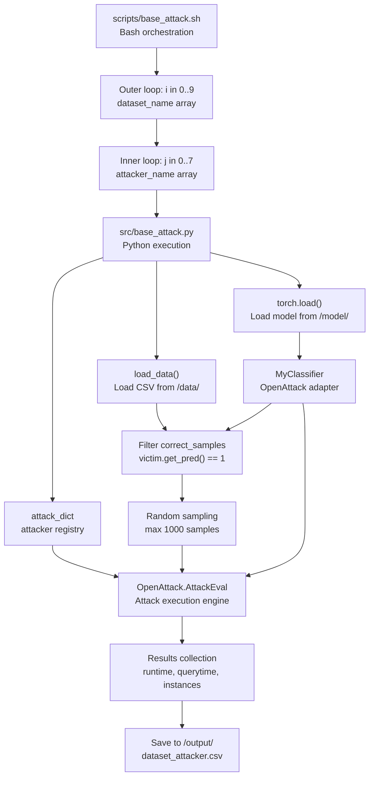
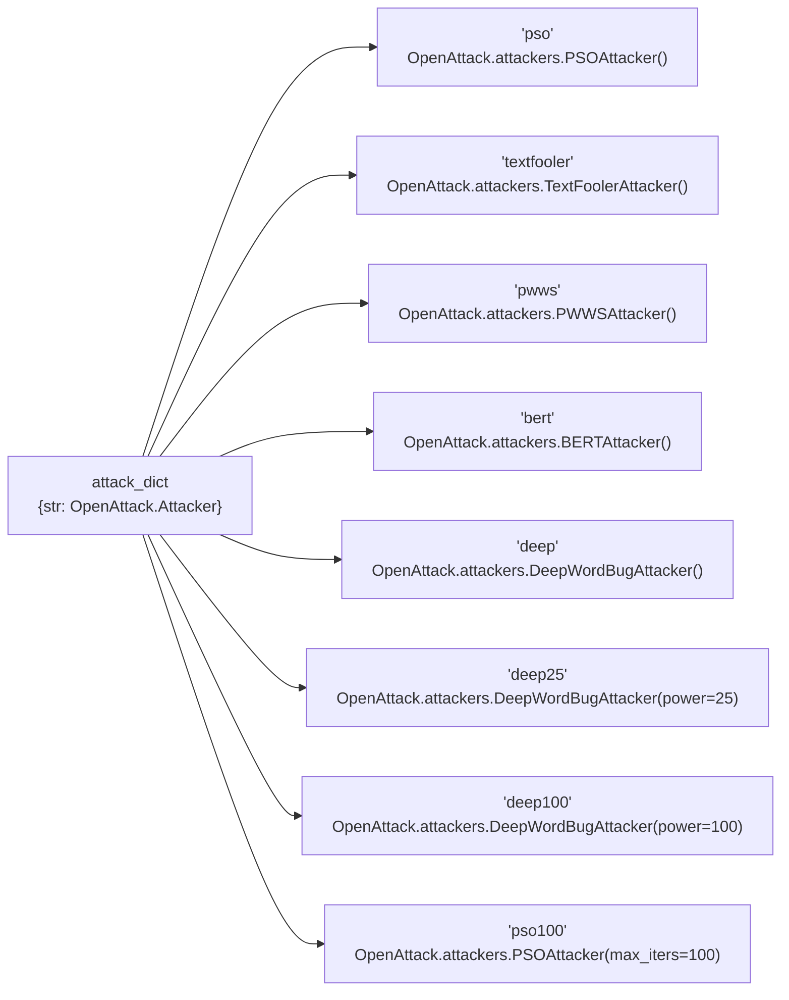
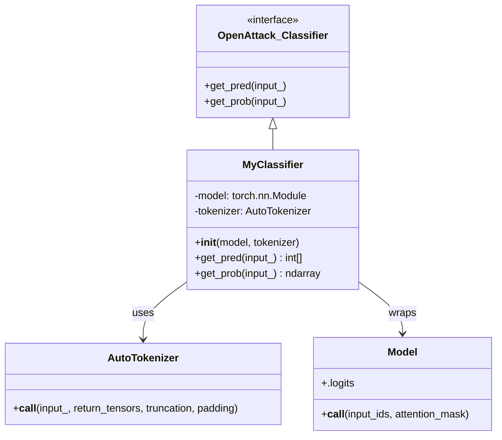
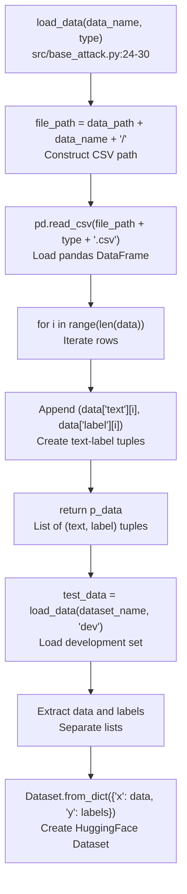
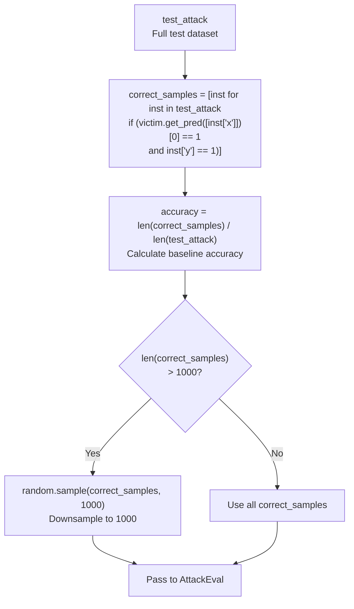
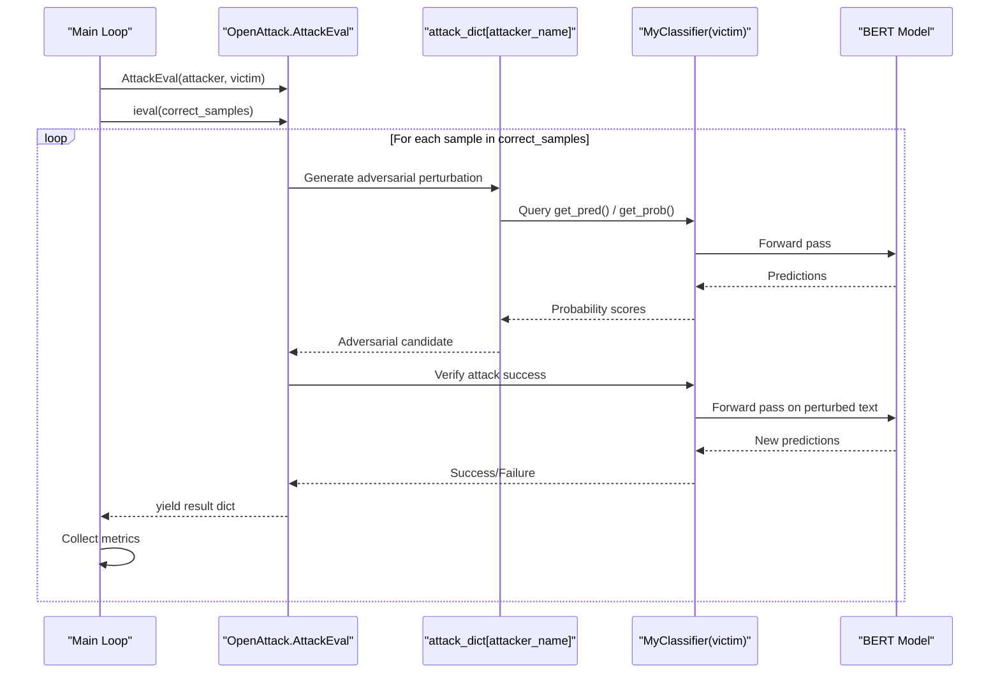
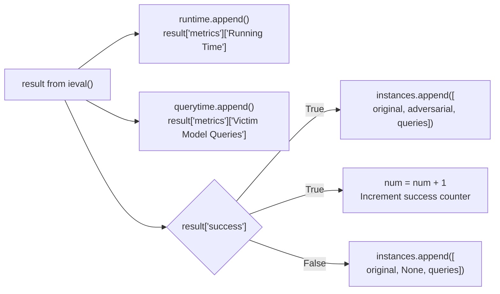
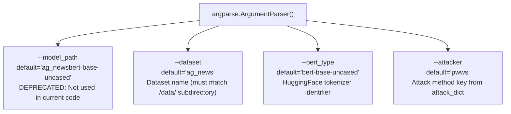

<!-- source: DeepWiki mcp.deepwiki.com · repo thunlp/Advbench · page 2.2 Baseline Attack Pipeline · fetched 2026-11-02 -->

# Baseline Attack Pipeline

<details>
<summary>Relevant source files</summary>

The following files were used as context for generating this wiki page:

- [scripts/base_attack.sh](scripts/base_attack.sh)
- [src/base_attack.py](src/base_attack.py)

</details>


## Purpose and Scope

This document describes the baseline adversarial attack pipeline implemented in Advbench for evaluating model robustness using established attack methods from the OpenAttack framework. This pipeline applies 8 different attack algorithms to fine-tuned BERT models across 10 security datasets, generating adversarial examples and measuring attack effectiveness.

For information about model training, see [Model Training Pipeline](#2.1). For the ROCKET attack method, see [ROCKET Attack Pipeline](#2.3). For complete attack method specifications, see [Attack Method Catalog](#5.2).

**Sources:** [src/base_attack.py:1-183](), [scripts/base_attack.sh:1-11](), README.md

---

## Pipeline Overview

The baseline attack pipeline orchestrates adversarial attacks through a two-layer architecture: a bash script for cross-product execution across datasets and attackers, and a Python module that implements the attack logic using OpenAttack.

### Execution Matrix

The pipeline executes a comprehensive attack matrix of **80 experiments** (10 datasets × 8 attackers):

| Component | Count | Items |
|-----------|-------|-------|
| Datasets | 10 | LUN, satnews, amazon_lb, CGFake, HSOL, jigsaw, EDENCE, FAS, assassin, enron |
| Attackers | 8 | pso, textfooler, pwws, bert, deep, deep25, deep100, pso100 |
| Total Runs | 80 | Full cross-product evaluation |

**Sources:** [scripts/base_attack.sh:2-3]()

### High-Level Workflow



**Sources:** [scripts/base_attack.sh:4-10](), [src/base_attack.py:82-183]()

---

## Attack Method Registry

The pipeline supports 8 attack methods through the `attack_dict` dictionary, which maps attacker names to OpenAttack attacker instances:



### Attack Method Specifications

| Attacker Key | Class | Configuration | Attack Strategy |
|--------------|-------|---------------|-----------------|
| `pso` | `PSOAttacker` | Default | Particle swarm optimization for word replacement |
| `textfooler` | `TextFoolerAttacker` | Default | Synonym replacement with importance ranking |
| `pwws` | `PWWSAttacker` | Default | Probability weighted word saliency |
| `bert` | `BERTAttacker` | Default | BERT masked language model predictions |
| `deep` | `DeepWordBugAttacker` | Default power | Character-level perturbations |
| `deep25` | `DeepWordBugAttacker` | `power=25` | More aggressive character edits |
| `deep100` | `DeepWordBugAttacker` | `power=100` | Most aggressive character edits |
| `pso100` | `PSOAttacker` | `max_iters=100` | Extended PSO iterations |

**Sources:** [src/base_attack.py:34-43]()

---

## MyClassifier Adapter

The `MyClassifier` class implements the `OpenAttack.Classifier` interface to bridge fine-tuned BERT models with the OpenAttack framework. This adapter handles tokenization, GPU acceleration, and probability score mapping.

### Class Structure



### Implementation Details

The adapter implements two required methods:

**`get_pred(input_)`** [src/base_attack.py:53-54]()
- Returns predicted class labels by calling `get_prob()` and selecting argmax
- Input: List of text strings
- Output: 1D numpy array of integer labels

**`get_prob(input_)`** [src/base_attack.py:57-75]()
- Returns probability distributions over classes
- Process flow:
  1. Tokenize input with `AutoTokenizer` (max length 512, padding, truncation)
  2. Move tensors to GPU if available
  3. Forward pass through model to get logits
  4. Convert logits to CPU numpy array
  5. Map predicted labels to one-hot encoded probability vectors

**Special Handling:** The method includes dataset-specific probability mapping. For binary classification (sst2), it uses 2-dimensional vectors. For multi-class tasks, it uses 4-dimensional vectors [src/base_attack.py:69-75]().

**Sources:** [src/base_attack.py:48-76]()

---

## Data Loading and Model Initialization

### Data Loading Pipeline



**Sources:** [src/base_attack.py:24-30](), [src/base_attack.py:114-120]()

### Model Initialization

The pipeline loads pre-trained models and tokenizers for each dataset:

```python
# Model loading [src/base_attack.py:105-107]()
model_path = base_path + "/model/"
model = torch.load(model_path + dataset_name)
tokenizer = AutoTokenizer.from_pretrained(bert_type)

# GPU acceleration [src/base_attack.py:109-110]()
if torch.cuda.is_available():
    model = model.cuda()
```

**Sources:** [src/base_attack.py:104-111]()

---

## Sample Selection and Filtering

Before executing attacks, the pipeline filters the test set to identify correctly classified positive samples. This ensures attacks are only attempted on samples where the model is initially correct.

### Filtering Process



**Key Implementation Details:**

1. **Filtering Criteria** [src/base_attack.py:129-131]()
   - `victim.get_pred([inst["x"]])[0] == 1` - Model predicts positive class
   - `inst["y"] == 1` - True label is positive class
   - Only attacks samples where model is initially correct

2. **Sample Size Control** [src/base_attack.py:137-141]()
   - If more than 1000 correct samples exist, randomly downsample to 1000
   - Uses fixed random seed (714) for reproducibility
   - Ensures consistent evaluation across different datasets

**Sources:** [src/base_attack.py:129-141]()

---

## Attack Execution Flow

The attack execution uses OpenAttack's `AttackEval` class to iteratively apply the selected attack method to each sample and collect results.

### AttackEval Execution



### Result Dictionary Structure

Each iteration yields a result dictionary with the following structure:

```python
result = {
    "success": bool,                    # Whether attack succeeded
    "data": {
        "x": [original_text],          # Original input
        "y": label                     # True label
    },
    "result": [adversarial_text],      # Perturbed text (if success)
    "metrics": {
        "Running Time": float,         # Attack runtime in seconds
        "Victim Model Queries": int    # Number of model queries
    }
}
```

### Metrics Collection

The pipeline collects three types of metrics for each attack:



**Sources:** [src/base_attack.py:150-168]()

---

## Results Collection and Storage

After completing all attacks, the pipeline computes aggregate metrics and saves detailed results to CSV files.

### Aggregate Metrics Calculation

```python
# Attack success rate [src/base_attack.py:172]()
attack_success_rate = num / 1000

# Average runtime [src/base_attack.py:174]()
ave_runtime = np.mean(np.array(runtime))

# Average query count [src/base_attack.py:175]()
ave_querytime = np.mean(np.array(querytime))
```

### Output File Structure

Results are saved to CSV files with the naming pattern: `/output/{dataset_name}_{attacker_name}.csv`

**CSV Schema:**

| Column | Type | Description |
|--------|------|-------------|
| `origin` | str | Original text before attack |
| `attack` | str or None | Adversarial text (None if attack failed) |
| `query_time` | int | Number of model queries used |

**Sources:** [src/base_attack.py:172-183]()

---

## Command-Line Interface

The `base_attack.py` script accepts the following command-line arguments:

### Argument Specifications



### Usage Example

```bash
# Single attack execution
python src/base_attack.py \
    --dataset CGFake \
    --attacker textfooler \
    --bert_type bert-base-uncased

# Automated batch execution via shell script
bash scripts/base_attack.sh
```

**Note:** The `--model_path` argument is defined but not used. The actual model loading uses a hardcoded path: `base_path + "/model/" + dataset_name` [src/base_attack.py:105-106]().

**Sources:** [src/base_attack.py:83-101](), [scripts/base_attack.sh:1-11]()

---

## Implementation Dependencies

The baseline attack pipeline relies on the following key libraries and modules:

| Component | Purpose | Import Statement |
|-----------|---------|-----------------|
| OpenAttack | Attack method implementations | `import OpenAttack as oa` |
| transformers | BERT tokenizer | `from transformers import AutoTokenizer` |
| torch | Model loading and inference | `import torch` |
| pandas | CSV data handling | `import pandas as pd` |
| datasets | HuggingFace Dataset API | `from datasets import Dataset` |
| numpy | Numerical operations | `import numpy as np` |
| tqdm | Progress bar display | `from tqdm import tqdm` |

**Sources:** [src/base_attack.py:1-17]()

---

