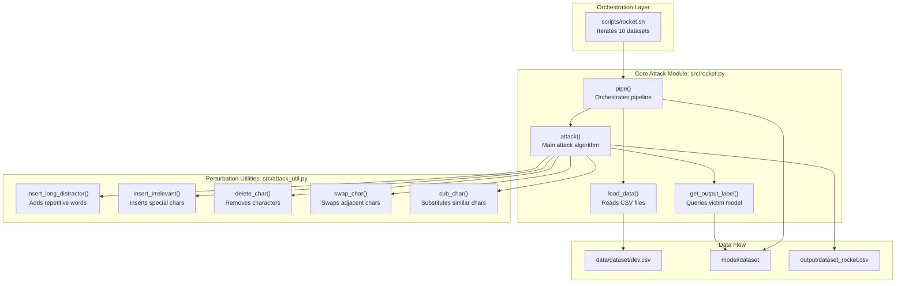
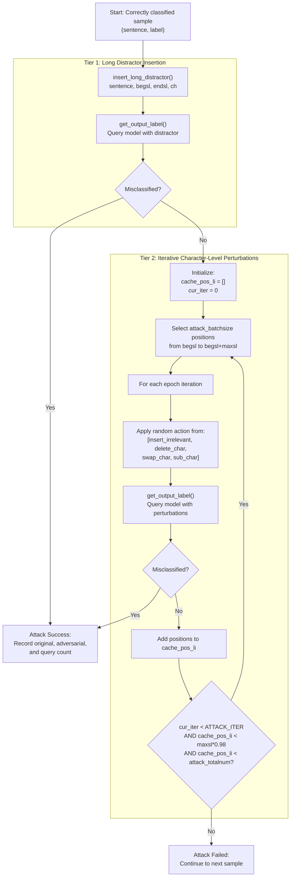
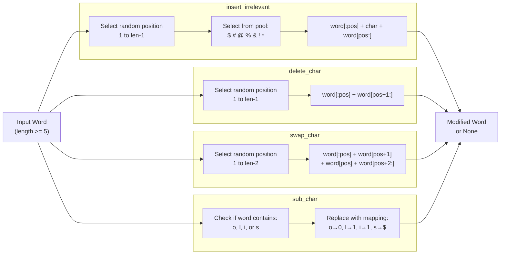
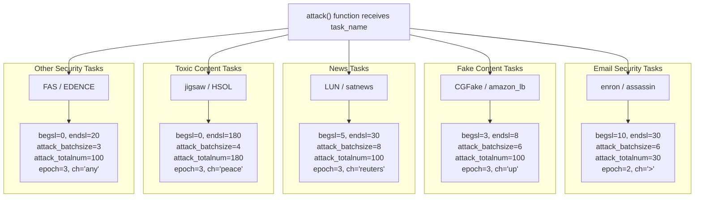
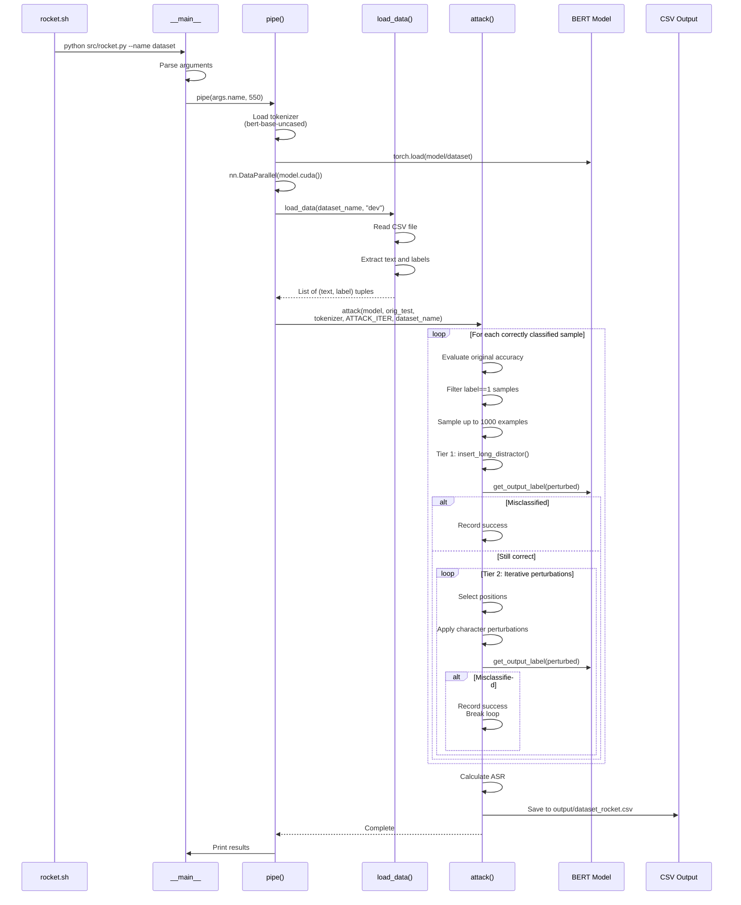
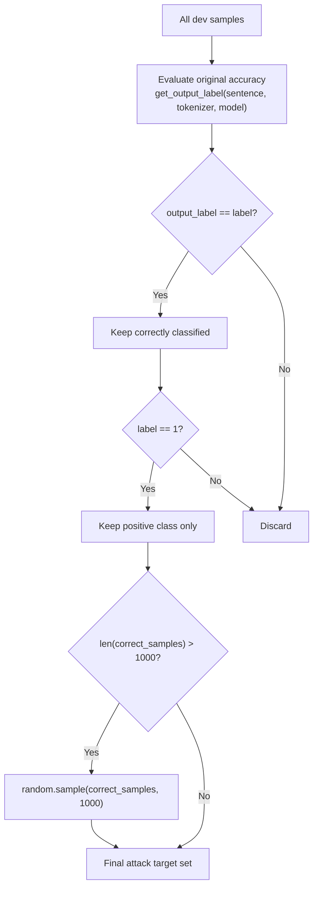

<!-- source: DeepWiki mcp.deepwiki.com · repo thunlp/Advbench · page 2.3 ROCKET Attack Pipeline · fetched 2026-11-02 -->

# ROCKET Attack Pipeline

<details>
<summary>Relevant source files</summary>

The following files were used as context for generating this wiki page:

- [scripts/rocket.sh](scripts/rocket.sh)
- [src/attack_util.py](src/attack_util.py)
- [src/rocket.py](src/rocket.py)

</details>


## Purpose and Scope

This document describes the ROCKET (Rule-based, Objective-oriented, Character-level, Efficient, Task-specific) attack pipeline, which implements a heuristic-rule-based adversarial attack method designed for security-oriented NLP tasks. Unlike the baseline attacks that use complex optimization methods from the OpenAttack framework (see [2.2](#2.2)), ROCKET employs simple, interpretable character-level perturbations combined with long distractor insertion to simulate practical, real-world attacker behavior.

This page covers:
- The two-tiered attack strategy (long distractor + iterative perturbations)
- Character-level perturbation functions and their implementations
- Task-specific parameter configurations for different security datasets
- Execution flow from the orchestration script to output generation

For information about the attack utility functions themselves, see [3.2](#3.2). For instructions on running ROCKET experiments, see [4.2](#4.2).

**Sources:** [src/rocket.py:1-264](), [scripts/rocket.sh:1-8](), [README.md]()

---

## Overview and Architecture

ROCKET implements a practical adversarial attack approach that prioritizes real-world attacker behavior over imperceptible perturbations. The pipeline consists of three main components: an orchestration script that automates execution across datasets, a core attack algorithm that implements the two-tiered strategy, and a set of character-level perturbation utilities.

### System Components



**Figure 1: ROCKET System Architecture**

The pipeline begins with `rocket.sh` which iterates through all 10 datasets, calling `rocket.py` with the `--name` argument for each. The `pipe()` function loads the fine-tuned model and test data, then invokes the `attack()` function which implements the core algorithm. The attack function uses perturbation utilities from `attack_util.py` to generate adversarial examples.

**Sources:** [scripts/rocket.sh:1-8](), [src/rocket.py:234-253](), [src/attack_util.py:1-144]()

---

## Two-Tiered Attack Strategy

ROCKET employs a distinctive two-tiered attack strategy that combines long distractor insertion with iterative character-level perturbations. This approach is designed to simulate real-world attackers who may use both obvious and subtle modifications to evade detection.

### Attack Algorithm Flow



**Figure 2: Two-Tiered Attack Algorithm Flow**

The algorithm is implemented in the `attack()` function [src/rocket.py:51-229](). The first tier (lines 133-142) applies `insert_long_distractor()` to add repetitive distractor words at the beginning and/or end of the sentence. If this causes misclassification, the attack succeeds immediately. Otherwise, the second tier (lines 144-216) begins iterative character-level perturbations.

**Sources:** [src/rocket.py:51-229](), [src/rocket.py:133-142](), [src/rocket.py:144-216]()

### Tier 1: Long Distractor Insertion

The first tier uses the `insert_long_distractor()` function from `attack_util.py` to prepend and/or append repetitive distractor words:

```
for_distractor = (ch + " ") * begsl
distractor = (" " + ch) * endsl
return for_distractor + sentence + distractor
```

This creates adversarial examples like: `"> > > > > original sentence reuters reuters reuters reuters"`

The distractor word (`ch`) and repetition counts (`begsl`, `endsl`) are task-specific, chosen to reflect realistic attacker strategies for each security domain.

**Sources:** [src/attack_util.py:4-16](), [src/rocket.py:133]()

### Tier 2: Iterative Character-Level Perturbations

If the long distractor alone doesn't succeed, the algorithm enters an iterative loop that applies character-level perturbations to individual words. The key components are:

1. **Position Selection** [src/rocket.py:161-170](): Randomly selects `attack_batchsize` word positions to perturb, either from the original sentence range (`begsl` to `begsl+maxsl`) or the entire modified sentence.

2. **Perturbation Application** [src/rocket.py:173-200](): For each selected position:
   - Checks if the position has been perturbed before (using `cache_pos_li`)
   - Skips stopwords [src/rocket.py:186]()
   - Randomly selects an action from the `action_list` [src/rocket.py:190]()
   - Applies the action to modify the word [src/rocket.py:191]()
   - Updates the sentence with the modified word [src/rocket.py:199-200]()

3. **Query and Evaluation** [src/rocket.py:202-211](): After each batch of perturbations, queries the model and checks if misclassification occurred.

4. **Position Caching** [src/rocket.py:212-213](): Adds perturbed positions to cache to avoid redundant modifications.

The loop continues until one of three conditions is met:
- Attack succeeds (misclassification)
- Maximum iterations reached (`cur_iter >= ATTACK_ITER`)
- Nearly all positions perturbed (`cache_pos_li >= maxsl * 0.98` or `cache_pos_li >= attack_totalnum`)

**Sources:** [src/rocket.py:161-216]()

---

## Character-Level Perturbation Functions

ROCKET uses four character-level perturbation functions defined in `attack_util.py`. All functions operate on individual words and require words to be at least 5 characters long to maintain some readability.

### Perturbation Function Reference

| Function | Description | Example | Implementation |
|----------|-------------|---------|----------------|
| `insert_irrelevant()` | Inserts a random special character ($, #, @, %, &, !, *) at a random position within the word | `foolish` → `foo$lish` | [attack_util.py:40-51]() |
| `delete_char()` | Deletes a character at a random position | `foolish` → `folish` | [attack_util.py:53-59]() |
| `swap_char()` | Swaps two adjacent characters at a random position | `foolish` → `foolsih` | [attack_util.py:63-71]() |
| `sub_char()` | Substitutes similar-looking characters (o→0, l→1, i→1, s→$) | `foolish` → `f00lish` | [attack_util.py:78-108]() |

### Function Implementation Details



**Figure 3: Character-Level Perturbation Functions**

Each function returns `None` if the perturbation cannot be applied (e.g., word too short, no substitutable characters found), allowing the attack algorithm to skip that modification attempt gracefully.

**Sources:** [src/attack_util.py:40-108]()

### Perturbation Selection Strategy

The attack algorithm maintains a list of available actions in the `action_list` variable:

```python
action_list = [insert_irrelevant, delete_char, swap_char, sub_char]
```

For each perturbation attempt, an action is randomly selected using `random.choice(action_list)` [src/rocket.py:190](). This randomization ensures diverse perturbation patterns and prevents predictable attack signatures.

**Sources:** [src/rocket.py:68](), [src/rocket.py:190]()

---

## Task-Specific Configurations

One of ROCKET's key features is task-specific parameter configuration. Different security tasks require different perturbation strategies based on text characteristics (length, domain, content type). The configurations are implemented as conditional blocks in the `attack()` function.

### Configuration Parameter Reference

| Parameter | Description | Typical Range |
|-----------|-------------|---------------|
| `begsl` | Number of distractor words to prepend | 0-10 |
| `endsl` | Number of distractor words to append | 8-180 |
| `ch` | Distractor word/character | ">" / "up" / "reuters" / "peace" / "any" |
| `attack_batchsize` | Number of positions to perturb simultaneously | 3-8 |
| `attack_totalnum` | Maximum number of positions to perturb | 30-180 |
| `epoch` | Repetitions per batch of perturbations | 2-3 |
| `attack_ori_only` | Whether to only perturb original sentence (not distractors) | True/False |

### Dataset-Specific Configurations



**Figure 4: Task-Specific Parameter Configurations**

### Configuration Rationale

The parameter choices reflect domain-specific attack strategies:

- **Email Security (enron, assassin)** [src/rocket.py:74-81](): Moderate distractor length (30 words) with the ">" character, simulating email reply chains. Smaller perturbation budget (30 positions) since emails are typically shorter.

- **Fake Content (CGFake, amazon_lb)** [src/rocket.py:82-90](): Short distractors (8 words) with "up" word, simulating promotional/spam patterns. Larger perturbation budget (100 positions) for longer reviews.

- **News (LUN, satnews)** [src/rocket.py:91-99](): Moderate distractors with "reuters" word, simulating news metadata/headers. Balanced parameters for medium-length articles.

- **Toxic Content (jigsaw, HSOL)** [src/rocket.py:100-108](): Long distractors (180 words) with "peace" word, simulating adversarial padding to dilute toxic content. Largest perturbation budget due to longer comments.

- **Other Security (FAS, EDENCE)** [src/rocket.py:111-120](): Minimal distractors (20 words) with generic "any" word. Conservative perturbation budget (100 positions).

All configurations set `attack_ori_only=True`, meaning perturbations are applied only to the original sentence, not to the added distractors. This maintains the distractors' role as context padding while focusing modifications on the actual content.

**Sources:** [src/rocket.py:74-121]()

---

## Execution Flow and Pipeline Orchestration

### Script Orchestration

The ROCKET pipeline is orchestrated by the `rocket.sh` bash script, which automates execution across all datasets:

```bash
dataset_name=('LUN' 'satnews' 'amazon_lb' 'CGFake' 'HSOL' 'jigsaw' 'EDENCE' 'FAS' 'assassin' 'enron') 

for i in {0..9}
do
    python src/rocket.py --name ${dataset_name[i]} 
done
```

The script iterates through all 10 datasets and invokes `rocket.py` with the `--name` argument specifying the dataset.

**Sources:** [scripts/rocket.sh:1-8]()

### Main Pipeline Function

The `pipe()` function orchestrates the complete attack pipeline for a single dataset:



**Figure 5: Complete ROCKET Execution Flow**

**Sources:** [src/rocket.py:234-253](), [src/rocket.py:257-262]()

### Command-Line Interface

The main entry point accepts a single argument:

- `--name`: Dataset name (default: 'amazon_lb') [src/rocket.py:259]()

The attack iteration limit is hardcoded to 550 in the `pipe()` call [src/rocket.py:262]().

**Sources:** [src/rocket.py:257-262]()

---

## Sample Selection and Filtering

Before attacking, ROCKET evaluates the original model accuracy and filters samples based on specific criteria:



**Figure 6: Sample Selection Process**

The filtering logic [src/rocket.py:55-66]() ensures:

1. Only correctly classified samples are attacked (meaningful adversarial examples)
2. Only positive class samples (label=1) are targeted
3. Maximum of 1000 samples to control computational cost

This selective approach focuses attack resources on the most relevant test cases.

**Sources:** [src/rocket.py:55-66]()

---

## Query Counting and Efficiency Tracking

ROCKET tracks the number of model queries for each attack attempt, providing efficiency metrics comparable to baseline methods:

- `querytime`: Global counter for total queries across all samples [src/rocket.py:72]()
- `querytime_each`: Per-sample query counter [src/rocket.py:124]()

Queries are incremented at two points:
1. After Tier 1 distractor insertion [src/rocket.py:136-137]()
2. After each Tier 2 perturbation batch [src/rocket.py:203-204]()

The per-sample query count is recorded in the output CSV for successful attacks [src/rocket.py:141](), [src/rocket.py:209]().

**Sources:** [src/rocket.py:72](), [src/rocket.py:124](), [src/rocket.py:136-137](), [src/rocket.py:203-204]()

---

## Output Generation and Results Storage

Upon completion, ROCKET generates a CSV file containing successful adversarial examples:

### Output File Format

The results are saved to `output/{dataset_name}_rocket.csv` with three columns:

| Column | Description |
|--------|-------------|
| `origin` | Original correctly classified text |
| `attack` | Adversarial text that caused misclassification |
| `querytime` | Number of model queries used for this attack |

```python
name = ['origin','attack',"querytime"]
save_data = pd.DataFrame(columns=name, data=success_list)
save_data.to_csv(base_path+"/output/"+task_name+'_rocket.csv')
```

**Sources:** [src/rocket.py:224-226]()

### Console Output

The attack function prints several metrics during and after execution:

1. **Original Accuracy**: Accuracy on dev set before any attacks [src/rocket.py:62]()
2. **Incremental ASR**: Prints after each successful attack with cumulative attack success rate [src/rocket.py:47-48]()
3. **Final Statistics**: 
   - Total query count [src/rocket.py:222]()
   - Total successful attacks [src/rocket.py:223]()
   - Final ASR (successful attacks / total attempted) [src/rocket.py:228]()
   - Dataset name separator [src/rocket.py:252]()

**Sources:** [src/rocket.py:46-49](), [src/rocket.py:62](), [src/rocket.py:222-228](), [src/rocket.py:252]()

---

## Key Design Decisions

### Heuristic-Rule-Based Approach

ROCKET deliberately uses simple, interpretable perturbations instead of gradient-based or search-based optimization. This design reflects the SoadNLP paradigm: real-world attackers often use straightforward modifications rather than sophisticated algorithms. The heuristic approach offers:

- **Interpretability**: Each perturbation type has clear semantics
- **Efficiency**: No gradient computation or complex search required
- **Practicality**: Simulates realistic attacker capabilities

### Character-Level Focus

Unlike word-level methods (synonym replacement, word insertion/deletion), ROCKET operates primarily at the character level. This choice enables:

- **Evasion of word-based defenses**: Character perturbations bypass vocabulary-based filtering
- **Minimal semantic change**: Character typos maintain approximate meaning
- **Natural appearance**: Typos and special characters resemble real user errors

The combination with long distractors (word-level) provides a multi-granularity attack surface.

### Task-Specific Parameterization

Rather than using universal parameters, ROCKET adapts to each security task. This acknowledges that:

- Email spam uses different patterns than fake news
- Toxic comments require different strategies than product reviews
- Text length variations necessitate different perturbation budgets

The task-specific configurations [src/rocket.py:74-121]() enable fair comparison across diverse security domains.

### Positive Class Targeting

The filtering logic targets only positive class samples (label=1) [src/rocket.py:59-60](). This design choice reflects that:

- Security tasks typically flag malicious content as positive class
- Attackers aim to make malicious content appear benign
- Evaluating evasion capability requires attacking the class that triggers detection

**Sources:** [src/rocket.py:68](), [src/rocket.py:74-121](), [src/rocket.py:59-60]()

---

