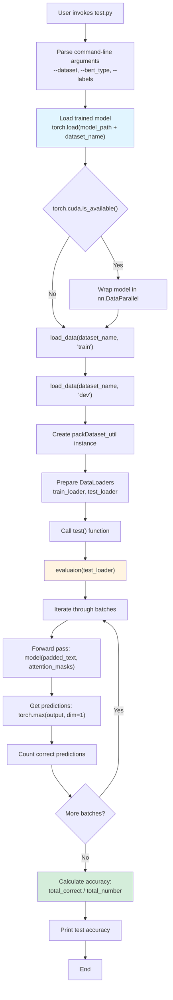
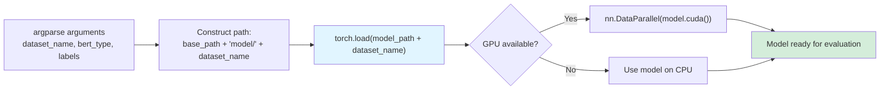
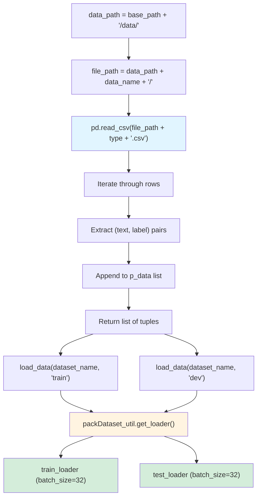
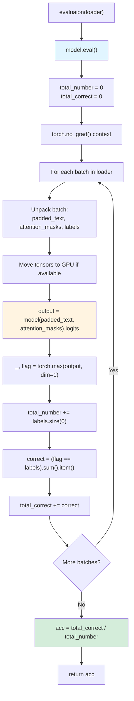
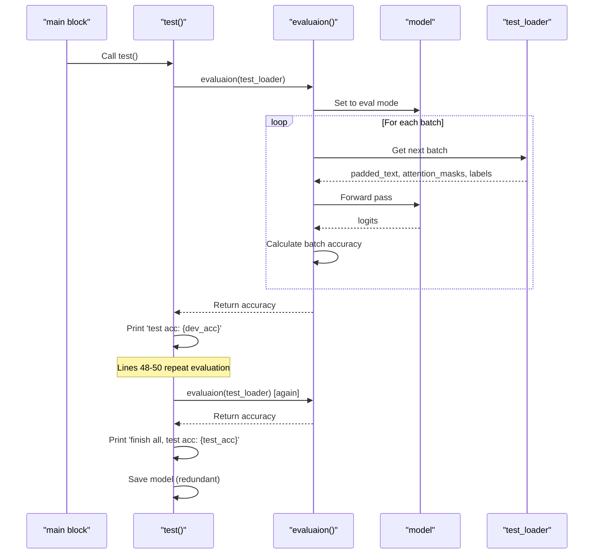
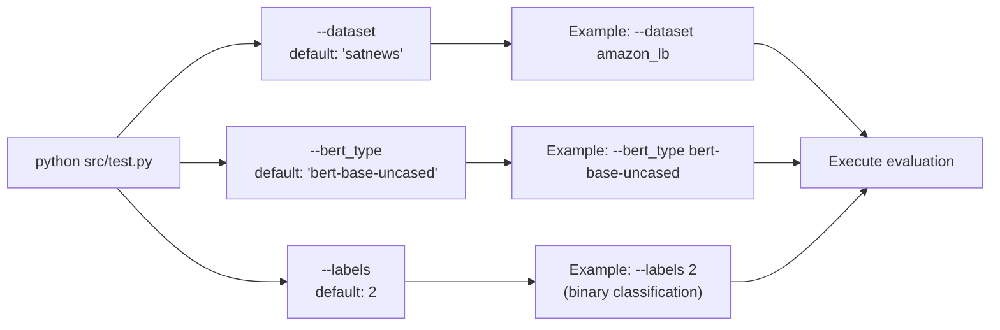
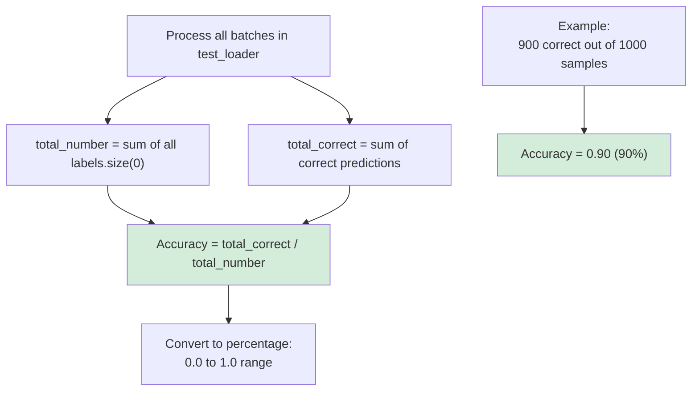
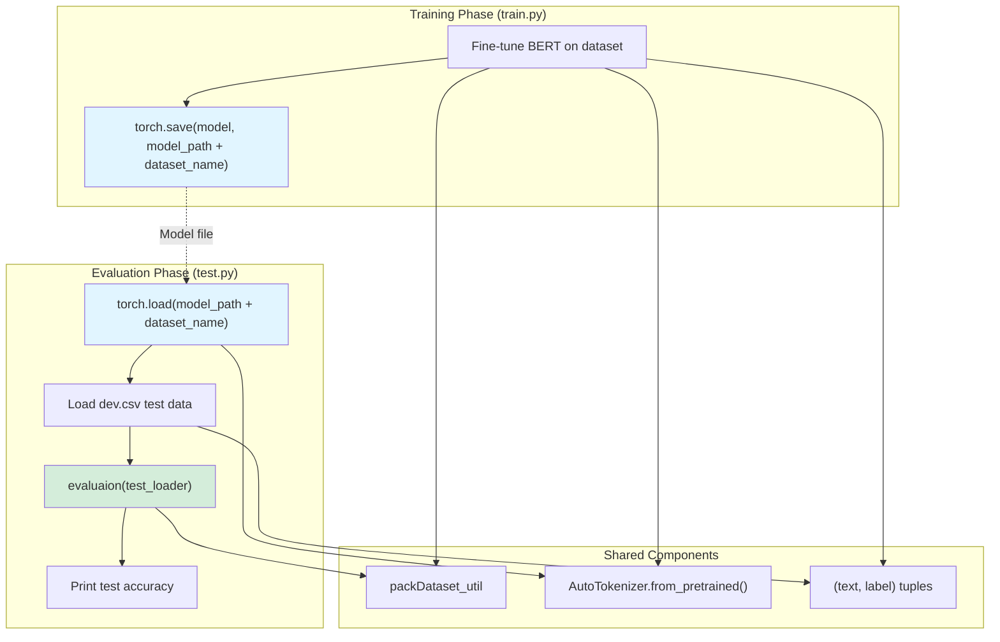
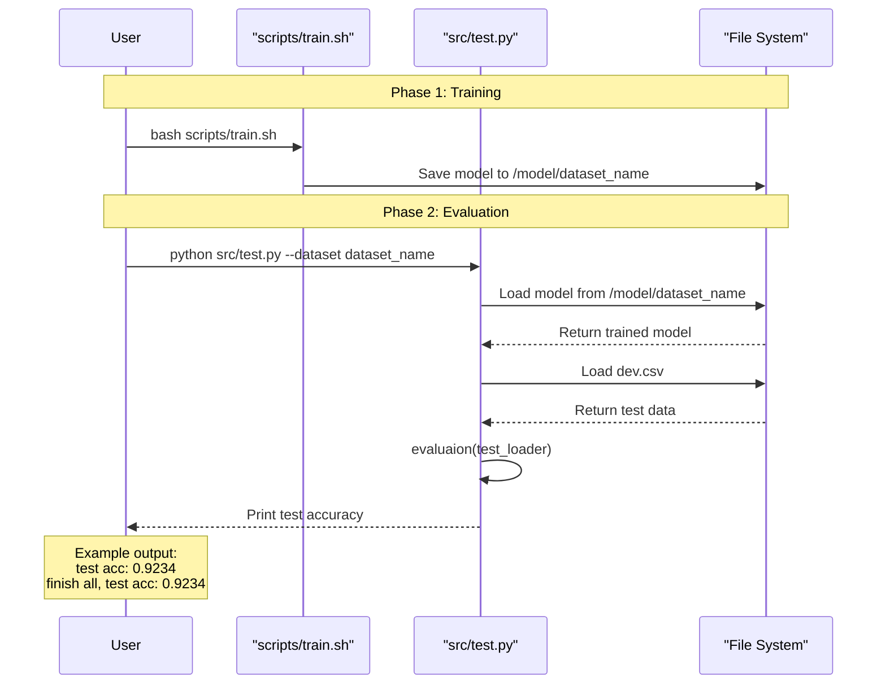

<!-- source: DeepWiki mcp.deepwiki.com · repo thunlp/Advbench · page 2.4 Model Evaluation · fetched 2026-11-02 -->

# Model Evaluation

<details>
<summary>Relevant source files</summary>

The following files were used as context for generating this wiki page:

- [src/PackDataset.py](src/PackDataset.py)
- [src/test.py](src/test.py)

</details>


This document describes the model evaluation system in Advbench, which tests the accuracy of fine-tuned BERT models on clean (non-adversarial) test datasets. This evaluation provides baseline performance metrics before adversarial attacks are applied.

For information about training models, see [Model Training Pipeline](#2.1). For evaluating models under adversarial conditions, see [Baseline Attack Pipeline](#2.2) and [ROCKET Attack Pipeline](#2.3). For interpreting attack results, see [Interpreting Results](#4.3).

## Purpose and Scope

The evaluation pipeline serves to:
- Validate that fine-tuned models have learned the security classification tasks correctly
- Establish baseline accuracy metrics on clean test data
- Verify model quality before proceeding to adversarial evaluation

The evaluation is performed using [src/test.py:1-87](), which loads a previously trained model and computes its accuracy on the development/test set.

## Evaluation Workflow



**Evaluation Workflow**: This diagram shows the complete execution flow from command invocation to results output. The process loads a trained model, prepares data loaders, and computes accuracy through batch-wise forward passes.

**Sources**: [src/test.py:55-86]()

## Core Components

### Model Loading

The evaluation system loads previously trained models from the `/model/` directory:



The model loading process occurs in [src/test.py:73-77]():

| Step | Code Reference | Description |
|------|---------------|-------------|
| 1. Get base path | [src/test.py:11]() | `base_path = os.path.abspath('.')` |
| 2. Construct model path | [src/test.py:74]() | `model_path = base_path + "model/"` |
| 3. Load model | [src/test.py:75]() | `torch.load(model_path + dataset_name)` |
| 4. Enable multi-GPU | [src/test.py:76-77]() | `nn.DataParallel(model.cuda())` if CUDA available |

**Sources**: [src/test.py:11](), [src/test.py:73-77]()

### Data Loading

The `load_data()` function reads CSV files and converts them to the format expected by the model:



The `load_data()` function implementation [src/test.py:14-20]():

```python
def load_data(data_name, type):
    file_path = data_path + data_name + "/"
    data = pd.read_csv(file_path + type + ".csv")
    p_data = []
    for i in range(len(data)):
        p_data.append((data['text'][i], data['label'][i]))
    return p_data
```

**Data Preparation Pipeline**:

| Component | Function | Input | Output |
|-----------|----------|-------|--------|
| `load_data()` | Load CSV and format | CSV file path, type ('train'/'dev') | List of (text, label) tuples |
| `packDataset_util` | Tokenization and batching | Raw text-label pairs | PyTorch DataLoader |
| `processed_dataset` | BERT tokenization | Text strings | Token tensors (max 512 tokens) |
| `fn()` collate function | Batch assembly | Individual samples | Padded batches with attention masks |

The data preparation relies on [src/PackDataset.py:30-51]() for tokenization, padding, and DataLoader creation. See [Data Processing System](#3.1) for detailed documentation of the `packDataset_util` class.

**Sources**: [src/test.py:14-20](), [src/test.py:78-83]()

### Evaluation Function

The `evaluaion()` function (note spelling in source code) computes model accuracy by iterating through test batches:



**Implementation details** [src/test.py:24-38]():

| Line | Operation | Purpose |
|------|-----------|---------|
| 25 | `model.eval()` | Set model to evaluation mode (disable dropout) |
| 28 | `torch.no_grad()` | Disable gradient computation for efficiency |
| 32 | `model(padded_text, attention_masks).logits` | Forward pass through BERT model |
| 33 | `torch.max(output, dim=1)` | Get predicted class (argmax) |
| 35 | `(flag == labels).sum().item()` | Count correct predictions |
| 37 | `total_correct / total_number` | Compute accuracy percentage |

**Sources**: [src/test.py:24-38]()

### Test Execution

The `test()` function orchestrates the evaluation and output:



**Note**: The code in [src/test.py:40-53]() contains apparent redundancy. The `evaluaion()` function is called twice with the same `test_loader`, and the model is saved at the end despite being loaded at the start. This appears to be legacy code that needs cleanup.

**Sources**: [src/test.py:40-53]()

## Command-Line Usage

The evaluation script accepts three command-line arguments:



**Command-Line Arguments** [src/test.py:56-67]():

| Argument | Type | Default | Description |
|----------|------|---------|-------------|
| `--dataset` | str | `'satnews'` | Name of the dataset to evaluate (must match trained model filename) |
| `--bert_type` | str | `'bert-base-uncased'` | BERT model variant used for tokenization (must match training) |
| `--labels` | int | `2` | Number of output classes (binary or multi-class classification) |

**Example usage**:

```bash
# Evaluate the satnews model
python src/test.py --dataset satnews --bert_type bert-base-uncased --labels 2

# Evaluate the jigsaw toxic comments model
python src/test.py --dataset jigsaw --bert_type bert-base-uncased --labels 2

# Evaluate the amazon_lb sentiment model
python src/test.py --dataset amazon_lb --bert_type bert-base-uncased --labels 2
```

**Sources**: [src/test.py:56-67]()

## Evaluation Metrics

The evaluation system computes a single metric: **classification accuracy**.

### Accuracy Calculation



**Metric Definition**:

$$\text{Accuracy} = \frac{\text{Number of Correct Predictions}}{\text{Total Number of Samples}}$$

The accuracy is calculated in [src/test.py:37]() as `acc = total_correct / total_number`.

**Output Format**:

The evaluation results are printed to stdout in the following format:

```
test acc: 0.9234
***********************************************************************************
finish all, test acc: 0.9234
```

Where `0.9234` represents 92.34% accuracy on the test set.

**Sources**: [src/test.py:37](), [src/test.py:42](), [src/test.py:49-50]()

## Integration with Training Pipeline

The evaluation system is tightly coupled with the training pipeline:



**Key Integration Points**:

| Component | Training Phase | Evaluation Phase |
|-----------|----------------|------------------|
| Model storage | Saves to `/model/{dataset_name}` | Loads from `/model/{dataset_name}` |
| Tokenizer | Same `bert_type` argument | Same `bert_type` argument (must match) |
| Data format | Uses `train.csv` and `dev.csv` | Uses `train.csv` and `dev.csv` |
| Data preparation | `packDataset_util.get_loader()` | `packDataset_util.get_loader()` |
| Batch size | Varies by dataset (16-64) | Fixed at 32 |

**Important**: The `--bert_type` argument must match between training and evaluation. If you trained with `bert-base-uncased`, you must evaluate with the same tokenizer, otherwise the token IDs will be incompatible.

**Sources**: [src/test.py:73-83](), [src/PackDataset.py:30-51]()

## Typical Workflow

The standard workflow for model evaluation after training:



**Typical Accuracy Ranges**:

Based on the security datasets used in Advbench, expected clean accuracy ranges are:

| Dataset | Task Type | Expected Accuracy |
|---------|-----------|-------------------|
| `satnews` | Fake news detection | 85-95% |
| `amazon_lb` | Sentiment analysis | 90-95% |
| `jigsaw` | Toxic comment detection | 90-95% |
| `enron` | Spam detection | 95-99% |
| `HSOL` | Hate speech detection | 85-92% |

Lower accuracies may indicate training issues, while very high accuracies (>98%) on complex tasks may suggest overfitting.

**Sources**: [src/test.py:1-87]()

## File System Dependencies

The evaluation system expects the following directory structure:

```
.
├── data/
│   └── {dataset_name}/
│       ├── train.csv
│       └── dev.csv
├── model/
│   └── {dataset_name}    # Trained model file (no extension)
└── src/
    ├── test.py
    └── PackDataset.py
```

**Required files**:
- **Model file**: `/model/{dataset_name}` - Saved by [src/train.py]() during training
- **Test data**: `/data/{dataset_name}/dev.csv` - Contains text and label columns
- **Train data**: `/data/{dataset_name}/train.csv` - Loaded but not used in evaluation

**Sources**: [src/test.py:11-20](), [src/test.py:74-79]()

---

