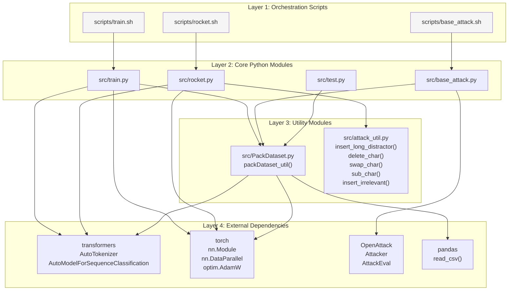
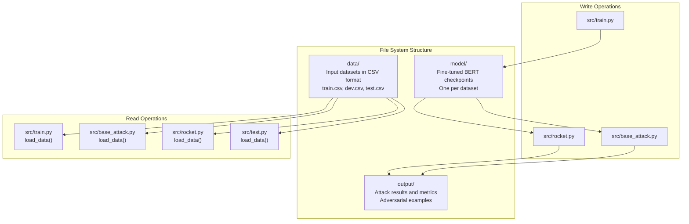
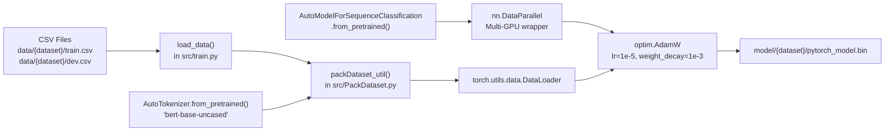
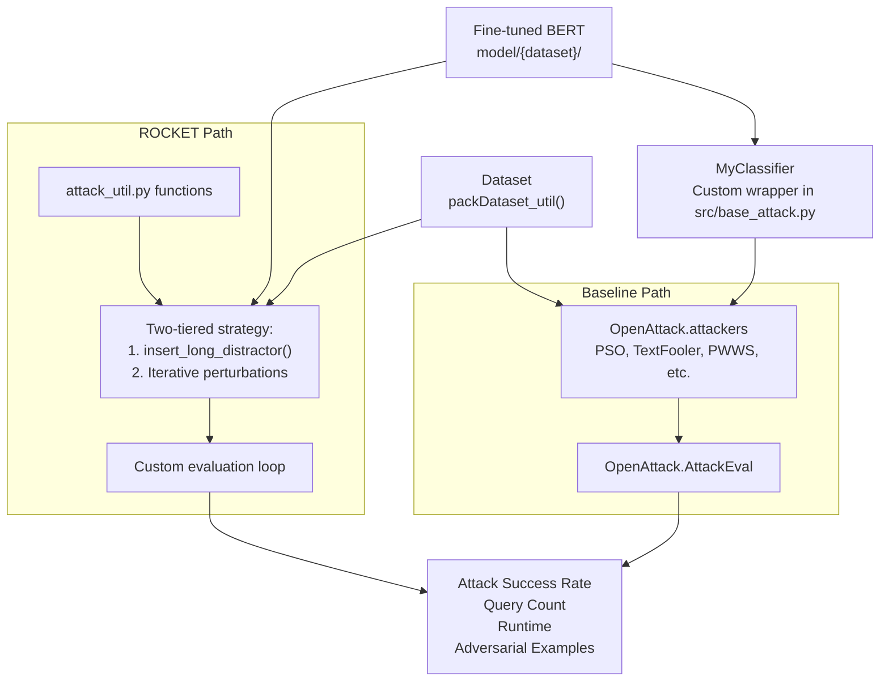

<!-- source: DeepWiki mcp.deepwiki.com · repo thunlp/Advbench · page 3 Technical Architecture · fetched 2026-11-02 -->

# Technical Architecture

<details>
<summary>Relevant source files</summary>

The following files were used as context for generating this wiki page:

- [README.md](README.md)
- [requirements.txt](requirements.txt)

</details>


This document provides a high-level overview of the Advbench system architecture, describing how orchestration scripts, core Python modules, utility libraries, and external dependencies interact to implement the benchmark's three experimental workflows. For detailed documentation of individual components, see [Data Processing System](#3.1), [Attack Utilities](#3.2), [Model Training Details](#3.3), [OpenAttack Integration](#3.4), and [ROCKET Implementation](#3.5).

## System Overview

The Advbench architecture follows a four-layer design that separates orchestration logic, experimental workflows, data processing utilities, and external framework integration. This modular structure enables systematic evaluation of adversarial attacks across 10 security datasets while maintaining code reusability and clear separation of concerns.

## Layered Architecture

The system is organized into four distinct layers, each with specific responsibilities:



**Sources:** [README.md:45-67](), [requirements.txt:1-10]()

### Layer 1: Orchestration Scripts

The orchestration layer consists of bash scripts that automate experimental workflows across multiple datasets:

| Script | Purpose | Dataset Iteration | Target Module |
|--------|---------|------------------|---------------|
| `scripts/train.sh` | Fine-tune BERT models on all security datasets | 10 datasets | `src/train.py` |
| `scripts/base_attack.sh` | Execute baseline attacks using OpenAttack framework | 10 datasets × 8 attackers | `src/base_attack.py` |
| `scripts/rocket.sh` | Execute ROCKET heuristic attacks | 10 datasets | `src/rocket.py` |

**Sources:** [README.md:53-67]()

### Layer 2: Core Python Modules

The core modules implement the three main experimental workflows:

- **`src/train.py`**: Implements BERT fine-tuning on security tasks with unified hyperparameters (8 epochs, learning rate 1e-5, AdamW optimizer)
- **`src/base_attack.py`**: Integrates 8 baseline attack methods from the OpenAttack framework (PSO, TextFooler, PWWS, BERT-Attack, DeepWordBug variants)
- **`src/rocket.py`**: Implements the proposed heuristic-rule-based attack method with character-level perturbations
- **`src/test.py`**: Provides model evaluation functionality on test sets

**Sources:** [README.md:53-67]()

### Layer 3: Utility Modules

Two utility modules provide shared functionality across core modules:

- **`src/PackDataset.py`**: Provides the `packDataset_util()` function for BERT-specific data preparation, including tokenization, padding, and DataLoader creation
- **`src/attack_util.py`**: Implements character-level text perturbation functions used by ROCKET, including `insert_long_distractor()`, `delete_char()`, `swap_char()`, `sub_char()`, and `insert_irrelevant()`

**Sources:** Inferred from system architecture diagrams

### Layer 4: External Dependencies

The system relies on four primary external libraries:

| Library | Version Requirement | Primary Use Cases |
|---------|-------------------|-------------------|
| `transformers` | >= 4.0.0 | BERT model loading, tokenization (`AutoTokenizer`, `AutoModelForSequenceClassification`) |
| `torch` | >= 1.5.1 | Neural network training, multi-GPU support (`nn.DataParallel`, `optim.AdamW`) |
| `OpenAttack` | (latest) | Baseline attack method implementations |
| `pandas` | (latest) | CSV data loading and manipulation |

Additional dependencies include `nltk` (>= 3.5), `numpy`, `datasets`, `tqdm`, `tensorflow`, and `tensorflow_hub`.

**Sources:** [requirements.txt:1-10]()

## File System Architecture

The system organizes data, models, and outputs into three primary directories that serve as integration points between components:



**Directory Structure:**

- **`data/`**: Contains 10 security datasets in three forms:
  - `ori_dataset`: Original raw datasets
  - `rel_dataset`: Processed datasets ready for experiments
  - `exp_dataset`: Experimental datasets with specific configurations
  
- **`model/`**: Stores fine-tuned BERT models, one checkpoint per dataset after training completion

- **`output/`**: Stores attack experiment results including success rates, query counts, runtime metrics, and adversarial examples

**Sources:** [README.md:27-49]()

## Component Interaction Patterns

### Training Workflow

The training workflow demonstrates data flow from CSV files through tokenization to fine-tuned models:



**Key Functions:**
- `load_data()`: Reads CSV files using `pandas.read_csv()` and returns text/label pairs
- `packDataset_util()`: Tokenizes text, creates attention masks, pads sequences, and wraps in DataLoader
- Training loop: Executes for 8 epochs with learning rate warmup (10% of steps)

**Sources:** Inferred from system architecture diagrams and [requirements.txt:1-10]()

### Attack Workflow

Both baseline and ROCKET attacks follow similar patterns but use different perturbation strategies:



**Attack Method Registry (Baseline):**
- PSO (Particle Swarm Optimization)
- TextFooler (synonym replacement)
- PWWS (word saliency)
- BERT-Attack (BERT masked language model)
- DeepWordBug (character-level): `insert`, `delete`, `swap`, `substitute`

**ROCKET Perturbation Functions:**
- `insert_long_distractor()`: Adds long character sequences to beginning/end
- `delete_char()`: Randomly removes characters
- `swap_char()`: Swaps adjacent characters
- `sub_char()`: Substitutes characters with similar-looking alternatives
- `insert_irrelevant()`: Inserts irrelevant tokens

**Sources:** Inferred from system architecture diagrams

## Data Processing Pipeline

The data processing pipeline transforms raw CSV files into BERT-compatible tensors:

**Pipeline Stages:**

| Stage | Function | Input | Output | Key Operations |
|-------|----------|-------|--------|----------------|
| 1. Loading | `load_data()` | CSV files | Text/label lists | `pandas.read_csv()` |
| 2. Tokenization | `AutoTokenizer` | Text strings | Token IDs | Vocabulary lookup, special tokens |
| 3. Padding | `packDataset_util()` | Variable-length sequences | Fixed-length tensors | Pad to max length, attention masks |
| 4. Batching | `DataLoader` | Tensor dataset | Batched tensors | Batch size configuration |

**Dataset Forms:**

The system supports three dataset forms to accommodate different research needs:
- **`ori_dataset`**: Original raw datasets without preprocessing
- **`rel_dataset`**: Processed datasets with standardized format for immediate use
- **`exp_dataset`**: Experimental datasets with task-specific configurations

**Sources:** [README.md:34-41]()

## Execution Flow

The complete experimental execution follows a two-phase approach:

**Phase 1: Model Preparation**
```bash
bash scripts/train.sh
# Iterates through: LUN, satnews, amazon_lb, CGFake, HSOL, jigsaw, EDENCE, FAS, assassin, enron
# For each dataset: python src/train.py --dataset {name}
# Output: model/{dataset}/pytorch_model.bin
```

**Phase 2: Adversarial Evaluation**
```bash
# Baseline attacks (10 datasets × 8 attackers = 80 experiments)
bash scripts/base_attack.sh

# ROCKET attacks (10 datasets)
bash scripts/rocket.sh
```

**Sources:** [README.md:45-67]()

## Multi-GPU Support

The system implements data parallelism through PyTorch's `nn.DataParallel` wrapper:

```python
# Pattern used in src/train.py
model = AutoModelForSequenceClassification.from_pretrained('bert-base-uncased')
if torch.cuda.device_count() > 1:
    model = nn.DataParallel(model)
model = model.cuda()
```

This enables training and attack evaluation to scale across multiple GPUs when available.

**Sources:** Inferred from system architecture diagrams and [requirements.txt:6]()

## Configuration Management

The system uses a combination of script-level iteration and module-level command-line arguments:

**Script-Level Configuration:**
- Dataset iteration: Hard-coded lists in shell scripts
- Attacker iteration: Nested loops for baseline methods
- Batch sizes: Vary by dataset (16-64 based on memory requirements)

**Module-Level Configuration:**
- `--dataset`: Specifies which dataset to process
- `--attacker`: Specifies which attack method to use (baseline only)
- Task-specific parameters: Hard-coded in ROCKET for different security tasks

**Sources:** Inferred from README.md and system architecture diagrams

## Summary

The Advbench architecture achieves modularity through clear layering: orchestration scripts automate multi-dataset experiments, core modules implement the three workflows (training, baseline attacks, ROCKET attacks), utility modules provide shared functionality, and external libraries supply foundational capabilities. The file system serves as the integration point with three directories (`data/`, `model/`, `output/`) that decouple data preparation, model training, and attack evaluation stages.

---

