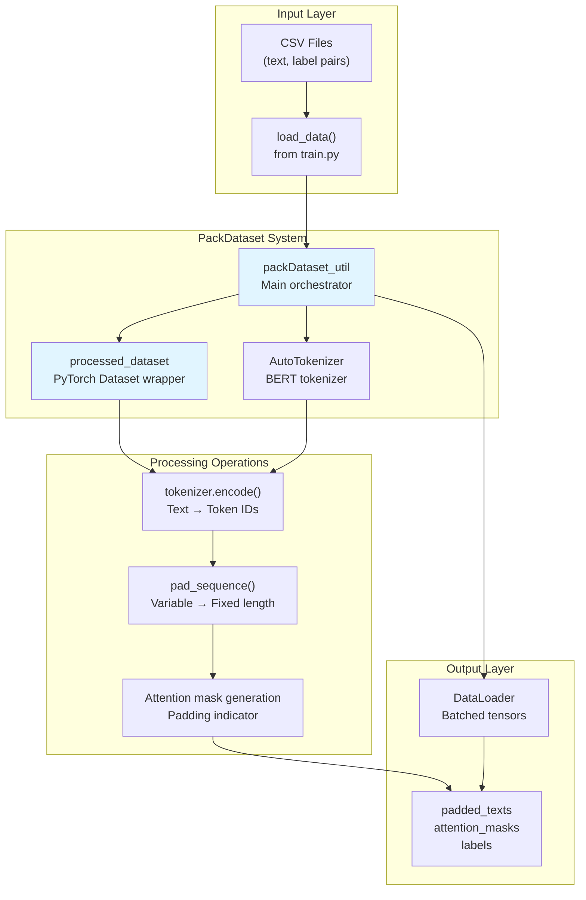
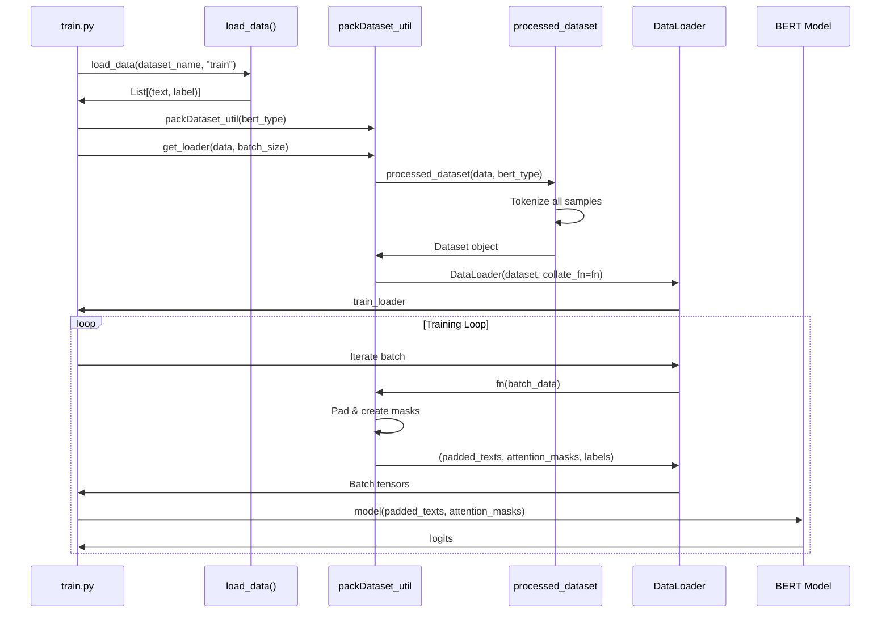

<!-- source: DeepWiki mcp.deepwiki.com · repo thunlp/Advbench · page 3.1 Data Processing System · fetched 2026-11-02 -->

# Data Processing System

<details>
<summary>Relevant source files</summary>

The following files were used as context for generating this wiki page:

- [src/PackDataset.py](src/PackDataset.py)
- [src/train.py](src/train.py)

</details>


## Purpose and Scope

The Data Processing System is the core data transformation pipeline in Advbench that converts raw text-label pairs into BERT-compatible tensor batches. This system handles tokenization, padding, attention mask generation, and DataLoader creation for training and evaluation pipelines.

This page provides a technical deep dive into the `PackDataset.py` module, which serves as the bridge between raw CSV data and the fine-tuned BERT models. For information about how data is loaded from CSV files, see [Model Training Pipeline](#2.1). For details on the datasets themselves, see [Datasets](#1.3).

**Sources:** [src/PackDataset.py:1-51](), [src/train.py:119-121]()

---

## System Architecture

The data processing system consists of two primary classes that work together to transform raw text into batched tensors:



**Diagram: Data Processing Architecture**

The system follows a clear two-stage design: the `processed_dataset` class handles individual sample tokenization, while `packDataset_util` orchestrates batching and padding across samples.

**Sources:** [src/PackDataset.py:13-50](), [src/train.py:119-121]()

---

## Component Details

### processed_dataset Class

The `processed_dataset` class is a PyTorch `Dataset` implementation that wraps raw text-label pairs and performs per-sample tokenization.

| Attribute | Type | Description |
|-----------|------|-------------|
| `texts` | List[torch.Tensor] | Tokenized input IDs for each text sample |
| `labels` | List[int] | Corresponding labels for classification |
| `bert_type` | str | BERT model identifier (e.g., "bert-base-uncased") |

**Key Methods:**

- `__init__(self, data, bert_type)` [src/PackDataset.py:14-21]()
  - Accepts list of `(text, label)` tuples
  - Tokenizes each text using `AutoTokenizer.encode()`
  - Applies max length of 512 tokens with truncation
  - Stores tokenized tensors and labels separately

- `__len__(self)` [src/PackDataset.py:23-24]()
  - Returns total number of samples

- `__getitem__(self, idx)` [src/PackDataset.py:26-27]()
  - Returns tuple of `(tokenized_text, label)` for given index

**Tokenization Details:**

The tokenization process at [src/PackDataset.py:19]() uses these parameters:
- `max_length=512`: BERT's maximum sequence length
- `truncation=True`: Truncates sequences exceeding 512 tokens
- Output: `torch.tensor` of token IDs

**Sources:** [src/PackDataset.py:13-27]()

---

### packDataset_util Class

The `packDataset_util` class is the main entry point for creating batched DataLoaders with proper padding and attention masks.

| Attribute | Type | Description |
|-----------|------|-------------|
| `bert_type` | str | BERT model identifier |
| `tokenizer` | AutoTokenizer | Shared tokenizer instance |

**Key Methods:**

#### Constructor

```python
def __init__(self, bert_type)
```

Initializes the utility with a BERT model type and creates a shared tokenizer instance [src/PackDataset.py:31-34]().

#### Collate Function: fn()

```python
def fn(self, data)
```

The collate function [src/PackDataset.py:35-44]() is the core batching mechanism that processes a list of `(text_tensor, label)` tuples into a unified batch:

**Processing Steps:**

1. **Separation** [src/PackDataset.py:36-40](): Splits texts and labels into separate lists
2. **Label Conversion** [src/PackDataset.py:41](): Converts labels to `torch.tensor`
3. **Padding** [src/PackDataset.py:42](): Applies `pad_sequence()` to align variable-length token sequences
4. **Attention Mask Generation** [src/PackDataset.py:43](): Creates binary masks indicating real vs. padding tokens

**Return Values:**

| Tensor | Shape | Description |
|--------|-------|-------------|
| `padded_texts` | `(batch_size, max_seq_len)` | Padded token IDs, padding uses `tokenizer.pad_token_id` |
| `attention_masks` | `(batch_size, max_seq_len)` | Binary mask: 1 for real tokens, 0 for padding |
| `labels` | `(batch_size,)` | Classification labels |

#### DataLoader Factory: get_loader()

```python
def get_loader(self, data, shuffle=True, batch_size=32)
```

Creates a PyTorch DataLoader with the custom collate function [src/PackDataset.py:47-50]().

**Parameters:**

- `data`: List of `(text, label)` tuples (raw text, not tokenized)
- `shuffle`: Boolean for randomizing batch order (default: True)
- `batch_size`: Number of samples per batch (default: 32)

**Returns:** `DataLoader` object configured for BERT training/evaluation

**Sources:** [src/PackDataset.py:30-50]()

---

## Data Transformation Flow

The following diagram shows the complete transformation from raw text to batched tensors:

```mermaid
graph LR
    subgraph "Stage 1: Load Data"
        S1["Raw CSV<br/>text,label"]
        S2["load_data()<br/>Returns List[(text, label)]"]
    end
    
    subgraph "Stage 2: Create Dataset"
        S3["processed_dataset.__init__()<br/>Tokenize each sample"]
        S4["List[Tensor]<br/>Variable lengths"]
    end
    
    subgraph "Stage 3: Batch Processing"
        S5["DataLoader iteration<br/>Calls collate_fn"]
        S6["fn() collate function<br/>Batch processing"]
    end
    
    subgraph "Stage 4: Padding"
        S7["pad_sequence()<br/>batch_first=True"]
        S8["padded_texts<br/>Fixed shape batch"]
    end
    
    subgraph "Stage 5: Mask Creation"
        S9["masked_fill()<br/>padded_texts != pad_token_id"]
        S10["attention_masks<br/>Binary indicators"]
    end
    
    subgraph "Stage 6: Output"
        S11["Model Input<br/>(padded_texts, attention_masks, labels)"]
    end
    
    S1 --> S2
    S2 --> S3
    S3 --> S4
    S4 --> S5
    S5 --> S6
    S6 --> S7
    S7 --> S8
    S8 --> S9
    S9 --> S10
    S10 --> S11
```



**Diagram: Complete Data Transformation Pipeline**

**Example Transformation:**

Consider a batch with 2 samples:

```
Input:
- Sample 1: "This is a spam message" → Tokenized to [101, 2023, 2003, 102] (length 4)
- Sample 2: "Buy now!" → Tokenized to [101, 4965, 2085, 102] (length 4, by coincidence)

After padding (if batch has longer sequences):
- padded_texts: [[101, 2023, 2003, 102, 0, 0], [101, 4965, 2085, 102, 0, 0]]
- attention_masks: [[1, 1, 1, 1, 0, 0], [1, 1, 1, 1, 0, 0]]
- labels: [1, 1]
```

**Sources:** [src/PackDataset.py:35-44](), [src/train.py:19-25]()

---

## Attention Mask Generation

The attention mask creation at [src/PackDataset.py:43]() uses a specific pattern:

```python
attention_masks = torch.zeros_like(padded_texts).masked_fill(padded_texts != self.tokenizer.pad_token_id, 1)
```

**Process Breakdown:**

1. **Initialize zeros** - Create tensor of same shape as `padded_texts`, filled with 0
2. **Identify real tokens** - Create boolean mask where `padded_texts != pad_token_id`
3. **Fill with 1s** - Set positions with real tokens to 1

**Why This Matters:**

BERT's attention mechanism uses these masks to prevent the model from attending to padding tokens during self-attention computation. This ensures computational efficiency and prevents the model from learning spurious patterns from padding.

**Sources:** [src/PackDataset.py:43]()

---

## Integration with Training Pipeline

The data processing system integrates with the training pipeline as shown:



**Diagram: Integration Sequence**

**Usage Example from Training:**

```python
# From train.py:119-121
pack_util = packDataset_util(bert_type)
train_loader = pack_util.get_loader(orig_train, shuffle=True, batch_size=batch_size_dict[dataset_name])
test_loader = pack_util.get_loader(orig_test, shuffle=False, batch_size=128)
```

**Sources:** [src/train.py:119-121](), [src/train.py:34-43]()

---

## Batch Size Configuration

Different datasets use different batch sizes based on their characteristics:

| Dataset | Batch Size | Rationale |
|---------|-----------|-----------|
| `amazon_lb` | 64 | Shorter texts, can fit more in GPU memory |
| `LUN` | 32 | Standard batch size |
| `satnews` | 32 | Standard batch size |
| `EDENCE` | 32 | Standard batch size |
| `FAS` | 32 | Standard batch size |
| `assassin` | 32 | Standard batch size |
| `enron` | 32 | Standard batch size |
| `CGFake` | 16 | Longer fake news articles, reduced batch size |
| `HSOL` | 16 | Memory-intensive hate speech detection |
| `jigsaw` | 16 | Longer toxic comment sequences |

These configurations are defined in [src/train.py:107]() as `batch_size_dict`.

**Evaluation Batch Size:**

All datasets use a fixed batch size of 128 for evaluation [src/train.py:121]() since evaluation doesn't require gradient computation and has lower memory requirements.

**Sources:** [src/train.py:107](), [src/train.py:120-121]()

---

## Technical Specifications

### Dependencies

| Library | Purpose | Usage Location |
|---------|---------|----------------|
| `torch` | Tensor operations and Dataset/DataLoader | [src/PackDataset.py:5-7]() |
| `transformers` | AutoTokenizer for BERT tokenization | [src/PackDataset.py:8]() |
| `torch.nn.utils.rnn` | `pad_sequence()` for batch padding | [src/PackDataset.py:7]() |

### Tokenizer Configuration

The system uses `AutoTokenizer.from_pretrained(bert_type)` with:
- Default BERT model: `"bert-base-uncased"` [src/train.py:95]()
- Max sequence length: 512 tokens [src/PackDataset.py:19]()
- Truncation: Enabled [src/PackDataset.py:19]()
- Special tokens: Automatically handled by tokenizer (CLS, SEP)

### Memory Considerations

The `processed_dataset` class pre-tokenizes all samples during initialization [src/PackDataset.py:18-20](), which:
- **Advantage**: Tokenization happens once, not per epoch
- **Disadvantage**: All tokenized tensors stored in memory
- **Trade-off**: Suitable for datasets that fit in memory (all 10 Advbench datasets do)

**Sources:** [src/PackDataset.py:1-51](), [src/train.py:111-114]()

---

## Code Entity Reference

### Classes

- **`processed_dataset`** [src/PackDataset.py:13](): PyTorch Dataset wrapper for tokenized text
- **`packDataset_util`** [src/PackDataset.py:30](): Main utility class for creating DataLoaders

### Key Functions

- **`processed_dataset.__init__(data, bert_type)`** [src/PackDataset.py:14](): Tokenizes and stores dataset
- **`packDataset_util.fn(data)`** [src/PackDataset.py:35](): Collate function for batching
- **`packDataset_util.get_loader(data, shuffle, batch_size)`** [src/PackDataset.py:47](): Creates configured DataLoader

### External Dependencies

- **`AutoTokenizer`** [src/PackDataset.py:8](): From `transformers`, handles BERT tokenization
- **`pad_sequence`** [src/PackDataset.py:7](): From `torch.nn.utils.rnn`, pads variable-length sequences
- **`Dataset`** [src/PackDataset.py:6](): From `torch.utils.data`, base class for PyTorch datasets
- **`DataLoader`** [src/PackDataset.py:6](): From `torch.utils.data`, batching and iteration

**Sources:** [src/PackDataset.py:1-51]()

---

