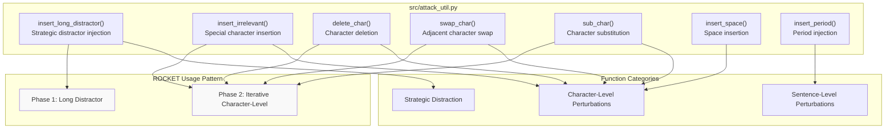
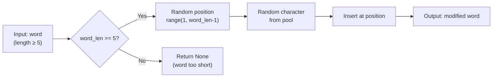
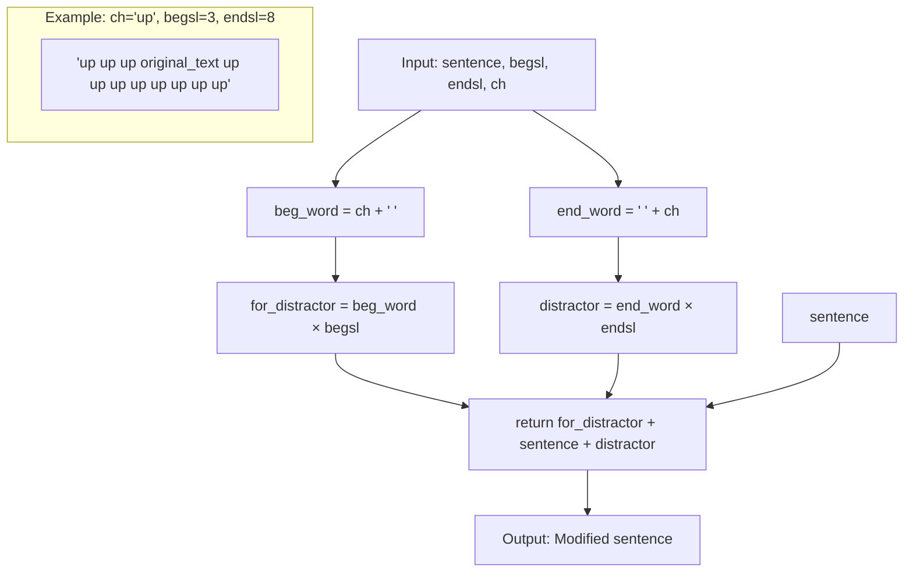
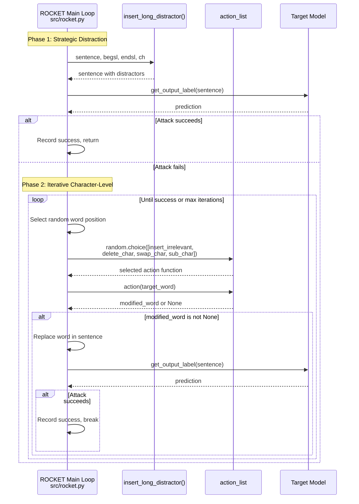
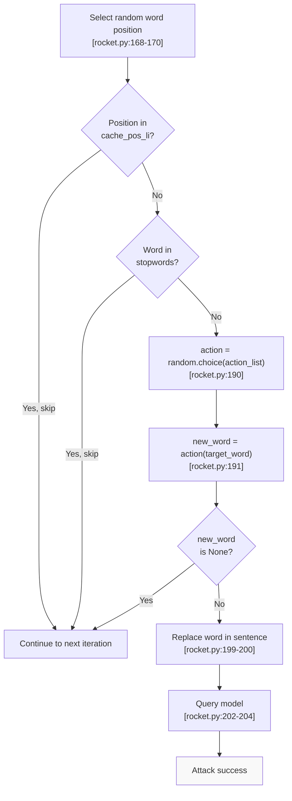
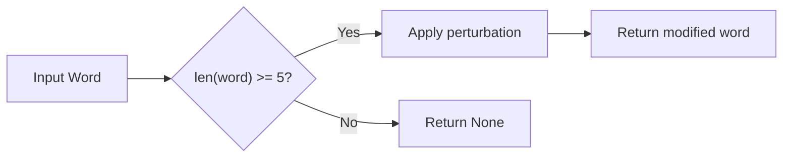

<!-- source: DeepWiki mcp.deepwiki.com · repo thunlp/Advbench · page 3.2 Attack Utilities · fetched 2026-11-02 -->

# Attack Utilities

<details>
<summary>Relevant source files</summary>

The following files were used as context for generating this wiki page:

- [src/attack_util.py](src/attack_util.py)
- [src/rocket.py](src/rocket.py)

</details>


## Purpose and Scope

This document provides technical documentation for the text perturbation functions in `src/attack_util.py`, which implement character-level and word-level adversarial modifications used by the ROCKET attack method. These utilities serve as the building blocks for generating adversarial examples that simulate practical real-world attacks on NLP models.

For the high-level ROCKET attack algorithm that orchestrates these utilities, see [ROCKET Implementation](#3.5). For the complete attack pipeline execution, see [ROCKET Attack Pipeline](#2.3).

**Sources:** [src/attack_util.py:1-144]()

## Overview

The attack utilities module provides seven distinct perturbation functions that modify text at character and word levels. These functions are designed to create adversarial examples that remain semantically similar to the original text while causing misclassification in target models. The perturbations simulate realistic attacker behaviors such as typos, character substitutions, and injection of distracting content.



**Sources:** [src/attack_util.py:4-121](), [src/rocket.py:68](), [src/rocket.py:133]()

## Character-Level Perturbation Functions

### Core Action List

The ROCKET method employs four primary character-level perturbation functions, defined in the `action_list` at [src/rocket.py:68]():

| Function | Operation | Example Transformation | Use Case |
|----------|-----------|------------------------|----------|
| `insert_irrelevant()` | Insert special character | "foolish" → "foo$lish" | Simulate typos with special chars |
| `delete_char()` | Delete single character | "foolish" → "folish" | Simulate character omission |
| `swap_char()` | Swap adjacent characters | "foolish" → "foloisH" | Simulate typing errors |
| `sub_char()` | Substitute with look-alike | "foolish" → "f00lish" | Simulate character confusion |

**Sources:** [src/rocket.py:68](), [src/attack_util.py:40-108]()

### Function: insert_irrelevant()



Inserts a special character from a predefined pool at a random position within a word. The function targets words with at least 5 characters to maintain word recognizability.

**Implementation Details:**
- **Character pool:** `['$', '#', '@', '%', '&', '!', '*']` [src/attack_util.py:48]()
- **Minimum word length:** 5 characters [src/attack_util.py:42-43]()
- **Insertion position:** Random position between first and last character (exclusive) [src/attack_util.py:44-45]()
- **Return value:** Modified word or `None` if word is too short [src/attack_util.py:43]()

**Example:**
```
Input: "foolish"
Position: 3 (random)
Character: '$' (random from pool)
Output: "foo$lish"
```

**Sources:** [src/attack_util.py:40-51]()

### Function: delete_char()

Deletes a single character from a random position within a word. This simulates common typing errors where characters are accidentally omitted.

**Implementation Details:**
- **Minimum word length:** 5 characters [src/attack_util.py:55-56]()
- **Deletion position:** Random position between first and last character [src/attack_util.py:57]()
- **Operation:** Concatenates word segments before and after deletion position [src/attack_util.py:58]()

**Example:**
```
Input: "foolish"
Position: 4 (random)
Output: "folish" (deleted 'o' at position 4)
```

**Sources:** [src/attack_util.py:53-59]()

### Function: swap_char()

Swaps two adjacent characters at a random position within a word. This simulates transposition errors common in fast typing.

**Implementation Details:**
- **Minimum word length:** 5 characters [src/attack_util.py:65-66]()
- **Swap position:** Random position allowing for adjacent character [src/attack_util.py:67]()
- **Position range:** `range(1, word_len-2)` to ensure both characters exist [src/attack_util.py:67]()
- **Operation:** Exchanges characters at position `i` and `i+1` [src/attack_util.py:68-70]()

**Example:**
```
Input: "foolish"
Position: 3 (random)
Characters: 'l' and 'i'
Output: "fooilsh" (swapped 'l' and 'i')
```

**Sources:** [src/attack_util.py:63-71]()

### Function: sub_char()

Substitutes specific characters with visually similar or semantically confusing alternatives. This function implements character-to-character mapping for common confusions.

**Implementation Details:**
- **Minimum word length:** 5 characters [src/attack_util.py:80-81]()
- **Substitution dictionary:**
  - `'o'` → `'0'` (letter to number)
  - `'l'` → `'1'` (lowercase L to one)
  - `'i'` → `'1'` (lowercase i to one)
  - `'s'` → `'$'` (s to dollar sign)
  [src/attack_util.py:87-93]()
- **Target character list:** `['o', 'l', 'i', 's']` [src/attack_util.py:94]()
- **Selection strategy:** Shuffles target list and attempts substitution in random order [src/attack_util.py:101-105]()
- **Return value:** Returns `None` if no target characters found in word [src/attack_util.py:99-100]()

**Example:**
```
Input: "foolish"
Target found: 'o'
Output: "f00lish" (both 'o' characters replaced with '0')
```

**Sources:** [src/attack_util.py:78-108]()

### Function: insert_space()

Inserts a space character at a random position within a word, effectively splitting it into two tokens. This function is defined but not included in the primary `action_list` used by ROCKET.

**Implementation Details:**
- **Minimum word length:** 5 characters [src/attack_util.py:34-35]()
- **Insertion position:** Random position between first and last character [src/attack_util.py:36]()
- **Effect:** Splits word into two separate tokens for tokenizer [src/attack_util.py:37]()

**Example:**
```
Input: "foolish"
Position: 3 (random)
Output: "foo lish" (space inserted at position 3)
```

**Sources:** [src/attack_util.py:32-38]()

## Long Distractor Function

### Function: insert_long_distractor()

The `insert_long_distractor()` function implements a strategic perturbation by injecting repeated words at the beginning and/or end of a sentence. This serves as the first phase of the ROCKET attack, aiming to overwhelm the model with irrelevant content before applying character-level perturbations.



**Implementation Details:**
- **Parameters:**
  - `sentence`: Original input text [src/attack_util.py:4]()
  - `begsl`: Number of distractor repetitions at beginning [src/attack_util.py:4]()
  - `endsl`: Number of distractor repetitions at end [src/attack_util.py:4]()
  - `ch`: Distractor word/character to repeat [src/attack_util.py:4]()
- **Construction:**
  - Beginning distractor: `(ch + ' ')` repeated `begsl` times [src/attack_util.py:10-12]()
  - Ending distractor: `(' ' + ch)` repeated `endsl` times [src/attack_util.py:11-14]()
- **Return value:** Concatenated string with distractors surrounding original sentence [src/attack_util.py:16]()

**Task-Specific Configurations:**

The distractor parameters are customized per dataset in [src/rocket.py:74-120]():

| Dataset(s) | begsl | endsl | ch | Purpose |
|------------|-------|-------|----|----|
| enron, assassin | 10 | 30 | ">" | Email spam detection |
| CGFake, amazon_lb | 3 | 8 | "up" | Fake review detection |
| LUN, satnews | 5 | 30 | "reuters" | Fake news detection |
| jigsaw, HSOL | 0 | 180 | "peace" | Toxic content detection |
| FAS, EDENCE | 0 | 20 | "any" | Stance detection |

**Sources:** [src/attack_util.py:4-16](), [src/rocket.py:74-120]()

## Sentence-Level Perturbation

### Function: insert_period()

Inserts a period after every word in a sentence, creating a fragmented appearance. This function is defined but not used in the current ROCKET implementation.

**Implementation Details:**
- **Operation:** Splits sentence into words, inserts '.' after each word [src/attack_util.py:115-120]()
- **Effect:** Creates unusual tokenization pattern that may confuse models

**Example:**
```
Input: "This is a test sentence"
Output: "This . is . a . test . sentence ."
```

**Sources:** [src/attack_util.py:114-121]()

## Integration with ROCKET

### Two-Phase Attack Strategy

The attack utilities are invoked in a two-phase strategy within the ROCKET attack loop:



**Phase 1 Execution:**
- Invoked at [src/rocket.py:133]() immediately after original label confirmation
- Single query to model to check if distractor alone causes misclassification
- If successful, attack terminates early with high efficiency

**Phase 2 Execution:**
- Iterative loop at [src/rocket.py:163-215]()
- Random action selection at [src/rocket.py:190](): `action = random.choice(action_list)`
- Action application at [src/rocket.py:191](): `new_word = action(target_word)`
- Continues until attack succeeds or iteration limit reached

**Sources:** [src/rocket.py:133](), [src/rocket.py:163-215](), [src/rocket.py:190-191]()

### Function Selection and Application

The character-level perturbations are applied with several constraints:



**Constraints:**
1. **Position caching:** Avoids re-attacking same position [src/rocket.py:181]()
2. **Stopword filtering:** Skips common English stopwords [src/rocket.py:186]()
3. **None handling:** Continues if function returns None (word too short, no applicable substitution) [src/rocket.py:195-196]()
4. **Batch processing:** Multiple positions attacked in parallel before querying [src/rocket.py:166-177]()

**Sources:** [src/rocket.py:163-215]()

## Function Behavior Characteristics

### Minimum Word Length Requirements

All character-level perturbation functions enforce a minimum word length of 5 characters to maintain semantic integrity:



This design decision ensures that:
- Short words (articles, prepositions) remain unmodified
- Perturbations maintain word recognizability
- Semantic meaning is preserved at word level

**Sources:** [src/attack_util.py:34](), [src/attack_util.py:42](), [src/attack_util.py:55](), [src/attack_util.py:65](), [src/attack_util.py:80]()

### Return Value Handling

All perturbation functions may return `None` under specific conditions:

| Function | Returns None When |
|----------|-------------------|
| `insert_irrelevant()` | Word length < 5 |
| `delete_char()` | Word length < 5 |
| `swap_char()` | Word length < 5 |
| `sub_char()` | Word length < 5 OR no substitutable characters found |
| `insert_space()` | Word length < 5 |

The ROCKET attack loop handles `None` returns by continuing to the next iteration without querying the model [src/rocket.py:195-196]():

```python
if new_word is None:
    continue
```

**Sources:** [src/rocket.py:195-196](), [src/attack_util.py:43](), [src/attack_util.py:56](), [src/attack_util.py:66](), [src/attack_util.py:81](), [src/attack_util.py:99-100]()

### Randomization Strategy

The utilities employ randomization at multiple levels:

1. **Position randomization:** All functions select random positions within words [src/attack_util.py:36](), [src/attack_util.py:44](), [src/attack_util.py:57](), [src/attack_util.py:67]()
2. **Character pool randomization:** `insert_irrelevant()` randomly selects from special character pool [src/attack_util.py:49]()
3. **Substitution order randomization:** `sub_char()` shuffles target character list before attempting substitution [src/attack_util.py:101]()
4. **Action randomization:** ROCKET randomly selects which perturbation function to apply [src/rocket.py:190]()

This multi-level randomization ensures diverse adversarial examples and prevents predictable attack patterns.

**Sources:** [src/attack_util.py:36](), [src/attack_util.py:44-49](), [src/attack_util.py:57](), [src/attack_util.py:67](), [src/attack_util.py:101](), [src/rocket.py:190]()

## Testing and Validation

The module includes a test block demonstrating function behavior [src/attack_util.py:126-137]():

```python
test_sentence = '5 of arthritis patients in Singapore take Bextra...'
word = 'foolish'

# Demonstrates each perturbation function
print(insert_period(test_sentence))
print(insert_space(word))
print(insert_irrelevant(word))
print(delete_char(word))
print(swap_char(word))
print(sub_char(word))
```

This test code can be executed directly to observe the output of each perturbation function on sample inputs.

**Sources:** [src/attack_util.py:126-137]()

---

