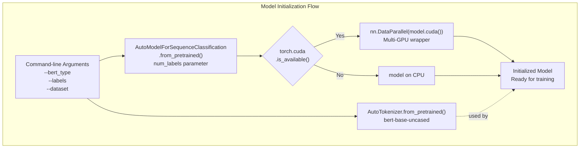
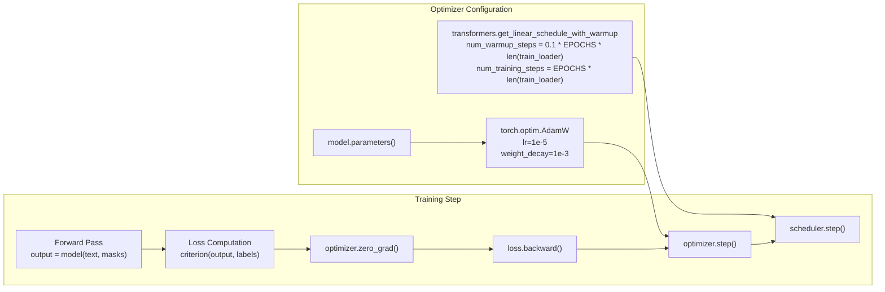
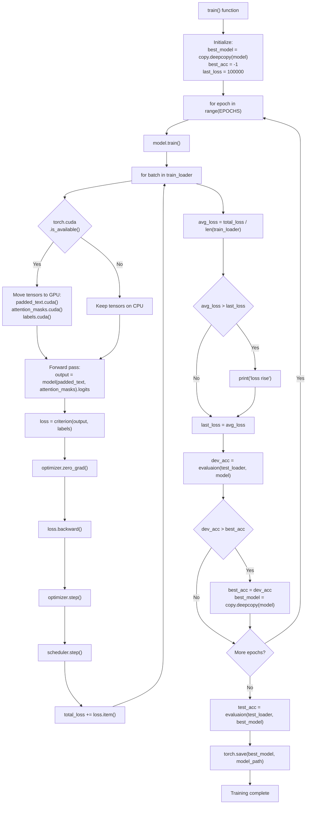
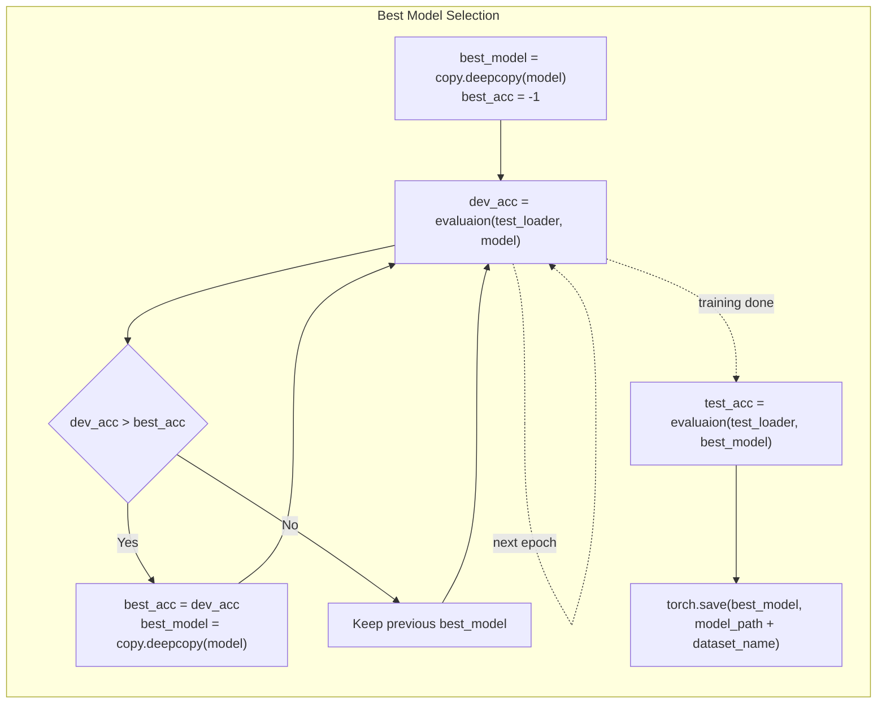
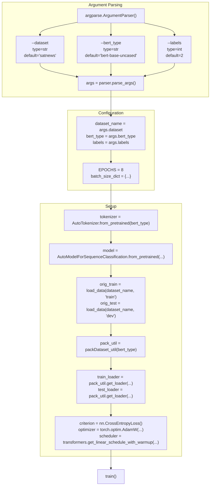

<!-- source: DeepWiki mcp.deepwiki.com · repo thunlp/Advbench · page 3.3 Model Training Details · fetched 2026-11-02 -->

# Model Training Details

<details>
<summary>Relevant source files</summary>

The following files were used as context for generating this wiki page:

- [src/train.py](src/train.py)

</details>


## Purpose and Scope

This page provides technical documentation for the model training implementation in [src/train.py](). It covers the training loop mechanics, optimization strategy, learning rate scheduling, model checkpointing, and evaluation procedures used to fine-tune BERT models on security datasets.

For high-level workflow and usage instructions, see [Model Training Pipeline](#2.1). For data preparation details, see [Data Processing System](#3.1). For command-line arguments and parameters, see [Command-Line Reference](#5.1).

**Sources:** [src/train.py:1-128]()

---

## Model Initialization

The training system initializes pre-trained BERT models and configures them for sequence classification tasks. The initialization process loads models from the Hugging Face Transformers library and wraps them for multi-GPU training.



### Key Components

**AutoTokenizer**: Loaded at [src/train.py:111]() using the `bert_type` argument (default: `bert-base-uncased`). The tokenizer is passed to `packDataset_util` for text processing.

**AutoModelForSequenceClassification**: Initialized at [src/train.py:112]() with the `num_labels` parameter, which specifies the number of classification classes (typically 2 for binary security tasks).

**nn.DataParallel**: Applied at [src/train.py:114]() when CUDA is available. This wrapper automatically distributes batches across multiple GPUs and aggregates outputs, enabling efficient training on multi-GPU systems.

**Sources:** [src/train.py:111-115]()

---

## Training Configuration

The training system uses fixed hyperparameters across all datasets, with dataset-specific batch sizes to optimize memory usage and training efficiency.

### Hyperparameters

| Parameter | Value | Location | Description |
|-----------|-------|----------|-------------|
| `EPOCHS` | 8 | [src/train.py:106]() | Number of complete passes through training data |
| `learning_rate` | 1e-5 | [src/train.py:124]() | AdamW optimizer learning rate |
| `weight_decay` | 1e-3 | [src/train.py:124]() | L2 regularization coefficient |
| `warmup_ratio` | 0.1 | [src/train.py:125]() | Proportion of training steps for warmup |
| `test_batch_size` | 128 | [src/train.py:121]() | Batch size for evaluation |

### Dataset-Specific Batch Sizes

The `batch_size_dict` at [src/train.py:107]() defines training batch sizes optimized for each dataset's characteristics:

```python
batch_size_dict = {
    'LUN': 32,
    'satnews': 32,
    'amazon_lb': 64,      # Larger batch for efficiency
    'jigsaw': 16,         # Smaller batch for memory
    'EDENCE': 32,
    'CGFake': 16,         # Smaller batch for memory
    'HSOL': 16,           # Smaller batch for memory
    'FAS': 32,
    'assassin': 32,
    'enron': 32
}
```

Batch sizes are selected based on text length and memory requirements. Datasets with longer texts or more complex examples (e.g., `jigsaw`, `CGFake`, `HSOL`) use smaller batches to prevent GPU memory overflow.

**Sources:** [src/train.py:106-107](), [src/train.py:120-121](), [src/train.py:124]()

---

## Optimization Strategy

The training system uses AdamW optimizer with linear learning rate scheduling and warmup. This combination provides stable convergence for fine-tuning pre-trained models.



### AdamW Optimizer

Initialized at [src/train.py:124]() with:
- **Learning rate**: `1e-5` - Standard for BERT fine-tuning
- **Weight decay**: `1e-3` - L2 regularization to prevent overfitting

AdamW decouples weight decay from gradient-based updates, providing more effective regularization than standard Adam.

### Learning Rate Scheduler

The `get_linear_schedule_with_warmup` scheduler at [src/train.py:125]() implements a two-phase learning rate strategy:

1. **Warmup Phase**: Linear increase from 0 to target learning rate
   - Duration: 10% of total training steps (`0.1 * EPOCHS * len(train_loader)`)
   - Purpose: Stabilize training at the beginning

2. **Decay Phase**: Linear decrease from target learning rate to 0
   - Duration: Remaining 90% of training steps
   - Purpose: Fine-tune model parameters as training progresses

**Total training steps calculation:**
```
num_training_steps = EPOCHS * len(train_loader)
                   = 8 * (dataset_size / batch_size)
```

The scheduler is updated at every optimization step [src/train.py:63](), not per epoch.

**Sources:** [src/train.py:123-125](), [src/train.py:60-63]()

---

## Training Loop Implementation

The `train()` function at [src/train.py:47-86]() implements the core training loop with loss tracking, model evaluation, and best model selection.

### Training Loop Structure



### Loss Function

The system uses `nn.CrossEntropyLoss()` at [src/train.py:123]() for all classification tasks. This loss function:
- Combines `LogSoftmax` and `NLLLoss` in a single operation
- Accepts raw logits from the model (no softmax needed)
- Supports multi-class classification with integer labels

### Gradient Computation and Update

The training step sequence at [src/train.py:60-63]() follows standard PyTorch practice:

1. **Zero gradients**: `optimizer.zero_grad()` - Clear gradients from previous step
2. **Backward pass**: `loss.backward()` - Compute gradients via backpropagation
3. **Optimizer step**: `optimizer.step()` - Update model parameters
4. **Scheduler step**: `scheduler.step()` - Adjust learning rate

### Loss Tracking

The system tracks two loss metrics:

- **total_loss**: Accumulated loss across all batches in an epoch [src/train.py:64]()
- **avg_loss**: Average loss per batch [src/train.py:65]()

A warning is printed if `avg_loss > last_loss` [src/train.py:66-68](), indicating potential training instability (though this doesn't halt training).

### Early Stopping Support

The training loop includes `KeyboardInterrupt` handling at [src/train.py:77-79](), allowing users to manually stop training while preserving the best model found so far.

**Sources:** [src/train.py:47-86](), [src/train.py:52-69](), [src/train.py:123]()

---

## Evaluation During Training

The `evaluaion()` function at [src/train.py:29-43]() computes validation accuracy after each training epoch. This function is used for both validation (`test_loader`) during training and final test set evaluation.

### Evaluation Process

```mermaid
graph TB
    subgraph "evaluaion(loader, eval_model)"
        START["Function entry"]
        EVAL_MODE["eval_model.eval()"]
        INIT["total_number = 0<br/>total_correct = 0"]
        
        NO_GRAD["with torch.no_grad()"]
        BATCH_LOOP["for batch in loader"]
        
        CUDA_CHECK{"torch.cuda<br/>.is_available()"}
        MOVE_GPU["Move tensors to GPU"]
        KEEP_CPU["Keep tensors on CPU"]
        
        FORWARD["output = eval_model(padded_text, attention_masks).logits"]
        ARGMAX["_, flag = torch.max(output, dim=1)"]
        COUNT_TOTAL["total_number += labels.size(0)"]
        COUNT_CORRECT["correct = (flag == labels).sum().item()<br/>total_correct += correct"]
        
        MORE_BATCHES{"More batches?"}
        COMPUTE_ACC["acc = total_correct / total_number"]
        RETURN["return acc"]
    end
    
    START --> EVAL_MODE
    EVAL_MODE --> INIT
    INIT --> NO_GRAD
    NO_GRAD --> BATCH_LOOP
    
    BATCH_LOOP --> CUDA_CHECK
    CUDA_CHECK -->|"Yes"| MOVE_GPU
    CUDA_CHECK -->|"No"| KEEP_CPU
    MOVE_GPU --> FORWARD
    KEEP_CPU --> FORWARD
    
    FORWARD --> ARGMAX
    ARGMAX --> COUNT_TOTAL
    COUNT_TOTAL --> COUNT_CORRECT
    COUNT_CORRECT --> MORE_BATCHES
    
    MORE_BATCHES -->|"Yes"| BATCH_LOOP
    MORE_BATCHES -->|"No"| COMPUTE_ACC
    COMPUTE_ACC --> RETURN
```



### Key Implementation Details

**Evaluation mode**: `eval_model.eval()` at [src/train.py:30]() disables dropout and batch normalization updates, ensuring deterministic behavior.

**Gradient computation disabled**: The `torch.no_grad()` context at [src/train.py:33]() prevents gradient computation during evaluation, reducing memory usage and improving speed.

**Prediction extraction**: `torch.max(output, dim=1)` at [src/train.py:38]() returns the predicted class label (argmax across classes).

**Accuracy calculation**: Simple ratio of correct predictions to total examples [src/train.py:42](). Accumulation across batches ensures accurate computation for the entire dataset.

### Evaluation Frequency

The evaluation function is called:
1. **After each training epoch** [src/train.py:70]() on validation set (`test_loader`)
2. **After training completes** [src/train.py:82]() on test set with best model

**Sources:** [src/train.py:29-43](), [src/train.py:70](), [src/train.py:82]()

---

## Model Checkpointing

The training system implements best-model checkpointing based on validation accuracy. This ensures the final saved model has the best generalization performance, not just the lowest training loss.

### Checkpointing Strategy



### Implementation Details

**Deep copy for best model**: `copy.deepcopy(model)` at [src/train.py:48]() and [src/train.py:74]() creates independent copies of the model state. This prevents the best model from being affected by subsequent training updates.

**Validation-based selection**: The system compares validation accuracy (`dev_acc`) against the current best [src/train.py:72]() after each epoch. Only models that improve validation accuracy are saved.

**Storage location**: Models are saved to `/model/{dataset_name}` via `torch.save()` at [src/train.py:86](). The full model object (including architecture and weights) is saved, not just state dictionary.

### File Naming Convention

The saved model filename is the dataset name:
```python
model_path = base_path + "/model/"
torch.save(best_model, model_path + dataset_name)
```

For example:
- `model/satnews` - Model trained on satnews dataset
- `model/CGFake` - Model trained on CGFake dataset
- `model/jigsaw` - Model trained on jigsaw dataset

**Sources:** [src/train.py:48-49](), [src/train.py:72-74](), [src/train.py:85-86]()

---

## Module Entry Point and Configuration

The `__main__` block at [src/train.py:89-127]() handles command-line argument parsing, data loading, and training orchestration.

### Command-Line Arguments



### Data Loading

The `load_data()` function at [src/train.py:19-25]() reads CSV files from `/data/{dataset_name}/`:
- **train.csv**: Training data
- **dev.csv**: Development/validation data

CSV files must have `text` and `label` columns. Data is converted to list of tuples: `(text, label)`.

### Execution Flow

1. **Parse arguments** [src/train.py:90-101]()
2. **Set hyperparameters** [src/train.py:103-107]()
3. **Initialize model and tokenizer** [src/train.py:111-114]()
4. **Load data** [src/train.py:116-117]()
5. **Create data loaders** [src/train.py:119-121]()
6. **Configure optimizer and scheduler** [src/train.py:123-125]()
7. **Execute training** [src/train.py:126]()

**Sources:** [src/train.py:89-127](), [src/train.py:19-25](), [src/train.py:90-101]()

---

## Training Progress Output

The training system provides detailed console output for monitoring progress:

### Output Format

| Stage | Output | Code Location |
|-------|--------|---------------|
| Batch progress | `tqdm` progress bar | [src/train.py:55]() |
| Epoch loss | `finish training, avg_loss: X.XXX, begin to evaluate` | [src/train.py:69]() |
| Validation accuracy | `finish evaluation, acc: X.XXX/Y.YYY` | [src/train.py:71]() |
| Loss increase warning | `loss rise` | [src/train.py:67]() |
| Epoch separator | `*` * 89 | [src/train.py:75]() |
| Early stopping | `Exiting from training early` | [src/train.py:79]() |
| Final results | `finish all, test acc: X.XXX` | [src/train.py:84]() |

### Example Output Sequence

```
finish training, avg_loss: 0.245, begin to evaluate
finish evaluation, acc: 0.921/0.900
*************************************************************************************
finish training, avg_loss: 0.198, begin to evaluate
finish evaluation, acc: 0.935/0.921
*************************************************************************************
...
finish all, test acc: 0.942
```

The format `acc: X.XXX/Y.YYY` shows current validation accuracy and previous best accuracy, helping track model improvement across epochs.

**Sources:** [src/train.py:55](), [src/train.py:67](), [src/train.py:69](), [src/train.py:71](), [src/train.py:75](), [src/train.py:79](), [src/train.py:84]()

---

