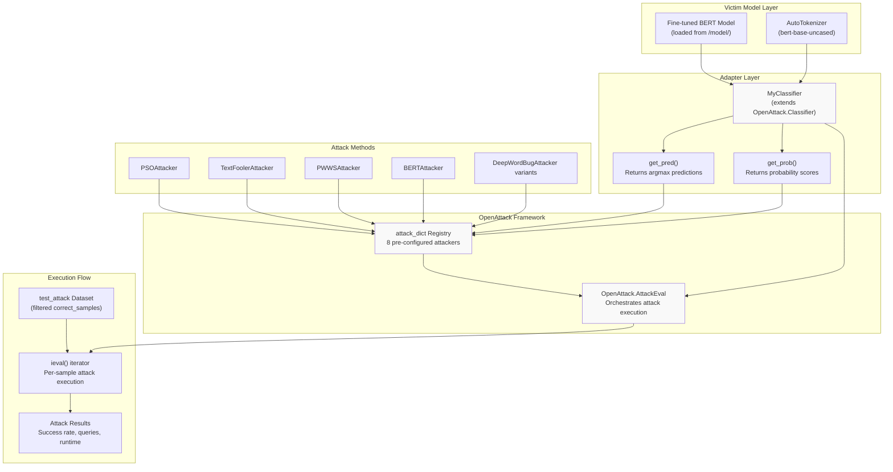
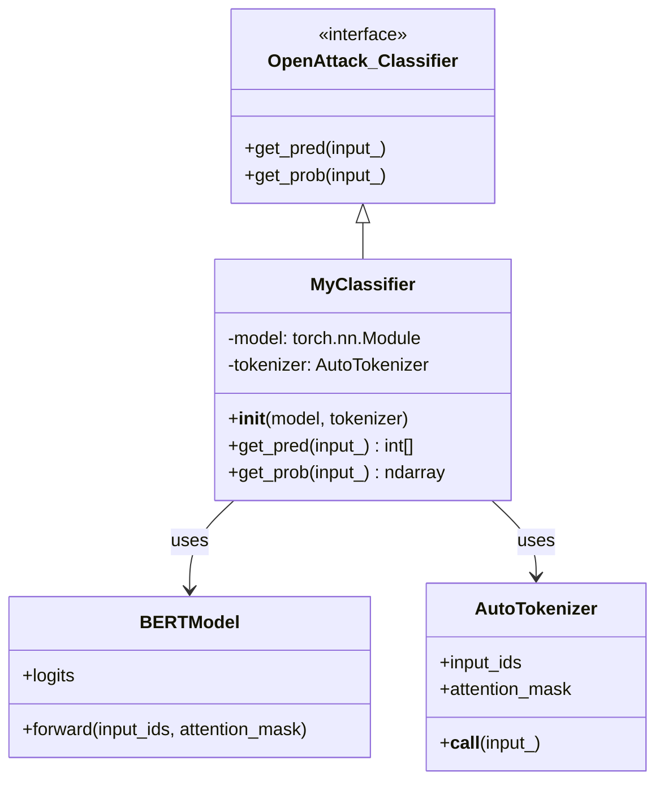
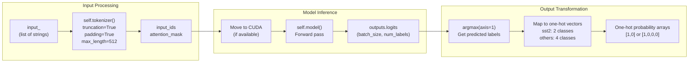
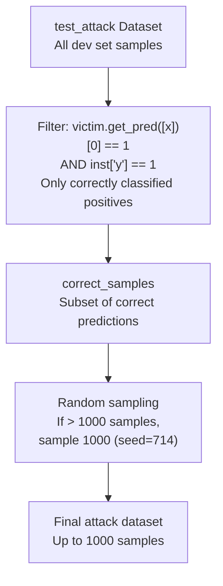
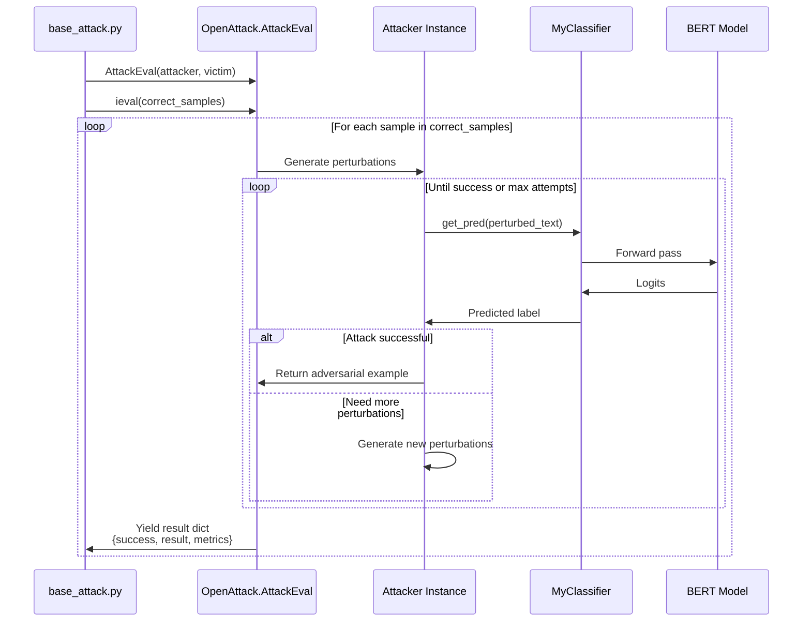
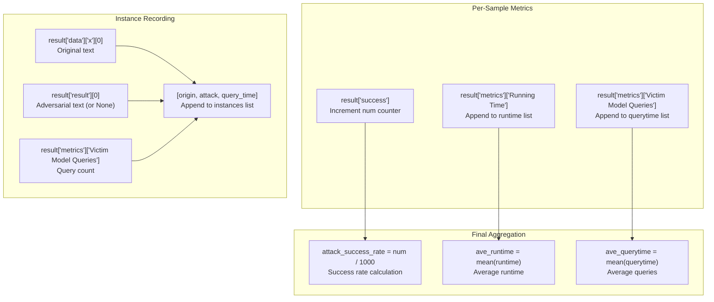
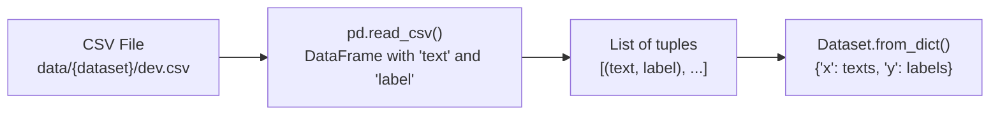

<!-- source: DeepWiki mcp.deepwiki.com · repo thunlp/Advbench · page 3.4 OpenAttack Integration · fetched 2026-11-02 -->

# OpenAttack Integration

<details>
<summary>Relevant source files</summary>

The following files were used as context for generating this wiki page:

- [src/base_attack.py](src/base_attack.py)

</details>


## Purpose and Scope

This document explains how Advbench integrates with the OpenAttack framework to provide baseline adversarial attack methods for comparison against ROCKET. The integration is implemented in [src/base_attack.py]() and serves as the foundation for the baseline attack pipeline.

For information about the baseline attack pipeline workflow, see [Baseline Attack Pipeline](#2.2). For details about ROCKET's custom implementation, see [ROCKET Implementation](#3.5). For the catalog of all attack methods and their characteristics, see [Attack Method Catalog](#5.2).

**Sources:** [src/base_attack.py:1-183]()

---

## System Architecture Overview

The OpenAttack integration consists of three main components: an adapter class that bridges the victim model to OpenAttack's interface, a registry of configured attackers, and an evaluation orchestrator that executes attacks and collects metrics.



**Diagram: OpenAttack Integration Architecture**

The system uses the Adapter pattern to make fine-tuned BERT models compatible with OpenAttack's interface requirements. The `MyClassifier` adapter wraps the model and tokenizer, providing standardized `get_pred()` and `get_prob()` methods that OpenAttack attackers expect.

**Sources:** [src/base_attack.py:48-76](), [src/base_attack.py:34-43](), [src/base_attack.py:150-154]()

---

## The MyClassifier Adapter

### Interface Implementation

The `MyClassifier` class [src/base_attack.py:48-76]() extends `OpenAttack.Classifier` to bridge the gap between Advbench's fine-tuned BERT models and OpenAttack's expected interface.



**Diagram: MyClassifier Adapter Pattern**

**Sources:** [src/base_attack.py:48-76]()

### Method Implementations

| Method | Purpose | Input | Output | Implementation Detail |
|--------|---------|-------|--------|----------------------|
| `__init__()` | Initialize adapter | `model`, `tokenizer` | None | Stores references to victim model and tokenizer |
| `get_pred()` | Get predicted labels | `input_` (list of strings) | `ndarray` of int | Calls `get_prob()` and returns argmax along axis 1 |
| `get_prob()` | Get probability scores | `input_` (list of strings) | `ndarray` of floats | Tokenizes, runs model, maps logits to probability format |

**Sources:** [src/base_attack.py:48-76]()

### Probability Score Mapping

The `get_prob()` method [src/base_attack.py:57-75]() performs a critical transformation to meet OpenAttack's expectations:



**Diagram: get_prob() Transformation Pipeline**

The method converts actual model logits into one-hot encoded probability arrays because OpenAttack expects probability distributions rather than raw logits. The special handling for `sst2` dataset [src/base_attack.py:69-72]() distinguishes between binary classification (2 classes) and multi-class tasks (4 classes).

**Sources:** [src/base_attack.py:57-75]()

---

## Attack Registry: attack_dict

### Registry Structure

The `attack_dict` dictionary [src/base_attack.py:34-43]() serves as a registry mapping attack method names to pre-configured OpenAttack attacker instances:

```python
attack_dict = {
    "pso": OpenAttack.attackers.PSOAttacker(),
    "textfoole": OpenAttack.attackers.TextFoolerAttacker(),
    "pwws": OpenAttack.attackers.PWWSAttacker(),
    "bert": OpenAttack.attackers.BERTAttacker(),
    "deep": OpenAttack.attackers.DeepWordBugAttacker(),
    "deep25": OpenAttack.attackers.DeepWordBugAttacker(power=25),
    "deep100": OpenAttack.attackers.DeepWordBugAttacker(power=100),
    "pso100": OpenAttack.attackers.PSOAttacker(max_iters=100)
}
```

**Sources:** [src/base_attack.py:34-43]()

### Available Attack Methods

| Key | Attacker Class | Configuration | Attack Strategy |
|-----|----------------|---------------|-----------------|
| `pso` | `PSOAttacker()` | Default parameters | Particle Swarm Optimization for word-level substitution |
| `textfoole` | `TextFoolerAttacker()` | Default parameters | Synonym replacement based on word importance |
| `pwws` | `PWWSAttacker()` | Default parameters | Probability Weighted Word Saliency |
| `bert` | `BERTAttacker()` | Default parameters | BERT Masked Language Model for substitution |
| `deep` | `DeepWordBugAttacker()` | `power=default` | Character-level perturbations (default power) |
| `deep25` | `DeepWordBugAttacker()` | `power=25` | Character-level perturbations (25 operations) |
| `deep100` | `DeepWordBugAttacker()` | `power=100` | Character-level perturbations (100 operations) |
| `pso100` | `PSOAttacker()` | `max_iters=100` | PSO with increased iteration limit |

The registry includes configuration variants for `DeepWordBugAttacker` (different `power` values) and `PSOAttacker` (different `max_iters`) to enable comparative analysis of parameter sensitivity.

**Sources:** [src/base_attack.py:34-43]()

### Attacker Selection

At runtime, the attacker is selected from the registry using the command-line argument:

```python
attacker_name = args.attacker  # e.g., "pwws", "pso", "bert"
attacker = attack_dict[attacker_name]  # Line 143
```

**Sources:** [src/base_attack.py:94](), [src/base_attack.py:143]()

---

## Attack Execution Pipeline

### Sample Filtering

Before attack execution, the system filters the test dataset to include only samples that the victim model correctly classifies [src/base_attack.py:129-140]():



**Diagram: Sample Filtering Pipeline**

This filtering ensures attacks are evaluated only on samples the model can correctly classify, which is standard practice in adversarial robustness evaluation. The random sampling with fixed seed [src/base_attack.py:138-140]() ensures reproducibility when datasets exceed 1000 samples.

**Sources:** [src/base_attack.py:129-140]()

### AttackEval Orchestration

The `OpenAttack.AttackEval` class [src/base_attack.py:150-154]() orchestrates the attack execution:



**Diagram: Attack Execution Sequence**

The `ieval()` method [src/base_attack.py:157]() returns an iterator that yields results one sample at a time, enabling progress tracking via `tqdm` and memory-efficient processing.

**Sources:** [src/base_attack.py:150-168]()

### Result Structure

Each iteration yields a result dictionary with the following structure:

```python
result = {
    "success": bool,                    # Whether attack succeeded
    "data": {
        "x": [original_text],           # Original input text
        "y": label                      # True label
    },
    "result": [adversarial_text],      # Perturbed text (if success)
    "metrics": {
        "Running Time": float,          # Seconds elapsed
        "Victim Model Queries": int     # Number of model calls
    }
}
```

**Sources:** [src/base_attack.py:157-167]()

---

## Metrics Collection and Storage

### Metrics Aggregation

The system collects three primary metrics during attack execution [src/base_attack.py:145-176]():



**Diagram: Metrics Collection Flow**

**Sources:** [src/base_attack.py:145-176]()

### Output Format

Results are saved to CSV files with three columns [src/base_attack.py:179-183]():

| Column | Content | Description |
|--------|---------|-------------|
| `origin` | Original text | The unperturbed input text |
| `attack` | Adversarial text or `None` | The perturbed text if attack succeeded, otherwise `None` |
| `query_time` | Integer | Number of victim model queries for this sample |

Output file path format: `/output/{dataset_name}_{attacker_name}.csv`

Example: `/output/enron_pwws.csv`, `/output/CGFake_textfoole.csv`

**Sources:** [src/base_attack.py:179-183]()

---

## Implementation Details

### Tokenization Configuration

The tokenizer is configured with specific parameters for BERT compatibility [src/base_attack.py:58]():

```python
inputs = self.tokenizer(
    input_,
    return_tensors='pt',      # PyTorch tensors
    return_length=512,        # Note: should be max_length
    truncation=True,          # Truncate long sequences
    padding=True              # Pad short sequences
)
```

Note: The parameter `return_length=512` appears to be a typo; it should likely be `max_length=512` based on the Transformers library API.

**Sources:** [src/base_attack.py:58]()

### GPU Support

The implementation includes automatic GPU utilization [src/base_attack.py:60-61](), [src/base_attack.py:109-110]():

```python
# Move inputs to GPU if available
if torch.cuda.is_available():
    input_ids, attention_mask = input_ids.cuda(), attention_mask.cuda()

# Move model to GPU if available
if torch.cuda.is_available():
    model = model.cuda()
```

This ensures efficient inference during attack execution, which may query the model hundreds of times per sample.

**Sources:** [src/base_attack.py:60-61](), [src/base_attack.py:109-110]()

### Data Loading

The system loads test data from CSV files using the `load_data()` function [src/base_attack.py:24-30]():



**Diagram: Data Loading Pipeline**

The conversion from tuples to a Hugging Face `Dataset` object [src/base_attack.py:120]() enables compatibility with OpenAttack's expected data format.

**Sources:** [src/base_attack.py:24-30](), [src/base_attack.py:114-120]()

### SSL Configuration

The script includes SSL certificate verification bypass [src/base_attack.py:16-17]():

```python
import ssl
ssl._create_default_https_context = ssl._create_unverified_context
```

This is necessary to handle SSL certificate issues when OpenAttack downloads pre-trained models or resources during attack execution.

**Sources:** [src/base_attack.py:16-17]()

---

## Command-Line Interface

### Required Arguments

| Argument | Default | Description | Example |
|----------|---------|-------------|---------|
| `--model_path` | `ag_newsbert-base-uncased` | Model identifier (overridden by code) | N/A |
| `--dataset` | `ag_news` | Dataset name from the 10 available datasets | `enron`, `CGFake`, `jigsaw` |
| `--bert_type` | `bert-base-uncased` | Pre-trained BERT model type | `bert-base-uncased` |
| `--attacker` | `pwws` | Attack method key from `attack_dict` | `pso`, `textfoole`, `bert`, `deep25` |

Note: The `--model_path` argument is overridden by the code [src/base_attack.py:105-106](), which loads models from `/model/{dataset_name}`.

**Sources:** [src/base_attack.py:83-101]()

### Usage Example

```bash
python src/base_attack.py \
    --dataset enron \
    --attacker pwws \
    --bert_type bert-base-uncased
```

This command loads the fine-tuned model from `/model/enron`, runs the PWWS attacker on correctly classified samples from the enron dev set, and saves results to `/output/enron_pwws.csv`.

**Sources:** [src/base_attack.py:82-183]()

---

## Integration with Baseline Attack Pipeline

The OpenAttack integration is invoked by the baseline attack shell script [scripts/base_attack.sh](), which iterates over all dataset-attacker combinations:

```bash
for attacker in pso textfoole pwws bert deep deep25 deep100 pso100
do
    for name in LUN satnews amazon_lb CGFake HSOL jigsaw EDENCE FAS assassin enron
    do
        python src/base_attack.py --dataset $name --attacker $attacker
    done
done
```

This produces a comprehensive evaluation matrix of 80 attack scenarios (10 datasets × 8 attackers), enabling systematic comparison between different attack methods and datasets. For the complete baseline attack workflow, see [Baseline Attack Pipeline](#2.2).

**Sources:** [src/base_attack.py:1-183]()

---

