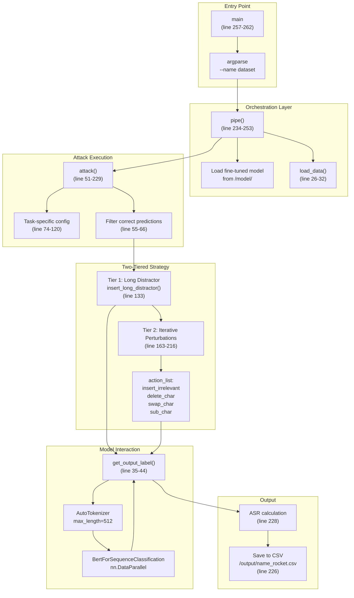
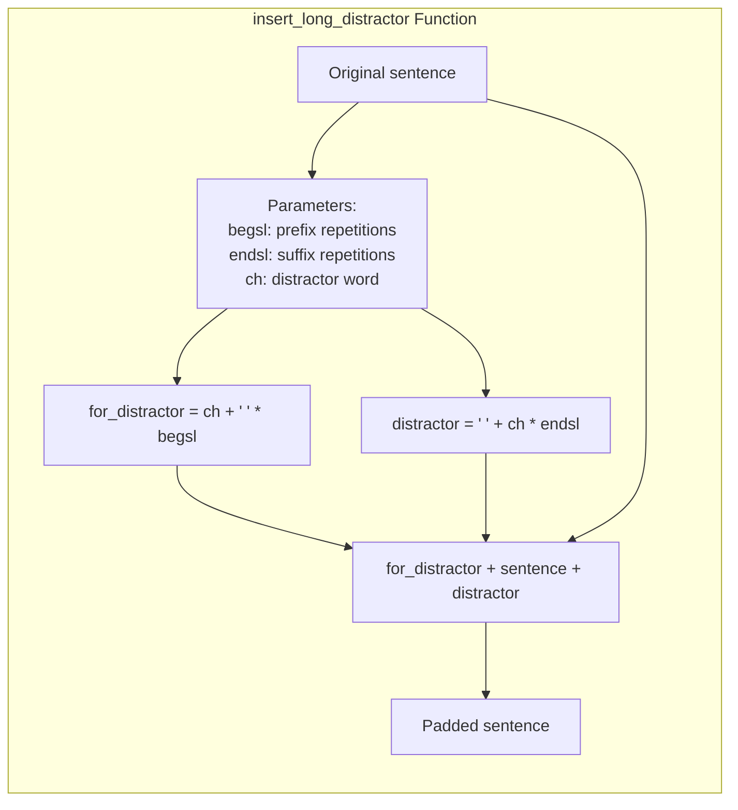
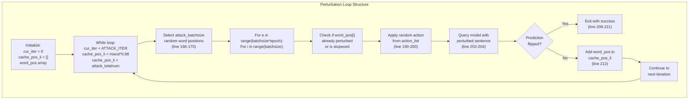
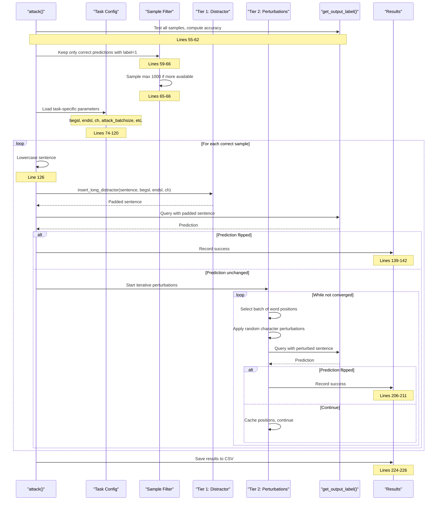
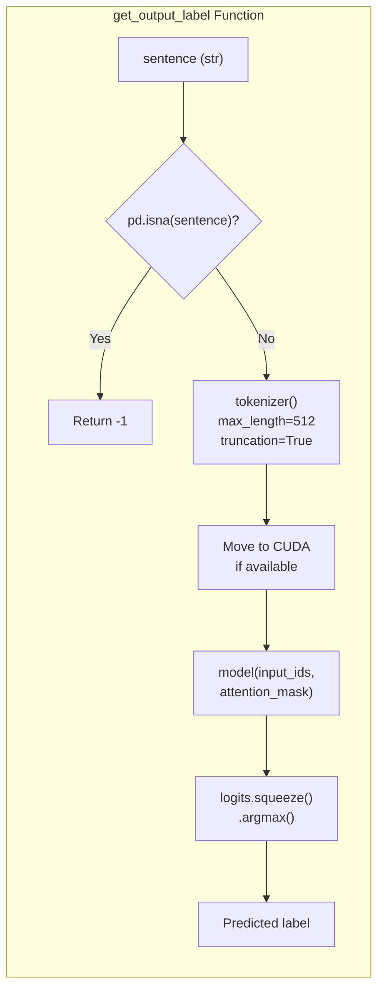
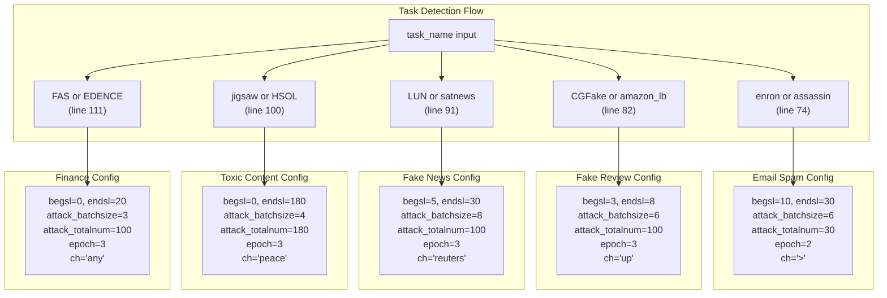
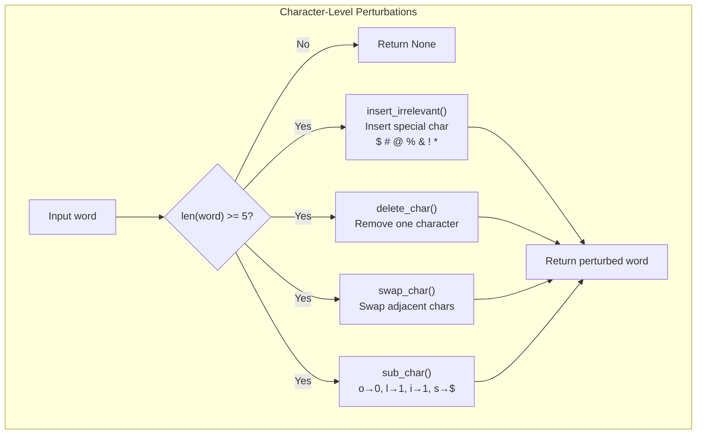
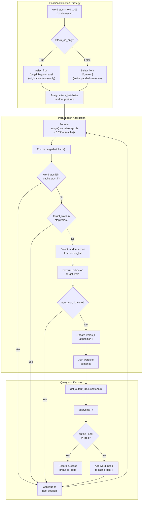
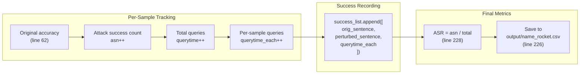
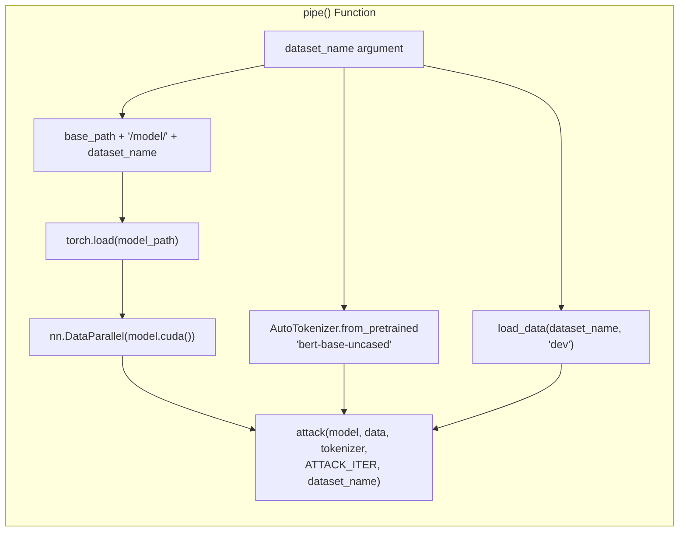

<!-- source: DeepWiki mcp.deepwiki.com · repo thunlp/Advbench · page 3.5 ROCKET Implementation · fetched 2026-11-02 -->

# ROCKET Implementation

<details>
<summary>Relevant source files</summary>

The following files were used as context for generating this wiki page:

- [src/attack_util.py](src/attack_util.py)
- [src/rocket.py](src/rocket.py)

</details>


This document provides a technical deep dive into the ROCKET (Rule-based Optimized Character-level Knowledge-Enhanced Textual) attack algorithm. ROCKET implements a heuristic-based adversarial attack method that uses practical, interpretable perturbations to evaluate model robustness on security tasks.

For information about the attack utility functions used by ROCKET, see [Attack Utilities](#3.2). For the overall ROCKET attack pipeline and how to run experiments, see [ROCKET Attack Pipeline](#2.3). For baseline attack methods using OpenAttack, see [OpenAttack Integration](#3.4).

## Purpose and Scope

ROCKET is designed as an alternative to complex optimization-based adversarial attacks. It employs a two-tiered strategy:
1. **Long distractor insertion** to simulate real-world content padding
2. **Iterative character-level perturbations** to evade detection while maintaining semantic meaning

This document covers the algorithm implementation in [src/rocket.py]() and its interaction with perturbation utilities in [src/attack_util.py]().

**Sources:** [src/rocket.py:1-264]()

## System Architecture

### ROCKET Pipeline Overview



**Sources:** [src/rocket.py:234-262](), [src/rocket.py:51-229]()

## Two-Tiered Attack Strategy

ROCKET implements a sequential two-tiered approach to adversarial perturbation, combining content padding with character-level modifications.

### Tier 1: Long Distractor Insertion

The first tier inserts repetitive "distractor" text at the beginning and end of the input sentence. This simulates real-world attack scenarios where adversaries pad content to evade detection systems.



Implementation details:
- **Function:** `insert_long_distractor()` in [src/attack_util.py:4-16]()
- **Invocation:** [src/rocket.py:133]()
- **Query:** Immediately queries model with padded sentence [src/rocket.py:135-142]()
- **Early exit:** If padding alone flips the prediction, attack succeeds without further perturbations

**Task-specific distractor examples:**
- `enron`/`assassin`: `ch=">"`, `begsl=10`, `endsl=30` → adds 10 ">" before and 30 ">" after
- `CGFake`/`amazon_lb`: `ch="up"`, `begsl=3`, `endsl=8` → adds 3 "up" before and 8 "up" after
- `jigsaw`/`HSOL`: `ch="peace"`, `begsl=0`, `endsl=180` → adds 180 "peace" after only

**Sources:** [src/attack_util.py:4-16](), [src/rocket.py:133-142]()

### Tier 2: Iterative Character-Level Perturbations

If the long distractor fails to fool the model, ROCKET proceeds to iteratively apply character-level perturbations to words in the sentence. This tier uses a batch-based random search strategy.



**Sources:** [src/rocket.py:144-216]()

## Attack Algorithm Flow

### Main Attack Function

The `attack()` function orchestrates the complete adversarial attack process on a dataset.

**Function signature:** `attack(model, orig_test, tokenizer, ATTACK_ITER, task_name)`

**Parameters:**
| Parameter | Type | Description |
|-----------|------|-------------|
| `model` | `nn.Module` | Fine-tuned BERT model |
| `orig_test` | `list[(str, int)]` | Test dataset (text, label) tuples |
| `tokenizer` | `AutoTokenizer` | BERT tokenizer |
| `ATTACK_ITER` | `int` | Maximum attack iterations (default: 550) |
| `task_name` | `str` | Dataset name for config selection |

**Execution flow:**



**Sources:** [src/rocket.py:51-229]()

### Model Query Mechanism

The `get_output_label()` function provides the interface for querying the victim model.



**Key characteristics:**
- Handles `NaN` inputs gracefully [src/rocket.py:36-37]()
- Enforces 512 token maximum with truncation [src/rocket.py:38]()
- Returns argmax over logits (predicted class) [src/rocket.py:43]()
- Increments global query counter on each call [src/rocket.py:136](), [src/rocket.py:203]()

**Sources:** [src/rocket.py:35-44]()

## Task-Specific Configuration System

ROCKET uses different attack parameters for different security tasks to optimize effectiveness. The configuration system maps dataset names to parameter sets.

### Configuration Parameters

| Parameter | Type | Description |
|-----------|------|-------------|
| `begsl` | `int` | Number of prefix distractor repetitions |
| `endsl` | `int` | Number of suffix distractor repetitions |
| `ch` | `str` | Distractor word/character |
| `attack_batchsize` | `int` | Number of parallel word positions to perturb |
| `attack_totalnum` | `int` | Maximum total positions to perturb |
| `epoch` | `int` | Perturbation attempts per batch |
| `attack_ori_only` | `bool` | If True, only perturb original sentence words (not distractors) |

### Configuration Matrix



**Rationale for different configurations:**

- **Email spam** (`enron`, `assassin`): Short texts, moderate padding, smaller attack surface (30 positions)
- **Fake reviews** (`CGFake`, `amazon_lb`): Balanced padding, moderate batch size
- **Fake news** (`LUN`, `satnews`): Longer texts, larger batch size (8), domain-specific distractor ("reuters")
- **Toxic content** (`jigsaw`, `HSOL`): Very long texts (up to 180 tokens), small batch size (4), no prefix padding, benign distractor ("peace")
- **Financial** (`FAS`, `EDENCE`): Variable length, small batch size, generic distractor ("any")

**Sources:** [src/rocket.py:74-120]()

## Perturbation Function Reference

ROCKET uses four primary character-level perturbation functions from [src/attack_util.py]().

### Function Specifications



### Detailed Function Behavior

#### insert_irrelevant()

**Purpose:** Insert a special character into a word to create a typo-like perturbation.

**Implementation:** [src/attack_util.py:40-51]()

**Algorithm:**
1. Check word length ≥ 5 (return `None` if shorter)
2. Select random insertion position from range [1, len-1]
3. Choose random character from pool: `['$', '#', '@', '%', '&', '!', '*']`
4. Insert character at position: `word[:pos] + char + word[pos:]`

**Example:** `"foolish"` → `"fool#ish"`

#### delete_char()

**Purpose:** Delete a single character from a word to simulate typo.

**Implementation:** [src/attack_util.py:53-59]()

**Algorithm:**
1. Check word length ≥ 5 (return `None` if shorter)
2. Select random deletion position from range [1, len-1]
3. Remove character: `word[:pos] + word[pos+1:]`

**Example:** `"foolish"` → `"folish"`

#### swap_char()

**Purpose:** Swap two adjacent characters to simulate transposition error.

**Implementation:** [src/attack_util.py:63-71]()

**Algorithm:**
1. Check word length ≥ 5 (return `None` if shorter)
2. Select random position from range [1, len-2]
3. Swap characters at position and position+1: `word[:pos] + word[pos+1] + word[pos] + word[pos+2:]`

**Example:** `"foolish"` → `"foolsih"`

#### sub_char()

**Purpose:** Substitute characters with visually similar alternatives.

**Implementation:** [src/attack_util.py:78-108]()

**Algorithm:**
1. Check word length ≥ 5 (return `None` if shorter)
2. Define substitution dictionary: `{'o': '0', 'l': '1', 'i': '1', 's': '$'}`
3. Shuffle substitution candidate list
4. Find first character in word that can be substituted
5. Replace all occurrences of that character

**Example:** `"foolish"` → `"f00lish"` (o→0)

**Sources:** [src/attack_util.py:40-108]()

## Iterative Perturbation Strategy

The iterative perturbation loop implements a parallel batch-based search to efficiently find adversarial examples.

### Batch-Based Random Search



**Key implementation details:**

1. **Position caching:** [src/rocket.py:145](), [src/rocket.py:213]()
   - Prevents re-perturbing the same word position
   - Cache checked before each perturbation attempt [src/rocket.py:181]()

2. **Stopword filtering:** [src/rocket.py:52](), [src/rocket.py:186]()
   - Uses NLTK English stopword list
   - Skips perturbation if target word is a stopword
   - Preserves grammatical structure

3. **Batch parallelization:** [src/rocket.py:166-170]()
   - Selects multiple positions (`attack_batchsize`) per iteration
   - Each position gets perturbed independently
   - Single query after batch application

4. **Epoch multiplication:** [src/rocket.py:173]()
   - `batchsize * epoch + 0.05 * len(cache)` total attempts
   - Increases perturbation density as more positions cached
   - Balances exploration vs exploitation

5. **Convergence criteria:** [src/rocket.py:163]()
   - Stop when `cur_iter >= ATTACK_ITER`
   - Stop when `cache_pos_li >= maxsl * 0.98` (98% of words perturbed)
   - Stop when `cache_pos_li >= attack_totalnum` (task-specific limit)

**Sources:** [src/rocket.py:144-216]()

## Attack Success Tracking

ROCKET tracks attack metrics throughout execution and saves detailed results.

### Metrics Collection



**Output CSV format:**

| Column | Description |
|--------|-------------|
| `origin` | Original sentence text |
| `attack` | Adversarially perturbed sentence |
| `querytime` | Number of model queries for this sample |

**Console output:**
- Original accuracy on test set [src/rocket.py:62]()
- Attack success notifications after each successful attack [src/rocket.py:47-48](), [src/rocket.py:208]()
- Cumulative ASR after each success [src/rocket.py:48]()
- Final total query count [src/rocket.py:222]()
- Final success count [src/rocket.py:223]()
- Final ASR [src/rocket.py:228]()

**Sources:** [src/rocket.py:47-48](), [src/rocket.py:62](), [src/rocket.py:222-228]()

## Integration with Training Pipeline

ROCKET operates on fine-tuned BERT models produced by the training pipeline.

### Model Loading



**Model expectations:**
- Pre-trained: `bert-base-uncased` [src/rocket.py:236]()
- Fine-tuned: Task-specific model from training pipeline [src/rocket.py:239]()
- Device: Multi-GPU via `nn.DataParallel` if CUDA available [src/rocket.py:240-241]()
- Format: PyTorch state dict saved by `torch.save()` in training script

**Data expectations:**
- Format: CSV with `text` and `label` columns [src/PackDataset.py]()
- Split: Uses `dev.csv` (development/test set) [src/rocket.py:247]()
- Labels: Integer class labels matching training data

**Sources:** [src/rocket.py:234-253]()

## Command-Line Interface

ROCKET is invoked via command-line arguments parsed by `argparse`.

**Usage:**
```bash
python src/rocket.py --name <dataset_name>
```

**Arguments:**

| Argument | Type | Default | Description |
|----------|------|---------|-------------|
| `--name` | `str` | `'amazon_lb'` | Dataset name for attack |

**Example invocations:**
```bash
python src/rocket.py --name enron
python src/rocket.py --name CGFake
python src/rocket.py --name jigsaw
```

**Internal parameters:**
- `ATTACK_ITER`: Fixed at 550 in main [src/rocket.py:262]()
- Task-specific parameters: Determined by `task_name` branching [src/rocket.py:74-120]()

**Sources:** [src/rocket.py:257-262]()

## Performance Characteristics

### Computational Complexity

**Per-sample complexity:**
- **Best case:** O(1) - long distractor immediately flips prediction
- **Average case:** O(k × b × e) where:
  - k = number of outer loop iterations
  - b = `attack_batchsize`
  - e = `epoch`
- **Worst case:** O(`ATTACK_ITER` × `attack_batchsize` × `epoch`)

**Query efficiency:**
- Minimum queries per sample: 1 (distractor only)
- Maximum queries per sample: Bounded by convergence criteria
- Average queries: Task-dependent, reported in output CSV

### Memory Requirements

- **Model:** Fine-tuned BERT (~110M parameters)
- **Cache:** `cache_pos_li` grows up to `min(maxsl*0.98, attack_totalnum)`
- **Batch:** Processes one sample at a time (not batched across samples)
- **GPU:** Multi-GPU supported via `nn.DataParallel`

### Parallelization Strategy

**Word-level parallelization:**
- Multiple word positions (`attack_batchsize`) perturbed in parallel
- All perturbations applied to single sentence copy
- Single model query per batch

**No sample-level parallelization:**
- Processes samples sequentially in for-loop [src/rocket.py:123]()
- Could be extended with multiprocessing for large-scale experiments

**Sources:** [src/rocket.py:163-216]()

## Comparison with Baseline Methods

ROCKET differs from OpenAttack baseline methods in several key aspects:

| Aspect | ROCKET | Baseline Methods (OpenAttack) |
|--------|--------|-------------------------------|
| **Strategy** | Two-tiered: distractor + character-level | Varied: word substitution, gradient-based |
| **Optimization** | Heuristic random search | Sophisticated (PSO, genetic, gradient) |
| **Perturbation type** | Character-level + padding | Primarily word-level |
| **Interpretability** | High (simple rules) | Low to medium |
| **Query efficiency** | Moderate | Often lower (complex search) |
| **Semantic preservation** | Weak (typos acceptable) | Strong (synonym substitution) |
| **Real-world simulation** | High (mimics actual attacks) | Low (imperceptible perturbations) |

**Design philosophy:**
- ROCKET prioritizes **practical attacker simulation** over imperceptibility
- Accepts visible perturbations (typos, padding) as realistic attack vectors
- Trades semantic preservation for attack effectiveness
- Emphasizes computational efficiency through simple heuristics

**Sources:** [src/rocket.py:1-264](), [src/base_attack.py:29-35]()

---

