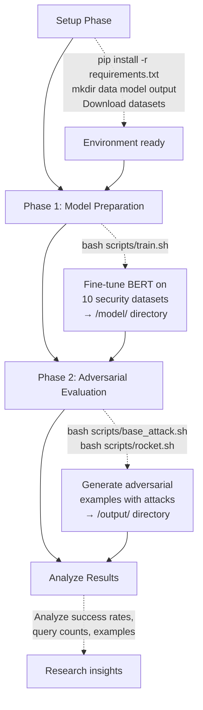
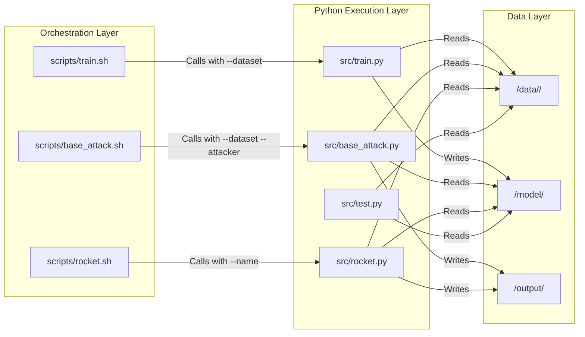
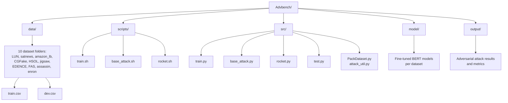

<!-- source: DeepWiki mcp.deepwiki.com · repo thunlp/Advbench · page 4 User Guide · fetched 2026-11-02 -->

# User Guide

<details>
<summary>Relevant source files</summary>

The following files were used as context for generating this wiki page:

- [README.md](README.md)

</details>


This guide provides practical instructions for researchers using Advbench to conduct adversarial NLP experiments on security tasks. It covers the complete experimental workflow from setup through training, attacking, and evaluation.

**Scope**: This page provides an overview of the user-facing experimental workflows. For detailed instructions on specific tasks, see:
- Initial setup and installation: [Getting Started](#1.1)
- Detailed training procedures: [Running Training Experiments](#4.1)
- Detailed attack execution: [Running Attack Experiments](#4.2)
- Understanding output metrics: [Interpreting Results](#4.3)
- Advanced customization: [Customizing Experiments](#4.4)

For technical architecture details, see [Technical Architecture](#3).

## Quick Start Workflow

Advbench follows a two-phase experimental workflow: **model preparation** followed by **adversarial evaluation**. The system is designed to be used through bash orchestration scripts that automate execution across multiple datasets.



**Workflow: User Interaction with Advbench System**

**Sources**: [README.md:16-67]()

## Experimental Pipelines Overview

Advbench provides three main experimental pipelines, each orchestrated by a bash script that automates execution across datasets:

### Pipeline Mapping



**Pipeline: Script-to-Module Mapping and Data Flow**

The table below summarizes the three main experimental workflows:

| Pipeline | Script | Python Module | Purpose | Dataset Coverage | Output Location |
|----------|--------|---------------|---------|------------------|-----------------|
| **Training** | `scripts/train.sh` | `src/train.py` | Fine-tune BERT models on security tasks | 10 datasets | `/model/` |
| **Baseline Attacks** | `scripts/base_attack.sh` | `src/base_attack.py` | Evaluate 8 OpenAttack methods | 10 datasets × 8 attackers = 80 runs | `/output/` |
| **ROCKET Attacks** | `scripts/rocket.sh` | `src/rocket.py` | Evaluate heuristic-rule-based method | 10 datasets | `/output/` |
| **Evaluation** | Manual invocation | `src/test.py` | Test model accuracy | Any dataset | Console output |

**Sources**: [README.md:45-67](), [scripts/train.sh:1-6](), [scripts/base_attack.sh:1-7](), [scripts/rocket.sh:1-6]()

### 1. Model Training Pipeline

Fine-tunes pre-trained BERT models (`bert-base-uncased`) on each of the 10 security datasets.

**Command**:
```bash
bash scripts/train.sh
```

**What it does**: Loops through datasets (`LUN`, `satnews`, `amazon_lb`, `CGFake`, `HSOL`, `jigsaw`, `EDENCE`, `FAS`, `assassin`, `enron`) and calls `src/train.py` for each with appropriate batch sizes.

**Output**: Fine-tuned models saved to `/model/{dataset}_model/`

**Sources**: [scripts/train.sh:1-6](), [README.md:51-55]()

### 2. Baseline Attack Pipeline

Evaluates model robustness using 8 attack methods from the OpenAttack framework.

**Command**:
```bash
bash scripts/base_attack.sh
```

**Attack methods evaluated**:
- `pwws` - Word saliency-based substitution
- `textfooler` - Synonym replacement with semantic similarity
- `pso` - Particle Swarm Optimization
- `bert` - BERT masked language model-based
- `deepwordbug` - Character-level perturbations
- `deepwordbuga` - DeepWordBug variant A
- `deepwordbugb` - DeepWordBug variant B
- `deepwordbugc` - DeepWordBug variant C

**What it does**: For each dataset and attacker combination (80 total runs), calls `src/base_attack.py` to generate adversarial examples.

**Output**: Attack results saved to `/output/{dataset}_{attacker}.txt`

**Sources**: [scripts/base_attack.sh:1-7](), [README.md:57-61]()

### 3. ROCKET Attack Pipeline

Evaluates the proposed ROCKET method using heuristic-rule-based character-level perturbations.

**Command**:
```bash
bash scripts/rocket.sh
```

**What it does**: For each dataset, calls `src/rocket.py` with task-specific perturbation parameters (sentence length ranges, distractor characters, etc.).

**Perturbation techniques**:
- `insert_long_distractor` - Insert long sequences at sentence boundaries
- `delete_char` - Remove characters
- `swap_char` - Swap adjacent characters
- `sub_char` - Substitute characters
- `insert_irrelevant` - Insert irrelevant characters

**Output**: Attack results saved to `/output/attack_{dataset}.txt`

**Sources**: [scripts/rocket.sh:1-6](), [README.md:63-67]()

## Directory Structure and File System

The system organizes data and outputs into three main directories that must be created before running experiments:



**Diagram: Advbench File System Organization**

### Required Directory Setup

Before running any experiments, create the necessary directories:

```bash
cd Advbench
mkdir data model output
```

- **`/data/`**: Stores datasets in CSV format. Each dataset has a subdirectory containing `train.csv` and `dev.csv` files.
- **`/model/`**: Stores fine-tuned BERT models. Each dataset gets its own model subdirectory (e.g., `/model/CGFake_model/`).
- **`/output/`**: Stores adversarial attack results, including success rates, query counts, and adversarial examples.

**Sources**: [README.md:27-49]()

## Common Usage Patterns

### Pattern 1: Full Benchmark Evaluation

To run the complete benchmark (train all models, then run all attacks):

```bash
# Phase 1: Train models
bash scripts/train.sh

# Phase 2: Baseline attacks
bash scripts/base_attack.sh

# Phase 3: ROCKET attacks
bash scripts/rocket.sh
```

This executes:
- 10 training runs (one per dataset)
- 80 baseline attack runs (10 datasets × 8 attackers)
- 10 ROCKET attack runs (one per dataset)

**Expected time**: Several hours to days depending on hardware (GPU recommended).

**Sources**: [README.md:45-67]()

### Pattern 2: Single Dataset Workflow

To work with a specific dataset (e.g., `CGFake`):

```bash
# Train model
python src/train.py --name CGFake --batch_size 16 --epochs 8

# Test model accuracy
python src/test.py --name CGFake

# Run baseline attack (e.g., TextFooler)
python src/base_attack.py --dataset CGFake --attacker textfooler

# Run ROCKET attack
python src/rocket.py --name CGFake
```

**Sources**: [scripts/train.sh:4-6](), [scripts/base_attack.sh:4-7](), [scripts/rocket.sh:4-6]()

### Pattern 3: Comparing Attack Methods

To compare different attack methods on the same dataset:

```bash
# Run multiple baseline attacks
for attacker in pwws textfooler pso bert; do
    python src/base_attack.py --dataset CGFake --attacker $attacker
done

# Run ROCKET for comparison
python src/rocket.py --name CGFake

# Compare results in /output/
```

**Sources**: [scripts/base_attack.sh:4-7]()

## Command-Line Interface Overview

Each Python module accepts command-line arguments for configuration. The table below summarizes key parameters:

| Module | Key Arguments | Example |
|--------|---------------|---------|
| `train.py` | `--name` (dataset name)<br/>`--batch_size`<br/>`--epochs` | `python src/train.py --name CGFake --batch_size 16 --epochs 8` |
| `base_attack.py` | `--dataset` (dataset name)<br/>`--attacker` (attack method) | `python src/base_attack.py --dataset CGFake --attacker textfooler` |
| `rocket.py` | `--name` (dataset name) | `python src/rocket.py --name CGFake` |
| `test.py` | `--name` (dataset name) | `python src/test.py --name CGFake` |

For complete command-line reference, see [Command-Line Reference](#5.1).

**Sources**: [scripts/train.sh:6](), [scripts/base_attack.sh:7](), [scripts/rocket.sh:6]()

## Dataset-Specific Configurations

Different datasets require different batch sizes and attack parameters due to varying text lengths and computational requirements:

| Dataset | Training Batch Size | Task Domain | Notes |
|---------|---------------------|-------------|-------|
| `LUN` | 16-32 | Security | Variable batch size |
| `satnews` | 32 | News | Standard batch size |
| `amazon_lb` | 64 | Reviews | Larger batch supported |
| `CGFake` | 16 | Fake news detection | Memory-intensive |
| `HSOL` | 16 | Hate speech | Long texts |
| `jigsaw` | 16 | Toxic comments | Long texts |
| `EDENCE` | 16 | Security | Standard |
| `FAS` | 16 | Security | Standard |
| `assassin` | 16 | Security | Email-like |
| `enron` | 16 | Spam detection | Email-like |

**ROCKET attack parameters** are configured differently per dataset in [src/rocket.py:59-99]() based on task characteristics (e.g., email datasets use `begsl=10`, toxic comment datasets use `endsl=180`).

**Sources**: [scripts/train.sh:4-6](), [src/rocket.py:59-99]()

## Output Files and Results

After running experiments, the `/output/` directory contains:

### Training Outputs
- Model checkpoints: `/model/{dataset}_model/`
- Training logs: Console output with accuracy metrics

### Attack Outputs
- **Baseline attacks**: `/output/{dataset}_{attacker}.txt`
  - Attack success rate (ASR)
  - Average queries per successful attack
  - Runtime statistics
  - Adversarial examples (original vs perturbed)

- **ROCKET attacks**: `/output/attack_{dataset}.txt`
  - Attack success rate
  - Perturbation statistics
  - Adversarial examples

For detailed information on interpreting these results, see [Interpreting Results](#4.3).

**Sources**: [README.md:45-67]()

## Next Steps

This overview provides the foundation for using Advbench. For detailed instructions on specific tasks:

- **Setting up the environment**: [Getting Started](#1.1)
- **Training models**: [Running Training Experiments](#4.1)
- **Running attacks**: [Running Attack Experiments](#4.2)
- **Understanding results**: [Interpreting Results](#4.3)
- **Extending the system**: [Customizing Experiments](#4.4)

For technical details on the system architecture and implementation, see [Technical Architecture](#3).

**Sources**: [README.md:1-81]()

---

