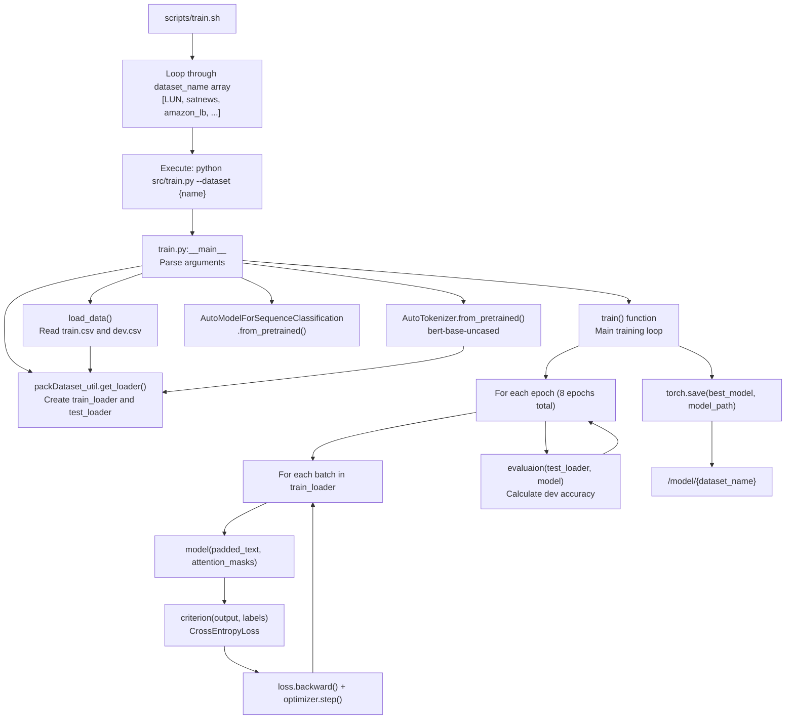
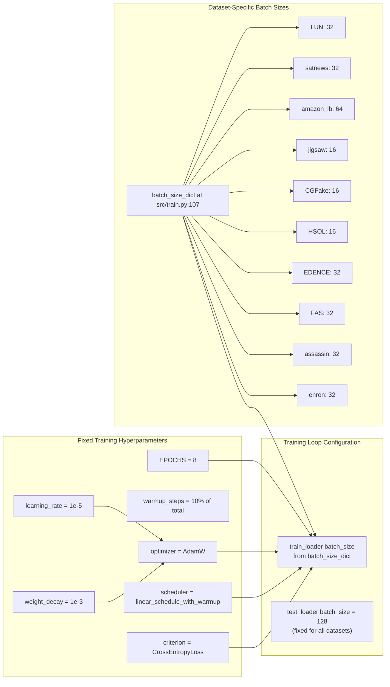
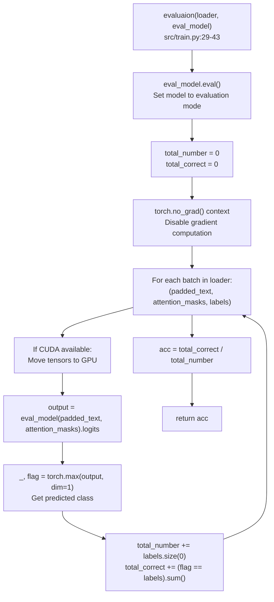
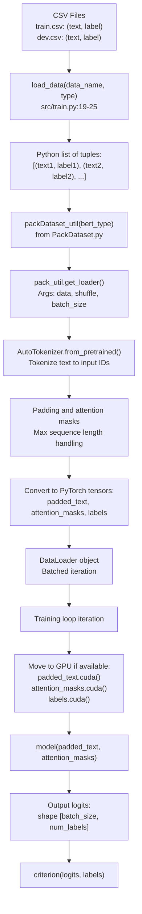

<!-- source: DeepWiki mcp.deepwiki.com · repo thunlp/Advbench · page 4.1 Running Training Experiments · fetched 2026-11-02 -->

# Running Training Experiments

<details>
<summary>Relevant source files</summary>

The following files were used as context for generating this wiki page:

- [README.md](README.md)
- [scripts/train.sh](scripts/train.sh)
- [src/train.py](src/train.py)

</details>


This page provides step-by-step instructions for fine-tuning BERT models on Advbench security datasets. It covers how to execute training runs, configure training parameters, monitor progress, and access trained models. For architectural details of the training system, see [Model Training Pipeline](#2.1). For technical implementation details, see [Model Training Details](#3.3). For complete command-line argument reference, see [Command-Line Reference](#5.1).

## Prerequisites

Before running training experiments, ensure the following setup is complete:

**Required Directories:**
```
Advbench/
├── data/          # Dataset storage (must exist)
├── model/         # Trained model output (must exist)
└── output/        # Attack results (created later)
```

**Dataset Availability:**
Training requires the Advbench datasets to be downloaded and extracted into `/data`. Each dataset should have the following structure:
```
data/
├── LUN/
│   ├── train.csv
│   └── dev.csv
├── satnews/
│   ├── train.csv
│   └── dev.csv
└── ... (8 more datasets)
```

Each CSV file must contain `text` and `label` columns. The `load_data()` function at [src/train.py:19-25]() reads these files and converts them into tuple format `(text, label)`.

**Python Environment:**
Install dependencies via `pip install -r requirements.txt`. Key libraries include:
- `transformers` (for BERT models and tokenizers)
- `torch` (PyTorch framework)
- `pandas` (CSV data loading)

**Sources:** [README.md:25-42](), [src/train.py:16-25]()

---

## Quick Start: Training All Datasets

The simplest way to train models on all 10 Advbench datasets is to execute the orchestration script:

```bash
bash scripts/train.sh
```

This script iterates through all datasets and trains a BERT model for each one. The complete dataset list is:

| Index | Dataset Name | Description |
|-------|--------------|-------------|
| 0 | LUN | Security task |
| 1 | satnews | Security task |
| 2 | amazon_lb | Security task |
| 3 | CGFake | Fake news detection |
| 4 | HSOL | Hate speech detection |
| 5 | jigsaw | Toxic comment detection |
| 6 | EDENCE | Security task |
| 7 | FAS | Security task |
| 8 | assassin | Security task |
| 9 | enron | Email spam detection |

The script executes sequentially, training one dataset at a time. Total execution time depends on dataset size and available GPU resources, typically ranging from several hours to a day for all 10 datasets.

**Sources:** [scripts/train.sh:1-8](), [README.md:51-55]()

---

## Training Execution Flow

The following diagram shows how the orchestration script invokes the training module and the data flow through the training process:

**Diagram: Training Script Execution and Data Flow**



**Key Execution Steps:**

1. **Script Initialization** [scripts/train.sh:2](): The bash script defines the `dataset_name` array containing all 10 dataset identifiers.

2. **Sequential Invocation** [scripts/train.sh:4-7](): A loop iterates from 0 to 9, calling `python src/train.py --dataset ${dataset_name[i]}` for each dataset.

3. **Argument Parsing** [src/train.py:90-105](): The training script accepts command-line arguments including `--dataset`, `--bert_type`, and `--labels`.

4. **Data Loading** [src/train.py:116-117](): The `load_data()` function reads CSV files from `/data/{dataset_name}/train.csv` and `/data/{dataset_name}/dev.csv`.

5. **Model Initialization** [src/train.py:111-114](): BERT tokenizer and model are loaded from Hugging Face. The model is wrapped with `nn.DataParallel` for multi-GPU support if CUDA is available.

6. **Data Preparation** [src/train.py:119-121](): The `packDataset_util` creates PyTorch DataLoaders with dataset-specific batch sizes from `batch_size_dict`.

7. **Training Loop** [src/train.py:47-86](): The `train()` function executes 8 epochs of training, evaluating on the dev set after each epoch and keeping the best model based on accuracy.

8. **Model Storage** [src/train.py:85-86](): The best-performing model is saved to `/model/{dataset_name}` using `torch.save()`.

**Sources:** [scripts/train.sh:1-8](), [src/train.py:47-86](), [src/train.py:89-126]()

---

## Training a Single Dataset

To train on a specific dataset instead of all 10, invoke the training script directly:

```bash
python src/train.py --dataset satnews
```

**Available Command-Line Arguments:**

| Argument | Type | Default | Description |
|----------|------|---------|-------------|
| `--dataset` | str | `'satnews'` | Dataset name (must match directory in `/data`) |
| `--bert_type` | str | `'bert-base-uncased'` | Pre-trained BERT model identifier from Hugging Face |
| `--labels` | int | `2` | Number of classification labels (binary classification by default) |

**Example: Training on Toxic Comment Detection**
```bash
python src/train.py --dataset jigsaw --labels 2
```

**Example: Using a Different BERT Variant**
```bash
python src/train.py --dataset CGFake --bert_type bert-large-uncased --labels 2
```

Note that changing `--bert_type` requires that the model is available on Hugging Face and compatible with `AutoModelForSequenceClassification`.

**Sources:** [src/train.py:90-105]()

---

## Hyperparameter Configuration

The training process uses fixed hyperparameters defined within the training script. These are not exposed as command-line arguments in the current implementation.

**Diagram: Hyperparameter Configuration Mapping**



**Core Hyperparameters:**

| Parameter | Value | Location | Notes |
|-----------|-------|----------|-------|
| `EPOCHS` | 8 | [src/train.py:106]() | Fixed for all datasets |
| Learning Rate | `1e-5` | [src/train.py:124]() | Passed to AdamW optimizer |
| Weight Decay | `1e-3` | [src/train.py:124]() | L2 regularization |
| Optimizer | `AdamW` | [src/train.py:124]() | Adaptive learning rate with weight decay |
| Warmup Steps | `0.1 * EPOCHS * len(train_loader)` | [src/train.py:125]() | 10% of total training steps |
| Loss Function | `CrossEntropyLoss` | [src/train.py:123]() | For multi-class classification |
| Dev Batch Size | 128 | [src/train.py:121]() | Fixed across all datasets |

**Dataset-Specific Batch Sizes:**

Training batch sizes are configured per dataset in the `batch_size_dict` at [src/train.py:107](). The batch size selection balances GPU memory constraints with convergence speed:

- **Smaller batches (16):** Used for datasets with longer texts or memory-intensive tasks (`jigsaw`, `CGFake`, `HSOL`)
- **Medium batches (32):** Standard size for most datasets (`LUN`, `satnews`, `EDENCE`, `FAS`, `assassin`, `enron`)
- **Larger batches (64):** Used for `amazon_lb` which likely has shorter texts or more GPU memory available

**Sources:** [src/train.py:106-125]()

---

## Monitoring Training Progress

The training script outputs progress information to the console during execution:

**Progress Output Format:**
```
Epoch 1/8:
[Progress bar from tqdm] - shows batch processing
finish training, avg_loss: 0.3456, begin to evaluate
finish evaluation, acc: 0.8234/0.0000
*************************************************************************************

Epoch 2/8:
[Progress bar from tqdm]
finish training, avg_loss: 0.2891, begin to evaluate
finish evaluation, acc: 0.8567/0.8234
*************************************************************************************

...

finish all, test acc: 0.8712
```

**Key Metrics Displayed:**

1. **Average Loss** [src/train.py:65-69](): Computed as `total_loss / len(train_loader)` after each epoch. The script checks if loss increases, printing `'loss rise'` if it does.

2. **Dev Accuracy** [src/train.py:70-71](): Calculated by the `evaluaion()` function on the dev set. Displayed as `current_acc/best_acc`.

3. **Best Model Tracking** [src/train.py:72-74](): If the current epoch's dev accuracy exceeds the previous best, the model is saved as `best_model` using `copy.deepcopy()`.

4. **Final Test Accuracy** [src/train.py:82-84](): After all epochs complete, the best model is evaluated on the test set (which uses the same dev.csv file in this implementation).

**Early Stopping:**
The training loop can be interrupted with `Ctrl+C` (KeyboardInterrupt), which triggers graceful shutdown [src/train.py:77-79]().

**Sources:** [src/train.py:47-86]()

---

## Understanding the Evaluation Process

The `evaluaion()` function (note the misspelling in the code) computes accuracy on a given dataset loader.

**Diagram: Evaluation Function Flow**



**Key Implementation Details:**

1. **Evaluation Mode** [src/train.py:30](): `eval_model.eval()` disables dropout and batch normalization updating.

2. **No Gradient Computation** [src/train.py:33](): The `with torch.no_grad()` context prevents gradient calculation, reducing memory usage.

3. **Prediction Extraction** [src/train.py:38](): `torch.max(output, dim=1)` returns both the maximum value and its index (predicted class).

4. **Accuracy Calculation** [src/train.py:42](): Simple fraction of correct predictions over total samples.

This function is called twice per epoch: once for dev accuracy during training, and once for final test accuracy.

**Sources:** [src/train.py:29-43]()

---

## Model Storage and Output

Trained models are saved as PyTorch model files in the `/model` directory.

**Model File Naming Convention:**
```
model/
├── LUN              # PyTorch model file (no extension)
├── satnews
├── amazon_lb
├── jigsaw
├── CGFake
├── HSOL
├── EDENCE
├── FAS
├── assassin
└── enron
```

**Model Saving Implementation:**
```python
model_path = base_path + "/model/"
torch.save(best_model, model_path + dataset_name)
```
[src/train.py:85-86]()

**What is Saved:**
The entire model object is saved using `torch.save()`, including:
- Model architecture (BERT with classification head)
- Trained weights for all layers
- Model configuration

If using `nn.DataParallel` (multi-GPU), the saved model includes the parallel wrapper.

**Loading Trained Models:**
To load a saved model for attacks or evaluation:
```python
model = torch.load('model/satnews')
```

The attack scripts [src/base_attack.py]() and [src/rocket.py]() use this approach to load fine-tuned models.

**Sources:** [src/train.py:85-86](), [README.md:45-49]()

---

## Data Flow Through Training Pipeline

This diagram shows how data is transformed from CSV files through tokenization, batching, and model processing:

**Diagram: Data Transformation Pipeline**



**Transformation Stages:**

1. **CSV Parsing** [src/train.py:19-25](): `pd.read_csv()` loads CSV files, then `load_data()` converts each row to a `(text, label)` tuple.

2. **Tokenization & Batching** [src/train.py:119-121](): The `packDataset_util` (detailed in [Data Processing System](#3.1)) handles:
   - Text tokenization using BERT tokenizer
   - Padding sequences to uniform length
   - Creating attention masks
   - Batching into DataLoader

3. **GPU Transfer** [src/train.py:56-57](): Before each forward pass, tensors are moved to GPU with `.cuda()` if available.

4. **Model Forward Pass** [src/train.py:58](): The model processes `(padded_text, attention_masks)` and returns logits.

5. **Loss Computation** [src/train.py:59](): CrossEntropyLoss compares logits with true labels.

**Sources:** [src/train.py:19-25](), [src/train.py:55-62](), [src/train.py:119-121]()

---

## Verifying Training Success

After training completes, verify the process was successful:

**1. Check Model Files Exist:**
```bash
ls -lh model/
```
Expected output: 10 model files, one per dataset. File sizes typically range from 400MB to 500MB for `bert-base-uncased`.

**2. Verify Training Output:**
Look for the final line in console output:
```
finish all, test acc: 0.XXXX
```
Accuracy above 0.80 (80%) indicates successful training for most security tasks.

**3. Check for Error Messages:**
Common issues include:
- `FileNotFoundError`: Dataset not found in `/data` directory
- `CUDA out of memory`: Reduce batch size in `batch_size_dict`
- `KeyError`: Dataset name not in `batch_size_dict`

**4. Model Loading Test:**
Test that saved models can be loaded:
```python
import torch
model = torch.load('model/satnews')
print(type(model))  # Should show: <class 'torch.nn.parallel.data_parallel.DataParallel'>
```

**Sources:** [src/train.py:82-86]()

---

## Common Issues and Troubleshooting

### Issue: Dataset Not Found

**Error Message:**
```
FileNotFoundError: [Errno 2] No such file or directory: './data/satnews/train.csv'
```

**Solution:**
Ensure datasets are extracted to the correct location:
```bash
ls data/satnews/
# Should show: train.csv  dev.csv
```

**Sources:** [src/train.py:19-25]()

---

### Issue: CUDA Out of Memory

**Error Message:**
```
RuntimeError: CUDA out of memory. Tried to allocate X.XX GiB
```

**Solution:**
Reduce batch size for the problematic dataset in `batch_size_dict` at [src/train.py:107](). For example, change:
```python
'jigsaw': 16  # Original
'jigsaw': 8   # Reduced
```

Note: This requires modifying the source code, as batch sizes are not exposed as command-line arguments.

---

### Issue: Model Already Exists

**Behavior:**
The training script overwrites existing model files without warning.

**Solution:**
To preserve existing models, back them up before retraining:
```bash
mkdir model_backup
cp model/* model_backup/
```

**Sources:** [src/train.py:85-86]()

---

### Issue: Training Takes Too Long

**Expected Duration:**
- Single dataset: 30 minutes to 2 hours (depending on size and GPU)
- All 10 datasets: 5-20 hours total

**Optimization Options:**
1. Use more GPUs: The code supports multi-GPU via `nn.DataParallel` [src/train.py:114]()
2. Reduce epochs: Modify `EPOCHS = 8` to a lower value (requires source code change)
3. Train specific datasets only: Use direct invocation instead of the bash script

---

## Next Steps

After training models, proceed to:
- **[Running Attack Experiments](#4.2)**: Execute adversarial attacks on trained models
- **[Model Evaluation](#2.4)**: Test model accuracy on clean data using `src/test.py`
- **[Interpreting Results](#4.3)**: Analyze attack success rates and model robustness

For advanced users:
- **[Customizing Experiments](#4.4)**: Add new datasets or modify training configurations
- **[Model Training Details](#3.3)**: Deep dive into training loop implementation and optimizer configuration

**Sources:** [README.md:43-67]()

---

