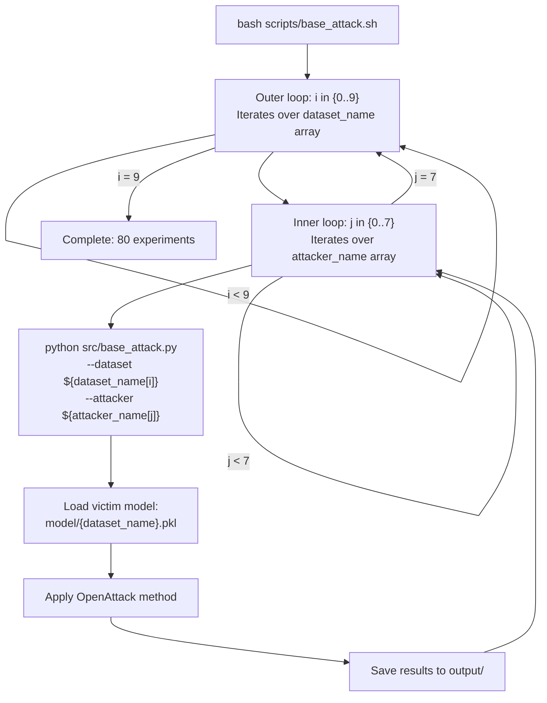
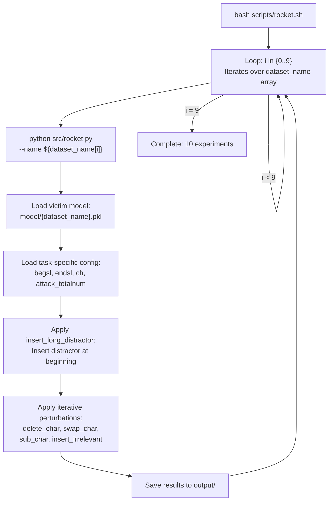
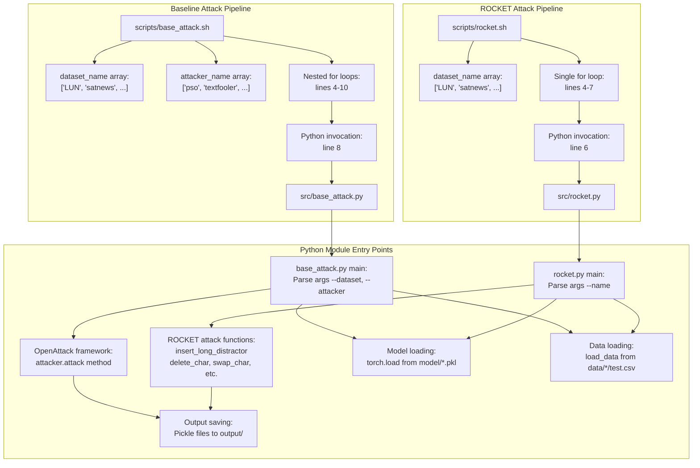
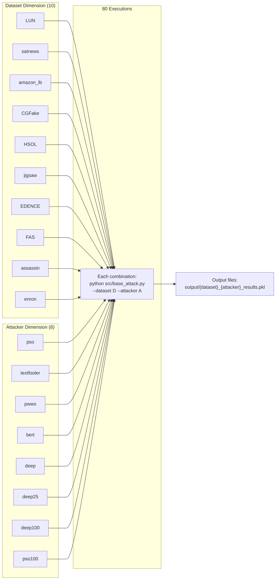

<!-- source: DeepWiki mcp.deepwiki.com · repo thunlp/Advbench · page 4.2 Running Attack Experiments · fetched 2026-11-02 -->

# Running Attack Experiments

<details>
<summary>Relevant source files</summary>

The following files were used as context for generating this wiki page:

- [README.md](README.md)
- [scripts/base_attack.sh](scripts/base_attack.sh)
- [scripts/rocket.sh](scripts/rocket.sh)

</details>


## Purpose and Scope

This page provides step-by-step instructions for executing adversarial attack experiments in Advbench. It covers both baseline attacks (using the OpenAttack framework) and ROCKET attacks (using the proposed heuristic-based method). This page assumes you have already completed model training as described in [Running Training Experiments](#4.1). For guidance on understanding attack results and metrics, see [Interpreting Results](#4.3).

**Sources:** [README.md:57-67]()

---

## Prerequisites

Before running attack experiments, ensure you have:

1. **Completed model training**: Fine-tuned models must exist in the `/model/` directory for each dataset you plan to attack
2. **Created output directory**: Run `mkdir output` if not already created
3. **Data available**: Datasets must be present in `/data/` directory
4. **Environment ready**: All dependencies from `requirements.txt` installed

Attack experiments require pre-trained victim models because the attacks attempt to generate adversarial examples that fool these models. The system will load models from paths like `model/{dataset_name}.pkl`.

**Sources:** [README.md:45-49](), [README.md:51-55]()

---

## Baseline Attack Experiments

Baseline attacks evaluate 8 traditional adversarial NLP methods from the OpenAttack framework across all 10 Advbench datasets, creating a comprehensive evaluation matrix.

### Attack Matrix

The baseline pipeline executes **80 attack configurations** (10 datasets × 8 attackers):

| Dataset | pso | textfooler | pwws | bert | deep | deep25 | deep100 | pso100 |
|---------|-----|------------|------|------|------|--------|---------|--------|
| LUN | ✓ | ✓ | ✓ | ✓ | ✓ | ✓ | ✓ | ✓ |
| satnews | ✓ | ✓ | ✓ | ✓ | ✓ | ✓ | ✓ | ✓ |
| amazon_lb | ✓ | ✓ | ✓ | ✓ | ✓ | ✓ | ✓ | ✓ |
| CGFake | ✓ | ✓ | ✓ | ✓ | ✓ | ✓ | ✓ | ✓ |
| HSOL | ✓ | ✓ | ✓ | ✓ | ✓ | ✓ | ✓ | ✓ |
| jigsaw | ✓ | ✓ | ✓ | ✓ | ✓ | ✓ | ✓ | ✓ |
| EDENCE | ✓ | ✓ | ✓ | ✓ | ✓ | ✓ | ✓ | ✓ |
| FAS | ✓ | ✓ | ✓ | ✓ | ✓ | ✓ | ✓ | ✓ |
| assassin | ✓ | ✓ | ✓ | ✓ | ✓ | ✓ | ✓ | ✓ |
| enron | ✓ | ✓ | ✓ | ✓ | ✓ | ✓ | ✓ | ✓ |

Each cell represents one execution of `src/base_attack.py` with specific `--dataset` and `--attacker` parameters.

**Sources:** [scripts/base_attack.sh:2-3](), [scripts/base_attack.sh:4-10]()

### Running Baseline Attacks

To execute all 80 baseline attack configurations:

```bash
bash scripts/base_attack.sh
```

This script performs a nested loop over datasets and attackers. The execution can take several hours depending on hardware and dataset sizes.

**Execution Flow:**



**Sources:** [scripts/base_attack.sh:1-11]()

### Command-Line Arguments for base_attack.py

To run a single baseline attack experiment manually:

```bash
python src/base_attack.py --dataset <dataset_name> --attacker <attacker_name>
```

**Key arguments:**

- `--dataset`: Dataset name from: `LUN`, `satnews`, `amazon_lb`, `CGFake`, `HSOL`, `jigsaw`, `EDENCE`, `FAS`, `assassin`, `enron`
- `--attacker`: Attack method from: `pso`, `textfooler`, `pwws`, `bert`, `deep`, `deep25`, `deep100`, `pso100`

The script will:
1. Load the victim model from `model/{dataset_name}.pkl`
2. Load test data from `data/{dataset_name}/test.csv`
3. Initialize the specified OpenAttack attacker
4. Generate adversarial examples by attacking the victim model
5. Save results including attack success rate, query counts, and adversarial examples

**Sources:** [scripts/base_attack.sh:8](), [README.md:57-61]()

---

## ROCKET Attack Experiments

ROCKET (the proposed heuristic-rule-based attack method) uses task-specific character-level perturbations to simulate practical real-world attacks. Unlike baseline attacks, ROCKET is executed once per dataset with dataset-specific configurations.

### Running ROCKET Attacks

To execute ROCKET attacks on all 10 datasets:

```bash
bash scripts/rocket.sh
```

This executes 10 experiments (one per dataset). ROCKET typically runs faster than baseline methods because it uses simple heuristic rules rather than complex optimization.

**Execution Flow:**



**Sources:** [scripts/rocket.sh:1-8]()

### Command-Line Arguments for rocket.py

To run a single ROCKET attack experiment manually:

```bash
python src/rocket.py --name <dataset_name>
```

**Key argument:**

- `--name`: Dataset name from: `LUN`, `satnews`, `amazon_lb`, `CGFake`, `HSOL`, `jigsaw`, `EDENCE`, `FAS`, `assassin`, `enron`

The script uses predefined task-specific parameters for each dataset (not exposed as command-line arguments). These configurations are hardcoded in the module to reflect domain expertise about different security tasks.

**Sources:** [scripts/rocket.sh:6](), [README.md:63-67]()

---

## Task-Specific ROCKET Configurations

ROCKET uses different perturbation strategies for different security tasks. The configurations are defined in [src/rocket.py:59-99]():

### Configuration Table

| Dataset | begsl | endsl | ch | attack_totalnum | attack_batchsize | Description |
|---------|-------|-------|----|-----------------|--------------------|-------------|
| enron | 10 | 180 | `'>'` | 100 | 50 | Email spam: insert `>` characters at position 10 |
| assassin | 10 | 180 | `'>'` | 100 | 50 | Similar to enron |
| CGFake | 3 | 180 | `'up'` | 100 | 50 | Fake news: insert "up" at position 3 |
| amazon_lb | 3 | 180 | `'up'` | 100 | 50 | Similar to CGFake |
| jigsaw | 0 | 180 | `'peace'` | 100 | 50 | Toxic comments: insert "peace" at beginning |
| HSOL | 0 | 180 | `'peace'` | 100 | 50 | Hate speech: similar to jigsaw |

**Parameter meanings:**

- `begsl`: Starting position for long distractor insertion (sentence length)
- `endsl`: Maximum sentence length to consider (default 180)
- `ch`: Distractor character(s) to insert at the beginning
- `attack_totalnum`: Number of perturbation positions to attempt (default 100)
- `attack_batchsize`: Number of perturbations to apply in parallel (default 50)

These configurations reflect domain knowledge: email spam can tolerate `>` quote characters, while toxic comment detectors might be confused by inserting the word "peace".

**Sources:** [src/rocket.py:59-99]()

---

## Attack Experiment Code Mapping

This diagram shows how shell scripts map to Python modules and their key components:



**Sources:** [scripts/base_attack.sh:1-11](), [scripts/rocket.sh:1-8]()

---

## Understanding Output Structure

Attack experiments generate multiple output files in the `/output/` directory:

### Output Files

```
output/
├── {dataset}_{attacker}_results.pkl     # Baseline attack results
├── {dataset}_rocket_results.pkl         # ROCKET attack results
└── {dataset}_{attacker}_examples.pkl    # Adversarial examples (optional)
```

### Output Content

Each results file (pickle format) typically contains:

- **Original texts**: The unperturbed test samples
- **Adversarial texts**: The perturbed versions that fooled the model
- **Attack success indicators**: Boolean array indicating which attacks succeeded
- **Query counts**: Number of model queries per attack
- **Runtime metrics**: Time taken for each attack
- **Model predictions**: Original and adversarial predictions

The exact structure depends on the attack method implementation. For detailed analysis of these outputs, see [Interpreting Results](#4.3).

**Sources:** Based on system design from [README.md:45-49]()

---

## Execution Tips and Best Practices

### Parallel Execution

The provided shell scripts execute attacks sequentially. For faster execution on multi-GPU systems:

```bash
# Run different datasets in parallel
for dataset in LUN satnews amazon_lb; do
    bash -c "python src/base_attack.py --dataset $dataset --attacker pso" &
done
wait
```

### Selective Execution

To run attacks on specific datasets only:

```bash
# Modify the array in the script
dataset_name=('LUN' 'CGFake' 'jigsaw')  # Only 3 datasets
```

Or run individual experiments:

```bash
# Single baseline attack
python src/base_attack.py --dataset CGFake --attacker textfooler

# Single ROCKET attack
python src/rocket.py --name jigsaw
```

### Memory Considerations

Some attack methods (especially `bert` and `textfooler`) can be memory-intensive. If you encounter CUDA out-of-memory errors:

1. Reduce batch size in the data loading (modify dataset-specific batch sizes)
2. Run baseline attacks sequentially rather than in parallel
3. Use CPU instead of GPU by setting `CUDA_VISIBLE_DEVICES=""`

### Monitoring Progress

Both attack scripts print progress information to stdout. Redirect to log files for monitoring:

```bash
bash scripts/base_attack.sh > baseline_attacks.log 2>&1 &
tail -f baseline_attacks.log
```

### Expected Runtime

Approximate execution times on a single GPU:

| Pipeline | Datasets | Configurations | Estimated Time |
|----------|----------|----------------|----------------|
| Baseline | 10 | 80 (10×8) | 8-24 hours |
| ROCKET | 10 | 10 | 1-3 hours |

Actual times vary significantly based on dataset size, attack method complexity, and hardware specifications.

**Sources:** Based on experimental workflow design from [README.md:43-67]()

---

## Attack Matrix Execution Visualization

This diagram shows the complete execution matrix for baseline attacks:



**Sources:** [scripts/base_attack.sh:2-10]()

---

## Next Steps

After completing attack experiments:

1. **Analyze results**: See [Interpreting Results](#4.3) for guidance on understanding attack success rates, query counts, and adversarial examples
2. **Customize attacks**: See [Customizing Experiments](#4.4) to modify attack parameters or add new attack methods
3. **Compare methods**: Use the comprehensive results from both baseline and ROCKET attacks to evaluate which methods are most effective for different security tasks

The attack experiments generate all data needed for robust evaluation of adversarial NLP methods in security-oriented scenarios.

**Sources:** [README.md:57-67]()

---

