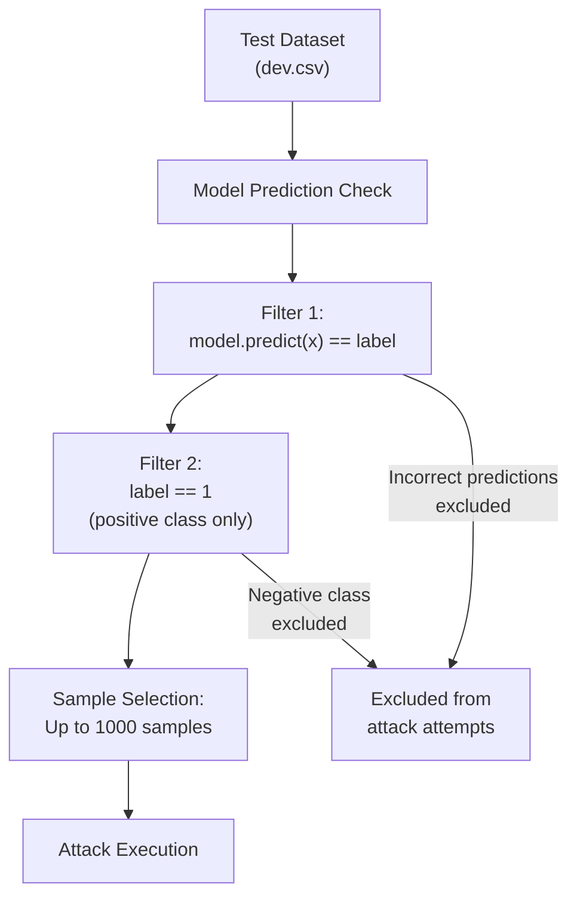
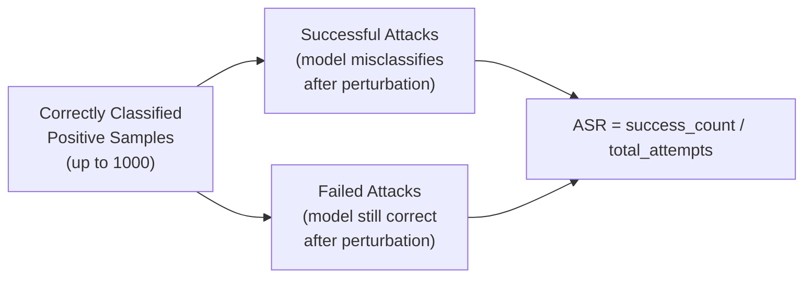
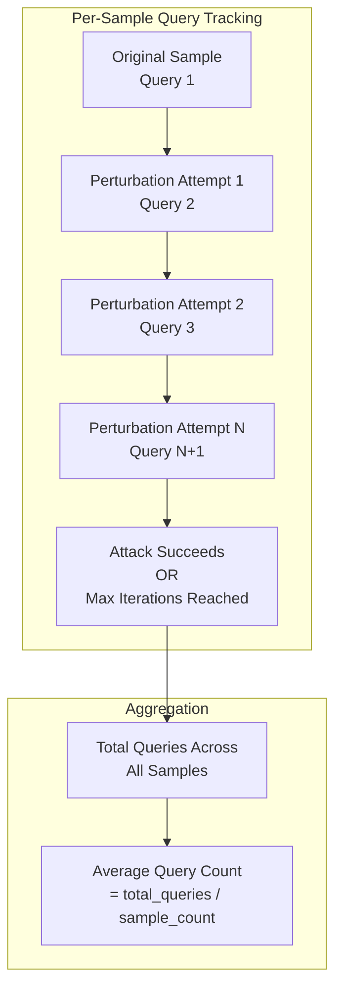
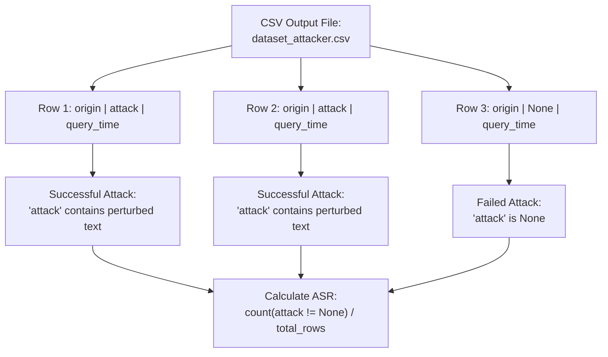
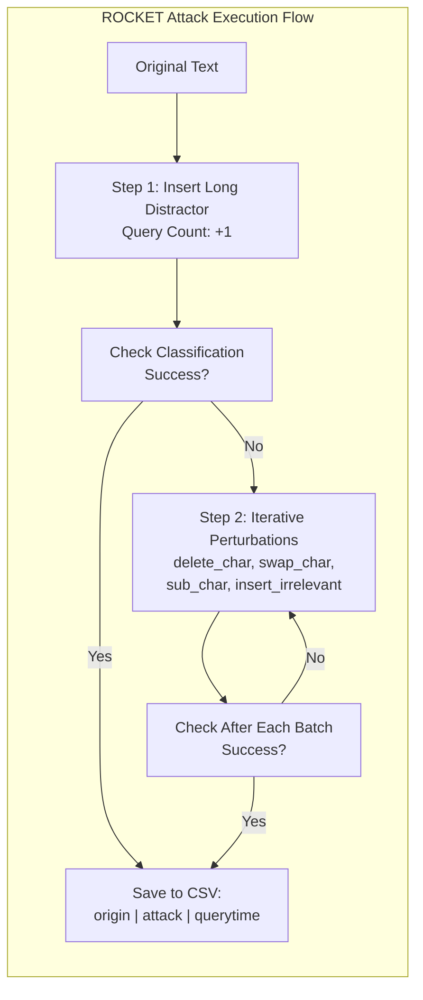
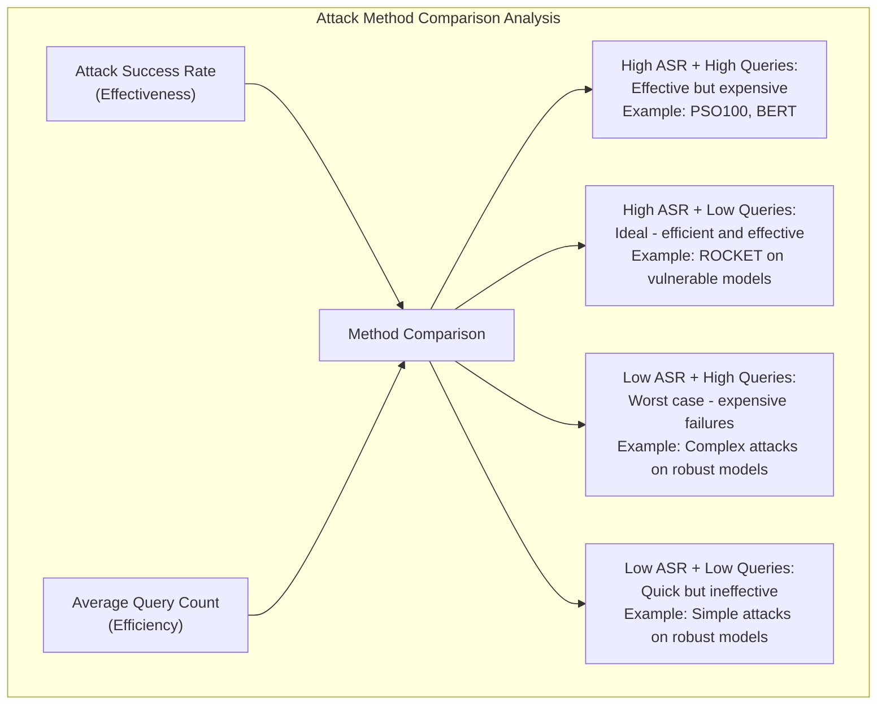
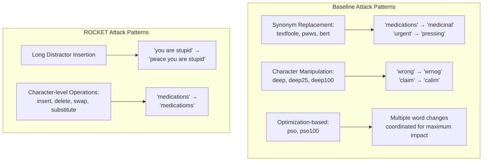
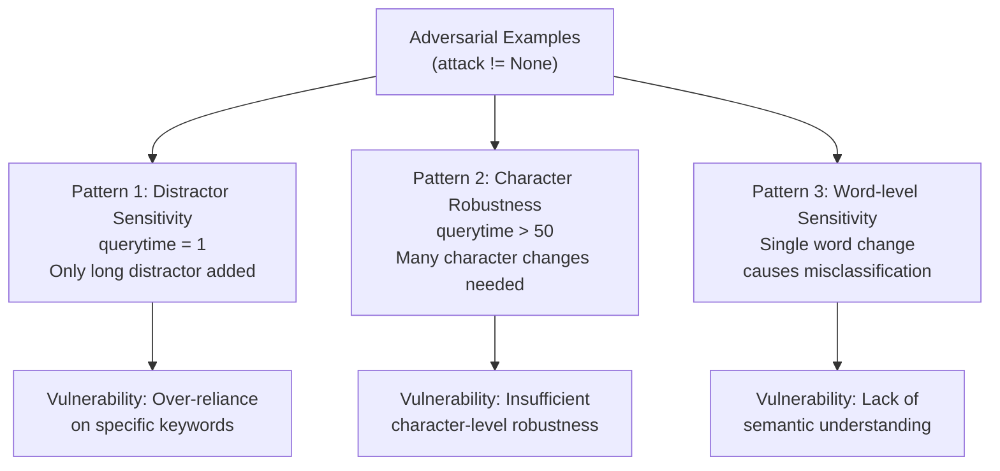
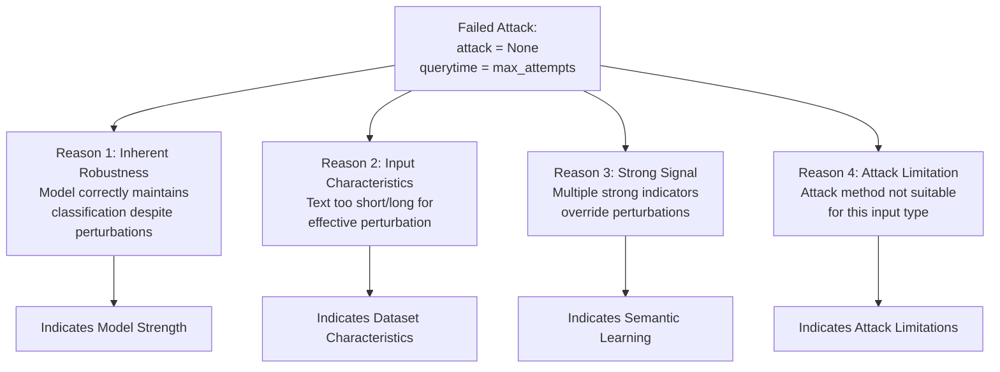

<!-- source: DeepWiki mcp.deepwiki.com · repo thunlp/Advbench · page 4.3 Interpreting Results · fetched 2026-11-02 -->

# Interpreting Results

<details>
<summary>Relevant source files</summary>

The following files were used as context for generating this wiki page:

- [README.md](README.md)
- [src/base_attack.py](src/base_attack.py)
- [src/rocket.py](src/rocket.py)

</details>


This page explains how to understand and analyze the output from Advbench attack experiments. It covers the interpretation of attack success rates (ASR), query counts, runtime metrics, and adversarial examples generated by both baseline and ROCKET attacks.

For instructions on running attack experiments, see [Running Attack Experiments](#4.2). For technical details on attack implementations, see [OpenAttack Integration](#3.4) and [ROCKET Implementation](#3.5). For comprehensive catalogs of attack methods, see [Attack Method Catalog](#5.2).

---

## Output File Structure

Both baseline and ROCKET attack experiments save results as CSV files in the `/output/` directory. The file naming convention differs between attack types:

**Baseline attacks**: `{dataset_name}_{attacker_name}.csv`
- Example: `enron_pwws.csv`, `CGFake_textfoole.csv`

**ROCKET attacks**: `{dataset_name}_rocket.csv`
- Example: `enron_rocket.csv`, `jigsaw_rocket.csv`

Each CSV file contains three columns representing the attack attempt on individual samples:

| Column | Description |
|--------|-------------|
| `origin` | The original text sample from the test set |
| `attack` | The perturbed adversarial text (or `None` if attack failed) |
| `query_time` (baseline) / `querytime` (ROCKET) | Number of queries to the victim model for this sample |

**Sources**: [src/base_attack.py:179-183](), [src/rocket.py:224-226]()

---

## Attack Success Determination

### Sample Selection Criteria

Both attack pipelines only attempt attacks on samples that satisfy specific conditions. Understanding this filtering is crucial for interpreting results correctly.



**Diagram: Sample Filtering Pipeline for Attack Experiments**

The baseline attack implementation filters samples at [src/base_attack.py:129-131]():
```python
correct_samples = [
    inst for inst in test_attack if (victim.get_pred( [inst["x"]] )[0] ==  1 and inst["y"] == 1)
]
```

The ROCKET implementation applies similar filtering at [src/rocket.py:55-60]():
```python
for sentence, label in tqdm(orig_test):
    output_label = get_output_label(sentence,tokenizer,model)
    if output_label == label:
        correct += 1.
        if label==1:
            correct_samples.append((sentence,1))
```

Both implementations then limit to 1000 samples if more are available ([src/base_attack.py:139-140](), [src/rocket.py:65-66]()).

**Key Interpretation Point**: Attack success rates are calculated **only over samples that the model correctly classified as positive (label 1)**. This is important because:
1. You cannot "attack" a sample the model already misclassifies
2. The focus on positive class reflects security task characteristics where positive typically indicates malicious/harmful content
3. The denominator for ASR is the number of correctly-classified positive samples, not the entire test set

**Sources**: [src/base_attack.py:129-140](), [src/rocket.py:55-66]()

---

## Key Metrics

### Attack Success Rate (ASR)

The **Attack Success Rate** measures the percentage of correctly-classified samples that were successfully perturbed to cause misclassification.



**Diagram: ASR Calculation Logic**

**Baseline ASR Calculation** [src/base_attack.py:172]():
```python
attack_success_rate = num/1000
```
Where `num` is incremented each time an attack succeeds [src/base_attack.py:161-164]().

**ROCKET ASR Calculation** [src/rocket.py:228]():
```python
print('ASR: ',asn / len(correct_samples))
```
Where `asn` (attack success number) is incremented when `output_label != label` [src/rocket.py:206-209]().

**Interpretation Guidelines**:
- **ASR = 1.0 (100%)**: Perfect attack - all samples successfully perturbed
- **ASR = 0.0 (0%)**: No successful attacks - model is robust to this attack method
- **High ASR (>0.8)**: Model is vulnerable; attack method is effective
- **Low ASR (<0.2)**: Model shows good robustness to this attack type

**Sources**: [src/base_attack.py:172](), [src/rocket.py:228]()

### Query Counts

**Query count** measures how many times the attacker queries the victim model to generate a successful adversarial example. This metric is critical for understanding attack efficiency and practicality.



**Diagram: Query Count Accumulation Process**

**Baseline Query Tracking** [src/base_attack.py:157-159]():
```python
for result in tqdm(attack_eval.ieval(correct_samples), total=len(correct_samples)):
    runtime.append(result["metrics"]["Running Time"])
    querytime.append(result["metrics"]["Victim Model Queries"])
```

The average is calculated at [src/base_attack.py:175]():
```python
ave_querytime=np.mean(np.array(querytime))
```

**ROCKET Query Tracking** [src/rocket.py:136-137]() and [src/rocket.py:203-204]():
```python
querytime = querytime+1
querytime_each=querytime_each+1
```

Individual query counts are saved per sample in the output CSV [src/rocket.py:209]().

**Interpretation Guidelines**:
- **Low queries (<10)**: Very efficient attack; practical for real-world scenarios
- **Medium queries (10-100)**: Moderately efficient; feasible but slower
- **High queries (>100)**: Computationally expensive; may be impractical in constrained scenarios
- **Failed attacks**: Query count still recorded, showing computational cost even without success

**Important**: ROCKET tracks per-sample queries (`querytime_each`), while baseline methods provide aggregate statistics. Individual query counts are saved in the CSV output for both methods.

**Sources**: [src/base_attack.py:157-175](), [src/rocket.py:136-137](), [src/rocket.py:203-204]()

### Runtime Metrics

**Runtime** measures the wall-clock time taken to execute each attack attempt. This is collected only for baseline attacks using the OpenAttack framework.

**Baseline Runtime Collection** [src/base_attack.py:158]():
```python
runtime.append(result["metrics"]["Running Time"])
```

**Baseline Average Runtime** [src/base_attack.py:174]():
```python
ave_runtime=np.mean(np.array(runtime))
```

**Interpretation Guidelines**:
- Useful for comparing computational efficiency between different baseline methods
- Does not directly appear in output CSV files (only printed to console)
- Should be considered alongside query counts for complete efficiency assessment
- ROCKET does not track wall-clock runtime separately

**Sources**: [src/base_attack.py:158](), [src/base_attack.py:174]()

---

## Interpreting Baseline Attack Results

Baseline attacks use the OpenAttack framework with eight different attack methods. Each method has distinct characteristics that affect result interpretation.

### Attack Method Characteristics

| Attacker | Method Type | Typical Query Count | Typical ASR | Key Characteristic |
|----------|-------------|---------------------|-------------|-------------------|
| `pso` | Particle Swarm Optimization | High (>50) | Variable | Global optimization approach |
| `pso100` | PSO with 100 iterations | Very High (>100) | Higher than base PSO | Extended search |
| `textfoole` | Synonym replacement | Medium (20-50) | High | Word importance ranking |
| `pwws` | Word saliency | Medium (20-50) | High | Uses word saliency scores |
| `bert` | BERT-based MLM | High (>50) | Very High | Contextual replacement |
| `deep` | Character-level (default power) | Low-Medium | Medium | Character perturbations |
| `deep25` | Character-level (power=25) | Medium | Higher | More aggressive |
| `deep100` | Character-level (power=100) | High | Highest | Very aggressive |

The attack dictionary is defined at [src/base_attack.py:34-43]():

```python
attack_dict = {
    "pso": OpenAttack.attackers.PSOAttacker(),
    "textfoole":  OpenAttack.attackers.TextFoolerAttacker(),
    "pwws": OpenAttack.attackers.PWWSAttacker(),
    "bert": OpenAttack.attackers.BERTAttacker(),
    "deep": OpenAttack.attackers.DeepWordBugAttacker(),
    "deep25": OpenAttack.attackers.DeepWordBugAttacker(power=25),
    "deep100": OpenAttack.attackers.DeepWordBugAttacker(power=100),
    "pso100": OpenAttack.attackers.PSOAttacker(max_iters=100)
}
```

### Analyzing Baseline Output Files



**Diagram: Baseline Output File Structure and Interpretation**

**Example**: Consider `enron_pwws.csv` output:

| origin | attack | query_time |
|--------|--------|------------|
| "Subject: low prices for your medications" | "Subject: low prices for your medicinal" | 23 |
| "Re: meeting today" | None | 45 |
| "URGENT: claim your prize now" | "URGENT: claim your prize immediately" | 18 |

**Interpretation**:
- Sample 1: Successfully attacked with 23 queries, changing "medications" to "medicinal"
- Sample 2: Attack failed after 45 queries; original text remained correctly classified
- Sample 3: Successfully attacked with 18 queries, changing "now" to "immediately"
- ASR = 2/3 = 0.667 (66.7%)
- Average queries = (23 + 45 + 18) / 3 = 28.67

**Sources**: [src/base_attack.py:161-167](), [src/base_attack.py:179-183]()

---

## Interpreting ROCKET Attack Results

ROCKET uses heuristic-rule-based perturbations with task-specific configurations. Understanding these configurations is essential for result interpretation.

### Task-Specific Configuration Impact

```mermaid
graph TB
    subgraph "ROCKET Attack Strategy"
        PHASE1["Phase 1:<br/>Long Distractor Insertion"]
        
        PHASE2["Phase 2:<br/>Iterative Character Perturbations"]
        
        PARAMS["Task-Specific Parameters:<br/>begsl, endsl, attack_totalnum,<br/>attack_batchsize, ch"]
    end
    
    subgraph "Example: Email Spam (enron/assassin)"
        E_PARAMS["begsl=10, endsl=30<br/>attack_totalnum=30<br/>attack_batchsize=6<br/>ch='>'"]
        
        E_PHASE1["Insert '>' characters<br/>between words 10-30"]
        
        E_PHASE2["Perturb up to 30 positions<br/>6 positions per batch"]
    end
    
    subgraph "Example: Toxic Comments (jigsaw/HSOL)"
        T_PARAMS["begsl=0, endsl=180<br/>attack_totalnum=180<br/>attack_batchsize=4<br/>ch='peace'"]
        
        T_PHASE1["Insert 'peace' distractor<br/>across long span (0-180 words)"]
        
        T_PHASE2["Perturb up to 180 positions<br/>4 positions per batch"]
    end
    
    PHASE1 --> PHASE2
    PARAMS --> PHASE1
    PARAMS --> PHASE2
    
    E_PARAMS --> E_PHASE1
    E_PHASE1 --> E_PHASE2
    
    T_PARAMS --> T_PHASE1
    T_PHASE1 --> T_PHASE2
```



**Diagram: ROCKET Task-Specific Configuration and Attack Flow**

The task-specific configurations are defined at [src/rocket.py:74-120]():

| Task Group | Datasets | `begsl` | `endsl` | `attack_totalnum` | `ch` | Strategy |
|------------|----------|---------|---------|-------------------|------|----------|
| Email Spam | enron, assassin | 10 | 30 | 30 | `">"` | Focus on subject/early lines |
| Fake Reviews | CGFake, amazon_lb | 3 | 8 | 100 | `"up"` | Target review opening |
| Fake News | LUN, satnews | 5 | 30 | 100 | `"reuters"` | Mimic news style |
| Toxic Comments | jigsaw, HSOL | 0 | 180 | 180 | `"peace"` | Counter-signal insertion |
| Other | FAS, EDENCE | 0 | 20 | 100 | `"any"` | Generic approach |

**Interpretation Impact**:
- **Lower `attack_totalnum`** (e.g., 30 for email): Fewer perturbations, more focused attacks
- **Higher `attack_totalnum`** (e.g., 180 for toxic): More aggressive, thorough perturbations
- **Distractor character (`ch`)**: Domain-specific strings designed to mislead classifiers
  - `">"` for emails mimics forwarding markers
  - `"peace"` for toxic comments acts as positive signal
  - `"reuters"` for news mimics legitimate source

**Sources**: [src/rocket.py:74-120]()

### Analyzing ROCKET Output Files



**Diagram: ROCKET Attack Execution and Query Counting**

**Example**: Consider `jigsaw_rocket.csv` output:

| origin | attack | querytime |
|--------|--------|-----------|
| "you are so stupid" | "peace you are so stupid" | 1 |
| "this comment is wrong" | "peace this comment is wrnng peace" | 47 |
| "i disagree with this" | None | 180 |

**Interpretation**:
- Sample 1: Successfully attacked with **only 1 query** - the long distractor insertion alone caused misclassification. This indicates the model is highly sensitive to the "peace" distractor.
- Sample 2: Required **47 queries** - distractor insertion failed, but subsequent character perturbations ("wrong" → "wrnng") combined with distractor eventually succeeded.
- Sample 3: Attack **failed after 180 queries** - reached `attack_totalnum` limit without success. Model is robust against this input.

**Query Count Analysis**:
- **querytime = 1**: Distractor-only success ([src/rocket.py:136-141]())
- **querytime > 1**: Required iterative perturbations ([src/rocket.py:203-210]())
- **Low querytime (<10)**: High attack efficiency
- **High querytime (>100)**: Hard-to-attack sample or robust input

**Sources**: [src/rocket.py:133-141](), [src/rocket.py:203-210](), [src/rocket.py:224-226]()

---

## Comparing Attack Methods

When evaluating multiple attack methods on the same dataset, consider these comparison dimensions:

### Comparative Metrics Table

For a complete experimental run on a single dataset (e.g., `enron`), you would have these output files:

- `enron_pso.csv`, `enron_textfoole.csv`, `enron_pwws.csv`, `enron_bert.csv`
- `enron_deep.csv`, `enron_deep25.csv`, `enron_deep100.csv`, `enron_pso100.csv`
- `enron_rocket.csv`

**Comparison Framework**:

| Metric | Purpose | Interpretation |
|--------|---------|----------------|
| **Attack Success Rate (ASR)** | Measures attack effectiveness | Higher = more effective, model more vulnerable |
| **Average Query Count** | Measures computational efficiency | Lower = more efficient, more practical |
| **ASR vs Query Trade-off** | Efficiency-effectiveness balance | Ideal: high ASR with low queries |
| **Success Distribution** | Consistency across samples | All samples attacked vs some samples attacked |



**Diagram: Attack Method Comparison Dimensions**

### Practical Comparison Example

Suppose you have these results for the `CGFake` dataset:

| Method | ASR | Avg Queries | Interpretation |
|--------|-----|-------------|----------------|
| textfoole | 0.87 | 34.2 | High success, moderate efficiency |
| pwws | 0.85 | 28.7 | Comparable success, slightly better efficiency |
| bert | 0.92 | 67.8 | Highest success but computationally expensive |
| deep | 0.73 | 15.3 | Lower success but very efficient |
| rocket | 0.91 | 12.1 | **High success with exceptional efficiency** |

**Key Insights**:
- **BERT** achieves highest ASR but requires many queries - best for offline analysis
- **ROCKET** achieves comparable ASR to BERT with 5x fewer queries - best for practical attacks
- **DeepWordBug** is fast but less effective - good for quick probing
- **Trade-off**: Complex optimization methods (BERT, PSO) vs simple heuristics (ROCKET, DeepWordBug)

**Sources**: [src/base_attack.py:172-175](), [src/rocket.py:228]()

---

## Analyzing Adversarial Examples

The most valuable output for understanding model vulnerabilities is the actual adversarial examples - the perturbed text that caused misclassification.

### Common Perturbation Patterns



**Diagram: Attack Pattern Classification**

### Example-Based Analysis Workflow

**Step 1: Extract Successful Attacks**

Load the CSV and filter for successful attacks:
```python
# Pseudo-code for analysis
import pandas as pd

df = pd.read_csv("output/enron_rocket.csv")
successful = df[df['attack'].notna()]  # Non-null attack column
failed = df[df['attack'].isna()]       # Null attack column

print(f"Success rate: {len(successful)}/{len(df)} = {len(successful)/len(df):.3f}")
```

**Step 2: Identify Vulnerability Patterns**

Examine what types of perturbations caused misclassification:



**Diagram: Vulnerability Pattern Analysis from Adversarial Examples**

**Step 3: Manual Inspection**

Key questions to ask when inspecting adversarial examples:

| Question | Purpose |
|----------|---------|
| Does the perturbation preserve semantic meaning? | Assess whether attack is realistic vs artificial |
| What minimal perturbation caused misclassification? | Identify most vulnerable aspects |
| Are certain word positions more vulnerable? | Location-based vulnerability analysis |
| Do distractors alone cause failure? | Test robustness to noise |
| How many character changes were needed? | Character-level robustness assessment |

**Example Analysis Session**:

Original: `"Subject: get medications at low prices"`
Attack: `"Subject: get medicatioms at low prices"`
Queries: 12

**Analysis**: Single character transposition ("on" → "om") in "medications" caused misclassification. This suggests:
- Model may use exact string matching
- Character-level robustness is weak
- Likely learned to flag specific medication-related words without robust encoding

**Sources**: [src/base_attack.py:161-167](), [src/rocket.py:209]()

---

## Understanding Failed Attacks

Failed attacks (where `attack` column is `None`) provide equally valuable insights about model robustness.

### Failure Analysis Framework



**Diagram: Failed Attack Analysis Decision Tree**

### Interpreting High Query Counts on Failures

When `querytime` is high but `attack` is `None`:

**For Baseline Attacks**: Attack reached OpenAttack's internal iteration limit without finding successful perturbation [src/base_attack.py:150-167]().

**For ROCKET**: Attack reached one of these limits:
- Maximum iterations: `ATTACK_ITER` (default 550) [src/rocket.py:262]()
- Position coverage: `len(cache_pos_li) < maxsl*0.98` [src/rocket.py:163]()
- Total perturbations: `len(cache_pos_li) < attack_totalnum` [src/rocket.py:163]()

**Interpretation**: This is **positive for model robustness** - the model maintained correct classification despite extensive perturbation attempts.

**Sources**: [src/rocket.py:163](), [src/rocket.py:262]()

---

## Console Output During Execution

Both baseline and ROCKET attacks print progress information to the console that supplements the CSV outputs.

### Baseline Console Output

During execution of [src/base_attack.py]():
1. **Test set size**: `print(test_attack)` [src/base_attack.py:128]()
2. **Correct samples count**: `print(len(correct_samples))` [src/base_attack.py:135]()
3. **Progress bar**: `tqdm(attack_eval.ieval(correct_samples), ...)` [src/base_attack.py:157]()
4. Final ASR and average metrics (printed but not shown in provided code)

### ROCKET Console Output

During execution of [src/rocket.py]():
1. **Original accuracy**: `print('Orig Acc: ', correct / len(orig_test))` [src/rocket.py:62]()
2. **Attack parameters**: `print(ATTACK_ITER)` [src/rocket.py:73]()
3. **Progress updates**: `correct_print(asn,total)` called on each success [src/rocket.py:140, 208]()
4. **Total queries**: `print(querytime)` [src/rocket.py:222]()
5. **Success count**: `print(asn)` [src/rocket.py:223]()
6. **Final ASR**: `print('ASR: ',asn / len(correct_samples))` [src/rocket.py:228]()

The `correct_print` function [src/rocket.py:46-48]() displays:
```python
def correct_print(asn,total):
    print("Attack Success")
    print('ASR: ',asn / total)
```

This provides real-time feedback showing the running ASR as attacks progress.

**Sources**: [src/base_attack.py:128-135](), [src/rocket.py:46-48](), [src/rocket.py:62](), [src/rocket.py:73](), [src/rocket.py:222-228]()

---

## Best Practices for Result Interpretation

### 1. Always Consider the Baseline

Compare ASR and query counts against the original model accuracy:
- If original accuracy is low, high ASR may be less meaningful
- If original accuracy is high, even moderate ASR indicates vulnerability

The original accuracy is computed before attacks at [src/rocket.py:53-62]().

### 2. Examine Both Successful and Failed Examples

Don't only focus on successful attacks. Failed attacks reveal:
- Model strengths
- Attack method limitations
- Input characteristics that confer robustness

### 3. Cross-Compare Attack Methods

No single metric tells the complete story. Consider:
- Which attack has highest ASR?
- Which attack is most efficient (lowest queries)?
- Which attack produces most realistic perturbations?
- Which attack best simulates real-world adversaries?

### 4. Task-Specific Interpretation

Security task characteristics affect what constitutes a "good" or "bad" result:

| Task | High ASR Means | Low ASR Means |
|------|----------------|---------------|
| Spam Detection | Spam filters easily evaded | Spam filters robust |
| Fake News | Fake news easily disguised | Good detection robustness |
| Toxic Content | Moderation easily bypassed | Effective content moderation |

### 5. Query Efficiency Matters

In real-world scenarios:
- **Black-box attacks**: Each query may have cost (API rate limits, detection risk)
- **Low queries (<10)**: Highly practical for real attackers
- **High queries (>100)**: May be impractical except for determined adversaries

**Sources**: [src/rocket.py:53-62]()

---

This page provides comprehensive guidance for interpreting Advbench attack results. For extending the benchmark with custom analyses, see [Customizing Experiments](#4.4). For complete technical specifications of all metrics, see [Attack Method Catalog](#5.2).

---

