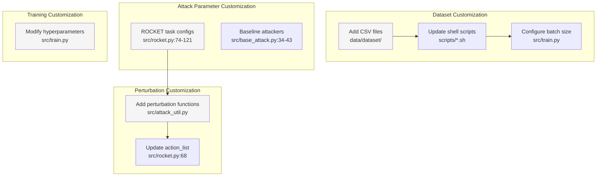
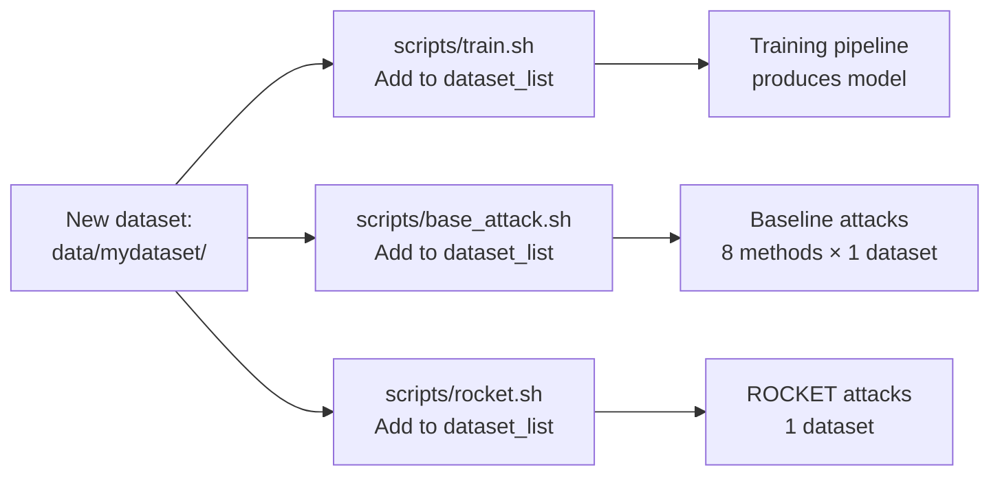
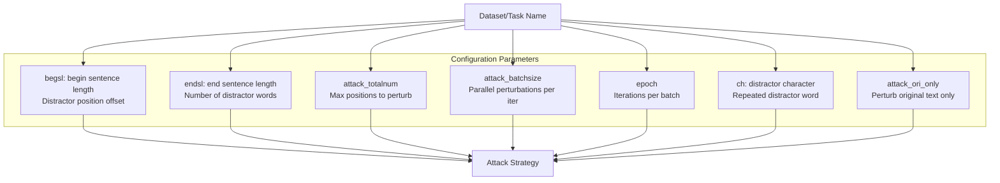
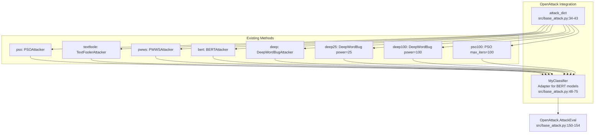
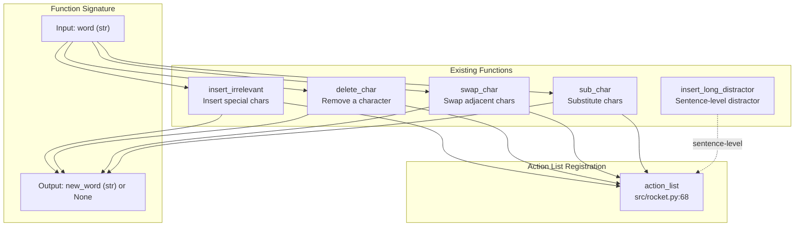
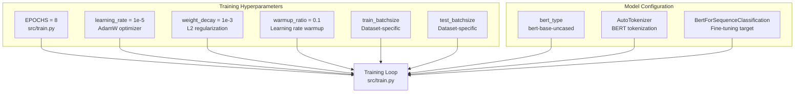

<!-- source: DeepWiki mcp.deepwiki.com · repo thunlp/Advbench · page 4.4 Customizing Experiments · fetched 2026-11-02 -->

# Customizing Experiments

<details>
<summary>Relevant source files</summary>

The following files were used as context for generating this wiki page:

- [src/attack_util.py](src/attack_util.py)
- [src/base_attack.py](src/base_attack.py)
- [src/rocket.py](src/rocket.py)

</details>


This page provides technical instructions for researchers who want to extend or modify Advbench experiments beyond the default configurations. Topics covered include adding new datasets, configuring task-specific attack parameters for ROCKET, integrating new baseline attack methods, and creating custom text perturbation functions.

For general instructions on running experiments with default settings, see [Running Attack Experiments](#4.2). For comprehensive parameter reference, see [Command-Line Reference](#5.1).

---

## Overview of Customization Points

The Advbench system provides four primary extension points for customization:



**Sources:** [src/rocket.py:74-121](), [src/base_attack.py:34-43](), [src/attack_util.py:1-144](), [src/train.py:1-200]()

---

## Adding New Datasets

To integrate a new dataset into the Advbench benchmark, you must prepare the data files, update orchestration scripts, and optionally configure task-specific parameters.

### Dataset File Format

Each dataset requires two CSV files with the following structure:

| File | Purpose | Required Columns |
|------|---------|------------------|
| `train.csv` | Model training data | `text` (str), `label` (int) |
| `dev.csv` | Attack evaluation data | `text` (str), `label` (int) |

Place these files in a new directory: `data/<dataset_name>/`

The `text` column contains the raw text samples, and `label` contains integer class labels (0, 1, or higher for multi-class tasks).

**Sources:** [src/base_attack.py:24-30](), [src/rocket.py:26-32]()

### Updating Orchestration Scripts

After adding dataset files, update the shell scripts to include your dataset:



**Modification Steps:**

1. **Training script** [scripts/train.sh:2](): Add dataset name to the space-separated list
   ```bash
   dataset_list="LUN satnews ... mydataset"
   ```

2. **Baseline attack script** [scripts/base_attack.sh:2](): Add dataset name
   ```bash
   dataset_list="LUN satnews ... mydataset"
   ```

3. **ROCKET attack script** [scripts/rocket.sh:2](): Add dataset name
   ```bash
   dataset_list="LUN satnews ... mydataset"
   ```

**Sources:** [scripts/train.sh:2](), [scripts/base_attack.sh:2](), [scripts/rocket.sh:2]()

### Configuring Batch Size for Training

If your dataset has memory constraints or different sample sizes, adjust the batch size in the training module:

**Location:** [src/train.py:113-114]()

The default batch sizes are configured based on dataset name:
- Small datasets: batch size 16 (e.g., CGFake, HSOL)
- Medium datasets: batch size 32 (e.g., satnews)
- Large datasets: batch size 64 (e.g., amazon_lb)

To add a custom batch size for your dataset, modify the conditional logic that sets `train_batchsize` and `test_batchsize` variables.

**Sources:** [src/train.py:113-114]()

---

## Configuring ROCKET Attack Parameters

ROCKET uses task-specific parameter configurations to optimize attack effectiveness for different security domains. These configurations control the distractor insertion strategy and iterative perturbation behavior.

### Parameter Configuration Structure



**Sources:** [src/rocket.py:74-121]()

### Existing Task Configurations

The following table shows the pre-configured parameter sets for existing datasets:

| Task Group | Datasets | begsl | endsl | attack_totalnum | attack_batchsize | epoch | ch | attack_ori_only |
|------------|----------|-------|-------|-----------------|------------------|-------|----|--------------------|
| Email/Assassination | enron, assassin | 10 | 30 | 30 | 6 | 2 | ">" | True |
| Fake Reviews | CGFake, amazon_lb | 3 | 8 | 100 | 6 | 3 | "up" | True |
| News Classification | LUN, satnews | 5 | 30 | 100 | 8 | 3 | "reuters" | True |
| Toxic Content | jigsaw, HSOL | 0 | 180 | 180 | 4 | 3 | "peace" | True |
| Stance Detection | FAS, EDENCE | 0 | 20 | 100 | 3 | 3 | "any" | True |

**Parameter Meanings:**

- **begsl**: Number of distractor words to insert before the original text
- **endsl**: Number of distractor words to insert after the original text
- **attack_totalnum**: Maximum number of unique word positions to perturb
- **attack_batchsize**: Number of word positions to perturb simultaneously in each iteration
- **epoch**: Number of perturbation attempts per batch of positions
- **ch**: The distractor word string to repeat (e.g., ">" becomes "> > > ...")
- **attack_ori_only**: If True, only perturb words from the original text (not distractors)

**Sources:** [src/rocket.py:74-121]()

### Adding Custom Task Configuration

To add a configuration for a new dataset, insert a new conditional block in the `attack` function:

**Location:** [src/rocket.py:74-121]()

**Template:**
```python
elif task_name == "mydataset":
    begsl = 5              # Adjust based on text length
    endsl = 20             # Adjust for distractor intensity
    attack_totalnum = 100  # Max perturbation positions
    attack_batchsize = 6   # Parallel perturbations
    epoch = 3              # Iterations per batch
    ch = "word"           # Choose appropriate distractor
    attack_ori_only = True # Usually True for focused attacks
```

**Configuration Guidelines:**

1. **Short texts (< 50 words)**: Use smaller `attack_totalnum` (30-50), higher `attack_batchsize` (6-8)
2. **Long texts (> 200 words)**: Use larger `attack_totalnum` (100-180), lower `attack_batchsize` (3-4) to manage memory
3. **Distractor character selection**: Choose domain-appropriate words (e.g., "peace" for toxic content, ">" for spam)
4. **begsl/endsl balance**: Short texts benefit from end distractors only (begsl=0), longer texts can use both

**Sources:** [src/rocket.py:74-121]()

---

## Adding New Baseline Attack Methods

The baseline attack pipeline uses the OpenAttack framework. You can add new attack methods by extending the `attack_dict` registry.

### Attack Method Registry Structure



**Sources:** [src/base_attack.py:34-43](), [src/base_attack.py:48-75](), [src/base_attack.py:150-154]()

### Adding a New OpenAttack Method

**Step 1: Add to attack_dict**

Location: [src/base_attack.py:34-43]()

```python
attack_dict = {
    "pso": OpenAttack.attackers.PSOAttacker(),
    "textfoole": OpenAttack.attackers.TextFoolerAttacker(),
    # ... existing methods ...
    "myattack": OpenAttack.attackers.CustomAttacker(param1=value1)
}
```

**Step 2: Update base_attack.sh**

Location: [scripts/base_attack.sh:3]()

Add your method key to the `attacker_list`:
```bash
attacker_list="pso textfoole pwws bert deep deep25 deep100 pso100 myattack"
```

**Step 3: Run experiments**

```bash
bash scripts/base_attack.sh
```

The script will automatically run your new attack method across all configured datasets.

**Sources:** [src/base_attack.py:34-43](), [scripts/base_attack.sh:3-7]()

### OpenAttack Method Configuration Options

The OpenAttack library supports various configuration parameters for each attacker. Common patterns include:

| Attacker | Configuration Parameters | Example |
|----------|-------------------------|---------|
| PSOAttacker | `max_iters`, `pop_size` | `PSOAttacker(max_iters=100)` |
| DeepWordBugAttacker | `power` (number of perturbations) | `DeepWordBugAttacker(power=25)` |
| TextFoolerAttacker | `threshold_pred_score` | `TextFoolerAttacker(threshold=0.5)` |
| BERTAttacker | `k` (candidate words) | `BERTAttacker(k=50)` |

Refer to the OpenAttack documentation for complete parameter specifications for each attack method.

**Sources:** [src/base_attack.py:35-42]()

---

## Creating Custom Perturbation Functions

ROCKET's character-level perturbations are implemented as modular functions in `attack_util.py`. You can add new perturbation strategies by defining new functions and registering them in the attack pipeline.

### Perturbation Function Interface



**Sources:** [src/attack_util.py:1-144](), [src/rocket.py:68]()

### Existing Perturbation Functions

The following functions are available in [src/attack_util.py]():

| Function | Line Range | Purpose | Example |
|----------|-----------|---------|---------|
| `insert_long_distractor` | 4-16 | Insert repeated distractor words | `"hello" → "up up hello up up"` |
| `insert_irrelevant` | 40-51 | Insert special characters into word | `"foolish" → "fool$ish"` |
| `delete_char` | 53-59 | Remove a random character | `"foolish" → "folish"` |
| `swap_char` | 63-71 | Swap adjacent characters | `"foolish" → "foloish"` |
| `sub_char` | 78-108 | Substitute with visually similar | `"foolish" → "f00lish"` |

**Sources:** [src/attack_util.py:4-108]()

### Perturbation Function Requirements

All word-level perturbation functions must follow these conventions:

1. **Input**: Single parameter `word` (str)
2. **Output**: Modified `new_word` (str) or `None` if perturbation cannot be applied
3. **Minimum length check**: Most functions return `None` for words with `len(word) < 5`
4. **Randomization**: Use `random.choice()` for position/character selection to ensure diversity

**Example skeleton:**
```python
def custom_perturbation(word):
    word_len = len(word)
    if word_len < 5:  # Skip short words
        return None
    
    # Your perturbation logic here
    # ...
    
    return new_word  # or None if perturbation fails
```

**Sources:** [src/attack_util.py:40-108]()

### Adding a Custom Perturbation Function

**Step 1: Define the function in attack_util.py**

Location: [src/attack_util.py:1-144]()

Example of adding a vowel-deletion perturbation:

```python
def delete_vowel(word):
    """Delete a random vowel from the word"""
    word_len = len(word)
    if word_len < 5:
        return None
    
    vowels = ['a', 'e', 'i', 'o', 'u']
    vowel_positions = [i for i, c in enumerate(word) if c.lower() in vowels]
    
    if len(vowel_positions) == 0:
        return None
    
    delete_pos = random.choice(vowel_positions)
    new_word = word[:delete_pos] + word[delete_pos+1:]
    return new_word
```

**Step 2: Register in action_list**

Location: [src/rocket.py:68]()

```python
action_list = [insert_irrelevant, delete_char, swap_char, sub_char, delete_vowel]
```

Import your function at the top of `rocket.py`:
```python
from attack_util import *
```

**Step 3: Test the perturbation**

Run ROCKET attacks to verify your perturbation function is called correctly:
```bash
python src/rocket.py --name amazon_lb
```

**Sources:** [src/attack_util.py:1-144](), [src/rocket.py:68](), [src/rocket.py:13]()

### Perturbation Function Design Guidelines

When creating custom perturbations, consider:

1. **Semantic preservation**: Perturbations should maintain overall meaning while evading detection
2. **Imperceptibility vs. Practicality**: ROCKET focuses on practical attacks that real adversaries might use
3. **Computational efficiency**: Avoid expensive operations as functions are called thousands of times per attack
4. **Failure handling**: Always return `None` when perturbation cannot be applied to avoid crashes
5. **Stopword awareness**: The attack loop [src/rocket.py:186]() already filters stopwords, so focus on content word perturbations

**Sources:** [src/attack_util.py:1-144](), [src/rocket.py:186]()

---

## Modifying Training Parameters

To experiment with different model training configurations, you can adjust hyperparameters in the training module.

### Training Configuration Locations



**Sources:** [src/train.py:1-200]()

### Key Training Parameters

The main training parameters are hardcoded in [src/train.py]():

| Parameter | Default Value | Purpose | Modification Impact |
|-----------|---------------|---------|---------------------|
| `EPOCHS` | 8 | Training epochs | Higher = better convergence but longer training |
| `learning_rate` | 1e-5 | AdamW learning rate | Lower = more stable, higher = faster convergence |
| `weight_decay` | 1e-3 | L2 regularization | Higher = more regularization |
| `warmup_ratio` | 0.1 | LR warmup proportion | Typically 0.05-0.1 for BERT |
| `train_batchsize` | 16/32/64 | Training batch size | Higher = faster training but more memory |
| `test_batchsize` | 16/32/64 | Evaluation batch size | Typically same as train |

To modify these parameters, edit the corresponding values in the training module where they are defined and used in the optimizer and scheduler setup.

**Sources:** [src/train.py:1-200]()

### Multi-GPU Training Configuration

The training pipeline supports automatic multi-GPU parallelization:

**Location:** [src/train.py]()

The model is wrapped with `nn.DataParallel` when multiple GPUs are available. To force single-GPU training or customize GPU allocation, modify the device assignment logic before the DataParallel wrapper is applied.

**Sources:** [src/train.py:1-200]()

---

## Advanced Customizations

### Custom Victim Model Adapter

If you want to attack models other than BERT, you need to implement a custom classifier adapter that conforms to the OpenAttack interface:

**Reference Implementation:** [src/base_attack.py:48-75]()

The `MyClassifier` class shows the required methods:
- `get_pred(input_)`: Return predicted class labels
- `get_prob(input_)`: Return probability distributions

Your adapter must handle tokenization, device placement, and output formatting to match OpenAttack's expectations.

**Sources:** [src/base_attack.py:48-75]()

### Custom Dataset Loading

The default data loading function [src/base_attack.py:24-30]() expects CSV files with `text` and `label` columns. For custom formats:

1. Create a new loading function following the signature:
   ```python
   def load_custom_data(data_name, type):
       # Load and process your data
       return [(text1, label1), (text2, label2), ...]
   ```

2. Replace calls to `load_data()` in attack and training scripts with your function

**Sources:** [src/base_attack.py:24-30](), [src/rocket.py:26-32]()

### Custom Attack Success Criteria

The current implementation uses label flipping as the success criterion [src/base_attack.py:161]() and [src/rocket.py:205-206](). To implement custom success criteria:

1. Modify the conditional logic that checks `output_label != label`
2. Implement your own success function (e.g., confidence threshold, targeted attacks)
3. Update metrics collection to reflect your criteria

**Sources:** [src/base_attack.py:161-165](), [src/rocket.py:205-210]()

---

