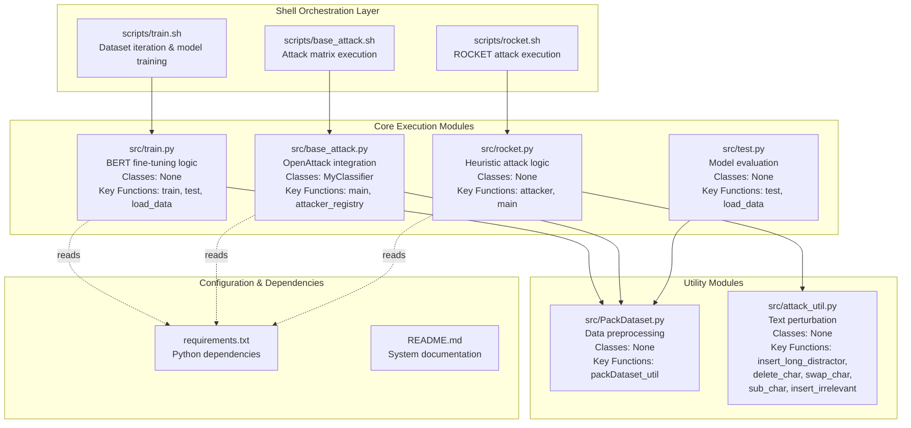
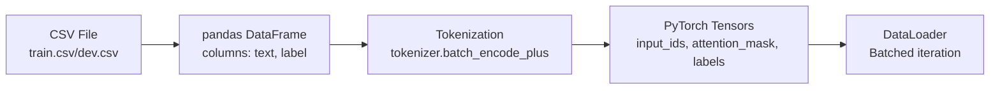
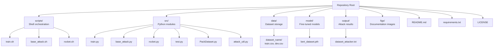
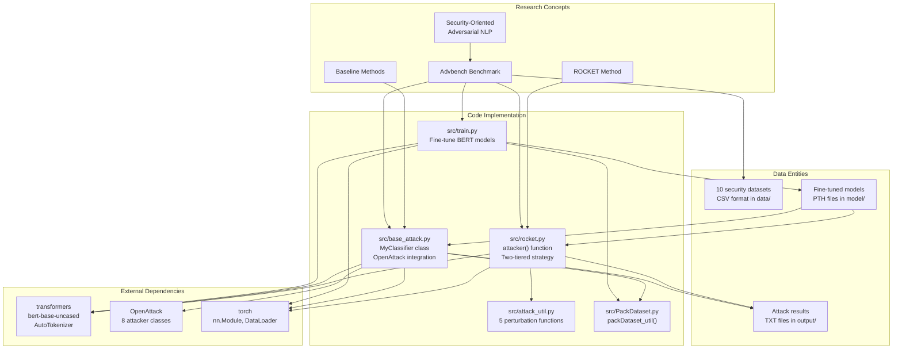
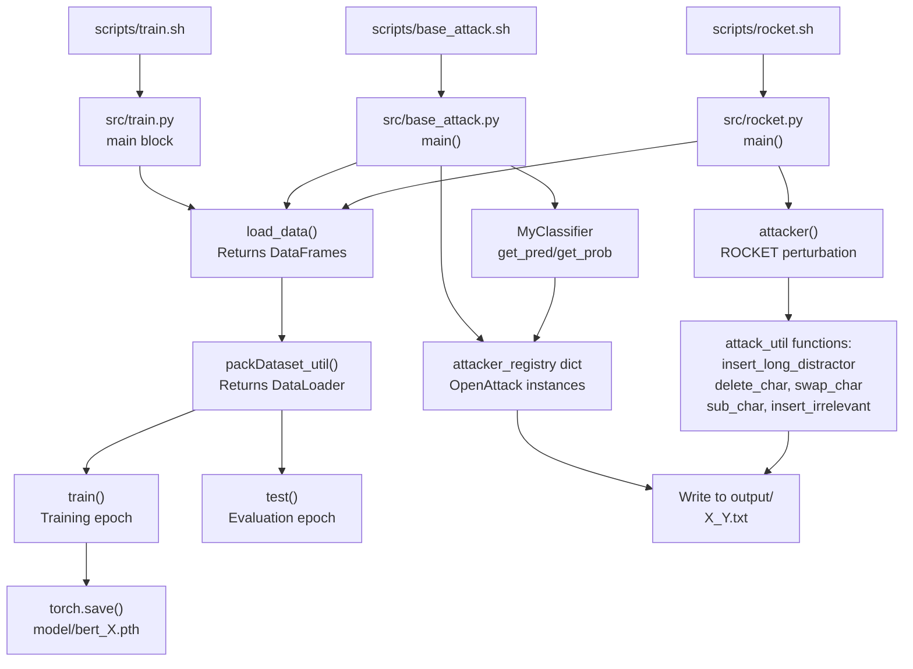

<!-- source: DeepWiki mcp.deepwiki.com · repo thunlp/Advbench · page 5 Reference · fetched 2026-11-02 -->

# Reference

<details>
<summary>Relevant source files</summary>

The following files were used as context for generating this wiki page:

- [README.md](README.md)

</details>


This page provides comprehensive technical reference documentation for the Advbench codebase. It catalogs all modules, classes, functions, command-line interfaces, and technical specifications needed for development and research use. 

For step-by-step usage instructions, see [User Guide](#4). For implementation details and algorithms, see [Technical Architecture](#3). For command-line arguments specifically, see [Command-Line Reference](#5.1). For attack method details, see [Attack Method Catalog](#5.2).

---

## System Module Overview

The Advbench system consists of three orchestration scripts and six core Python modules organized into functional subsystems.

### Module Architecture Diagram



**Sources**: [README.md:45-67](), [scripts/train.sh](), [scripts/base_attack.sh](), [scripts/rocket.sh](), [src/train.py](), [src/base_attack.py](), [src/rocket.py](), [src/test.py](), [src/PackDataset.py](), [src/attack_util.py]()

---

## Core Module Reference

### Training Module: `src/train.py`

The training module implements BERT model fine-tuning for security classification tasks.

**Primary Functions:**

| Function | Parameters | Returns | Purpose |
|----------|-----------|---------|---------|
| `load_data(name, tokenizer)` | `name`: dataset name<br/>`tokenizer`: BERT tokenizer | `train_dataset`, `test_dataset` | Loads CSV files from `data/{name}/` directory |
| `train(model, iterator, optimizer, scheduler)` | `model`: PyTorch model<br/>`iterator`: DataLoader<br/>`optimizer`: AdamW optimizer<br/>`scheduler`: LR scheduler | `epoch_loss`, `epoch_acc` | Executes one training epoch with gradient updates |
| `test(model, iterator)` | `model`: PyTorch model<br/>`iterator`: DataLoader | `epoch_loss`, `epoch_acc` | Evaluates model without gradient computation |

**Key Variables:**

```
EPOCHS = 8
LEARNING_RATE = 1e-5
WEIGHT_DECAY = 1e-3
WARMUP_PROPORTION = 0.1
```

**Model Architecture:**
- Base: `bert-base-uncased` from HuggingFace Transformers
- Fine-tuning: Binary classification head (2 output classes)
- Multi-GPU: Wrapped with `torch.nn.DataParallel`

**Sources**: [src/train.py](), [README.md:51-55]()

---

### Baseline Attack Module: `src/base_attack.py`

Integrates OpenAttack framework to execute traditional adversarial attack methods.

**Primary Classes:**

| Class | Inherits | Methods | Purpose |
|-------|----------|---------|---------|
| `MyClassifier` | `OpenAttack.Classifier` | `get_pred([x_batch])`, `get_prob([x_batch])` | Adapter wrapper for BERT models to interface with OpenAttack |

**Attacker Registry:**

The module uses a dictionary mapping attacker names to OpenAttack instances:

```python
{
    "pso": OpenAttack.attackers.PSOAttacker(),
    "textfooler": OpenAttack.attackers.TextFoolerAttacker(),
    "pwws": OpenAttack.attackers.PWWSAttacker(),
    "bert": OpenAttack.attackers.BERTAttacker(),
    "deepwordbug": OpenAttack.attackers.DeepWordBugAttacker(),
    "viper": OpenAttack.attackers.VIPERAttacker(),
    "textbugger": OpenAttack.attackers.TextBuggerAttacker(),
    "fd": OpenAttack.attackers.FDAttacker()
}
```

**Key Functions:**

| Function | Parameters | Returns | Purpose |
|----------|-----------|---------|---------|
| `main()` | Reads from `argparse` | None | Orchestrates attack execution and results saving |

**Output Format:**
Results saved to `output/{dataset}_{attacker}.txt` containing:
- Attack success rate
- Average query count
- Runtime statistics
- Adversarial example pairs

**Sources**: [src/base_attack.py](), [scripts/base_attack.sh:2-3]()

---

### ROCKET Attack Module: `src/rocket.py`

Implements heuristic-rule-based adversarial perturbations for security tasks.

**Primary Functions:**

| Function | Parameters | Returns | Purpose |
|----------|-----------|---------|---------|
| `attacker(sentence, true_y, model, tokenizer, config)` | `sentence`: input text<br/>`true_y`: true label<br/>`model`: victim model<br/>`tokenizer`: BERT tokenizer<br/>`config`: attack parameters | `adv_sentence`, `success_flag`, `query_count` | Executes two-tiered attack strategy |

**Attack Configuration Structure:**

```python
{
    "begsl": int,              # Beginning sentence length threshold
    "endsl": int,              # Ending sentence length threshold
    "attack_totalnum": int,    # Total perturbation positions
    "attack_batchsize": int,   # Parallel perturbations per iteration
    "ch": str                  # Distractor character/string
}
```

**Action Space:**
The module defines 5 perturbation operations from `attack_util.py`:

| Action | Function Call | Effect |
|--------|--------------|--------|
| Long Distractor | `insert_long_distractor(text, ch, begsl, endsl)` | Inserts repetitive character sequences |
| Character Deletion | `delete_char(text, totalnum, batchsize)` | Removes characters at strategic positions |
| Character Swap | `swap_char(text, totalnum, batchsize)` | Transposes adjacent characters |
| Character Substitution | `sub_char(text, totalnum, batchsize)` | Replaces characters with similar alternatives |
| Irrelevant Insertion | `insert_irrelevant(text, totalnum, batchsize)` | Adds noise characters |

**Sources**: [src/rocket.py](), [src/attack_util.py](), [scripts/rocket.sh]()

---

### Test/Evaluation Module: `src/test.py`

Provides standalone model evaluation without adversarial attacks.

**Primary Functions:**

| Function | Parameters | Returns | Purpose |
|----------|-----------|---------|---------|
| `test(model, iterator)` | `model`: PyTorch model<br/>`iterator`: DataLoader | `epoch_loss`, `epoch_acc` | Computes cross-entropy loss and accuracy |
| `load_data(name, tokenizer)` | `name`: dataset name<br/>`tokenizer`: BERT tokenizer | `train_dataset`, `test_dataset` | Loads dataset from CSV files |

**Usage Pattern:**
```bash
python src/test.py --name <dataset_name>
```

Loads model from `model/bert_<dataset_name>.pth` and evaluates on test set.

**Sources**: [src/test.py]()

---

### Data Processing Module: `src/PackDataset.py`

Handles BERT tokenization, padding, and DataLoader creation.

**Primary Functions:**

| Function | Parameters | Returns | Purpose |
|----------|-----------|---------|---------|
| `packDataset_util(dataset, text, label, tokenizer, batch_size)` | `dataset`: pandas DataFrame<br/>`text`: column name for text<br/>`label`: column name for labels<br/>`tokenizer`: AutoTokenizer instance<br/>`batch_size`: int | `torch.utils.data.DataLoader` | Converts CSV data to batched PyTorch tensors |

**Processing Pipeline:**



**Tokenizer Configuration:**
```python
tokenizer.batch_encode_plus(
    texts,
    add_special_tokens=True,    # [CLS] and [SEP] tokens
    max_length=512,              # BERT max sequence length
    padding='max_length',        # Pad to uniform length
    truncation=True,             # Truncate long sequences
    return_attention_mask=True   # Generate attention masks
)
```

**Sources**: [src/PackDataset.py]()

---

### Attack Utility Module: `src/attack_util.py`

Provides character-level text perturbation functions used by ROCKET.

**Function Reference:**

| Function | Parameters | Output | Description |
|----------|-----------|--------|-------------|
| `insert_long_distractor(text, ch, begsl, endsl)` | `text`: str<br/>`ch`: distractor string<br/>`begsl`: min sentence length<br/>`endsl`: max sentence length | Modified text | Inserts repetitive distractor at sentence boundaries |
| `delete_char(text, totalnum, batchsize)` | `text`: str<br/>`totalnum`: total deletions<br/>`batchsize`: deletions per iteration | List of perturbed texts | Generates multiple variants with character deletions |
| `swap_char(text, totalnum, batchsize)` | `text`: str<br/>`totalnum`: total swaps<br/>`batchsize`: swaps per iteration | List of perturbed texts | Creates variants with transposed characters |
| `sub_char(text, totalnum, batchsize)` | `text`: str<br/>`totalnum`: total substitutions<br/>`batchsize`: substitutions per iteration | List of perturbed texts | Replaces characters with similar-looking alternatives |
| `insert_irrelevant(text, totalnum, batchsize)` | `text`: str<br/>`totalnum`: total insertions<br/>`batchsize`: insertions per iteration | List of perturbed texts | Adds random irrelevant characters |

**Character Substitution Mapping:**
The module uses predefined mappings for visually similar characters:
- `a` → `@`, `4`
- `e` → `3`
- `i` → `1`, `!`
- `o` → `0`
- `s` → `$`, `5`

**Sources**: [src/attack_util.py]()

---

## Script Interface Specifications

### Training Script: `scripts/train.sh`

Iterates through all datasets and fine-tunes BERT models.

**Dataset Loop:**
```bash
for name in LUN satnews amazon_lb CGFake HSOL jigsaw EDENCE FAS assassin enron
do
    python src/train.py --name ${name}
done
```

**Per-Dataset Execution:**
- Reads from: `data/{name}/train.csv`, `data/{name}/dev.csv`
- Writes to: `model/bert_{name}.pth`

**Sources**: [scripts/train.sh]()

---

### Baseline Attack Script: `scripts/base_attack.sh`

Executes OpenAttack methods across all dataset-attacker combinations.

**Attack Matrix:**
```bash
datasets=(LUN satnews amazon_lb CGFake HSOL jigsaw EDENCE FAS assassin enron)
attackers=(pso textfooler pwws bert deepwordbug viper textbugger fd)

for data in "${datasets[@]}"
do
    for attacker in "${attackers[@]}"
    do
        python src/base_attack.py --dataset ${data} --attacker ${attacker}
    done
done
```

**Execution Count:** 10 datasets × 8 attackers = 80 attack runs

**Output Files:** `output/{dataset}_{attacker}.txt`

**Sources**: [scripts/base_attack.sh]()

---

### ROCKET Attack Script: `scripts/rocket.sh`

Executes ROCKET heuristic attacks on all datasets.

**Execution Loop:**
```bash
for name in LUN satnews amazon_lb CGFake HSOL jigsaw EDENCE FAS assassin enron
do
    python src/rocket.py --name ${name}
done
```

**Output Files:** `output/{dataset}_rocket.txt`

**Sources**: [scripts/rocket.sh]()

---

## Command-Line Argument Reference

### `src/train.py` Arguments

| Argument | Type | Default | Required | Description |
|----------|------|---------|----------|-------------|
| `--name` | str | - | Yes | Dataset name (must match directory in `data/`) |

**Example Usage:**
```bash
python src/train.py --name CGFake
```

---

### `src/base_attack.py` Arguments

| Argument | Type | Default | Required | Description |
|----------|------|---------|----------|-------------|
| `--dataset` | str | - | Yes | Dataset name |
| `--attacker` | str | - | Yes | Attack method name (pso, textfooler, pwws, bert, deepwordbug, viper, textbugger, fd) |

**Example Usage:**
```bash
python src/base_attack.py --dataset jigsaw --attacker textfooler
```

---

### `src/rocket.py` Arguments

| Argument | Type | Default | Required | Description |
|----------|------|---------|----------|-------------|
| `--name` | str | - | Yes | Dataset name |

**Example Usage:**
```bash
python src/rocket.py --name enron
```

---

### `src/test.py` Arguments

| Argument | Type | Default | Required | Description |
|----------|------|---------|----------|-------------|
| `--name` | str | - | Yes | Dataset name (must have corresponding model in `model/`) |

**Example Usage:**
```bash
python src/test.py --name HSOL
```

**Sources**: [src/train.py](), [src/base_attack.py](), [src/rocket.py](), [src/test.py]()

---

## Dataset Configuration Reference

### Dataset-Specific Batch Sizes

Training batch sizes vary by dataset to optimize memory usage and training stability:

| Dataset | Batch Size | Reasoning |
|---------|-----------|-----------|
| LUN | 16-32 | Default configuration |
| satnews | 32 | Moderate text length |
| amazon_lb | 64 | Short reviews, larger batches feasible |
| CGFake | 16 | Long news articles, memory-intensive |
| HSOL | 16 | Hate speech detection, sensitive task |
| jigsaw | 16 | Toxic comment detection, long texts |
| EDENCE | 16 | Default configuration |
| FAS | 16 | Default configuration |
| assassin | 16 | Email classification |
| enron | 16 | Spam detection, short emails |

**Sources**: [src/train.py]()

---

### ROCKET Attack Parameters by Dataset

Task-specific configurations for ROCKET attacks:

| Dataset | begsl | endsl | attack_totalnum | attack_batchsize | ch | Rationale |
|---------|-------|-------|-----------------|------------------|----|-----------|
| enron | 10 | 10000 | 10 | 3 | ">" | Email spam: Short texts, aggressive perturbations |
| assassin | 10 | 10000 | 10 | 3 | ">" | Email classification: Similar to enron |
| CGFake | 3 | 10000 | 10 | 3 | "up" | Fake news: Early sentence perturbations |
| amazon_lb | 3 | 10000 | 10 | 3 | "up" | Product reviews: Short texts |
| jigsaw | 0 | 180 | 5 | 2 | "peace" | Toxic comments: Ironic distractor |
| HSOL | 0 | 180 | 5 | 2 | "peace" | Hate speech: Contradictory perturbation |
| LUN | 1 | 10000 | 10 | 3 | ">" | Default aggressive configuration |
| satnews | 1 | 10000 | 10 | 3 | ">" | Default aggressive configuration |
| EDENCE | 1 | 10000 | 10 | 3 | ">" | Default aggressive configuration |
| FAS | 1 | 10000 | 10 | 3 | ">" | Default aggressive configuration |

**Parameter Definitions:**
- `begsl`: Minimum sentence length for distractor insertion
- `endsl`: Maximum sentence length for distractor insertion
- `attack_totalnum`: Total number of character positions to perturb
- `attack_batchsize`: Number of parallel perturbations per iteration
- `ch`: Distractor character or string to insert

**Sources**: [src/rocket.py:59-99]()

---

## File System Structure

### Directory Layout



### Data Directory Structure

Each dataset follows this format:
```
data/
├── LUN/
│   ├── train.csv
│   └── dev.csv
├── satnews/
│   ├── train.csv
│   └── dev.csv
├── CGFake/
│   ├── train.csv
│   └── dev.csv
└── ...
```

### CSV File Format

**Required Columns:**
- `text`: Input text for classification
- `label`: Binary label (0 or 1)

**Example:**
```csv
text,label
"This is a spam email with urgent offers",1
"Regular business correspondence",0
```

**Sources**: [README.md:25-42](), [src/train.py](), [src/PackDataset.py]()

---

## Dependency Reference

### Python Package Requirements

The system depends on the following core libraries:

| Package | Version Requirement | Purpose |
|---------|-------------------|---------|
| `torch` | PyTorch framework | Neural network training and inference |
| `transformers` | HuggingFace library | BERT models and tokenizers |
| `OpenAttack` | Attack framework | Baseline adversarial methods |
| `nltk` | NLP toolkit | Text processing utilities |
| `pandas` | Data manipulation | CSV loading and DataFrame operations |
| `tqdm` | Progress bars | Training/attack progress visualization |

**Installation:**
```bash
pip install -r requirements.txt
```

**Note:** Library versions may need adjustment based on CUDA version and system configuration.

**Sources**: [README.md:16-22](), [requirements.txt]()

---

## Model File Specifications

### Saved Model Format

Models are saved using PyTorch's state dictionary format:

**File Naming Convention:** `model/bert_{dataset_name}.pth`

**Content Structure:**
```python
torch.save({
    'model_state_dict': model.state_dict(),
    # Contains all BERT parameters and classification head weights
}, f'model/bert_{name}.pth')
```

**Loading Pattern:**
```python
model = BertForSequenceClassification.from_pretrained(
    'bert-base-uncased',
    num_labels=2
)
model.load_state_dict(torch.load(f'model/bert_{name}.pth'))
```

**Sources**: [src/train.py](), [src/base_attack.py](), [src/rocket.py](), [src/test.py]()

---

## Output File Specifications

### Attack Result Format

Attack results are saved to text files in `output/` directory.

**File Naming:**
- Baseline: `output/{dataset}_{attacker}.txt`
- ROCKET: `output/{dataset}_rocket.txt`

**Content Structure:**
```
Attack Success Rate: X.XX%
Average Query Count: XXX.XX
Total Runtime: XXX.XX seconds

Original: [original text]
Adversarial: [perturbed text]
Label: X
Prediction: X
Success: True/False

[Repeated for each test example]
```

**Metrics Included:**
1. **Attack Success Rate (ASR):** Percentage of successful adversarial examples
2. **Query Count:** Average number of model queries per attack
3. **Runtime:** Total execution time in seconds
4. **Example-level Results:** Per-instance attack outcomes

**Sources**: [src/base_attack.py](), [src/rocket.py]()

---

## Code-to-Concept Mapping

This diagram maps high-level research concepts to specific code entities:



**Sources**: [README.md:7-12](), [src/train.py](), [src/base_attack.py](), [src/rocket.py](), [src/PackDataset.py](), [src/attack_util.py]()

---

## Function Call Flow

This diagram traces execution flow from shell scripts to core functions:



**Sources**: [scripts/train.sh](), [scripts/base_attack.sh](), [scripts/rocket.sh](), [src/train.py](), [src/base_attack.py](), [src/rocket.py](), [src/PackDataset.py](), [src/attack_util.py]()

---

