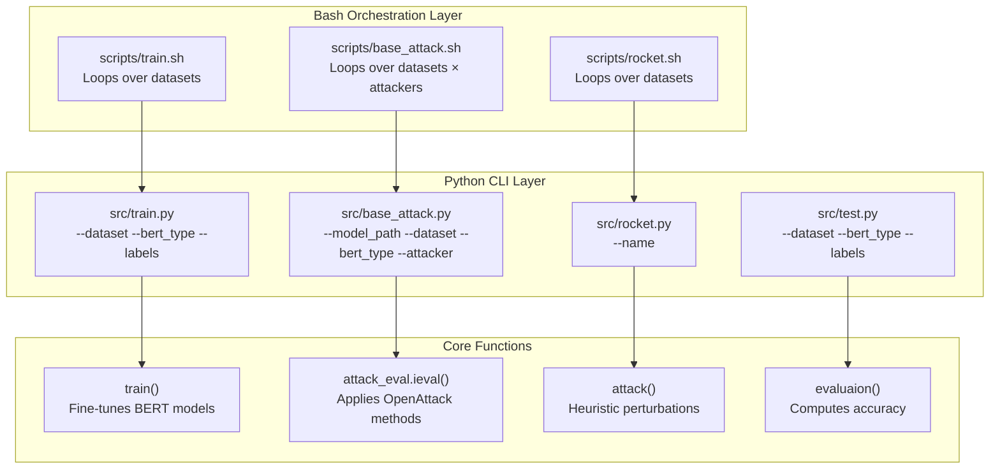
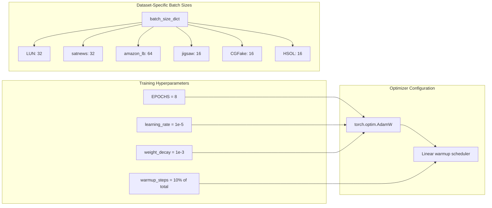
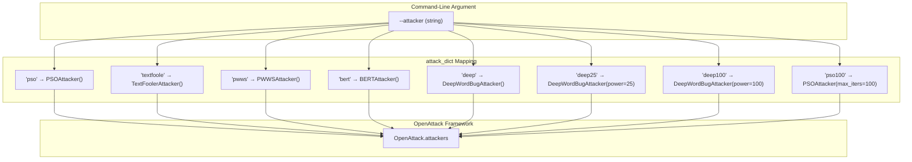
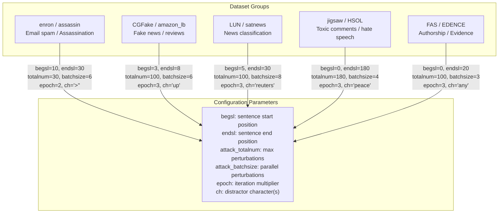
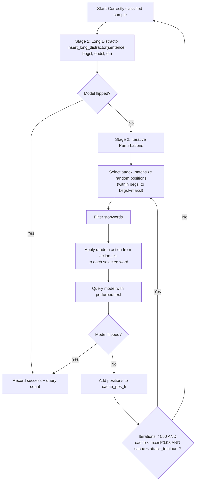
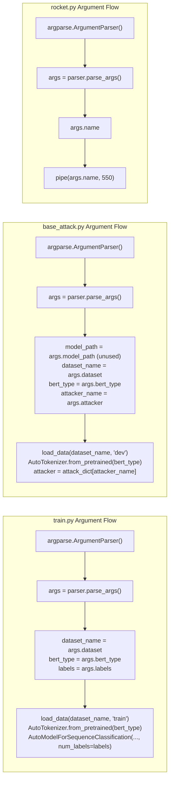

<!-- source: DeepWiki mcp.deepwiki.com · repo thunlp/Advbench · page 5.1 Command-Line Reference · fetched 2026-11-02 -->

# Command-Line Reference

<details>
<summary>Relevant source files</summary>

The following files were used as context for generating this wiki page:

- [src/base_attack.py](src/base_attack.py)
- [src/rocket.py](src/rocket.py)
- [src/test.py](src/test.py)
- [src/train.py](src/train.py)

</details>


This page provides comprehensive documentation for all command-line interfaces in the Advbench system. Each of the four main Python modules (`train.py`, `base_attack.py`, `rocket.py`, and `test.py`) accepts command-line arguments that control experimental configurations. For step-by-step usage instructions, see [Running Training Experiments](#4.1) and [Running Attack Experiments](#4.2). For information about the bash orchestration scripts that automate these commands across multiple datasets, see [Experimental Workflows](#2).

## Command-Line Interface Overview

The Advbench system exposes four primary command-line interfaces, each serving a distinct role in the experimental pipeline. These interfaces are typically invoked through bash orchestration scripts but can also be called directly for individual experiments.



**Sources**: [src/train.py:90-101](), [src/base_attack.py:83-97](), [src/rocket.py:258-262](), [src/test.py:56-67]()

## train.py Command-Line Reference

The `train.py` module fine-tunes pre-trained BERT models on security classification tasks. It saves trained models to the `/model/` directory for subsequent attack evaluation.

### Arguments

| Argument | Type | Default | Description |
|----------|------|---------|-------------|
| `--dataset` | str | `'satnews'` | Dataset name. Must match a dataset in `/data/` directory with `train.csv` and `dev.csv` files. Valid values: `LUN`, `satnews`, `amazon_lb`, `CGFake`, `HSOL`, `jigsaw`, `EDENCE`, `FAS`, `assassin`, `enron`. |
| `--bert_type` | str | `'bert-base-uncased'` | Pre-trained BERT model identifier from HuggingFace. Determines tokenizer and base architecture. |
| `--labels` | int | `2` | Number of classification labels. Most datasets use binary classification (2), but multi-class tasks may require different values. |

### Internal Configuration

The following constants are hardcoded in [src/train.py:106-125]() and cannot be modified via command-line:



**Sources**: [src/train.py:106-107](), [src/train.py:124-125]()

### Usage Examples

**Train a model on the satnews dataset (default parameters):**
```bash
python src/train.py --dataset satnews
```

**Train on CGFake dataset with explicit BERT type:**
```bash
python src/train.py --dataset CGFake --bert_type bert-base-uncased --labels 2
```

**Train on a custom dataset with 4 labels:**
```bash
python src/train.py --dataset my_dataset --labels 4
```

### Output Behavior

- Model checkpoints saved to: `model/{dataset_name}` [src/train.py:86]()
- Prints per-epoch training loss and dev accuracy [src/train.py:69-71]()
- Saves best model based on dev set performance [src/train.py:72-74]()
- Final test accuracy reported at end of training [src/train.py:84]()

**Sources**: [src/train.py:47-86](), [src/train.py:90-126]()

## base_attack.py Command-Line Reference

The `base_attack.py` module evaluates model robustness using baseline adversarial attack methods from the OpenAttack framework. It generates adversarial examples and measures attack success rates.

### Arguments

| Argument | Type | Default | Description |
|----------|------|---------|-------------|
| `--model_path` | str | `'ag_newsbert-base-uncased'` | Path to trained model file. **Note**: This argument is defined but not actually used; the code loads models from `model/{dataset}` instead [src/base_attack.py:106](). |
| `--dataset` | str | `'ag_news'` | Dataset name for loading test data and model. Must match a directory in `/data/`. |
| `--bert_type` | str | `'bert-base-uncased'` | BERT tokenizer type for input processing. Must match the tokenizer used during training. |
| `--attacker` | str | `'pwws'` | Attack method to use. Valid values: `pso`, `textfoole`, `pwws`, `bert`, `deep`, `deep25`, `deep100`, `pso100`. See attack dictionary mapping below. |

### Attack Method Registry

The system maintains an `attack_dict` mapping string identifiers to OpenAttack attacker instances [src/base_attack.py:34-43]():



**Sources**: [src/base_attack.py:34-43]()

### Usage Examples

**Run PWWS attack on satnews dataset:**
```bash
python src/base_attack.py --dataset satnews --attacker pwws
```

**Run PSO attack with 100 iterations:**
```bash
python src/base_attack.py --dataset amazon_lb --attacker pso100 --bert_type bert-base-uncased
```

**Run DeepWordBug with power=25:**
```bash
python src/base_attack.py --dataset jigsaw --attacker deep25
```

### Internal Attack Configuration

- Filters test set to correctly classified positive-label samples [src/base_attack.py:129-131]()
- Limits attack to 1000 samples if more are available [src/base_attack.py:139-140]()
- Uses random seed 714 for reproducibility [src/base_attack.py:138]()
- Collects metrics: running time, victim model queries, success/failure status [src/base_attack.py:158-167]()

### Output Behavior

- Saves adversarial examples to: `output/{dataset}_{attacker}.csv` [src/base_attack.py:183]()
- CSV columns: `origin` (original text), `attack` (adversarial text or None if failed), `query_time` (number of model queries) [src/base_attack.py:179-180]()
- Prints attack success rate and average metrics to console [src/base_attack.py:172-176]()

**Sources**: [src/base_attack.py:83-183]()

## rocket.py Command-Line Reference

The `rocket.py` module implements the ROCKET attack method, which uses heuristic-rule-based perturbations tailored to security tasks. Unlike baseline attacks, ROCKET applies task-specific character-level perturbations and long distractor insertion.

### Arguments

| Argument | Type | Default | Description |
|----------|------|---------|-------------|
| `--name` | str | `'amazon_lb'` | Dataset name for attack evaluation. Determines which task-specific attack configuration to use. Valid values: `LUN`, `satnews`, `amazon_lb`, `CGFake`, `HSOL`, `jigsaw`, `EDENCE`, `FAS`, `assassin`, `enron`. |

### Task-Specific Attack Configurations

The ROCKET attack adapts its parameters based on the target dataset's characteristics [src/rocket.py:74-121]():



**Parameter Definitions** [src/rocket.py:74-121]():

- `begsl`: Starting word position for perturbations in original text
- `endsl`: Ending word position for long distractor insertion
- `attack_totalnum`: Maximum number of word positions to perturb
- `attack_batchsize`: Number of words to perturb in parallel per iteration
- `epoch`: Multiplier for perturbation attempts per batch
- `ch`: Character string used as long distractor
- `attack_ori_only`: Whether to only perturb original text (True for all datasets)

### Attack Algorithm Parameters

The ROCKET attack hardcodes the following in [src/rocket.py:68]() and [src/rocket.py:262]():

| Parameter | Value | Description |
|-----------|-------|-------------|
| `action_list` | `[insert_irrelevant, delete_char, swap_char, sub_char]` | Character-level perturbation functions from `attack_util.py` |
| `ATTACK_ITER` | `550` | Maximum attack iterations per sample |
| `random.seed` | `714` | Random seed for reproducibility |

### Usage Examples

**Run ROCKET attack on enron dataset:**
```bash
python src/rocket.py --name enron
```

**Run ROCKET on jigsaw dataset:**
```bash
python src/rocket.py --name jigsaw
```

### Two-Tiered Attack Strategy

The ROCKET algorithm employs a two-stage approach [src/rocket.py:133-226]():



**Sources**: [src/rocket.py:123-226]()

### Output Behavior

- Prints original accuracy before attack [src/rocket.py:62]()
- Prints attack success rate incrementally [src/rocket.py:140, 208]()
- Saves successful attacks to: `output/{task_name}_rocket.csv` [src/rocket.py:226]()
- CSV columns: `origin`, `attack`, `querytime` [src/rocket.py:224-225]()
- Reports final ASR and total query count [src/rocket.py:222-228]()

**Sources**: [src/rocket.py:51-228](), [src/rocket.py:258-262]()

## test.py Command-Line Reference

The `test.py` module evaluates trained model accuracy on test sets without adversarial perturbations. It provides a simple interface for model validation.

### Arguments

| Argument | Type | Default | Description |
|----------|------|---------|-------------|
| `--dataset` | str | `'satnews'` | Dataset name for evaluation. Must match a directory in `/data/` with `dev.csv` file. |
| `--bert_type` | str | `'bert-base-uncased'` | BERT tokenizer type. Must match the tokenizer used during training. |
| `--labels` | int | `2` | Number of classification labels. Must match the model's output layer configuration. |

### Usage Examples

**Evaluate model on satnews dataset:**
```bash
python src/test.py --dataset satnews
```

**Evaluate model on CGFake dataset:**
```bash
python src/test.py --dataset CGFake --bert_type bert-base-uncased --labels 2
```

### Output Behavior

- Loads model from: `model/{dataset}` [src/test.py:75]()
- Prints test accuracy to console [src/test.py:42, 50]()
- **Note**: Lines 51-52 contain duplicate code that saves the model again, which is likely unintended [src/test.py:51-52]()

**Sources**: [src/test.py:40-86]()

## Common Command-Line Patterns

### Argument-to-Code Variable Mapping

The following diagram shows how command-line arguments are parsed and used within each module:



**Sources**: [src/train.py:90-126](), [src/base_attack.py:83-143](), [src/rocket.py:258-262]()

### Dataset Name Consistency

All scripts expect dataset names to match directory names in `/data/` and saved model names in `/model/`:

| Dataset | Directory Path | Model Path | Batch Size (train.py) |
|---------|----------------|------------|----------------------|
| `LUN` | `data/LUN/` | `model/LUN` | 32 |
| `satnews` | `data/satnews/` | `model/satnews` | 32 |
| `amazon_lb` | `data/amazon_lb/` | `model/amazon_lb` | 64 |
| `CGFake` | `data/CGFake/` | `model/CGFake` | 16 |
| `HSOL` | `data/HSOL/` | `model/HSOL` | 16 |
| `jigsaw` | `data/jigsaw/` | `model/jigsaw` | 16 |
| `EDENCE` | `data/EDENCE/` | `model/EDENCE` | 32 |
| `FAS` | `data/FAS/` | `model/FAS` | 32 |
| `assassin` | `data/assassin/` | `model/assassin` | 32 |
| `enron` | `data/enron/` | `model/enron` | 32 |

**Sources**: [src/train.py:107](), [src/train.py:20-25](), [src/train.py:86]()

### Path Resolution

All modules use absolute path resolution to locate data, models, and output directories [src/train.py:16](), [src/base_attack.py:21](), [src/rocket.py:23]():

```python
base_path = os.path.abspath('.')
data_path = base_path + "/data/"
model_path = base_path + "/model/"
output_path = base_path + "/output/"
```

This requires scripts to be executed from the repository root directory.

**Sources**: [src/train.py:16-17](), [src/base_attack.py:21-22](), [src/rocket.py:23-24](), [src/test.py:11-12]()

### Execution Order Dependencies

The experimental pipeline requires execution in the following order:

1. **Training**: `python src/train.py --dataset X` creates `model/X`
2. **Baseline Attack**: `python src/base_attack.py --dataset X --attacker Y` reads `model/X`, writes `output/X_Y.csv`
3. **ROCKET Attack**: `python src/rocket.py --name X` reads `model/X`, writes `output/X_rocket.csv`
4. **Evaluation**: `python src/test.py --dataset X` reads `model/X`

The orchestration scripts in `/scripts/` automate this workflow across all dataset-attacker combinations. See [Experimental Workflows](#2) for details.

**Sources**: [src/train.py:86](), [src/base_attack.py:106](), [src/rocket.py:239](), [src/test.py:75]()

---

