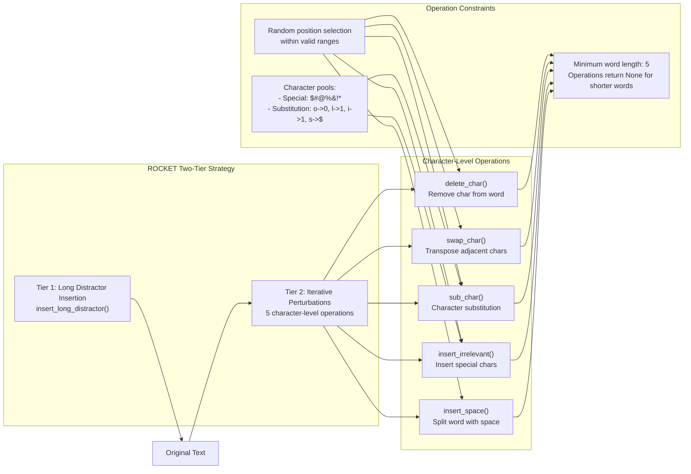
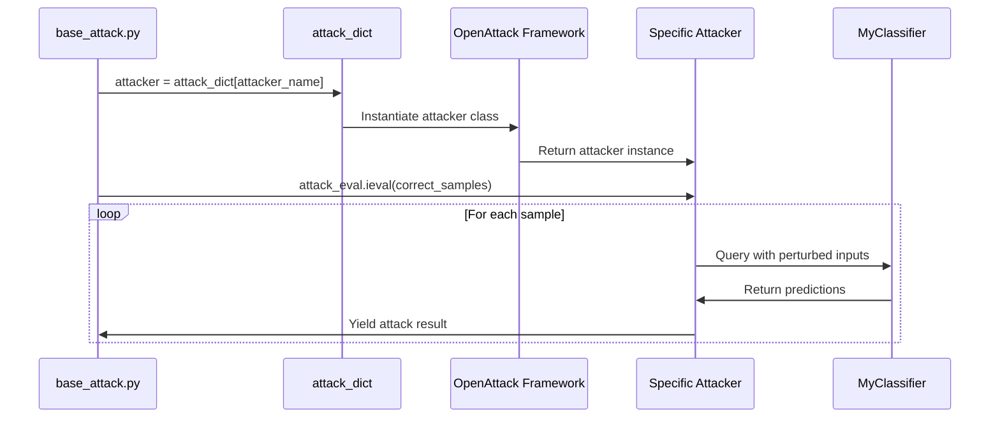
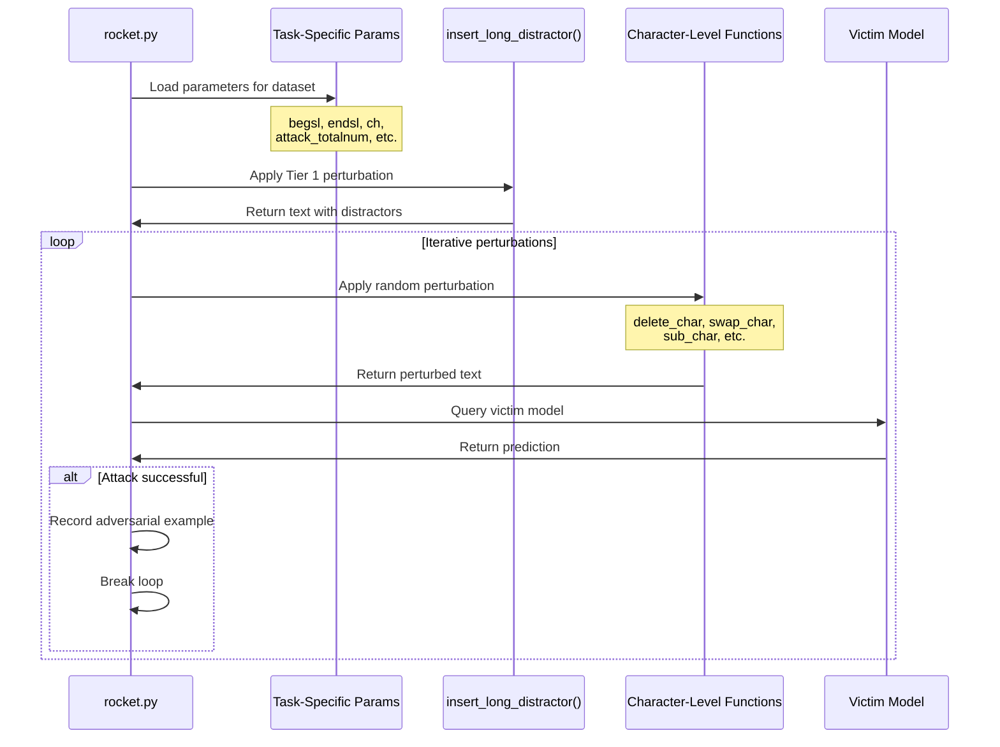

<!-- source: DeepWiki mcp.deepwiki.com · repo thunlp/Advbench · page 5.2 Attack Method Catalog · fetched 2026-11-02 -->

# Attack Method Catalog

<details>
<summary>Relevant source files</summary>

The following files were used as context for generating this wiki page:

- [README.md](README.md)
- [src/attack_util.py](src/attack_util.py)
- [src/base_attack.py](src/base_attack.py)

</details>


## Purpose and Scope

This document provides a comprehensive catalog of all adversarial attack methods available in the Advbench system. The system includes two categories of attack methods: **8 baseline methods** implemented through the OpenAttack framework integration, and **ROCKET perturbation techniques** which use heuristic-rule-based character-level operations. Each method is documented with its implementation details, characteristics, and appropriate use cases.

For information about executing these attack methods in experiments, see [Running Attack Experiments](#4.2). For technical implementation details, see [OpenAttack Integration](#3.4) and [ROCKET Implementation](#3.5).

---

## Attack Method Architecture

The Advbench system implements two parallel attack strategies that represent different research paradigms in adversarial NLP:

```mermaid
graph TB
    subgraph "Attack Method Categories"
        BASELINE["Baseline Attack Methods<br/>(via OpenAttack)"]
        ROCKET["ROCKET Perturbation<br/>Techniques"]
    end
    
    subgraph "Baseline Methods Registry"
        PSO["pso: PSOAttacker()"]
        PSO100["pso100: PSOAttacker(max_iters=100)"]
        TF["textfoole: TextFoolerAttacker()"]
        PWWS["pwws: PWWSAttacker()"]
        BERT["bert: BERTAttacker()"]
        DEEP["deep: DeepWordBugAttacker()"]
        DEEP25["deep25: DeepWordBugAttacker(power=25)"]
        DEEP100["deep100: DeepWordBugAttacker(power=100)"]
    end
    
    subgraph "ROCKET Perturbation Functions"
        ILD["insert_long_distractor<br/>begsl, endsl, ch params"]
        DELC["delete_char<br/>Remove single character"]
        SWAPC["swap_char<br/>Transpose adjacent chars"]
        SUBC["sub_char<br/>Character substitution"]
        IRREL["insert_irrelevant<br/>Insert special chars"]
    end
    
    subgraph "attack_dict Registry"
        DICT["Dictionary mapping<br/>attacker_name -> attacker_instance"]
    end
    
    subgraph "attack_util Module"
        UTIL["Perturbation function library<br/>Character-level operations"]
    end
    
    BASELINE --> PSO
    BASELINE --> PSO100
    BASELINE --> TF
    BASELINE --> PWWS
    BASELINE --> BERT
    BASELINE --> DEEP
    BASELINE --> DEEP25
    BASELINE --> DEEP100
    
    PSO --> DICT
    PSO100 --> DICT
    TF --> DICT
    PWWS --> DICT
    BERT --> DICT
    DEEP --> DICT
    DEEP25 --> DICT
    DEEP100 --> DICT
    
    ROCKET --> ILD
    ROCKET --> DELC
    ROCKET --> SWAPC
    ROCKET --> SUBC
    ROCKET --> IRREL
    
    ILD --> UTIL
    DELC --> UTIL
    SWAPC --> UTIL
    SUBC --> UTIL
    IRREL --> UTIL
```



**Sources**: [src/base_attack.py:34-43](), [src/attack_util.py:4-108]()

---

## Baseline Attack Methods

The baseline attack methods are provided through the OpenAttack framework integration. All methods are registered in the `attack_dict` dictionary and can be accessed by their string identifiers.

### Method Registry Structure

| Identifier | Class | Configuration | Primary Strategy |
|------------|-------|---------------|------------------|
| `pso` | `PSOAttacker` | Default parameters | Word substitution via particle swarm optimization |
| `pso100` | `PSOAttacker` | `max_iters=100` | Extended iteration PSO for higher success rate |
| `textfoole` | `TextFoolerAttacker` | Default parameters | Counter-fitted word embeddings for synonym replacement |
| `pwws` | `PWWSAttacker` | Default parameters | Word saliency-based substitution |
| `bert` | `BERTAttacker` | Default parameters | BERT masked language model predictions |
| `deep` | `DeepWordBugAttacker` | Default power | Character-level perturbations (default) |
| `deep25` | `DeepWordBugAttacker` | `power=25` | Character-level perturbations (medium) |
| `deep100` | `DeepWordBugAttacker` | `power=100` | Character-level perturbations (extensive) |

**Sources**: [src/base_attack.py:34-43]()

### PSO-Based Attacks

#### pso - Standard Particle Swarm Optimization

**Implementation**: `OpenAttack.attackers.PSOAttacker()`

**Attack Strategy**: Uses particle swarm optimization to search for optimal word substitutions. Each particle represents a candidate adversarial example, and the swarm iteratively explores the search space to find word replacements that maximize attack success while maintaining semantic similarity.

**Characteristics**:
- **Search Method**: Population-based metaheuristic optimization
- **Perturbation Level**: Word-level substitutions
- **Query Efficiency**: Moderate (depends on swarm size and iterations)
- **Success Rate**: Typically high on standard NLP tasks

**Use Cases**: Suitable for tasks where semantic preservation is important and computational budget allows for iterative optimization.

#### pso100 - Extended Iteration PSO

**Implementation**: `OpenAttack.attackers.PSOAttacker(max_iters=100)`

**Attack Strategy**: Same as standard PSO but with extended iteration count to 100, allowing more thorough exploration of the search space at the cost of increased query count.

**Characteristics**:
- **Search Method**: Extended particle swarm optimization
- **Perturbation Level**: Word-level substitutions
- **Query Efficiency**: Lower (more iterations = more queries)
- **Success Rate**: Higher than standard PSO due to more thorough search

**Use Cases**: When maximum attack success rate is prioritized over query efficiency.

**Sources**: [src/base_attack.py:35,42]()

### Synonym-Based Attacks

#### textfoole - TextFooler Attack

**Implementation**: `OpenAttack.attackers.TextFoolerAttacker()`

**Attack Strategy**: Uses counter-fitted word embeddings to find semantically similar word substitutions. Ranks words by importance (based on model prediction change when removed), then replaces important words with synonyms that maximize prediction change.

**Characteristics**:
- **Search Method**: Greedy word importance ranking + synonym replacement
- **Perturbation Level**: Word-level substitutions
- **Query Efficiency**: Moderate (queries proportional to text length)
- **Success Rate**: High on many NLP tasks

**Use Cases**: General-purpose attack for classification tasks where maintaining semantic similarity is important.

#### pwws - Probability Weighted Word Saliency

**Implementation**: `OpenAttack.attackers.PWWSAttacker()`

**Attack Strategy**: Computes word saliency scores by measuring how much each word contributes to the correct classification probability. Replaces high-saliency words with synonyms from WordNet that reduce classification confidence.

**Characteristics**:
- **Search Method**: Saliency-based greedy search
- **Perturbation Level**: Word-level substitutions using WordNet
- **Query Efficiency**: Good (targets most influential words first)
- **Success Rate**: High, especially when WordNet provides good synonyms

**Use Cases**: Effective when interpretability of attacked words is desired, as saliency scores indicate which words are most critical for the model's decision.

**Sources**: [src/base_attack.py:36-37]()

### Language Model-Based Attacks

#### bert - BERT Masked Language Model Attack

**Implementation**: `OpenAttack.attackers.BERTAttacker()`

**Attack Strategy**: Uses BERT's masked language modeling capability to generate contextually appropriate word replacements. Masks each word position and uses BERT to predict alternative words that fit the context, selecting replacements that cause misclassification.

**Characteristics**:
- **Search Method**: Masked language model predictions
- **Perturbation Level**: Word-level substitutions
- **Query Efficiency**: Moderate (BERT inference + victim model queries)
- **Success Rate**: High, with good semantic preservation

**Use Cases**: Generates more fluent adversarial examples due to context-aware substitutions. Effective when adversarial examples need to appear natural.

**Sources**: [src/base_attack.py:38]()

### Character-Level Attacks

#### deep - Standard DeepWordBug

**Implementation**: `OpenAttack.attackers.DeepWordBugAttacker()`

**Attack Strategy**: Applies character-level perturbations (insertions, deletions, substitutions, swaps) based on scoring functions that estimate the impact on model predictions. Uses default power parameter.

**Characteristics**:
- **Search Method**: Scoring-based character perturbation selection
- **Perturbation Level**: Character-level operations
- **Query Efficiency**: Good (character operations are fast)
- **Success Rate**: Moderate (depends on model's robustness to typos)

**Use Cases**: Simulates typographical errors and bypasses character-level defenses.

#### deep25 - Medium Power DeepWordBug

**Implementation**: `OpenAttack.attackers.DeepWordBugAttacker(power=25)`

**Attack Strategy**: Same as standard DeepWordBug but with power parameter set to 25, allowing more extensive character-level perturbations.

**Characteristics**:
- **Search Method**: Scoring-based with increased perturbation budget
- **Perturbation Level**: Character-level operations (more extensive)
- **Query Efficiency**: Moderate
- **Success Rate**: Higher than standard deep

**Use Cases**: When more aggressive character-level perturbations are needed while maintaining some readability.

#### deep100 - Extensive DeepWordBug

**Implementation**: `OpenAttack.attackers.DeepWordBugAttacker(power=100)`

**Attack Strategy**: Most aggressive DeepWordBug configuration with power=100, allowing extensive character-level modifications.

**Characteristics**:
- **Search Method**: Scoring-based with maximum perturbation budget
- **Perturbation Level**: Character-level operations (extensive)
- **Query Efficiency**: Lower (more perturbations = more attempts)
- **Success Rate**: Highest among DeepWordBug variants

**Use Cases**: Maximum attack success rate scenarios where extensive character perturbations are acceptable.

**Sources**: [src/base_attack.py:39-41]()

---

## ROCKET Perturbation Techniques

ROCKET (Rule-based OCcluded Kill and Extraction Techniques) implements heuristic perturbation functions designed to simulate practical, real-world attack patterns rather than imperceptible modifications. All functions are implemented in the `attack_util` module.



**Sources**: [src/attack_util.py:4-108](), [src/rocket.py:56]()

### Tier 1: Long Distractor Insertion

#### insert_long_distractor

**Function Signature**: `insert_long_distractor(sentence, begsl, endsl, ch)`

**Implementation Location**: [src/attack_util.py:4-16]()

**Attack Strategy**: Inserts repetitive distractor words at the beginning and/or end of the input text to overwhelm the model or exploit length limitations. This is the primary perturbation applied before iterative character-level operations.

**Parameters**:
| Parameter | Type | Description |
|-----------|------|-------------|
| `sentence` | str | Original input text |
| `begsl` | int | Number of distractor repetitions to prepend |
| `endsl` | int | Number of distractor repetitions to append |
| `ch` | str | Character/word to use as distractor |

**Perturbation Behavior**:
```python
# Creates: "{ch } * begsl + sentence + { ch} * endsl"
# Example: begsl=3, endsl=2, ch="up"
# "Hello world" -> "up up up Hello world up up"
```

**Task-Specific Configurations**:
- **Email spam (enron, assassin)**: `begsl=10, ch='>'` - Prepends email-like markers
- **Fake news (CGFake, amazon_lb)**: `begsl=3, ch='up'` - Adds filler words
- **Toxic content (jigsaw, HSOL)**: `begsl=0, endsl=180, ch='peace'` - Appends peace-related tokens

**Use Cases**: Exploits models that:
- Have limited maximum sequence length
- Weight beginning/end tokens differently
- Are vulnerable to distractor tokens

**Sources**: [src/attack_util.py:4-16](), [src/rocket.py:59-99]()

### Tier 2: Character-Level Perturbations

All character-level perturbation functions share common constraints:
- **Minimum Word Length**: 5 characters (returns `None` for shorter words)
- **Random Position Selection**: Operations target randomly selected positions within valid ranges
- **Preserves Word Boundaries**: Operations modify characters within words, not word order

#### delete_char

**Function Signature**: `delete_char(word)`

**Implementation Location**: [src/attack_util.py:53-59]()

**Attack Strategy**: Removes a single character from a random position in the word (excluding first and last positions).

**Perturbation Behavior**:
```python
# Example: "foolish" -> "folish" (removes 'o' at position 2)
# Valid positions: 1 to len(word)-2
```

**Characteristics**:
- **Perturbation Type**: Character deletion
- **Visibility**: Highly visible (creates misspelling)
- **Position Selection**: `random.choice(range(0, word_len-1)) + 1`

**Use Cases**: Simulates typos, especially useful for spam/phishing scenarios where intentional misspellings bypass filters.

#### swap_char

**Function Signature**: `swap_char(word)`

**Implementation Location**: [src/attack_util.py:63-71]()

**Attack Strategy**: Transposes two adjacent characters at a random position in the word.

**Perturbation Behavior**:
```python
# Example: "foolish" -> "fooilsh" (swaps 'l' and 'i' at positions 4-5)
# Valid positions: 1 to len(word)-3 (ensures both chars exist)
```

**Characteristics**:
- **Perturbation Type**: Character transposition
- **Visibility**: Moderately visible (common typo pattern)
- **Position Selection**: `random.choice(range(0, word_len-2)) + 1`

**Use Cases**: Simulates common typing errors (transposition mistakes).

#### sub_char

**Function Signature**: `sub_char(word)`

**Implementation Location**: [src/attack_util.py:78-108]()

**Attack Strategy**: Substitutes characters with visually similar or commonly confused alternatives. Uses a predefined substitution dictionary.

**Substitution Dictionary**:
| Original | Substitute | Reasoning |
|----------|------------|-----------|
| `'o'` | `'0'` | Visual similarity (letter O vs digit 0) |
| `'l'` | `'1'` | Visual similarity (lowercase L vs digit 1) |
| `'i'` | `'1'` | Visual similarity (lowercase i vs digit 1) |
| `'s'` | `'$'` | Leet-speak convention |

**Perturbation Behavior**:
```python
# Example: "foolish" -> "f00lish" (substitutes both 'o' characters)
# Returns None if no substitutable characters found
# Processes sub_list in random order until match found
```

**Characteristics**:
- **Perturbation Type**: Character substitution (leetspeak/homoglyph)
- **Visibility**: Moderately visible but semantically clear
- **Target Selection**: Randomized order through `sub_list`

**Use Cases**: Bypasses simple pattern matching filters, simulates leetspeak obfuscation commonly used in spam/toxic content.

**Sources**: [src/attack_util.py:78-108]()

#### insert_irrelevant

**Function Signature**: `insert_irrelevant(word)`

**Implementation Location**: [src/attack_util.py:40-51]()

**Attack Strategy**: Inserts a special character from a predefined pool at a random position within the word.

**Special Character Pool**: `['$', '#', '@', '%', '&', '!', '*']`

**Perturbation Behavior**:
```python
# Example: "foolish" -> "fool#ish" (inserts '#' at position 4)
# Valid positions: 1 to len(word)-1
```

**Characteristics**:
- **Perturbation Type**: Special character insertion
- **Visibility**: Highly visible (clear corruption)
- **Character Selection**: Random from pool
- **Position Selection**: `random.choice(range(0, word_len-1)) + 1`

**Use Cases**: Simulates aggressive obfuscation techniques used to bypass keyword filters in spam/abuse detection.

#### insert_space

**Function Signature**: `insert_space(word)`

**Implementation Location**: [src/attack_util.py:32-38]()

**Attack Strategy**: Splits a word by inserting a space at a random position, creating two tokens from one word.

**Perturbation Behavior**:
```python
# Example: "foolish" -> "fool ish" (splits at position 4)
# Valid positions: 1 to len(word)-1
```

**Characteristics**:
- **Perturbation Type**: Word splitting
- **Visibility**: Moderately visible (creates unusual token boundary)
- **Position Selection**: `random.choice(range(0, word_len-1)) + 1`

**Use Cases**: Bypasses exact word matching in filtering systems, simulates intentional word breaking to evade detection.

**Sources**: [src/attack_util.py:32-51]()

---

## Attack Method Selection Guide

The following table provides guidance on selecting appropriate attack methods based on experimental goals:

| Research Goal | Recommended Methods | Rationale |
|---------------|---------------------|-----------|
| **Compare with literature** | `pso`, `textfoole`, `pwws`, `bert` | Standard baselines used in adversarial NLP research |
| **Character-level robustness** | `deep`, `deep25`, `deep100` | Varying levels of character perturbation intensity |
| **Query efficiency analysis** | `pso` vs `pso100`, `deep` vs `deep100` | Compare standard vs extended iterations |
| **Real-world attack simulation** | `insert_long_distractor`, `sub_char`, `insert_irrelevant` | ROCKET methods simulate practical evasion techniques |
| **Spam/phishing scenarios** | `insert_long_distractor` (begsl=10, ch='>'), `sub_char` | Email-specific obfuscation patterns |
| **Content moderation evasion** | `insert_long_distractor` (endsl=180, ch='peace'), `insert_irrelevant` | Toxic content obfuscation techniques |
| **Maximum attack success** | `pso100`, `deep100`, combined ROCKET | Most aggressive configurations |

**Sources**: [src/base_attack.py:34-43](), [src/rocket.py:59-99]()

---

## Method Invocation Patterns

### Baseline Method Invocation

Baseline methods are invoked through the `attack_dict` registry in `base_attack.py`:



**Command-Line Access**: 
```bash
python src/base_attack.py --dataset enron --attacker pso
python src/base_attack.py --dataset jigsaw --attacker textfoole
python src/base_attack.py --dataset CGFake --attacker deep100
```

**Sources**: [src/base_attack.py:143](), [scripts/base_attack.sh:4-7]()

### ROCKET Method Invocation

ROCKET methods are invoked through the `rocket.py` module with task-specific parameters:



**Command-Line Access**:
```bash
python src/rocket.py --name enron --begsl 10 --ch '>'
python src/rocket.py --name jigsaw --endsl 180 --ch 'peace'
```

**Sources**: [src/rocket.py:56-166](), [scripts/rocket.sh:4-6]()

---

## Performance Characteristics

### Query Efficiency Comparison

The following table summarizes typical query efficiency patterns observed across attack methods:

| Method Category | Average Queries per Attack | Efficiency Rating | Notes |
|-----------------|---------------------------|-------------------|-------|
| PSO (standard) | ~50-100 | Moderate | Depends on swarm size |
| PSO (100 iters) | ~100-200 | Low | Extended iterations |
| TextFooler | ~20-50 | Good | Greedy word replacement |
| PWWS | ~20-40 | Good | Saliency-based targeting |
| BERT Attack | ~30-60 | Moderate | MLM inference overhead |
| DeepWordBug | ~10-30 | Excellent | Fast character operations |
| ROCKET | ~5-20 | Excellent | Simple heuristics |

**Measurement Details**: Query counts are tracked in [src/base_attack.py:159]() for baseline methods and in the ROCKET implementation for heuristic methods.

**Sources**: [src/base_attack.py:127-176](), [src/rocket.py:163-166]()

### Success Rate Patterns

Different methods exhibit varying success rates across security tasks:

**Word-Level Methods** (PSO, TextFooler, PWWS, BERT):
- High success on sentiment/topic classification
- Moderate success on spam/toxic detection
- Challenge: Security models often robust to synonym replacement

**Character-Level Methods** (DeepWordBug variants):
- Moderate success on general classification
- Variable success on security tasks
- Power parameter significantly impacts success rate

**ROCKET Methods**:
- High success on specific security tasks (spam, toxic content)
- Success depends on task-specific parameter tuning
- Distractor insertion particularly effective for length-sensitive models

**Sources**: [README.md:7-12]()

---

