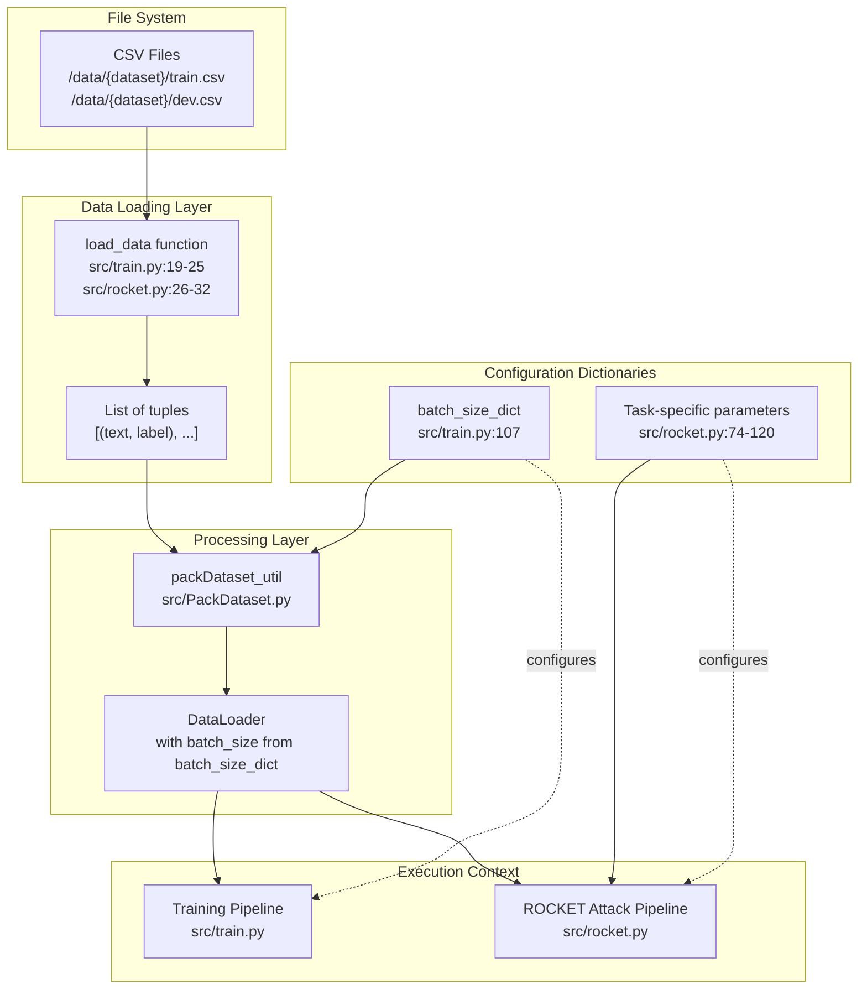
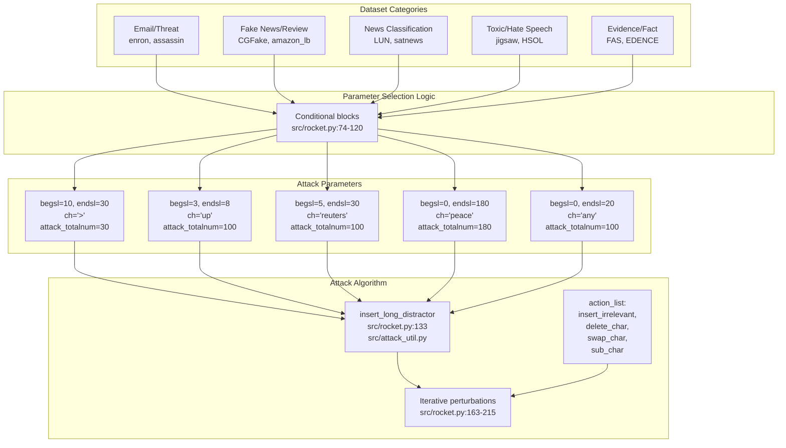
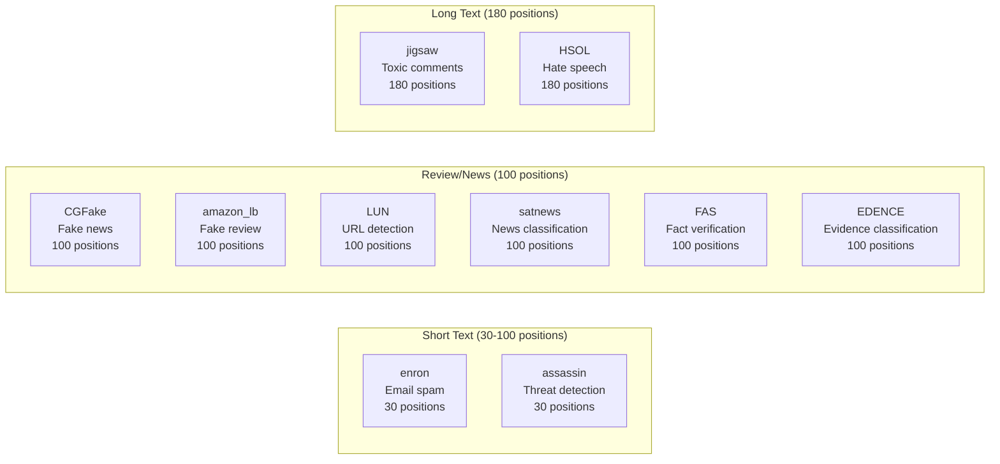

<!-- source: DeepWiki mcp.deepwiki.com · repo thunlp/Advbench · page 5.3 Dataset Specifications · fetched 2026-11-02 -->

# Dataset Specifications

<details>
<summary>Relevant source files</summary>

The following files were used as context for generating this wiki page:

- [README.md](README.md)
- [src/rocket.py](src/rocket.py)
- [src/train.py](src/train.py)

</details>


This page provides detailed technical specifications for each of the 10 security datasets included in the Advbench benchmark. This includes file formats, batch sizes, and task-specific attack parameters. For general information about obtaining and using the datasets, see [Datasets](#1.3). For instructions on running experiments with these datasets, see [Running Attack Experiments](#4.2).

## Dataset Overview

Advbench includes 10 datasets representing diverse security-oriented NLP tasks. The following table provides a comprehensive reference for all datasets:

| Dataset | Security Task | Training Batch Size | File Location Pattern |
|---------|--------------|-------------------|---------------------|
| `LUN` | URL/Link detection | 32 | `/data/LUN/train.csv`, `/data/LUN/dev.csv` |
| `satnews` | News classification | 32 | `/data/satnews/train.csv`, `/data/satnews/dev.csv` |
| `amazon_lb` | Review authenticity | 64 | `/data/amazon_lb/train.csv`, `/data/amazon_lb/dev.csv` |
| `CGFake` | Fake news detection | 16 | `/data/CGFake/train.csv`, `/data/CGFake/dev.csv` |
| `HSOL` | Hate speech detection | 16 | `/data/HSOL/train.csv`, `/data/HSOL/dev.csv` |
| `jigsaw` | Toxic comment detection | 16 | `/data/jigsaw/train.csv`, `/data/jigsaw/dev.csv` |
| `EDENCE` | Evidence classification | 32 | `/data/EDENCE/train.csv`, `/data/EDENCE/dev.csv` |
| `FAS` | Fact verification | 32 | `/data/FAS/train.csv`, `/data/FAS/dev.csv` |
| `assassin` | Threat detection | 32 | `/data/assassin/train.csv`, `/data/assassin/dev.csv` |
| `enron` | Email spam detection | 32 | `/data/enron/train.csv`, `/data/enron/dev.csv` |

**Sources**: [src/train.py:107](), [scripts/train.sh:2](), [README.md:34-41]()

## File Format Specifications

### Directory Structure

Each dataset follows a standardized directory structure within the `/data/` directory:

```
data/
├── LUN/
│   ├── train.csv
│   └── dev.csv
├── satnews/
│   ├── train.csv
│   └── dev.csv
├── amazon_lb/
│   ├── train.csv
│   └── dev.csv
...
```

### CSV File Schema

All dataset files use CSV format with the following schema:

| Column | Type | Description |
|--------|------|-------------|
| `text` | string | Input text to be classified |
| `label` | integer | Ground truth label (binary: 0 or 1) |

The `load_data` function reads these files and returns a list of tuples in the format `(text, label)`:

```python
# Example from load_data function
[(text_1, label_1), (text_2, label_2), ...]
```

**Sources**: [src/train.py:19-25](), [src/rocket.py:26-32]()

## Dataset-to-Code Entity Mapping



**Sources**: [src/train.py:19-25](), [src/train.py:107](), [src/rocket.py:26-32](), [src/rocket.py:74-120]()

## Training Batch Size Configuration

The `batch_size_dict` in [src/train.py:107]() specifies the training batch size for each dataset:

```python
batch_size_dict = {
    'LUN': 32,
    'satnews': 32,
    'amazon_lb': 64,
    'jigsaw': 16,
    'EDENCE': 32,
    'CGFake': 16,
    'HSOL': 16,
    'FAS': 32,
    'assassin': 32,
    'enron': 32
}
```

### Batch Size Rationale

- **64**: `amazon_lb` - Higher batch size for memory efficiency on review text
- **32**: `LUN`, `satnews`, `EDENCE`, `FAS`, `assassin`, `enron` - Standard batch size
- **16**: `CGFake`, `HSOL`, `jigsaw` - Smaller batch size for memory-intensive datasets (long texts, toxic comments)

These batch sizes are used in [src/train.py:120]() when creating the training DataLoader:

```python
train_loader = pack_util.get_loader(orig_train, shuffle=True, batch_size=batch_size_dict[dataset_name])
```

**Sources**: [src/train.py:107](), [src/train.py:120]()

## ROCKET Attack Parameter Specifications

The ROCKET method uses task-specific attack parameters configured in [src/rocket.py:74-120](). These parameters control the perturbation strategy for each dataset category.

### Parameter Definitions

| Parameter | Type | Description |
|-----------|------|-------------|
| `begsl` | int | Beginning sentence length for long distractor insertion |
| `endsl` | int | Ending sentence length for long distractor insertion |
| `attack_totalnum` | int | Maximum number of positions to perturb |
| `attack_batchsize` | int | Number of positions to perturb in parallel per iteration |
| `epoch` | int | Number of perturbation epochs per batch |
| `ch` | string | Distractor character/word for insertion |
| `attack_ori_only` | bool | Whether to only perturb original text (not inserted distractor) |

### Dataset-Specific Configurations

#### Email/Threat Detection: `enron`, `assassin`

```python
begsl = 10
endsl = 30
attack_batchsize = 6
attack_totalnum = 30
epoch = 2
ch = ">"
attack_ori_only = True
```

- **Distractor**: `">"`  (single character)
- **Range**: Insert distractor between positions 10-30
- **Focus**: Short, targeted perturbations for email content
- **Total positions**: Up to 30 perturbations

#### Fake News/Reviews: `CGFake`, `amazon_lb`

```python
begsl = 3
endsl = 8
attack_totalnum = 100
attack_batchsize = 6
epoch = 3
ch = "up"
attack_ori_only = True
```

- **Distractor**: `"up"` (word)
- **Range**: Insert distractor between positions 3-8
- **Focus**: Early insertion to disrupt review/news classification
- **Total positions**: Up to 100 perturbations (comprehensive)

#### News Classification: `LUN`, `satnews`

```python
begsl = 5
endsl = 30
attack_totalnum = 100
attack_batchsize = 8
epoch = 3
ch = "reuters"
attack_ori_only = True
```

- **Distractor**: `"reuters"` (news-related word)
- **Range**: Insert distractor between positions 5-30
- **Focus**: Domain-relevant distractor for news text
- **Total positions**: Up to 100 perturbations

#### Toxic/Hate Speech: `jigsaw`, `HSOL`

```python
begsl = 0
endsl = 180
attack_totalnum = 180
attack_batchsize = 4
epoch = 3
ch = "peace"
attack_ori_only = True
```

- **Distractor**: `"peace"` (opposite sentiment word)
- **Range**: Insert distractor at beginning (position 0-180)
- **Focus**: Long distractor to dilute toxic content
- **Total positions**: Up to 180 perturbations (extensive for long comments)

#### Evidence/Fact Verification: `FAS`, `EDENCE`

```python
begsl = 0
endsl = 20
attack_totalnum = 100
attack_batchsize = 3
epoch = 3
ch = "any"
attack_ori_only = True
```

- **Distractor**: `"any"` (generic word)
- **Range**: Insert distractor at beginning (position 0-20)
- **Focus**: Modest distractor for evidence text
- **Total positions**: Up to 100 perturbations

**Sources**: [src/rocket.py:74-120]()

## Attack Parameter Configuration Flow



**Sources**: [src/rocket.py:74-120](), [src/rocket.py:133](), [src/rocket.py:163-215](), [src/attack_util.py:4-108]()

## Attack Parameter Usage in Code

The attack parameters are used in two main stages within the ROCKET attack algorithm:

### Stage 1: Long Distractor Insertion

[src/rocket.py:133]() applies the long distractor using the configured parameters:

```python
sentence = insert_long_distractor(sentence, begsl, endsl, ch)
```

The `insert_long_distractor` function (from [src/attack_util.py]()) inserts a repeated distractor word/character between positions `begsl` and `endsl` in the sentence.

### Stage 2: Iterative Perturbations

[src/rocket.py:163-215]() performs character-level perturbations on selected word positions:

```python
while cur_iter < ATTACK_ITER and len(cache_pos_li) < maxsl*0.98 and len(cache_pos_li) < attack_totalnum:
    # Select attack_batchsize positions
    for p in range(attack_batchsize):
        if attack_ori_only:
            word_pos[p] = random.choice(list(range(begsl, begsl+maxsl)))
        else:
            word_pos[p] = random.choice(list(range(0, maxsl)))
    
    # Apply perturbations for epoch iterations
    for e in range(attack_batchsize*epoch + int(0.05*len(cache_pos_li))):
        for i in range(attack_batchsize):
            # Apply random action from action_list
            action = random.choice(action_list)
            new_word = action(target_word)
```

The parameters control:
- **`attack_totalnum`**: Maximum positions to perturb before stopping
- **`attack_batchsize`**: How many positions to perturb simultaneously
- **`epoch`**: Number of perturbation iterations per batch
- **`begsl`/`attack_ori_only`**: Which part of the text to perturb

**Sources**: [src/rocket.py:133](), [src/rocket.py:163-215]()

## Dataset Categories Summary



**Sources**: [src/rocket.py:74-120]()

## Implementation Notes

### Random Seed

The ROCKET implementation uses a fixed random seed for reproducibility:

```python
random.seed(714)
```

This is set in [src/rocket.py:20]().

### Sample Limiting

To manage computational cost, if a dataset has more than 1000 correctly classified samples, ROCKET randomly samples 1000 for attack evaluation:

```python
if len(correct_samples) > 1000:
    correct_samples = random.sample(correct_samples, 1000)
```

This occurs in [src/rocket.py:65-66]().

### Stopword Filtering

The attack algorithm skips perturbations on stopwords to maintain text coherence:

```python
if target_word in stopwords_list: continue
```

Stopwords are loaded from NLTK's English stopwords list in [src/rocket.py:52]().

**Sources**: [src/rocket.py:20](), [src/rocket.py:52](), [src/rocket.py:65-66](), [src/rocket.py:186]()

---

