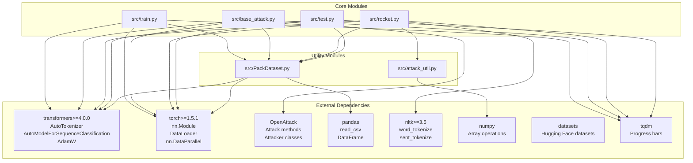
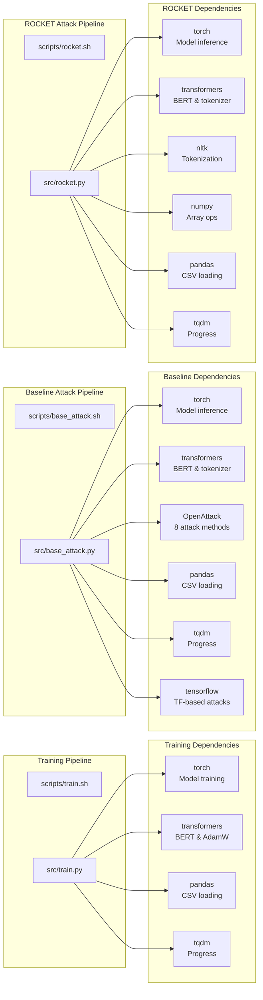
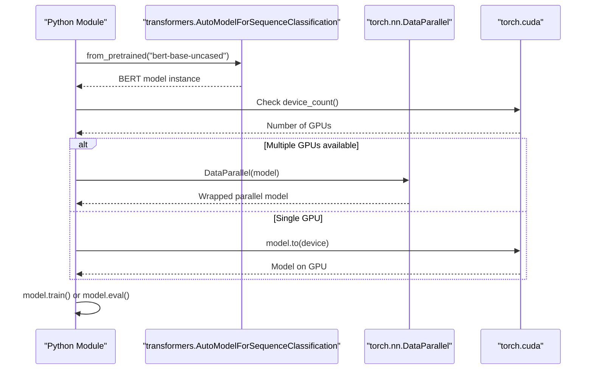
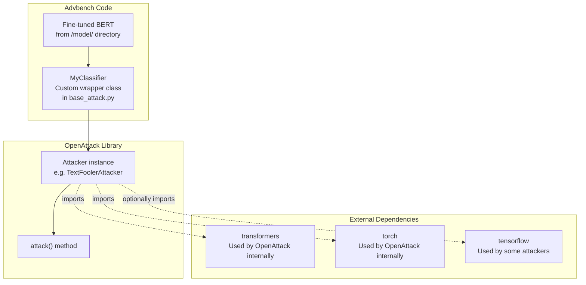

<!-- source: DeepWiki mcp.deepwiki.com · repo thunlp/Advbench · page 5.4 Dependencies and Requirements · fetched 2026-11-02 -->

# Dependencies and Requirements

<details>
<summary>Relevant source files</summary>

The following files were used as context for generating this wiki page:

- [README.md](README.md)
- [requirements.txt](requirements.txt)

</details>


This page provides comprehensive documentation of all external Python libraries required to run Advbench, including version requirements and detailed explanations of how each dependency is used within the system. For installation instructions, see [Getting Started](#1.1). For information about configuring the experimental environment, see [Running Training Experiments](#4.1).

## Overview

Advbench requires 10 external Python packages that provide functionality for natural language processing, deep learning, adversarial attacks, and data manipulation. The dependencies fall into four categories: core deep learning frameworks (PyTorch, Transformers), adversarial attack tools (OpenAttack), data processing libraries (pandas, numpy, datasets), and NLP utilities (nltk, tqdm). Two additional TensorFlow-related packages are included for compatibility with certain OpenAttack baseline methods.

**Sources:** [requirements.txt:1-10](), [README.md:16-22]()

---

## Dependency Installation

The complete set of dependencies can be installed using the provided requirements file:

```bash
pip install -r requirements.txt
```

The README notes that version adjustments may be necessary depending on server configurations, particularly for CUDA-enabled PyTorch installations or specific transformer model compatibility.

**Sources:** [README.md:18-22]()

---

## Core Dependencies Mapping

The following diagram shows how the core Python modules in Advbench depend on external libraries:



**Sources:** [requirements.txt:1-10](), Diagram 4 from high-level architecture

---

## Detailed Dependency Specifications

### transformers (>=4.0.0)

The Hugging Face Transformers library is the foundation of Advbench's model architecture, providing pre-trained BERT models and tokenization infrastructure.

**Usage in codebase:**
- `AutoTokenizer` - Used in [src/PackDataset.py]() for tokenizing text inputs into BERT-compatible format
- `AutoModelForSequenceClassification` - Used in [src/train.py]() for loading pre-trained BERT models and adding classification heads
- `AdamW` optimizer - Used in [src/train.py]() for model fine-tuning with weight decay
- `get_linear_schedule_with_warmup` - Used in [src/train.py]() for learning rate scheduling with 10% warmup

**Modules that import it:** `src/train.py`, `src/base_attack.py`, `src/rocket.py`, `src/test.py`, `src/PackDataset.py`

**Sources:** [requirements.txt:5](), Diagram 3 (Model Layer), Diagram 4

---

### torch (>=1.5.1)

PyTorch is the core deep learning framework used for model training, inference, and multi-GPU parallelization.

**Usage in codebase:**
- `torch.nn.Module` - Base class for all model architectures
- `torch.nn.DataParallel` - Used in [src/train.py]() for multi-GPU training
- `torch.utils.data.DataLoader` - Created by [src/PackDataset.py]() for batched data loading
- `torch.cuda` - GPU memory management and device placement
- `torch.no_grad()` - Context manager for evaluation without gradient computation

**Modules that import it:** `src/train.py`, `src/base_attack.py`, `src/rocket.py`, `src/test.py`, `src/PackDataset.py`

**Sources:** [requirements.txt:6](), Diagram 3 (Model Layer), Diagram 4

---

### OpenAttack

The OpenAttack library provides implementations of 8 baseline adversarial attack methods used for comparative evaluation.

**Usage in codebase:**
- Attack method classes: `PSOAttacker`, `TextFoolerAttacker`, `PWWSAttacker`, `BERTAttacker`
- DeepWordBug variants: `DeepWordBugAttacker`, `HotFlipAttacker`, `VIPERAttacker`, `TextBuggerAttacker`
- `Attacker` base class - Used in [src/base_attack.py]() for uniform attack interface
- Custom classifier adapter - [src/base_attack.py]() implements `MyClassifier` to wrap BERT models for OpenAttack compatibility

**Attack method mapping:**

| OpenAttack Class | Attack Name | Type | Usage in Advbench |
|------------------|-------------|------|-------------------|
| `PSOAttacker` | PSO | Word-level | Particle swarm optimization |
| `TextFoolerAttacker` | TextFooler | Word-level | Synonym replacement |
| `PWWSAttacker` | PWWS | Word-level | Word saliency scoring |
| `BERTAttacker` | BERT | Word-level | BERT masked language model |
| `DeepWordBugAttacker` | DeepWordBug | Character-level | Character edits |
| `HotFlipAttacker` | HotFlip | Character-level | Gradient-based flipping |
| `VIPERAttacker` | VIPER | Character-level | Visual similarity |
| `TextBuggerAttacker` | TextBugger | Hybrid | Combined approach |

**Modules that import it:** `src/base_attack.py`

**Sources:** [requirements.txt:7](), [src/base_attack.py:29-35]() (from Diagram 5 context), Diagram 1, Diagram 5

---

### pandas

Pandas is used for loading and manipulating CSV dataset files.

**Usage in codebase:**
- `pandas.read_csv()` - Used in [src/PackDataset.py]() to load train.csv and dev.csv files
- `DataFrame` operations - Data filtering and column access for text and label extraction
- Dataset structure: All datasets follow CSV format with columns for text data and classification labels

**Modules that import it:** `src/PackDataset.py`

**Sources:** [requirements.txt:8](), Diagram 3 (Data Layer), Diagram 4

---

### nltk (>=3.5)

The Natural Language Toolkit provides text processing utilities used by the ROCKET attack method.

**Usage in codebase:**
- `word_tokenize()` - Tokenizes text into words for perturbation targeting
- `sent_tokenize()` - Splits text into sentences for structure-aware perturbations
- Used in [src/rocket.py]() for identifying perturbation positions in heuristic-based attacks

**Modules that import it:** `src/rocket.py`

**Sources:** [requirements.txt:1](), Diagram 4, Diagram 1 (ROCKET workflow)

---

### Supporting Libraries

The following table summarizes the remaining dependencies:

| Library | Version | Purpose | Primary Usage |
|---------|---------|---------|---------------|
| `numpy` | Any | Numerical operations | Array manipulations in [src/attack_util.py]() for character-level perturbations |
| `datasets` | Any | Hugging Face datasets API | Dataset loading and processing utilities |
| `tqdm` | Any | Progress visualization | Training and attack progress bars in all main modules |
| `tensorflow` | Any | Deep learning framework | Required by certain OpenAttack baseline methods |
| `tensorflow_hub` | Any | TensorFlow model repository | Pre-trained model loading for TensorFlow-based attacks |

**Sources:** [requirements.txt:2-4,9-10](), Diagram 4

---

## Dependency Usage by Pipeline

The following diagram maps external dependencies to the three main experimental pipelines:



**Sources:** [requirements.txt:1-10](), Diagram 1, Diagram 2, Diagram 4

---

## Version Requirements and Compatibility

### Minimum Version Constraints

Three dependencies specify minimum versions with explicit compatibility considerations:

- **transformers>=4.0.0** - Version 4.0.0 introduced the `AutoModelForSequenceClassification` API and unified tokenizer interface. Earlier versions lack these features.
- **torch>=1.5.1** - Version 1.5.1 provides stable `nn.DataParallel` support and the optimizer state management required by the training loop.
- **nltk>=3.5** - Version 3.5 includes updated tokenization algorithms and better Unicode handling for adversarial text processing.

### Version Flexibility

The README.md notes: "Maybe you need to change the version of some libraries depending on your servers" [README.md:22](). This flexibility is necessary for:

1. **CUDA compatibility** - PyTorch version must match the server's CUDA version for GPU acceleration
2. **Python version** - Transformers and TensorFlow compatibility varies with Python 3.6, 3.7, 3.8, 3.9, 3.10
3. **Operating system** - TensorFlow binaries differ between Linux, macOS, and Windows
4. **Hardware constraints** - Older servers may require earlier PyTorch/TensorFlow versions

**Sources:** [requirements.txt:1-10](), [README.md:22]()

---

## Dependency Interaction Patterns

### BERT Model Loading Flow



**Sources:** Diagram 3 (Model Layer), [src/train.py:117-130]() (from Diagram 3 context)

---

### OpenAttack Integration Pattern



**Sources:** [requirements.txt:7,9-10](), [src/base_attack.py:29-35]() (from Diagram 1 context), Diagram 4

---

## Installation Troubleshooting

### Common Installation Issues

| Issue | Cause | Solution |
|-------|-------|----------|
| PyTorch CUDA mismatch | PyTorch version doesn't match server CUDA version | Install PyTorch with correct CUDA version: `pip install torch==X.X.X+cuXXX` |
| Transformers version conflict | Older transformers incompatible with newer torch | Upgrade transformers: `pip install transformers --upgrade` |
| OpenAttack import error | OpenAttack has its own transformers dependency | Install OpenAttack after transformers to avoid conflicts |
| TensorFlow compatibility | TensorFlow GPU version mismatch | Use TensorFlow CPU version if GPU not needed |
| NLTK data missing | NLTK requires separate data downloads | Run `python -m nltk.downloader punkt` |

### Recommended Installation Order

To minimize dependency conflicts, install packages in this order:

1. Core frameworks: `torch`, `tensorflow`
2. Model libraries: `transformers`
3. Attack framework: `OpenAttack`
4. Utilities: `pandas`, `numpy`, `nltk`, `tqdm`, `datasets`

**Sources:** [README.md:18-22](), [requirements.txt:1-10]()

---

## System Requirements

### Hardware Requirements

While not specified in the dependencies, the codebase requires:

- **GPU memory**: Minimum 8GB for batch sizes 16-64 (varies by dataset)
- **CPU cores**: Multi-threading support for data loading (PyTorch DataLoader workers)
- **Storage**: Sufficient space for `/data/`, `/model/`, and `/output/` directories

### Software Requirements

- **Python**: Version 3.6 or higher (implied by transformers>=4.0.0)
- **CUDA**: Optional but recommended for GPU acceleration (matched to PyTorch version)
- **Operating System**: Linux, macOS, or Windows (cross-platform via PyTorch/Transformers)

**Sources:** Diagram 6 (batch size configurations), [README.md:45-48]() (directory requirements)

---

## Dependency Summary Table

| Dependency | Version | Category | Core Usage | Used By |
|------------|---------|----------|------------|---------|
| `transformers` | >=4.0.0 | Deep Learning | BERT models, tokenizers | All modules |
| `torch` | >=1.5.1 | Deep Learning | PyTorch framework | All modules |
| `OpenAttack` | Any | Adversarial NLP | Baseline attack methods | `base_attack.py` |
| `pandas` | Any | Data Processing | CSV loading | `PackDataset.py` |
| `nltk` | >=3.5 | NLP Utilities | Text tokenization | `rocket.py` |
| `numpy` | Any | Numerical | Array operations | `attack_util.py` |
| `datasets` | Any | Data Processing | HuggingFace datasets | Data utilities |
| `tqdm` | Any | Utilities | Progress bars | All modules |
| `tensorflow` | Any | Deep Learning | OpenAttack compatibility | `base_attack.py` (indirect) |
| `tensorflow_hub` | Any | Model Hub | Pre-trained TF models | `base_attack.py` (indirect) |

**Sources:** [requirements.txt:1-10](), All diagrams

---

