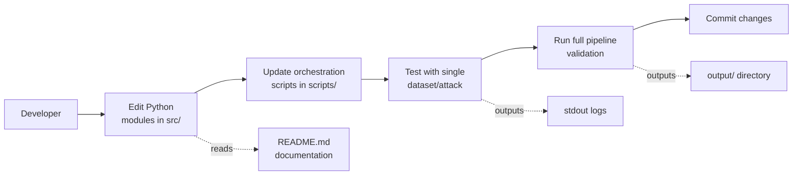
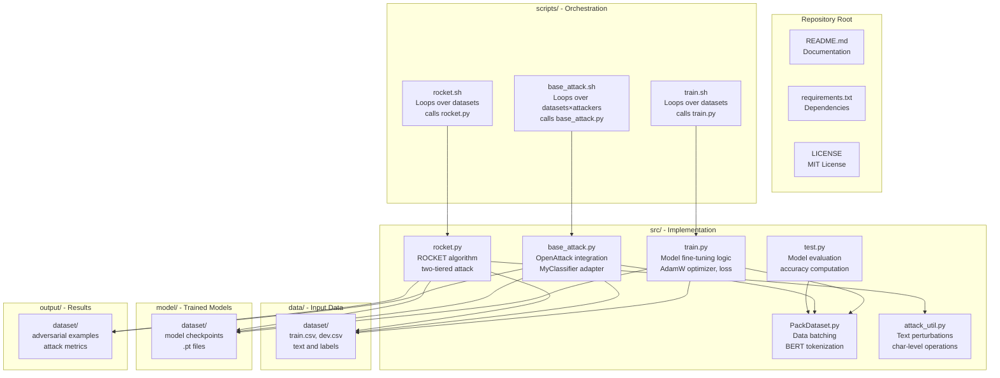
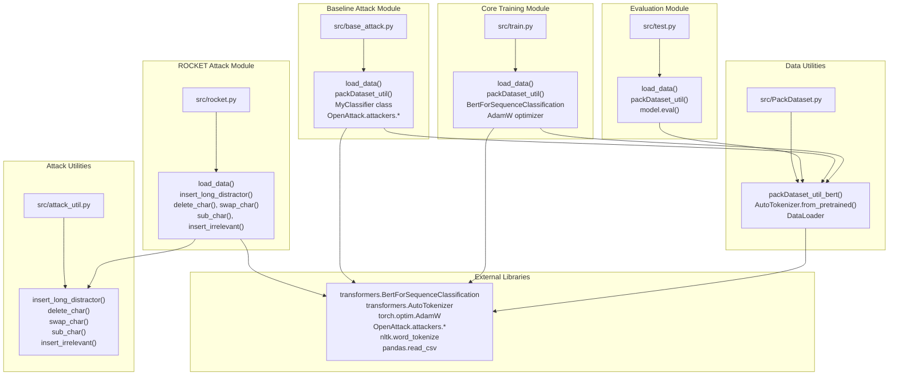
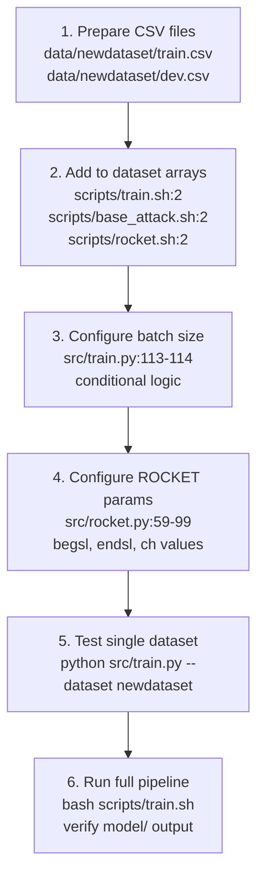
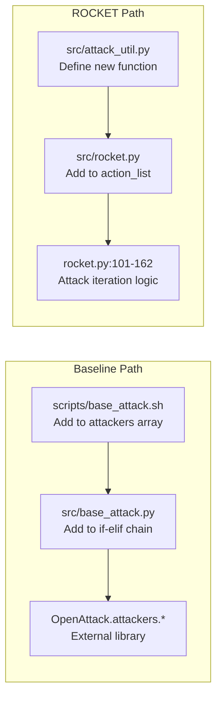
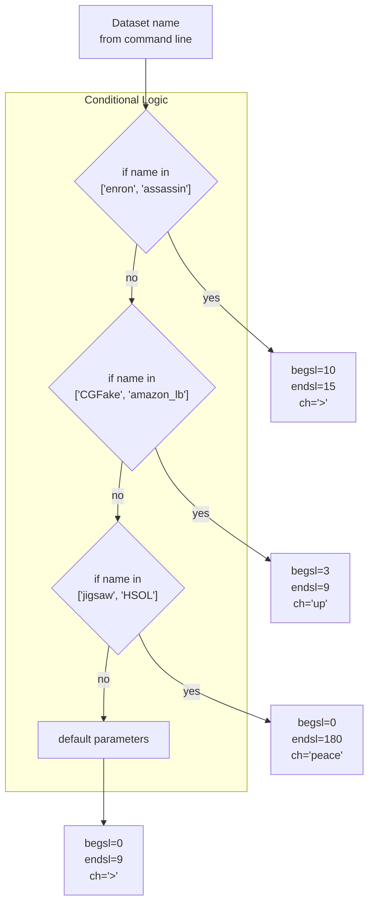
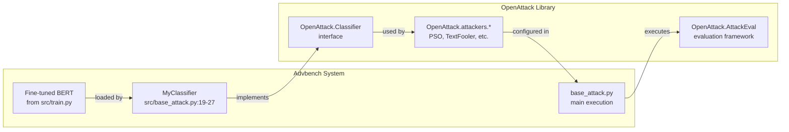

<!-- source: DeepWiki mcp.deepwiki.com · repo thunlp/Advbench · page 6 Development Guide · fetched 2026-11-02 -->

# Development Guide

<details>
<summary>Relevant source files</summary>

The following files were used as context for generating this wiki page:

- [LICENSE](LICENSE)
- [README.md](README.md)

</details>


This document provides information for developers who want to contribute to or extend the Advbench system. It covers the codebase structure, architectural patterns, and key extension points for implementing new functionality.

**Scope**: This page covers the overall development workflow, system architecture, and code organization patterns. For detailed information on specific topics, see:
- [Project Structure](#6.1) - Detailed explanation of directory organization
- [Adding New Attack Methods](#6.2) - Step-by-step guide for implementing new attacks
- [License](#6.3) - MIT License terms and conditions

For user-oriented information about running experiments, see [User Guide](#4). For technical implementation details of specific components, see [Technical Architecture](#3).

---

## Development Workflow Overview

The Advbench system follows a modular architecture where bash scripts orchestrate Python modules that implement core functionality. Development typically involves one of three activities:

| Activity | Entry Points | Key Files |
|----------|-------------|-----------|
| Adding datasets | [scripts/train.sh:2](), [scripts/rocket.sh:2]() | [src/PackDataset.py](), dataset CSV files |
| Implementing attack methods | [scripts/base_attack.sh:2-3]() | [src/base_attack.py:29-35](), [src/attack_util.py]() |
| Modifying training logic | [scripts/train.sh]() | [src/train.py:113-130]() |

**Typical Development Flow**:



**Sources**: [README.md:45-67]()

---

## Repository Architecture

### Directory Structure and File Roles

The repository follows a clear separation between orchestration (scripts), implementation (src), and data storage:



**Sources**: [README.md:27-49](), Diagram 4 from high-level overview

### Module Dependencies with Code Entities

This diagram shows how Python modules import and call each other, using actual function and class names from the codebase:



**Sources**: Diagram 4 from high-level overview, [src/train.py:1-13](), [src/base_attack.py:1-13](), [src/rocket.py:1-13]()

---

## Code Organization Patterns

### Orchestration Layer: Bash Scripts

The bash scripts in `scripts/` implement a consistent pattern for iterating over datasets and calling Python modules:

**Pattern Structure**:
```bash
# Define dataset list
datasets=(dataset1 dataset2 dataset3)

# Iterate and execute
for name in ${datasets[@]}; do
    python src/module.py --dataset $name [other args]
done
```

**Key Files**:
- [scripts/train.sh:2-6]() - Trains on all 10 datasets
- [scripts/base_attack.sh:2-7]() - Creates dataset × attacker matrix (80 combinations)
- [scripts/rocket.sh:2-6]() - Applies ROCKET to all datasets

### Implementation Layer: Python Modules

All core Python modules follow a consistent structure:

| Section | Purpose | Common Patterns |
|---------|---------|-----------------|
| Imports | External dependencies | `transformers`, `torch`, `pandas`, `OpenAttack` |
| Argument parsing | CLI configuration | `argparse.ArgumentParser()` |
| Data loading | CSV to memory | `load_data()` function |
| Data processing | Tokenization, batching | `packDataset_util()` from PackDataset.py |
| Core logic | Training/attack/evaluation | Main execution block |
| Output | Results storage | Save to `model/` or `output/` |

**Sources**: [src/train.py:1-130](), [src/base_attack.py:1-135](), [src/rocket.py:1-166]()

### Shared Utility Pattern

The system uses two shared utility modules that are imported by multiple core modules:

**PackDataset.py** ([src/PackDataset.py:7-43]()):
- **Function**: `packDataset_util_bert()`
- **Purpose**: Tokenizes text and creates PyTorch DataLoader
- **Used by**: train.py, base_attack.py, test.py
- **Key operations**: 
  - Calls `AutoTokenizer.from_pretrained('bert-base-uncased')`
  - Handles padding and truncation
  - Creates attention masks
  - Wraps in `DataLoader` with specified batch size

**attack_util.py** ([src/attack_util.py:4-108]()):
- **Functions**: `insert_long_distractor()`, `delete_char()`, `swap_char()`, `sub_char()`, `insert_irrelevant()`
- **Purpose**: Character-level text perturbations
- **Used by**: rocket.py
- **Key operations**: String manipulation for adversarial example generation

**Sources**: [src/PackDataset.py](), [src/attack_util.py](), Diagram 3 from high-level overview

---

## Extension Points

### Adding New Datasets

To add a new dataset to the benchmark:



**CSV Format Requirements**:
- Column 1: Text content
- Column 2: Label (integer)
- No header row
- Comma-separated values

**Configuration Locations**:
- Dataset list: [scripts/train.sh:2](), [scripts/base_attack.sh:2](), [scripts/rocket.sh:2]()
- Batch size: [src/train.py:113-114]()
- ROCKET parameters: [src/rocket.py:59-99]()

**Sources**: [README.md:34-41](), [scripts/train.sh:2](), [src/rocket.py:59-99]()

### Adding New Attack Methods

The system supports two types of attack extensions:

**1. OpenAttack-based Methods** (for gradient-based or search-based attacks):

Add to the attacker list in [scripts/base_attack.sh:3]():
```bash
attackers=(pso textfooler pwws bert deepwordbug fd ga viper NewMethod)
```

Then extend the attacker registry in [src/base_attack.py:29-35]():
```python
if args.attacker == "NewMethod":
    attacker = OpenAttack.attackers.NewMethodAttacker()
```

**2. Heuristic-based Methods** (for rule-based perturbations):

Add new perturbation function to [src/attack_util.py]():
```python
def new_perturbation(sentence, params):
    # Implementation
    return modified_sentence
```

Import and use in ROCKET's action list [src/rocket.py:56]():
```python
action_list = ['insert_long_distractor', 'delete_char', 
               'swap_char', 'sub_char', 'insert_irrelevant', 
               'new_perturbation']
```

**Integration Pattern**:



**Sources**: [src/base_attack.py:29-35](), [src/attack_util.py](), [src/rocket.py:56]()

### Modifying Training Configuration

Training hyperparameters are defined in [src/train.py]():

| Parameter | Location | Default Value | Purpose |
|-----------|----------|---------------|---------|
| `EPOCHS` | [src/train.py:113]() | 8 | Training iterations |
| `lr` | train.py arguments | 1e-5 | Learning rate |
| `weight_decay` | train.py arguments | 1e-3 | L2 regularization |
| Optimizer | [src/train.py:117-120]() | AdamW | Optimization algorithm |
| Warmup ratio | train.py | 0.1 | Learning rate warmup |
| Batch size | [src/train.py:113-114]() | Dataset-specific | Training batch size |

To modify training logic:
1. Edit hyperparameters in [src/train.py:113-130]()
2. Modify training loop in [src/train.py:131-end]()
3. Update optimizer configuration in [src/train.py:117-120]()

**Sources**: [src/train.py:113-130](), Diagram 6 from high-level overview

---

## Development Best Practices

### Parameter Configuration Strategy

The codebase uses two levels of configuration:

**1. Script-level (bash)**: Dataset selection and iteration
- Modify: [scripts/train.sh:2](), [scripts/base_attack.sh:2-3](), [scripts/rocket.sh:2]()
- Purpose: Control which experiments run

**2. Module-level (Python)**: Algorithm parameters and hyperparameters
- Modify: [src/train.py:113-130](), [src/rocket.py:59-99]()
- Purpose: Control how experiments execute

**Task-specific Configuration Pattern**:



**Implementation**: [src/rocket.py:59-99]()

**Sources**: [src/rocket.py:59-99](), Diagram 6 from high-level overview

### Testing and Validation Approach

**Single-dataset Testing**:
```bash
# Test training
python src/train.py --dataset testdataset

# Test baseline attack
python src/base_attack.py --dataset testdataset --attacker textfooler

# Test ROCKET attack
python src/rocket.py --name testdataset
```

**Full Pipeline Validation**:
```bash
# Run complete workflows
bash scripts/train.sh
bash scripts/base_attack.sh
bash scripts/rocket.sh

# Verify outputs
ls model/testdataset/  # Should contain .pt file
ls output/testdataset/ # Should contain attack results
```

**Output Verification**:
- Training: Check `model/dataset/` for saved model checkpoints
- Attacks: Check `output/dataset/` for adversarial examples and metrics
- Console: Monitor stdout for progress logs and final accuracy/ASR values

**Sources**: [README.md:51-67](), [scripts/train.sh:4-6]()

### Error Handling Patterns

The codebase uses minimal explicit error handling, relying on Python's default exception propagation. Common failure points:

| Issue | Symptom | Solution |
|-------|---------|----------|
| Missing data files | `FileNotFoundError` | Verify [data/ directory structure](#6.1) |
| Missing model checkpoints | `FileNotFoundError` | Run [training pipeline](#2.1) first |
| GPU memory overflow | `RuntimeError: CUDA out of memory` | Reduce batch size in [src/train.py:113-114]() |
| Import errors | `ModuleNotFoundError` | Check [requirements.txt]() installation |
| OpenAttack attacker not found | `AttributeError` | Verify attacker name in [src/base_attack.py:29-35]() |

**Sources**: [src/train.py](), [src/base_attack.py](), [requirements.txt]()

---

## Integration with External Systems

### OpenAttack Framework Integration

The system integrates with OpenAttack through an adapter pattern:



**MyClassifier Implementation** ([src/base_attack.py:19-27]()):
- Wraps BERT model to conform to OpenAttack interface
- Implements `get_pred()` method for predictions
- Implements `get_prob()` method for probability scores
- Handles tokenization and inference

**Sources**: [src/base_attack.py:19-35](), Diagram 4 from high-level overview

### Multi-GPU Training Support

Training automatically uses DataParallel for multi-GPU setups:

```python
model = torch.nn.DataParallel(model)  # src/train.py
```

The model is wrapped but saves without the wrapper:
```python
torch.save(model.module.state_dict(), checkpoint_path)
```

**Sources**: [src/train.py:117-130]()

---

This development guide provides the foundation for understanding and extending the Advbench system. For specific implementation details, refer to the subsections: [Project Structure](#6.1), [Adding New Attack Methods](#6.2), and [License](#6.3).

---

