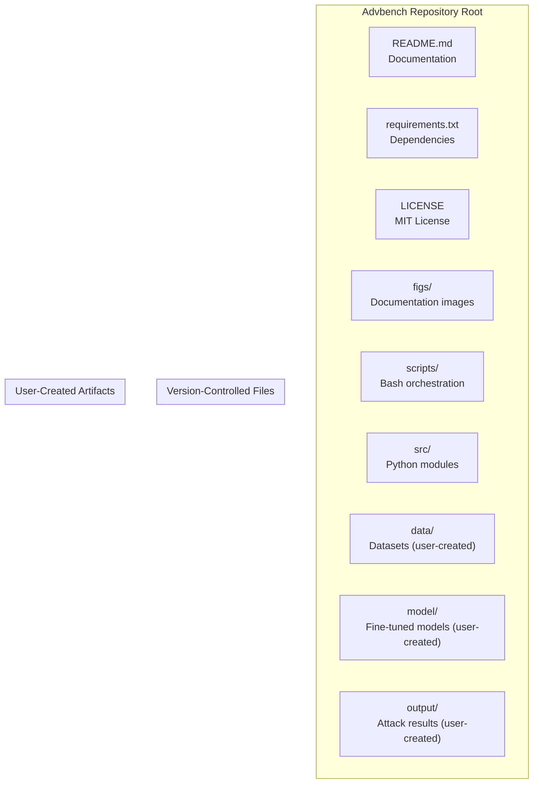
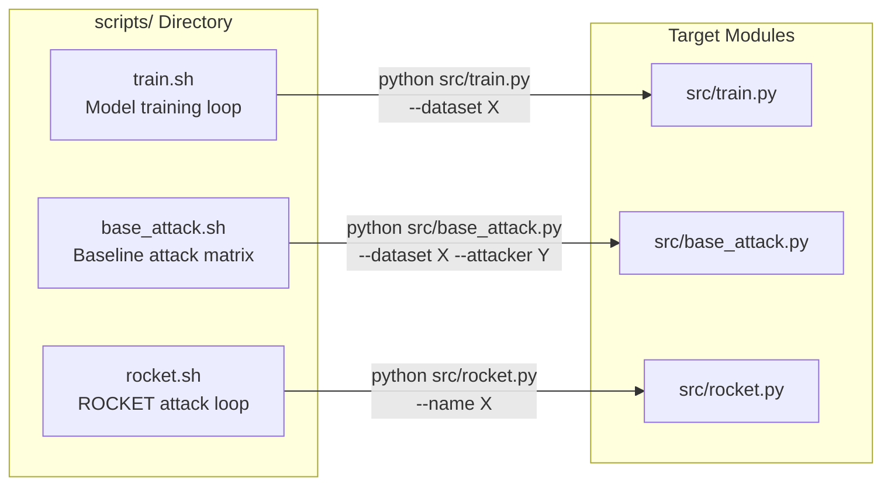
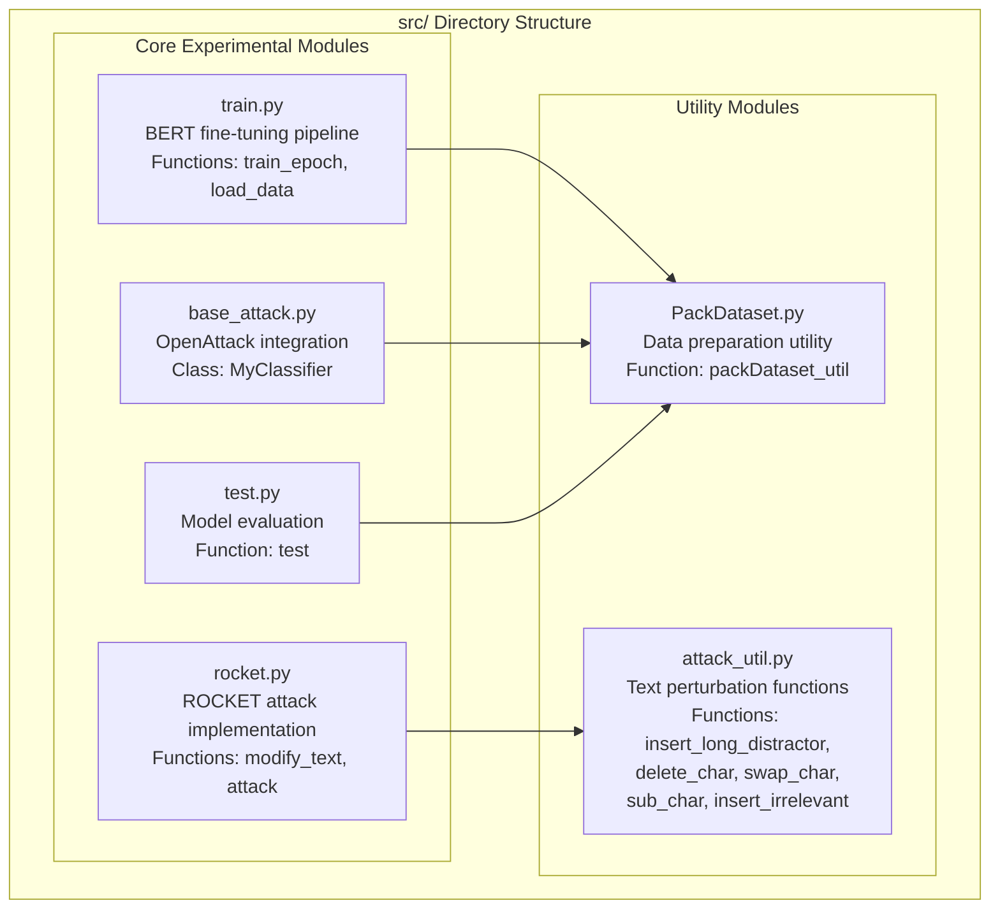
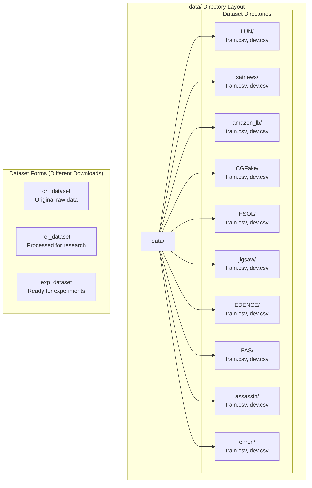
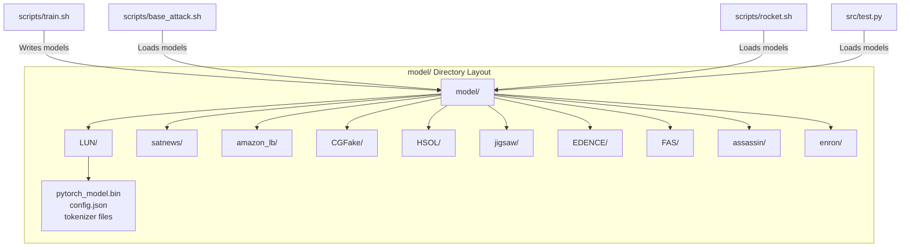
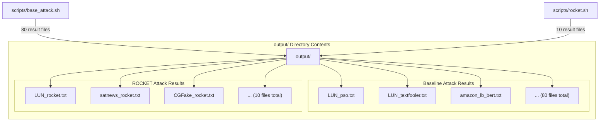
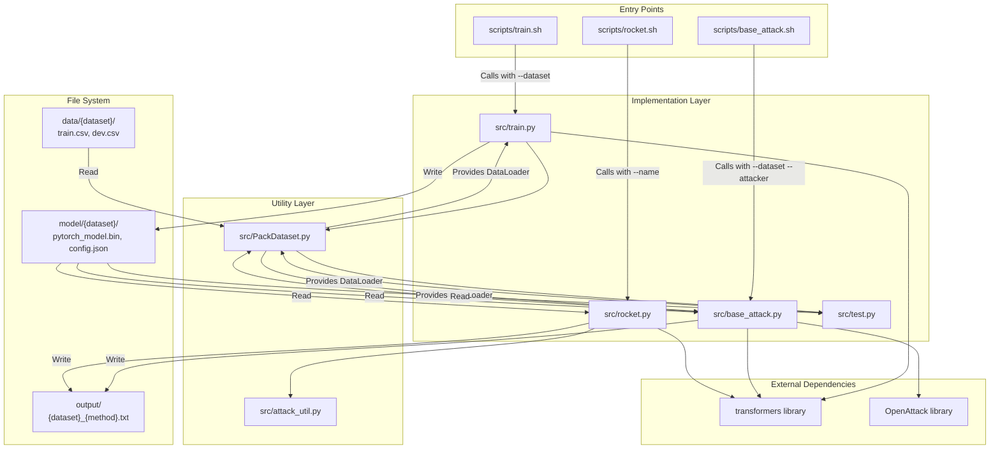

<!-- source: DeepWiki mcp.deepwiki.com · repo thunlp/Advbench · page 6.1 Project Structure · fetched 2026-11-02 -->

# Project Structure

Relevant source files

The following files were used as context for generating this wiki page:

- [README.md](README.md)

This page provides a comprehensive overview of the Advbench repository's file organization and directory structure. It documents the purpose and contents of each directory, the relationships between files, and how the physical structure maps to the system's experimental workflows.

For information about individual module implementations, see [Technical Architecture](#3). For details about running experiments, see [User Guide](#4).

---

## Repository Overview

The Advbench repository follows a clear separation between orchestration logic (Bash scripts), implementation logic (Python modules), configuration (root-level files), and data artifacts (datasets, models, outputs). The structure is designed for reproducibility, with user-created directories isolated from source code.

**Sources:** [README.md:1-81]()

---

## Top-Level Directory Structure

**Directory Creation Requirements:**

| Directory | Created By | Purpose | Referenced In |
|-----------|------------|---------|---------------|
| `data/` | User (mkdir) | Stores security datasets | [README.md:27-31]() |
| `model/` | User (mkdir) | Stores fine-tuned BERT models | [README.md:45-48]() |
| `output/` | User (mkdir) | Stores adversarial attack results | [README.md:45-48]() |

The repository distinguishes between version-controlled source files and user-generated artifacts. Users must manually create the `data/`, `model/`, and `output/` directories before running experiments, following the setup instructions in [Getting Started](#1.1).

**Sources:** [README.md:27-48]()

---

## The `scripts/` Directory

The `scripts/` directory contains Bash orchestration scripts that automate the execution of experiments across multiple datasets. Each script corresponds to one experimental workflow and implements a loop over datasets to ensure comprehensive evaluation.

### Script Details

**`train.sh`**: Iterates over 10 datasets to fine-tune BERT models
- Dataset list: `LUN`, `satnews`, `amazon_lb`, `CGFake`, `HSOL`, `jigsaw`, `EDENCE`, `FAS`, `assassin`, `enron`
- Calls `src/train.py` with dataset-specific arguments
- Each run saves a model to `model/{dataset}/`

**`base_attack.sh`**: Executes 80 attack combinations (10 datasets × 8 attackers)
- Attacker list: `pso`, `textfooler`, `pwws`, `bert`, `deepwordbug`, `viper`, `textbugger`, `fd`
- Calls `src/base_attack.py` for each dataset-attacker pair
- Results saved to `output/`

**`rocket.sh`**: Applies ROCKET attacks to all datasets
- Calls `src/rocket.py` with dataset-specific configurations
- Each run generates adversarial examples in `output/`

**Sources:** [README.md:51-67](), Diagram 2, Diagram 4

---

## The `src/` Directory

The `src/` directory contains all Python implementation modules. Files are organized by function: core experimental pipelines (`train.py`, `base_attack.py`, `rocket.py`), evaluation (`test.py`), and shared utilities (`PackDataset.py`, `attack_util.py`).

### Module Responsibilities

| Module | Primary Function | Key Classes/Functions | Dependencies |
|--------|------------------|----------------------|--------------|
| `train.py` | Fine-tune BERT models | `train_epoch()`, `load_data()` | transformers, torch, PackDataset |
| `base_attack.py` | Execute baseline attacks | `MyClassifier` | OpenAttack, transformers, PackDataset |
| `rocket.py` | Execute ROCKET attacks | `modify_text()`, `attack()` | transformers, attack_util, nltk |
| `test.py` | Evaluate model accuracy | `test()` | transformers, torch, PackDataset |
| `PackDataset.py` | Prepare BERT inputs | `packDataset_util()` | transformers, torch, pandas |
| `attack_util.py` | Character perturbations | 5 perturbation functions | random |

### Module Interactions

The utility modules serve as shared dependencies:
- **`PackDataset.py`** is imported by `train.py`, `base_attack.py`, and `test.py` for consistent data preprocessing
- **`attack_util.py`** is imported only by `rocket.py` for character-level text perturbations

This design promotes code reuse while maintaining clear separation of concerns between attack methodologies (baseline vs. ROCKET).

**Sources:** Diagram 4, [README.md:1-81]()

---

## The `data/` Directory

The `data/` directory stores security datasets in CSV format. Users must create this directory and populate it with downloaded datasets before running experiments. The repository supports three dataset forms for different research purposes.

### Dataset Organization

Each dataset directory follows a consistent structure:
- **`train.csv`**: Training split (used by `src/train.py`)
- **`dev.csv`**: Development/test split (used by attack and evaluation scripts)

### Three Dataset Forms

The repository provides three forms of the datasets, available as separate downloads:

| Form | Purpose | Use Case | Download Format |
|------|---------|----------|-----------------|
| **ori_dataset** | Raw, unprocessed data | Custom data processing research | Individual dataset folders |
| **rel_dataset** | Processed for research | Further benchmark research | Individual dataset folders |
| **exp_dataset** | Experiment-ready | Direct reproduction | Uncompressed `data.zip` |

For reproducing experiments, users download `data.zip` and extract it to create the full `data/` directory structure with all 10 datasets.

**Sources:** [README.md:25-41](), Diagram 3

---

## The `model/` Directory

The `model/` directory stores fine-tuned BERT models produced by the training pipeline. The directory structure mirrors the dataset organization, with one subdirectory per dataset.

### Model Storage Format

Each dataset subdirectory contains a complete Hugging Face model checkpoint:
- **`pytorch_model.bin`**: Model weights
- **`config.json`**: Model configuration
- **`vocab.txt`, `tokenizer_config.json`, `special_tokens_map.json`**: Tokenizer files

Models are saved using the `model.save_pretrained()` method from the transformers library, ensuring compatibility with standard loading procedures in attack and evaluation scripts.

### Storage Location References

Models are referenced in code via the `args.model_path` pattern:
- Training: `model_path = f"model/{args.dataset}/"` (write location)
- Attacking: `model_path = f"model/{args.dataset}/"` (read location)
- Evaluation: `model_path = f"model/{args.dataset}/"` (read location)

**Sources:** [README.md:45-48](), Diagram 3, Diagram 4

---

## The `output/` Directory

The `output/` directory stores adversarial attack results, including success metrics and generated adversarial examples. Unlike the structured `model/` directory, `output/` contains flat files named by dataset and attack method.

### Output File Naming Convention

| Script | File Pattern | Example |
|--------|--------------|---------|
| `base_attack.sh` | `{dataset}_{attacker}.txt` | `jigsaw_textfooler.txt` |
| `rocket.sh` | `{dataset}_rocket.txt` | `enron_rocket.txt` |

### Output File Contents

Each result file contains:
1. **Attack configuration**: Dataset name, model path, attack method
2. **Performance metrics**: Attack success rate, query counts, runtime
3. **Adversarial examples**: Original text, perturbed text, prediction changes

The exact format depends on the attack method, with baseline attacks using OpenAttack's output format and ROCKET using a custom format.

**Sources:** [README.md:45-48](), Diagram 1, Diagram 5

---

## Root-Level Configuration Files

The repository root contains essential configuration and documentation files that define dependencies and provide user guidance.

### `requirements.txt`

Specifies Python package dependencies required to run Advbench:
- **transformers**: Hugging Face library for BERT models
- **torch**: PyTorch deep learning framework
- **OpenAttack**: Framework for adversarial attacks
- **nltk**: Natural Language Toolkit for text processing
- **pandas**: Data manipulation library

Users install dependencies with: `pip install -r requirements.txt`

**Note:** The README warns that library versions may need adjustment depending on server configuration.

### `README.md`

Primary documentation file containing:
- Overview of the SoadNLP research paradigm
- Installation and setup instructions
- Experiment execution commands
- Citation information

### `LICENSE`

MIT License file defining usage permissions and limitations. For detailed license terms, see [License](#6.3).

### `figs/` Directory

Contains images used in `README.md`, including `main.png` which illustrates the research paradigm.

**Sources:** [README.md:16-22](), [README.md:1-4](), Diagram 4

---

## File Dependency Graph

The following diagram maps execution flow from entry points (scripts) through implementation modules to file system artifacts, showing which files read from and write to each directory.

### Key Dependency Patterns

1. **Scripts invoke modules**: Bash scripts in `scripts/` are the sole entry points; they call Python modules in `src/` with appropriate arguments.

2. **Shared utility pattern**: `PackDataset.py` is a common dependency for training, baseline attacks, and evaluation, ensuring consistent data preprocessing.

3. **Specialized utilities**: `attack_util.py` is only used by ROCKET, reflecting its character-level perturbation approach that differs from baseline methods.

4. **Sequential data flow**: Training writes to `model/`, which is then read by attack scripts that write to `output/`. This enforces the two-phase experimental workflow (training, then attacking).

5. **External framework integration**: `base_attack.py` uniquely depends on OpenAttack, while all modules share transformers and torch dependencies.

**Sources:** Diagram 4, Diagram 2, Diagram 3

---

## Data Flow Through Directory Structure

This diagram illustrates how data artifacts move through the repository's directory structure during a complete experimental workflow, from raw datasets to final attack results.

```mermaid
graph LR
    subgraph "Phase 1: Setup"
        DOWNLOAD["Download from<br/>Google Drive"]
        UNZIP["unzip data.zip"]
        DATA_CREATED["data/ populated"]
    end
    
    subgraph "Phase 2: Training"
        READ_TRAIN["Read data/{dataset}/<br/>train.csv"]
        TRAIN_EXEC["src/train.py<br/>Fine-tune BERT"]
        WRITE_MODEL["Write model/{dataset}/<br/>pytorch_model.bin"]
    end
    
    subgraph "Phase 3: Attacking"
        READ_DEV["Read data/{dataset}/<br/>dev.csv"]
        READ_MODEL["Read model/{dataset}/<br/>pytorch_model.bin"]
        ATTACK_EXEC["src/base_attack.py or<br/>src/rocket.py"]
        WRITE_OUTPUT["Write output/<br/>{dataset}_{method}.txt"]
    end
    
    subgraph "Phase 4: Analysis"
        READ_OUTPUT["Read output/<br/>result files"]
        ANALYZE["Compute ASR,<br/>query counts"]
    end
    
    DOWNLOAD --> UNZIP
    UNZIP --> DATA_CREATED
    DATA_CREATED --> READ_TRAIN
    READ_TRAIN --> TRAIN_EXEC
    TRAIN_EXEC --> WRITE_MODEL
    
    DATA_CREATED --> READ_DEV
    WRITE_MODEL --> READ_MODEL
    READ_DEV --> ATTACK_EXEC
    READ_MODEL --> ATTACK_EXEC
    ATTACK_EXEC --> WRITE_OUTPUT
    
    WRITE_OUTPUT --> READ_OUTPUT
    READ_OUTPUT --> ANALYZE
```

### Directory Interactions by Workflow Phase

| Phase | Reads From | Writes To | Purpose |
|-------|-----------|-----------|---------|
| Setup | External (Google Drive) | `data/` | Prepare datasets |
| Training | `data/{dataset}/train.csv` | `model/{dataset}/` | Create fine-tuned models |
| Attacking | `data/{dataset}/dev.csv`, `model/{dataset}/` | `output/` | Generate adversarial examples |
| Analysis | `output/` | N/A | Evaluate attack effectiveness |

This sequential structure ensures reproducibility: each phase's outputs become the next phase's inputs, and directory boundaries enforce separation between configuration (data), trained artifacts (model), and experimental results (output).

**Sources:** [README.md:25-67](), Diagram 2, Diagram 3

---

## Summary: Directory Structure Quick Reference

| Directory/File | Type | Created By | Purpose | Size Estimate |
|----------------|------|------------|---------|---------------|
| `scripts/` | Source | Repository | Bash orchestration (3 files) | ~0.5 KB |
| `src/` | Source | Repository | Python modules (6 files) | ~50 KB |
| `data/` | Artifact | User (manual + download) | 10 security datasets | ~500 MB |
| `model/` | Artifact | Training pipeline | 10 fine-tuned BERT models | ~4 GB |
| `output/` | Artifact | Attack pipelines | 90 result files (80 baseline + 10 ROCKET) | ~100 MB |
| `requirements.txt` | Config | Repository | Python dependencies | ~0.5 KB |
| `README.md` | Docs | Repository | User documentation | ~3 KB |
| `LICENSE` | Docs | Repository | MIT License | ~1 KB |
| `figs/` | Docs | Repository | Documentation images | ~100 KB |

**Total repository size after all experiments:** ~4.6 GB (primarily model checkpoints)

**Sources:** [README.md:1-81](), all diagrams

---

