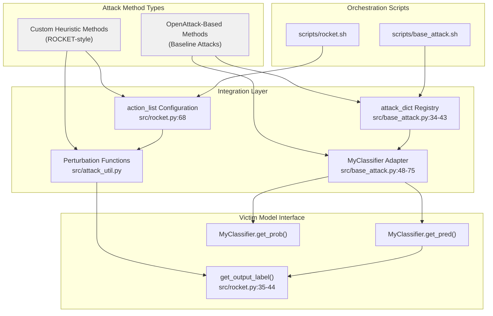
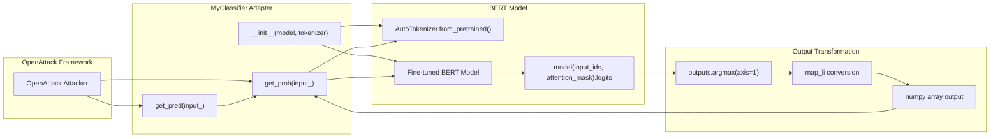
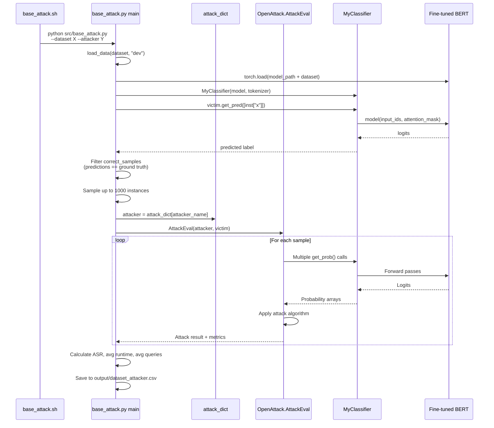
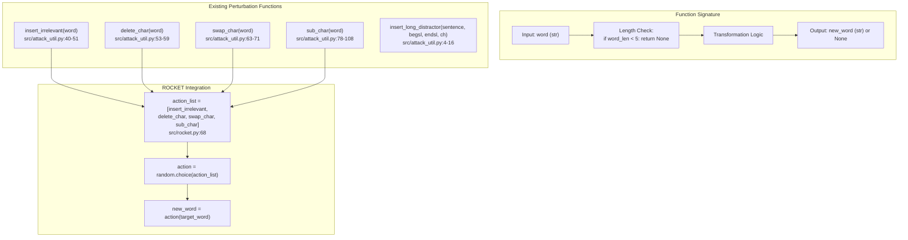
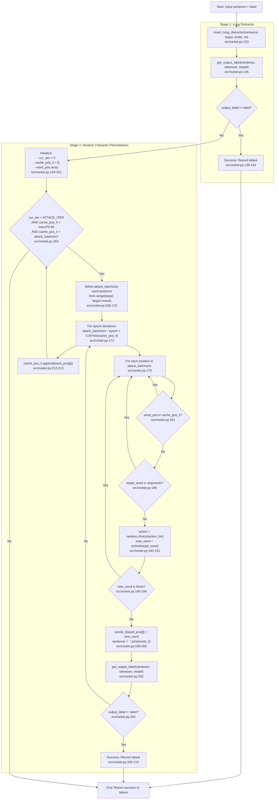
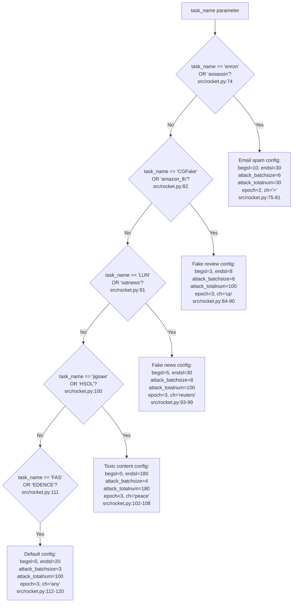
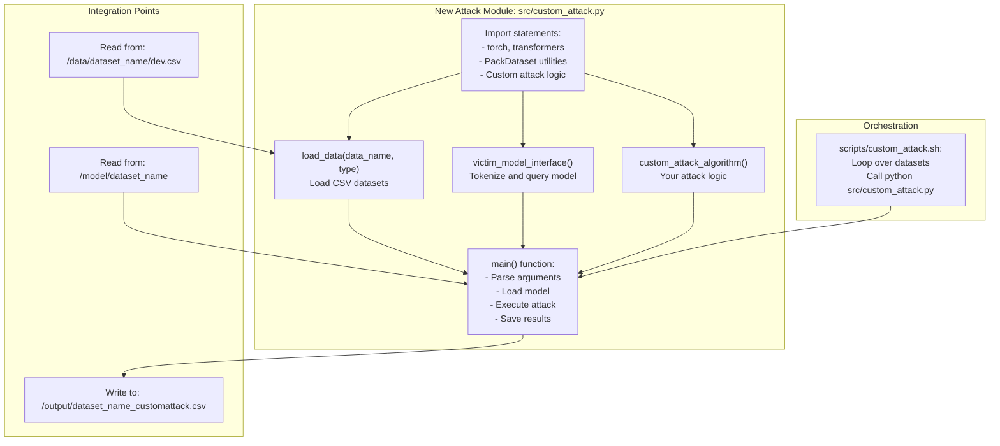

<!-- source: DeepWiki mcp.deepwiki.com · repo thunlp/Advbench · page 6.2 Adding New Attack Methods · fetched 2026-11-02 -->

# Adding New Attack Methods

<details>
<summary>Relevant source files</summary>

The following files were used as context for generating this wiki page:

- [src/attack_util.py](src/attack_util.py)
- [src/base_attack.py](src/base_attack.py)
- [src/rocket.py](src/rocket.py)

</details>


This document provides technical guidance for developers who want to extend the Advbench framework with new adversarial attack methods. It covers the two attack integration pathways available in the system: OpenAttack-based baseline methods and custom heuristic-based methods similar to ROCKET.

For information about using existing attack methods, see [Running Attack Experiments](#4.2). For a complete catalog of currently available attack methods, see [Attack Method Catalog](#5.2).

---

## Overview of Attack Integration Architecture

The Advbench framework supports two distinct approaches for implementing adversarial attacks, each with different integration requirements and use cases.

**System Architecture: Attack Method Integration Points**



**Sources:** [src/base_attack.py:34-43](), [src/base_attack.py:48-75](), [src/attack_util.py:1-108](), [src/rocket.py:68](), [src/rocket.py:35-44]()

---

## Attack Method Comparison

The framework provides two integration pathways with different characteristics:

| Aspect | OpenAttack-Based | Custom Heuristic |
|--------|------------------|------------------|
| **Integration File** | `src/base_attack.py` | `src/rocket.py`, `src/attack_util.py` |
| **Registration** | `attack_dict` dictionary | `action_list` array |
| **Victim Model Interface** | `MyClassifier` adapter | Direct `get_output_label()` function |
| **Orchestration Script** | `scripts/base_attack.sh` | `scripts/rocket.sh` |
| **Attack Strategy** | Framework-provided algorithms | Custom iterative perturbation |
| **Complexity** | External library dependency | Self-contained implementation |
| **Typical Use Case** | Standard NLP attacks (synonyms, gradients) | Security-specific perturbations (char-level) |

**Sources:** [src/base_attack.py:1-183](), [src/rocket.py:1-264](), [src/attack_util.py:1-144]()

---

## Adding OpenAttack-Based Methods

OpenAttack-based methods integrate through the `attack_dict` registry and the `MyClassifier` adapter pattern.

### Step 1: Understanding the MyClassifier Adapter

The `MyClassifier` class provides a standardized interface between fine-tuned BERT models and the OpenAttack framework. It implements two required methods:

**MyClassifier Architecture**



**Sources:** [src/base_attack.py:48-75]()

Key implementation details:

- **`get_prob()` method** [src/base_attack.py:57-75](): Tokenizes input sentences, obtains model logits, and converts predictions to one-hot encoded probability arrays
- **Dataset-specific mapping** [src/base_attack.py:69-74](): Uses different probability mappings for binary (SST2) vs multi-class (4-class) datasets
- **GPU handling** [src/base_attack.py:60-61](): Automatically moves tensors to CUDA if available

### Step 2: Registering a New OpenAttack Method

New attack methods are registered in the `attack_dict` dictionary at [src/base_attack.py:34-43]():

```python
attack_dict = {
    "pso": OpenAttack.attackers.PSOAttacker(),
    "textfoole": OpenAttack.attackers.TextFoolerAttacker(),
    "pwws": OpenAttack.attackers.PWWSAttacker(),
    "bert": OpenAttack.attackers.BERTAttacker(),
    "deep": OpenAttack.attackers.DeepWordBugAttacker(),
    "deep25": OpenAttack.attackers.DeepWordBugAttacker(power=25),
    "deep100": OpenAttack.attackers.DeepWordBugAttacker(power=100),
    "pso100": OpenAttack.attackers.PSOAttacker(max_iters=100)
}
```

To add a new method:

1. **Import the attacker class** at the top of `src/base_attack.py` (add to existing imports at [src/base_attack.py:5-6]())
2. **Add an entry to `attack_dict`** with a unique key and instantiated attacker object
3. **Configure attacker parameters** using the attacker's constructor arguments

**Example: Adding GAAttacker**

```python
# In imports section:
from OpenAttack.attackers import GAAttacker

# In attack_dict:
attack_dict = {
    # ... existing entries ...
    "ga": OpenAttack.attackers.GAAttacker(),
    "ga_custom": OpenAttack.attackers.GAAttacker(pop_size=60, max_iters=20)
}
```

**Sources:** [src/base_attack.py:5-6](), [src/base_attack.py:34-43]()

### Step 3: Updating the Orchestration Script

The `scripts/base_attack.sh` script orchestrates attack execution across datasets and attackers:

```bash
datasets="LUN satnews amazon_lb CGFake HSOL jigsaw EDENCE FAS assassin enron"
attackers="pso textfoole pwws bert deep deep25 deep100 pso100"

for dataset in $datasets
do
    for attacker in $attackers
    do
        python src/base_attack.py --dataset $dataset --attacker $attacker
    done
done
```

To include your new attacker:

1. **Add the attacker key** to the `attackers` variable at [scripts/base_attack.sh:3]()
2. **Run the script** to execute attacks across all datasets

**Sources:** [scripts/base_attack.sh:2-7]()

### Step 4: Attack Execution Flow

**OpenAttack Method Execution Sequence**



**Sources:** [src/base_attack.py:82-183](), [scripts/base_attack.sh:4-7]()

---

## Adding Custom Heuristic Methods

Custom heuristic methods integrate through the perturbation function system used by ROCKET, which operates directly on text without external frameworks.

### Step 1: Understanding Perturbation Functions

Perturbation functions in `src/attack_util.py` implement character-level and word-level text transformations. Each function follows a consistent interface:

**Perturbation Function Interface Pattern**



**Sources:** [src/attack_util.py:1-144](), [src/rocket.py:68]()

### Step 2: Implementing a New Perturbation Function

Create a new function in `src/attack_util.py` following the established pattern:

**Template for New Perturbation Function:**

```python
def new_perturbation(word):
    """
    Brief description of the perturbation strategy.
    
    Args:
        word: Target word to perturb
        
    Returns:
        new_word: Perturbed word, or None if perturbation cannot be applied
    """
    word_len = len(word)
    
    # Minimum length check (common pattern)
    if word_len < 5:
        return None
    
    # Your perturbation logic here
    # Example: duplicate a random character
    insert_pos = random.choice(list(range(0, word_len - 1))) + 1
    char_to_dup = word[insert_pos]
    new_word = word[:insert_pos] + char_to_dup + word[insert_pos:]
    
    return new_word
```

**Key Implementation Guidelines:**

1. **Return `None` for inapplicable cases** [src/attack_util.py:35,43,56,66,80,99-100](): This allows the attack loop to skip the perturbation without error
2. **Use consistent length checks** [src/attack_util.py:34,42,54,65,79](): Most functions require `word_len >= 5`
3. **Use `random.choice()` for position selection** [src/attack_util.py:36,44,57,67](): Ensures randomness in attack strategy
4. **Test your function** [src/attack_util.py:126-137](): Add test cases at the bottom of the file

**Existing Perturbation Functions as References:**

| Function | Purpose | Line Reference |
|----------|---------|----------------|
| `insert_irrelevant()` | Insert special character ($, #, @, %, &, !, *) | [src/attack_util.py:40-51]() |
| `delete_char()` | Remove one character | [src/attack_util.py:53-59]() |
| `swap_char()` | Swap adjacent characters | [src/attack_util.py:63-71]() |
| `sub_char()` | Substitute with lookalike (o→0, l→1, i→1, s→$) | [src/attack_util.py:78-108]() |
| `insert_long_distractor()` | Prepend/append repeated words | [src/attack_util.py:4-16]() |

**Sources:** [src/attack_util.py:1-144]()

### Step 3: Registering in ROCKET's Action List

The ROCKET attack algorithm maintains an `action_list` of perturbation functions at [src/rocket.py:68]():

```python
action_list = [insert_irrelevant, delete_char, swap_char, sub_char]
```

To integrate your new perturbation:

1. **Import the function** at the top of `src/rocket.py` (add to [src/rocket.py:13]())
2. **Add to `action_list`** in the `attack()` function

Example:
```python
# In imports:
from attack_util import insert_irrelevant, delete_char, swap_char, sub_char, new_perturbation

# In action_list:
action_list = [insert_irrelevant, delete_char, swap_char, sub_char, new_perturbation]
```

**Sources:** [src/rocket.py:13](), [src/rocket.py:68]()

### Step 4: Understanding ROCKET's Two-Tiered Attack Strategy

ROCKET employs a two-stage attack strategy that applies different perturbation types sequentially:

**ROCKET Attack Algorithm Flow**



**Sources:** [src/rocket.py:123-220]()

**Key Algorithm Parameters:**

| Parameter | Purpose | Configuration Location |
|-----------|---------|------------------------|
| `begsl` | Beginning sentence length for distractor | [src/rocket.py:75,84,93,102,112]() |
| `endsl` | Ending sentence length for distractor | [src/rocket.py:76,85,94,103,113]() |
| `attack_batchsize` | Number of words to perturb in parallel | [src/rocket.py:77,87,96,105,115]() |
| `attack_totalnum` | Maximum total positions to attack | [src/rocket.py:78,86,95,104,114]() |
| `epoch` | Iterations per batch | [src/rocket.py:79,88,97,106,116]() |
| `ch` | Distractor character/word | [src/rocket.py:80,89,98,107,118]() |
| `ATTACK_ITER` | Maximum outer loop iterations | [src/rocket.py:250]() |

**Sources:** [src/rocket.py:74-121](), [src/rocket.py:250]()

### Step 5: Adding Task-Specific Configurations

ROCKET uses task-specific parameter configurations based on dataset characteristics. These are defined in the `attack()` function at [src/rocket.py:74-121]():

**Configuration Selection Logic:**



**Sources:** [src/rocket.py:74-121]()

To add a configuration for a new dataset:

1. **Add an `elif` branch** in the configuration selection logic
2. **Set appropriate parameters** based on dataset characteristics (text length, domain)
3. **Choose a suitable distractor character** (`ch` parameter) relevant to the domain

Example:
```python
elif task_name == "new_dataset":
    begsl = 5
    endsl = 40
    attack_totalnum = 120
    attack_batchsize = 5
    epoch = 3
    ch = "safe"  # Domain-relevant distractor
    attack_ori_only = True
```

### Step 6: Updating the Orchestration Script

The `scripts/rocket.sh` script orchestrates ROCKET attacks across datasets:

```bash
names="LUN satnews amazon_lb CGFake HSOL jigsaw EDENCE FAS assassin enron"

for name in $names
do
    python src/rocket.py --name $name
done
```

To include a new dataset:

1. **Add the dataset name** to the `names` variable at [scripts/rocket.sh:2]()
2. **Ensure task-specific configuration** exists in `src/rocket.py`
3. **Run the script** to execute ROCKET attacks

**Sources:** [scripts/rocket.sh:2-6]()

---

## Implementing a Fully Custom Attack Method

For attacks that don't fit either integration pathway, you can create a standalone attack module:

### Architecture for Custom Attack Module

**Custom Attack Module Structure**



**Sources:** [src/base_attack.py:1-183](), [src/rocket.py:1-264]()

### Required Components

Your custom attack module should implement these components:

1. **Data Loading Function**
   - Pattern: Use `load_data()` similar to [src/base_attack.py:24-30]() or [src/rocket.py:26-32]()
   - Read from `data_path + dataset_name + "/dev.csv"`

2. **Victim Model Interface**
   - Pattern: Either `MyClassifier` adapter [src/base_attack.py:48-75]() or direct `get_output_label()` [src/rocket.py:35-44]()
   - Load model from `model_path + dataset_name`
   - Handle tokenization and GPU placement

3. **Attack Algorithm**
   - Implement your custom logic
   - Track metrics: success rate, query count, runtime
   - Return adversarial examples

4. **Main Execution Block**
   - Parse command-line arguments using `argparse` [src/base_attack.py:83-101]()
   - Filter correctly classified samples [src/base_attack.py:129-140]()
   - Save results to `output/dataset_name_attackname.csv` [src/base_attack.py:180-183]()

5. **Orchestration Script**
   - Create `scripts/custom_attack.sh`
   - Loop over datasets like [scripts/base_attack.sh:2-7]() or [scripts/rocket.sh:2-6]()

**Sources:** [src/base_attack.py:24-30,48-75,83-183](), [src/rocket.py:26-44,234-252](), [scripts/base_attack.sh:2-7](), [scripts/rocket.sh:2-6]()

---

## Testing and Validation

After implementing a new attack method, follow these validation steps:

### Step 1: Unit Test the Perturbation Functions

For custom perturbations, add test cases at the bottom of `src/attack_util.py`:

```python
if __name__ == '__main__':
    '''test'''
    word = 'foolish'
    print(f"Original: {word}")
    print(f"insert_irrelevant: {insert_irrelevant(word)}")
    print(f"delete_char: {delete_char(word)}")
    print(f"swap_char: {swap_char(word)}")
    print(f"sub_char: {sub_char(word)}")
    print(f"new_perturbation: {new_perturbation(word)}")  # Your new function
```

Run: `python src/attack_util.py`

**Sources:** [src/attack_util.py:126-137]()

### Step 2: Test on Single Dataset

Before running full experiments, test on a single dataset:

**For OpenAttack methods:**
```bash
python src/base_attack.py --dataset enron --attacker your_new_attacker
```

**For custom heuristic methods:**
```bash
python src/rocket.py --name enron
```

**Sources:** [scripts/base_attack.sh:7](), [scripts/rocket.sh:6]()

### Step 3: Verify Output Format

Check that the output CSV file matches the expected format:

| Column | Description | Source |
|--------|-------------|--------|
| `origin` | Original text | [src/base_attack.py:179,165]() |
| `attack` | Adversarial text (or `None` if failed) | [src/base_attack.py:179,165,167]() |
| `query_time` / `querytime` | Number of model queries | [src/base_attack.py:179,165]() |

**Sources:** [src/base_attack.py:179-183](), [src/rocket.py:224-226]()

### Step 4: Validate Metrics

Ensure your attack produces reasonable metrics:

- **Attack Success Rate (ASR)**: Should be between 0 and 1 [src/base_attack.py:172](), [src/rocket.py:228]()
- **Query Count**: Average queries per sample [src/base_attack.py:175](), [src/rocket.py:222]()
- **Runtime**: Average time per attack [src/base_attack.py:174]()

**Sources:** [src/base_attack.py:172-176](), [src/rocket.py:222-228]()

---

## Best Practices and Recommendations

### For OpenAttack-Based Methods

1. **Choose appropriate attacker parameters**: Study OpenAttack documentation for constructor arguments like `max_iters`, `pop_size`, `power`
2. **Use descriptive dictionary keys**: Name attackers clearly in `attack_dict` (e.g., `"pso100"` indicates 100 iterations)
3. **Consider computational cost**: Methods like PSO and BERT-Attack are query-intensive
4. **Test MyClassifier compatibility**: Ensure the attacker works with the probability array format

**Sources:** [src/base_attack.py:34-43]()

### For Custom Heuristic Methods

1. **Return `None` for invalid perturbations**: This allows graceful handling in the attack loop
2. **Avoid perturbations on short words**: Most functions use `word_len >= 5` threshold
3. **Use domain-relevant distractors**: Choose `ch` parameter based on task semantics (e.g., "peace" for toxic content)
4. **Tune attack parameters per dataset**: Different text lengths require different `begsl`, `endsl`, `attack_batchsize` values
5. **Respect stopwords**: ROCKET skips stopwords at [src/rocket.py:186]() to maintain grammaticality

**Sources:** [src/attack_util.py:35,43,56,66,80](), [src/rocket.py:74-121,186]()

### General Guidelines

1. **Maintain consistent random seeds**: Use `random.seed(714)` for reproducibility [src/rocket.py:20](), [src/base_attack.py:138]()
2. **Sample to 1000 instances**: Both pipelines limit to 1000 correctly classified samples [src/base_attack.py:139-140](), [src/rocket.py:65-66]()
3. **Track query efficiency**: Count every model forward pass for fair comparison
4. **Save all adversarial examples**: Include both successful and failed attacks in output CSV
5. **Follow naming conventions**: Use lowercase with underscores for function names, match existing patterns

**Sources:** [src/rocket.py:20](), [src/base_attack.py:138-140](), [src/rocket.py:65-66]()

---

## Example: Adding a New Perturbation Type

This example demonstrates adding a vowel removal perturbation:

**Step 1: Implement the perturbation function in `src/attack_util.py`:**

```python
def remove_vowels(word):
    """Remove random vowels from word to create perturbation."""
    word_len = len(word)
    if word_len < 5:
        return None
    
    vowels = ['a', 'e', 'i', 'o', 'u']
    word_vowels = [i for i, c in enumerate(word) if c.lower() in vowels]
    
    if len(word_vowels) == 0:
        return None
    
    # Remove random vowel
    remove_pos = random.choice(word_vowels)
    new_word = word[:remove_pos] + word[remove_pos+1:]
    
    # Ensure word still has reasonable length
    if len(new_word) < 3:
        return None
        
    return new_word
```

**Step 2: Update imports in `src/rocket.py`:**

```python
from attack_util import insert_irrelevant, delete_char, swap_char, sub_char, remove_vowels
```

**Step 3: Add to action_list in `src/rocket.py`:**

```python
action_list = [insert_irrelevant, delete_char, swap_char, sub_char, remove_vowels]
```

**Step 4: Test the perturbation:**

```bash
python src/attack_util.py
```

**Step 5: Run full attack:**

```bash
python src/rocket.py --name enron
```

This will incorporate vowel removal into the iterative perturbation strategy alongside existing character-level operations.

---

## Summary

This document covered three pathways for adding attack methods to Advbench:

1. **OpenAttack-Based Integration**: Register new attackers in `attack_dict`, leveraging the `MyClassifier` adapter
2. **Custom Heuristic Integration**: Add perturbation functions to `attack_util.py` and register in ROCKET's `action_list`
3. **Fully Custom Attacks**: Create standalone modules following the established patterns

Each pathway serves different use cases: OpenAttack for standard NLP attacks, custom heuristics for security-specific perturbations, and fully custom for novel attack algorithms. Follow the testing and validation procedures to ensure your implementation integrates correctly with the benchmark system.

For further information on running experiments with your new attack method, see [Running Attack Experiments](#4.2). For understanding the output format and metrics, see [Interpreting Results](#4.3).

**Sources:** [src/base_attack.py:1-183](), [src/rocket.py:1-264](), [src/attack_util.py:1-144](), [scripts/base_attack.sh:1-7](), [scripts/rocket.sh:1-6]()

---

