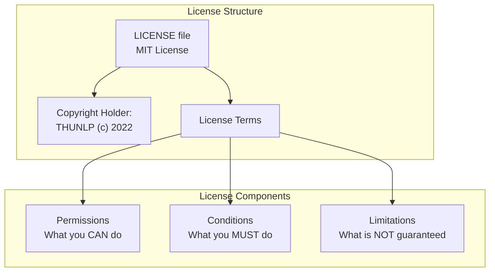
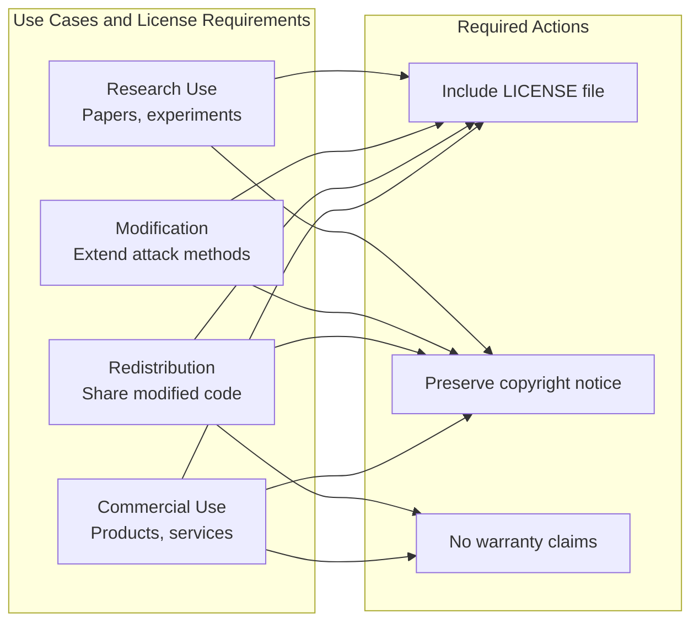
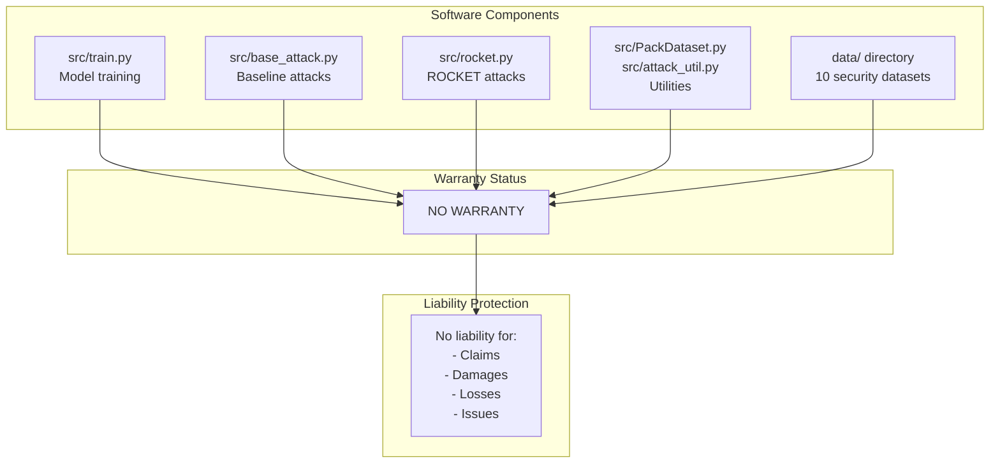
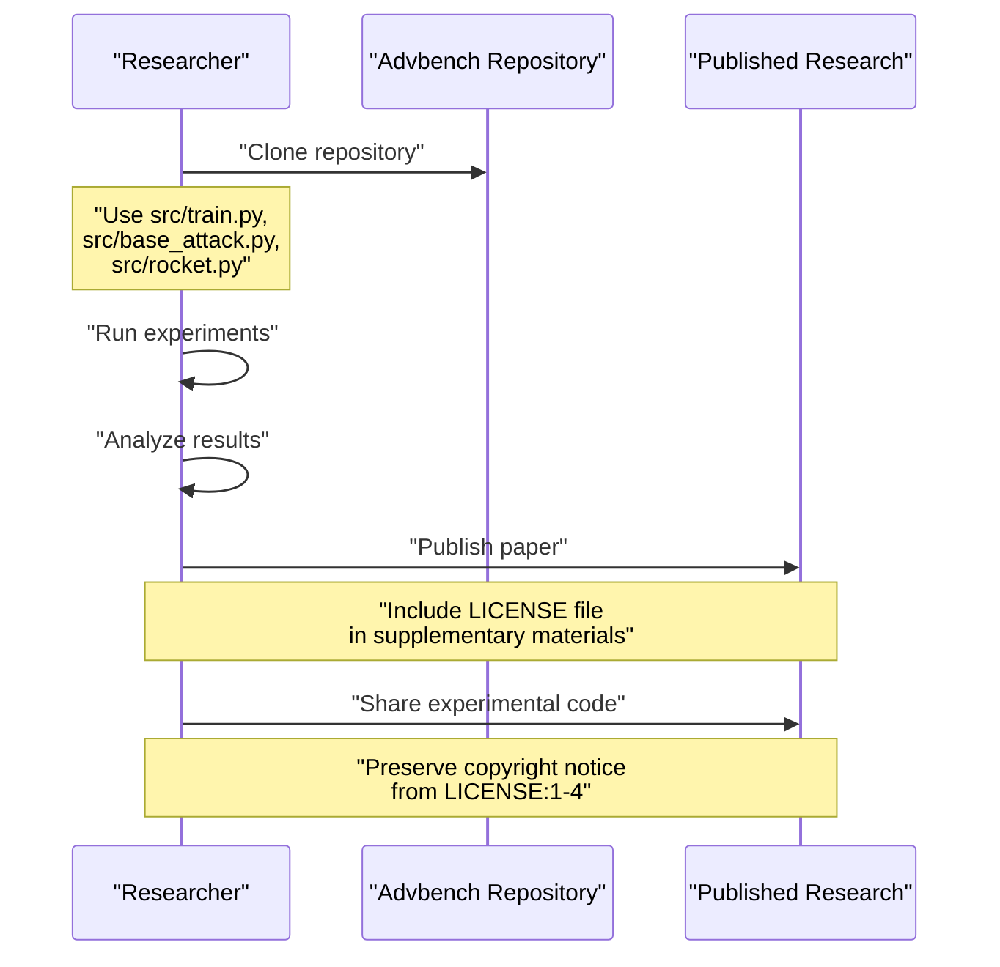
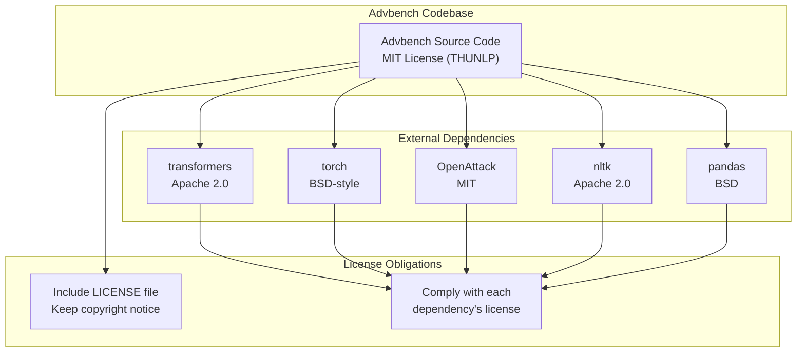

<!-- source: DeepWiki mcp.deepwiki.com · repo thunlp/Advbench · page 6.3 License · fetched 2026-11-02 -->

# License

<details>
<summary>Relevant source files</summary>

The following files were used as context for generating this wiki page:

- [LICENSE](LICENSE)

</details>


## Purpose and Scope

This page documents the licensing terms for the Advbench repository. The Advbench system is released under the MIT License, which governs how the software may be used, modified, and redistributed. This document explains the permissions, conditions, and limitations of the license as defined in [LICENSE:1-22](). 

For information about technical dependencies and third-party library licenses, see [Dependencies and Requirements](#5.4). For contribution guidelines that complement these licensing terms, see [Development Guide](#6).

**Sources**: [LICENSE:1-22]()

---

## License Overview

Advbench is distributed under the **MIT License**, a permissive open-source license that grants broad freedoms to users and developers. The copyright is held by **THUNLP** (Tsinghua University Natural Language Processing Lab) with an initial copyright year of **2022**.



**Diagram: License Structure and Components**

The MIT License is one of the most permissive software licenses, allowing commercial and non-commercial use with minimal restrictions. The license text is contained in the single file `LICENSE` at the repository root.

**Sources**: [LICENSE:1-4]()

---

## Permissions Granted

The MIT License grants the following rights to any person obtaining a copy of the Advbench software:

| Permission | Description |
|------------|-------------|
| **Use** | Run the software for any purpose, including commercial applications |
| **Copy** | Create and distribute copies of the software |
| **Modify** | Alter the source code to create derivative works |
| **Merge** | Combine the software with other codebases |
| **Publish** | Make the software publicly available |
| **Distribute** | Share copies with others |
| **Sublicense** | Grant permissions to others under different terms |
| **Sell** | Commercially distribute the software or derivatives |

These permissions apply **without restriction** to all components of Advbench, including:

- Orchestration scripts in `scripts/` directory ([scripts/train.sh](), [scripts/base_attack.sh](), [scripts/rocket.sh]())
- Core Python modules in `src/` directory ([src/train.py](), [src/base_attack.py](), [src/rocket.py](), [src/test.py]())
- Utility modules ([src/PackDataset.py](), [src/attack_util.py]())
- Documentation files (README.md)

**Sources**: [LICENSE:5-10]()

---

## Conditions for Use

The MIT License requires users to satisfy the following conditions when using or distributing Advbench:

### Mandatory Copyright Notice

The copyright notice and license text **must be included** in all copies or substantial portions of the software:

```
MIT License

Copyright (c) 2022 THUNLP

[Full license text from LICENSE file]
```

This requirement applies to:
- **Redistributions of source code**: Include [LICENSE:1-22]() in the distribution
- **Redistributions of binary/compiled forms**: Include the copyright notice and license text in documentation or other materials
- **Derivative works**: Retain the original copyright notice while adding your own copyright for modifications



**Diagram: License Conditions by Use Case**

**Sources**: [LICENSE:11-13]()

---

## Limitations of Liability

The MIT License explicitly disclaims warranties and limits liability:

### No Warranty

The software is provided **"AS IS"**, without warranty of any kind:

| Warranty Type | Status |
|---------------|--------|
| **Express Warranties** | None provided |
| **Implied Warranties** | Disclaimed |
| **Merchantability** | Not warranted |
| **Fitness for Particular Purpose** | Not warranted |
| **Non-infringement** | Not warranted |

This means:
- **Model accuracy**: THUNLP makes no guarantees about the accuracy of fine-tuned models produced by [src/train.py]()
- **Attack effectiveness**: Success rates of baseline attacks ([src/base_attack.py]()) and ROCKET attacks ([src/rocket.py]()) are not guaranteed
- **Dataset quality**: The 10 security datasets provided are offered without warranty of completeness or correctness
- **Computational efficiency**: Performance characteristics are not guaranteed across different hardware configurations

### No Liability

The copyright holders and contributors are **not liable** for:
- **Claims**: Any legal claims arising from software use
- **Damages**: Direct, indirect, incidental, or consequential damages
- **Other Liability**: Whether in contract, tort, or otherwise
- **Connection**: Arising from, out of, or in connection with the software or its use



**Diagram: Warranty and Liability Terms Applied to Codebase Components**

This protection extends to all contributors to the repository, not just the original copyright holder THUNLP.

**Sources**: [LICENSE:15-21]()

---

## Practical Implications

### For Researchers

Researchers using Advbench for academic work should:

1. **Include the LICENSE file** when sharing code or experimental setups
2. **Cite the copyright notice** in documentation or supplementary materials
3. **Acknowledge** that results depend on experimental conditions and are not guaranteed by the license

Example research workflow with license compliance:



**Diagram: License Compliance in Research Workflow**

### For Developers

Developers extending or modifying Advbench should:

1. **Retain the original LICENSE file** when creating derivative works
2. **Add their own copyright notice** for substantial modifications (while keeping the original)
3. **Document modifications** but make no warranty claims about the modified software

Example: If adding a new attack method to `src/`, the derivative work must still include [LICENSE:1-22]().

### For Commercial Users

Organizations using Advbench in commercial products or services:

1. **May use the software commercially** without royalty or licensing fees
2. **Must include the license and copyright notice** in product distributions
3. **Cannot hold THUNLP liable** for issues arising from commercial use
4. **May sublicense** but cannot remove the original MIT License terms

**Sources**: [LICENSE:5-21]()

---

## Integration with External Dependencies

While Advbench itself is MIT-licensed, it depends on external libraries with their own licenses:

| Dependency | Usage in Advbench | License Consideration |
|------------|-------------------|----------------------|
| `transformers` | BERT models in [src/train.py:1-2]() | Apache 2.0 |
| `torch` | PyTorch framework in [src/train.py:3]() | BSD-style |
| `OpenAttack` | Attack methods in [src/base_attack.py:4]() | MIT |
| `nltk` | NLP utilities in [src/rocket.py:6]() | Apache 2.0 |
| `pandas` | Data handling in [src/PackDataset.py:3]() | BSD |

The MIT License of Advbench applies only to the Advbench codebase itself. Users must comply with the licenses of all dependencies. For complete dependency information, see the requirements file at the repository root and [Dependencies and Requirements](#5.4).



**Diagram: License Relationships Between Advbench and Dependencies**

**Sources**: [LICENSE:1-22]()

---

## Summary

The MIT License provides maximum flexibility for using, modifying, and distributing Advbench with minimal restrictions. Users must:

- ✅ **Include** the copyright notice and license text ([LICENSE:12-13]())
- ✅ **Acknowledge** that no warranties are provided ([LICENSE:15-17]())
- ✅ **Accept** that THUNLP and contributors have no liability ([LICENSE:18-21]())

Users may:
- ✅ Use for commercial purposes
- ✅ Modify and create derivatives
- ✅ Distribute and sublicense
- ✅ Use privately or publicly

The license applies to all components: scripts ([scripts/]() directory), core modules ([src/]() directory), utilities, and documentation. For questions about specific use cases not covered by this documentation, consult the full license text in [LICENSE:1-22]() or seek legal counsel.

**Sources**: [LICENSE:1-22]()