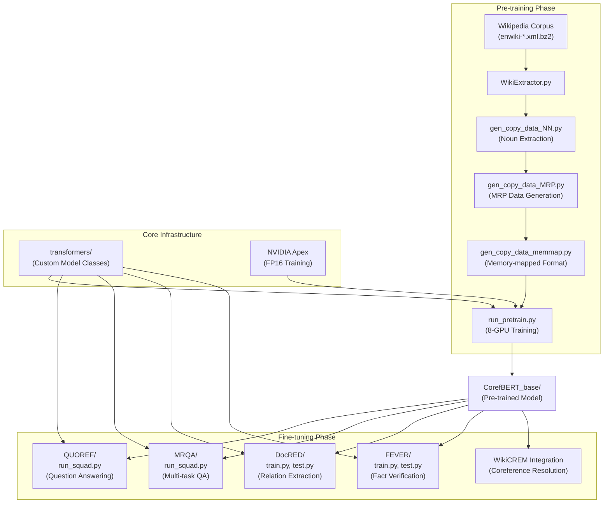
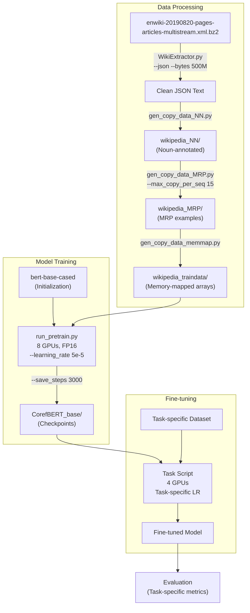
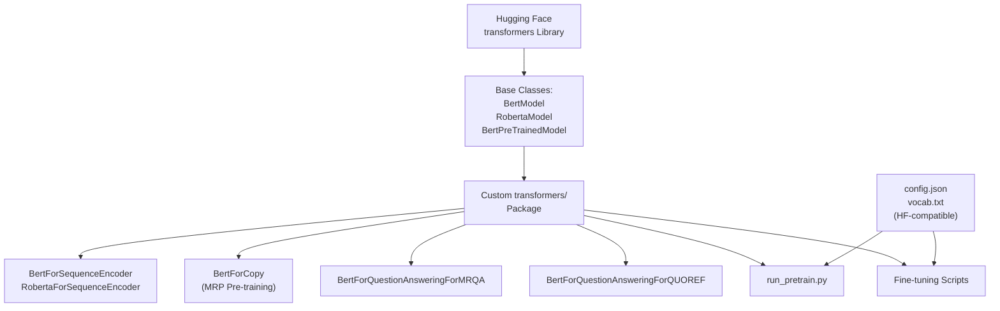

<!-- source: DeepWiki mcp.deepwiki.com · repo thunlp/CorefBERT · page 1 CorefBERT Overview · fetched 2026-11-02 -->

# CorefBERT Overview

<details>
<summary>Relevant source files</summary>

The following files were used as context for generating this wiki page:

- [README.md](README.md)
- [model.jpg](model.jpg)

</details>


## Purpose and Scope

This document provides a high-level overview of the CorefBERT system, a language representation model designed to enhance coreferential reasoning capabilities in NLP tasks. CorefBERT extends BERT by introducing a novel pre-training objective called Masked Reasoning Prediction (MRP) that explicitly models coreferential patterns in text.

This page covers:
- Overall system architecture and main components
- The coreferential reasoning concept and MRP pre-training objective
- High-level pre-training to fine-tuning pipeline
- Repository structure and code organization

For detailed information on specific subsystems:
- Pre-training data processing and execution: See [Pre-training System](#2)
- Task-specific fine-tuning instructions: See [Fine-tuning Systems](#3)
- Custom model implementations: See [Transformers Library](#4)
- Installation and environment setup: See [Installation and Setup](#6)

**Sources:** [README.md:1-10]()

## System Architecture

CorefBERT consists of three major subsystems that work together to enable coreferential reasoning in language models:



**Diagram: CorefBERT System Architecture - End-to-End Pipeline**

The system follows a two-phase approach:

1. **Pre-training Phase**: Processes raw Wikipedia data through multiple stages to create training data emphasizing coreferential patterns, then trains the base model using distributed GPU training
2. **Fine-tuning Phase**: Adapts the pre-trained model to specific downstream tasks using task-specific training scripts

**Sources:** [README.md:20-50](), [README.md:52-147]()

## Main Components

### Pre-training System

Located in `Pretrain/`, this subsystem handles the complete lifecycle from raw Wikipedia dumps to the trained CorefBERT model. The pipeline consists of:

| Stage | Script | Purpose |
|-------|--------|---------|
| 1. Text Extraction | `WikiExtractor.py` | Extracts clean text from Wikipedia XML dumps |
| 2. Noun Identification | `gen_copy_data_NN.py` | Identifies and extracts nouns from text |
| 3. MRP Data Generation | `gen_copy_data_MRP.py` | Creates masked reasoning prediction training examples |
| 4. Format Conversion | `gen_copy_data_memmap.py` | Converts to memory-mapped numpy format for efficiency |
| 5. Model Training | `run_pretrain.py` | Executes distributed training with FP16 mixed precision |

The pre-training system uses 8 GPUs with `torch.distributed.launch` and NVIDIA Apex for efficient large-scale training.

For detailed documentation, see [Pre-training System](#2).

**Sources:** [README.md:20-50]()

### Fine-tuning Systems

CorefBERT supports five downstream task categories, each with dedicated training infrastructure:

| Task | Directory | Primary Scripts | Task Type |
|------|-----------|----------------|-----------|
| QUOREF | `QUOREF/` | `run_squad.py` (with `--model_type bert_multi`) | Question Answering with multiple answers |
| MRQA | `MRQA/` | `run_squad.py` | Multi-dataset Question Answering |
| DocRED | `DocRED/` | `train.py`, `test.py` | Document-level Relation Extraction |
| FEVER | `FEVER/` | `train.py`, `test.py` | Fact Verification with evidence retrieval |
| Coreference Resolution | External (WikiCREM) | Integration with external codebase | Entity coreference |

Each task uses 4 GPUs for fine-tuning with task-specific hyperparameters and batch sizes.

For task-specific guides, see [Fine-tuning Systems](#3).

**Sources:** [README.md:52-147]()

### Transformers Library

The `transformers/` directory contains custom extensions to the Hugging Face transformers library. These extensions include:

- **BertForSequenceEncoder** and **RobertaForSequenceEncoder**: Base encoder variants
- **BertForCopy**: Specialized model for copy mechanism in pre-training
- **BertForQuestionAnsweringForMRQA**: MRQA-specific question answering
- **BertForQuestionAnsweringForQUOREF**: QUOREF-specific multi-answer QA

The custom transformers package maintains API compatibility with Hugging Face while adding CorefBERT-specific functionality.

For detailed API documentation, see [Transformers Library](#4).

**Sources:** [README.md:8]()

## Coreferential Reasoning and Masked Reasoning Prediction

CorefBERT introduces **coreferential reasoning** as an explicit pre-training objective. The system learns to understand and predict relationships between coreferent entities (nouns that refer to the same real-world entity) within documents.

### Masked Reasoning Prediction (MRP)

The MRP task extends BERT's Masked Language Modeling by focusing on coreferential patterns:


**Diagram: Masked Reasoning Prediction Process**

The MRP objective is implemented in the data processing pipeline:

1. `gen_copy_data_NN.py` extracts nouns using spaCy's NER
2. `gen_copy_data_MRP.py` identifies repeated nouns (potential coreferents), masks them, and creates training examples
3. The model learns to predict masked tokens by reasoning about coreferential relationships

Key parameters:
- `--max_seq_length 512`: Maximum sequence length for training
- `--max_copy_per_seq 15`: Maximum number of coreferent mentions per sequence
- `--short_seq_prob 0.1`: Probability of using shorter sequences

**Sources:** [README.md:3-5](), [README.md:31-43]()

## Pre-training to Fine-tuning Workflow



**Diagram: Complete CorefBERT Training Workflow**

The workflow consists of three main stages:

1. **Data Processing**: Multi-stage pipeline converting raw Wikipedia to MRP training data
2. **Pre-training**: Distributed training on 8 GPUs using the processed data, initializing from `bert-base-cased`
3. **Fine-tuning**: Task-specific adaptation on 4 GPUs with smaller learning rates

**Sources:** [README.md:20-50](), [README.md:52-147]()

## Model Variants and Availability

CorefBERT provides pre-trained models based on BERT architecture:

| Model | Base Architecture | Training Data | Download |
|-------|------------------|---------------|----------|
| CorefBERT_base | bert-base-cased | Wikipedia (MRP) | [Google Drive](https://drive.google.com/drive/folders/1JGDxWqvhWCQ58PqD7dAzye3NW5U2pZOp?usp=sharing) / [Tsinghua Cloud](https://cloud.tsinghua.edu.cn/d/a2eed603edd949b0a663) |

The pre-trained model includes:
- Model weights compatible with Hugging Face transformers API
- Configuration files (`config.json`)
- Vocabulary files (`vocab.txt`)
- Tokenizer files

For download instructions and usage, see [Model Downloads](#7).

**Sources:** [README.md:10]()

## Repository Structure

```mermaid
graph TB
    ROOT["CorefBERT/<br/>(Repository Root)"]
    
    ROOT --> README["README.md<br/>(Documentation)"]
    ROOT --> REQ["requirement.txt<br/>(Dependencies)"]
    
    ROOT --> PRETRAIN["Pretrain/<br/>(Pre-training Pipeline)"]
    ROOT --> QUOREF["QUOREF/<br/>(Question Answering)"]
    ROOT --> MRQA["MRQA/<br/>(Multi-task QA)"]
    ROOT --> DOCRED["DocRED/<br/>(Relation Extraction)"]
    ROOT --> FEVER["FEVER/<br/>(Fact Verification)"]
    ROOT --> TRANS["transformers/<br/>(Custom Models)"]
    
    PRETRAIN --> WIKIEXT["WikiExtractor.py"]
    PRETRAIN --> GENNN["gen_copy_data_NN.py"]
    PRETRAIN --> GENMRP["gen_copy_data_MRP.py"]
    PRETRAIN --> GENMEM["gen_copy_data_memmap.py"]
    PRETRAIN --> RUNPRE["run_pretrain.py"]
    
    QUOREF --> RUNSQUAD1["run_squad.py"]
    MRQA --> RUNSQUAD2["run_squad.py"]
    MRQA --> SPLIT["split.py"]
    
    DOCRED --> GENDATA["gen_data.py"]
    DOCRED --> TRAIN1["train.py"]
    DOCRED --> TEST1["test.py"]
    
    FEVER --> TRAIN2["train.py"]
    FEVER --> TEST2["test.py"]
    FEVER --> SCORER["fever_score_test.py"]
    FEVER --> SUBMIT["generate_submit.py"]
    
    TRANS --> INIT["__init__.py"]
    TRANS --> MODELS["Model Classes<br/>(BertFor*, RobertaFor*)"]
```



**Diagram: Repository Directory Structure and Key Files**

The repository is organized into task-specific directories, each containing:
- Training scripts (`train.py` or `run_squad.py`)
- Testing/evaluation scripts (`test.py`, evaluation utilities)
- Data preprocessing scripts (`gen_data.py`, `split.py`)
- Task-specific utilities

**Sources:** [README.md:1-180]()

## Technical Requirements

CorefBERT requires the following infrastructure and dependencies:

### Hardware Requirements

| Phase | GPUs | Memory | Configuration |
|-------|------|--------|---------------|
| Pre-training | 8 | High (FP16 recommended) | `CUDA_VISIBLE_DEVICES=0,1,2,3,4,5,6,7` |
| Fine-tuning | 4 | Medium | `CUDA_VISIBLE_DEVICES=0,1,2,3` |
| Inference | 1+ | Low-Medium | Flexible |

### Software Dependencies

Key dependencies include:
- **PyTorch**: Deep learning framework with distributed training support
- **transformers**: Hugging Face library (extended with custom models)
- **apex**: NVIDIA library for mixed precision training
- **spacy**: NLP library for noun extraction (`en_core_web_sm` model required)

Installation command from repository:
```bash
pip3 install -r requirement.txt
python3 -m spacy download en_core_web_sm
```

For complete setup instructions, see [Installation and Setup](#6).

**Sources:** [README.md:12-17](), [README.md:49](), [README.md:66]()

## Integration with Hugging Face Ecosystem

CorefBERT maintains compatibility with the Hugging Face transformers ecosystem while adding custom functionality:



**Diagram: Hugging Face Integration Architecture**

The custom `transformers/` package:
- Inherits from Hugging Face base classes
- Uses standard configuration and tokenizer formats
- Supports loading with `--model_name_or_path` parameter
- Enables drop-in replacement for standard BERT models

API usage pattern:
```python
--model_type bert --model_name_or_path ../CorefBERT_base
```

This design allows CorefBERT to leverage the Hugging Face ecosystem while introducing specialized model architectures for coreferential reasoning.

**Sources:** [README.md:8](), [README.md:49](), [README.md:66](), [README.md:91]()

## Citation and Research Context

CorefBERT is based on the research paper "Coreferential Reasoning Learning for Language Representation" published at EMNLP 2020. The system demonstrates that explicitly modeling coreferential patterns during pre-training improves performance on tasks requiring entity tracking and reasoning.

For citation information and licensing details, see [License and Citation](#9).

**Sources:** [README.md:3](), [README.md:150-179]()

---

