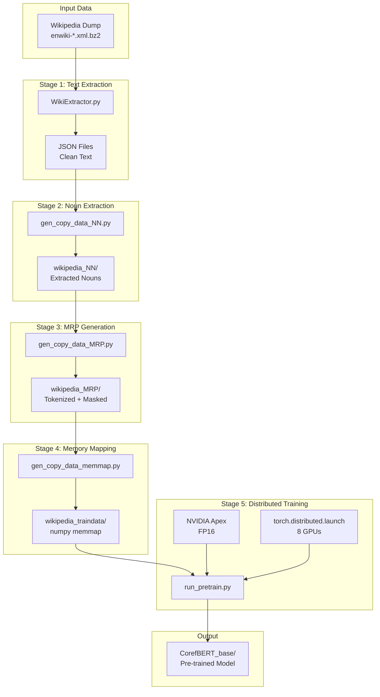
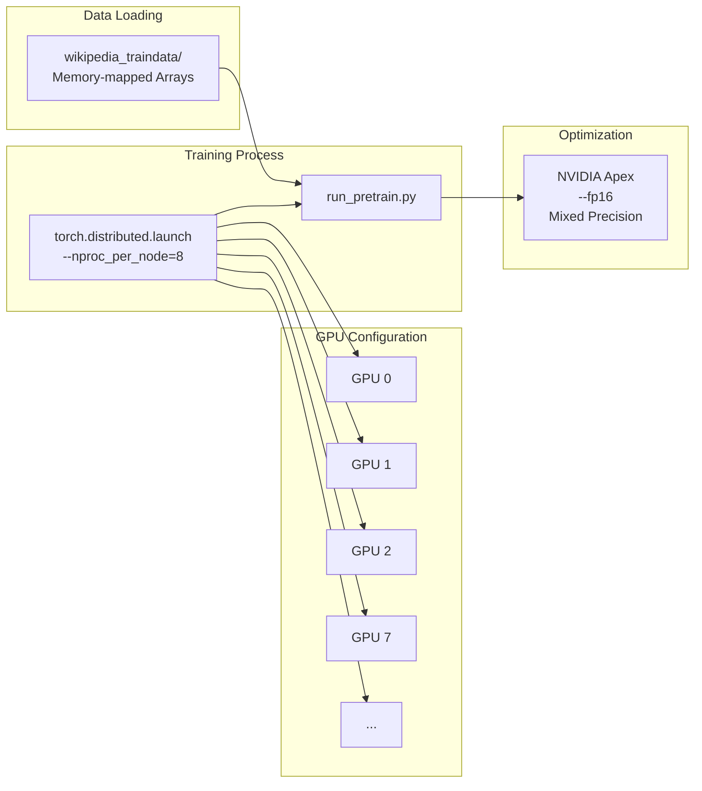
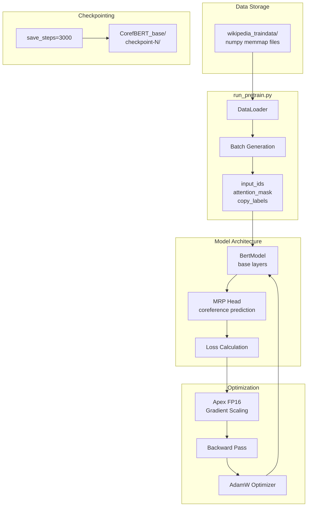

<!-- source: DeepWiki mcp.deepwiki.com · repo thunlp/CorefBERT · page 2 Pre-training System · fetched 2026-11-02 -->

# Pre-training System

<details>
<summary>Relevant source files</summary>

The following files were used as context for generating this wiki page:

- [README.md](README.md)
- [model.jpg](model.jpg)

</details>


## Purpose and Scope

The Pre-training System encompasses the complete pipeline for training CorefBERT models from raw Wikipedia data. This includes data extraction, preprocessing stages to emphasize coreferential patterns through Masked Reasoning Prediction (MRP), and distributed GPU training of the base model. The system transforms Wikipedia XML dumps into a pre-trained BERT model capable of coreferential reasoning.

For detailed information about specific stages, see [Data Processing Pipeline](#2.1) and [Pre-training Execution](#2.2). For fine-tuning the pre-trained model on downstream tasks, see [Fine-tuning Systems](#3).

**Sources:** [README.md:20-50]()

## System Architecture

The pre-training system follows a five-stage pipeline that progressively refines Wikipedia text to create training data optimized for learning coreferential patterns:



**Sources:** [README.md:20-50]()

## Data Processing Pipeline Overview

The data processing pipeline transforms raw Wikipedia XML into training-ready numpy memmap arrays. Each stage serves a specific purpose in preparing data for Masked Reasoning Prediction:

### Stage 1: Text Extraction with WikiExtractor

`WikiExtractor.py` processes the Wikipedia database dump (`enwiki-20190820-pages-articles-multistream.xml.bz2`) to extract clean text in JSON format. The extraction is parallelized using multiple processes and outputs data in manageable chunks (500MB files).

Command parameters:
- `--json`: Output format
- `--output`: Output directory
- `--bytes 500M`: Maximum file size per chunk
- `--processes 8`: Number of parallel processes

### Stage 2: Noun Extraction

`gen_copy_data_NN.py` analyzes the extracted Wikipedia text to identify and extract noun phrases. This stage uses natural language processing to detect entities that can participate in coreference relationships.

Input: `wikipedia/` (JSON files from Stage 1)  
Output: `wikipedia_NN/` (Wikipedia with annotated nouns)

### Stage 3: Masked Reasoning Prediction Data Generation

`gen_copy_data_MRP.py` implements the core preprocessing logic for CorefBERT's training objective. This script:

1. Identifies repeated nouns across sentences that form coreference chains
2. Tokenizes text using BERT's WordPiece tokenizer
3. Applies masking strategy for Masked Reasoning Prediction
4. Generates training examples with maximum sequence length constraints

Key parameters:
- `--bert_model bert-base-cased`: Base BERT model for tokenizer
- `--max_seq_length 512`: Maximum sequence length
- `--short_seq_prob 0.1`: Probability of generating short sequences
- `--max_copy_per_seq 15`: Maximum coreferential mentions per sequence

### Stage 4: Memory-Mapped Format Conversion

`gen_copy_data_memmap.py` converts JSON training data into numpy memmap format for efficient data loading during training. Memory-mapped arrays allow the training script to access data without loading the entire dataset into RAM.

Input: `wikipedia_MRP/` (tokenized JSON)  
Output: `wikipedia_traindata/` (numpy memmap arrays)

**Sources:** [README.md:24-44]()

## Training Infrastructure

### Distributed Training Configuration

The pre-training phase employs distributed data-parallel training across 8 GPUs using PyTorch's `torch.distributed.launch`:



### Training Parameters

The training configuration uses the following key parameters:

| Parameter | Value | Purpose |
|-----------|-------|---------|
| `--model_type` | `bert` | Base model architecture |
| `--model_name_or_path` | `bert-base-cased` | Starting checkpoint |
| `--per_gpu_train_batch_size` | `8` | Batch size per GPU |
| `--learning_rate` | `5e-5` | Optimizer learning rate |
| `--num_train_epochs` | `1` | Number of training epochs |
| `--max_seq_length` | `512` | Maximum sequence length |
| `--save_steps` | `3000` | Checkpoint save interval |
| `--logging_steps` | `5` | Logging interval |
| `--warmup_steps` | `3000` | Learning rate warmup steps |
| `--fp16` | flag | Enable mixed precision training |

**Sources:** [README.md:47-50]()

## Key Scripts and Components

### Pre-training Script Mapping

The following table maps the natural language description of each processing stage to the concrete Python script that implements it:

| Stage | Script Name | Input | Output | Key Function |
|-------|-------------|-------|--------|--------------|
| Text Extraction | `WikiExtractor.py` | `enwiki-*.xml.bz2` | JSON files | Extract and clean Wikipedia articles |
| Noun Extraction | `gen_copy_data_NN.py` | `wikipedia/` | `wikipedia_NN/` | Identify noun phrases for coreference |
| MRP Generation | `gen_copy_data_MRP.py` | `wikipedia_NN/` | `wikipedia_MRP/` | Generate masked reasoning examples |
| Memory Mapping | `gen_copy_data_memmap.py` | `wikipedia_MRP/` | `wikipedia_traindata/` | Convert to efficient binary format |
| Training | `run_pretrain.py` | `wikipedia_traindata/` | `CorefBERT_base/` | Train model with MRP objective |

### Script Parameter Details

#### gen_copy_data_NN.py Parameters
```
--train_corpus: Input directory containing Wikipedia JSON
--output_dir: Output directory for noun-annotated data
```

#### gen_copy_data_MRP.py Parameters
```
--train_NN_corpus: Input directory with noun-annotated Wikipedia
--output_dir: Output directory for MRP-formatted data
--bert_model: BERT model name for tokenizer (bert-base-cased)
--max_seq_length: Maximum sequence length (512)
--short_seq_prob: Probability of short sequences (0.1)
--max_copy_per_seq: Maximum coreference mentions per sequence (15)
```

#### gen_copy_data_memmap.py Parameters
```
--train_token_corpus: Input directory with tokenized MRP data
--output_dir: Output directory for memory-mapped arrays
--max_seq_length: Maximum sequence length (512)
--max_copy_per_seq: Maximum coreference mentions (15)
```

#### run_pretrain.py Parameters
```
--do_train: Enable training mode
--model_type: Model architecture (bert)
--model_name_or_path: Starting checkpoint (bert-base-cased)
--corpus_path: Path to memory-mapped training data
--per_gpu_train_batch_size: Batch size per GPU (8)
--learning_rate: Learning rate (5e-5)
--num_train_epochs: Number of epochs (1)
--max_seq_length: Maximum sequence length (512)
--save_steps: Checkpoint interval (3000)
--logging_steps: Logging interval (5)
--warmup_steps: Warmup steps (3000)
--output_dir: Output directory for checkpoints
--fp16: Enable mixed precision training
```

**Sources:** [README.md:28-50]()

## Training Data Flow

The following diagram shows how data flows through the system during the training phase, connecting the memory-mapped data format to the training script's data loading and model components:



**Sources:** [README.md:47-50]()

## Output Artifacts

### Model Checkpoints

The training process generates checkpoints at regular intervals (every 3000 steps by default) in the specified `--output_dir`:

```
CorefBERT_base/
├── checkpoint-3000/
│   ├── config.json
│   ├── pytorch_model.bin
│   ├── training_args.bin
│   └── optimizer.pt
├── checkpoint-6000/
├── checkpoint-9000/
└── ...
```

Each checkpoint contains:
- `config.json`: Model configuration
- `pytorch_model.bin`: Model weights
- `training_args.bin`: Training configuration
- `optimizer.pt`: Optimizer state (for resuming training)

### Final Pre-trained Model

The final CorefBERT model in `CorefBERT_base/` can be loaded using the transformers library and serves as the starting point for all downstream fine-tuning tasks. The pre-trained model is compatible with standard BERT interfaces but has learned enhanced representations for coreferential reasoning through the Masked Reasoning Prediction objective.

**Sources:** [README.md:47-50]()

## System Requirements

### Hardware Requirements

- **GPUs:** 8 NVIDIA GPUs with CUDA support (as configured by `CUDA_VISIBLE_DEVICES=0,1,2,3,4,5,6,7`)
- **Memory:** Sufficient RAM to handle data preprocessing (memory-mapped format reduces training-time memory requirements)
- **Storage:** Large disk space for Wikipedia dump (~100GB compressed) and processed data

### Software Dependencies

- Python 3.x
- PyTorch with distributed training support
- NVIDIA Apex for mixed precision training
- Hugging Face transformers library
- spaCy with `en_core_web_sm` model for noun extraction

**Sources:** [README.md:12-17](), [README.md:47-50]()

## Integration with Custom Transformers

The pre-training system uses the custom transformers package located in the `transformers/` directory, which extends Hugging Face's implementation with CorefBERT-specific model architectures. The `run_pretrain.py` script specifically uses:

- `BertForCopy`: Custom BERT variant with Masked Reasoning Prediction head
- `BertForSequenceEncoder`: Sequence encoding functionality for pre-training

For detailed information about the custom model architectures, see [Transformers Library](#4) and [Model Extensions](#4.2).

**Sources:** [README.md:8](), [README.md:47-50]()

---

