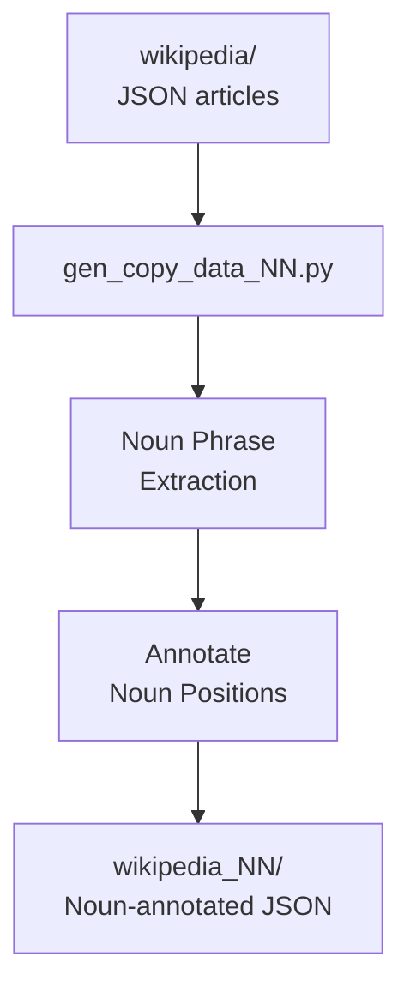
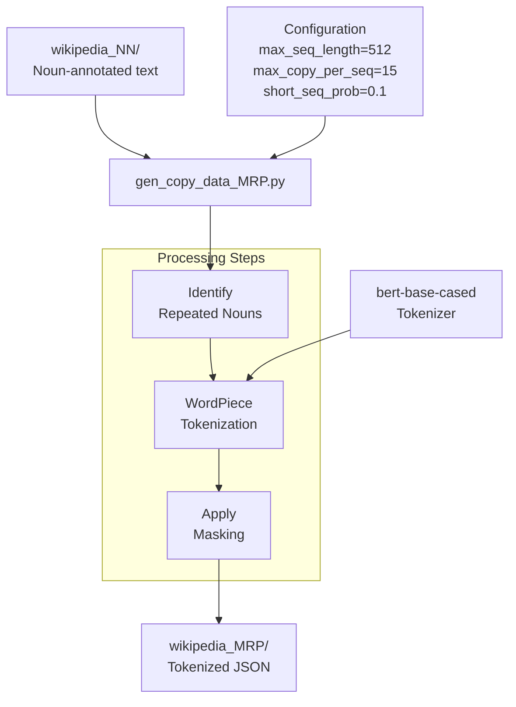
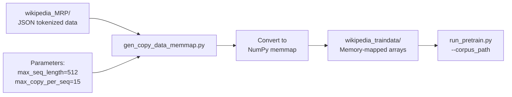
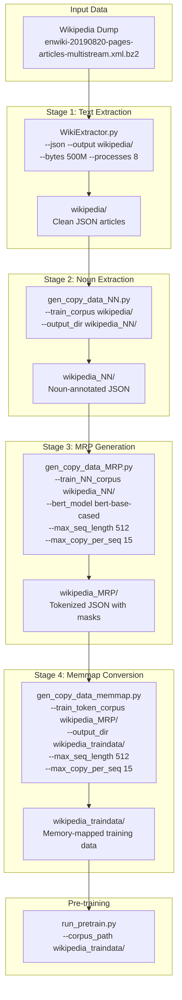

<!-- source: DeepWiki mcp.deepwiki.com · repo thunlp/CorefBERT · page 2.1 Data Processing Pipeline · fetched 2026-11-02 -->

# Data Processing Pipeline

<details>
<summary>Relevant source files</summary>

The following files were used as context for generating this wiki page:

- [README.md](README.md)
- [model.jpg](model.jpg)

</details>


## Purpose and Scope

This document describes the data processing pipeline that prepares Wikipedia text for CorefBERT pre-training. The pipeline transforms raw Wikipedia dumps into memory-mapped training data optimized for the Masked Reasoning Prediction (MRP) pre-training task.

This page covers data preparation only. For information about the actual pre-training execution process, see [Pre-training Execution](#2.2). For details about the custom model architectures used during pre-training, see [Model Extensions](#4.2).

**Sources:** [README.md:20-50]()

## Pipeline Overview

The data processing pipeline consists of four sequential stages, each producing intermediate data consumed by the next stage:


| Stage | Script | Input | Output | Purpose |
|-------|--------|-------|--------|---------|
| 1 | `WikiExtractor.py` | Wikipedia XML dump | Clean JSON text | Extract and clean Wikipedia articles |
| 2 | `gen_copy_data_NN.py` | Clean JSON text | Noun-annotated text | Identify and extract nouns for coreference |
| 3 | `gen_copy_data_MRP.py` | Noun-annotated text | Tokenized MRP data | Generate masked reasoning examples |
| 4 | `gen_copy_data_memmap.py` | Tokenized MRP data | Memory-mapped arrays | Convert to efficient training format |

**Sources:** [README.md:24-50]()

## Stage 1: Wikipedia Text Extraction

### WikiExtractor Processing

The pipeline begins with raw Wikipedia database dumps downloaded from [dumps.wikimedia.org](https://dumps.wikimedia.org/enwiki). The `WikiExtractor.py` script extracts clean text from compressed XML format.

**Command:**
```bash
python3 WikiExtractor.py wikipedia/enwiki-20190820-pages-articles-multistream.xml.bz2 \
    --json \
    --output wikipedia/ \
    --bytes 500M \
    --processes 8
```

### Key Parameters

| Parameter | Value | Purpose |
|-----------|-------|---------|
| Input file | `enwiki-*.xml.bz2` | Compressed Wikipedia dump |
| `--json` | flag | Output in JSON format (one article per line) |
| `--output` | `wikipedia/` | Output directory for extracted text |
| `--bytes` | `500M` | Maximum size per output file (500 megabytes) |
| `--processes` | `8` | Number of parallel extraction processes |

### Output Format

WikiExtractor produces JSON files containing clean Wikipedia article text with markup removed. Each line represents one article with fields for title, URL, and cleaned text content.

**Sources:** [README.md:24-29]()

## Stage 2: Noun Extraction

### Purpose and Implementation

The `gen_copy_data_NN.py` script processes the clean Wikipedia text to identify and extract noun phrases. This step is crucial for CorefBERT's coreferential reasoning objective, as nouns are the primary entities involved in coreference chains.

**Command:**
```bash
python3 gen_copy_data_NN.py \
    --train_corpus wikipedia/ \
    --output_dir wikipedia_NN/
```



### Script Arguments

| Argument | Description | Example |
|----------|-------------|---------|
| `--train_corpus` | Directory containing WikiExtractor output | `wikipedia/` |
| `--output_dir` | Directory for noun-extracted output | `wikipedia_NN/` |

### Processing Details

The script likely uses NLP libraries (such as spaCy, as indicated by the requirement `python3 -m spacy download en_core_web_sm` in [README.md:16]()) to perform linguistic analysis and identify noun phrases. These nouns become candidates for the masked reasoning prediction task.

**Sources:** [README.md:31-34](), [README.md:16]()

## Stage 3: Masked Reasoning Prediction (MRP) Data Generation

### Overview

The `gen_copy_data_MRP.py` script is the core of CorefBERT's data preparation. It identifies repeated nouns (coreferential mentions), tokenizes text using BERT's WordPiece tokenizer, and applies masking to create the MRP pre-training task.

**Command:**
```bash
python3 gen_copy_data_MRP.py \
    --train_NN_corpus wikipedia_NN/ \
    --output_dir wikipedia_MRP/ \
    --bert_model bert-base-cased \
    --max_seq_length 512 \
    --short_seq_prob 0.1 \
    --max_copy_per_seq 15
```



### Configuration Parameters

| Parameter | Value | Description |
|-----------|-------|-------------|
| `--train_NN_corpus` | `wikipedia_NN/` | Input directory with noun-annotated text |
| `--output_dir` | `wikipedia_MRP/` | Output directory for MRP data |
| `--bert_model` | `bert-base-cased` | BERT model for tokenization vocabulary |
| `--max_seq_length` | `512` | Maximum sequence length in tokens |
| `--short_seq_prob` | `0.1` | Probability of generating sequences shorter than max length |
| `--max_copy_per_seq` | `15` | Maximum number of coreferential masks per sequence |

### MRP Task Generation

The script performs three key operations:

1. **Coreference Identification**: Analyzes noun-annotated text to find repeated noun mentions that refer to the same entity
2. **WordPiece Tokenization**: Converts text to subword tokens using the BERT tokenizer from `bert-base-cased`
3. **Masking Strategy**: Applies masks to coreferential mentions according to the `max_copy_per_seq` constraint

The `max_copy_per_seq=15` parameter limits each sequence to at most 15 masked coreferential mentions, balancing between learning signal and computational feasibility.

**Sources:** [README.md:36-39]()

## Stage 4: Memory-Mapped Data Conversion

### Efficient Data Format

The `gen_copy_data_memmap.py` script converts JSON-formatted MRP data into NumPy memory-mapped arrays. This format enables efficient random access during distributed training without loading the entire dataset into memory.

**Command:**
```bash
python3 gen_copy_data_memmap.py \
    --train_token_corpus wikipedia_MRP/ \
    --output_dir wikipedia_traindata/ \
    --max_seq_length 512 \
    --max_copy_per_seq 15
```



### Script Configuration

| Parameter | Value | Purpose |
|-----------|-------|---------|
| `--train_token_corpus` | `wikipedia_MRP/` | Input directory with tokenized JSON |
| `--output_dir` | `wikipedia_traindata/` | Output directory for memmap files |
| `--max_seq_length` | `512` | Must match Stage 3 value |
| `--max_copy_per_seq` | `15` | Must match Stage 3 value |

### Memory-Mapped Format Benefits

Memory-mapped arrays provide several advantages for distributed pre-training:

- **Memory Efficiency**: Data remains on disk; only accessed portions are loaded into RAM
- **Fast Random Access**: Direct byte-level access without parsing overhead
- **Multi-Process Safety**: Multiple GPU processes can read simultaneously without conflicts
- **Large Dataset Support**: Handles datasets larger than available system memory

The output directory `wikipedia_traindata/` is directly consumed by `run_pretrain.py` via the `--corpus_path` argument.

**Sources:** [README.md:41-44]()

## Complete Data Flow

The following diagram shows the end-to-end data transformation with all file paths and script names:



**Sources:** [README.md:24-50]()

## Output Directory Structure

After completing all pipeline stages, the expected directory structure is:

```
project_root/
├── wikipedia/
│   ├── AA/
│   │   └── wiki_00.json
│   │   └── wiki_01.json
│   └── AB/
│       └── wiki_00.json
├── wikipedia_NN/
│   ├── AA/
│   │   └── wiki_00.json  # Noun-annotated
│   └── AB/
│       └── wiki_00.json
├── wikipedia_MRP/
│   ├── AA/
│   │   └── wiki_00.json  # Tokenized with masks
│   └── AB/
│       └── wiki_00.json
└── wikipedia_traindata/
    ├── input_ids.npy       # Memory-mapped token IDs
    ├── input_mask.npy      # Attention masks
    ├── segment_ids.npy     # Segment IDs
    └── copy_*.npy          # Coreference-related arrays
```

Each stage produces a new directory while preserving the original data, allowing for inspection and debugging at any pipeline stage.

**Sources:** [README.md:24-50]()

## Parameter Consistency Requirements

Critical parameters must remain consistent across Stages 3 and 4, and must match the pre-training configuration:

| Parameter | Stage 3 (MRP) | Stage 4 (Memmap) | Pre-training | Required Match |
|-----------|---------------|------------------|--------------|----------------|
| `max_seq_length` | `512` | `512` | `--max_seq_length 512` | ✓ |
| `max_copy_per_seq` | `15` | `15` | (implicit in data) | ✓ |
| `bert_model` | `bert-base-cased` | - | `--model_name_or_path bert-base-cased` | ✓ |

Mismatched parameters will cause training failures or incorrect data loading. The tokenizer vocabulary from `bert_model` in Stage 3 must match the model architecture used in pre-training.

**Sources:** [README.md:36-50]()

## Computational Requirements

### Processing Time Estimates

The processing time for each stage depends on the Wikipedia dump size:

- **Stage 1 (WikiExtractor)**: ~2-4 hours for full English Wikipedia with 8 processes
- **Stage 2 (Noun Extraction)**: ~8-12 hours depending on NLP library performance
- **Stage 3 (MRP Generation)**: ~12-24 hours including tokenization and coreference analysis
- **Stage 4 (Memmap Conversion)**: ~2-4 hours for format conversion

### Storage Requirements

Approximate disk space needed for each stage (based on full English Wikipedia):

| Stage | Directory | Approximate Size |
|-------|-----------|------------------|
| Raw dump | `enwiki-*.xml.bz2` | ~17-20 GB (compressed) |
| Stage 1 | `wikipedia/` | ~70-80 GB (uncompressed JSON) |
| Stage 2 | `wikipedia_NN/` | ~80-90 GB (with annotations) |
| Stage 3 | `wikipedia_MRP/` | ~100-120 GB (tokenized) |
| Stage 4 | `wikipedia_traindata/` | ~150-200 GB (memory-mapped arrays) |

Total disk space requirement: **~500-600 GB** for full pipeline

**Sources:** [README.md:24-50]()

---

