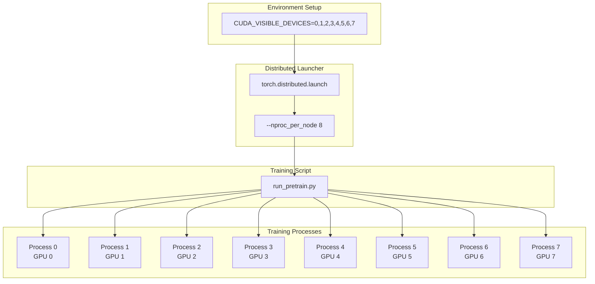
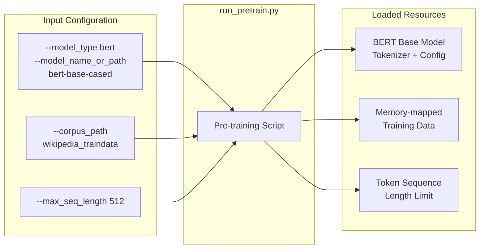
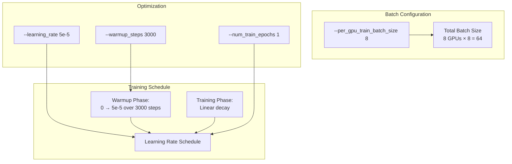
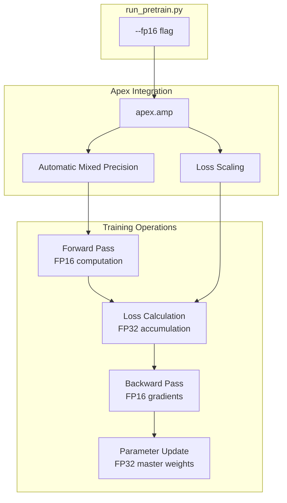
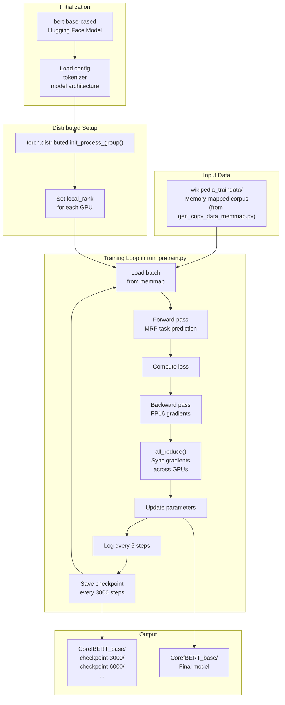

<!-- source: DeepWiki mcp.deepwiki.com · repo thunlp/CorefBERT · page 2.2 Pre-training Execution · fetched 2026-11-02 -->

# Pre-training Execution

<details>
<summary>Relevant source files</summary>

The following files were used as context for generating this wiki page:

- [README.md](README.md)
- [model.jpg](model.jpg)

</details>


## Purpose and Scope

This document describes how to execute the CorefBERT pre-training process using processed Wikipedia data. Pre-training execution encompasses distributed GPU training configuration, command-line parameter specification, mixed-precision training setup, and checkpoint management.

For information about preparing the training data (Wikipedia extraction, noun identification, and MRP data generation), see [Data Processing Pipeline](#2.1). For information about the resulting pre-trained models and their usage in downstream tasks, see [Fine-tuning Systems](#3).

**Sources:** [README.md:20-50]()

---

## Prerequisites

Before executing pre-training, the following must be completed:

1. **Data preparation pipeline** (see [#2.1](#2.1)): Wikipedia data must be processed through all stages:
   - Text extraction via WikiExtractor
   - Noun extraction via `gen_copy_data_NN.py`
   - MRP data generation via `gen_copy_data_MRP.py`
   - Memory-mapped format conversion via `gen_copy_data_memmap.py`

2. **Dependencies installed**: The environment must have apex (NVIDIA's mixed-precision training library) and transformers library installed

3. **Base model available**: The `bert-base-cased` model from Hugging Face must be accessible

4. **Hardware availability**: 8 GPUs are required for the standard configuration

**Sources:** [README.md:12-44]()

---

## Training Command Structure

The pre-training process is executed through `run_pretrain.py` using PyTorch's distributed launch utility:

```bash
CUDA_VISIBLE_DEVICES=0,1,2,3,4,5,6,7 python3 -m torch.distributed.launch \
    --nproc_per_node 8 \
    run_pretrain.py \
    --do_train \
    --model_type bert \
    --model_name_or_path bert-base-cased \
    --corpus_path wikipedia_traindata \
    --per_gpu_train_batch_size 8 \
    --learning_rate 5e-5 \
    --num_train_epochs 1 \
    --max_seq_length 512 \
    --save_steps 3000 \
    --logging_steps 5 \
    --warmup_steps 3000 \
    --output_dir ../CorefBERT_base \
    --fp16
```

This command launches 8 parallel training processes, one per GPU, coordinated through PyTorch's distributed training infrastructure.

**Sources:** [README.md:47-50]()

---

## Distributed Training Configuration

### GPU Assignment and Process Launching



**Distributed Training Setup**

| Component | Value | Purpose |
|-----------|-------|---------|
| `CUDA_VISIBLE_DEVICES` | `0,1,2,3,4,5,6,7` | Makes 8 GPUs visible to the process |
| `torch.distributed.launch` | PyTorch module | Launches multiple training processes |
| `--nproc_per_node` | `8` | Creates 8 parallel processes (one per GPU) |

Each process receives a unique `local_rank` (0-7) identifying its GPU assignment. Processes synchronize gradients during backpropagation to maintain consistent model updates across all GPUs.

**Sources:** [README.md:49-50]()

---

## Training Parameters

### Model and Data Configuration



| Parameter | Value | Description |
|-----------|-------|-------------|
| `--do_train` | Flag | Enables training mode |
| `--model_type` | `bert` | Specifies BERT architecture |
| `--model_name_or_path` | `bert-base-cased` | Base model checkpoint to initialize from |
| `--corpus_path` | `wikipedia_traindata` | Directory containing memory-mapped training data |
| `--max_seq_length` | `512` | Maximum sequence length in tokens |

**Sources:** [README.md:49-50]()

### Training Hyperparameters



| Parameter | Value | Description |
|-----------|-------|-------------|
| `--per_gpu_train_batch_size` | `8` | Batch size per GPU (effective batch: 64) |
| `--learning_rate` | `5e-5` | Peak learning rate after warmup |
| `--num_train_epochs` | `1` | Number of passes through the dataset |
| `--warmup_steps` | `3000` | Steps for linear learning rate warmup |

The effective batch size is 64 (8 GPUs × 8 samples per GPU), which enables stable training with the 5e-5 learning rate.

**Sources:** [README.md:49-50]()

### Logging and Checkpointing

| Parameter | Value | Description |
|-----------|-------|-------------|
| `--logging_steps` | `5` | Print training loss every 5 steps |
| `--save_steps` | `3000` | Save model checkpoint every 3000 steps |
| `--output_dir` | `../CorefBERT_base` | Directory for checkpoints and final model |

Checkpoints are saved at regular intervals (every 3000 steps), allowing training to resume from intermediate points if interrupted. Each checkpoint includes model weights, optimizer state, and training progress information.

**Sources:** [README.md:49-50]()

---

## Mixed Precision Training

### FP16 Configuration

The `--fp16` flag enables mixed-precision training via NVIDIA Apex, which:

1. **Reduces memory usage**: FP16 tensors consume half the memory of FP32
2. **Accelerates computation**: Modern GPUs have specialized FP16 hardware
3. **Maintains accuracy**: Critical operations remain in FP32 via automatic casting



The Apex library automatically:
- Converts model operations to FP16 where safe
- Maintains FP32 master copies of model parameters
- Applies loss scaling to prevent gradient underflow
- Handles FP16/FP32 conversions transparently

**Sources:** [README.md:13-16, 49-50]()

---

## Output Structure and Checkpointing

### Directory Layout

The `--output_dir` parameter specifies where training artifacts are saved:

```
CorefBERT_base/
├── checkpoint-3000/
│   ├── config.json
│   ├── pytorch_model.bin
│   ├── optimizer.pt
│   ├── scheduler.pt
│   └── training_args.bin
├── checkpoint-6000/
│   └── ...
├── checkpoint-9000/
│   └── ...
└── (final checkpoint after training completes)
```

### Checkpoint Contents

Each checkpoint directory contains:

| File | Description |
|------|-------------|
| `config.json` | Model configuration (architecture, vocab size, etc.) |
| `pytorch_model.bin` | Model weights in PyTorch format |
| `optimizer.pt` | Optimizer state (Adam momentum, variance) |
| `scheduler.pt` | Learning rate scheduler state |
| `training_args.bin` | Training arguments and hyperparameters |

These files enable:
- **Training resumption**: Continue from any checkpoint if interrupted
- **Model deployment**: Use `pytorch_model.bin` and `config.json` for inference
- **Fine-tuning initialization**: Load pre-trained weights for downstream tasks

**Sources:** [README.md:49-50]()

---

## Pre-training Process Flow

### End-to-End Execution Diagram



### Training Iteration Details

Each training step performs:

1. **Data Loading**: Read a batch from memory-mapped files (8 samples per GPU)
2. **Forward Pass**: Process sequences through BERT encoder, compute MRP task predictions
3. **Loss Calculation**: Calculate masked token prediction loss and mention reasoning loss
4. **Backward Pass**: Compute gradients in FP16 (with Apex handling)
5. **Gradient Synchronization**: Use `all_reduce` to average gradients across 8 GPUs
6. **Parameter Update**: Apply optimizer step to update model weights
7. **Logging**: Print loss every 5 steps to monitor training progress
8. **Checkpointing**: Save full model state every 3000 steps

The process repeats until completing one epoch over the Wikipedia corpus.

**Sources:** [README.md:47-50]()

---

## Hardware and Performance Considerations

### Resource Requirements

| Resource | Requirement | Notes |
|----------|-------------|-------|
| GPUs | 8× with ≥16GB VRAM | FP16 reduces memory vs. FP32 |
| CPU RAM | ≥128GB | For memory-mapped data access |
| Disk Space | ~100GB | Processed Wikipedia + checkpoints |
| Training Time | ~1-2 weeks | Depends on GPU type (V100, A100, etc.) |

### Configuration Trade-offs

**Batch Size**: The `per_gpu_train_batch_size=8` setting balances:
- **Memory usage**: Larger batches require more GPU memory
- **Training stability**: Larger effective batch (64) enables higher learning rates
- **Convergence speed**: Larger batches mean fewer update steps per epoch

**Checkpoint Frequency**: `save_steps=3000` balances:
- **Disk usage**: More frequent saves consume more disk space
- **Recovery cost**: Less frequent saves mean more recomputation after failures
- **I/O overhead**: Saving too often impacts training throughput

**Sources:** [README.md:49-50]()

---

## Integration with Transformers Library

The pre-training script (`run_pretrain.py`) integrates with the custom transformers package (see [Transformers Library](#4)) to access:

- **`BertForCopy`**: Custom BERT variant for MRP pre-training task
- **`BertConfig`**: Model architecture configuration
- **`BertTokenizer`**: Tokenization using bert-base-cased vocabulary
- **`AdamW` optimizer**: Weight decay optimization
- **Learning rate schedulers**: Linear warmup and decay

The resulting model in `CorefBERT_base/` follows the standard transformers format, making it compatible with all transformers-based fine-tuning scripts.

**Sources:** [README.md:8, 49-50]()

---

