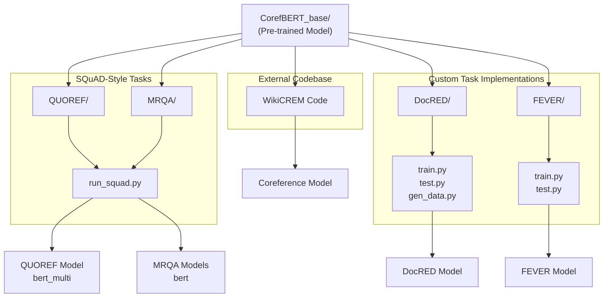
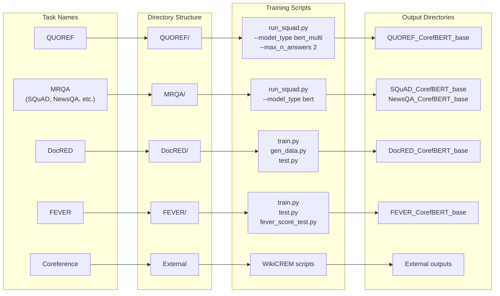
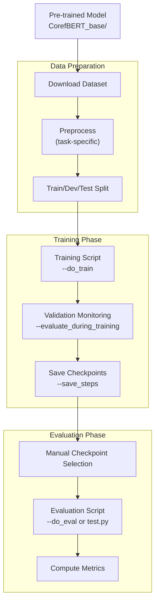
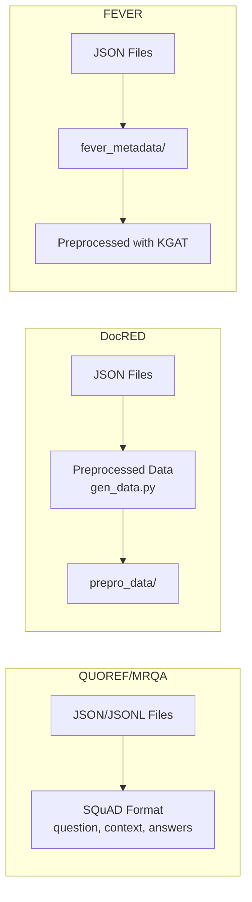
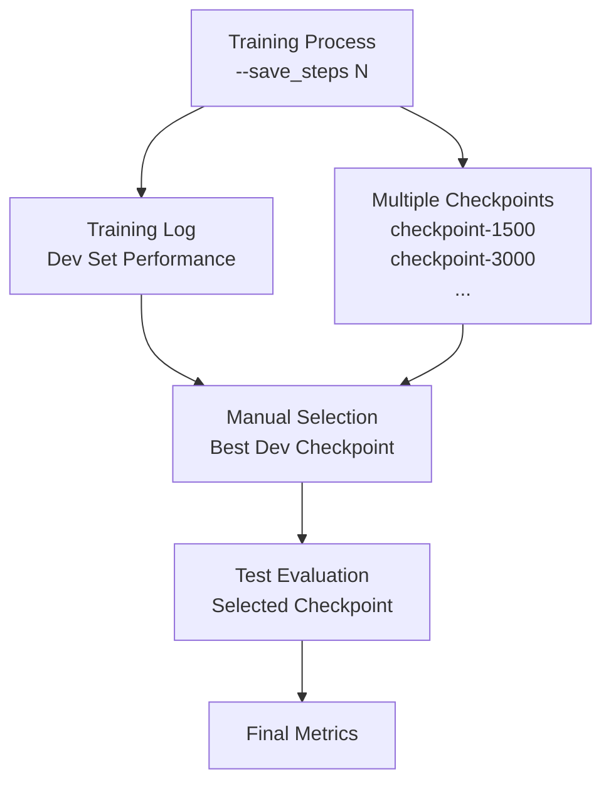

<!-- source: DeepWiki mcp.deepwiki.com · repo thunlp/CorefBERT · page 3 Fine-tuning Systems · fetched 2026-11-02 -->

# Fine-tuning Systems

<details>
<summary>Relevant source files</summary>

The following files were used as context for generating this wiki page:

- [README.md](README.md)
- [model.jpg](model.jpg)

</details>


## Purpose and Scope

This page documents the fine-tuning systems that adapt the pre-trained CorefBERT model for downstream NLP tasks. It covers the overall architecture patterns, training workflows, and common components shared across tasks. For specific task implementations, see:
- [QUOREF Question Answering](#3.1)
- [MRQA Tasks](#3.2)
- [DocRED Relation Extraction](#3.3)
- [FEVER Fact Verification](#3.4)
- [Coreference Resolution](#3.5)

For information about the pre-training process that creates the base model, see [Pre-training System](#2).

**Sources:** [README.md:1-180]()

## Overview

The CorefBERT fine-tuning systems demonstrate transfer learning where a pre-trained model (`CorefBERT_base/`) is adapted to task-specific objectives. All fine-tuning tasks share a common pattern: they load weights from the pre-trained CorefBERT model and train task-specific heads on labeled data while allowing the entire model to be updated.

The repository includes five main fine-tuning task categories:
1. **Question Answering** - QUOREF and MRQA datasets requiring span extraction
2. **Relation Extraction** - DocRED for document-level relation classification
3. **Fact Verification** - FEVER for claim validation against evidence
4. **Coreference Resolution** - Standard coreference datasets via WikiCREM

**Sources:** [README.md:52-147]()

## Fine-tuning Architecture

### System Organization



**Sources:** [README.md:52-147]()

### Task-to-Code Entity Mapping

The following diagram maps natural language task names to their concrete code entities in the repository:



**Sources:** [README.md:52-147]()

## Common Fine-tuning Patterns

### GPU Configuration and Distributed Training

All fine-tuning tasks use multi-GPU training with 4 GPUs by default. The pattern is consistent across tasks:

```bash
CUDA_VISIBLE_DEVICES=0,1,2,3 python3 [script_name] [arguments]
```

This contrasts with pre-training which uses 8 GPUs with `torch.distributed.launch`. Fine-tuning tasks use simpler data-parallel training without explicit distributed launchers.

**Sources:** [README.md:66, 91, 114, 128]()

### Model Loading Pattern

All tasks load the pre-trained model using the `--model_name_or_path` parameter pointing to `CorefBERT_base/`:

| Task | Parameter |
|------|-----------|
| QUOREF | `--model_name_or_path ../CorefBERT_base` |
| MRQA | `--model_name_or_path ../CorefBERT_base` |
| DocRED | `--model_name_or_path ../CorefBERT_base` |
| FEVER | `--bert_pretrain ../CorefBERT_base` |

Note that FEVER uses a different parameter name (`--bert_pretrain`) due to its KGAT-based implementation.

**Sources:** [README.md:66, 91, 114, 128]()

### Training Configuration Parameters

```mermaid
graph TB
    subgraph "Common Parameters"
        ModelType["--model_type<br/>bert or bert_multi"]
        ModelPath["--model_name_or_path<br/>../CorefBERT_base"]
        SeqLen["--max_seq_length<br/>512 (standard)"]
        BatchSize["Batch Sizes<br/>8-32 per GPU"]
        LR["Learning Rates<br/>2e-5 to 5e-5"]
    end
    
    subgraph "SQuAD-Style Specific"
        DocStride["--doc_stride<br/>128"]
        SaveSteps["--save_steps<br/>Checkpoint intervals"]
        EvalDuring["--evaluate_during_training"]
    end
    
    subgraph "Task-Specific"
        MaxAnswers["--max_n_answers<br/>QUOREF: 2"]
        Threshold["--input_threshold<br/>DocRED: 0.5534"]
        Epochs["--num_train_epochs<br/>2-200 depending on task"]
    end
    
    ModelType --> Training["Training Process"]
    ModelPath --> Training
    SeqLen --> Training
    BatchSize --> Training
    LR --> Training
    DocStride --> Training
    SaveSteps --> Training
    EvalDuring --> Training
    MaxAnswers --> Training
    Threshold --> Testing["Test Evaluation"]
    Epochs --> Training
```



**Sources:** [README.md:66, 91, 114, 128]()

### Task Configuration Summary

| Task | Script | Model Type | Batch Size | Learning Rate | Epochs | Special Parameters |
|------|--------|------------|------------|---------------|--------|-------------------|
| QUOREF | `run_squad.py` | `bert_multi` | 8 | 2e-5 | 6 | `--max_n_answers 2` |
| MRQA | `run_squad.py` | `bert` | 8 | 3e-5 | 2 | `--doc_stride 128` |
| DocRED | `train.py` | `bert` | 32 | 4e-5 | 200 | `--evaluate_during_training_epoch 5` |
| FEVER | `train.py` | `bert` | 32 | 2e-5 | 3 | KGAT-based architecture |

**Sources:** [README.md:66, 91, 114, 128]()

## Training and Evaluation Workflow

### General Workflow Pattern



**Sources:** [README.md:52-147]()

### Evaluation Approaches by Task

Different tasks use different evaluation strategies:

**SQuAD-Style Tasks (QUOREF, MRQA):**
- Training includes `--evaluate_during_training` flag
- Manual checkpoint selection based on dev set performance in training logs
- Separate evaluation pass using `--do_eval` on test set

**DocRED:**
- Periodic evaluation during training with `--evaluate_during_training_epoch`
- Manual threshold selection from training log analysis
- Test evaluation requires threshold parameter: `--input_threshold 0.5534`

**FEVER:**
- Separate test script (`test.py`) for evaluation
- Custom scorer (`fever_score_test.py`) for final metrics
- Two-stage evaluation: model prediction + scorer computation

**Sources:** [README.md:69-72, 94-97, 117-120, 132-141]()

## Data Requirements and Formats

### Input Data Patterns



**Sources:** [README.md:57-59, 79-82, 105-109, 124]()

### Task-Specific Data Locations

| Task | Data Directory | Input Files | Preprocessing |
|------|----------------|-------------|---------------|
| QUOREF | `quoref_data/` | `quoref-train-v0.1.json`<br/>`quoref-dev-v0.1.json` | None required |
| MRQA | `squad/`, `newsqa/`, etc. | `train.jsonl`<br/>`dev.jsonl`<br/>`test.jsonl` | `split.py` for dev/test split |
| DocRED | `docred_data/` | `train_annotated.json`<br/>`dev.json`<br/>`test.json` | `gen_data.py` → `prepro_data/` |
| FEVER | `fever_metadata/` | `train.json`<br/>`dev.json`<br/>`test.json` | External KGAT preprocessing |

**Sources:** [README.md:57, 79-86, 105-109, 124]()

## Output Structure

### Model Checkpoints and Artifacts

All fine-tuning tasks save outputs to task-specific directories with a common naming pattern:

```
[TASK]_CorefBERT_base/
├── checkpoint-[step]/      # Intermediate checkpoints
├── model.best.pt           # Best model (FEVER only)
└── [predictions files]     # Task-specific outputs
```

Example output directories referenced in the codebase:
- `QUOREF_CorefBERT_base/`
- `SQuAD_CorefBERT_base/`
- `NewsQA_CorefBERT_base/`
- `DocRED_CorefBERT_base/`
- `FEVER_CorefBERT_base/`

**Sources:** [README.md:66, 91, 114, 128]()

### Checkpoint Selection Strategy



The repository requires manual checkpoint selection based on development set performance logged during training. This approach is explicitly mentioned for MRQA [README.md:94]() and used across all tasks.

**Sources:** [README.md:69-72, 94-97, 117-120, 134-136]()

## Script Reuse and Shared Components

### SQuAD Script Dual Usage

The `run_squad.py` script in both `QUOREF/` and `MRQA/` directories serves two different task types through the `--model_type` parameter:

**QUOREF Configuration:**
```bash
--model_type bert_multi --max_n_answers 2
```
Uses a specialized multi-answer model architecture for questions requiring multiple coreferential answers.

**MRQA Configuration:**
```bash
--model_type bert
```
Uses standard BERT architecture for single-answer extraction across multiple reading comprehension datasets.

This pattern demonstrates code reuse where the same training script adapts its behavior through configuration rather than separate implementations.

**Sources:** [README.md:66, 91]()

### Common Hyperparameters

The following hyperparameters are standardized across tasks:

- `max_seq_length`: 512 tokens (standard BERT limit)
- `doc_stride`: 128 tokens (for sliding window approaches in QUOREF/MRQA)
- `per_gpu_train_batch_size`: 8 or 32 depending on task complexity
- `per_gpu_eval_batch_size`: 16 or 32 for faster inference

**Sources:** [README.md:66, 91, 114, 128]()

## Integration with Custom Transformers

All fine-tuning tasks depend on the custom `transformers/` package that extends Hugging Face transformers. See [Transformers Library](#4) for details on the custom model implementations.

Key model types referenced:
- `bert_multi` - Custom QUOREF model in [transformers/](#4.2)
- `bert` - Extended BERT models for various tasks

**Sources:** [README.md:8, 66, 91]()

## Summary

The CorefBERT fine-tuning systems follow consistent patterns:

1. **Model Source**: All tasks load from `CorefBERT_base/` pre-trained model
2. **Multi-GPU Training**: Standard 4-GPU configuration without distributed launcher
3. **Sequence Length**: 512 tokens across all tasks
4. **Evaluation**: Manual checkpoint selection based on development set performance
5. **Output Naming**: `[TASK]_CorefBERT_base/` directory convention

The systems are organized into three implementation categories:
- **SQuAD-style** (QUOREF, MRQA): Shared `run_squad.py` with different configurations
- **Custom implementations** (DocRED, FEVER): Task-specific training scripts
- **External codebases** (Coreference): Integration with WikiCREM

For detailed information about each task's implementation, data format, and evaluation metrics, refer to the task-specific pages ([3.1](#3.1) through [3.5](#3.5)).

**Sources:** [README.md:52-147]()

---

