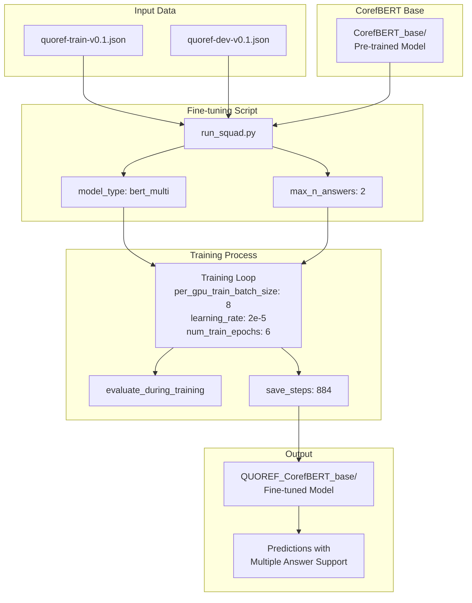
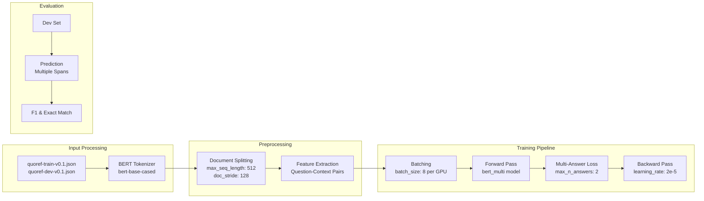
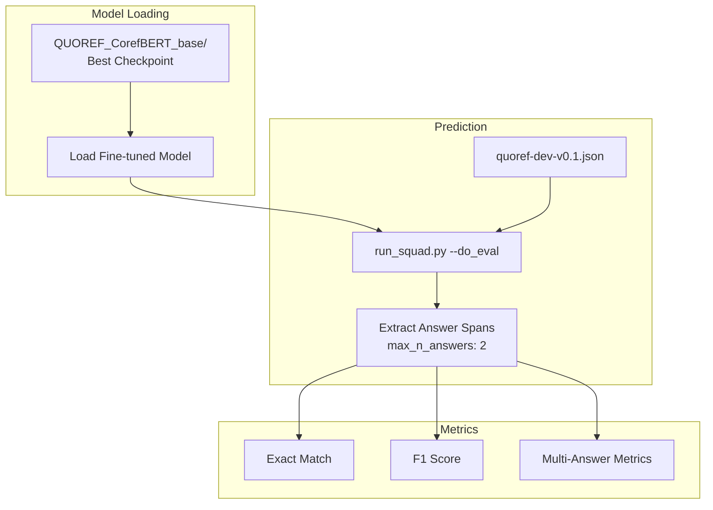
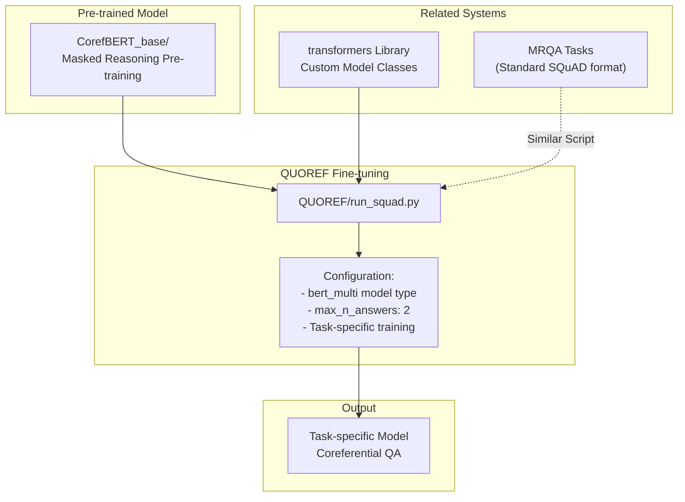

<!-- source: DeepWiki mcp.deepwiki.com · repo thunlp/CorefBERT · page 3.1 QUOREF Question Answering · fetched 2026-11-02 -->

# QUOREF Question Answering

<details>
<summary>Relevant source files</summary>

The following files were used as context for generating this wiki page:

- [README.md](README.md)
- [model.jpg](model.jpg)

</details>


This page documents the fine-tuning of CorefBERT for the QUOREF (Questions Requiring Coreferential Reasoning) task. QUOREF is a question answering dataset that specifically requires models to perform coreferential reasoning to answer questions correctly. This task demonstrates CorefBERT's effectiveness on questions that require understanding entity mentions across document contexts.

For information about other question answering tasks, see [MRQA Tasks](#3.2). For general fine-tuning architecture, see [Fine-tuning Systems](#3).

**Sources:** [README.md:52-72]()

## Dataset Overview

QUOREF is a reading comprehension dataset where questions explicitly require resolving coreferences to produce correct answers. The dataset is provided by AllenAI and consists of:

- **Training set**: `quoref-train-v0.1.json`
- **Development set**: `quoref-dev-v0.1.json`

The dataset must be downloaded from the [QUOREF leaderboard](https://leaderboard.allenai.org/quoref/submissions/get-started) and placed in the `quoref_data/` directory within the QUOREF folder.

**Sources:** [README.md:56-59]()

## System Architecture

The QUOREF fine-tuning system extends the standard question answering architecture with two specialized components:

1. **Coreferential reasoning component**: Enhanced entity tracking across the document
2. **Multiple answer handling**: Support for questions that may have multiple valid answer spans



**Diagram: QUOREF Fine-tuning Pipeline**

The system uses the `run_squad.py` script with the `bert_multi` model type, which differs from standard BERT models used in MRQA tasks. This specialized model type enables handling multiple answer spans per question.

**Sources:** [README.md:52-72]()

## Model Type: bert_multi

The QUOREF task uses `model_type bert_multi` instead of the standard `bert` model type used in MRQA tasks. This model type provides:

| Feature | Standard BERT | bert_multi |
|---------|---------------|------------|
| Answer Extraction | Single span | Multiple spans (configurable) |
| Coreferential Reasoning | Basic | Enhanced entity tracking |
| max_n_answers Parameter | Not used | Required (set to 2) |
| Use Case | Single-answer QA | Questions with multiple valid answers |

The `bert_multi` model type is specifically designed for QUOREF's requirement to handle questions where multiple answer spans may be equally valid or where the answer requires aggregating information from multiple coreferential mentions.

**Sources:** [README.md:62-67]()

## Training Configuration

### Command Line Execution

Training is performed using distributed GPU training across 4 GPUs:

```bash
CUDA_VISIBLE_DEVICES=0,1,2,3 python run_squad.py \
    --do_train \
    --evaluate_during_training \
    --model_type bert_multi \
    --model_name_or_path ../CorefBERT_base \
    --train_file quoref_data/quoref-train-v0.1.json \
    --predict_file quoref_data/quoref-dev-v0.1.json \
    --per_gpu_train_batch_size 8 \
    --per_gpu_eval_batch_size 16 \
    --learning_rate 2e-5 \
    --num_train_epochs 6 \
    --max_seq_length 512 \
    --doc_stride 128 \
    --save_steps 884 \
    --max_n_answers 2 \
    --output_dir QUOREF_CorefBERT_base
```

**Sources:** [README.md:64-67]()

### Key Parameters

| Parameter | Value | Purpose |
|-----------|-------|---------|
| `model_type` | `bert_multi` | Enables multiple answer extraction |
| `model_name_or_path` | `../CorefBERT_base` | Path to pre-trained CorefBERT model |
| `per_gpu_train_batch_size` | 8 | Batch size per GPU during training |
| `per_gpu_eval_batch_size` | 16 | Batch size per GPU during evaluation |
| `learning_rate` | 2e-5 | Training learning rate |
| `num_train_epochs` | 6 | Total number of training epochs |
| `max_seq_length` | 512 | Maximum sequence length for input |
| `doc_stride` | 128 | Stride for splitting long documents |
| `save_steps` | 884 | Save checkpoint every N steps |
| `max_n_answers` | 2 | Maximum number of answer spans to extract |
| `output_dir` | `QUOREF_CorefBERT_base` | Directory for model checkpoints |

The `max_n_answers` parameter is critical for QUOREF as it allows the model to extract up to 2 answer spans, accommodating questions that require multiple references or have multiple valid formulations.

**Sources:** [README.md:64-67]()

## Data Processing Flow



**Diagram: QUOREF Data Processing and Training Flow**

The system processes documents by:
1. Tokenizing with BERT's cased tokenizer
2. Splitting long documents into overlapping segments using `doc_stride=128`
3. Creating question-context pairs
4. Training with multi-answer loss function that supports `max_n_answers=2`

**Sources:** [README.md:64-67]()

## Evaluation Process

### Running Evaluation

Evaluation uses the same `run_squad.py` script with `--do_eval` flag:

```bash
CUDA_VISIBLE_DEVICES=0,1,2,3 python run_squad.py \
    --do_eval \
    --model_type bert_multi \
    --model_name_or_path ../CorefBERT_base \
    --train_file quoref_data/quoref-train-v0.1.json \
    --predict_file quoref_data/quoref-dev-v0.1.json \
    --per_gpu_train_batch_size 8 \
    --per_gpu_eval_batch_size 16 \
    --learning_rate 2e-5 \
    --num_train_epochs 6 \
    --max_seq_length 512 \
    --doc_stride 128 \
    --save_steps 884 \
    --max_n_answers 2 \
    --output_dir QUOREF_CorefBERT_base
```

**Sources:** [README.md:69-72]()

### Evaluation Workflow



**Diagram: QUOREF Evaluation Workflow**

The evaluation phase:
1. Loads the best checkpoint from training
2. Runs inference on the development set
3. Extracts up to 2 answer spans per question
4. Computes standard QA metrics (Exact Match, F1)
5. Evaluates multi-answer predictions

**Sources:** [README.md:69-72]()

## Integration with Fine-tuning Framework

The QUOREF system integrates with CorefBERT's broader fine-tuning framework:



**Diagram: QUOREF Integration with CorefBERT Framework**

Key integration points:
- Uses shared `run_squad.py` script with MRQA tasks but different model type
- Leverages custom transformers library for `bert_multi` model implementation
- Builds on CorefBERT's coreferential reasoning pre-training
- Outputs task-specific checkpoints compatible with evaluation pipeline

**Sources:** [README.md:52-98]()

## Directory Structure

The QUOREF system expects the following directory structure:

```
QUOREF/
├── run_squad.py              # Training and evaluation script
├── quoref_data/             # Dataset directory
│   ├── quoref-train-v0.1.json
│   └── quoref-dev-v0.1.json
└── QUOREF_CorefBERT_base/   # Output directory (created during training)
    ├── checkpoint-*/         # Periodic checkpoints
    ├── config.json          # Model configuration
    ├── pytorch_model.bin    # Model weights
    └── training_args.bin    # Training arguments
```

**Sources:** [README.md:54-72]()

## Training vs Evaluation Comparison

| Aspect | Training | Evaluation |
|--------|----------|------------|
| Primary Flag | `--do_train` | `--do_eval` |
| Secondary Flag | `--evaluate_during_training` | None |
| Purpose | Fine-tune CorefBERT on QUOREF | Assess model performance |
| Input | Training + Dev sets | Dev set only |
| Output | Model checkpoints | Predictions + metrics |
| Batch Size | 8 per GPU | 16 per GPU (larger for efficiency) |
| Epochs | 6 | N/A |
| Checkpoint Usage | Saves periodically | Loads best checkpoint |

**Sources:** [README.md:64-72]()

## Connection to Custom Transformers

The `bert_multi` model type used by QUOREF is implemented in the custom transformers library (see [Model Extensions](#4.2)). This model type extends standard BERT with:

- Multi-span answer extraction logic
- Enhanced attention mechanisms for coreferential reasoning
- Support for `max_n_answers` parameter
- Specialized loss functions for multi-answer scenarios

The implementation can be found in the transformers package, which extends Hugging Face's base classes with CorefBERT-specific functionality.

**Sources:** [README.md:8, 62-67]()

## Relation to Baseline

The README references the [official QUOREF baseline code](https://github.com/allenai/quoref-leaderboard-example) as a comparison point. CorefBERT's implementation enhances this baseline by:

1. Adding specialized coreferential reasoning components
2. Implementing multi-answer support through `max_n_answers`
3. Leveraging pre-trained coreferential knowledge from CorefBERT

These enhancements specifically target QUOREF's design goal of requiring models to perform coreferential reasoning to answer questions correctly.

**Sources:** [README.md:59-62]()

---

