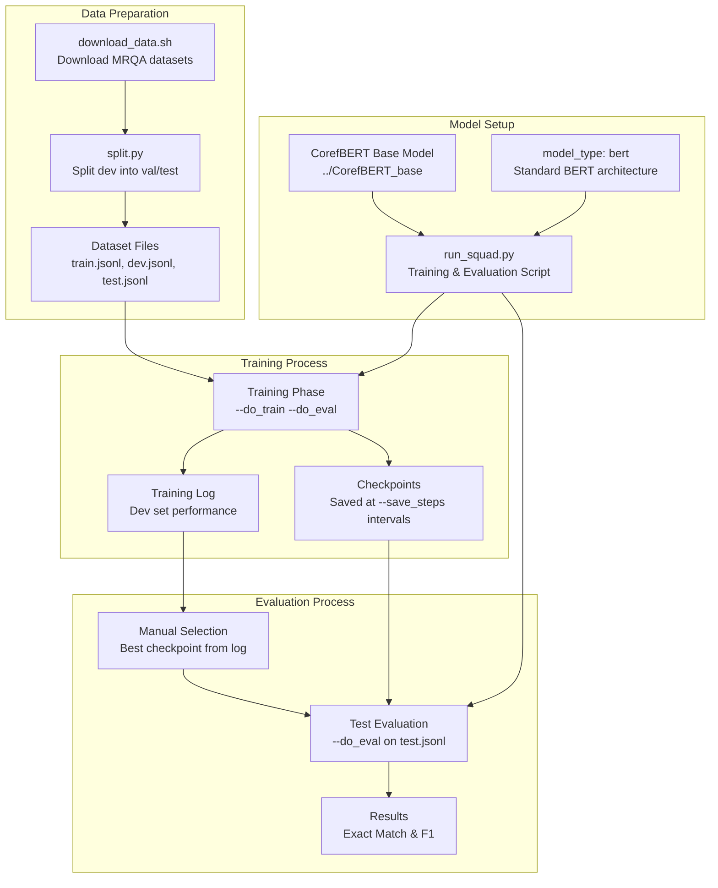
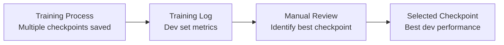
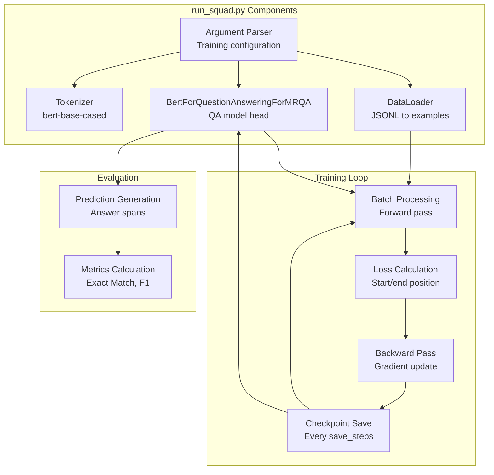

<!-- source: DeepWiki mcp.deepwiki.com · repo thunlp/CorefBERT · page 3.2 MRQA Tasks · fetched 2026-11-02 -->

# MRQA Tasks

<details>
<summary>Relevant source files</summary>

The following files were used as context for generating this wiki page:

- [README.md](README.md)
- [model.jpg](model.jpg)

</details>


## Purpose and Scope

This document covers the fine-tuning of CorefBERT on MRQA (Machine Reading for Question Answering) shared task datasets. MRQA provides a collection of question answering datasets in a unified format, allowing evaluation of model generalization across different QA domains.

For fine-tuning on the QUOREF dataset (which requires handling multiple answers and coreferential reasoning), see [QUOREF Question Answering](#3.1). For other fine-tuning tasks, see [Fine-tuning Systems](#3).

**Sources:** [README.md:74-97]()

---

## Overview

The MRQA system fine-tunes CorefBERT on multiple extractive question answering datasets from the [MRQA 2019 Shared Task](https://github.com/mrqa/MRQA-Shared-Task-2019). Unlike QUOREF which uses a specialized `bert_multi` model type for multiple answers, MRQA fine-tuning uses the standard `bert` model type.

### Supported Datasets

MRQA includes several question answering datasets:
- **SQuAD** - Stanford Question Answering Dataset
- **NewsQA** - News domain questions
- **TriviaQA** - Trivia questions from web
- **SearchQA** - Search query based QA
- **HotpotQA** - Multi-hop reasoning questions
- **NaturalQuestions** - Google search queries

All datasets follow a unified JSONL format for consistency across experiments.

**Sources:** [README.md:74-97]()

---

## System Architecture



**Diagram:** MRQA Fine-tuning Pipeline

This diagram shows the complete MRQA workflow from data preparation through evaluation. The process uses `run_squad.py` as the main training script with standard BERT architecture, unlike QUOREF which requires a specialized multi-answer variant.

**Sources:** [README.md:74-97]()

---

## Data Preparation

### Downloading MRQA Datasets

The MRQA datasets are downloaded and organized using the provided shell script:

```bash
sh download_data.sh
```

This script downloads all MRQA datasets from the official repository and organizes them into dataset-specific folders. Each dataset includes training and development files in JSONL format.

**File:** [MRQA/download_data.sh]()

### Development Set Splitting

The development sets are split into validation and test portions to enable proper model selection:

```bash
python3 split.py
```

The `split.py` script randomly divides each development set into two equal halves:
- First half becomes the new validation set (`dev.jsonl`)
- Second half becomes the test set (`test.jsonl`)

This split allows for checkpoint selection on the validation set while preserving a held-out test set for final evaluation.

**File:** [MRQA/split.py]()

**Sources:** [README.md:79-87]()

---

## Training Process

### Training Configuration

Training is executed using `run_squad.py` with the following command structure (example for SQuAD):

```bash
CUDA_VISIBLE_DEVICES=0,1,2,3 python3 run_squad.py \
    --do_train \
    --do_eval \
    --evaluate_during_training \
    --model_type bert \
    --model_name_or_path ../CorefBERT_base \
    --train_file squad/train.jsonl \
    --predict_file squad/dev.jsonl \
    --doc_stride 128 \
    --per_gpu_train_batch_size 8 \
    --per_gpu_eval_batch_size 16 \
    --learning_rate 3e-5 \
    --num_train_epochs 2 \
    --max_seq_length 512 \
    --save_steps 1500 \
    --output_dir SQuAD_CorefBERT_base
```

**File:** [MRQA/run_squad.py]()

### Key Parameters

| Parameter | Value | Purpose |
|-----------|-------|---------|
| `--model_type` | `bert` | Use standard BERT architecture (not `bert_multi`) |
| `--model_name_or_path` | `../CorefBERT_base` | Path to pre-trained CorefBERT model |
| `--doc_stride` | `128` | Stride for sliding window over long documents |
| `--per_gpu_train_batch_size` | `8` | Training batch size per GPU |
| `--per_gpu_eval_batch_size` | `16` | Evaluation batch size per GPU |
| `--learning_rate` | `3e-5` | Learning rate for fine-tuning |
| `--num_train_epochs` | `2` | Number of training epochs |
| `--max_seq_length` | `512` | Maximum sequence length in tokens |
| `--save_steps` | `1500` | Checkpoint saving frequency |
| `--evaluate_during_training` | flag | Evaluate on dev set during training |

### GPU Configuration

MRQA training uses 4 GPUs via `CUDA_VISIBLE_DEVICES=0,1,2,3`, which is sufficient for fine-tuning on task-specific datasets. This is less intensive than the 8-GPU setup required for pre-training (see [Pre-training Execution](#2.2)).

**Sources:** [README.md:89-92]()

---

## Evaluation Process

### Manual Checkpoint Selection



**Diagram:** Checkpoint Selection Workflow

The evaluation process requires manual intervention:

1. **Training produces checkpoints** at intervals specified by `--save_steps`
2. **Review training log** to find checkpoint with best development set performance
3. **Manually note** the best checkpoint directory (e.g., `checkpoint-3000`)
4. **Use selected checkpoint** for final test set evaluation

This manual selection approach ensures the model generalizes well to unseen data without overfitting to the test set.

### Test Set Evaluation

After selecting the best checkpoint, evaluate on the test set:

```bash
CUDA_VISIBLE_DEVICES=0,1,2,3 python3 run_squad.py \
    --do_eval \
    --model_type bert \
    --model_name_or_path ../CorefBERT_base \
    --train_file squad/train.jsonl \
    --predict_file squad/test.jsonl \
    --doc_stride 128 \
    --per_gpu_train_batch_size 8 \
    --per_gpu_eval_batch_size 16 \
    --learning_rate 3e-5 \
    --num_train_epochs 2 \
    --max_seq_length 512 \
    --save_steps 1500 \
    --output_dir SQuAD_CorefBERT_base
```

Key differences from training command:
- Only `--do_eval` flag (no `--do_train`)
- `--predict_file` points to `test.jsonl` instead of `dev.jsonl`
- Output directory should contain the selected checkpoint

**Sources:** [README.md:94-97]()

---

## Training Script Details



**Diagram:** run_squad.py Internal Architecture

The `run_squad.py` script handles:
- **Model initialization** using `model_type=bert` with `BertForQuestionAnsweringForMRQA`
- **Data loading** from JSONL format
- **Training loop** with periodic checkpointing
- **Evaluation** during and after training

**File:** [MRQA/run_squad.py]()

**Sources:** [README.md:89-97]()

---

## Differences from QUOREF

| Aspect | MRQA | QUOREF |
|--------|------|--------|
| **Model Type** | `bert` | `bert_multi` |
| **Multiple Answers** | Single answer per question | Up to 2 answers (`--max_n_answers 2`) |
| **Model Class** | `BertForQuestionAnsweringForMRQA` | `BertForQuestionAnsweringForQUOREF` |
| **Training Epochs** | 2 epochs | 6 epochs |
| **Learning Rate** | `3e-5` | `2e-5` |
| **Save Steps** | `1500` | `884` |
| **Coreferential Components** | Standard QA head | Additional coreferential reasoning components |
| **Script Location** | `MRQA/run_squad.py` | `QUOREF/run_squad.py` |

The key distinction is that MRQA uses standard extractive QA approaches, while QUOREF requires specialized handling for coreferential reasoning and multiple answer extraction. Both share the same script name (`run_squad.py`) but with different implementations in their respective directories.

**Sources:** [README.md:64-72](), [README.md:89-97]()

---

## Dataset-Specific Training

To train on different MRQA datasets, modify the `--train_file` and `--predict_file` parameters:

### SQuAD Example
```bash
--train_file squad/train.jsonl \
--predict_file squad/dev.jsonl \
--output_dir SQuAD_CorefBERT_base
```

### NewsQA Example
```bash
--train_file newsqa/train.jsonl \
--predict_file newsqa/dev.jsonl \
--output_dir NewsQA_CorefBERT_base
```

### TriviaQA Example
```bash
--train_file triviaqa/train.jsonl \
--predict_file triviaqa/dev.jsonl \
--output_dir TriviaQA_CorefBERT_base
```

All other parameters typically remain consistent across datasets, though learning rate and number of epochs may require dataset-specific tuning for optimal performance.

**Sources:** [README.md:89-97]()

---

## File Organization

```
MRQA/
├── download_data.sh          # Dataset download script
├── split.py                  # Dev set splitting utility
├── run_squad.py              # Main training & evaluation script
├── squad/
│   ├── train.jsonl          # SQuAD training data
│   ├── dev.jsonl            # SQuAD validation data
│   └── test.jsonl           # SQuAD test data
├── newsqa/
│   ├── train.jsonl
│   ├── dev.jsonl
│   └── test.jsonl
└── [other datasets]/
    └── ...
```

Each dataset maintains a consistent structure with `train.jsonl`, `dev.jsonl`, and `test.jsonl` files, enabling unified training and evaluation across all MRQA tasks.

**Sources:** [README.md:74-97]()

---

