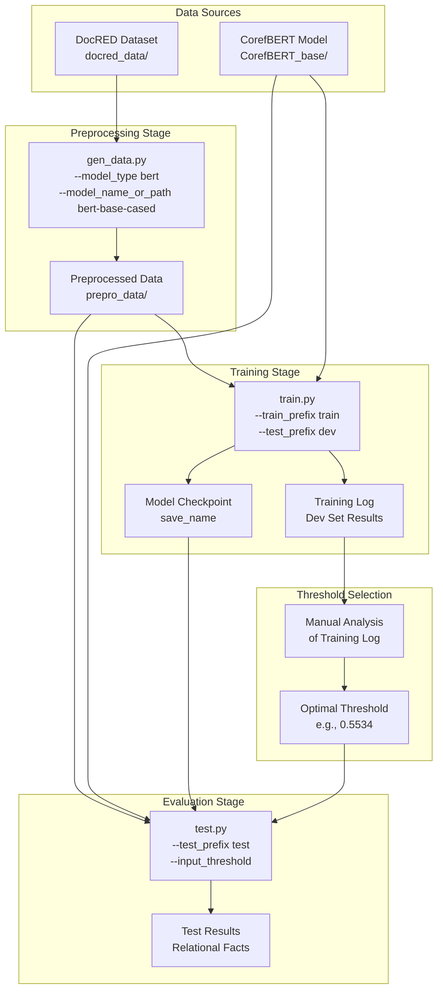
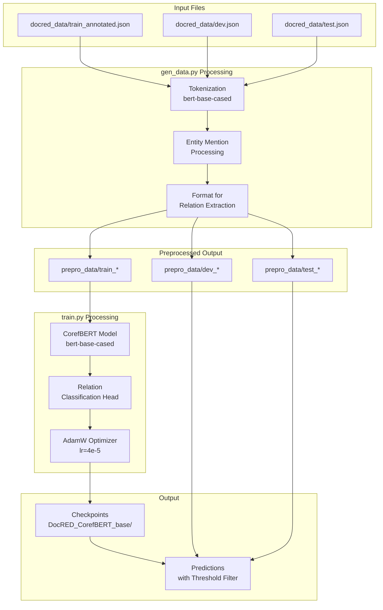

<!-- source: DeepWiki mcp.deepwiki.com · repo thunlp/CorefBERT · page 3.3 DocRED Relation Extraction · fetched 2026-11-02 -->

# DocRED Relation Extraction

<details>
<summary>Relevant source files</summary>

The following files were used as context for generating this wiki page:

- [README.md](README.md)
- [model.jpg](model.jpg)

</details>


## Purpose and Scope

This document covers the fine-tuning of CorefBERT for document-level relation extraction on the DocRED dataset. DocRED (Document-level Relation Extraction Dataset) requires models to identify relations between entities across multiple sentences within a document, making it particularly suitable for evaluating coreferential reasoning capabilities.

For other fine-tuning tasks, see [QUOREF Question Answering](#3.1), [MRQA Tasks](#3.2), and [FEVER Fact Verification](#3.4). For general fine-tuning architecture patterns, see [Fine-tuning Systems](#3).

**Sources:** [README.md:99-120]()

---

## Overview

The DocRED fine-tuning system adapts the [official DocRED implementation](https://github.com/thunlp/DocRED) to support BERT-based models. A distinctive feature of this task is the **threshold selection process**: after training, the optimal prediction probability threshold must be manually determined from training logs to filter predicted relational facts during evaluation.

The system consists of three main components:
- **Data preprocessing** (`gen_data.py`): Converts raw DocRED data into BERT-compatible format
- **Training** (`train.py`): Fine-tunes CorefBERT on relation extraction
- **Testing** (`test.py`): Evaluates the model with a specified threshold

All code resides in the `DocRED/` directory.

**Sources:** [README.md:101-120]()

---

## DocRED Pipeline Architecture



**Diagram:** DocRED fine-tuning pipeline showing the progression from raw data through preprocessing, training, threshold selection, and evaluation.

**Sources:** [README.md:99-120]()

---

## Data Preparation

### Dataset Acquisition

The DocRED dataset must be downloaded from the [official repository](https://github.com/thunlp/DocRED/tree/master/data) and placed in the `docred_data/` directory.

### Preprocessing

The `gen_data.py` script converts raw DocRED data into preprocessed format suitable for BERT-based models:

```bash
python3 gen_data.py \
    --model_type bert \
    --model_name_or_path bert-base-cased \
    --data_dir docred_data \
    --output_dir prepro_data \
    --max_seq_length 512
```

#### Preprocessing Parameters

| Parameter | Value | Description |
|-----------|-------|-------------|
| `--model_type` | `bert` | Specifies BERT architecture |
| `--model_name_or_path` | `bert-base-cased` | Base tokenizer configuration |
| `--data_dir` | `docred_data` | Input directory with raw DocRED files |
| `--output_dir` | `prepro_data` | Output directory for preprocessed data |
| `--max_seq_length` | `512` | Maximum sequence length for BERT input |

The preprocessing step tokenizes documents, handles entity mentions, and formats data for the relation extraction task.

**Sources:** [README.md:107-110]()

---

## Training Process

### Training Configuration

Training uses the preprocessed data and a CorefBERT checkpoint:

```bash
CUDA_VISIBLE_DEVICES=0,1,2,3 python3 train.py \
    --model_type bert \
    --model_name_or_path ../CorefBERT_base \
    --train_prefix train \
    --test_prefix dev \
    --evaluate_during_training_epoch 5 \
    --prepro_data_dir prepro_data \
    --max_seq_length 512 \
    --batch_size 32 \
    --learning_rate 4e-5 \
    --num_train_epochs 200 \
    --save_name DocRED_CorefBERT_base
```

### Training Parameters

| Parameter | Value | Description |
|-----------|-------|-------------|
| `--model_type` | `bert` | Model architecture type |
| `--model_name_or_path` | `../CorefBERT_base` | Pre-trained CorefBERT checkpoint |
| `--train_prefix` | `train` | Training data prefix in `prepro_data_dir` |
| `--test_prefix` | `dev` | Development data prefix for evaluation |
| `--evaluate_during_training_epoch` | `5` | Evaluate on dev set every 5 epochs |
| `--prepro_data_dir` | `prepro_data` | Directory with preprocessed data |
| `--max_seq_length` | `512` | Maximum input sequence length |
| `--batch_size` | `32` | Training batch size across all GPUs |
| `--learning_rate` | `4e-5` | Learning rate for optimizer |
| `--num_train_epochs` | `200` | Total training epochs |
| `--save_name` | `DocRED_CorefBERT_base` | Output directory for checkpoints |

### Multi-GPU Training

The training script uses 4 GPUs (`CUDA_VISIBLE_DEVICES=0,1,2,3`) with a batch size of 32, effectively distributing 8 samples per GPU.

**Sources:** [README.md:112-115]()

---

## Threshold Selection Process

A critical and distinctive aspect of DocRED evaluation is **threshold selection**. The model outputs prediction probabilities for potential relations, and a threshold determines which predictions are retained as final relational facts.

```mermaid
graph LR
    subgraph "During Training"
        TRAINLOOP["Training Loop<br/>200 epochs"]
        DEVEVAL["Dev Set Evaluation<br/>Every 5 epochs"]
        TRAINLOG["Training Log<br/>Dev Results with<br/>Various Thresholds"]
    end
    
    subgraph "Manual Selection"
        ANALYZE["Analyze Training Log"]
        IDENTIFY["Identify Best<br/>Threshold Value"]
        THRESHOLD["Selected Threshold<br/>Example: 0.5534"]
    end
    
    subgraph "Test Evaluation"
        TESTSCRIPT["test.py<br/>--input_threshold"]
        FILTER["Filter Predictions<br/>prob >= threshold"]
        TESTRESULTS["Final Test Results"]
    end
    
    TRAINLOOP --> DEVEVAL
    DEVEVAL --> TRAINLOG
    TRAINLOG --> ANALYZE
    ANALYZE --> IDENTIFY
    IDENTIFY --> THRESHOLD
    THRESHOLD --> TESTSCRIPT
    TESTSCRIPT --> FILTER
    FILTER --> TESTRESULTS
```



**Diagram:** Threshold selection workflow showing how the optimal threshold is determined from training logs and applied during test evaluation.

### Process Steps

1. **Training with Periodic Evaluation**: During training, the model is evaluated on the development set every 5 epochs (`--evaluate_during_training_epoch 5`). The training log records performance metrics at different prediction thresholds.

2. **Log Analysis**: After training completes, manually inspect the training log to identify which threshold yields the best F1 score on the development set.

3. **Threshold Application**: The selected threshold (e.g., `0.5534` in the example) is passed to the test script via `--input_threshold`.

### Example Threshold

The README demonstrates threshold selection with value `0.5534`, though the actual optimal threshold varies based on training dynamics and should be determined from your specific training run.

**Sources:** [README.md:117-120]()

---

## Evaluation

### Test Set Evaluation

Once the optimal threshold is determined, evaluate on the test set:

```bash
CUDA_VISIBLE_DEVICES=0,1,2,3 python3 test.py \
    --model_type bert \
    --model_name_or_path ../CorefBERT_base \
    --test_prefix test \
    --prepro_data_dir prepro_data \
    --max_seq_length 512 \
    --batch_size 32 \
    --save_name DocRED_CorefBERT_base \
    --input_threshold 0.5534
```

### Evaluation Parameters

| Parameter | Value | Description |
|-----------|-------|-------------|
| `--model_type` | `bert` | Model architecture type |
| `--model_name_or_path` | `../CorefBERT_base` | Pre-trained CorefBERT checkpoint |
| `--test_prefix` | `test` | Test data prefix in `prepro_data_dir` |
| `--prepro_data_dir` | `prepro_data` | Directory with preprocessed data |
| `--max_seq_length` | `512` | Maximum input sequence length |
| `--batch_size` | `32` | Evaluation batch size |
| `--save_name` | `DocRED_CorefBERT_base` | Directory containing trained checkpoint |
| `--input_threshold` | `0.5534` | Prediction probability threshold |

The test script loads the trained model checkpoint from the `--save_name` directory and generates predictions filtered by the specified threshold.

**Sources:** [README.md:117-120]()

---

## Data Flow Architecture



**Diagram:** Data flow from raw DocRED files through preprocessing, training, and evaluation stages, showing key processing components.

**Sources:** [README.md:99-120]()

---

## Key Configuration Summary

### File Locations

| Component | Location |
|-----------|----------|
| Code directory | `DocRED/` |
| Raw data | `docred_data/` |
| Preprocessed data | `prepro_data/` |
| Model checkpoint | `../CorefBERT_base` |
| Training output | `DocRED_CorefBERT_base/` |

### Script Overview

| Script | Purpose | Key Parameters |
|--------|---------|----------------|
| `gen_data.py` | Preprocess raw DocRED data | `--model_type`, `--data_dir`, `--output_dir`, `--max_seq_length` |
| `train.py` | Fine-tune CorefBERT | `--model_name_or_path`, `--prepro_data_dir`, `--batch_size`, `--learning_rate`, `--num_train_epochs` |
| `test.py` | Evaluate with threshold | `--test_prefix`, `--save_name`, `--input_threshold` |

### Training Specifications

- **GPU Configuration**: 4 GPUs (`CUDA_VISIBLE_DEVICES=0,1,2,3`)
- **Batch Size**: 32 total (8 per GPU)
- **Learning Rate**: 4e-5
- **Training Epochs**: 200
- **Development Evaluation**: Every 5 epochs
- **Sequence Length**: 512 tokens

**Sources:** [README.md:99-120]()

---

## Implementation Notes

### Relation to Official DocRED

The implementation modifies the [official DocRED code](https://github.com/thunlp/DocRED) to support BERT-based models. The original DocRED implementation uses BiLSTM architectures; this adaptation integrates BERT encoders for improved representation learning, particularly benefiting from CorefBERT's coreferential reasoning capabilities.

### Comparison with Other Tasks

Unlike QUOREF (see [#3.1](#3.1)) which uses `run_squad.py` with `--model_type bert_multi`, or MRQA tasks (see [#3.2](#3.2)) which use standard BERT fine-tuning, DocRED requires:
1. **Custom preprocessing** via `gen_data.py` for document-level inputs
2. **Task-specific training script** (`train.py`) rather than shared scripts
3. **Manual threshold selection** based on development set performance

This reflects DocRED's unique characteristics as a document-level relation extraction task requiring entity pair classification across long contexts.

**Sources:** [README.md:99-120]()

---

